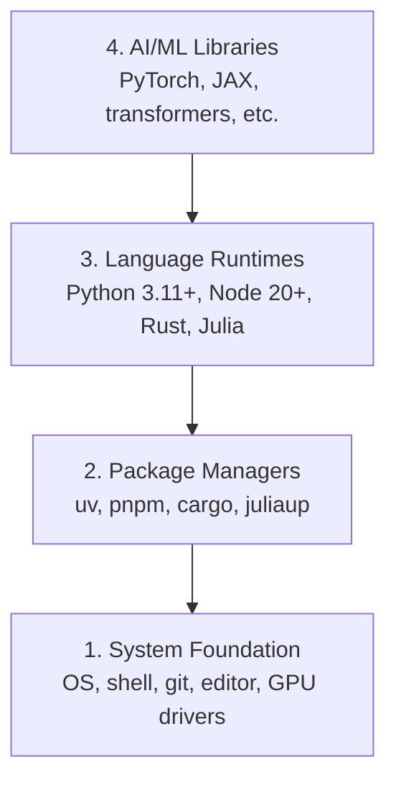

# Lingkungan Pengembangan

> Peralatanmu membentuk cara berpikirmu. Siapkan sekali, siapkan dengan benar.

**Type:** Build
**Languages:** Python, Node.js, Rust
**Prerequisites:** None
**Time:** ~45 minutes

## Tujuan Pembelajaran

- Siapkan toolchain Python 3.11+, Node.js 20+, dan Rust dari nol
- Konfigurasikan virtual environment dan package manager agar build dapat direproduksi
- Verifikasi akses GPU dengan CUDA/MPS dan jalankan satu operasi tensor uji
- Pahami stack empat lapis: sistem, paket, runtime, pustaka AI

## Masalahnya

Kamu akan belajar AI engineering lewat 500+ pelajaran memakai Python, TypeScript, Rust, dan Julia. Kalau environment-mu rusak, setiap pelajaran berubah menjadi perang melawan tooling, bukan belajar.

Kebanyakan orang melewatkan setup environment. Lalu mereka menghabiskan berjam-jam men-debug import error, konflik versi, dan driver CUDA yang hilang. Kita kerjakan sekali, dengan benar.

## Konsepnya

Sebuah environment AI engineering punya empat lapisan:



Kita menginstal dari bawah ke atas. Setiap lapisan bergantung pada lapisan di bawahnya.

```figure
s0-env-stack
```

## Bangun Sendiri

### Langkah 1: Fondasi Sistem

Cek sistemmu dan instal hal-hal dasar.

```bash
# macOS
xcode-select --install
brew install git curl wget

# Ubuntu/Debian
sudo apt update && sudo apt install -y build-essential git curl wget unzip

# Windows (use WSL2)
wsl --install -d Ubuntu-24.04
```

### Langkah 2: Python dengan uv

Kita memakai `uv` — 10-100x lebih cepat daripada pip dan menangani virtual environment secara otomatis.

```bash
curl -LsSf https://astral.sh/uv/install.sh | sh

uv python install 3.12

uv venv
source .venv/bin/activate  # or .venv\Scripts\activate on Windows

uv pip install numpy matplotlib jupyter
```

Verifikasi:

```python
import sys
print(f"Python {sys.version}")

import numpy as np
print(f"NumPy {np.__version__}")
a = np.array([1, 2, 3])
print(f"Vector: {a}, dot product with itself: {np.dot(a, a)}")
```

### Langkah 3: Node.js dengan pnpm

Untuk pelajaran TypeScript (agen, server MCP, aplikasi web).

```bash
curl -fsSL https://fnm.vercel.app/install | bash
fnm install 22
fnm use 22

npm install -g pnpm

node -e "console.log('Node', process.version)"
```

Installer fnm memeriksa `unzip` lebih dulu dan berhenti dengan `Not installing fnm due to missing dependencies.` kalau `unzip` tidak ada: di Linux ia mengekstrak arsip zip, di macOS ia menginstal lewat Homebrew. macOS sudah membawa `unzip`; Ubuntu, Debian, dan WSL2 mendapatkannya dari baris apt di Langkah 1 (`sudo apt install -y unzip` kalau kamu melewatkan langkah itu).

**macOS / Apple Silicon (M1/M2/M3/M4):** Kalau installer berhenti dengan `Error: Cannot install under Rosetta 2 in ARM default prefix (/opt/homebrew)`, terminalmu berjalan di bawah Rosetta 2 (`arch` mencetak `i386`) sementara Homebrew adalah build arm64 native. Instal fnm dengan memaksa arm64, sambungkan ke shell-mu, lalu ulangi perintah di atas mulai dari `fnm install 22`:

```bash
arch -arm64 brew install fnm
echo 'eval "$(fnm env --use-on-cd)"' >> ~/.zshrc
source ~/.zshrc
```

### Langkah 4: Rust

Untuk pelajaran yang kritis performa (inference, systems).

```bash
curl --proto '=https' --tlsv1.2 -sSf https://sh.rustup.rs | sh

rustc --version
cargo --version
```

### Langkah 5: Julia (Opsional)

Untuk pelajaran yang sarat matematika, di mana Julia bersinar.

```bash
curl -fsSL https://install.julialang.org | sh

julia -e 'println("Julia ", VERSION)'
```

### Langkah 6: Setup GPU (Kalau Punya)

**NVIDIA (Linux / Windows):**

```bash
nvidia-smi

# Install PyTorch with CUDA
uv pip install torch torchvision torchaudio --index-url https://download.pytorch.org/whl/cu124
```

**macOS / Apple Silicon (M1/M2/M3/M4):** Tidak ada CUDA di Mac — itu wajar, bukan kegagalan. **Jangan** menambahkan `--index-url .../cuXXX` (wheel tersebut hanya untuk Linux/Windows, jadi instalasi gagal). Instal build biasa, yang sudah menyertakan backend GPU MPS (Metal) milik Apple:

```bash
uv pip install torch torchvision torchaudio
```

Verifikasi (berjalan di semua platform):

```python
import torch
print(f"CUDA available: {torch.cuda.is_available()}")           # False on macOS — expected
print(f"MPS available:  {torch.backends.mps.is_available()}")   # True on Apple Silicon
if torch.cuda.is_available():
    print(f"GPU: {torch.cuda.get_device_name(0)}")
```

Tidak punya GPU? Tidak masalah. Kebanyakan pelajaran berjalan di CPU. Untuk pelajaran training yang berat, pakai Google Colab atau GPU cloud.

### Langkah 7: Verifikasi rute yang ingin kamu mulai

Jalankan setiap perintah di pelajaran ini dari root repositori, direktori yang berisi `README.md` dan `phases/`. Preflight hanya memeriksa apa yang kamu butuhkan untuk memulai rute yang dipilih. Ia melewatkan tool lanjutan secara default supaya pembelajar baru melihat satu jawaban yang jelas, bukan tembok peringatan.

Mulai rangkaian pemula secara penuh:

```bash
python3 phases/00-setup-and-tooling/01-dev-environment/code/verify.py --route beginner
```

Atau cek hanya rute yang kamu mau:

```bash
python3 phases/00-setup-and-tooling/01-dev-environment/code/verify.py --route ml-foundations
python3 phases/00-setup-and-tooling/01-dev-environment/code/verify.py --route llm-engineering
python3 phases/00-setup-and-tooling/01-dev-environment/code/verify.py --route agents
python3 phases/00-setup-and-tooling/01-dev-environment/code/verify.py --route mcp
python3 phases/00-setup-and-tooling/01-dev-environment/code/verify.py --route agent-skills
python3 phases/00-setup-and-tooling/01-dev-environment/code/verify.py --route certification
```

Tambahkan `--show-later` kalau kamu ingin preflight yang sama memeriksa tool opsional dan dependensi yang dipakai pelajaran lanjutan. Tool lanjutan yang hilang tidak pernah memblokir rute yang dipilih.

Setiap cek wajib yang gagal menyertakan path atau import error yang terdeteksi beserta perintah perbaikan yang tepat. Rute Agent Skills dan sertifikasi juga menampilkan cek host manual karena skrip Python tidak bisa membuktikan bahwa sebuah host AI telah menemukan sebuah skill atau bahwa scope skill pilihanmu bisa ditulisi.

Ketika preflight pemula lolos, ia mencetak pelajaran runnable pertama yang tepat:

```text
Ready to start Beginner course.
Next: python3 phases/01-math-foundations/01-linear-algebra-intuition/code/vectors.py
```

## Gunakan

Environment-mu siap untuk memulai rute yang kamu cek. Instal tool lanjutan ketika ada pelajaran yang memintanya, jangan sampai pelajaran pertamamu terhambat seluruh stack. Berikut yang akan kamu pakai di seluruh kurikulum:

| Language | Used In | Package Manager |
|----------|---------|-----------------|
| Python | Phases 1-12 (ML, DL, NLP, Vision, Audio, LLMs) | uv |
| TypeScript | Phases 13-17 (Tools, Agents, Swarms, Infra) | pnpm |
| Rust | Phases 12, 15-17 (Performance-critical systems) | cargo |
| Julia | Phase 1 (Math foundations) | Pkg |

## Rilis

Pelajaran ini menghasilkan skrip verifikasi yang bisa dijalankan siapa pun untuk memeriksa setup mereka.

Lihat `outputs/prompt-env-check.md` untuk prompt yang membantu asisten AI mendiagnosis masalah environment.

## Latihan

1. Jalankan skrip verifikasi dan perbaiki setiap kegagalan
2. Buat Python virtual environment untuk kursus ini dan instal PyTorch
3. Tulis "hello world" di keempat bahasa dan jalankan masing-masing
