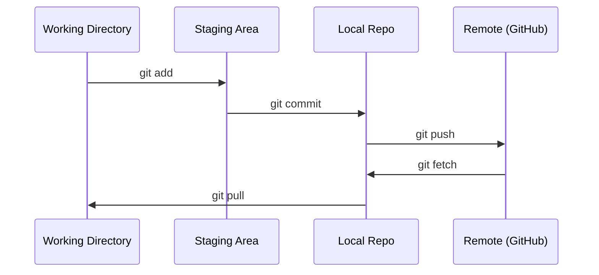

# Git & Kolaborasi

> Version control bukan opsional. Setiap eksperimen, setiap model, setiap pelajaran yang kamu bangun di sini wajib dilacak.

**Type:** Learn
**Languages:** --
**Prerequisites:** Phase 0, Lesson 01
**Time:** ~30 minutes

## Tujuan Pembelajaran

- Konfigurasikan identitas git dan gunakan alur kerja harian add, commit, dan push
- Buat dan gabungkan branch untuk eksperimen yang terisolasi tanpa merusak main
- Tulis `.gitignore` yang mengecualikan checkpoint model dan file biner besar
- Telusuri riwayat commit dengan `git log` untuk memahami evolusi proyek

## Masalahnya

Kamu akan menulis ratusan file kode di 20 fase. Tanpa version control kamu akan kehilangan pekerjaan, merusak hal yang tidak bisa dibatalkan, dan tidak punya cara untuk berkolaborasi dengan orang lain.

Git adalah tool-nya. GitHub adalah tempat kode tinggal. Pelajaran ini membahas apa yang kamu butuhkan untuk kursus ini, tidak lebih.

## Konsepnya



Tiga hal yang perlu diingat:
1. Simpan sesering mungkin (`git commit`)
2. Push ke remote (`git push`)
3. Buat branch untuk eksperimen (`git checkout -b experiment`)

```figure
s0-commit-dag
```

## Bangun Sendiri

### Langkah 1: Konfigurasikan git

```bash
git config --global user.name "Your Name"
git config --global user.email "you@example.com"
```

### Langkah 2: Alur kerja harian

```bash
git status
git add file.py
git commit -m "Add perceptron implementation"
git push origin main
```

### Langkah 3: Branching untuk eksperimen

```bash
git checkout -b experiment/new-optimizer

# ... make changes, commit ...

git checkout main
git merge experiment/new-optimizer
```

### Langkah 4: Bekerja dengan repo kursus ini

Kamu tidak bisa push ke repo kursus itu sendiri — hanya maintainer yang punya akses tulis. Fork dulu di GitHub (tombol Fork, kanan atas) supaya `origin` menunjuk ke salinan milikmu sendiri:

```bash
git clone https://github.com/YOUR-USERNAME/ai-engineering-from-scratch.git
cd ai-engineering-from-scratch

git checkout -b my-progress
# work through lessons, commit your code
git push origin my-progress
```

## Gunakan

Untuk kursus ini, kamu hanya butuh perintah-perintah ini:

| Command | When |
|---------|------|
| `git clone` | Get the course repo |
| `git add` + `git commit` | Save your work |
| `git push` | Back it up to GitHub |
| `git checkout -b` | Try something without breaking main |
| `git log --oneline` | See what you've done |

Cuma itu. Kamu tidak butuh rebase, cherry-pick, atau submodule untuk kursus ini.

## Latihan

1. Fork repo ini, clone fork-mu, buat branch bernama `my-progress`, buat satu file, commit, lalu push
2. Buat `.gitignore` yang mengecualikan file checkpoint model (`.pt`, `.pth`, `.safetensors`)
3. Lihat riwayat commit repo ini dengan `git log --oneline` dan baca bagaimana pelajaran-pelajaran ditambahkan

## Istilah Kunci

| Term | What people say | What it actually means |
|------|----------------|----------------------|
| Commit | "Saving" | A snapshot of your entire project at a point in time |
| Branch | "A copy" | A pointer to a commit that moves forward as you work |
| Merge | "Combining code" | Taking changes from one branch and applying them to another |
| Remote | "The cloud" | A copy of your repo hosted somewhere else (GitHub, GitLab) |
