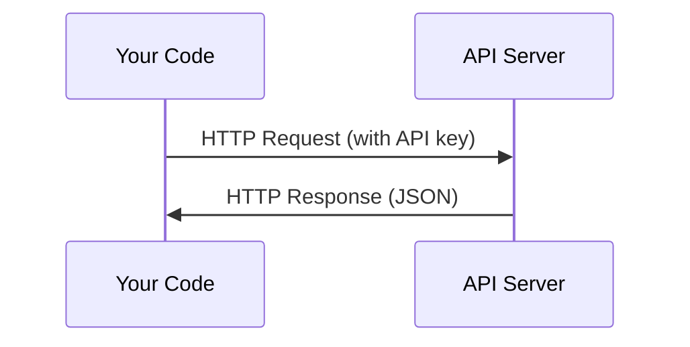

# API & Key

> Setiap API AI bekerja dengan cara yang sama: kirim request, terima response. Detailnya berubah, polanya tidak.

**Type:** Build
**Languages:** Python, TypeScript
**Prerequisites:** Phase 0, Lesson 01
**Time:** ~30 minutes

## Tujuan Pembelajaran

- Simpan API key dengan aman memakai environment variable dan file `.env`
- Lakukan panggilan API LLM memakai Anthropic Python SDK sekaligus HTTP mentah
- Bandingkan format request/response versi SDK dan versi HTTP mentah untuk debugging
- Kenali dan tangani error API yang umum termasuk autentikasi dan rate limit

## Masalahnya

Mulai Fase 11, kamu akan memanggil API LLM (Anthropic, OpenAI, Google). Di Fase 13-16 kamu akan membangun agen yang memakai API ini dalam loop. Kamu perlu tahu cara kerja API key, cara menyimpannya dengan aman, dan cara melakukan panggilan API pertamamu.

## Konsepnya



Setiap panggilan API punya:
1. Endpoint (URL)
2. API key (autentikasi)
3. Request body (apa yang kamu mau)
4. Response body (apa yang kamu dapat)

```figure
s0-secret-inject
```

## Bangun Sendiri

### Langkah 1: Simpan API key dengan aman

Jangan pernah menaruh API key di kode. Gunakan environment variable.

```bash
export ANTHROPIC_API_KEY="sk-ant-..."
export OPENAI_API_KEY="sk-..."
```

Atau pakai file `.env` (tambahkan ke `.gitignore`):

```
ANTHROPIC_API_KEY=sk-ant-...
OPENAI_API_KEY=sk-...
```

### Langkah 2: Panggilan API pertama (Python)

```python
import os

import anthropic

client = anthropic.Anthropic()

MODEL = os.environ.get("LLM_MODEL", "claude-sonnet-5")

response = client.messages.create(
    model=MODEL,
    max_tokens=256,
    messages=[{"role": "user", "content": "What is a neural network in one sentence?"}]
)

print(response.content[0].text)
```

`LLM_MODEL` memilih model id Anthropic, dan default-nya adalah alias Sonnet tanpa tanggal. Provider lain (OpenAI, Google, dan lainnya) memakai pola yang sama yaitu key plus model id, tetapi masing-masing punya SDK, endpoint, dan skema request/response sendiri.

### Langkah 3: Panggilan API pertama (TypeScript)

```typescript
import Anthropic from "@anthropic-ai/sdk";

const client = new Anthropic();

const MODEL = process.env.LLM_MODEL ?? "claude-sonnet-5";

const response = await client.messages.create({
  model: MODEL,
  max_tokens: 256,
  messages: [{ role: "user", content: "What is a neural network in one sentence?" }],
});

console.log(response.content[0].text);
```

### Langkah 4: HTTP mentah (tanpa SDK)

```python
import os
import urllib.request
import json

url = "https://api.anthropic.com/v1/messages"
headers = {
    "Content-Type": "application/json",
    "x-api-key": os.environ["ANTHROPIC_API_KEY"],
    "anthropic-version": "2023-06-01",
}
body = json.dumps({
    "model": os.environ.get("LLM_MODEL", "claude-sonnet-5"),
    "max_tokens": 256,
    "messages": [{"role": "user", "content": "What is a neural network in one sentence?"}],
}).encode()

req = urllib.request.Request(url, data=body, headers=headers, method="POST")
with urllib.request.urlopen(req) as resp:
    result = json.loads(resp.read())
    print(result["content"][0]["text"])
```

Inilah yang dilakukan SDK di balik layar. Memahami panggilan HTTP mentah membantumu saat debugging.

## Gunakan

Untuk kursus ini:

| API | When you need it | Free tier |
|-----|-----------------|-----------|
| Anthropic (Claude) | Phases 11-16 (agents, tools) | $5 credit on signup |
| OpenAI | Phase 11 (comparison) | $5 credit on signup |
| Hugging Face | Phases 4-10 (models, datasets) | Free |

Kamu tidak butuh semuanya sekarang. Siapkan saat ada pelajaran yang memintanya.

## Rilis

Pelajaran ini menghasilkan:
- `outputs/prompt-api-troubleshooter.md` - mendiagnosis error API yang umum

## Latihan

1. Dapatkan Anthropic API key dan lakukan panggilan API pertamamu
2. Coba versi HTTP mentah dan bandingkan format response-nya dengan versi SDK
3. Sengaja pakai API key yang salah dan baca pesan error-nya

## Istilah Kunci

| Term | What people say | What it actually means |
|------|----------------|----------------------|
| API key | "Password for the API" | A unique string that identifies your account and authorizes requests |
| Rate limit | "They're throttling me" | Maximum requests per minute/hour to prevent abuse and ensure fair usage |
| Token | "A word" (in API context) | A billing unit: input and output tokens are counted and charged separately |
| Streaming | "Real-time responses" | Getting the response word by word instead of waiting for the full response |
