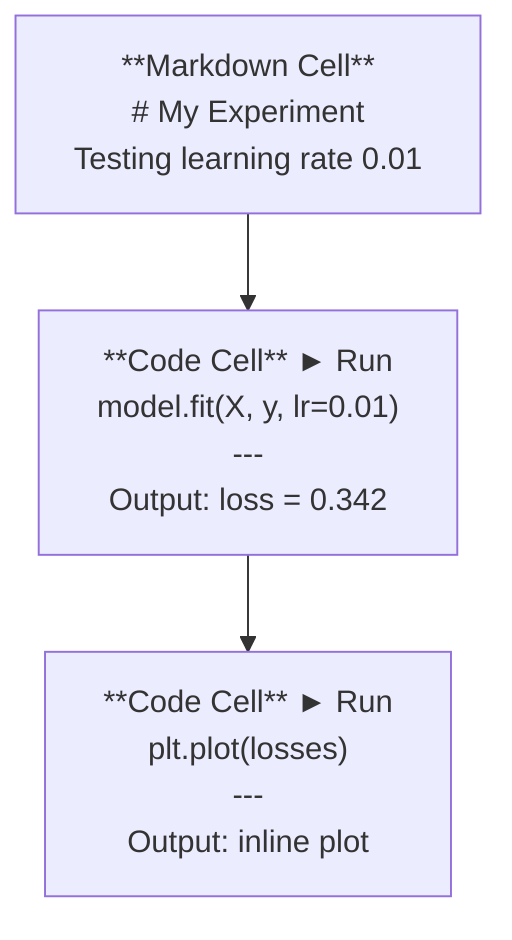
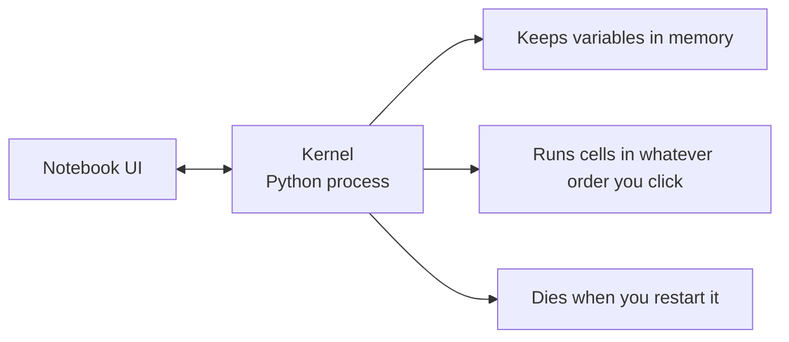

# Jupyter Notebook

> Notebook adalah meja lab AI engineering. Kamu membuat prototipe di sini, lalu memindahkan yang berhasil ke production.

**Type:** Build
**Languages:** Python
**Prerequisites:** Phase 0, Lesson 01
**Time:** ~30 minutes

## Tujuan Pembelajaran

- Instal dan jalankan JupyterLab, Jupyter Notebook, atau VS Code dengan ekstensi Jupyter
- Gunakan magic command (`%timeit`, `%%time`, `%matplotlib inline`) untuk benchmark dan visualisasi inline
- Bedakan kapan memakai notebook vs skrip dan terapkan alur kerja "eksplorasi di notebook, rilis di skrip"
- Kenali dan hindari jebakan umum notebook: eksekusi yang tidak berurutan, hidden state, dan kebocoran memori

## Masalahnya

Setiap paper AI, tutorial, dan kompetisi Kaggle memakai Jupyter notebook. Notebook membuatmu bisa menjalankan kode per bagian, melihat output secara inline, mencampur kode dengan penjelasan, dan iterasi dengan cepat. Kalau kamu belajar AI tanpa notebook, itu seperti mengerjakan PR matematika tanpa kertas coretan.

Tapi notebook punya jebakan nyata. Orang memakainya untuk segalanya, termasuk hal yang justru buruk dilakukan di notebook. Tahu kapan memakai notebook dan kapan memakai skrip akan menyelamatkanmu dari mimpi buruk debugging nanti.

## Konsepnya

Notebook adalah daftar cell. Setiap cell berupa kode atau teks.



Kernel adalah proses Python yang berjalan di background. Saat kamu menjalankan cell, ia mengirim kode ke kernel, kernel mengeksekusinya dan mengembalikan hasilnya. Semua cell memakai kernel yang sama, jadi variabel bertahan antar cell.



Bagian "urutan apa pun yang kamu klik" itu adalah superpower sekaligus senjata makan tuan.

```figure
s0-cell-order
```

## Bangun Sendiri

### Langkah 1: Pilih antarmukamu

Tiga opsi, satu format:

| Interface | Install | Best for |
|-----------|---------|----------|
| JupyterLab | `pip install jupyterlab` then `jupyter lab` | Full IDE experience, multiple tabs, file browser, terminal |
| Jupyter Notebook | `pip install notebook` then `jupyter notebook` | Simple, lightweight, one notebook at a time |
| VS Code | Install "Jupyter" extension | Already in your editor, git integration, debugging |

Ketiganya membaca dan menulis file `.ipynb` yang sama. Pilih yang kamu suka. JupyterLab adalah yang paling umum di kerja AI.

```bash
pip install jupyterlab
jupyter lab
```

### Langkah 2: Shortcut keyboard yang penting

Kamu beroperasi dalam dua mode. Tekan `Escape` untuk command mode (bilah biru di kiri), `Enter` untuk edit mode (bilah hijau).

**Command mode (paling sering dipakai):**

| Key | Action |
|-----|--------|
| `Shift+Enter` | Run cell, move to next |
| `A` | Insert cell above |
| `B` | Insert cell below |
| `DD` | Delete cell |
| `M` | Convert to markdown |
| `Y` | Convert to code |
| `Z` | Undo cell operation |
| `Ctrl+Shift+H` | Show all shortcuts |

**Edit mode:**

| Key | Action |
|-----|--------|
| `Tab` | Autocomplete |
| `Shift+Tab` | Show function signature |
| `Ctrl+/` | Toggle comment |

`Shift+Enter` adalah yang akan kamu pakai ribuan kali sehari. Pelajari itu dulu.

### Langkah 3: Tipe cell

**Code cell** menjalankan Python dan menampilkan output:

```python
import numpy as np
data = np.random.randn(1000)
data.mean(), data.std()
```

Output: `(0.0032, 0.9987)`

**Markdown cell** me-render teks berformat. Pakai untuk mendokumentasikan apa yang kamu lakukan dan kenapa. Mendukung header, bold, italic, LaTeX math (`$E = mc^2$`), tabel, dan gambar.

### Langkah 4: Magic command

Ini bukan Python. Ini perintah khusus Jupyter yang diawali `%` (line magic) atau `%%` (cell magic).

**Ukur waktu kodemu:**

```python
%timeit np.random.randn(10000)
```

Output: `45.2 us +/- 1.3 us per loop`

```python
%%time
model.fit(X_train, y_train, epochs=10)
```

Output: `Wall time: 2.34 s`

`%timeit` menjalankan kode berkali-kali lalu merata-ratakannya. `%%time` menjalankannya sekali. Pakai `%timeit` untuk microbenchmark, `%%time` untuk training run.

**Aktifkan plot inline:**

```python
%matplotlib inline
```

Setiap `plt.plot()` atau `plt.show()` kini me-render langsung di notebook.

**Instal paket tanpa keluar dari notebook:**

```python
!pip install scikit-learn
```

Prefiks `!` menjalankan perintah shell apa pun.

**Cek environment variable:**

```python
%env CUDA_VISIBLE_DEVICES
```

### Langkah 5: Tampilkan output kaya secara inline

Notebook otomatis menampilkan ekspresi terakhir di cell. Tapi kamu bisa mengaturnya:

```python
import pandas as pd

df = pd.DataFrame({
    "model": ["Linear", "Random Forest", "Neural Net"],
    "accuracy": [0.72, 0.89, 0.94],
    "training_time": [0.1, 2.3, 45.6]
})
df
```

Ini me-render tabel HTML berformat, bukan teks mentah. Sama dengan plot:

```python
import matplotlib.pyplot as plt

plt.figure(figsize=(8, 4))
plt.plot([1, 2, 3, 4], [1, 4, 2, 3])
plt.title("Inline Plot")
plt.show()
```

Plot muncul tepat di bawah cell. Inilah kenapa notebook mendominasi kerja AI. Kamu melihat data, plot, dan kode bersamaan.

Untuk gambar:

```python
from IPython.display import Image, display
display(Image(filename="architecture.png"))
```

### Langkah 6: Google Colab

Colab adalah Jupyter notebook gratis di cloud. Ia memberimu GPU, pustaka yang sudah terinstal, dan integrasi Google Drive. Tanpa setup.

1. Buka [colab.research.google.com](https://colab.research.google.com)
2. Unggah file `.ipynb` apa pun dari kursus ini
3. Runtime > Change runtime type > T4 GPU (gratis)

Perbedaan Colab dengan Jupyter lokal:
- File tidak bertahan antar sesi (simpan ke Drive atau unduh)
- Sudah terinstal: numpy, pandas, matplotlib, torch, tensorflow, sklearn
- `from google.colab import files` untuk mengunggah/mengunduh file
- `from google.colab import drive; drive.mount('/content/drive')` untuk penyimpanan permanen
- Sesi berakhir setelah 90 menit tidak aktif (tier gratis)

## Gunakan

### Notebook vs Skrip: kapan memakai yang mana

| Use notebooks for | Use scripts for |
|-------------------|-----------------|
| Exploring a dataset | Training pipelines |
| Prototyping a model | Reusable utilities |
| Visualizing results | Anything with `if __name__` |
| Explaining your work | Code that runs on a schedule |
| Quick experiments | Production code |
| Course exercises | Packages and libraries |

Aturannya: **eksplorasi di notebook, rilis di skrip**.

Alur kerja umum di AI:
1. Eksplorasi data di notebook
2. Buat prototipe modelmu di notebook
3. Setelah berhasil, pindahkan kode ke file `.py`
4. Import file `.py` itu kembali ke notebook untuk eksperimen lanjutan

### Jebakan umum

**Eksekusi yang tidak berurutan.** Kamu menjalankan cell 5, lalu cell 2, lalu cell 7. Notebook berjalan di mesinmu tapi rusak saat orang lain menjalankannya dari atas ke bawah. Perbaikan: Kernel > Restart & Run All sebelum dibagikan.

**Hidden state.** Kamu menghapus cell tapi variabel yang dibuatnya masih ada di memori. Notebook terlihat bersih tapi bergantung pada cell hantu. Perbaikan: restart kernel secara berkala.

**Kebocoran memori.** Memuat dataset 4GB, melatih model, memuat dataset lain. Tidak ada yang dibebaskan. Perbaikan: `del variable_name` dan `gc.collect()`, atau restart kernel.

## Rilis

Pelajaran ini menghasilkan:
- `outputs/prompt-notebook-helper.md` untuk debugging masalah notebook

## Latihan

1. Buka JupyterLab, buat notebook, dan pakai `%timeit` untuk membandingkan list comprehension vs numpy dalam membuat array 100.000 angka acak
2. Buat notebook berisi cell markdown dan kode yang memuat CSV, menampilkan dataframe, dan mem-plot chart. Lalu jalankan Kernel > Restart & Run All untuk memastikan ia berjalan dari atas ke bawah
3. Ambil kode dari `code/notebook_tips.py`, tempel ke notebook Colab, dan jalankan dengan GPU gratis

## Istilah Kunci

| Term | What people say | What it actually means |
|------|----------------|----------------------|
| Kernel | "The thing running my code" | A separate Python process that executes cells and keeps variables in memory |
| Cell | "A code block" | An independently runnable unit in a notebook, either code or markdown |
| Magic command | "Jupyter tricks" | Special commands prefixed with `%` or `%%` that control the notebook environment |
| `.ipynb` | "Notebook file" | A JSON file containing cells, outputs, and metadata. Stands for IPython Notebook |

## Bacaan Lanjutan

- [Dokumentasi JupyterLab](https://jupyterlab.readthedocs.io/) untuk rangkaian fitur lengkap
- [FAQ Google Colab](https://research.google.com/colaboratory/faq.html) untuk limit dan fitur khusus Colab
- [28 Tips Jupyter Notebook](https://www.dataquest.io/blog/jupyter-notebook-tips-tricks-shortcuts/) untuk shortcut power-user
