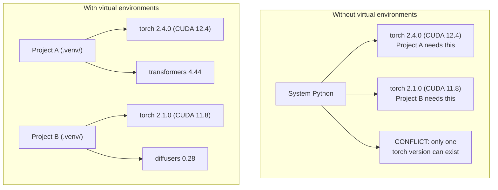

# Python Environment

> Dependency hell itu nyata. Virtual environment adalah obatnya.

**Type:** Build
**Languages:** Shell
**Prerequisites:** Phase 0, Lesson 01
**Time:** ~30 minutes

## Tujuan Pembelajaran

- Buat virtual environment yang terisolasi memakai `uv`, `venv`, atau `conda`
- Tulis `pyproject.toml` dengan grup dependensi opsional dan generate lockfile agar reproduksibel
- Diagnosis dan perbaiki jebakan umum: instalasi global, campuran pip/conda, versi CUDA yang tidak cocok
- Terapkan strategi environment per fase untuk proyek dengan dependensi yang saling bertentangan

## Masalahnya

Kamu menginstal PyTorch 2.4 untuk proyek fine-tuning. Minggu depan, proyek lain butuh PyTorch 2.1 karena build CUDA-nya di-pin. Kamu upgrade secara global, dan proyek pertama rusak. Kamu downgrade, dan proyek kedua rusak.

Ini dependency hell. Ia terus terjadi di kerja AI/ML karena:

- PyTorch, JAX, dan TensorFlow masing-masing membawa binding CUDA sendiri
- Pustaka model me-pin versi framework tertentu
- `pip install` global menimpa apa pun yang sudah ada sebelumnya
- Build CUDA 11.8 tidak berjalan dengan driver CUDA 12.x (dan sebaliknya)

Solusinya: setiap proyek dapat environment terisolasi sendiri dengan paketnya sendiri.

## Konsepnya



```figure
s0-env-isolation
```

## Bangun Sendiri

### Opsi 1: uv venv (disarankan)

`uv` adalah package manager Python tercepat (10-100x lebih cepat daripada pip). Ia menangani virtual environment, versi Python, dan resolusi dependensi dalam satu tool.

```bash
curl -LsSf https://astral.sh/uv/install.sh | sh

uv python install 3.12

cd your-project
uv venv
source .venv/bin/activate
```

Instal paket:

```bash
uv pip install torch numpy
```

Buat proyek dengan `pyproject.toml` dalam satu langkah:

```bash
uv init my-ai-project
cd my-ai-project
uv add torch numpy matplotlib
```

### Opsi 2: venv (bawaan)

Kalau kamu tidak bisa menginstal `uv`, Python sudah membawa `venv`:

```bash
python3 -m venv .venv
source .venv/bin/activate  # Linux/macOS
.venv\Scripts\activate     # Windows

pip install torch numpy
```

Lebih lambat daripada `uv`, tapi berjalan di mana pun Python terinstal.

### Opsi 3: conda (saat kamu butuh)

Conda mengelola dependensi non-Python seperti toolkit CUDA, cuDNN, dan pustaka C. Pakai saat:

- Kamu butuh versi toolkit CUDA tertentu tanpa menginstalnya system-wide
- Kamu di cluster bersama di mana kamu tidak bisa menginstal paket sistem
- Panduan instalasi pustaka bilang "pakai conda"

```bash
# Install miniconda (not the full Anaconda)
curl -LsSf https://repo.anaconda.com/miniconda/Miniconda3-latest-Linux-x86_64.sh -o miniconda.sh
bash miniconda.sh -b

conda create -n myproject python=3.12
conda activate myproject

conda install pytorch torchvision torchaudio pytorch-cuda=12.4 -c pytorch -c nvidia
```

Satu aturan: kalau kamu memakai conda untuk sebuah environment, pakai conda untuk semua paket di environment itu. Mencampur `pip install` ke env conda menimbulkan konflik dependensi yang menyakitkan untuk di-debug.

### Untuk kursus ini: strategi per fase

Kamu bisa membuat satu environment untuk seluruh kursus. Jangan. Fase yang berbeda butuh dependensi yang berbeda (kadang bertentangan).

Strateginya:

```
ai-engineering-from-scratch/
├── .venv/                    <-- shared lightweight env for phases 0-3
├── phases/
│   ├── 04-neural-networks/
│   │   └── .venv/            <-- PyTorch env
│   ├── 05-cnns/
│   │   └── .venv/            <-- same PyTorch env (symlink or shared)
│   ├── 08-transformers/
│   │   └── .venv/            <-- might need different transformer versions
│   └── 11-llm-apis/
│       └── .venv/            <-- API SDKs, no torch needed
```

Skrip di `code/env_setup.sh` membuat base environment untuk kursus ini.

## Dasar pyproject.toml

Setiap proyek Python harus punya `pyproject.toml`. Ia menggantikan `setup.py`, `setup.cfg`, dan `requirements.txt` dalam satu file.

```toml
[project]
name = "ai-engineering-from-scratch"
version = "0.1.0"
requires-python = ">=3.11"
dependencies = [
    "numpy>=1.26",
    "matplotlib>=3.8",
    "jupyter>=1.0",
    "scikit-learn>=1.4",
]

[project.optional-dependencies]
torch = ["torch>=2.3", "torchvision>=0.18"]
llm = ["anthropic>=0.39", "openai>=1.50"]
```

Lalu instal:

```bash
uv pip install -e ".[torch]"    # base + PyTorch
uv pip install -e ".[llm]"     # base + LLM SDKs
uv pip install -e ".[torch,llm]" # everything
```

## Lockfile

Lockfile me-pin setiap dependensi (termasuk yang transitif) ke versi yang persis. Ini menjamin reproduksibilitas: siapa pun yang menginstal dari lockfile mendapat paket yang persis sama.

```bash
# uv generates uv.lock automatically when using uv add
uv add numpy

# pip-tools approach
uv pip compile pyproject.toml -o requirements.lock
uv pip install -r requirements.lock
```

Commit lockfile-mu ke git. Saat seseorang meng-clone repo, mereka menginstal dari lockfile dan mendapat versi yang identik.

## Kesalahan Umum

### 1. Menginstal secara global

```bash
pip install torch  # BAD: installs to system Python

source .venv/bin/activate
pip install torch  # GOOD: installs to virtual environment
```

Cek ke mana paketmu pergi:

```bash
which python       # should show .venv/bin/python, not /usr/bin/python
which pip           # should show .venv/bin/pip
```

### 2. Mencampur pip dan conda

```bash
conda create -n myenv python=3.12
conda activate myenv
conda install pytorch -c pytorch
pip install some-other-package   # BAD: can break conda's dependency tracking
conda install some-other-package # GOOD: let conda manage everything
```

Kalau kamu wajib memakai pip di dalam conda (beberapa paket hanya ada di pip), instal semua paket conda dulu, lalu paket pip terakhir.

### 3. Lupa activate

```bash
python train.py           # uses system Python, missing packages
source .venv/bin/activate
python train.py           # uses project Python, packages found
```

Prompt shell-mu harus menunjukkan nama environment:

```
(.venv) $ python train.py
```

### 4. Mem-commit .venv ke git

```bash
echo ".venv/" >> .gitignore
```

Virtual environment berukuran 200MB-2GB. Ia lokal, tidak portabel antar mesin. Commit `pyproject.toml` dan lockfile sebagai gantinya.

### 5. Versi CUDA tidak cocok

```bash
nvidia-smi                # shows driver CUDA version (e.g., 12.4)
python -c "import torch; print(torch.version.cuda)"  # shows PyTorch CUDA version

# These must be compatible.
# PyTorch CUDA version must be <= driver CUDA version.
```

## Gunakan

Jalankan skrip setup untuk membuat environment kursusmu:

```bash
bash phases/00-setup-and-tooling/06-python-environments/code/env_setup.sh
```

Ini membuat `.venv` di root repo dengan dependensi inti yang terinstal dan terverifikasi.

## Latihan

1. Jalankan `env_setup.sh` dan pastikan semua cek lolos
2. Buat virtual environment kedua, instal versi numpy yang berbeda di dalamnya, dan pastikan kedua environment terisolasi
3. Tulis `pyproject.toml` untuk proyek yang butuh PyTorch sekaligus Anthropic SDK
4. Sengaja instal paket secara global (tanpa mengaktifkan venv), perhatikan ke mana ia pergi, lalu uninstall

## Istilah Kunci

| Term | What people say | What it actually means |
|------|----------------|----------------------|
| Virtual environment | "A venv" | An isolated directory containing a Python interpreter and packages, separate from the system Python |
| Lockfile | "Pinned dependencies" | A file listing every package and its exact version, guaranteeing identical installs across machines |
| pyproject.toml | "The new setup.py" | The standard Python project configuration file, replacing setup.py/setup.cfg/requirements.txt |
| Transitive dependency | "A dependency of a dependency" | Package B depends on C; if you install A which depends on B, C is a transitive dependency of A |
| CUDA mismatch | "My GPU isn't working" | PyTorch was compiled for a different CUDA version than what your GPU driver supports |
