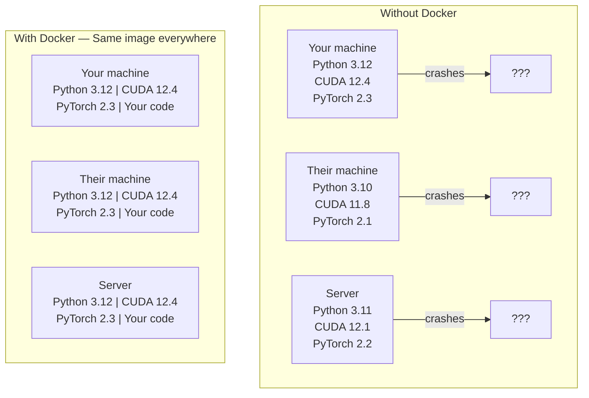

# Docker untuk AI

> Container membuat "works on my machine" menjadi masa lalu.

**Type:** Build
**Languages:** Docker
**Prerequisites:** Phase 0, Lessons 01 and 03
**Time:** ~60 minutes

## Tujuan Pembelajaran

- Build image Docker berkemampuan GPU dengan CUDA, PyTorch, dan pustaka AI dari Dockerfile
- Mount direktori host sebagai volume agar model, dataset, dan kode bertahan antar rebuild container
- Konfigurasikan NVIDIA Container Toolkit untuk mengekspos GPU di dalam container
- Orkestrasikan aplikasi AI multi-service (inference server + vector database) memakai Docker Compose

## Masalahnya

Kamu melatih model di laptop dengan PyTorch 2.3, CUDA 12.4, dan Python 3.12. Kolegamu punya PyTorch 2.1, CUDA 11.8, dan Python 3.10. Modelmu crash di mesinnya. Dockerfile-mu berjalan di keduanya.

Proyek AI adalah mimpi buruk dependensi. stack tipikal mencakup Python, PyTorch, driver CUDA, cuDNN, pustaka C level sistem, dan paket khusus seperti flash-attn yang butuh versi compiler yang persis. Docker mengemas semuanya ke satu image yang berjalan identik di mana pun.

## Konsepnya

Docker membungkus kode, runtime, pustaka, dan system tool-mu ke unit terisolasi bernama container. Anggap ia mesin virtual yang ringan, bedanya ia memakai kernel host OS alih-alih menjalankan miliknya sendiri, jadi ia menyala dalam hitungan detik bukan menit.



### Kenapa proyek AI butuh Docker lebih dari kebanyakan

1. **Driver GPU itu rapuh.** Kode CUDA 12.4 tidak berjalan di CUDA 11.8. Docker mengisolasi toolkit CUDA di dalam container sambil memakai driver GPU host lewat NVIDIA Container Toolkit.

2. **Bobot model itu besar.** Model 7B parameter berukuran 14 GB dalam fp16. Kamu tidak mau mengunduh ulang setiap kali rebuild. Volume Docker membuatmu bisa me-mount direktori model dari host.

3. **Arsitektur multi-service itu umum.** Aplikasi AI nyata bukan sekadar skrip Python. Ia adalah inference server, vector database untuk RAG, mungkin frontend web. Docker Compose mengorkestrasikan semuanya dengan satu perintah.

### Kosakata kunci

| Term | What it means |
|------|---------------|
| Image | A read-only template. Your recipe. Built from a Dockerfile. |
| Container | A running instance of an image. Your kitchen. |
| Dockerfile | Instructions to build an image. Layer by layer. |
| Volume | Persistent storage that survives container restarts. |
| docker-compose | A tool for defining multi-container applications in YAML. |

### Pola container umum di AI

```
Dev Container
  Full toolkit. Editor support. Jupyter. Debugging tools.
  Used during development and experimentation.

Training Container
  Minimal. Just the training script and dependencies.
  Runs on GPU clusters. No editor, no Jupyter.

Inference Container
  Optimized for serving. Small image. Fast cold start.
  Runs behind a load balancer in production.
```

```figure
s0-image-layers
```

## Bangun Sendiri

### Langkah 1: Instal Docker

```bash
# macOS
brew install --cask docker
open /Applications/Docker.app

# Ubuntu
curl -fsSL https://get.docker.com | sh
sudo usermod -aG docker $USER
# Log out and back in for group change to take effect
```

Verifikasi:

```bash
docker --version
docker run hello-world
```

### Langkah 2: Instal NVIDIA Container Toolkit (Linux dengan GPU NVIDIA)

Ini membuat container Docker bisa mengakses GPU-mu. Pengguna macOS dan Windows (WSL2) bisa melewati ini; Docker Desktop menangani GPU passthrough secara berbeda di platform tersebut.

```bash
distribution=$(. /etc/os-release;echo $ID$VERSION_ID)
curl -fsSL https://nvidia.github.io/libnvidia-container/gpgkey | sudo gpg --dearmor -o /usr/share/keyrings/nvidia-container-toolkit-keyring.gpg
curl -s -L https://nvidia.github.io/libnvidia-container/$distribution/libnvidia-container.list | \
    sed 's#deb https://#deb [signed-by=/usr/share/keyrings/nvidia-container-toolkit-keyring.gpg] https://#g' | \
    sudo tee /etc/apt/sources.list.d/nvidia-container-toolkit.list

sudo apt-get update
sudo apt-get install -y nvidia-container-toolkit
sudo nvidia-ctk runtime configure --runtime=docker
sudo systemctl restart docker
```

Uji akses GPU di dalam container:

```bash
docker run --rm --gpus all nvidia/cuda:12.4.1-base-ubuntu22.04 nvidia-smi
```

Kalau kamu melihat info GPU-mu, toolkit bekerja.

### Langkah 3: Pahami base image

Memilih base image yang tepat menghemat jam debugging.

```
nvidia/cuda:12.4.1-devel-ubuntu22.04
  Full CUDA toolkit. Compilers included.
  Use for: building packages that need nvcc (flash-attn, bitsandbytes)
  Size: ~4 GB

nvidia/cuda:12.4.1-runtime-ubuntu22.04
  CUDA runtime only. No compilers.
  Use for: running pre-built code
  Size: ~1.5 GB

pytorch/pytorch:2.6.0-cuda12.4-cudnn9-runtime
  PyTorch pre-installed on top of CUDA.
  Use for: skipping the PyTorch install step
  Size: ~6 GB

python:3.12-slim
  No CUDA. CPU only.
  Use for: inference on CPU, lightweight tools
  Size: ~150 MB
```

### Langkah 4: Tulis Dockerfile untuk pengembangan AI

Ini Dockerfile di `code/Dockerfile`. Pahami baris per baris:

```dockerfile
FROM --platform=linux/amd64 nvidia/cuda:12.4.1-devel-ubuntu22.04

ENV DEBIAN_FRONTEND=noninteractive
ENV PYTHONUNBUFFERED=1

RUN apt-get update && apt-get install -y --no-install-recommends \
    software-properties-common \
    git \
    curl \
    build-essential \
    && add-apt-repository -y ppa:deadsnakes/ppa \
    && apt-get update && apt-get install -y --no-install-recommends \
    python3.12 \
    python3.12-venv \
    python3.12-dev \
    && rm -rf /var/lib/apt/lists/*

RUN update-alternatives --install /usr/bin/python python /usr/bin/python3.12 1

RUN curl -sSL https://raw.githubusercontent.com/pypa/get-pip/3b73145063be545b649ad9ca83ea8da5fc915a4f/public/get-pip.py -o /tmp/get-pip.py \
    && echo "a341e1a43e38001c551a1508a73ff23636a11970b61d901d9a1cad2a18f57055  /tmp/get-pip.py" | sha256sum -c - \
    && python /tmp/get-pip.py \
    && rm /tmp/get-pip.py \
    && update-alternatives --install /usr/bin/pip pip /usr/local/bin/pip3.12 1

RUN python -m pip install --no-cache-dir --upgrade pip setuptools wheel

RUN python -m pip install --no-cache-dir \
    torch==2.6.0+cu124 \
    torchvision==0.21.0+cu124 \
    torchaudio==2.6.0+cu124 \
    --index-url https://download.pytorch.org/whl/cu124

RUN python -m pip install --no-cache-dir \
    numpy \
    pandas \
    scikit-learn \
    matplotlib \
    jupyter \
    transformers \
    datasets \
    accelerate \
    safetensors

WORKDIR /workspace

VOLUME ["/workspace", "/models"]

EXPOSE 8888

CMD ["python"]
```

Build:

```bash
docker build -t ai-dev -f phases/00-setup-and-tooling/07-docker-for-ai/code/Dockerfile .
```

Ini lama saat pertama kali (mengunduh base image CUDA + PyTorch). Build berikutnya memakai layer yang di-cache.

**macOS / Apple Silicon (M1/M2/M3/M4):** `--platform=linux/amd64` pada baris `FROM` inilah yang membuat build ini berhasil di Mac. Base image CUDA juga menyediakan varian arm64 dan Docker Desktop memilihnya otomatis di Apple Silicon, tetapi PyTorch menerbitkan wheel `cu124`-nya hanya untuk x86_64, sehingga layer `pip install torch==2.6.0+cu124` gagal dengan `No matching distribution found for torch==2.6.0+cu124`. Me-pin platform menarik image x86_64 dan menjalankannya di bawah emulasi: build lebih lambat dan container tidak punya GPU (di Mac memang tidak ada CUDA). Hapus `--gpus all` dari perintah `docker run` di bawah pada Mac. Untuk kerja GPU di Apple Silicon, jalankan pelajaran secara native dengan build MPS dari Pelajaran 01 dan simpan image ini untuk host Linux x86_64 dengan GPU NVIDIA.

Jalankan:

```bash
docker run --rm -it --gpus all \
    -v $(pwd):/workspace \
    -v ~/models:/models \
    ai-dev python -c "import torch; print(f'PyTorch {torch.__version__}, CUDA: {torch.cuda.is_available()}')"
```

Jalankan Jupyter di dalam container:

```bash
docker run --rm -it --gpus all \
    -v $(pwd):/workspace \
    -v ~/models:/models \
    -p 8888:8888 \
    ai-dev jupyter notebook --ip=0.0.0.0 --port=8888 --no-browser --allow-root
```

### Langkah 5: Volume mount untuk data dan model

Volume mount itu kritis untuk kerja AI. Tanpa itu, unduhan model 14 GB-mu lenyap saat container berhenti.

```bash
# Mount your code
-v $(pwd):/workspace

# Mount a shared models directory
-v ~/models:/models

# Mount datasets
-v ~/datasets:/data
```

Di dalam skrip training-mu, muat dari path yang di-mount:

```python
from transformers import AutoModel

model = AutoModel.from_pretrained("/models/llama-7b")
```

Model tinggal di filesystem host-mu. Rebuild container sesering yang kamu mau tanpa mengunduh ulang.

### Langkah 6: Docker Compose untuk aplikasi AI multi-service

Aplikasi RAG nyata butuh inference server dan vector database. Docker Compose menjalankan keduanya dengan satu perintah.

Lihat `code/docker-compose.yml`:

```yaml
services:
  ai-dev:
    build:
      context: .
      dockerfile: Dockerfile
    deploy:
      resources:
        reservations:
          devices:
            - driver: nvidia
              count: all
              capabilities: [gpu]
    volumes:
      - ../../../:/workspace
      - ~/models:/models
      - ~/datasets:/data
    ports:
      - "8888:8888"
    stdin_open: true
    tty: true
    command: jupyter notebook --ip=0.0.0.0 --port=8888 --no-browser --allow-root

  qdrant:
    image: qdrant/qdrant:v1.12.5
    ports:
      - "6333:6333"
      - "6334:6334"
    volumes:
      - qdrant_data:/qdrant/storage

volumes:
  qdrant_data:
```

Jalankan semuanya:

```bash
cd phases/00-setup-and-tooling/07-docker-for-ai/code
docker compose up -d
```

Kini container dev AI-mu bisa mencapai vector database di `http://qdrant:6333` lewat nama service. Docker Compose membuat jaringan bersama otomatis.

Uji koneksi dari dalam container AI:

```python
from qdrant_client import QdrantClient

client = QdrantClient(host="qdrant", port=6333)
print(client.get_collections())
```

Hentikan semuanya:

```bash
docker compose down
```

Tambahkan `-v` untuk menghapus juga volume qdrant:

```bash
docker compose down -v
```

### Langkah 7: Perintah Docker yang berguna untuk kerja AI

```bash
# List running containers
docker ps

# List all images and their sizes
docker images

# Remove unused images (reclaim disk space)
docker system prune -a

# Check GPU usage inside a running container
docker exec -it <container_id> nvidia-smi

# Copy a file from container to host
docker cp <container_id>:/workspace/results.csv ./results.csv

# View container logs
docker logs -f <container_id>
```

## Gunakan

Kamu kini punya environment pengembangan AI yang reproduksibel. Untuk sisa kursus ini:

- Pakai `docker compose up` untuk menyalakan environment dev dan vector database bersamaan
- Mount kode, model, dan data sebagai volume agar tidak ada yang hilang antar rebuild
- Saat ada pelajaran yang butuh paket Python baru, tambahkan ke Dockerfile dan rebuild
- Bagikan Dockerfile-mu ke rekan setim. Mereka mendapat environment yang persis sama.

### Tidak punya GPU?

Hapus flag `--gpus all` dan blok deploy NVIDIA. Container tetap berjalan untuk pelajaran berbasis CPU. PyTorch mendeteksi tidak adanya CUDA dan otomatis fallback ke CPU.

## Latihan

1. Build Dockerfile dan jalankan `python -c "import torch; print(torch.__version__)"` di dalam container
2. Nyalakan stack docker-compose dan pastikan Qdrant bisa diakses dari container AI di `http://qdrant:6333/collections`
3. Tambahkan `flask` ke Dockerfile, rebuild, dan jalankan server API sederhana di port 5000. Petakan port dengan `-p 5000:5000`
4. Ukur ukuran image dengan `docker images`. Coba ganti base image dari `devel` ke `runtime` dan bandingkan ukurannya

## Istilah Kunci

| Term | What people say | What it actually means |
|------|----------------|----------------------|
| Container | "Lightweight VM" | An isolated process using the host kernel, with its own filesystem and network |
| Image layer | "Cached step" | Each Dockerfile instruction creates a layer. Unchanged layers are cached, so rebuilds are fast. |
| NVIDIA Container Toolkit | "GPU in Docker" | A runtime hook that exposes host GPUs to containers via `--gpus` flag |
| Volume mount | "Shared folder" | A directory on the host mapped into the container. Changes persist after the container stops. |
| Base image | "Starting point" | The `FROM` image your Dockerfile builds on top of. Determines what is pre-installed. |
