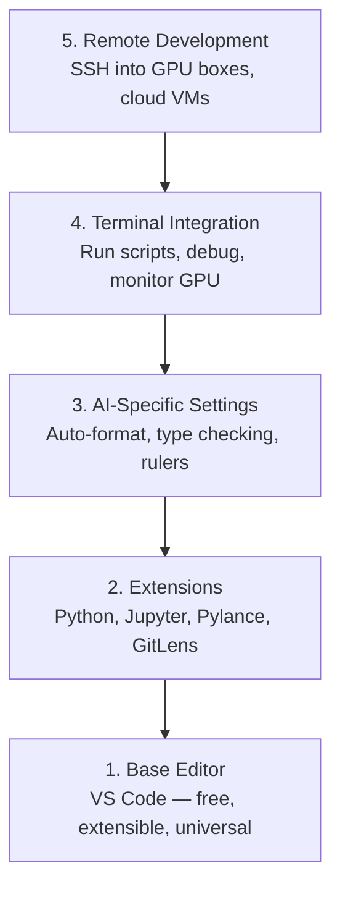

# Setup Editor

> Editormu adalah kopilotmu. Konfigurasikan sekali supaya ia tidak menghalangi dan mulai membantu.

**Type:** Build
**Languages:** --
**Prerequisites:** Phase 0, Lesson 01
**Time:** ~20 minutes

## Tujuan Pembelajaran

- Instal VS Code dengan ekstensi esensial untuk Python, Jupyter, linting, dan SSH remote
- Konfigurasikan format-on-save, type checking, dan notebook output scrolling untuk alur kerja AI
- Siapkan Remote SSH untuk mengedit dan men-debug kode di mesin GPU remote seolah lokal
- Evaluasi alternatif editor (Cursor, Windsurf, Neovim) dan tradeoff-nya untuk kerja AI

## Masalahnya

Kamu akan menghabiskan ribuan jam di dalam editormu menulis Python, menjalankan notebook, men-debug training loop, dan SSH ke GPU box. Editor yang salah konfigurasi membuat setiap sesi penuh friksi: tidak ada autocomplete, tidak ada type hint, tidak ada inline error, format manual, dan alur terminal yang kikuk.

Setup yang benar memakan 20 menit. Melewatkannya membuatmu rugi 20 menit setiap hari.

## Konsepnya

Setup editor AI engineering butuh lima hal:



```figure
s0-lsp-roundtrip
```

## Bangun Sendiri

### Langkah 1: Instal VS Code

VS Code adalah editor yang disarankan. Ia gratis, berjalan di semua OS, punya dukungan Jupyter notebook kelas satu, dan ekosistem ekstensinya mencakup semua yang kamu butuhkan untuk kerja AI.

Unduh dari [code.visualstudio.com](https://code.visualstudio.com/).

Verifikasi dari terminal:

```bash
code --version
```

Kalau `code` tidak ditemukan di macOS, buka VS Code, tekan `Cmd+Shift+P`, ketik "Shell Command", dan pilih "Install 'code' command in PATH".

### Langkah 2: Instal Ekstensi Esensial

Buka terminal terintegrasi di VS Code (`` Ctrl+` `` di semua platform) dan instal ekstensi yang penting untuk kerja AI:

```bash
code --install-extension ms-python.python
code --install-extension ms-python.vscode-pylance
code --install-extension ms-toolsai.jupyter
code --install-extension eamodio.gitlens
code --install-extension ms-vscode-remote.remote-ssh
code --install-extension ms-python.debugpy
code --install-extension ms-python.black-formatter
code --install-extension charliermarsh.ruff
```

Fungsi masing-masing:

| Extension | Why |
|-----------|-----|
| Python | Language support, virtual env detection, run/debug |
| Pylance | Fast type checking, autocomplete, import resolution |
| Jupyter | Run notebooks inside VS Code, variable explorer |
| GitLens | See who changed what, inline git blame |
| Remote SSH | Open a folder on a remote GPU box as if it were local |
| Debugpy | Step-through debugging for Python |
| Black Formatter | Auto-format on save, consistent style |
| Ruff | Fast linting, catches common mistakes |

File `code/.vscode/extensions.json` di pelajaran ini berisi daftar rekomendasi lengkap. Saat kamu membuka folder proyek, VS Code akan memintamu menginstalnya.

### Langkah 3: Konfigurasikan Setting

Salin setting dari `code/.vscode/settings.json` di pelajaran ini, atau terapkan manual lewat `Settings > Open Settings (JSON)`.

Setting kunci untuk kerja AI:

```jsonc
{
    "python.analysis.typeCheckingMode": "basic",
    "editor.formatOnSave": true,
    "editor.rulers": [88, 120],
    "notebook.output.scrolling": true,
    "files.autoSave": "afterDelay"
}
```

Kenapa ini penting:

- **Type checking di basic**: Menangkap tipe argumen yang salah sebelum kamu run. Menghemat waktu debugging untuk tensor shape mismatch dan parameter API yang salah.
- **Format on save**: Jangan pernah pikirkan formatting lagi. Black yang menangani.
- **Ruler di 88 dan 120**: Black membungkus di 88. Penanda 120 menunjukkan saat docstring dan komentar kepanjangan.
- **Notebook output scrolling**: Training loop mencetak ribuan baris. Tanpa scrolling, panel output meledak.
- **Auto-save**: Kamu akan lupa menyimpan. Skrip training-mu akan menjalankan kode basi. Auto-save mencegah itu.

### Langkah 4: Integrasi Terminal

Terminal terintegrasi VS Code adalah tempatmu menjalankan skrip training, memantau GPU, dan mengelola environment.

Siapkan dengan benar:

```jsonc
{
    "terminal.integrated.defaultProfile.osx": "zsh",
    "terminal.integrated.defaultProfile.linux": "bash",
    "terminal.integrated.fontSize": 13,
    "terminal.integrated.scrollback": 10000
}
```

Shortcut berguna:

| Action | macOS | Linux/Windows |
|--------|-------|---------------|
| Toggle terminal | `` Ctrl+` `` | `` Ctrl+` `` |
| New terminal | `` Ctrl+Shift+` `` | `` Ctrl+Shift+` `` |
| Split terminal | `Cmd+\` | `Ctrl+Shift+5` |

Terminal split berguna: satu untuk menjalankan skripmu, satu untuk memantau GPU dengan `nvidia-smi -l 1` atau `watch -n 1 nvidia-smi`.

### Langkah 5: Remote Development (SSH ke GPU Box)

Ini ekstensi terpenting untuk kerja AI. Kamu akan menjalankan training di mesin remote (VM cloud, server lab, Lambda, Vast.ai). Remote SSH membuatmu bisa membuka filesystem remote, mengedit file, menjalankan terminal, dan men-debug seolah semuanya lokal.

Setup:

1. Instal ekstensi Remote SSH (sudah di Langkah 2).
2. Tekan `Ctrl+Shift+P` (atau `Cmd+Shift+P`), ketik "Remote-SSH: Connect to Host".
3. Masukkan `user@your-gpu-box-ip`.
4. VS Code menginstal komponen server-nya di mesin remote otomatis.

Untuk akses tanpa kata sandi, siapkan SSH key:

```bash
ssh-keygen -t ed25519 -C "your-email@example.com"
ssh-copy-id user@your-gpu-box-ip
```

Tambahkan host ke `~/.ssh/config` agar praktis:

```
Host gpu-box
    HostName 203.0.113.50
    User ubuntu
    IdentityFile ~/.ssh/id_ed25519
    ForwardAgent yes
```

Kini `Remote-SSH: Connect to Host > gpu-box` langsung tersambung.

## Alternatif

### Cursor

[cursor.com](https://cursor.com) adalah fork VS Code dengan code generation AI bawaan. Ia memakai ekosistem ekstensi dan format setting yang sama. Kalau kamu memakai Cursor, semua di pelajaran ini tetap berlaku. Import `settings.json` dan `extensions.json` yang sama.

### Windsurf

[windsurf.com](https://windsurf.com) adalah fork VS Code lain yang AI-first. Ceritanya sama: ekstensi sama, format setting sama, dukungan Remote SSH sama.

### Vim/Neovim

Kalau kamu sudah memakai Vim atau Neovim dan produktif, tetap di sana. Setup minimum untuk kerja Python AI:

- **pyright** atau **pylsp** untuk type checking (lewat Mason atau instalasi manual)
- **nvim-lspconfig** untuk integrasi language server
- **jupyter-vim** atau **molten-nvim** untuk eksekusi ala notebook
- **telescope.nvim** untuk pencarian file/symbol
- **none-ls.nvim** dengan black dan ruff untuk formatting/linting

Kalau kamu belum memakai Vim, jangan mulai sekarang. Kurva belajarnya akan bersaing dengan belajar AI engineering. Pakai VS Code.

## Gunakan

Dengan setup ini, alur harianmu terlihat seperti:

1. Buka folder proyek di VS Code (atau sambung lewat Remote SSH ke GPU box).
2. Tulis Python di editor dengan autocomplete, type hint, dan inline error.
3. Jalankan Jupyter notebook secara inline dengan ekstensi Jupyter.
4. Pakai terminal terintegrasi untuk skrip training, `uv pip install`, dan pemantauan GPU.
5. Review perubahan dengan GitLens sebelum commit.

## Latihan

1. Instal VS Code dan semua ekstensi di Langkah 2
2. Salin `settings.json` dari pelajaran ini ke konfigurasi VS Code-mu
3. Buka file Python dan pastikan Pylance menampilkan type hint dan Black memformat saat save
4. Kalau kamu punya akses ke mesin remote, siapkan Remote SSH dan buka folder di dalamnya

## Istilah Kunci

| Term | What people say | What it actually means |
|------|----------------|----------------------|
| LSP | "Autocomplete engine" | Language Server Protocol: a standard for editors to get type info, completions, and diagnostics from a language-specific server |
| Pylance | "The Python plugin" | Microsoft's Python language server using Pyright for type checking and IntelliSense |
| Remote SSH | "Working on the server" | VS Code extension that runs a lightweight server on a remote machine and streams the UI to your local editor |
| Format on save | "Auto-prettier" | The editor runs a formatter (Black, Ruff) every time you save, so code style is always consistent |
