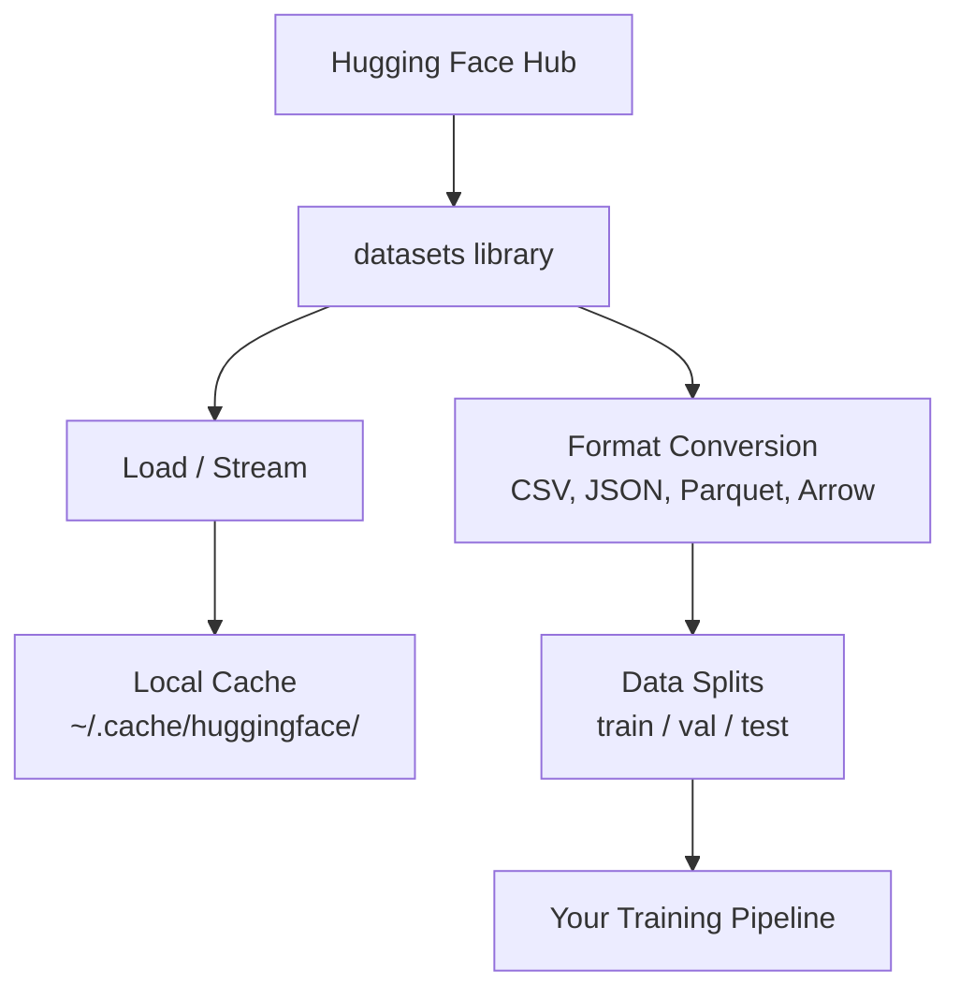

# Manajemen Data

> Data adalah bahan bakar. Cara kamu mengelolanya menentukan seberapa cepat kamu melaju.

**Type:** Build
**Language:** Python
**Prerequisites:** Phase 0, Lesson 01
**Time:** ~45 minutes

## Tujuan Pembelajaran

- Muat, stream, dan cache dataset memakai pustaka `datasets` Hugging Face
- Konversi antar format CSV, JSON, Parquet, dan Arrow dan jelaskan tradeoff-nya
- Buat split train/validasi/test yang reproduksibel dengan random seed yang tetap
- Kelola file model dan dataset besar memakai `.gitignore`, Git LFS, atau DVC

## Masalahnya

Setiap proyek AI dimulai dari data. Kamu perlu menemukan dataset, mengunduhnya, mengonversi antar format, membaginya untuk training dan evaluasi, dan mem-versi-nya supaya eksperimen reproduksibel. Melakukan ini manual setiap kali itu lambat dan rawan error. Kamu butuh alur kerja yang bisa diulang.

## Konsepnya



Pustaka `datasets` Hugging Face adalah cara standar memuat data untuk kerja AI. Ia menangani pengunduhan, caching, konversi format, dan streaming langsung dari bawaan.

```figure
s0-data-pipeline
```

## Bangun Sendiri

### Langkah 1: Instal pustaka datasets

```bash
pip install datasets huggingface_hub
```

### Langkah 2: Muat dataset

```python
from datasets import load_dataset

dataset = load_dataset("stanfordnlp/imdb")
print(dataset)
print(dataset["train"][0])
```

Ini mengunduh dataset review film IMDB. Setelah unduhan pertama, ia dimuat dari cache di `~/.cache/huggingface/datasets/`.

### Langkah 3: Stream dataset besar

Beberapa dataset terlalu besar untuk muat di disk. Streaming memuatnya baris per baris tanpa mengunduh semuanya.

```python
dataset = load_dataset("wikimedia/wikipedia", "20231101.en", split="train", streaming=True)

for i, example in enumerate(dataset):
    print(example["title"])
    if i >= 4:
        break
```

Streaming memberimu `IterableDataset`. Kamu memproses baris saat datang. Pemakaian memori tetap konstan berapa pun ukuran dataset.

### Langkah 4: Format dataset

Pustaka `datasets` memakai Apache Arrow di balik layar. Kamu bisa mengonversi ke format lain tergantung kebutuhan pipeline-mu.

```python
dataset = load_dataset("stanfordnlp/imdb", split="train")

dataset.to_csv("imdb_train.csv")
dataset.to_json("imdb_train.json")
dataset.to_parquet("imdb_train.parquet")
```

Perbandingan format:

| Format | Size | Read Speed | Best For |
|--------|------|-----------|----------|
| CSV | Large | Slow | Human readability, spreadsheets |
| JSON | Large | Slow | APIs, nested data |
| Parquet | Small | Fast | Analytics, columnar queries |
| Arrow | Small | Fastest | In-memory processing (what `datasets` uses internally) |

Untuk kerja AI, Parquet adalah format penyimpanan terbaik. Arrow adalah yang kamu pakai di memori. CSV dan JSON untuk pertukaran.

### Langkah 5: Split data

Setiap proyek ML butuh tiga split:

- **Train**: Model belajar dari sini (biasanya 80%)
- **Validasi**: Kamu cek progres selama training (biasanya 10%)
- **Test**: Evaluasi final setelah training selesai (biasanya 10%)

Beberapa dataset sudah ter-split. Kalau belum, bagi sendiri:

```python
dataset = load_dataset("stanfordnlp/imdb", split="train")

split = dataset.train_test_split(test_size=0.2, seed=42)
train_val = split["train"].train_test_split(test_size=0.125, seed=42)

train_ds = train_val["train"]
val_ds = train_val["test"]
test_ds = split["test"]

print(f"Train: {len(train_ds)}, Val: {len(val_ds)}, Test: {len(test_ds)}")
```

Selalu tetapkan seed agar reproduksibel. Seed yang sama menghasilkan split yang sama setiap kali.

### Langkah 6: Unduh dan cache model

Model adalah file besar. Pustaka `huggingface_hub` menangani pengunduhan dan caching.

```python
from huggingface_hub import hf_hub_download, snapshot_download

model_path = hf_hub_download(
    repo_id="sentence-transformers/all-MiniLM-L6-v2",
    filename="config.json"
)
print(f"Cached at: {model_path}")

model_dir = snapshot_download("sentence-transformers/all-MiniLM-L6-v2")
print(f"Full model at: {model_dir}")
```

Model di-cache ke `~/.cache/huggingface/hub/`. Setelah diunduh, ia dimuat instan pada run berikutnya.

### Langkah 7: Tangani file besar

Bobot model dan dataset besar tidak boleh masuk git. Tiga opsi:

**Opsi A: .gitignore (paling sederhana)**

```
*.bin
*.safetensors
*.pt
*.onnx
data/*.parquet
data/*.csv
models/
```

**Opsi B: Git LFS (lacak file besar di git)**

```bash
git lfs install
git lfs track "*.bin"
git lfs track "*.safetensors"
git add .gitattributes
```

Git LFS menyimpan pointer di repo-mu dan file aslinya di server terpisah. GitHub memberimu 1 GB gratis.

**Opsi C: DVC (data version control)**

```bash
pip install dvc
dvc init
dvc add data/training_set.parquet
git add data/training_set.parquet.dvc data/.gitignore
git commit -m "Track training data with DVC"
```

DVC membuat file `.dvc` kecil yang menunjuk ke datamu. Data itu sendiri tinggal di S3, GCS, atau backend penyimpanan remote lain.

| Approach | Complexity | Best For |
|----------|-----------|----------|
| .gitignore | Low | Personal projects, downloaded data you can re-fetch |
| Git LFS | Medium | Teams sharing model weights via git |
| DVC | High | Reproducible experiments, large datasets, teams |

Untuk kursus ini, `.gitignore` sudah cukup. Pakai DVC saat kamu perlu mereproduksi eksperimen yang persis antar mesin.

### Langkah 8: Pola penyimpanan

**Penyimpanan lokal** cukup untuk dataset di bawah ~10 GB. HF cache menangani ini otomatis.

**Penyimpanan cloud** untuk apa pun yang lebih besar atau dipakai bersama antar mesin:

```python
import os

local_path = os.path.expanduser("~/.cache/huggingface/datasets/")

# s3_path = "s3://my-bucket/datasets/"
# gcs_path = "gs://my-bucket/datasets/"
```

DVC terintegrasi langsung dengan S3 dan GCS:

```bash
dvc remote add -d myremote s3://my-bucket/dvc-store
dvc push
```

Untuk kursus ini, penyimpanan lokal sudah cukup. Penyimpanan cloud menjadi relevan saat kamu fine-tuning di instance GPU remote.

## Dataset yang dipakai di kursus ini

| Dataset | Lessons | Size | What It Teaches |
|---------|---------|------|----------------|
| IMDB | Tokenization, classification | 84 MB | Text classification basics |
| WikiText | Language modeling | 181 MB | Next-token prediction |
| SQuAD | QA systems | 35 MB | Question answering, spans |
| Common Crawl (subset) | Embeddings | Varies | Large-scale text processing |
| MNIST | Vision basics | 21 MB | Image classification fundamentals |
| COCO (subset) | Multimodal | Varies | Image-text pairs |

Kamu tidak perlu mengunduh semuanya sekarang. Setiap pelajaran menjelaskan apa yang dibutuhkannya.

## Gunakan

Jalankan skrip utilitas untuk memastikan semuanya bekerja:

```bash
python code/data_utils.py
```

Ini mengunduh dataset kecil, mengonversinya, membaginya, dan mencetak ringkasan.

## Rilis

Pelajaran ini menghasilkan:
- `code/data_utils.py` - utilitas pemuatan dan caching data yang bisa dipakai ulang
- `outputs/prompt-data-helper.md` - prompt untuk menemukan dataset yang tepat untuk suatu tugas

## Latihan

1. Muat dataset `glue` dengan config `mrpc` dan periksa 5 contoh pertama
2. Stream dataset `c4` dan hitung berapa contoh yang bisa kamu proses dalam 10 detik
3. Konversi dataset ke Parquet dan bandingkan ukuran file-nya dengan CSV
4. Buat split train/val/test 70/15/15 dengan seed tetap dan verifikasi ukurannya

## Istilah Kunci

| Term | What people say | What it actually means |
|------|----------------|----------------------|
| Dataset split | "Training data" | A named subset (train/val/test) used at different stages of the ML lifecycle |
| Streaming | "Load it lazily" | Processing data row by row from a remote source without downloading the full dataset |
| Parquet | "Compressed CSV" | A columnar file format optimized for analytical queries and storage efficiency |
| Arrow | "Fast dataframe" | An in-memory columnar format used internally by the datasets library for zero-copy reads |
| Git LFS | "Git for big files" | An extension that stores large files outside the git repo while keeping pointers in version control |
| DVC | "Git for data" | A version control system for datasets and models that integrates with cloud storage |
| Cache | "Already downloaded" | A local copy of previously fetched data, stored at ~/.cache/huggingface/ by default |
