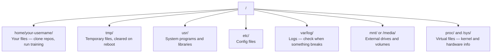

# Linux untuk AI

> Kebanyakan AI berjalan di Linux. Kamu perlu tahu cukup agar tidak macet.

**Type:** Learn
**Languages:** --
**Prerequisites:** Phase 0, Lesson 01
**Time:** ~30 minutes

## Tujuan Pembelajaran

- Navigasi file system Linux dan lakukan operasi file esensial dari command line
- Kelola permission file dengan `chmod` dan `chown` untuk mengatasi error "Permission denied"
- Instal paket sistem dengan `apt` dan siapkan GPU box baru untuk kerja AI
- Kenali perbedaan macOS-ke-Linux yang sering menjebak developer yang bekerja di mesin remote

## Masalahnya

Kamu mengembangkan di macOS atau Windows. Tapi saat kamu SSH ke GPU box cloud, menyewa instance Lambda, atau menyalakan mesin EC2, kamu mendarat di Ubuntu. Terminal adalah satu-satunya antarmukamu. Tidak ada Finder, Explorer, atau GUI. Kalau kamu tidak bisa menavigasi file system, menginstal paket, dan mengelola proses dari command line, kamu macet membayar GPU hours yang idle sambil googling "cara unzip file di Linux."

Ini panduan bertahan hidup. Ia membahas tepat apa yang kamu butuhkan untuk beroperasi di mesin Linux remote untuk kerja AI. Tidak lebih.

## Tata Letak File System

Linux mengatur semuanya di bawah satu root `/`. Tidak ada `C:\` atau `/Volumes`. Direktori yang benar-benar akan kamu sentuh:



Direktori home-mu adalah `~` atau `/home/your-username`. Hampir semua yang kamu lakukan terjadi di sini.

## Perintah Esensial

Ini 15 perintah yang mencakup 95% dari yang akan kamu lakukan di GPU box remote.

### Berpindah-pindah

```bash
pwd                         # Where am I?
ls                          # What's here?
ls -la                      # What's here, including hidden files with details?
cd /path/to/dir             # Go there
cd ~                        # Go home
cd ..                       # Go up one level
```

### File dan Direktori

```bash
mkdir my-project            # Create a directory
mkdir -p a/b/c              # Create nested directories in one shot

cp file.txt backup.txt      # Copy a file
cp -r src/ src-backup/      # Copy a directory (recursive)

mv old.txt new.txt          # Rename a file
mv file.txt /tmp/           # Move a file

rm file.txt                 # Delete a file (no trash, it's gone)
rm -rf my-dir/              # Delete a directory and everything inside
```

`rm -rf` bersifat permanen. Tidak ada undo. Periksa ulang path sebelum menekan enter.

### Membaca File

```bash
cat file.txt                # Print entire file
head -20 file.txt           # First 20 lines
tail -20 file.txt           # Last 20 lines
tail -f log.txt             # Follow a log file in real time (Ctrl+C to stop)
less file.txt               # Scroll through a file (q to quit)
```

### Mencari

```bash
grep "error" training.log           # Find lines containing "error"
grep -r "learning_rate" .           # Search all files in current directory
grep -i "cuda" config.yaml          # Case-insensitive search

find . -name "*.py"                 # Find all Python files under current dir
find . -name "*.ckpt" -size +1G     # Find checkpoint files larger than 1GB
```

## Permission

Setiap file di Linux punya owner dan bit permission. Kamu akan menemui ini saat skrip tidak mau dieksekusi atau kamu tidak bisa menulis ke direktori.

```bash
ls -l train.py
# -rwxr-xr-- 1 user group 2048 Mar 19 10:00 train.py
#  ^^^             owner permissions: read, write, execute
#     ^^^          group permissions: read, execute
#        ^^        everyone else: read only
```

Perbaikan umum:

```bash
chmod +x train.sh           # Make a script executable
chmod 755 deploy.sh         # Owner: full, others: read+execute
chmod 644 config.yaml       # Owner: read+write, others: read only

chown user:group file.txt   # Change who owns a file (needs sudo)
```

Saat sesuatu bilang "Permission denied," hampir selalu itu masalah permission. `chmod +x` atau `sudo` akan memperbaiki kebanyakan kasus.

## Manajemen Paket (apt)

Ubuntu memakai `apt`. Beginilah cara menginstal software level sistem.

```bash
sudo apt update             # Refresh the package list (always do this first)
sudo apt install -y htop    # Install a package (-y skips confirmation)
sudo apt install -y build-essential  # C compiler, make, etc. Needed by many Python packages
sudo apt install -y tmux    # Terminal multiplexer (keep sessions alive after disconnect)

apt list --installed        # What's installed?
sudo apt remove htop        # Uninstall
```

Paket umum yang akan kamu instal di GPU box baru:

```bash
sudo apt update && sudo apt install -y \
    build-essential \
    git \
    curl \
    wget \
    tmux \
    htop \
    unzip \
    python3-venv
```

## User dan sudo

Kamu biasanya login sebagai user biasa. Beberapa operasi butuh akses root (admin).

```bash
whoami                      # What user am I?
sudo command                # Run a single command as root
sudo su                     # Become root (exit to go back, use sparingly)
```

Di instance GPU cloud, kamu biasanya satu-satunya user dan sudah punya akses sudo. Jangan jalankan semuanya sebagai root. Pakai sudo hanya saat perlu.

## Proses dan systemd

Saat training-mu hang, atau kamu perlu cek apa yang berjalan:

```bash
htop                        # Interactive process viewer (q to quit)
ps aux | grep python        # Find running Python processes
kill 12345                  # Gracefully stop process with PID 12345
kill -9 12345               # Force kill (use when graceful doesn't work)
nvidia-smi                  # GPU processes and memory usage
```

systemd mengelola service (daemon background). Kamu akan memakainya kalau menjalankan inference server:

```bash
sudo systemctl start nginx          # Start a service
sudo systemctl stop nginx           # Stop it
sudo systemctl restart nginx        # Restart it
sudo systemctl status nginx         # Check if it's running
sudo systemctl enable nginx         # Start automatically on boot
```

## Ruang Disk

GPU box sering punya ruang disk terbatas. Model dan dataset menghabiskannya dengan cepat.

```bash
df -h                       # Disk usage for all mounted drives
df -h /home                 # Disk usage for /home specifically

du -sh *                    # Size of each item in current directory
du -sh ~/.cache             # Size of your cache (pip, huggingface models land here)
du -sh /data/checkpoints/   # Check how big your checkpoints are

# Find the biggest space hogs
du -h --max-depth=1 / 2>/dev/null | sort -hr | head -20
```

Penghemat ruang umum:

```bash
# Clear pip cache
pip cache purge

# Clear apt cache
sudo apt clean

# Remove old checkpoints you don't need
rm -rf checkpoints/epoch_01/ checkpoints/epoch_02/
```

## Jaringan

Kamu akan mengunduh model, mentransfer file, dan memanggil API dari command line.

```bash
# Download files
wget https://example.com/model.bin                   # Download a file
curl -O https://example.com/data.tar.gz              # Same thing with curl
curl -s https://api.example.com/health | python3 -m json.tool  # Hit an API, pretty-print JSON

# Transfer files between machines
scp model.bin user@remote:/data/                     # Copy file to remote machine
scp user@remote:/data/results.csv .                  # Copy file from remote to local
scp -r user@remote:/data/checkpoints/ ./local-dir/   # Copy directory

# Sync directories (faster than scp for large transfers, resumes on failure)
rsync -avz --progress ./data/ user@remote:/data/
rsync -avz --progress user@remote:/results/ ./results/
```

Pakai `rsync` daripada `scp` untuk apa pun yang besar. Ia hanya mentransfer byte yang berubah dan menangani koneksi yang terputus.

## tmux: Jaga Sesi Tetap Hidup

Saat kamu SSH ke box remote, menutup laptop membunuh training run-mu. tmux mencegah ini.

```bash
tmux new -s train           # Start a new session named "train"
# ... start your training, then:
# Ctrl+B, then D            # Detach (training keeps running)

tmux ls                     # List sessions
tmux attach -t train        # Reattach to session

# Inside tmux:
# Ctrl+B, then %            # Split pane vertically
# Ctrl+B, then "            # Split pane horizontally
# Ctrl+B, then arrow keys   # Switch between panes
```

Selalu jalankan training job yang panjang di dalam tmux. Selalu.

## WSL2 untuk pengguna Windows

Kalau kamu di Windows, WSL2 memberimu environment Linux asli tanpa dual-boot.

```bash
# In PowerShell (admin)
wsl --install -d Ubuntu-24.04

# After restart, open Ubuntu from Start menu
sudo apt update && sudo apt upgrade -y
```

WSL2 menjalankan kernel Linux asli. Semua di pelajaran ini bekerja di dalamnya. File Windows-mu ada di `/mnt/c/Users/YourName/` dari dalam WSL.

GPU passthrough bekerja dengan driver NVIDIA yang diinstal di sisi Windows. Instal driver NVIDIA Windows (bukan yang Linux), dan CUDA akan tersedia di dalam WSL2.

## Jebakan: macOS ke Linux

Hal yang akan menjebakmu kalau kamu berasal dari macOS:

| macOS | Linux | Notes |
|-------|-------|-------|
| `brew install` | `sudo apt install` | Different package names sometimes. `brew install htop` vs `sudo apt install htop` works the same, but `brew install readline` vs `sudo apt install libreadline-dev` does not. |
| `open file.txt` | `xdg-open file.txt` | But you won't have a GUI on a remote box. Use `cat` or `less`. |
| `pbcopy` / `pbpaste` | Not available | Pipe to/from clipboard doesn't exist over SSH. |
| `~/.zshrc` | `~/.bashrc` | macOS defaults to zsh. Most Linux servers use bash. |
| `/opt/homebrew/` | `/usr/bin/`, `/usr/local/bin/` | Binaries live in different places. |
| `sed -i '' 's/a/b/' file` | `sed -i 's/a/b/' file` | macOS sed needs an empty string after `-i`. Linux does not. |
| Case-insensitive filesystem | Case-sensitive filesystem | `Model.py` and `model.py` are two different files on Linux. |
| Line endings `\n` | Line endings `\n` | Same. But Windows uses `\r\n`, which breaks bash scripts. Run `dos2unix` to fix. |

## Kartu Referensi Cepat

```
Navigation:     pwd, ls, cd, find
Files:          cp, mv, rm, mkdir, cat, head, tail, less
Search:         grep, find
Permissions:    chmod, chown, sudo
Packages:       apt update, apt install
Processes:      htop, ps, kill, nvidia-smi
Services:       systemctl start/stop/restart/status
Disk:           df -h, du -sh
Network:        curl, wget, scp, rsync
Sessions:       tmux new/attach/detach
```

```figure
s0-process-fork
```

## Latihan

1. SSH ke mesin Linux mana pun (atau buka WSL2) dan navigasi ke direktori home-mu. Buat folder proyek, buat tiga file kosong di dalamnya dengan `touch`, lalu list dengan `ls -la`.
2. Instal `htop` dengan apt, jalankan, dan kenali proses mana yang memakai memori paling banyak.
3. Mulai sesi tmux, jalankan `sleep 300` di dalamnya, detach, list sesi, dan reattach.
4. Pakai `df -h` untuk cek ruang disk yang tersedia, lalu pakai `du -sh ~/.cache/*` untuk menemukan apa yang memakan ruang di cache-mu.
5. Transfer file dari mesin lokalmu ke mesin remote memakai `scp`, lalu lakukan transfer yang sama dengan `rsync` dan bandingkan pengalamanmu.
