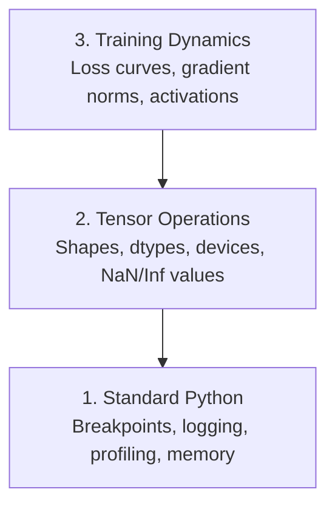

# Debugging dan Profiling

> Bug AI terburuk tidak crash. Ia training diam-diam di atas sampah dan melaporkan kurva loss yang indah.

**Type:** Build
**Language:** Python
**Prerequisites:** Lesson 1 (Dev Environment), basic PyTorch familiarity
**Time:** ~60 minutes

## Tujuan Pembelajaran

- Pakai `breakpoint()` kondisional dan `debug_print` untuk memeriksa shape tensor, dtype, dan nilai NaN di tengah training
- Profile training loop dengan `cProfile`, `line_profiler`, dan `tracemalloc` untuk menemukan bottleneck
- Deteksi bug AI yang umum: shape mismatch, loss NaN, kebocoran data, dan tensor di device yang salah
- Siapkan TensorBoard untuk memvisualisasikan kurva loss, histogram bobot, dan distribusi gradien

## Masalahnya

Kode AI gagal secara berbeda dari kode biasa. Aplikasi web crash dengan stack trace. Training loop yang salah konfigurasi berjalan 8 jam, membakar $200 waktu GPU, dan menghasilkan model yang memprediksi rata-rata setiap input. Kodenya tidak pernah error. Bug-nya adalah tensor di device yang salah, `.detach()` yang terlupa, atau label yang bocor ke fitur.

Kamu butuh tool debugging yang menangkap kegagalan diam-diam ini sebelum ia membuang waktu dan komputasimu.

## Konsepnya

Debugging AI beroperasi di tiga level:



Kebanyakan orang langsung loncat ke level 3 (menatap TensorBoard). Tapi 80% bug AI ada di level 1 dan 2.

```figure
s0-flame-hot
```

## Bangun Sendiri

### Bagian 1: Print Debugging (Ya, Ia Berhasil)

Print debugging sering diremehkan. Seharusnya tidak. Untuk kode tensor, print statement yang terarah mengalahkan step-through debugger karena kamu perlu melihat shape, dtype, dan rentang nilai sekaligus.

```python
def debug_print(name, tensor):
    print(f"{name}: shape={tensor.shape}, dtype={tensor.dtype}, "
          f"device={tensor.device}, "
          f"min={tensor.min().item():.4f}, max={tensor.max().item():.4f}, "
          f"mean={tensor.mean().item():.4f}, "
          f"has_nan={tensor.isnan().any().item()}")
```

Panggil ini setelah setiap operasi yang mencurigakan. Saat bug ketemu, hapus print-nya. Sederhana.

### Bagian 2: Debugger Python (pdb dan breakpoint)

Debugger bawaan diremehkan untuk kerja AI. Jatuhkan `breakpoint()` ke training loop-mu dan periksa tensor secara interaktif.

```python
def training_step(model, batch, criterion, optimizer):
    inputs, labels = batch
    outputs = model(inputs)
    loss = criterion(outputs, labels)

    if loss.item() > 100 or torch.isnan(loss):
        breakpoint()

    loss.backward()
    optimizer.step()
```

Saat debugger menjatuhkanmu masuk, perintah berguna:

- `p outputs.shape` untuk cek shape
- `p loss.item()` untuk melihat nilai loss
- `p torch.isnan(outputs).sum()` untuk menghitung NaN
- `p model.fc1.weight.grad` untuk cek gradien
- `c` untuk lanjut, `q` untuk keluar

Ini debugging kondisional. Kamu hanya berhenti saat ada yang terlihat salah. Untuk training run 10.000 langkah, itu penting.

### Bagian 3: Logging Python

Ganti print statement dengan logging saat debugging-mu melampaui cek cepat.

```python
import logging

logging.basicConfig(
    level=logging.INFO,
    format="%(asctime)s [%(levelname)s] %(message)s",
    handlers=[
        logging.FileHandler("training.log"),
        logging.StreamHandler()
    ]
)
logger = logging.getLogger(__name__)

logger.info("Starting training: lr=%.4f, batch_size=%d", lr, batch_size)
logger.warning("Loss spike detected: %.4f at step %d", loss.item(), step)
logger.error("NaN loss at step %d, stopping", step)
```

Logging memberimu timestamp, level severity, dan output file. Saat training run gagal jam 3 pagi, kamu butuh file log, bukan output terminal yang sudah ter-scroll hilang.

### Bagian 4: Mengukur waktu bagian kode

Tahu ke mana waktu pergi adalah langkah pertama optimasi.

```python
import time

class Timer:
    def __init__(self, name=""):
        self.name = name

    def __enter__(self):
        self.start = time.perf_counter()
        return self

    def __exit__(self, *args):
        elapsed = time.perf_counter() - self.start
        print(f"[{self.name}] {elapsed:.4f}s")

with Timer("data loading"):
    batch = next(dataloader_iter)

with Timer("forward pass"):
    outputs = model(batch)

with Timer("backward pass"):
    loss.backward()
```

Temuan umum: data loading memakan 60% waktu training. Perbaikannya adalah `num_workers > 0` di DataLoader-mu, bukan GPU yang lebih cepat.

### Bagian 5: cProfile dan line_profiler

Saat kamu butuh lebih dari timer manual:

```bash
python -m cProfile -s cumtime train.py
```

Ini menampilkan setiap panggilan fungsi yang diurutkan berdasar waktu kumulatif. Untuk profiling baris per baris:

```bash
pip install line_profiler
```

```python
@profile
def train_step(model, data, target):
    output = model(data)
    loss = F.cross_entropy(output, target)
    loss.backward()
    return loss

# Run with: kernprof -l -v train.py
```

### Bagian 6: Profiling memori

#### Memori CPU dengan tracemalloc

```python
import tracemalloc

tracemalloc.start()

# your code here
model = build_model()
data = load_dataset()

snapshot = tracemalloc.take_snapshot()
top_stats = snapshot.statistics("lineno")
for stat in top_stats[:10]:
    print(stat)
```

#### Memori CPU dengan memory_profiler

```bash
pip install memory_profiler
```

```python
from memory_profiler import profile

@profile
def load_data():
    raw = read_csv("data.csv")       # watch memory jump here
    processed = preprocess(raw)       # and here
    return processed
```

Jalankan dengan `python -m memory_profiler your_script.py` untuk melihat pemakaian memori baris per baris.

#### Memori GPU dengan PyTorch

```python
import torch

if torch.cuda.is_available():
    print(torch.cuda.memory_summary())

    print(f"Allocated: {torch.cuda.memory_allocated() / 1e9:.2f} GB")
    print(f"Cached: {torch.cuda.memory_reserved() / 1e9:.2f} GB")
```

Saat kamu kena OOM (Out of Memory):

1. Kecilkan batch size (hal pertama yang dicoba, selalu)
2. Pakai `torch.cuda.empty_cache()` untuk membebaskan memori yang di-cache
3. Pakai `del tensor` diikuti `torch.cuda.empty_cache()` untuk intermediate besar
4. Pakai mixed precision (`torch.cuda.amp`) untuk memangkas pemakaian memori separuh
5. Pakai gradient checkpointing untuk model yang sangat dalam

### Bagian 7: Bug AI umum dan cara menangkapnya

#### Shape Mismatch

Bug paling sering. Tensor punya shape `[batch, features]` padahal model mengharapkan `[batch, channels, height, width]`.

```python
def check_shapes(model, sample_input):
    print(f"Input: {sample_input.shape}")
    hooks = []

    def make_hook(name):
        def hook(module, inp, out):
            in_shape = inp[0].shape if isinstance(inp, tuple) else inp.shape
            out_shape = out.shape if hasattr(out, "shape") else type(out)
            print(f"  {name}: {in_shape} -> {out_shape}")
        return hook

    for name, module in model.named_modules():
        hooks.append(module.register_forward_hook(make_hook(name)))

    with torch.no_grad():
        model(sample_input)

    for h in hooks:
        h.remove()
```

Jalankan sekali dengan batch sampel. Ia memetakan setiap transformasi shape di modelmu.

#### Loss NaN

Loss NaN berarti sesuatu meledak. Penyebab umum:

- Learning rate terlalu tinggi
- Pembagian dengan nol di custom loss
- Log dari nol atau angka negatif
- Gradien meledak di RNN

```python
def detect_nan(model, loss, step):
    if torch.isnan(loss):
        print(f"NaN loss at step {step}")
        for name, param in model.named_parameters():
            if param.grad is not None:
                if torch.isnan(param.grad).any():
                    print(f"  NaN gradient in {name}")
                if torch.isinf(param.grad).any():
                    print(f"  Inf gradient in {name}")
        return True
    return False
```

#### Kebocoran Data

Modelmu dapat akurasi 99% di test set. Kedengarannya hebat. Itu bug.

```python
def check_data_leakage(train_set, test_set, id_column="id"):
    train_ids = set(train_set[id_column].tolist())
    test_ids = set(test_set[id_column].tolist())
    overlap = train_ids & test_ids
    if overlap:
        print(f"DATA LEAKAGE: {len(overlap)} samples in both train and test")
        return True
    return False
```

Cek juga temporal leakage: memakai data masa depan untuk memprediksi masa lalu. Urutkan berdasar timestamp sebelum split.

#### Device Salah

Tensor di device berbeda (CPU vs GPU) menimbulkan runtime error. Tapi kadang tensor diam-diam tetap di CPU sementara sisanya di GPU, dan training hanya berjalan lambat.

```python
def check_devices(model, *tensors):
    model_device = next(model.parameters()).device
    print(f"Model device: {model_device}")
    for i, t in enumerate(tensors):
        if t.device != model_device:
            print(f"  WARNING: tensor {i} on {t.device}, model on {model_device}")
```

### Bagian 8: Dasar TensorBoard

TensorBoard menunjukkan apa yang terjadi di dalam training dari waktu ke waktu.

```bash
pip install tensorboard
```

```python
from torch.utils.tensorboard import SummaryWriter

writer = SummaryWriter("runs/experiment_1")

for step in range(num_steps):
    loss = train_step(model, batch)

    writer.add_scalar("loss/train", loss.item(), step)
    writer.add_scalar("lr", optimizer.param_groups[0]["lr"], step)

    if step % 100 == 0:
        for name, param in model.named_parameters():
            writer.add_histogram(f"weights/{name}", param, step)
            if param.grad is not None:
                writer.add_histogram(f"grads/{name}", param.grad, step)

writer.close()
```

Jalankan:

```bash
tensorboard --logdir=runs
```

Yang perlu diperhatikan:

- **Loss tidak turun**: Learning rate terlalu rendah, atau masalah arsitektur model
- **Loss berosilasi liar**: Learning rate terlalu tinggi
- **Loss menjadi NaN**: Ketidakstabilan numerik (lihat bagian NaN di atas)
- **Train loss turun, val loss naik**: Overfitting
- **Histogram bobot kolaps ke nol**: Vanishing gradient
- **Histogram gradien meledak**: Butuh gradient clipping

### Bagian 9: Debugger VS Code

Untuk debugging interaktif, konfigurasikan VS Code dengan `launch.json`:

```json
{
    "version": "0.2.0",
    "configurations": [
        {
            "name": "Debug Training",
            "type": "debugpy",
            "request": "launch",
            "program": "${file}",
            "console": "integratedTerminal",
            "justMyCode": false
        }
    ]
}
```

Tetapkan breakpoint dengan mengklik gutter. Pakai panel Variables untuk memeriksa properti tensor. Debug Console membuatmu bisa menjalankan ekspresi Python apa pun di tengah eksekusi.

Berguna untuk menelusuri pipeline prapemrosesan data di mana kamu ingin melihat setiap transformasi.

## Gunakan

Ini alur debugging yang menangkap kebanyakan bug AI:

1. **Sebelum training**: Jalankan `check_shapes` dengan batch sampel. Pastikan dimensi input dan output sesuai ekspektasi.
2. **10 langkah pertama**: Pakai `debug_print` pada loss, output, dan gradien. Pastikan tidak ada NaN dan nilainya dalam rentang wajar.
3. **Selama training**: Log loss, learning rate, dan norm gradien. Pakai TensorBoard untuk visualisasi.
4. **Saat ada yang rusak**: Jatuhkan `breakpoint()` di titik kegagalan. Periksa tensor secara interaktif.
5. **Untuk performa**: Ukur waktu data loading vs forward vs backward pass. Profile memori kalau kamu hampir OOM.

## Rilis

Jalankan skrip toolkit debugging:

```bash
python phases/00-setup-and-tooling/12-debugging-and-profiling/code/debug_tools.py
```

Lihat `outputs/prompt-debug-ai-code.md` untuk prompt yang membantu mendiagnosis bug khusus AI.

## Latihan

1. Jalankan `debug_tools.py` dan baca setiap bagian output-nya. Ubah model dummy agar menghasilkan NaN (petunjuk: bagi dengan nol di forward pass) dan lihat detektor menangkapnya.
2. Profile training loop dengan `cProfile` dan kenali fungsi terlambatnya.
3. Pakai `tracemalloc` untuk menemukan baris mana di pipeline pemuatan datamu yang mengalokasi memori paling banyak.
4. Siapkan TensorBoard untuk training run sederhana dan kenali apakah model overfitting.
5. Pakai `breakpoint()` di dalam training loop. Latih memeriksa shape tensor, device, dan nilai gradien dari prompt debugger.
