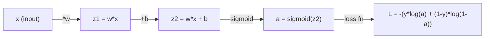
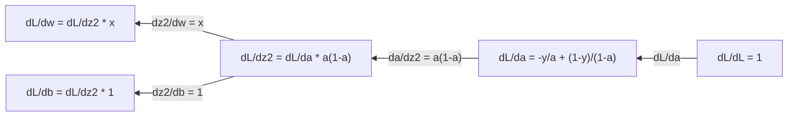
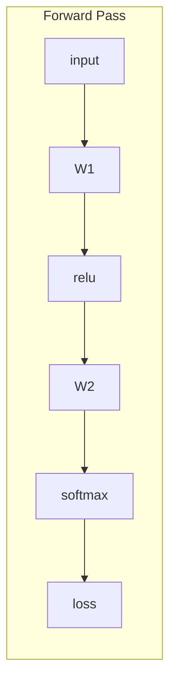
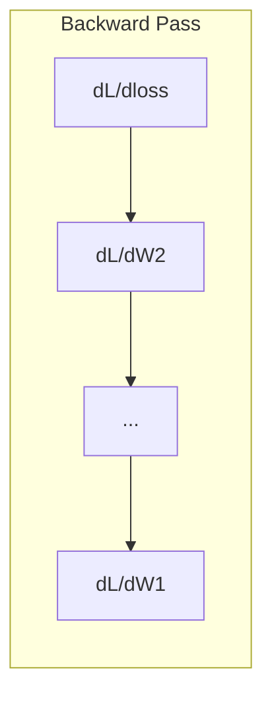

# Kalkulus untuk Machine Learning

> Turunan memberi tahu arah mana yang menurun. Itu saja yang dibutuhkan neural network untuk belajar.

**Type:** Learn
**Language:** Python
**Prerequisites:** Phase 1, Lessons 01-03
**Time:** ~60 minutes

## Tujuan Pembelajaran

- Hitung turunan numerik dan analitik untuk fungsi-fungsi umum ML (x^2, sigmoid, cross-entropy)
- Implementasikan gradient descent dari nol untuk meminimalkan fungsi loss dalam 1D dan 2D
- Turunkan gradien model regresi linear dan latih lewat pembaruan bobot manual
- Jelaskan matriks Hessian, aproksimasi deret Taylor, dan hubungannya dengan metode optimisasi

## Masalahnya

Kamu punya neural network dengan jutaan bobot. Setiap bobot adalah kenop. Kamu perlu mencari tahu ke arah mana memutar setiap kenop agar model sedikit berkurang salahnya. Kalkulus memberimu arah itu.

Tanpa kalkulus, melatih neural network berarti mencoba perubahan acak dan berharap yang terbaik. Dengan turunan, kamu tahu persis bagaimana setiap bobot memengaruhi error. Kamu memutar setiap kenop ke arah yang benar, setiap saat.

## Konsepnya

### Apa itu turunan?

Turunan mengukur laju perubahan. Untuk fungsi y = f(x), turunan f'(x) memberi tahu: jika kamu menggeser x sedikit, seberapa besar y berubah?

Secara geometris, turunan adalah kemiringan garis singgung di sebuah titik.

**f(x) = x^2:**

| x | f(x) | f'(x) (slope) |
|---|------|---------------|
| 0 | 0    | 0 (flat, at the bottom) |
| 1 | 1    | 2 |
| 2 | 4    | 4 (tangent line slope at this point) |
| 3 | 9    | 6 |

Pada x=2, kemiringannya 4. Jika kamu menggeser x sedikit ke kanan, y bertambah sekitar 4 kali lipat dari geseran itu. Pada x=0, kemiringannya 0. Kamu berada di dasar mangkuk.

Definisi formal:

```
f'(x) = lim   f(x + h) - f(x)
        h->0  -----------------
                     h
```

Dalam kode, kamu melewatkan limit dan cukup memakai h yang sangat kecil. Itulah turunan numerik.

### Turunan parsial: satu variabel dalam satu waktu

Fungsi nyata memiliki banyak input. Loss neural network bergantung pada ribuan bobot. Turunan parsial menahan semua variabel konstan kecuali satu, lalu mengambil turunan terhadap yang satu itu.

```
f(x, y) = x^2 + 3xy + y^2

df/dx = 2x + 3y     (treat y as a constant)
df/dy = 3x + 2y     (treat x as a constant)
```

Setiap turunan parsial menjawab: jika aku menggeser hanya bobot yang satu ini, bagaimana loss berubah?

### Gradien: vektor semua turunan parsial

Gradien mengumpulkan setiap turunan parsial ke dalam satu vektor. Untuk fungsi f(x, y, z), gradiennya adalah:

```
grad f = [ df/dx, df/dy, df/dz ]
```

Gradien menunjuk ke arah kenaikan tercuram. Untuk meminimalkan fungsi, pergi ke arah sebaliknya.

**Contour plot dari f(x,y) = x^2 + y^2:**

Fungsi ini membentuk mangkuk dengan lingkaran-lingkaran konsentris sebagai garis kontur. Minimumnya ada di (0, 0).

| Point | grad f | -grad f (descent direction) |
|-------|--------|----------------------------|
| (1, 1) | [2, 2] (points uphill, away from minimum) | [-2, -2] (points downhill, toward minimum) |
| (0, 0) | [0, 0] (flat, at the minimum) | [0, 0] |

Inilah gradient descent dalam sebuah gambar. Hitung gradien, negasikan, ambil satu langkah.

### Hubungan dengan optimisasi

Melatih neural network adalah optimisasi. Kamu punya fungsi loss L(w1, w2, ..., wn) yang mengukur seberapa salah model. Kamu ingin meminimalkannya.

```
Gradient descent update rule:

  w_new = w_old - learning_rate * dL/dw

For every weight:
  1. Compute the partial derivative of loss with respect to that weight
  2. Subtract a small multiple of it from the weight
  3. Repeat
```

Learning rate mengendalikan ukuran langkah. Terlalu besar dan kamu kebablasan. Terlalu kecil dan kamu merangkak.

**Loss landscape (irisan 1D):**

Fungsi loss L(w) membentuk kurva dengan puncak dan lembah seiring bobot w berubah.

| Feature | Description |
|---------|-------------|
| Global minimum | The lowest point on the entire curve -- the best solution |
| Local minimum | A valley that is lower than its neighbors but not the lowest overall |
| Slope | Gradient descent follows the slope downhill from any starting point |

Gradient descent mengikuti kemiringan menuruni bukit. Ia bisa terjebak di minimum lokal, tetapi di ruang berdimensi tinggi (jutaan bobot) hal ini jarang menjadi masalah praktis.

### Turunan numerik vs analitik

Ada dua cara menghitung turunan.

Analitik: terapkan aturan kalkulus dengan tangan. Untuk f(x) = x^2, turunannya adalah f'(x) = 2x. Eksak. Cepat.

Numerik: aproksimasi memakai definisi. Hitung f(x+h) dan f(x-h) untuk h yang mungil, lalu pakai selisihnya.

```
Numerical (central difference):

f'(x) ~= f(x + h) - f(x - h)
          -----------------------
                  2h

h = 0.0001 works well in practice
```

Turunan numerik lebih lambat tetapi bekerja untuk fungsi apa pun. Turunan analitik cepat tetapi mengharuskanmu menurunkan rumusnya. Framework neural network memakai pendekatan ketiga: diferensiasi otomatis (automatic differentiation), yang menghitung turunan eksak secara mekanis. Kamu akan melihatnya di Fase 3.

### Turunan manual untuk fungsi sederhana

Ini adalah turunan-turunan yang akan kamu lihat berulang-ulang di ML.

```
Function        Derivative       Used in
--------        ----------       -------
f(x) = x^2     f'(x) = 2x      Loss functions (MSE)
f(x) = wx + b  f'(w) = x        Linear layer (gradient w.r.t. weight)
                f'(b) = 1        Linear layer (gradient w.r.t. bias)
                f'(x) = w        Linear layer (gradient w.r.t. input)
f(x) = e^x     f'(x) = e^x     Softmax, attention
f(x) = ln(x)   f'(x) = 1/x     Cross-entropy loss
f(x) = 1/(1+e^-x)  f'(x) = f(x)(1-f(x))   Sigmoid activation
```

Untuk f(x) = x^2:

```
f(x) = x^2    f'(x) = 2x

  x    f(x)   f'(x)   meaning
  -2    4      -4      slope tilts left (decreasing)
  -1    1      -2      slope tilts left (decreasing)
   0    0       0      flat (minimum!)
   1    1       2      slope tilts right (increasing)
   2    4       4      slope tilts right (increasing)
```

Untuk f(w) = wx + b dengan x=3, b=1:

```
f(w) = 3w + 1    f'(w) = 3

The derivative with respect to w is just x.
If x is big, a small change in w causes a big change in output.
```

### Aturan rantai

Ketika fungsi-fungsi dikomposisikan, aturan rantai memberi tahu cara menurunkan.

```
If y = f(g(x)), then dy/dx = f'(g(x)) * g'(x)

Example: y = (3x + 1)^2
  outer: f(u) = u^2       f'(u) = 2u
  inner: g(x) = 3x + 1    g'(x) = 3
  dy/dx = 2(3x + 1) * 3 = 6(3x + 1)
```

Neural network adalah rantai fungsi: input -> linear -> activation -> linear -> activation -> loss. Backpropagation adalah aturan rantai yang diterapkan berulang-ulang dari output ke input. Itulah seluruh algoritmenya.

### Matriks Hessian

Gradien memberi tahu kemiringan. Hessian memberi tahu kelengkungan.

Hessian adalah matriks turunan parsial orde-dua. Untuk fungsi f(x1, x2, ..., xn), entri (i, j) dari Hessian adalah:

```
H[i][j] = d^2f / (dx_i * dx_j)
```

Untuk fungsi 2 variabel f(x, y):

```
H = | d^2f/dx^2    d^2f/dxdy |
    | d^2f/dydx    d^2f/dy^2 |
```

**Apa yang dikatakan Hessian di titik kritis (di mana gradien = 0):**

| Hessian property | Meaning | Example surface |
|-----------------|---------|-----------------|
| Positive definite (all eigenvalues > 0) | Local minimum | Bowl pointing up |
| Negative definite (all eigenvalues < 0) | Local maximum | Bowl pointing down |
| Indefinite (mixed eigenvalues) | Saddle point | Horse saddle shape |

**Contoh:** f(x, y) = x^2 - y^2 (fungsi sadel)

```
df/dx = 2x       df/dy = -2y
d^2f/dx^2 = 2    d^2f/dy^2 = -2    d^2f/dxdy = 0

H = | 2   0 |
    | 0  -2 |

Eigenvalues: 2 and -2 (one positive, one negative)
--> Saddle point at (0, 0)
```

Bandingkan dengan f(x, y) = x^2 + y^2 (mangkuk):

```
H = | 2  0 |
    | 0  2 |

Eigenvalues: 2 and 2 (both positive)
--> Local minimum at (0, 0)
```

**Mengapa Hessian penting di ML:**

Metode Newton memakai Hessian untuk mengambil langkah optimisasi yang lebih baik daripada gradient descent. Alih-alih sekadar mengikuti kemiringan, ia memperhitungkan kelengkungan:

```
Newton's update:    w_new = w_old - H^(-1) * gradient
Gradient descent:   w_new = w_old - lr * gradient
```

Metode Newton konvergen lebih cepat karena Hessian "me-rescale" gradien -- arah curam mendapat langkah lebih kecil, arah datar mendapat langkah lebih besar.

Jebakannya: untuk neural network dengan N parameter, Hessian berukuran N x N. Model dengan 1 juta parameter membutuhkan matriks 1 triliun entri. Itulah mengapa kita memakai aproksimasi.

| Method | What it uses | Cost | Convergence |
|--------|-------------|------|-------------|
| Gradient descent | First derivatives only | O(N) per step | Slow (linear) |
| Newton's method | Full Hessian | O(N^3) per step | Fast (quadratic) |
| L-BFGS | Approximate Hessian from gradient history | O(N) per step | Medium (superlinear) |
| Adam | Per-parameter adaptive rates (diagonal Hessian approx) | O(N) per step | Medium |
| Natural gradient | Fisher information matrix (statistical Hessian) | O(N^2) per step | Fast |

Dalam praktik, Adam adalah optimizer default untuk deep learning. Ia mengaproksimasi informasi orde-dua secara murah dengan melacak rata-rata berjalan dan varians gradien per parameter.

### Aproksimasi Deret Taylor

Fungsi mulus apa pun dapat diaproksimasi secara lokal dengan polinomial:

```
f(x + h) = f(x) + f'(x)*h + (1/2)*f''(x)*h^2 + (1/6)*f'''(x)*h^3 + ...
```

Makin banyak suku yang kamu sertakan, makin baik aproksimasinya -- tetapi hanya di dekat titik x.

**Mengapa deret Taylor penting untuk ML:**

- **Taylor orde-satu = gradient descent.** Ketika kamu memakai f(x + h) ~ f(x) + f'(x)*h, kamu membuat aproksimasi linear. Gradient descent meminimalkan model linear ini untuk memilih h = -lr * f'(x).

- **Taylor orde-dua = metode Newton.** Memakai f(x + h) ~ f(x) + f'(x)*h + (1/2)*f''(x)*h^2, kamu mendapat model kuadratik. Meminimalkannya memberi h = -f'(x)/f''(x) -- langkah Newton.

- **Desain fungsi loss.** MSE dan cross-entropy itu mulus, yang artinya ekspansi Taylor-nya berperilaku baik. Ini bukan kebetulan. Loss yang mulus membuat optimisasi dapat diprediksi.

```
Approximation order    What it captures    Optimization method
-------------------    -----------------   -------------------
0th order (constant)   Just the value      Random search
1st order (linear)     Slope               Gradient descent
2nd order (quadratic)  Curvature           Newton's method
Higher orders          Finer structure     Rarely used in ML
```

Wawasan kuncinya: semua optimisasi berbasis gradien sejatinya tentang mengaproksimasi fungsi loss secara lokal dan melangkah ke minimum aproksimasi itu.

### Integral dalam ML

Turunan memberi tahu laju perubahan. Integral menghitung akumulasi -- luas di bawah kurva.

Di ML, kamu jarang menghitung integral dengan tangan, tetapi konsepnya ada di mana-mana:

**Probabilitas.** Untuk variabel acak kontinu dengan densitas p(x):
```
P(a < X < b) = integral from a to b of p(x) dx
```
Luas di bawah kurva densitas probabilitas antara a dan b adalah probabilitas jatuh dalam rentang itu.

**Nilai harapan (expected value).** Rata-rata hasil yang dibobot probabilitas:
```
E[f(X)] = integral of f(x) * p(x) dx
```
Expected loss atas distribusi data adalah sebuah integral. Training meminimalkan aproksimasi empiris dari ini.

**Divergensi KL.** Mengukur seberapa berbeda dua distribusi:
```
KL(p || q) = integral of p(x) * log(p(x) / q(x)) dx
```
Dipakai dalam VAE, distilasi pengetahuan, dan inferensi Bayesian.

**Konstanta normalisasi.** Dalam inferensi Bayesian:
```
p(w | data) = p(data | w) * p(w) / integral of p(data | w) * p(w) dw
```
Penyebutnya adalah integral atas semua nilai parameter yang mungkin. Ia sering intractable, itulah mengapa kita memakai aproksimasi seperti MCMC dan variational inference.

| Integral concept | Where it appears in ML |
|-----------------|----------------------|
| Area under curve | Probability from density functions |
| Expected value | Loss functions, risk minimization |
| KL divergence | VAEs, policy optimization, distillation |
| Normalization | Bayesian posteriors, softmax denominator |
| Marginal likelihood | Model comparison, evidence lower bound (ELBO) |

### Aturan Rantai Multivariabel dalam Computation Graph

Aturan rantai tidak hanya berlaku untuk fungsi skalar dalam satu garis. Dalam neural network, variabel menyebar dan bergabung. Beginilah cara turunan mengalir melalui forward pass sederhana:



Backward pass menghitung gradien dari kanan ke kiri:



Setiap panah mengalikan dengan turunan lokal. Gradien untuk parameter apa pun adalah hasil kali semua turunan lokal sepanjang jalur dari loss ke parameter itu. Ketika jalur bercabang dan bergabung, kamu menjumlahkan kontribusinya (aturan rantai multivariat).

Inilah seluruh backpropagation: aturan rantai yang diterapkan sistematis melalui computation graph, dari output ke input.

### Matriks Jacobian

Ketika sebuah fungsi memetakan vektor ke vektor (seperti layer neural network), turunannya adalah matriks. Jacobian memuat setiap turunan parsial dari setiap output terhadap setiap input.

Untuk f: R^n -> R^m, Jacobian J adalah matriks m x n:

| | x1 | x2 | ... | xn |
|---|---|---|---|---|
| f1 | df1/dx1 | df1/dx2 | ... | df1/dxn |
| f2 | df2/dx1 | df2/dx2 | ... | df2/dxn |
| ... | ... | ... | ... | ... |
| fm | dfm/dx1 | dfm/dx2 | ... | dfm/dxn |

Kamu tidak akan menghitung Jacobian dengan tangan untuk neural network. PyTorch menanganinya. Tetapi mengetahui keberadaannya membantumu memahami shape dalam backpropagation: jika sebuah layer memetakan R^n ke R^m, Jacobiannya berukuran m x n. Gradien mengalir mundur melalui transpose matriks ini.

### Mengapa ini penting untuk neural network

Setiap bobot dalam neural network mendapat gradien. Gradien memberi tahu cara menyesuaikan bobot itu untuk mengurangi loss.





Setiap pembaruan bobot:
- `W1 = W1 - lr * dL/dW1`
- `W2 = W2 - lr * dL/dW2`

Forward pass menghitung prediksi dan loss. Backward pass menghitung gradien loss terhadap setiap bobot. Lalu setiap bobot mengambil langkah kecil menuruni bukit. Ulangi jutaan langkah. Itulah deep learning.

```figure
derivative-tangent
```

## Bangun Sendiri

### Langkah 1: Turunan numerik dari nol

```python
def numerical_derivative(f, x, h=1e-7):
    return (f(x + h) - f(x - h)) / (2 * h)

def f(x):
    return x ** 2

for x in [-2, -1, 0, 1, 2]:
    numerical = numerical_derivative(f, x)
    analytical = 2 * x
    print(f"x={x:2d}  f'(x) numerical={numerical:.6f}  analytical={analytical:.1f}")
```

Turunan numerik cocok dengan turunan analitik hingga banyak tempat desimal.

### Langkah 2: Turunan parsial dan gradien

```python
def numerical_gradient(f, point, h=1e-7):
    gradient = []
    for i in range(len(point)):
        point_plus = list(point)
        point_minus = list(point)
        point_plus[i] += h
        point_minus[i] -= h
        partial = (f(point_plus) - f(point_minus)) / (2 * h)
        gradient.append(partial)
    return gradient

def f_multi(point):
    x, y = point
    return x**2 + 3*x*y + y**2

grad = numerical_gradient(f_multi, [1.0, 2.0])
print(f"Numerical gradient at (1,2): {[f'{g:.4f}' for g in grad]}")
print(f"Analytical gradient at (1,2): [2*1+3*2, 3*1+2*2] = [{2*1+3*2}, {3*1+2*2}]")
```

### Langkah 3: Gradient descent untuk mencari minimum f(x) = x^2

```python
x = 5.0
lr = 0.1
for step in range(20):
    grad = 2 * x
    x = x - lr * grad
    print(f"step {step:2d}  x={x:8.4f}  f(x)={x**2:10.6f}")
```

Mulai dari x=5, setiap langkah bergerak mendekati x=0 (minimum).

### Langkah 4: Gradient descent pada fungsi 2D

```python
def f_2d(point):
    x, y = point
    return x**2 + y**2

point = [4.0, 3.0]
lr = 0.1
for step in range(30):
    grad = numerical_gradient(f_2d, point)
    point = [p - lr * g for p, g in zip(point, grad)]
    loss = f_2d(point)
    if step % 5 == 0 or step == 29:
        print(f"step {step:2d}  point=({point[0]:7.4f}, {point[1]:7.4f})  f={loss:.6f}")
```

### Langkah 5: Membandingkan turunan numerik dan analitik

```python
import math

test_functions = [
    ("x^2",      lambda x: x**2,          lambda x: 2*x),
    ("x^3",      lambda x: x**3,          lambda x: 3*x**2),
    ("sin(x)",   lambda x: math.sin(x),   lambda x: math.cos(x)),
    ("e^x",      lambda x: math.exp(x),   lambda x: math.exp(x)),
    ("1/x",      lambda x: 1/x,           lambda x: -1/x**2),
]

x = 2.0
print(f"{'Function':<12} {'Numerical':>12} {'Analytical':>12} {'Error':>12}")
print("-" * 50)
for name, f, df in test_functions:
    num = numerical_derivative(f, x)
    ana = df(x)
    err = abs(num - ana)
    print(f"{name:<12} {num:12.6f} {ana:12.6f} {err:12.2e}")
```

### Langkah 6: Menghitung Hessian secara numerik

```python
def hessian_2d(f, x, y, h=1e-5):
    fxx = (f(x + h, y) - 2 * f(x, y) + f(x - h, y)) / (h ** 2)
    fyy = (f(x, y + h) - 2 * f(x, y) + f(x, y - h)) / (h ** 2)
    fxy = (f(x + h, y + h) - f(x + h, y - h) - f(x - h, y + h) + f(x - h, y - h)) / (4 * h ** 2)
    return [[fxx, fxy], [fxy, fyy]]

def saddle(x, y):
    return x ** 2 - y ** 2

def bowl(x, y):
    return x ** 2 + y ** 2

H_saddle = hessian_2d(saddle, 0.0, 0.0)
H_bowl = hessian_2d(bowl, 0.0, 0.0)
print(f"Saddle Hessian: {H_saddle}")  # [[2, 0], [0, -2]] -- mixed signs
print(f"Bowl Hessian:   {H_bowl}")    # [[2, 0], [0, 2]]  -- both positive
```

Hessian dari fungsi sadel memiliki eigenvalue 2 dan -2 (tanda campuran, mengonfirmasi titik sadel). Mangkuk memiliki eigenvalue 2 dan 2 (keduanya positif, mengonfirmasi minimum).

### Langkah 7: Aproksimasi Taylor dalam aksi

```python
import math

def taylor_approx(f, f_prime, f_double_prime, x0, h, order=2):
    result = f(x0)
    if order >= 1:
        result += f_prime(x0) * h
    if order >= 2:
        result += 0.5 * f_double_prime(x0) * h ** 2
    return result

x0 = 0.0
for h in [0.1, 0.5, 1.0, 2.0]:
    true_val = math.sin(h)
    t1 = taylor_approx(math.sin, math.cos, lambda x: -math.sin(x), x0, h, order=1)
    t2 = taylor_approx(math.sin, math.cos, lambda x: -math.sin(x), x0, h, order=2)
    print(f"h={h:.1f}  sin(h)={true_val:.4f}  order1={t1:.4f}  order2={t2:.4f}")
```

Di dekat x0=0, sin(x) ~ x (Taylor orde-satu). Aproksimasinya sangat baik untuk h kecil tetapi gagal untuk h besar. Inilah mengapa gradient descent bekerja paling baik dengan learning rate kecil -- setiap langkah mengasumsikan aproksimasi linearnya akurat.

### Langkah 8: Mengapa ini penting untuk neural network

```python
import random

random.seed(42)

w = random.gauss(0, 1)
b = random.gauss(0, 1)
lr = 0.01

xs = [1.0, 2.0, 3.0, 4.0, 5.0]
ys = [3.0, 5.0, 7.0, 9.0, 11.0]

for epoch in range(200):
    total_loss = 0
    dw = 0
    db = 0
    for x, y in zip(xs, ys):
        pred = w * x + b
        error = pred - y
        total_loss += error ** 2
        dw += 2 * error * x
        db += 2 * error
    dw /= len(xs)
    db /= len(xs)
    total_loss /= len(xs)
    w -= lr * dw
    b -= lr * db
    if epoch % 40 == 0 or epoch == 199:
        print(f"epoch {epoch:3d}  w={w:.4f}  b={b:.4f}  loss={total_loss:.6f}")

print(f"\nLearned: y = {w:.2f}x + {b:.2f}")
print(f"Actual:  y = 2x + 1")
```

Setiap loop training berbasis gradien mengikuti pola ini: prediksi, hitung loss, hitung gradien, perbarui bobot.

## Gunakan

Dengan NumPy, operasi yang sama lebih cepat dan lebih ringkas:

```python
import numpy as np

x = np.array([1, 2, 3, 4, 5], dtype=float)
y = np.array([3, 5, 7, 9, 11], dtype=float)

w, b = np.random.randn(), np.random.randn()
lr = 0.01

for epoch in range(200):
    pred = w * x + b
    error = pred - y
    loss = np.mean(error ** 2)
    dw = np.mean(2 * error * x)
    db = np.mean(2 * error)
    w -= lr * dw
    b -= lr * db

print(f"Learned: y = {w:.2f}x + {b:.2f}")
```

Kamu baru saja membangun gradient descent dari nol. PyTorch mengotomatiskan komputasi gradien, tetapi loop pembaruannya identik.

## Latihan

1. Implementasikan `numerical_second_derivative(f, x)` memakai `numerical_derivative` yang dipanggil dua kali. Verifikasi bahwa turunan kedua dari x^3 pada x=2 adalah 12.
2. Pakai gradient descent untuk mencari minimum f(x, y) = (x - 3)^2 + (y + 1)^2. Mulai dari (0, 0). Jawabannya seharusnya konvergen ke (3, -1).
3. Tambahkan momentum ke loop gradient descent: jaga vektor velocity yang mengakumulasi gradien-gradien lampau. Bandingkan kecepatan konvergensi dengan dan tanpa momentum pada f(x) = x^4 - 3x^2.

## Istilah Kunci

| Term | What people say | What it actually means |
|------|----------------|----------------------|
| Derivative | "The slope" | The rate of change of a function at a point. Tells you how much the output changes per unit change in input. |
| Partial derivative | "Derivative of one variable" | The derivative with respect to one variable while all others are held constant. |
| Gradient | "Direction of steepest ascent" | A vector of all partial derivatives. Points in the direction that increases the function fastest. |
| Gradient descent | "Go downhill" | Subtract the gradient (times a learning rate) from the parameters to reduce the loss. The core of neural network training. |
| Learning rate | "Step size" | A scalar that controls how big each gradient descent step is. Too large: diverge. Too small: converge slowly. |
| Chain rule | "Multiply the derivatives" | The rule for differentiating composed functions: df/dx = df/dg * dg/dx. The mathematical basis of backpropagation. |
| Jacobian | "Matrix of derivatives" | When a function maps vectors to vectors, the Jacobian is the matrix of all partial derivatives of outputs with respect to inputs. |
| Numerical derivative | "Finite differences" | Approximating a derivative by evaluating the function at two nearby points and computing the slope between them. |
| Backpropagation | "Reverse-mode autodiff" | Computing gradients layer by layer from output to input using the chain rule. How neural networks learn. |
| Hessian | "Matrix of second derivatives" | The matrix of all second-order partial derivatives. Describes the curvature of a function. Positive definite Hessian at a critical point means local minimum. |
| Taylor series | "Polynomial approximation" | Approximating a function near a point using its derivatives: f(x+h) ~ f(x) + f'(x)h + (1/2)f''(x)h^2 + ... The basis for understanding why gradient descent and Newton's method work. |
| Integral | "Area under the curve" | The accumulation of a quantity over a range. In ML, integrals define probabilities, expected values, and KL divergence. |

## Bacaan Lanjutan

- [3Blue1Brown: Essence of Calculus](https://www.3blue1brown.com/topics/calculus) - intuisi visual untuk turunan, integral, dan aturan rantai
- [Stanford CS231n: Backpropagation](https://cs231n.github.io/optimization-2/) - cara gradien mengalir melalui layer-layer neural network
