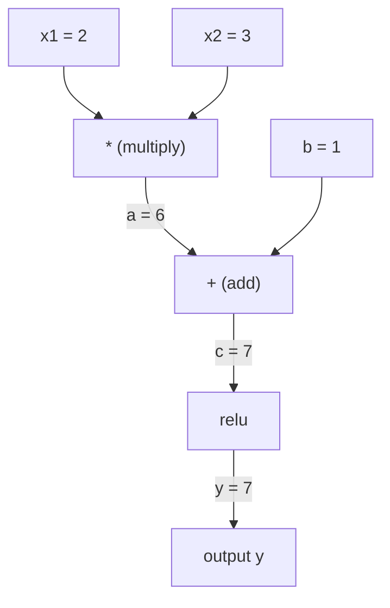
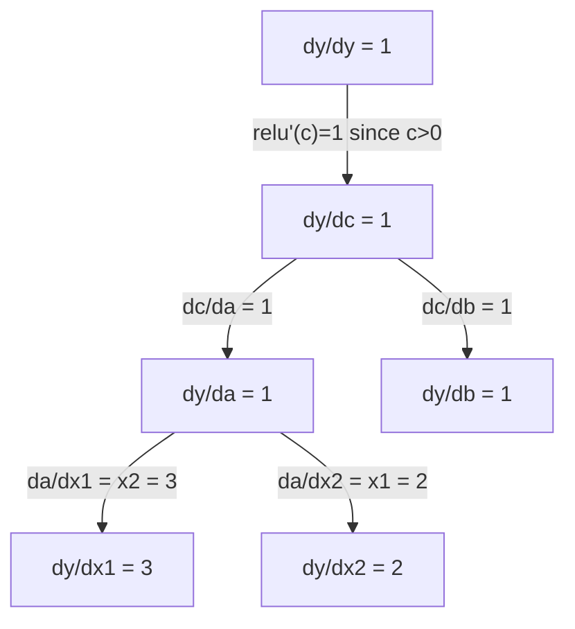

# Aturan Rantai & Diferensiasi Otomatis

> Aturan rantai adalah mesin di balik setiap neural network yang belajar.

**Type:** Build
**Language:** Python
**Prerequisites:** Phase 1, Lesson 04 (Derivatives & Gradients)
**Time:** ~90 minutes

## Tujuan Pembelajaran

- Bangun engine autograd minimal (kelas Value) yang merekam operasi dan menghitung gradien lewat autodiff reverse-mode
- Implementasikan forward dan backward pass melalui computation graph memakai topological sort
- Bangun dan latih multi-layer perceptron pada XOR hanya memakai engine autograd dari-nol
- Verifikasi kebenaran autodiff memakai gradient checking terhadap finite difference numerik

## Masalahnya

Kamu bisa menghitung turunan fungsi sederhana. Tetapi neural network bukan fungsi sederhana. Ia adalah ratusan fungsi yang dikomposisikan: perkalian matriks, tambah bias, terapkan aktivasi, perkalian matriks lagi, softmax, loss cross-entropy. Output adalah fungsi dari fungsi dari fungsi.

Untuk melatih network, kamu butuh gradien loss terhadap setiap bobot. Melakukan ini dengan tangan mustahil untuk jutaan parameter. Melakukannya secara numerik (finite difference) terlalu lambat.

Aturan rantai memberimu matematikanya. Diferensiasi otomatis memberimu algoritmenya. Bersama-sama mereka memungkinkanmu menghitung gradien eksak melalui komposisi fungsi arbitrer dalam waktu yang proporsional dengan satu forward pass.

Inilah cara kerja PyTorch, TensorFlow, dan JAX. Kamu akan membangun versi mininya dari nol.

## Konsepnya

### Aturan Rantai

Jika `y = f(g(x))`, turunan `y` terhadap `x` adalah:

```
dy/dx = dy/dg * dg/dx = f'(g(x)) * g'(x)
```

Kalikan turunan-turunan sepanjang rantai. Setiap mata rantai menyumbang turunan lokalnya.

Contoh: `y = sin(x^2)`

```
g(x) = x^2       g'(x) = 2x
f(g) = sin(g)     f'(g) = cos(g)

dy/dx = cos(x^2) * 2x
```

Untuk komposisi yang lebih dalam, rantainya memanjang:

```
y = f(g(h(x)))

dy/dx = f'(g(h(x))) * g'(h(x)) * h'(x)
```

Setiap layer dalam neural network adalah satu mata rantai ini.

### Computation Graph

Computation graph membuat aturan rantai menjadi visual. Setiap operasi menjadi node. Data mengalir maju melalui graf. Gradien mengalir mundur.

**Forward pass (hitung nilai):**



**Backward pass (hitung gradien):**



Backward pass menerapkan aturan rantai di setiap node, merambatkan gradien dari output ke input.

### Mode Forward vs Mode Reverse

Ada dua cara menerapkan aturan rantai melalui graf.

**Forward mode** mulai dari input dan mendorong turunan ke depan. Ia menghitung `dx/dx = 1` dan merambatkannya melalui setiap operasi. Bagus ketika kamu punya sedikit input dan banyak output.

```
Forward mode: seed dx/dx = 1, propagate forward

  x = 2       (dx/dx = 1)
  a = x^2     (da/dx = 2x = 4)
  y = sin(a)  (dy/dx = cos(a) * da/dx = cos(4) * 4 = -2.615)
```

**Reverse mode** mulai dari output dan menarik gradien ke belakang. Ia menghitung `dy/dy = 1` dan merambatkannya melalui setiap operasi secara terbalik. Bagus ketika kamu punya banyak input dan sedikit output.

```
Reverse mode: seed dy/dy = 1, propagate backward

  y = sin(a)  (dy/dy = 1)
  a = x^2     (dy/da = cos(a) = cos(4) = -0.654)
  x = 2       (dy/dx = dy/da * da/dx = -0.654 * 4 = -2.615)
```

Neural network memiliki jutaan input (bobot) dan satu output (loss). Reverse mode menghitung semua gradien dalam satu backward pass. Inilah mengapa backpropagation memakai reverse mode.

| Mode | Seed | Direction | Best when |
|------|------|-----------|-----------|
| Forward | `dx_i/dx_i = 1` | Input to output | Few inputs, many outputs |
| Reverse | `dy/dy = 1` | Output to input | Many inputs, few outputs (neural nets) |

### Bilangan Dual untuk Forward Mode

Forward mode dapat diimplementasikan elegan dengan bilangan dual. Bilangan dual berbentuk `a + b*epsilon` di mana `epsilon^2 = 0`.

```
Dual number: (value, derivative)

(2, 1) means: value is 2, derivative w.r.t. x is 1

Arithmetic rules:
  (a, a') + (b, b') = (a+b, a'+b')
  (a, a') * (b, b') = (a*b, a'*b + a*b')
  sin(a, a')         = (sin(a), cos(a)*a')
```

Seed variabel input dengan turunan 1. Turunannya merambat otomatis melalui setiap operasi.

### Membangun Engine Autograd

Engine autograd membutuhkan tiga hal:

1. **Value wrapping.** Bungkus setiap angka dalam objek yang menyimpan nilai dan gradiennya.
2. **Graph recording.** Setiap operasi merekam inputnya dan fungsi gradien lokal.
3. **Backward pass.** Urutkan graf secara topologis, lalu telusuri secara terbalik, terapkan aturan rantai di tiap node.

Inilah tepatnya yang dilakukan `autograd` milik PyTorch. Kelas `torch.Tensor` membungkus nilai, merekam operasi ketika `requires_grad=True`, dan menghitung gradien ketika kamu memanggil `.backward()`.

### Cara Kerja PyTorch Autograd di Balik Layar

Ketika kamu menulis kode PyTorch:

```python
x = torch.tensor(2.0, requires_grad=True)
y = x ** 2 + 3 * x + 1
y.backward()
print(x.grad)  # 7.0 = 2*x + 3 = 2*2 + 3
```

Secara internal PyTorch:

1. Membuat node `Tensor` untuk `x` dengan `requires_grad=True`
2. Setiap operasi (`**`, `*`, `+`) membuat node baru dan merekam fungsi backward
3. `y.backward()` memicu autodiff reverse-mode melalui graf yang direkam
4. `grad_fn` tiap node menghitung gradien lokal dan meneruskannya ke node induk
5. Gradien terakumulasi di atribut `.grad` lewat penjumlahan (bukan penggantian)

Grafnya dinamis (define-by-run). Graf baru dibangun pada setiap forward pass. Inilah mengapa PyTorch mendukung control flow (if/else, loop) di dalam model.

```figure
chain-rule
```

## Bangun Sendiri

### Langkah 1: Kelas Value

```python
class Value:
    def __init__(self, data, children=(), op=''):
        self.data = data
        self.grad = 0.0
        self._backward = lambda: None
        self._prev = set(children)
        self._op = op

    def __repr__(self):
        return f"Value(data={self.data:.4f}, grad={self.grad:.4f})"
```

Setiap `Value` menyimpan data numeriknya, gradiennya (awalnya nol), fungsi backward, dan pointer ke node-node anak yang menghasilkannya.

### Langkah 2: Operasi aritmetika dengan pelacakan gradien

```python
    def __add__(self, other):
        other = other if isinstance(other, Value) else Value(other)
        out = Value(self.data + other.data, (self, other), '+')
        def _backward():
            self.grad += out.grad
            other.grad += out.grad
        out._backward = _backward
        return out

    def __mul__(self, other):
        other = other if isinstance(other, Value) else Value(other)
        out = Value(self.data * other.data, (self, other), '*')
        def _backward():
            self.grad += other.data * out.grad
            other.grad += self.data * out.grad
        out._backward = _backward
        return out

    def relu(self):
        out = Value(max(0, self.data), (self,), 'relu')
        def _backward():
            self.grad += (1.0 if out.data > 0 else 0.0) * out.grad
        out._backward = _backward
        return out
```

Setiap operasi membuat closure yang tahu cara menghitung gradien lokal dan mengalikannya dengan gradien hulu (`out.grad`). `+=` menangani kasus ketika sebuah nilai dipakai dalam beberapa operasi.

### Langkah 3: Backward pass

```python
    def backward(self):
        topo = []
        visited = set()
        def build_topo(v):
            if v not in visited:
                visited.add(v)
                for child in v._prev:
                    build_topo(child)
                topo.append(v)
        build_topo(self)

        self.grad = 1.0
        for v in reversed(topo):
            v._backward()
```

Topological sort memastikan gradien setiap node dihitung penuh sebelum merambat ke anak-anaknya. Gradien seed adalah 1.0 (dy/dy = 1).

### Langkah 4: Lebih banyak operasi untuk engine yang lengkap

Kelas Value dasar menangani penjumlahan, perkalian, dan relu. Engine autograd sungguhan butuh lebih. Ini operasi-operasi yang kamu butuhkan untuk membangun neural network:

```python
    def __neg__(self):
        return self * -1

    def __sub__(self, other):
        return self + (-other)

    def __radd__(self, other):
        return self + other

    def __rmul__(self, other):
        return self * other

    def __rsub__(self, other):
        return other + (-self)

    def __pow__(self, n):
        out = Value(self.data ** n, (self,), f'**{n}')
        def _backward():
            self.grad += n * (self.data ** (n - 1)) * out.grad
        out._backward = _backward
        return out

    def __truediv__(self, other):
        return self * (other ** -1) if isinstance(other, Value) else self * (Value(other) ** -1)

    def exp(self):
        import math
        e = math.exp(self.data)
        out = Value(e, (self,), 'exp')
        def _backward():
            self.grad += e * out.grad
        out._backward = _backward
        return out

    def log(self):
        import math
        out = Value(math.log(self.data), (self,), 'log')
        def _backward():
            self.grad += (1.0 / self.data) * out.grad
        out._backward = _backward
        return out

    def tanh(self):
        import math
        t = math.tanh(self.data)
        out = Value(t, (self,), 'tanh')
        def _backward():
            self.grad += (1 - t ** 2) * out.grad
        out._backward = _backward
        return out
```

**Mengapa setiap operasi penting:**

| Operation | Backward rule | Used in |
|-----------|--------------|---------|
| `__sub__` | Reuses add + neg | Loss computation (pred - target) |
| `__pow__` | n * x^(n-1) | Polynomial activations, MSE (error^2) |
| `__truediv__` | Reuses mul + pow(-1) | Normalization, learning rate scaling |
| `exp` | exp(x) * upstream | Softmax, log-likelihood |
| `log` | (1/x) * upstream | Cross-entropy loss, log probabilities |
| `tanh` | (1 - tanh^2) * upstream | Classic activation function |

Bagian cerdasnya: `__sub__` dan `__truediv__` didefinisikan dari operasi yang sudah ada. Mereka mendapat gradien yang benar secara gratis karena aturan rantai terkomposisi melalui operasi add/mul/pow di bawahnya.

### Langkah 5: MLP mini dari nol

Dengan kelas Value yang lengkap, kamu bisa membangun neural network. Tanpa PyTorch. Tanpa NumPy. Hanya Value dan aturan rantai.

```python
import random

class Neuron:
    def __init__(self, n_inputs):
        self.w = [Value(random.uniform(-1, 1)) for _ in range(n_inputs)]
        self.b = Value(0.0)

    def __call__(self, x):
        act = sum((wi * xi for wi, xi in zip(self.w, x)), self.b)
        return act.tanh()

    def parameters(self):
        return self.w + [self.b]

class Layer:
    def __init__(self, n_inputs, n_outputs):
        self.neurons = [Neuron(n_inputs) for _ in range(n_outputs)]

    def __call__(self, x):
        return [n(x) for n in self.neurons]

    def parameters(self):
        return [p for n in self.neurons for p in n.parameters()]

class MLP:
    def __init__(self, sizes):
        self.layers = [Layer(sizes[i], sizes[i+1]) for i in range(len(sizes)-1)]

    def __call__(self, x):
        for layer in self.layers:
            x = layer(x)
        return x[0] if len(x) == 1 else x

    def parameters(self):
        return [p for layer in self.layers for p in layer.parameters()]
```

`Neuron` menghitung `tanh(w1*x1 + w2*x2 + ... + b)`. `Layer` adalah daftar neuron. `MLP` menumpuk layer. Setiap bobot adalah `Value`, sehingga memanggil `loss.backward()` merambatkan gradien ke setiap parameter.

**Training pada XOR:**

```python
random.seed(42)
model = MLP([2, 4, 1])  # 2 inputs, 4 hidden neurons, 1 output

xs = [[0, 0], [0, 1], [1, 0], [1, 1]]
ys = [-1, 1, 1, -1]  # XOR pattern (using -1/1 for tanh)

for step in range(100):
    preds = [model(x) for x in xs]
    loss = sum((p - y) ** 2 for p, y in zip(preds, ys))

    for p in model.parameters():
        p.grad = 0.0
    loss.backward()

    lr = 0.05
    for p in model.parameters():
        p.data -= lr * p.grad

    if step % 20 == 0:
        print(f"step {step:3d}  loss = {loss.data:.4f}")

print("\nPredictions after training:")
for x, y in zip(xs, ys):
    print(f"  input={x}  target={y:2d}  pred={model(x).data:6.3f}")
```

Ini adalah micrograd. Loop training neural network yang lengkap dalam Python murni dengan diferensiasi otomatis. Setiap framework deep learning komersial melakukan hal yang sama dalam skala masif.

### Langkah 6: Gradient checking

Bagaimana kamu tahu autodiff-mu benar? Bandingkan dengan turunan numerik. Inilah gradient checking.

```python
def gradient_check(build_expr, x_val, h=1e-7):
    x = Value(x_val)
    y = build_expr(x)
    y.backward()
    autodiff_grad = x.grad

    y_plus = build_expr(Value(x_val + h)).data
    y_minus = build_expr(Value(x_val - h)).data
    numerical_grad = (y_plus - y_minus) / (2 * h)

    diff = abs(autodiff_grad - numerical_grad)
    return autodiff_grad, numerical_grad, diff
```

Uji pada ekspresi yang kompleks:

```python
def expr(x):
    return (x ** 3 + x * 2 + 1).tanh()

ad, num, diff = gradient_check(expr, 0.5)
print(f"Autodiff:  {ad:.8f}")
print(f"Numerical: {num:.8f}")
print(f"Difference: {diff:.2e}")
# Difference should be < 1e-5
```

Gradient checking esensial ketika mengimplementasikan operasi baru. Jika backward pass-mu punya bug, cek numerik menangkapnya. Setiap implementasi deep learning yang serius menjalankan gradient check selama pengembangan.

**Kapan memakai gradient checking:**

| Situation | Do gradient check? |
|-----------|-------------------|
| Adding a new operation to your autograd | Yes, always |
| Debugging a training loop that won't converge | Yes, check gradients first |
| Production training | No, too slow (2x forward passes per parameter) |
| Unit tests for autograd code | Yes, automate it |

### Langkah 7: Verifikasi terhadap perhitungan manual

```python
x1 = Value(2.0)
x2 = Value(3.0)
a = x1 * x2          # a = 6.0
b = a + Value(1.0)    # b = 7.0
y = b.relu()          # y = 7.0

y.backward()

print(f"y = {y.data}")          # 7.0
print(f"dy/dx1 = {x1.grad}")   # 3.0 (= x2)
print(f"dy/dx2 = {x2.grad}")   # 2.0 (= x1)
```

Cek manual: `y = relu(x1*x2 + 1)`. Karena `x1*x2 + 1 = 7 > 0`, relu adalah identitas.
`dy/dx1 = x2 = 3`. `dy/dx2 = x1 = 2`. Enginenya cocok.

## Gunakan

### Verifikasi terhadap PyTorch

```python
import torch

x1 = torch.tensor(2.0, requires_grad=True)
x2 = torch.tensor(3.0, requires_grad=True)
a = x1 * x2
b = a + 1.0
y = torch.relu(b)
y.backward()

print(f"PyTorch dy/dx1 = {x1.grad.item()}")  # 3.0
print(f"PyTorch dy/dx2 = {x2.grad.item()}")  # 2.0
```

Gradien yang sama. Engine-mu menghitung hasil yang sama dengan PyTorch karena matematikanya sama: autodiff reverse-mode lewat aturan rantai.

### Ekspresi yang lebih kompleks

```python
a = Value(2.0)
b = Value(-3.0)
c = Value(10.0)
f = (a * b + c).relu()  # relu(2*(-3) + 10) = relu(4) = 4

f.backward()
print(f"df/da = {a.grad}")  # -3.0 (= b)
print(f"df/db = {b.grad}")  #  2.0 (= a)
print(f"df/dc = {c.grad}")  #  1.0
```

## Rilis

Pelajaran ini menghasilkan:
- `outputs/skill-autodiff.md` -- sebuah skill untuk membangun dan men-debug sistem autograd
- `code/autodiff.py` -- engine autograd minimal yang bisa kamu perluas

Kelas Value yang dibangun di sini adalah fondasi loop training neural network di Fase 3.

## Latihan

1. Tambahkan `__pow__` ke kelas Value agar kamu bisa menghitung `x ** n`. Verifikasi bahwa `d/dx(x^3)` pada `x=2` sama dengan `12.0`.

2. Tambahkan `tanh` sebagai fungsi aktivasi. Verifikasi bahwa `tanh'(0) = 1` dan `tanh'(2) = 0.0707` (kira-kira).

3. Bangun computation graph untuk satu neuron: `y = relu(w1*x1 + w2*x2 + b)`. Hitung kelima gradien dan verifikasi terhadap PyTorch.

4. Implementasikan autodiff forward-mode memakai bilangan dual. Buat kelas `Dual` dan verifikasi ia memberi turunan yang sama dengan engine reverse-mode-mu.

## Istilah Kunci

| Term | What people say | What it actually means |
|------|----------------|----------------------|
| Chain rule | "Multiply the derivatives" | The derivative of composed functions equals the product of each function's local derivative, evaluated at the right point |
| Computational graph | "The network diagram" | A directed acyclic graph where nodes are operations and edges carry values (forward) or gradients (backward) |
| Forward mode | "Push derivatives forward" | Autodiff that propagates derivatives from inputs to outputs. One pass per input variable. |
| Reverse mode | "Backpropagation" | Autodiff that propagates gradients from outputs to inputs. One pass per output variable. |
| Autograd | "Automatic gradients" | A system that records operations on values, builds a graph, and computes exact gradients via the chain rule |
| Dual numbers | "Value plus derivative" | Numbers of the form a + b*epsilon (epsilon^2 = 0) that carry derivative information through arithmetic |
| Topological sort | "Dependency order" | Ordering graph nodes so every node comes after all its dependencies. Required for correct gradient propagation. |
| Gradient accumulation | "Add, don't replace" | When a value feeds into multiple operations, its gradient is the sum of all incoming gradient contributions |
| Dynamic graph | "Define by run" | A computation graph rebuilt on every forward pass, allowing Python control flow inside models (PyTorch style) |
| Gradient checking | "Numerical verification" | Comparing autodiff gradients against numerical finite-difference gradients to verify correctness. Essential for debugging. |
| MLP | "Multi-layer perceptron" | A neural network with one or more hidden layers of neurons. Each neuron computes a weighted sum plus bias, then applies an activation function. |
| Neuron | "Weighted sum + activation" | The basic unit: output = activation(w1*x1 + w2*x2 + ... + b). The weights and bias are learnable parameters. |

## Bacaan Lanjutan

- [3Blue1Brown: Backpropagation calculus](https://www.youtube.com/watch?v=tIeHLnjs5U8) -- penjelasan visual aturan rantai dalam neural network
- [PyTorch Autograd mechanics](https://pytorch.org/docs/stable/notes/autograd.html) -- cara kerja sistem yang sebenarnya
- [Baydin et al., Automatic Differentiation in Machine Learning: a Survey](https://arxiv.org/abs/1502.05767) -- referensi komprehensif
