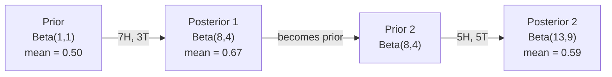

# Teorema Bayes

> Probabilitas tentang apa yang kamu harapkan. Teorema Bayes tentang apa yang kamu pelajari.

**Type:** Build
**Language:** Python
**Prerequisites:** Phase 1, Lesson 06 (Probability Fundamentals)
**Time:** ~75 minutes

## Tujuan Pembelajaran

- Terapkan teorema Bayes untuk menghitung probabilitas posterior dari prior, likelihood, dan evidence
- Bangun pengklasifikasi teks Naive Bayes dari nol dengan Laplace smoothing dan komputasi ruang-log
- Bandingkan estimasi MLE dan MAP dan jelaskan bagaimana MAP berkorespondensi dengan regularisasi L2
- Implementasikan pembaruan Bayesian sekuensial memakai prior konjugat Beta-Binomial untuk pengujian A/B

## Masalahnya

Tes medis 99% akurat. Kamu dinyatakan positif. Berapa peluang kamu benar-benar sakit?

Kebanyakan orang menjawab 99%. Jawaban sebenarnya bergantung pada seberapa langka penyakitnya. Jika 1 dari 10.000 orang memilikinya, hasil positif hanya memberimu peluang sakit sekitar 1%. 99% hasil positif lainnya adalah alarm palsu dari orang sehat.

Ini bukan pertanyaan jebakan. Ini teorema Bayes. Setiap filter spam, setiap diagnostik medis, setiap model machine learning yang mengkuantifikasi ketidakpastian memakai penalaran yang persis ini. Kamu mulai dengan keyakinan. Kamu melihat bukti. Kamu memperbarui.

Jika kamu membangun sistem ML tanpa memahami ini, kamu akan salah menafsirkan output model, menetapkan ambang yang buruk, dan merilis prediksi yang terlalu percaya diri.

## Konsepnya

### Dari probabilitas joint ke Bayes

Kamu sudah tahu dari Pelajaran 06 bahwa probabilitas bersyarat adalah:

```
P(A|B) = P(A and B) / P(B)
```

Dan secara simetris:

```
P(B|A) = P(A and B) / P(A)
```

Kedua ekspresi berbagi pembilang yang sama: P(A and B). Samakan dan susun ulang:

```
P(A and B) = P(A|B) * P(B) = P(B|A) * P(A)

Therefore:

P(A|B) = P(B|A) * P(A) / P(B)
```

Itulah teorema Bayes. Empat kuantitas, satu persamaan.

### Empat bagian

| Part | Name | What it means |
|------|------|---------------|
| P(A\|B) | Posterior | Your updated belief about A after seeing evidence B |
| P(B\|A) | Likelihood | How probable the evidence B is if A is true |
| P(A) | Prior | Your belief about A before seeing any evidence |
| P(B) | Evidence | Total probability of seeing B under all possibilities |

Suku evidence P(B) bertindak sebagai normalizer. Kamu bisa menguraikannya memakai hukum probabilitas total:

```
P(B) = P(B|A) * P(A) + P(B|not A) * P(not A)
```

### Contoh tes medis

Penyakit menyerang 1 dari 10.000 orang. Tesnya 99% akurat (menangkap 99% orang sakit, memberi positif palsu 1% dari waktu).

```
P(sick)          = 0.0001     (prior: disease is rare)
P(positive|sick) = 0.99       (likelihood: test catches it)
P(positive|healthy) = 0.01    (false positive rate)

P(positive) = P(positive|sick) * P(sick) + P(positive|healthy) * P(healthy)
            = 0.99 * 0.0001 + 0.01 * 0.9999
            = 0.000099 + 0.009999
            = 0.010098

P(sick|positive) = P(positive|sick) * P(sick) / P(positive)
                 = 0.99 * 0.0001 / 0.010098
                 = 0.0098
                 = 0.98%
```

Kurang dari 1%. Prior mendominasi. Ketika suatu kondisi langka, bahkan tes akurat menghasilkan mayoritas positif palsu. Inilah mengapa dokter memesan tes konfirmasi.

### Contoh filter spam

Kamu menerima email berisi kata "lottery". Apakah itu spam?

```
P(spam)                = 0.3      (30% of email is spam)
P("lottery"|spam)      = 0.05     (5% of spam emails contain "lottery")
P("lottery"|not spam)  = 0.001    (0.1% of legitimate emails contain "lottery")

P("lottery") = 0.05 * 0.3 + 0.001 * 0.7
             = 0.015 + 0.0007
             = 0.0157

P(spam|"lottery") = 0.05 * 0.3 / 0.0157
                  = 0.955
                  = 95.5%
```

Satu kata menggeser probabilitas dari 30% ke 95,5%. Filter spam sungguhan menerapkan Bayes ke ratusan kata sekaligus.

### Naive Bayes: asumsi independensi

Naive Bayes memperluas ini ke banyak fitur dengan mengasumsikan semua fitur independen bersyarat jika kelasnya diketahui:

```
P(class | feature_1, feature_2, ..., feature_n)
  = P(class) * P(feature_1|class) * P(feature_2|class) * ... * P(feature_n|class)
    / P(feature_1, feature_2, ..., feature_n)
```

Bagian "naif" adalah asumsi independensi. Dalam teks, kemunculan kata tidak independen ("New" dan "York" berkorelasi). Tetapi asumsi ini bekerja mengejutkan baiknya dalam praktik karena pengklasifikasi hanya perlu memeringkat kelas, bukan menghasilkan probabilitas yang terkalibrasi.

Karena penyebutnya sama untuk semua kelas, kamu bisa melewatkannya dan cukup membandingkan pembilang:

```
score(class) = P(class) * product of P(feature_i | class)
```

Pilih kelas dengan skor tertinggi.

### Estimasi maximum likelihood (MLE)

Bagaimana mendapatkan P(feature|class) dari data training? Hitung.

```
P("free"|spam) = (number of spam emails containing "free") / (total spam emails)
```

Inilah MLE: pilih nilai parameter yang membuat data observasi paling mungkin. Kamu memaksimalkan fungsi likelihood, yang untuk cacahan diskret mereduksi menjadi frekuensi relatif.

Masalah: jika sebuah kata tidak pernah muncul di spam selama training, MLE memberinya probabilitas nol. Satu kata tak terlihat membunuh seluruh hasil kali. Perbaiki dengan Laplace smoothing:

```
P(word|class) = (count(word, class) + 1) / (total_words_in_class + vocabulary_size)
```

Menambahkan 1 ke setiap cacahan memastikan tidak ada probabilitas yang nol.

### Maximum a posteriori (MAP)

MLE bertanya: parameter apa yang memaksimalkan P(data|parameters)?

MAP bertanya: parameter apa yang memaksimalkan P(parameters|data)?

Menurut teorema Bayes:

```
P(parameters|data) proportional to P(data|parameters) * P(parameters)
```

MAP menambahkan prior atas parameter itu sendiri. Jika kamu percaya parameter seharusnya kecil, kamu mengodekannya sebagai prior yang menghukum nilai besar. Ini identik dengan regularisasi L2 di ML. Penalti "ridge" dalam regresi ridge secara harfiah adalah prior Gaussian atas bobot.

| Estimation | Optimizes | ML equivalent |
|------------|-----------|---------------|
| MLE | P(data\|params) | Unregularized training |
| MAP | P(data\|params) * P(params) | L2 / L1 regularization |

### Bayesian vs frequentist: perbedaan praktis

Frequentist memperlakukan parameter sebagai unknown yang tetap. Mereka bertanya: "Jika aku mengulangi eksperimen ini berkali-kali, apa yang terjadi?"

Bayesian memperlakukan parameter sebagai distribusi. Mereka bertanya: "Berdasarkan apa yang telah kuamati, apa keyakinanku tentang parameter?"

Untuk membangun sistem ML, perbedaan praktisnya:

| Aspect | Frequentist | Bayesian |
|--------|-------------|----------|
| Output | Point estimate | Distribution over values |
| Uncertainty | Confidence intervals (about procedure) | Credible intervals (about parameter) |
| Small data | Can overfit | Prior acts as regularization |
| Computation | Usually faster | Often requires sampling (MCMC) |

Kebanyakan ML produksi itu frequentist (SGD, estimasi titik). Metode Bayesian bersinar ketika kamu butuh ketidakpastian terkalibrasi (keputusan medis, sistem safety-critical) atau ketika data langka (few-shot learning, cold start).

### Mengapa pemikiran Bayesian penting untuk ML

Hubungannya lebih dalam daripada analogi:

**Prior adalah regularisasi.** Prior Gaussian atas bobot adalah regularisasi L2. Prior Laplace adalah L1. Setiap kali kamu menambahkan suku regularisasi, kamu membuat pernyataan Bayesian tentang nilai parameter apa yang kamu harapkan.

**Posterior adalah ketidakpastian.** Satu probabilitas prediksi tidak memberi tahu apa pun tentang seberapa yakin model terhadap estimasi itu. Metode Bayesian memberimu distribusi: "Aku pikir P(spam) antara 0,8 dan 0,95."

**Pembaruan Bayes adalah online learning.** Posterior hari ini menjadi prior esok. Ketika model-mu melihat data baru, ia memperbarui keyakinannya secara inkremental alih-alih training ulang dari nol.

**Perbandingan model itu Bayesian.** Bayesian information criterion (BIC), marginal likelihood, dan faktor Bayes semuanya memakai penalaran Bayesian untuk memilih antar model tanpa overfitting.

```figure
bayes-update
```

## Bangun Sendiri

### Langkah 1: Fungsi teorema Bayes

```python
def bayes(prior, likelihood, false_positive_rate):
    evidence = likelihood * prior + false_positive_rate * (1 - prior)
    posterior = likelihood * prior / evidence
    return posterior

result = bayes(prior=0.0001, likelihood=0.99, false_positive_rate=0.01)
print(f"P(sick|positive) = {result:.4f}")
```

### Langkah 2: Pengklasifikasi Naive Bayes

```python
import math
from collections import defaultdict

class NaiveBayes:
    def __init__(self, smoothing=1.0):
        self.smoothing = smoothing
        self.class_counts = defaultdict(int)
        self.word_counts = defaultdict(lambda: defaultdict(int))
        self.class_word_totals = defaultdict(int)
        self.vocab = set()

    def train(self, documents, labels):
        for doc, label in zip(documents, labels):
            self.class_counts[label] += 1
            words = doc.lower().split()
            for word in words:
                self.word_counts[label][word] += 1
                self.class_word_totals[label] += 1
                self.vocab.add(word)

    def predict(self, document):
        words = document.lower().split()
        total_docs = sum(self.class_counts.values())
        vocab_size = len(self.vocab)
        best_class = None
        best_score = float("-inf")
        for cls in self.class_counts:
            score = math.log(self.class_counts[cls] / total_docs)
            for word in words:
                count = self.word_counts[cls].get(word, 0)
                total = self.class_word_totals[cls]
                score += math.log((count + self.smoothing) / (total + self.smoothing * vocab_size))
            if score > best_score:
                best_score = score
                best_class = cls
        return best_class
```

Log probabilitas mencegah underflow. Mengalikan banyak probabilitas kecil menghasilkan angka terlalu mungil untuk floating point. Menjumlahkan log-probabilitas stabil secara numerik dan ekuivalen secara matematis.

### Langkah 3: Training pada data spam

```python
train_docs = [
    "win free money now",
    "free lottery ticket winner",
    "claim your prize today free",
    "urgent offer free cash",
    "congratulations you won free",
    "meeting tomorrow at noon",
    "project update attached",
    "can we schedule a call",
    "quarterly report review",
    "lunch on thursday sounds good",
    "team standup notes attached",
    "please review the pull request",
]

train_labels = [
    "spam", "spam", "spam", "spam", "spam",
    "ham", "ham", "ham", "ham", "ham", "ham", "ham",
]

classifier = NaiveBayes()
classifier.train(train_docs, train_labels)

test_messages = [
    "free money waiting for you",
    "meeting rescheduled to friday",
    "you won a free prize",
    "please review the attached report",
]

for msg in test_messages:
    print(f"  '{msg}' -> {classifier.predict(msg)}")
```

### Langkah 4: Periksa probabilitas yang dipelajari

```python
def show_top_words(classifier, cls, n=5):
    vocab_size = len(classifier.vocab)
    total = classifier.class_word_totals[cls]
    probs = {}
    for word in classifier.vocab:
        count = classifier.word_counts[cls].get(word, 0)
        probs[word] = (count + classifier.smoothing) / (total + classifier.smoothing * vocab_size)
    sorted_words = sorted(probs.items(), key=lambda x: x[1], reverse=True)
    for word, prob in sorted_words[:n]:
        print(f"    {word}: {prob:.4f}")

print("\nTop spam words:")
show_top_words(classifier, "spam")
print("\nTop ham words:")
show_top_words(classifier, "ham")
```

## Gunakan

Scikit-learn menyediakan implementasi naive Bayes siap produksi:

```python
from sklearn.feature_extraction.text import CountVectorizer
from sklearn.naive_bayes import MultinomialNB
from sklearn.metrics import classification_report

vectorizer = CountVectorizer()
X_train = vectorizer.fit_transform(train_docs)
clf = MultinomialNB()
clf.fit(X_train, train_labels)

X_test = vectorizer.transform(test_messages)
predictions = clf.predict(X_test)
for msg, pred in zip(test_messages, predictions):
    print(f"  '{msg}' -> {pred}")
```

Algoritme yang sama. CountVectorizer menangani tokenisasi dan pembangunan kosakata. MultinomialNB menangani smoothing dan log-probabilitas secara internal. Versi dari-nol-mu melakukan hal yang sama dalam 40 baris.

## Rilis

Kelas NaiveBayes yang dibangun di sini mendemonstrasikan pipeline penuh: tokenisasi, estimasi probabilitas dengan Laplace smoothing, prediksi ruang-log. Kode di `code/bayes.py` berjalan end-to-end tanpa dependensi selain standard library Python.

### Prior Konjugat

Ketika prior dan posterior berasal dari keluarga distribusi yang sama, prior disebut "konjugat". Ini membuat pembaruan Bayesian bersih secara aljabar -- kamu mendapat posterior bentuk-tertutup tanpa integrasi numerik.

| Likelihood | Conjugate Prior | Posterior | Example |
|-----------|----------------|-----------|---------|
| Bernoulli | Beta(a, b) | Beta(a + successes, b + failures) | Coin flip bias estimation |
| Normal (known variance) | Normal(mu_0, sigma_0) | Normal(weighted mean, smaller variance) | Sensor calibration |
| Poisson | Gamma(a, b) | Gamma(a + sum of counts, b + n) | Modeling arrival rates |
| Multinomial | Dirichlet(alpha) | Dirichlet(alpha + counts) | Topic modeling, language models |

Mengapa ini penting: tanpa prior konjugat, kamu butuh sampling Monte Carlo atau variational inference untuk mengaproksimasi posterior. Dengan prior konjugat, kamu cukup memperbarui dua angka.

Distribusi Beta adalah prior konjugat paling umum dalam praktik. Beta(a, b) merepresentasikan keyakinanmu tentang parameter probabilitas. Mean-nya adalah a/(a+b). Makin besar a+b, makin terkonsentrasi (yakin) distribusinya.

Kasus khusus prior Beta:
- Beta(1, 1) = uniform. Kamu tidak punya pendapat tentang parameter.
- Beta(10, 10) = memuncak di 0,5. Kamu sangat yakin parameter dekat 0,5.
- Beta(1, 10) = condong ke 0. Kamu percaya parameternya kecil.

Aturan pembaruannya sangat sederhana:

```
Prior:     Beta(a, b)
Data:      s successes, f failures
Posterior: Beta(a + s, b + f)
```

Tanpa integral. Tanpa sampling. Hanya penjumlahan.

### Pembaruan Bayesian Sekuensial

Inferensi Bayesian secara alami sekuensial. Posterior hari ini menjadi prior esok. Beginilah sistem nyata belajar inkremental tanpa memproses ulang semua data historis.

Contoh konkret: mengestimasi apakah sebuah koin adil.

**Hari 1: Belum ada data.**
Mulai dengan Beta(1, 1) -- prior uniform. Kamu tidak punya pendapat.
- Mean prior: 0,5
- Prior datar di [0, 1]

**Hari 2: Amati 7 head, 3 tail.**
Posterior = Beta(1 + 7, 1 + 3) = Beta(8, 4)
- Mean posterior: 8/12 = 0,667
- Evidence menunjukkan koin bias ke head

**Hari 3: Amati 5 head lagi, 5 tail lagi.**
Pakai posterior kemarin sebagai prior hari ini.
Posterior = Beta(8 + 5, 4 + 5) = Beta(13, 9)
- Mean posterior: 13/22 = 0,591
- Data baru yang seimbang menarik estimasi kembali ke 0,5



Urutan observasi tidak penting. Beta(1,1) yang diperbarui dengan seluruh 12 head dan 8 tail sekaligus memberi Beta(13, 9) -- hasil yang sama. Pembaruan sekuensial dan pembaruan batch ekuivalen secara matematis. Tetapi pembaruan sekuensial memungkinkanmu mengambil keputusan di tiap langkah tanpa menyimpan data mentah.

Inilah fondasi online learning dalam sistem ML produksi. Thompson sampling untuk bandit, sistem rekomendasi inkremental, dan detektor anomali streaming semuanya memakai pola ini.

### Hubungan dengan Pengujian A/B

Pengujian A/B adalah inferensi Bayesian yang menyamar.

Setup: kamu menguji dua warna tombol. Varian A (biru) dan varian B (hijau). Kamu ingin tahu mana yang mendapat lebih banyak klik.

Uji A/B Bayesian:

1. **Prior.** Mulai dengan Beta(1, 1) untuk kedua varian. Tanpa preferensi awal.
2. **Data.** Varian A: 50 klik dari 1000 tayang. Varian B: 65 klik dari 1000 tayang.
3. **Posterior.**
   - A: Beta(1 + 50, 1 + 950) = Beta(51, 951). Mean = 0,051
   - B: Beta(1 + 65, 1 + 935) = Beta(66, 936). Mean = 0,066
4. **Keputusan.** Hitung P(B > A) -- probabilitas bahwa tingkat konversi sejati B lebih tinggi dari A.

Menghitung P(B > A) secara analitik itu sulit. Tetapi Monte Carlo membuatnya trivial:

```
1. Draw 100,000 samples from Beta(51, 951)  -> samples_A
2. Draw 100,000 samples from Beta(66, 936)  -> samples_B
3. P(B > A) = fraction of samples where B > A
```

Jika P(B > A) > 0,95, kamu merilis varian B. Jika di antara 0,05 dan 0,95, kamu terus mengumpulkan data. Jika P(B > A) < 0,05, kamu merilis varian A.

Keunggulan atas pengujian A/B frequentist:
- Kamu mendapat pernyataan probabilitas langsung: "ada peluang 97% B lebih baik"
- Tanpa kebingungan p-value. Tanpa basa-basi "fail to reject the null hypothesis".
- Kamu bisa mengecek hasil kapan saja tanpa menggembungkan tingkat positif palsu (tanpa "peeking problem")
- Kamu bisa memasukkan pengetahuan prior (mis. tes sebelumnya menunjukkan tingkat konversi biasanya 3-8%)

| Aspect | Frequentist A/B | Bayesian A/B |
|--------|----------------|--------------|
| Output | p-value | P(B > A) |
| Interpretation | "How surprising is this data if A=B?" | "How likely is B better than A?" |
| Early stopping | Inflates false positives | Safe at any point (given a well-chosen prior and correctly specified model) |
| Prior knowledge | Not used | Encoded as Beta prior |
| Decision rule | p < 0.05 | P(B > A) > threshold |

## Latihan

1. **Tes ganda.** Seorang pasien dinyatakan positif dua kali pada tes independen (keduanya 99% akurat, prevalensi penyakit 1 dari 10.000). Berapa P(sick) setelah kedua tes? Pakai posterior dari tes pertama sebagai prior untuk yang kedua.

2. **Dampak smoothing.** Jalankan pengklasifikasi spam dengan nilai smoothing 0,01, 0,1, 1,0, dan 10,0. Bagaimana probabilitas kata teratas berubah? Apa yang terjadi dengan smoothing=0 dan kata yang hanya muncul di ham?

3. **Tambah fitur.** Perluas kelas NaiveBayes agar juga memakai panjang pesan (pendek/panjang) sebagai fitur di samping cacahan kata. Estimasi P(short|spam) dan P(short|ham) dari data training dan lipat ke dalam skor prediksi.

4. **MAP manual.** Diberikan data observasi (7 head dalam 10 lemparan koin), hitung estimasi MAP dari bias memakai prior Beta(2,2). Bandingkan dengan estimasi MLE (7/10).

## Istilah Kunci

| Term | What people say | What it actually means |
|------|----------------|----------------------|
| Prior | "My initial guess" | P(hypothesis) before observing evidence. In ML: the regularization term. |
| Likelihood | "How well the data fits" | P(evidence\|hypothesis). How probable the observed data is under a specific hypothesis. |
| Posterior | "My updated belief" | P(hypothesis\|evidence). The prior multiplied by the likelihood, then normalized. |
| Evidence | "The normalizing constant" | P(data) across all hypotheses. Ensures the posterior sums to 1. |
| Naive Bayes | "That simple text classifier" | A classifier that assumes features are independent given the class. Works well despite the false assumption. |
| Laplace smoothing | "Add-one smoothing" | Adding a small count to every feature to prevent zero probabilities from unseen data. |
| MLE | "Just use the frequencies" | Choose parameters that maximize P(data\|parameters). No prior. Can overfit with small data. |
| MAP | "MLE with a prior" | Choose parameters that maximize P(data\|parameters) * P(parameters). Equivalent to regularized MLE. |
| Log-probability | "Work in log space" | Using log(P) instead of P to avoid floating-point underflow when multiplying many small numbers. |
| False positive | "A wrong alarm" | The test says positive, but the true state is negative. Drives the base rate fallacy. |

## Bacaan Lanjutan

- [3Blue1Brown: Bayes' theorem](https://www.youtube.com/watch?v=HZGCoVF3YvM) - penjelasan visual dengan contoh tes medis
- [Stanford CS229: Generative Learning Algorithms](https://cs229.stanford.edu/main_notes.pdf) - naive Bayes dan hubungannya dengan model diskriminatif
- [Think Bayes](https://greenteapress.com/wp/think-bayes/) - buku gratis, statistika Bayesian dengan kode Python
- [scikit-learn Naive Bayes](https://scikit-learn.org/stable/modules/naive_bayes.html) - implementasi produksi dan kapan memakai tiap varian
