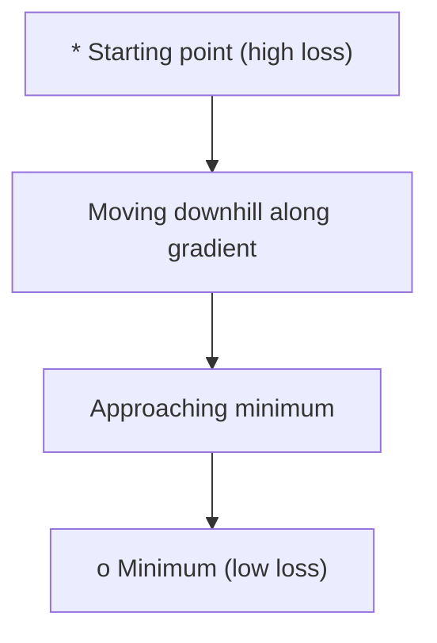
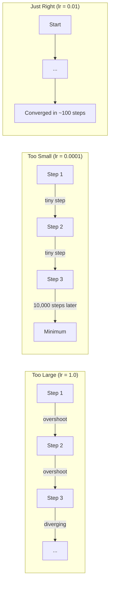
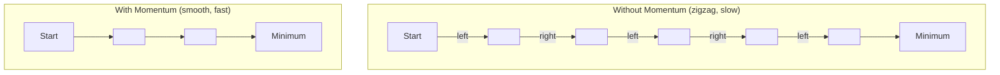
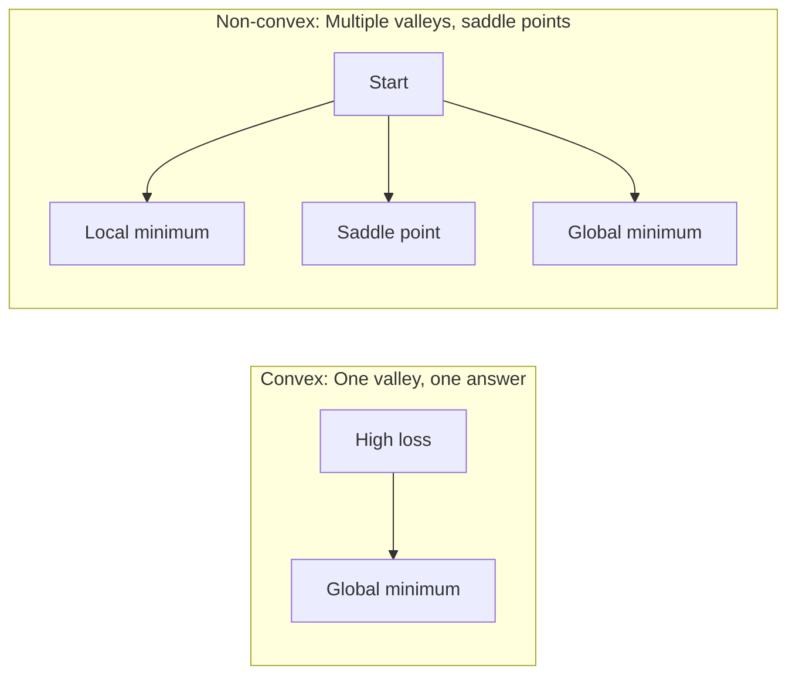
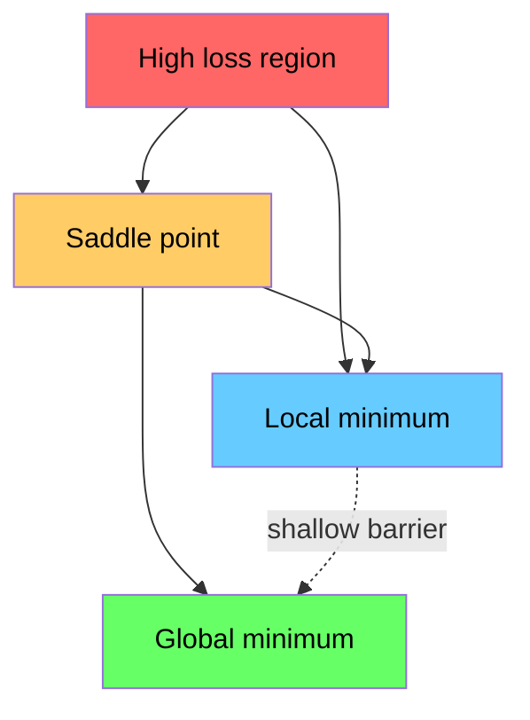

# Optimisasi

> Melatih neural network tidak lebih dari menemukan dasar lembah.

**Type:** Build
**Language:** Python
**Prerequisites:** Phase 1, Lessons 04-05 (Derivatives, Gradients)
**Time:** ~75 minutes

## Tujuan Pembelajaran

- Implementasikan gradient descent vanilla, SGD dengan momentum, dan Adam dari nol
- Bandingkan konvergensi optimizer pada fungsi Rosenbrock dan jelaskan mengapa Adam mengadaptasi learning rate per bobot
- Bedakan loss landscape konveks dari non-konveks dan jelaskan peran titik sadel dalam dimensi tinggi
- Konfigurasikan jadwal learning rate (step decay, cosine annealing, warmup) untuk stabilitas training

## Masalahnya

Kamu punya fungsi loss. Ia memberi tahu seberapa salah model-mu. Kamu punya gradien. Mereka memberi tahu arah mana yang membuat loss makin buruk. Sekarang kamu butuh strategi untuk berjalan menuruni bukit.

Pendekatan naif itu sederhana: bergerak berlawanan dengan gradien. Skalakan langkah dengan angka yang disebut learning rate. Ulangi. Inilah gradient descent, dan ia bekerja. Tetapi "bekerja" punya catatan. Learning rate terlalu besar dan kamu melewati lembah sepenuhnya, memantul antar dinding. Terlalu kecil dan kamu merangkak menuju jawaban lewat ribuan langkah yang tidak perlu. Menabrak titik sadel dan kamu berhenti bergerak padahal belum menemukan minimum.

Setiap optimizer dalam deep learning adalah jawaban atas pertanyaan yang sama: bagaimana mencapai dasar lembah lebih cepat dan lebih andal?

## Konsepnya

### Apa arti optimisasi

Optimisasi adalah mencari nilai input yang meminimalkan (atau memaksimalkan) sebuah fungsi. Dalam machine learning, fungsinya adalah loss. Inputnya adalah bobot model. Training adalah optimisasi.

```
minimize L(w) where:
  L = loss function
  w = model weights (could be millions of parameters)
```

### Gradient descent (vanilla)

Optimizer paling sederhana. Hitung gradien loss terhadap setiap bobot. Gerakkan setiap bobot ke arah berlawanan dari gradiennya. Skalakan langkah dengan learning rate.

```
w = w - lr * gradient
```

Itulah seluruh algoritmenya. Satu baris.



### Learning rate: hiperparameter paling penting

Learning rate mengendalikan ukuran langkah. Ia menentukan segalanya tentang konvergensi.



Tidak ada rumus untuk learning rate yang tepat. Kamu menemukannya lewat eksperimen. Titik awal umum: 0,001 untuk Adam, 0,01 untuk SGD dengan momentum.

### SGD vs batch vs mini-batch

Gradient descent vanilla menghitung gradien atas seluruh dataset sebelum mengambil satu langkah. Ini disebut batch gradient descent. Ia stabil tetapi lambat.

Stochastic gradient descent (SGD) menghitung gradien pada satu sampel acak dan langsung melangkah. Ia berisik tetapi cepat.

Mini-batch gradient descent mengambil jalan tengah. Hitung gradien atas batch kecil (32, 64, 128, 256 sampel), lalu melangkah. Inilah yang dipakai semua orang sebenarnya.

| Variant | Batch size | Gradient quality | Speed per step | Noise |
|---------|-----------|-----------------|---------------|-------|
| Batch GD | Entire dataset | Exact | Slow | None |
| SGD | 1 sample | Very noisy | Fast | High |
| Mini-batch | 32-256 | Good estimate | Balanced | Moderate |

Noise dalam SGD dan mini-batch bukanlah bug. Ia membantu lolos dari minimum lokal dangkal dan titik sadel.

### Momentum: bola yang menggelinding menuruni bukit

Gradient descent vanilla hanya melihat gradien saat ini. Jika gradien zigzag (umum di lembah sempit), progresnya lambat. Momentum memperbaikinya dengan mengakumulasi gradien lampau ke dalam suku velocity.

```
v = beta * v + gradient
w = w - lr * v
```

Analoginya: bola yang menggelinding menuruni bukit. Ia tidak berhenti dan mulai lagi di setiap gundukan. Ia membangun kecepatan dalam arah yang konsisten dan meredam osilasi.



`beta` (biasanya 0,9) mengendalikan seberapa banyak riwayat yang disimpan. Beta lebih tinggi berarti momentum lebih besar, jalur lebih mulus, tetapi respons lebih lambat terhadap perubahan arah.

### Adam: learning rate adaptif

Bobot yang berbeda butuh learning rate yang berbeda. Bobot yang jarang mendapat gradien besar seharusnya mengambil langkah lebih besar ketika akhirnya mendapatkannya. Bobot yang terus-menerus mendapat gradien besar seharusnya mengambil langkah lebih kecil.

Adam (Adaptive Moment Estimation) melacak dua hal per bobot:

1. Momen pertama (m): rata-rata berjalan gradien (seperti momentum)
2. Momen kedua (v): rata-rata berjalan gradien kuadrat (magnitudo gradien)

```
m = beta1 * m + (1 - beta1) * gradient
v = beta2 * v + (1 - beta2) * gradient^2

m_hat = m / (1 - beta1^t)    bias correction
v_hat = v / (1 - beta2^t)    bias correction

w = w - lr * m_hat / (sqrt(v_hat) + epsilon)
```

Pembagian dengan `sqrt(v_hat)` adalah wawasan kuncinya. Bobot dengan gradien besar dibagi angka besar (langkah efektif kecil). Bobot dengan gradien kecil dibagi angka kecil (langkah efektif besar). Setiap bobot mendapat learning rate adaptifnya sendiri.

Hiperparameter default: `lr=0.001, beta1=0.9, beta2=0.999, epsilon=1e-8`. Default ini bekerja baik untuk kebanyakan masalah.

### Jadwal learning rate

Learning rate tetap adalah kompromi. Di awal training, kamu ingin langkah besar untuk progres cepat. Di akhir training, kamu ingin langkah kecil untuk menyetel halus di dekat minimum.

Jadwal umum:

| Schedule | Formula | Use case |
|----------|---------|----------|
| Step decay | lr = lr * factor every N epochs | Simple, manual control |
| Exponential decay | lr = lr_0 * decay^t | Smooth reduction |
| Cosine annealing | lr = lr_min + 0.5 * (lr_max - lr_min) * (1 + cos(pi * t / T)) | Transformers, modern training |
| Warmup + decay | Linear ramp up, then decay | Large models, prevents early instability |

### Konveks vs non-konveks

Fungsi konveks memiliki satu minimum. Gradient descent selalu menemukannya. Kuadratik seperti `f(x) = x^2` itu konveks.

Fungsi loss neural network itu non-konveks. Mereka punya banyak minimum lokal, titik sadel, dan daerah datar.



Dalam praktik, minimum lokal dalam neural network berdimensi tinggi jarang menjadi masalah. Kebanyakan minimum lokal memiliki nilai loss dekat dengan minimum global. Titik sadel (datar di beberapa arah, melengkung di arah lain) adalah rintangan sebenarnya. Momentum dan noise dari mini-batch membantu lolos darinya.

### Visualisasi loss landscape

Loss adalah fungsi dari semua bobot. Untuk model dengan 1 juta bobot, loss landscape hidup di ruang 1.000.001 dimensi. Kita memvisualisasikannya dengan memilih dua arah acak di ruang bobot dan memplot loss sepanjang arah-arah itu, menghasilkan permukaan 2D.



Minimum tajam menggeneralisasi buruk. Minimum datar menggeneralisasi baik. Ini salah satu alasan SGD dengan momentum sering mengungguli Adam pada akurasi tes akhir: noise-nya mencegah menetap di minimum tajam.

```figure
gradient-descent
```

## Bangun Sendiri

### Langkah 1: Definisikan fungsi uji

Fungsi Rosenbrock adalah benchmark optimisasi klasik. Minimumnya ada di (1, 1) di dalam lembah sempit melengkung yang mudah ditemukan tetapi sulit diikuti.

```
f(x, y) = (1 - x)^2 + 100 * (y - x^2)^2
```

```python
def rosenbrock(params):
    x, y = params
    return (1 - x) ** 2 + 100 * (y - x ** 2) ** 2

def rosenbrock_gradient(params):
    x, y = params
    df_dx = -2 * (1 - x) + 200 * (y - x ** 2) * (-2 * x)
    df_dy = 200 * (y - x ** 2)
    return [df_dx, df_dy]
```

### Langkah 2: Gradient descent vanilla

```python
class GradientDescent:
    def __init__(self, lr=0.001):
        self.lr = lr

    def step(self, params, grads):
        return [p - self.lr * g for p, g in zip(params, grads)]
```

### Langkah 3: SGD dengan momentum

```python
class SGDMomentum:
    def __init__(self, lr=0.001, momentum=0.9):
        self.lr = lr
        self.momentum = momentum
        self.velocity = None

    def step(self, params, grads):
        if self.velocity is None:
            self.velocity = [0.0] * len(params)
        self.velocity = [
            self.momentum * v + g
            for v, g in zip(self.velocity, grads)
        ]
        return [p - self.lr * v for p, v in zip(params, self.velocity)]
```

### Langkah 4: Adam

```python
class Adam:
    def __init__(self, lr=0.001, beta1=0.9, beta2=0.999, epsilon=1e-8):
        self.lr = lr
        self.beta1 = beta1
        self.beta2 = beta2
        self.epsilon = epsilon
        self.m = None
        self.v = None
        self.t = 0

    def step(self, params, grads):
        if self.m is None:
            self.m = [0.0] * len(params)
            self.v = [0.0] * len(params)

        self.t += 1

        self.m = [
            self.beta1 * m + (1 - self.beta1) * g
            for m, g in zip(self.m, grads)
        ]
        self.v = [
            self.beta2 * v + (1 - self.beta2) * g ** 2
            for v, g in zip(self.v, grads)
        ]

        m_hat = [m / (1 - self.beta1 ** self.t) for m in self.m]
        v_hat = [v / (1 - self.beta2 ** self.t) for v in self.v]

        return [
            p - self.lr * mh / (vh ** 0.5 + self.epsilon)
            for p, mh, vh in zip(params, m_hat, v_hat)
        ]
```

### Langkah 5: Jalankan dan bandingkan

```python
def optimize(optimizer, func, grad_func, start, steps=5000):
    params = list(start)
    history = [params[:]]
    for _ in range(steps):
        grads = grad_func(params)
        params = optimizer.step(params, grads)
        history.append(params[:])
    return history

start = [-1.0, 1.0]

gd_history = optimize(GradientDescent(lr=0.0005), rosenbrock, rosenbrock_gradient, start)
sgd_history = optimize(SGDMomentum(lr=0.0001, momentum=0.9), rosenbrock, rosenbrock_gradient, start)
adam_history = optimize(Adam(lr=0.01), rosenbrock, rosenbrock_gradient, start)

for name, history in [("GD", gd_history), ("SGD+M", sgd_history), ("Adam", adam_history)]:
    final = history[-1]
    loss = rosenbrock(final)
    print(f"{name:6s} -> x={final[0]:.6f}, y={final[1]:.6f}, loss={loss:.8f}")
```

Output yang diharapkan: Adam konvergen tercepat. SGD dengan momentum mengikuti jalur lebih mulus. GD vanilla berprogres lambat sepanjang lembah sempit.

## Gunakan

Dalam praktik, pakai optimizer PyTorch atau JAX. Mereka menangani grup parameter, weight decay, gradient clipping, dan akselerasi GPU.

```python
import torch

model = torch.nn.Linear(784, 10)

sgd = torch.optim.SGD(model.parameters(), lr=0.01, momentum=0.9)
adam = torch.optim.Adam(model.parameters(), lr=0.001)
adamw = torch.optim.AdamW(model.parameters(), lr=0.001, weight_decay=0.01)

scheduler = torch.optim.lr_scheduler.CosineAnnealingLR(adam, T_max=100)
```

Aturan praktis:

- Mulai dengan Adam (lr=0,001). Ia bekerja untuk kebanyakan masalah tanpa tuning.
- Beralih ke SGD dengan momentum (lr=0,01, momentum=0,9) ketika kamu butuh akurasi akhir terbaik dan mampu melakukan lebih banyak tuning.
- Pakai AdamW (Adam dengan weight decay terpisah) untuk transformer.
- Selalu pakai jadwal learning rate untuk training yang lebih lama dari beberapa epoch.
- Jika training tidak stabil, kecilkan learning rate. Jika training terlalu lambat, besarkan.

## Rilis

Pelajaran ini menghasilkan prompt untuk memilih optimizer yang tepat. Lihat `outputs/prompt-optimizer-guide.md`.

Kelas-kelas optimizer yang dibangun di sini muncul lagi di Fase 3 ketika kita melatih neural network dari nol.

## Latihan

1. **Sweep learning rate.** Jalankan gradient descent vanilla pada fungsi Rosenbrock dengan learning rate [0.0001, 0.0005, 0.001, 0.005, 0.01]. Plot atau cetak loss akhir setelah 5000 langkah untuk masing-masing. Temukan learning rate terbesar yang masih konvergen.

2. **Perbandingan momentum.** Jalankan SGD dengan nilai momentum [0.0, 0.5, 0.9, 0.99] pada fungsi Rosenbrock. Lacak loss di setiap langkah. Nilai momentum mana yang konvergen tercepat? Mana yang kebablasan?

3. **Lolos dari titik sadel.** Definisikan fungsi `f(x, y) = x^2 - y^2` (titik sadel di origin). Mulai dari (0.01, 0.01). Bandingkan perilaku GD vanilla, SGD dengan momentum, dan Adam. Mana yang lolos dari titik sadel?

4. **Implementasikan peluruhan learning rate.** Tambahkan jadwal peluruhan eksponensial ke kelas GradientDescent: `lr = lr_0 * 0.999^step`. Bandingkan konvergensi dengan dan tanpa peluruhan pada fungsi Rosenbrock.

## Istilah Kunci

| Term | What people say | What it actually means |
|------|----------------|----------------------|
| Gradient descent | "Go downhill" | Update weights by subtracting the gradient scaled by the learning rate. The most basic optimizer. |
| Learning rate | "Step size" | A scalar that controls how far each update moves the weights. Too large causes divergence. Too small wastes compute. |
| Momentum | "Keep rolling" | Accumulate past gradients into a velocity vector. Dampens oscillations and accelerates movement through consistent directions. |
| SGD | "Random sampling" | Stochastic gradient descent. Compute gradient on a random subset instead of the full dataset. Almost always means mini-batch SGD in practice. |
| Mini-batch | "A chunk of data" | A small subset of training data (32-256 samples) used to estimate the gradient. Balances speed and gradient accuracy. |
| Adam | "The default optimizer" | Adaptive Moment Estimation. Tracks per-weight running averages of gradients and squared gradients to give each weight its own learning rate. |
| Bias correction | "Fix the cold start" | Adam's first and second moments are initialized to zero. Bias correction divides by (1 - beta^t) to compensate during early steps. |
| Learning rate schedule | "Change lr over time" | A function that adjusts the learning rate during training. Large steps early, small steps late. |
| Convex function | "One valley" | A function where any local minimum is the global minimum. Gradient descent always finds it. Neural network losses are not convex. |
| Saddle point | "Flat but not a minimum" | A point where the gradient is zero but it is a minimum in some directions and a maximum in others. Common in high dimensions. |
| Loss landscape | "The terrain" | The loss function plotted over weight space. Visualized by slicing along two random directions. |
| Convergence | "Getting there" | The optimizer has reached a point where further steps do not meaningfully reduce the loss. |

## Bacaan Lanjutan

- [Sebastian Ruder: An overview of gradient descent optimization algorithms](https://ruder.io/optimizing-gradient-descent/) - survei komprehensif semua optimizer utama
- [Why Momentum Really Works (Distill)](https://distill.pub/2017/momentum/) - visualisasi interaktif dinamika momentum
- [Adam: A Method for Stochastic Optimization (Kingma & Ba, 2014)](https://arxiv.org/abs/1412.6980) - makalah Adam orisinal, mudah dibaca dan pendek
- [Visualizing the Loss Landscape of Neural Nets (Li et al., 2018)](https://arxiv.org/abs/1712.09913) - makalah yang menunjukkan minimum tajam vs datar
