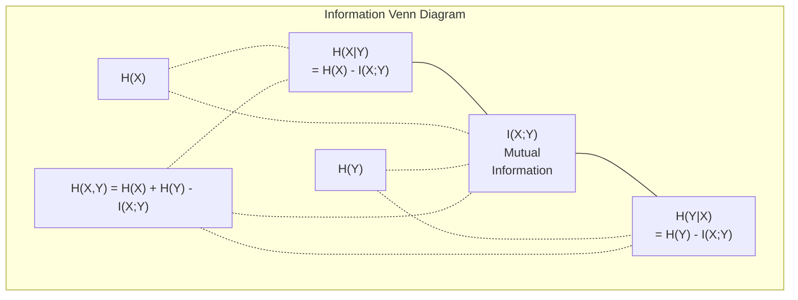

# Teori Informasi

> Teori informasi mengukur kejutan. Fungsi loss dibangun di atasnya.

**Type:** Learn
**Language:** Python
**Prerequisites:** Phase 1, Lesson 06 (Probability)
**Time:** ~60 minutes

## Tujuan Pembelajaran

- Hitung entropi, cross-entropy, dan divergensi KL dari nol dan jelaskan hubungannya
- Turunkan mengapa meminimalkan loss cross-entropy ekuivalen dengan memaksimalkan log-likelihood
- Hitung informasi mutual antara fitur dan target untuk memeringkat kepentingan fitur
- Jelaskan perpleksitas sebagai ukuran kosakata efektif yang dipilih language model

## Masalahnya

Kamu memanggil `CrossEntropyLoss()` di setiap model klasifikasi yang kamu latih. Kamu melihat "perplexity" di setiap makalah language model. Kamu membaca tentang divergensi KL di VAE, distilasi, dan RLHF. Ini bukan konsep-konsep yang terputus. Mereka semua adalah ide yang sama dengan topi berbeda.

Teori informasi memberimu bahasa untuk bernalar tentang ketidakpastian, kompresi, dan prediksi. Claude Shannon menciptakannya pada 1948 untuk memecahkan masalah komunikasi. Ternyata, melatih neural network adalah masalah komunikasi: model berusaha mentransmisikan label yang benar melalui kanal bising berupa bobot yang dipelajari.

Pelajaran ini membangun setiap rumus dari nol agar kamu melihat dari mana asalnya dan mengapa berhasil.

## Konsepnya

### Kandungan Informasi (Kejutan)

Ketika sesuatu yang tidak mungkin terjadi, ia membawa lebih banyak informasi. Koin mendarat head? Tidak mengejutkan. Menang lotre? Sangat mengejutkan.

Kandungan informasi sebuah event dengan probabilitas p adalah:

```
I(x) = -log(p(x))
```

Memakai log basis 2 memberimu bit. Memakai log natural memberimu nat. Ide yang sama, satuan berbeda.

```
Event              Probability    Surprise (bits)
Fair coin heads    0.5            1.0
Rolling a 6        0.167          2.58
1-in-1000 event    0.001          9.97
Certain event      1.0            0.0
```

Event yang pasti membawa nol informasi. Kamu sudah tahu mereka akan terjadi.

### Entropi (Rata-rata Kejutan)

Entropi adalah kejutan harapan di semua hasil yang mungkin dari sebuah distribusi.

```
H(P) = -sum( p(x) * log(p(x)) )  for all x
```

Koin adil memiliki entropi maksimum untuk variabel biner: 1 bit. Koin bias (99% head) memiliki entropi rendah: 0,08 bit. Kamu sudah tahu apa yang akan terjadi, sehingga setiap lemparan hampir tidak memberi tahu apa pun.

```
Fair coin:    H = -(0.5 * log2(0.5) + 0.5 * log2(0.5)) = 1.0 bit
Biased coin:  H = -(0.99 * log2(0.99) + 0.01 * log2(0.01)) = 0.08 bits
```

Entropi mengukur ketidakpastian tak tereduksi dalam sebuah distribusi. Kamu tidak bisa mengompresi di bawahnya.

### Cross-Entropy (Fungsi Loss yang Kamu Pakai Setiap Hari)

Cross-entropy mengukur rata-rata kejutan ketika kamu memakai distribusi Q untuk mengodekan event yang sebenarnya berasal dari distribusi P.

```
H(P, Q) = -sum( p(x) * log(q(x)) )  for all x
```

P adalah distribusi sebenarnya (label). Q adalah prediksi model-mu. Jika Q cocok sempurna dengan P, cross-entropy sama dengan entropi. Ketidakcocokan apa pun membuatnya lebih besar.

Dalam klasifikasi, P adalah vektor one-hot (kelas benar berprobabilitas 1, sisanya 0). Ini menyederhanakan cross-entropy menjadi:

```
H(P, Q) = -log(q(true_class))
```

Itulah seluruh rumus loss cross-entropy untuk klasifikasi. Maksimalkan probabilitas prediksi dari kelas yang benar.

### Divergensi KL (Jarak Antar Distribusi)

Divergensi KL mengukur berapa banyak kejutan ekstra yang kamu dapat dari memakai Q alih-alih P.

```
D_KL(P || Q) = sum( p(x) * log(p(x) / q(x)) )  for all x
             = H(P, Q) - H(P)
```

Cross-entropy adalah entropi ditambah divergensi KL. Karena entropi distribusi sebenarnya konstan selama training, meminimalkan cross-entropy sama dengan meminimalkan divergensi KL. Kamu mendorong distribusi model-mu menuju distribusi yang benar.

Divergensi KL tidak simetris: D_KL(P || Q) != D_KL(Q || P). Ia bukan metrik jarak sejati.

### Informasi Mutual

Informasi mutual mengukur seberapa banyak mengetahui satu variabel memberi tahu tentang yang lain.

```
I(X; Y) = H(X) - H(X|Y)
        = H(X) + H(Y) - H(X, Y)
```

Jika X dan Y independen, informasi mutual nol. Mengetahui yang satu tidak memberi tahu apa pun tentang yang lain. Jika mereka berkorelasi sempurna, informasi mutual sama dengan entropi salah satu variabel.

Dalam pemilihan fitur, informasi mutual tinggi antara fitur dan target berarti fiturnya berguna. Informasi mutual rendah berarti ia noise.

### Entropi Bersyarat

H(Y|X) mengukur berapa banyak ketidakpastian tersisa tentang Y setelah kamu mengamati X.

```
H(Y|X) = H(X,Y) - H(X)
```

Dua ekstrem:
- Jika X sepenuhnya menentukan Y, maka H(Y|X) = 0. Mengetahui X menghilangkan semua ketidakpastian tentang Y. Contoh: X = suhu dalam Celsius, Y = suhu dalam Fahrenheit.
- Jika X tidak memberi tahu apa pun tentang Y, maka H(Y|X) = H(Y). Mengetahui X tidak mengurangi ketidakpastianmu sama sekali. Contoh: X = lemparan koin, Y = cuaca besok.

Entropi bersyarat selalu non-negatif dan tidak pernah melebihi H(Y):

```
0 <= H(Y|X) <= H(Y)
```

Dalam machine learning, entropi bersyarat muncul di decision tree. Pada setiap split, algoritme memilih fitur X yang meminimalkan H(Y|X) -- fitur yang menghilangkan ketidakpastian paling banyak tentang label Y.

### Entropi Joint

H(X,Y) adalah entropi dari distribusi joint X dan Y bersama-sama.

```
H(X,Y) = -sum sum p(x,y) * log(p(x,y))   for all x, y
```

Sifat kunci:

```
H(X,Y) <= H(X) + H(Y)
```

Kesamaan berlaku ketika X dan Y independen. Jika mereka berbagi informasi, entropi joint kurang dari jumlah entropi masing-masing. Entropi yang "hilang" tepat adalah informasi mutual.



Hubungan-hubungannya:
- H(X,Y) = H(X) + H(Y|X) = H(Y) + H(X|Y)
- I(X;Y) = H(X) - H(X|Y) = H(Y) - H(Y|X)
- H(X,Y) = H(X) + H(Y) - I(X;Y)

### Informasi Mutual (Pendalaman)

Informasi mutual I(X;Y) mengkuantifikasi seberapa banyak mengetahui satu variabel mengurangi ketidakpastian tentang yang lain.

```
I(X;Y) = H(X) - H(X|Y)
       = H(Y) - H(Y|X)
       = H(X) + H(Y) - H(X,Y)
       = sum sum p(x,y) * log(p(x,y) / (p(x) * p(y)))
```

Sifat-sifat:
- I(X;Y) >= 0 selalu. Kamu tidak pernah kehilangan informasi dengan mengamati sesuatu.
- I(X;Y) = 0 jika dan hanya jika X dan Y independen.
- I(X;Y) = I(Y;X). Ia simetris, tidak seperti divergensi KL.
- I(X;X) = H(X). Sebuah variabel berbagi seluruh informasinya dengan dirinya sendiri.

**Informasi mutual untuk pemilihan fitur.** Di ML, kamu menginginkan fitur yang informatif tentang target. Informasi mutual memberimu cara berprinsip untuk memeringkat fitur:

1. Untuk setiap fitur X_i, hitung I(X_i; Y) di mana Y adalah variabel target.
2. Peringkatkan fitur berdasarkan skor MI.
3. Simpan k fitur teratas.

Ini bekerja untuk hubungan apa pun antara fitur dan target -- linear, nonlinear, monotonik, atau bukan. Korelasi hanya menangkap hubungan linear. MI menangkap semuanya.

| Method | Detects | Computational cost | Handles categorical? |
|--------|---------|-------------------|---------------------|
| Pearson correlation | Linear relationships | O(n) | No |
| Spearman correlation | Monotonic relationships | O(n log n) | No |
| Mutual information | Any statistical dependency | O(n log n) with binning | Yes |

### Label Smoothing dan Cross-Entropy

Klasifikasi standar memakai target keras: [0, 0, 1, 0]. Kelas benar mendapat probabilitas 1, sisanya 0. Label smoothing menggantinya dengan target lunak:

```
soft_target = (1 - epsilon) * hard_target + epsilon / num_classes
```

Dengan epsilon = 0,1 dan 4 kelas:
- Hard target:  [0, 0, 1, 0]
- Soft target:  [0.025, 0.025, 0.925, 0.025]

Dari sudut pandang teori informasi, label smoothing menaikkan entropi distribusi target. Target one-hot keras memiliki entropi 0 -- tidak ada ketidakpastian. Target lunak memiliki entropi positif.

Mengapa ini membantu:
- Mencegah model mendorong logit ke nilai ekstrem (logit tak hingga dibutuhkan untuk mencocokkan target one-hot secara sempurna di bawah cross-entropy)
- Bertindak sebagai regularisasi: model tidak bisa 100% yakin
- Memperbaiki kalibrasi: probabilitas prediksi lebih mencerminkan ketidakpastian sejati
- Mengurangi kesenjangan antara perilaku training dan inference

Loss cross-entropy dengan label smoothing menjadi:

```
L = (1 - epsilon) * CE(hard_target, prediction) + epsilon * H_uniform(prediction)
```

Suku kedua menghukum prediksi yang jauh dari uniform -- regularisasi langsung atas keyakinan.

### Mengapa Cross-Entropy ADALAH Loss Klasifikasi

Tiga sudut pandang, kesimpulan sama.

**Sudut pandang teori informasi.** Cross-entropy mengukur berapa banyak bit yang kamu buang dengan memakai distribusi model-mu alih-alih distribusi sebenarnya. Meminimalkannya menjadikan model-mu pengode realitas yang paling efisien.

**Sudut pandang maximum likelihood.** Untuk N sampel training dengan kelas benar y_i:

```
Likelihood     = product( q(y_i) )
Log-likelihood = sum( log(q(y_i)) )
Negative log-likelihood = -sum( log(q(y_i)) )
```

Baris terakhir itu adalah loss cross-entropy. Meminimalkan cross-entropy = memaksimalkan likelihood data training di bawah model-mu.

**Sudut pandang gradien.** Gradien cross-entropy terhadap logit hanyalah (predicted - true). Bersih, stabil, dan cepat dihitung. Inilah mengapa ia berpasangan sempurna dengan softmax.

### Bit vs Nat

Satu-satunya perbedaan adalah basis log.

```
log base 2   -> bits      (information theory tradition)
log base e   -> nats      (machine learning convention)
log base 10  -> hartleys  (rarely used)
```

1 nat = 1/ln(2) bit = 1,4427 bit. PyTorch dan TensorFlow memakai log natural (nat) secara default.

### Perpleksitas

Perpleksitas adalah eksponensial dari cross-entropy. Ia memberi tahu jumlah efektif pilihan sama-mungkinnya yang membuat model ragu.

```
Perplexity = 2^H(P,Q)   (if using bits)
Perplexity = e^H(P,Q)   (if using nats)
```

Language model dengan perpleksitas 50, rata-rata, bingung seolah harus memilih uniform dari 50 token berikutnya yang mungkin. Makin rendah makin baik.

GPT-2 mencapai perpleksitas ~30 pada benchmark umum. Model modern berada di satu digit untuk domain yang terwakili baik.

```figure
entropy-kl
```

## Bangun Sendiri

### Langkah 1: Kandungan informasi dan entropi

```python
import math

def information_content(p, base=2):
    if p <= 0 or p > 1:
        return float('inf') if p <= 0 else 0.0
    return -math.log(p) / math.log(base)

def entropy(probs, base=2):
    return sum(
        p * information_content(p, base)
        for p in probs if p > 0
    )

fair_coin = [0.5, 0.5]
biased_coin = [0.99, 0.01]
fair_die = [1/6] * 6

print(f"Fair coin entropy:   {entropy(fair_coin):.4f} bits")
print(f"Biased coin entropy: {entropy(biased_coin):.4f} bits")
print(f"Fair die entropy:    {entropy(fair_die):.4f} bits")
```

### Langkah 2: Cross-entropy dan divergensi KL

```python
def cross_entropy(p, q, base=2):
    total = 0.0
    for pi, qi in zip(p, q):
        if pi > 0:
            if qi <= 0:
                return float('inf')
            total += pi * (-math.log(qi) / math.log(base))
    return total

def kl_divergence(p, q, base=2):
    return cross_entropy(p, q, base) - entropy(p, base)

true_dist = [0.7, 0.2, 0.1]
good_model = [0.6, 0.25, 0.15]
bad_model = [0.1, 0.1, 0.8]

print(f"Entropy of true dist:     {entropy(true_dist):.4f} bits")
print(f"CE (good model):          {cross_entropy(true_dist, good_model):.4f} bits")
print(f"CE (bad model):           {cross_entropy(true_dist, bad_model):.4f} bits")
print(f"KL divergence (good):     {kl_divergence(true_dist, good_model):.4f} bits")
print(f"KL divergence (bad):      {kl_divergence(true_dist, bad_model):.4f} bits")
```

### Langkah 3: Cross-entropy sebagai loss klasifikasi

```python
def softmax(logits):
    max_logit = max(logits)
    exps = [math.exp(z - max_logit) for z in logits]
    total = sum(exps)
    return [e / total for e in exps]

def cross_entropy_loss(true_class, logits):
    probs = softmax(logits)
    return -math.log(probs[true_class])

logits = [2.0, 1.0, 0.1]
true_class = 0

probs = softmax(logits)
loss = cross_entropy_loss(true_class, logits)

print(f"Logits:      {logits}")
print(f"Softmax:     {[f'{p:.4f}' for p in probs]}")
print(f"True class:  {true_class}")
print(f"Loss:        {loss:.4f} nats")
print(f"Perplexity:  {math.exp(loss):.2f}")
```

### Langkah 4: Cross-entropy sama dengan negative log-likelihood

```python
import random

random.seed(42)

n_samples = 1000
n_classes = 3
true_labels = [random.randint(0, n_classes - 1) for _ in range(n_samples)]
model_logits = [[random.gauss(0, 1) for _ in range(n_classes)] for _ in range(n_samples)]

ce_loss = sum(
    cross_entropy_loss(label, logits)
    for label, logits in zip(true_labels, model_logits)
) / n_samples

nll = -sum(
    math.log(softmax(logits)[label])
    for label, logits in zip(true_labels, model_logits)
) / n_samples

print(f"Cross-entropy loss:      {ce_loss:.6f}")
print(f"Negative log-likelihood: {nll:.6f}")
print(f"Difference:              {abs(ce_loss - nll):.2e}")
```

### Langkah 5: Informasi mutual

```python
def mutual_information(joint_probs, base=2):
    rows = len(joint_probs)
    cols = len(joint_probs[0])

    margin_x = [sum(joint_probs[i][j] for j in range(cols)) for i in range(rows)]
    margin_y = [sum(joint_probs[i][j] for i in range(rows)) for j in range(cols)]

    mi = 0.0
    for i in range(rows):
        for j in range(cols):
            pxy = joint_probs[i][j]
            if pxy > 0:
                mi += pxy * math.log(pxy / (margin_x[i] * margin_y[j])) / math.log(base)
    return mi

independent = [[0.25, 0.25], [0.25, 0.25]]
dependent = [[0.45, 0.05], [0.05, 0.45]]

print(f"MI (independent): {mutual_information(independent):.4f} bits")
print(f"MI (dependent):   {mutual_information(dependent):.4f} bits")
```

## Gunakan

Konsep yang sama memakai NumPy, cara kamu memakainya dalam praktik:

```python
import numpy as np

def np_entropy(p):
    p = np.asarray(p, dtype=float)
    mask = p > 0
    result = np.zeros_like(p)
    result[mask] = p[mask] * np.log(p[mask])
    return -result.sum()

def np_cross_entropy(p, q):
    p, q = np.asarray(p, dtype=float), np.asarray(q, dtype=float)
    mask = p > 0
    return -(p[mask] * np.log(q[mask])).sum()

def np_kl_divergence(p, q):
    return np_cross_entropy(p, q) - np_entropy(p)

true = np.array([0.7, 0.2, 0.1])
pred = np.array([0.6, 0.25, 0.15])
print(f"Entropy:    {np_entropy(true):.4f} nats")
print(f"Cross-ent:  {np_cross_entropy(true, pred):.4f} nats")
print(f"KL div:     {np_kl_divergence(true, pred):.4f} nats")
```

Kamu membangun dari nol apa yang dilakukan `torch.nn.CrossEntropyLoss()` secara internal. Sekarang kamu tahu mengapa loss turun selama training: distribusi prediksi model-mu makin dekat ke distribusi sebenarnya, diukur dalam nat informasi yang terbuang.

## Latihan

1. Hitung entropi alfabet Inggris dengan asumsi distribusi uniform (26 huruf). Lalu estimasi memakai frekuensi huruf aktual. Mana yang lebih tinggi dan mengapa?

2. Model mengeluarkan logit [5.0, 2.0, 0.5] untuk sampel dengan kelas benar 1. Hitung loss cross-entropy dengan tangan, lalu verifikasi dengan fungsi `cross_entropy_loss`-mu. Logit apa yang memberi loss nol?

3. Tunjukkan bahwa divergensi KL tidak simetris. Pilih dua distribusi P dan Q lalu hitung D_KL(P || Q) dan D_KL(Q || P). Jelaskan mengapa mereka berbeda.

4. Bangun fungsi yang menghitung perpleksitas untuk sekuens prediksi token. Diberikan daftar pasangan (true_token_index, predicted_logits), kembalikan perpleksitas sekuens itu.

## Istilah Kunci

| Term | What people say | What it actually means |
|------|----------------|----------------------|
| Information content | "Surprise" | The number of bits (or nats) needed to encode an event: -log(p) |
| Entropy | "Randomness" | The average surprise across all outcomes of a distribution. Measures irreducible uncertainty. |
| Cross-entropy | "The loss function" | Average surprise when using model distribution Q to encode events from true distribution P. |
| KL divergence | "Distance between distributions" | Extra bits wasted by using Q instead of P. Equals cross-entropy minus entropy. Not symmetric. |
| Mutual information | "How related are X and Y" | Reduction in uncertainty about X from knowing Y. Zero means independent. |
| Softmax | "Turn logits into probabilities" | Exponentiate and normalize. Maps any real-valued vector to a valid probability distribution. |
| Perplexity | "How confused the model is" | Exponential of cross-entropy. The effective vocabulary size the model is choosing from at each step. |
| Bits | "Shannon's unit" | Information measured with log base 2. One bit resolves one fair coin flip. |
| Nats | "ML's unit" | Information measured with natural log. Used by PyTorch and TensorFlow by default. |
| Negative log-likelihood | "NLL loss" | Identical to cross-entropy loss for one-hot labels. Minimizing it maximizes the probability of correct predictions. |

## Bacaan Lanjutan

- [Shannon 1948: A Mathematical Theory of Communication](https://people.math.harvard.edu/~ctm/home/text/others/shannon/entropy/entropy.pdf) - makalah orisinal, masih mudah dibaca
- [Visual Information Theory (Chris Olah)](https://colah.github.io/posts/2015-09-Visual-Information/) - penjelasan visual terbaik tentang entropi dan divergensi KL
- [PyTorch CrossEntropyLoss docs](https://pytorch.org/docs/stable/generated/torch.nn.CrossEntropyLoss.html) - cara framework mengimplementasikan apa yang baru kamu bangun
