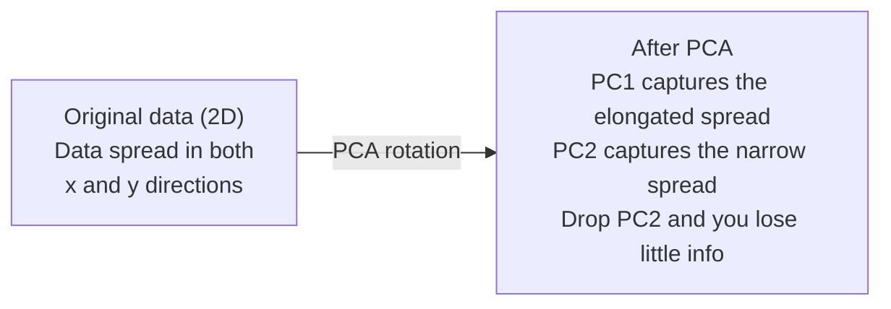

# Reduksi Dimensionalitas

> Data berdimensi tinggi punya struktur. Kamu menemukannya dengan melihat dari sudut yang tepat.

**Type:** Build
**Language:** Python
**Prerequisites:** Phase 1, Lessons 01 (Linear Algebra Intuition), 02 (Vectors, Matrices & Operations), 03 (Eigenvalues & Eigenvectors), 06 (Probability & Distributions)
**Time:** ~90 minutes

## Tujuan Pembelajaran

- Implementasikan PCA dari nol: pusatkan data, hitung matriks kovarians, eigendecompose, dan proyeksikan
- Pakai rasio explained variance dan metode elbow untuk memilih jumlah komponen utama
- Bandingkan PCA, t-SNE, dan UMAP untuk memvisualisasikan digit MNIST dalam 2D dan jelaskan tradeoff-nya
- Terapkan kernel PCA dengan kernel RBF untuk memisahkan struktur data nonlinear yang tidak bisa ditangani PCA standar

## Masalahnya

Kamu punya dataset dengan 784 fitur per sampel. Mungkin itu nilai piksel digit tulisan tangan. Mungkin itu level ekspresi gen. Mungkin itu sinyal perilaku pengguna. Kamu tidak bisa memvisualisasikan 784 dimensi. Kamu tidak bisa memplotnya. Kamu bahkan tidak bisa memikirkannya.

Tetapi kebanyakan dari 784 fitur itu redundan. Informasi aktualnya hidup pada permukaan yang jauh lebih kecil. Sebuah "7" tulisan tangan tidak butuh 784 angka independen untuk menggambarkannya. Ia butuh beberapa: sudut goresan, panjang garis silang, seberapa miring. Sisanya adalah noise.

Reduksi dimensionalitas menemukan permukaan yang lebih kecil itu. Ia mengambil data 784 dimensimu dan mengompresnya ke 2, 10, atau 50 dimensi sambil menjaga struktur yang penting.

## Konsepnya

### Kutukan dimensionalitas

Ruang berdimensi tinggi tidak intuitif. Tiga hal rusak seiring dimensi bertambah.

**Jarak menjadi tak bermakna.** Dalam dimensi tinggi, jarak antara dua titik acak mana pun konvergen ke nilai yang sama. Jika setiap titik kira-kira berjarak sama dari setiap titik lain, pencarian nearest-neighbor berhenti bekerja.

```
Dimension    Avg distance ratio (max/min between random points)
2            ~5.0
10           ~1.8
100          ~1.2
1000         ~1.02
```

**Volume terkonsentrasi di sudut.** Hiperkubus satuan dalam d dimensi memiliki 2^d sudut. Dalam 100 dimensi, hampir seluruh volume ada di sudut-sudut, jauh dari pusat. Titik-titik data menyebar ke tepi dan model-mu kelaparan data di interior.

**Kamu butuh data eksponensial lebih banyak.** Untuk menjaga densitas sampel yang sama dalam sebuah ruang, pergi dari 2D ke 20D berarti kamu butuh 10^18 kali lebih banyak data. Kamu tidak pernah punya cukup. Mengurangi dimensi mengembalikan densitas data ke sesuatu yang bisa dikerjakan.

### PCA: temukan arah yang penting

Principal Component Analysis (PCA) menemukan sumbu-sumbu di mana datamu paling bervariasi. Ia memutar sistem koordinatmu sehingga sumbu pertama menangkap varians terbanyak, yang kedua menangkap terbanyak berikutnya, dan seterusnya.

Algoritmenya:

```
1. Center the data        (subtract the mean from each feature)
2. Compute covariance     (how features move together)
3. Eigendecomposition     (find the principal directions)
4. Sort by eigenvalue     (biggest variance first)
5. Project               (keep top k eigenvectors, drop the rest)
```

Mengapa eigendecomposition? Matriks kovarians itu simetris dan semi-definit positif. Eigenvektornya adalah arah-arah ortogonal di ruang fitur. Eigenvalue memberi tahu berapa banyak varians yang ditangkap tiap arah. Eigenvektor dengan eigenvalue terbesar menunjuk sepanjang arah varians maksimum.



- **Sebelum PCA:** Awan data tersebar diagonal di sumbu x dan y
- **Setelah PCA:** Sistem koordinat diputar sehingga PC1 sejajar dengan arah varians maksimum (sebaran memanjang) dan PC2 sejajar dengan arah varians minimum (sebaran sempit)
- **Reduksi dimensionalitas:** Membuang PC2 memproyeksikan data ke PC1, kehilangan sangat sedikit informasi

### Rasio Explained Variance

Setiap komponen utama menangkap fraksi dari total varians. Rasio explained variance memberi tahu seberapa banyak.

```
Component    Eigenvalue    Explained ratio    Cumulative
PC1          4.73          0.473              0.473
PC2          2.51          0.251              0.724
PC3          1.12          0.112              0.836
PC4          0.89          0.089              0.925
...
```

Ketika explained variance kumulatif mencapai 0,95, kamu tahu sebanyak itu komponen menangkap 95% informasi. Segala hal setelah itu kebanyakan noise.

### Memilih jumlah komponen

Tiga strategi:

1. **Ambang.** Simpan cukup komponen untuk menjelaskan 90-95% varians.
2. **Metode elbow.** Plot explained variance per komponen. Cari penurunan tajam.
3. **Performa hilir.** Pakai PCA sebagai preprocessing. Sapu k dan ukur akurasi model-mu. K terbaik ada di mana akurasi mendatar.

### t-SNE: menjaga ketetanggaan

t-Distributed Stochastic Neighbor Embedding (t-SNE) dirancang untuk visualisasi. Ia memetakan data berdimensi tinggi ke 2D (atau 3D) sambil menjaga titik mana yang berdekatan.

Intuisinya: di ruang asal, hitung distribusi probabilitas atas pasangan titik berdasarkan jaraknya. Titik dekat mendapat probabilitas tinggi. Titik jauh mendapat probabilitas rendah. Lalu cari susunan 2D di mana distribusi probabilitas yang sama berlaku. Titik yang bertetangga dalam 784 dimensi tetap bertetangga dalam 2D.

Sifat kunci t-SNE:
- Nonlinear. Ia bisa membuka manifold kompleks yang tidak bisa dibuka PCA.
- Stokastik. Run berbeda menghasilkan tata letak berbeda.
- Parameter perplexity mengendalikan berapa banyak tetangga yang dipertimbangkan (rentang tipikal: 5-50).
- Jarak antar klaster dalam output tidak bermakna. Hanya klasternya sendiri yang bermakna.
- Lambat pada dataset besar. O(n^2) secara default.

### UMAP: lebih cepat, struktur global lebih baik

Uniform Manifold Approximation and Projection (UMAP) bekerja mirip t-SNE tetapi dengan dua keunggulan:
- Lebih cepat. Ia memakai graf nearest-neighbor aproksimasi alih-alih menghitung semua jarak berpasangan.
- Struktur global lebih baik. Posisi relatif klaster dalam output cenderung lebih bermakna daripada di t-SNE.

UMAP membangun graf berbobot di ruang berdimensi tinggi ("fuzzy topological representation") lalu mencari tata letak berdimensi rendah yang menjaga graf ini sebaik mungkin.

Parameter kunci:
- `n_neighbors`: berapa banyak tetangga yang mendefinisikan struktur lokal (mirip perplexity). Nilai lebih tinggi menjaga lebih banyak struktur global.
- `min_dist`: seberapa rapat titik berkemas dalam output. Nilai lebih rendah menciptakan klaster lebih padat.

### Kapan memakai yang mana

| Method | Use case | Preserves | Speed |
|--------|----------|-----------|-------|
| PCA | Preprocessing before training | Global variance | Fast (exact), works on millions of samples |
| PCA | Quick exploratory visualization | Linear structure | Fast |
| t-SNE | Publication-quality 2D plots | Local neighborhoods | Slow (< 10k samples ideal) |
| UMAP | 2D visualization at scale | Local + some global structure | Medium (handles millions) |
| PCA | Feature reduction for models | Variance-ranked features | Fast |
| t-SNE / UMAP | Understanding cluster structure | Cluster separation | Medium to slow |

Aturan praktis: pakai PCA untuk preprocessing dan kompresi data. Pakai t-SNE atau UMAP ketika kamu perlu memvisualisasikan struktur dalam 2D.

### Kernel PCA

PCA standar menemukan subruang linear. Ia memutar sistem koordinatmu dan membuang sumbu. Tetapi bagaimana jika data terletak pada manifold nonlinear? Lingkaran di 2D tidak bisa dipisahkan garis mana pun. PCA standar tidak membantu.

Kernel PCA menerapkan PCA di ruang fitur berdimensi tinggi yang diinduksi fungsi kernel, tanpa menghitung koordinat di ruang itu secara eksplisit. Inilah kernel trick -- ide yang sama di balik SVM.

Algoritmenya:
1. Hitung matriks kernel K di mana K_ij = k(x_i, x_j)
2. Pusatkan matriks kernel di ruang fitur
3. Eigendecompose matriks kernel yang dipusatkan
4. Eigenvektor teratas (diskala 1/sqrt(eigenvalue)) adalah proyeksinya

Fungsi kernel umum:

| Kernel | Formula | Good for |
|--------|---------|----------|
| RBF (Gaussian) | exp(-gamma * \|\|x - y\|\|^2) | Most nonlinear data, smooth manifolds |
| Polynomial | (x . y + c)^d | Polynomial relationships |
| Sigmoid | tanh(alpha * x . y + c) | Neural network-like mappings |

Kapan memakai kernel PCA vs PCA standar:

| Criterion | Standard PCA | Kernel PCA |
|-----------|-------------|------------|
| Data structure | Linear subspace | Nonlinear manifold |
| Speed | O(min(n^2 d, d^2 n)) | O(n^2 d + n^3) |
| Interpretability | Components are linear combinations of features | Components lack direct feature interpretation |
| Scalability | Works on millions of samples | Kernel matrix is n x n, memory-limited |
| Reconstruction | Direct inverse transform | Requires pre-image approximation |

Contoh klasik: lingkaran konsentris di 2D. Dua cincin titik, satu di dalam yang lain. PCA standar memproyeksikan keduanya ke garis yang sama -- tidak berguna untuk klasifikasi. Kernel PCA dengan kernel RBF memetakan lingkaran dalam dan lingkaran luar ke daerah berbeda, membuatnya terpisahkan secara linear.

### Error Rekonstruksi

Seberapa bagus reduksi dimensionalitasmu? Kamu mengompres 784 dimensi ke 50. Apa yang hilang?

Ukur error rekonstruksi:
1. Proyeksikan data ke k dimensi: X_reduced = X @ W_k
2. Rekonstruksi: X_hat = X_reduced @ W_k^T
3. Hitung MSE: mean((X - X_hat)^2)

Untuk PCA, error rekonstruksi punya hubungan bersih dengan explained variance:

```
Reconstruction error = sum of eigenvalues NOT included
Total variance = sum of ALL eigenvalues
Fraction lost = (sum of dropped eigenvalues) / (sum of all eigenvalues)
```

Rasio explained variance untuk tiap komponen adalah:

```
explained_ratio_k = eigenvalue_k / sum(all eigenvalues)
```

Memplot explained variance kumulatif terhadap jumlah komponen memberimu kurva "elbow". Jumlah komponen yang tepat ada di mana:
- Kurva mendatar (hasil yang makin mengecil)
- Varians kumulatif melewati ambangmu (biasanya 0,90 atau 0,95)
- Performa tugas hilir mendatar

Error rekonstruksi berguna lebih dari sekadar memilih k. Kamu bisa memakainya untuk deteksi anomali: sampel dengan error rekonstruksi tinggi adalah outlier yang tidak cocok dengan subruang yang dipelajari. Inilah dasar deteksi anomali berbasis PCA dalam sistem produksi.

```figure
pca-axes
```

## Bangun Sendiri

### Langkah 1: PCA dari nol

```python
import numpy as np

class PCA:
    def __init__(self, n_components):
        self.n_components = n_components
        self.components = None
        self.mean = None
        self.eigenvalues = None
        self.explained_variance_ratio_ = None

    def fit(self, X):
        self.mean = np.mean(X, axis=0)
        X_centered = X - self.mean

        cov_matrix = np.cov(X_centered, rowvar=False)

        eigenvalues, eigenvectors = np.linalg.eigh(cov_matrix)

        sorted_idx = np.argsort(eigenvalues)[::-1]
        eigenvalues = eigenvalues[sorted_idx]
        eigenvectors = eigenvectors[:, sorted_idx]

        self.components = eigenvectors[:, :self.n_components].T
        self.eigenvalues = eigenvalues[:self.n_components]
        total_var = np.sum(eigenvalues)
        self.explained_variance_ratio_ = self.eigenvalues / total_var

        return self

    def transform(self, X):
        X_centered = X - self.mean
        return X_centered @ self.components.T

    def fit_transform(self, X):
        self.fit(X)
        return self.transform(X)
```

### Langkah 2: Uji pada data sintetis

```python
np.random.seed(42)
n_samples = 500

t = np.random.uniform(0, 2 * np.pi, n_samples)
x1 = 3 * np.cos(t) + np.random.normal(0, 0.2, n_samples)
x2 = 3 * np.sin(t) + np.random.normal(0, 0.2, n_samples)
x3 = 0.5 * x1 + 0.3 * x2 + np.random.normal(0, 0.1, n_samples)

X_synthetic = np.column_stack([x1, x2, x3])

pca = PCA(n_components=2)
X_reduced = pca.fit_transform(X_synthetic)

print(f"Original shape: {X_synthetic.shape}")
print(f"Reduced shape:  {X_reduced.shape}")
print(f"Explained variance ratios: {pca.explained_variance_ratio_}")
print(f"Total variance captured: {sum(pca.explained_variance_ratio_):.4f}")
```

### Langkah 3: Digit MNIST dalam 2D

```python
from sklearn.datasets import fetch_openml

mnist = fetch_openml("mnist_784", version=1, as_frame=False, parser="auto")
X_mnist = mnist.data[:5000].astype(float)
y_mnist = mnist.target[:5000].astype(int)

pca_mnist = PCA(n_components=50)
X_pca50 = pca_mnist.fit_transform(X_mnist)
print(f"50 components capture {sum(pca_mnist.explained_variance_ratio_):.2%} of variance")

pca_2d = PCA(n_components=2)
X_pca2d = pca_2d.fit_transform(X_mnist)
print(f"2 components capture {sum(pca_2d.explained_variance_ratio_):.2%} of variance")
```

### Langkah 4: Bandingkan dengan sklearn

```python
from sklearn.decomposition import PCA as SklearnPCA
from sklearn.manifold import TSNE

sklearn_pca = SklearnPCA(n_components=2)
X_sklearn_pca = sklearn_pca.fit_transform(X_mnist)

print(f"\nOur PCA explained variance:     {pca_2d.explained_variance_ratio_}")
print(f"Sklearn PCA explained variance: {sklearn_pca.explained_variance_ratio_}")

diff = np.abs(np.abs(X_pca2d) - np.abs(X_sklearn_pca))
print(f"Max absolute difference: {diff.max():.10f}")

tsne = TSNE(n_components=2, perplexity=30, random_state=42)
X_tsne = tsne.fit_transform(X_mnist)
print(f"\nt-SNE output shape: {X_tsne.shape}")
```

### Langkah 5: Perbandingan UMAP

```python
try:
    from umap import UMAP

    reducer = UMAP(n_components=2, n_neighbors=15, min_dist=0.1, random_state=42)
    X_umap = reducer.fit_transform(X_mnist)
    print(f"UMAP output shape: {X_umap.shape}")
except ImportError:
    print("Install umap-learn: pip install umap-learn")
```

## Gunakan

PCA sebagai preprocessing sebelum pengklasifikasi:

```python
from sklearn.decomposition import PCA as SklearnPCA
from sklearn.linear_model import LogisticRegression
from sklearn.model_selection import train_test_split
from sklearn.metrics import accuracy_score

X_train, X_test, y_train, y_test = train_test_split(
    X_mnist, y_mnist, test_size=0.2, random_state=42
)

results = {}
for k in [10, 30, 50, 100, 200]:
    pca_k = SklearnPCA(n_components=k)
    X_tr = pca_k.fit_transform(X_train)
    X_te = pca_k.transform(X_test)

    clf = LogisticRegression(max_iter=1000, random_state=42)
    clf.fit(X_tr, y_train)
    acc = accuracy_score(y_test, clf.predict(X_te))
    var_captured = sum(pca_k.explained_variance_ratio_)
    results[k] = (acc, var_captured)
    print(f"k={k:>3d}  accuracy={acc:.4f}  variance={var_captured:.4f}")
```

Performa mendatar jauh sebelum 784 dimensi. Dataran itu adalah titik operasimu.

## Rilis

Pelajaran ini menghasilkan:
- `outputs/skill-dimensionality-reduction.md` - skill untuk memilih teknik reduksi dimensionalitas yang tepat untuk tugas tertentu

## Latihan

1. Modifikasi kelas PCA agar mendukung `inverse_transform`. Rekonstruksi digit MNIST dari 10, 50, dan 200 komponen. Cetak error rekonstruksi (selisih kuadrat rata-rata dari aslinya) untuk masing-masing.

2. Jalankan t-SNE pada subset MNIST yang sama dengan nilai perplexity 5, 30, dan 100. Jelaskan bagaimana output berubah. Mengapa perplexity memengaruhi keketatan klaster?

3. Ambil dataset dengan 50 fitur di mana hanya 5 yang informatif (hasilkan dengan `sklearn.datasets.make_classification`). Terapkan PCA dan cek apakah kurva explained variance mengidentifikasi dengan benar bahwa data efektif 5 dimensi.

## Istilah Kunci

| Term | What people say | What it actually means |
|------|----------------|----------------------|
| Curse of dimensionality | "Too many features" | Distances, volumes, and data density all behave counterintuitively as dimensions grow. Models need exponentially more data to compensate. |
| PCA | "Reduce dimensions" | Rotate your coordinate system so the axes align with the directions of maximum variance, then drop the low-variance axes. |
| Principal component | "An important direction" | An eigenvector of the covariance matrix. The direction in feature space along which the data varies most. |
| Explained variance ratio | "How much info this component has" | The fraction of total variance captured by one principal component. Sum the top k ratios to see how much k components preserve. |
| Covariance matrix | "How features correlate" | A symmetric matrix where entry (i,j) measures how feature i and feature j move together. Diagonal entries are individual variances. |
| t-SNE | "That cluster plot" | A nonlinear method that maps high-dimensional data to 2D by preserving pairwise neighborhood probabilities. Good for visualization, not for preprocessing. |
| UMAP | "Faster t-SNE" | A nonlinear method based on topological data analysis. Preserves both local and some global structure. Scales better than t-SNE. |
| Perplexity | "A t-SNE knob" | Controls the effective number of neighbors each point considers. Low perplexity focuses on very local structure. High perplexity captures broader patterns. |
| Manifold | "The surface the data lives on" | A lower-dimensional surface embedded in a higher-dimensional space. A sheet of paper crumpled in 3D is a 2D manifold. |

## Bacaan Lanjutan

- [A Tutorial on Principal Component Analysis](https://arxiv.org/abs/1404.1100) (Shlens) - derivasi PCA yang jelas dari dasar
- [How to Use t-SNE Effectively](https://distill.pub/2016/misread-tsne/) (Wattenberg et al.) - panduan interaktif jebakan t-SNE dan pilihan parameter
- [UMAP documentation](https://umap-learn.readthedocs.io/) - teori dan panduan praktis dari penulis UMAP
