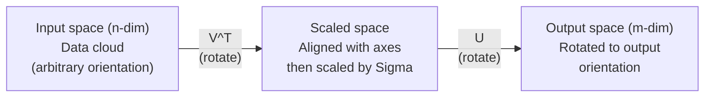
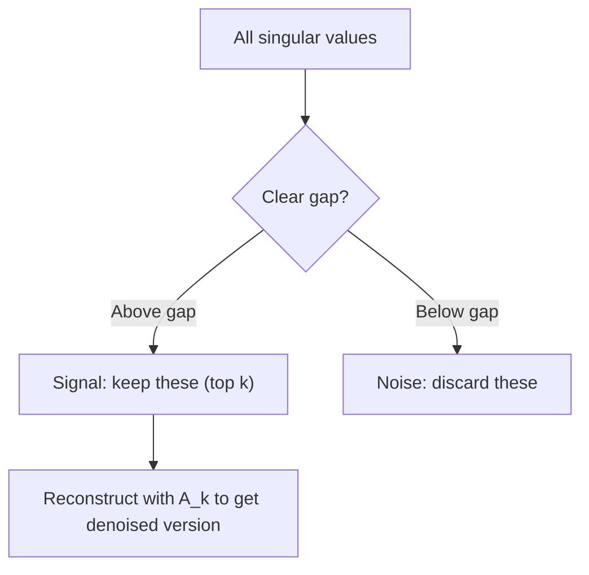

# Singular Value Decomposition

> SVD adalah pisau Swiss aljabar linear. Setiap matriks memilikinya. Setiap ilmuwan data membutuhkannya.

**Type:** Build
**Languages:** Python, Julia
**Prerequisites:** Phase 1, Lessons 01 (Linear Algebra Intuition), 02 (Vectors & Matrices Operations), 03 (Matrix Transformations)
**Time:** ~120 minutes

## Learning Objectives

- Mengimplementasikan SVD melalui power iteration dan menjelaskan makna geometrik dari U, Sigma, dan V^T
- Menerapkan truncated SVD untuk kompresi gambar dan mengukur rasio kompresi vs galat rekonstruksi
- Menghitung pseudoinverse Moore-Penrose via SVD untuk menyelesaikan sistem least-squares overdetermined
- Menghubungkan SVD dengan PCA, sistem rekomendasi (faktor laten), dan Latent Semantic Analysis di NLP

## Masalahnya

Kamu punya matriks berukuran 1000x2000. Mungkin itu rating pengguna-film. Mungkin itu tabel frekuensi dokumen-term. Mungkin itu nilai pixel sebuah gambar. Kamu perlu mengompresnya, menghilangkan noise-nya, menemukan struktur tersembunyi di dalamnya, atau menyelesaikan sistem least-squares dengannya. Eigendecomposition hanya bekerja pada matriks persegi. Bahkan begitu, matriksnya harus punya himpunan penuh eigenvector yang linier independen.

SVD bekerja pada matriks apa pun. Bentuk apa pun. Rank berapa pun. Tanpa syarat. Ia memfaktorkan matriks menjadi tiga faktor yang mengungkap geometri dari apa yang dilakukan matriks terhadap ruang. Ini adalah faktorisasi paling umum dan paling berguna di seluruh aljabar linear.

## Konsepnya

### Apa yang dilakukan SVD secara geometrik

Setiap matriks, terlepas dari bentuknya, melakukan tiga operasi secara berurutan: rotasi, skala, rotasi. SVD membuat dekomposisi ini eksplisit.

```
A = U * Sigma * V^T

      m x n     m x m    m x n    n x n
     (any)    (rotate)  (scale)  (rotate)
```

Diberikan matriks A apa pun, SVD memfaktorkannya menjadi:
- V^T memutar vektor di ruang masukan (n-dimensi)
- Sigma menskalakan di sepanjang setiap sumbu (meregangkan atau mengompres)
- U memutar hasilnya ke ruang keluaran (m-dimensi)



Bayangkan begini. Kamu memberikan sebuah matriks ke SVD. Ia memberitahumu: "Matriks ini mengambil bola dari input, memutarnya terlebih dahulu oleh V^T, lalu meregangkannya menjadi elipsoid oleh Sigma, lalu memutar elipsoid tersebut oleh U." Nilai singular adalah panjang-panjang sumbu elipsoid tersebut.

### Dekomposisi penuh

Untuk matriks A dengan bentuk m x n:

```
A = U * Sigma * V^T

where:
  U     is m x m, orthogonal (U^T U = I)
  Sigma is m x n, diagonal (singular values on the diagonal)
  V     is n x n, orthogonal (V^T V = I)

The singular values sigma_1 >= sigma_2 >= ... >= sigma_r > 0
where r = rank(A)
```

Kolom-kolom U disebut vektor singular kiri. Kolom-kolom V disebut vektor singular kanan. Entri diagonal Sigma disebul nilai singular. Nilai-nilai ini selalu non-negatif dan secara konvensi diurutkan menurun.

### Vektor singular kiri, nilai singular, vektor singular kanan

Setiap komponen SVD punya makna geometrik yang berbeda.

**Vektor singular kanan (kolom V):** Ini membentuk basis orthonormal untuk ruang masukan (R^n). Ini adalah arah-arah di ruang masukan yang dipetakan matriks ke arah-arah ortogonal di ruang keluaran. Anggap mereka sebagai sistem koordinat alami untuk domain.

**Nilai singular (diagonal Sigma):** Ini adalah faktor-faktor skala. Nilai singular ke-i memberitahumu seberapa besar matriks meregangkan vektor di sepanjang vektor singular kanan ke-i. Nilai singular nol berarti matriks menghancurkan arah itu sepenuhnya.

**Vektor singular kiri (kolom U):** Ini membentuk basis orthonormal untuk ruang keluaran (R^m). Vektor singular kiri ke-i adalah arah di ruang keluaran tempat vektor singular kanan ke-i mendarat (setelah diskalakan).

Hubungan di antara mereka:

```
A * v_i = sigma_i * u_i

The matrix A takes the i-th right singular vector v_i,
scales it by sigma_i, and maps it to the i-th left singular vector u_i.
```

Ini memberimu gambaran koordinat-per-koordinat tentang apa yang dilakukan matriks apa pun.

### Bentuk outer product

SVD dapat ditulis sebagai jumlah dari matriks-matriks rank-1:

```
A = sigma_1 * u_1 * v_1^T + sigma_2 * u_2 * v_2^T + ... + sigma_r * u_r * v_r^T

Each term sigma_i * u_i * v_i^T is a rank-1 matrix (an outer product).
The full matrix is the sum of r such matrices, where r is the rank.
```

Bentuk ini adalah fondasi dari aproksimasi low-rank. Setiap istilah menambahkan satu lapisan struktur. Istilah pertama menangkap pola paling penting tunggal. Istilah kedua menangkap yang paling penting berikutnya. Dan seterusnya. Memotong jumlah ini memberimu aproksimasi terbaik yang mungkin pada rank mana pun yang diberikan.

```
Rank-1 approx:    A_1 = sigma_1 * u_1 * v_1^T
                  (captures the dominant pattern)

Rank-2 approx:    A_2 = sigma_1 * u_1 * v_1^T + sigma_2 * u_2 * v_2^T
                  (captures the two most important patterns)

Rank-k approx:    A_k = sum of top k terms
                  (optimal by the Eckart-Young theorem)
```

### Hubungan dengan eigendecomposition

SVD dan eigendecomposition terhubung sangat erat. Nilai dan vektor singular A berasal langsung dari eigenvalue dan eigenvector dari A^T A dan A A^T.

```
A^T A = V * Sigma^T * U^T * U * Sigma * V^T
      = V * Sigma^T * Sigma * V^T
      = V * D * V^T

where D = Sigma^T * Sigma is a diagonal matrix with sigma_i^2 on the diagonal.

So:
- The right singular vectors (V) are eigenvectors of A^T A
- The singular values squared (sigma_i^2) are eigenvalues of A^T A

Similarly:
A A^T = U * Sigma * V^T * V * Sigma^T * U^T
      = U * Sigma * Sigma^T * U^T

So:
- The left singular vectors (U) are eigenvectors of A A^T
- The eigenvalues of A A^T are also sigma_i^2
```

Hubungan ini memberitahumu tiga hal:
1. Nilai singular selalu real dan non-negatif (akar kuadrat dari eigenvalue matriks semi-definisi positif).
2. Kamu bisa menghitung SVD via eigendecomposition dari A^T A, tapi ini men kuadratkan condition number dan kehilangan presisi numerik. Algoritma SVD khusus menghindari ini.
3. Ketika A persegi dan simetris semi-definisi positif, SVD dan eigendecomposition adalah hal yang sama.

### Truncated SVD: aproksimasi low-rank

Teorema Eckart-Young-Mirsky menyatakan bahwa aproksimasi rank-k terbaik untuk A (baik dalam norm Frobenius maupun spektral) diperoleh dengan hanya menyimpan k nilai singular teratas dan vektor-vektor yang sesuai:

```
A_k = U_k * Sigma_k * V_k^T

where:
  U_k     is m x k  (first k columns of U)
  Sigma_k is k x k  (top-left k x k block of Sigma)
  V_k     is n x k  (first k columns of V)

Approximation error = sigma_{k+1}  (in spectral norm)
                    = sqrt(sigma_{k+1}^2 + ... + sigma_r^2)  (in Frobenius norm)
```

Ini bukan sekadar aproksimasi yang "cukup baik". Ini terbukti sebagai aproksimasi terbaik yang mungkin dengan rank k. Tidak ada matriks rank-k lain yang lebih dekat ke A.

| Component | Relative magnitude | Kept in rank-3 approx? |
|-----------|-------------------|------------------------|
| sigma_1 | Largest | Yes |
| sigma_2 | Large | Yes |
| sigma_3 | Medium-large | Yes |
| sigma_4 | Medium | No (error) |
| sigma_5 | Medium-small | No (error) |
| sigma_6 | Small | No (error) |
| sigma_7 | Very small | No (error) |
| sigma_8 | Tiny | No (error) |

Simpan 3 teratas: A_3 menangkap tiga nilai singular terbesar. Galat = nilai-nilai yang tersisa (sigma_4 sampai sigma_8).

Jika nilai singular meluruh cepat, k kecil sudah menangkap sebagian besar matriks. Jika meluruh lambat, matriks tidak punya struktur low-rank.

### Kompresi gambar dengan SVD

Gambar grayscale adalah matriks intensitas pixel. Gambar 800x600 punya 480.000 nilai. SVD memungkinkan kamu mengaproksimasinya dengan jauh lebih sedikit.

```
Original image: 800 x 600 = 480,000 values

SVD with rank k:
  U_k:      800 x k values
  Sigma_k:  k values
  V_k:      600 x k values
  Total:    k * (800 + 600 + 1) = k * 1401 values

  k=10:   14,010 values   (2.9% of original)
  k=50:   70,050 values  (14.6% of original)
  k=100: 140,100 values  (29.2% of original)

  The compression ratio improves as k gets smaller,
  but visual quality degrades.
```

Wawasan kuncinya: gambar alami memiliki nilai singular yang meluruh cepat. Beberapa nilai singular pertama menangkap struktur luas (bentuk, gradien). Nilai-nilai berikutnya menangkap detail halus dan noise. Memotong pada rank 50 sering menghasilkan gambar yang tampak hampir identik dengan aslinya sambil menggunakan 85% lebih sedikit penyimpanan.

### SVD untuk sistem rekomendasi

Netflix Prize membuat ini terkenal. Kamu punya matriks rating pengguna-film di mana sebagian besar entri kosong.

```
             Movie1  Movie2  Movie3  Movie4  Movie5
  User1      [  5      ?       3       ?       1  ]
  User2      [  ?      4       ?       2       ?  ]
  User3      [  3      ?       5       ?       ?  ]
  User4      [  ?      ?       ?       4       3  ]

  ? = unknown rating
```

Idenya: matriks rating ini punya rank rendah. Pengguna tidak punya selera yang sepenuhnya independen. Ada segelintir faktor laten (aksi vs drama, lama vs baru, intelektual vs visceral) yang menjelaskan sebagian besar preferensi.

SVD pada matriks rating (yang sudah diisi) memfaktorkannya menjadi:
- U: profil pengguna di ruang faktor laten
- Sigma: pentingnya setiap faktor laten
- V^T: profil film di ruang faktor laten

Rating yang diprediksi untuk sebuah film adalah dot product dari profil pengguna dengan profil film (dibobot oleh nilai singular). Aproksimasi low-rank mengisi entri yang hilang.

Dalam praktiknya, kamu memakai varian seperti SVD inkremental Simon Funk atau ALS (alternating least squares) yang menangani data yang hilang secara langsung. Tapi inti idenya sama: dekomposisi faktor laten via SVD.

### SVD di NLP: Latent Semantic Analysis

Latent Semantic Analysis (LSA), juga disebut Latent Semantic Indexing (LSI), menerapkan SVD pada matriks term-dokumen.

```
             Doc1   Doc2   Doc3   Doc4
  "cat"      [  3      0      1      0  ]
  "dog"      [  2      0      0      1  ]
  "fish"     [  0      4      1      0  ]
  "pet"      [  1      1      1      1  ]
  "ocean"    [  0      3      0      0  ]

After SVD with rank k=2:

  Each document becomes a point in 2D "concept space."
  Each term becomes a point in the same 2D space.
  Documents about similar topics cluster together.
  Terms with similar meanings cluster together.

  "cat" and "dog" end up near each other (land pets).
  "fish" and "ocean" end up near each other (water concepts).
  Doc1 and Doc3 cluster if they share similar topics.
```

LSA adalah salah satu metode pertama yang berhasil menangkap kemiripan semantik dari teks mentah. Ia bekerja karena term sinonym cenderung muncul di dokumen yang mirip, sehingga SVD mengelompokkannya ke dimensi laten yang sama. Embedding kata modern (Word2Vec, GloVe) dapat dilihat sebagai keturunan dari ide ini.

### SVD untuk reduksi noise

Data berisik memiliki sinyal yang terkonsentrasi di nilai singular teratas dan noise yang tersebar di semua nilai singular. Pemotongan menghilangkan lantai noise-nya.

**Nilai singular sinyal bersih:**

| Component | Magnitude | Type |
|-----------|-----------|------|
| sigma_1 | Very large | Signal |
| sigma_2 | Large | Signal |
| sigma_3 | Medium | Signal |
| sigma_4 | Near zero | Negligible |
| sigma_5 | Near zero | Negligible |

**Nilai singular sinyal berisik (noise menambah ke semuanya):**

| Component | Magnitude | Type |
|-----------|-----------|------|
| sigma_1 | Very large | Signal |
| sigma_2 | Large | Signal |
| sigma_3 | Medium | Signal |
| sigma_4 | Small | Noise |
| sigma_5 | Small | Noise |
| sigma_6 | Small | Noise |
| sigma_7 | Small | Noise |



Ini dipakai dalam pemrosesan sinyal, pengukuran ilmiah, dan pembersihan data. Setiap kali kamu punya matriks yang rusak karena noise aditif, truncated SVD adalah cara yang berprinsip untuk memisahkan sinyal dari noise.

### Pseudoinverse via SVD

Pseudoinverse Moore-Penrose A+ menggeneralisasi inversi matriks ke matriks non-persegi dan singular. SVD membuat perhitungannya menjadi trivial.

```
If A = U * Sigma * V^T, then:

A+ = V * Sigma+ * U^T

where Sigma+ is formed by:
  1. Transpose Sigma (swap rows and columns)
  2. Replace each non-zero diagonal entry sigma_i with 1/sigma_i
  3. Leave zeros as zeros

For A (m x n):      A+ is (n x m)
For Sigma (m x n):  Sigma+ is (n x m)
```

Pseudoinverse menyelesaikan masalah least-squares. Jika Ax = b tidak punya solusi tepat (sistem overdetermined), maka x = A+ b adalah solusi least-squares (meminimalkan ||Ax - b||).

```
Overdetermined system (more equations than unknowns):

  [1  1]         [3]
  [2  1] x   =   [5]       No exact solution exists.
  [3  1]         [6]

  x_ls = A+ b = V * Sigma+ * U^T * b

  This gives the x that minimizes the sum of squared residuals.
  Same result as the normal equations (A^T A)^(-1) A^T b,
  but numerically more stable.
```

### Keunggulan stabilitas numerik

Menghitung eigendecomposition dari A^T A men kuadratkan nilai singular (eigenvalue dari A^T A adalah sigma_i^2). Ini men kuadratkan condition number, memperbesar galat numerik.

```
Example:
  A has singular values [1000, 1, 0.001]
  Condition number of A: 1000 / 0.001 = 10^6

  A^T A has eigenvalues [10^6, 1, 10^{-6}]
  Condition number of A^T A: 10^6 / 10^{-6} = 10^{12}

  Computing SVD directly: works with condition number 10^6
  Computing via A^T A:     works with condition number 10^{12}
                           (6 extra digits of precision lost)
```

Algoritma SVD modern (bidiagonalisasi Golub-Kahan) bekerja langsung pada A, tidak pernah membentuk A^T A. Itulah sebabnya kamu selalu harus memilih `np.linalg.svd(A)` daripada `np.linalg.eig(A.T @ A)`.

### Hubungan dengan PCA

PCA ADALAH SVD pada data yang sudah di-center. Ini bukan analogi. Ini secara harfiah perhitungan yang sama.

```
Given data matrix X (n_samples x n_features), centered (mean subtracted):

Covariance matrix: C = (1/(n-1)) * X^T X

PCA finds eigenvectors of C. But:

  X = U * Sigma * V^T    (SVD of X)

  X^T X = V * Sigma^2 * V^T

  C = (1/(n-1)) * V * Sigma^2 * V^T

So the principal components are exactly the right singular vectors V.
The explained variance for each component is sigma_i^2 / (n-1).

In sklearn, PCA is implemented using SVD, not eigendecomposition.
It is faster and more numerically stable.
```

Ini berarti semua yang kamu pelajari tentang reduksi dimensi di Lesson 10 sebenarnya adalah SVD di balik layar. PCA adalah aplikasi SVD yang paling umum dalam machine learning.

```figure
svd-rank-reconstruction
```

## Bangun Sendiri

### Langkah 1: SVD dari nol menggunakan power iteration

Idenya: untuk menemukan nilai singular terbesar dan vektor-vektornya, gunakan power iteration pada A^T A (atau A A^T). Lalu deflasikan matriksnya dan ulangi untuk nilai singular berikutnya.

```python
import numpy as np

def power_iteration(M, num_iters=100):
    n = M.shape[1]
    v = np.random.randn(n)
    v = v / np.linalg.norm(v)

    for _ in range(num_iters):
        Mv = M @ v
        v = Mv / np.linalg.norm(Mv)

    eigenvalue = v @ M @ v
    return eigenvalue, v

def svd_from_scratch(A, k=None):
    m, n = A.shape
    if k is None:
        k = min(m, n)

    sigmas = []
    us = []
    vs = []

    A_residual = A.copy().astype(float)

    for _ in range(k):
        AtA = A_residual.T @ A_residual
        eigenvalue, v = power_iteration(AtA, num_iters=200)

        if eigenvalue < 1e-10:
            break

        sigma = np.sqrt(eigenvalue)
        u = A_residual @ v / sigma

        sigmas.append(sigma)
        us.append(u)
        vs.append(v)

        A_residual = A_residual - sigma * np.outer(u, v)

    U = np.column_stack(us) if us else np.empty((m, 0))
    S = np.array(sigmas)
    V = np.column_stack(vs) if vs else np.empty((n, 0))

    return U, S, V
```

### Langkah 2: Uji dan bandingkan dengan NumPy

```python
np.random.seed(42)
A = np.random.randn(5, 4)

U_ours, S_ours, V_ours = svd_from_scratch(A)
U_np, S_np, Vt_np = np.linalg.svd(A, full_matrices=False)

print("Our singular values:", np.round(S_ours, 4))
print("NumPy singular values:", np.round(S_np, 4))

A_reconstructed = U_ours @ np.diag(S_ours) @ V_ours.T
print(f"Reconstruction error: {np.linalg.norm(A - A_reconstructed):.8f}")
```

### Langkah 3: Demo kompresi gambar

```python
def compress_image_svd(image_matrix, k):
    U, S, Vt = np.linalg.svd(image_matrix, full_matrices=False)
    compressed = U[:, :k] @ np.diag(S[:k]) @ Vt[:k, :]
    return compressed

image = np.random.seed(42)
rows, cols = 200, 300
image = np.random.randn(rows, cols)

for k in [1, 5, 10, 20, 50]:
    compressed = compress_image_svd(image, k)
    error = np.linalg.norm(image - compressed) / np.linalg.norm(image)
    original_size = rows * cols
    compressed_size = k * (rows + cols + 1)
    ratio = compressed_size / original_size
    print(f"k={k:>3d}  error={error:.4f}  storage={ratio:.1%}")
```

### Langkah 4: Reduksi noise

```python
np.random.seed(42)
clean = np.outer(np.sin(np.linspace(0, 4*np.pi, 100)),
                 np.cos(np.linspace(0, 2*np.pi, 80)))
noise = 0.3 * np.random.randn(100, 80)
noisy = clean + noise

U, S, Vt = np.linalg.svd(noisy, full_matrices=False)
denoised = U[:, :5] @ np.diag(S[:5]) @ Vt[:5, :]

print(f"Noisy error:    {np.linalg.norm(noisy - clean):.4f}")
print(f"Denoised error: {np.linalg.norm(denoised - clean):.4f}")
print(f"Improvement:    {(1 - np.linalg.norm(denoised - clean) / np.linalg.norm(noisy - clean)):.1%}")
```

### Langkah 5: Pseudoinverse

```python
A = np.array([[1, 1], [2, 1], [3, 1]], dtype=float)
b = np.array([3, 5, 6], dtype=float)

U, S, Vt = np.linalg.svd(A, full_matrices=False)
S_inv = np.diag(1.0 / S)
A_pinv = Vt.T @ S_inv @ U.T

x_svd = A_pinv @ b
x_lstsq = np.linalg.lstsq(A, b, rcond=None)[0]
x_pinv = np.linalg.pinv(A) @ b

print(f"SVD pseudoinverse solution:  {x_svd}")
print(f"np.linalg.lstsq solution:   {x_lstsq}")
print(f"np.linalg.pinv solution:    {x_pinv}")
```

## Gunakan

Demo lengkap yang berjalan ada di `code/svd.py`. Jalankan untuk melihat SVD diterapkan pada kompresi gambar, sistem rekomendasi, latent semantic analysis, dan reduksi noise.

```bash
python svd.py
```

Versi Julia di `code/svd.jl` mendemonstrasikan konsep yang sama menggunakan fungsi bawaan `svd()` Julia dan paket `LinearAlgebra`.

```bash
julia svd.jl
```

## Rilis

Pelajaran ini menghasilkan:
- `outputs/skill-svd.md` - sebuah skill untuk mengetahui kapan dan bagaimana menerapkan SVD dalam proyek nyata

## Latihan

1. Implementasikan SVD penuh dari nol tanpa menggunakan power iteration. Sebagai gantinya, hitung eigendecomposition dari A^T A untuk mendapatkan V dan nilai-nilai singular, lalu hitung U = A V Sigma^{-1}. Bandingkan akurasi numerik dengan versi power iteration-mu dan dengan NumPy.

2. Muat sebuah gambar grayscale nyata (atau konversi satu gambar ke grayscale). Kompres pada rank 1, 5, 10, 25, 50, 100. Untuk setiap rank, hitung rasio kompresi dan galat relatif. Temukan rank di mana gambar menjadi dapat diterima secara visual.

3. Bangun sistem rekomendasi mini. Buat matriks rating pengguna-film 10x8 dengan beberapa entri yang diketahui. Isi entri yang hilang dengan rata-rata baris. Hitung SVD dan rekonstruksi aproksimasi rank-3. Gunakan matriks yang direkonstruksi untuk memprediksi rating yang hilang. Verifikasi bahwa prediksinya masuk akal.

4. Buat matriks dokumen-term 100x50 dengan 3 topik sintetis. Setiap topik punya 5 term terkait. Tambahkan noise. Terapkan SVD dan verifikasi bahwa 3 nilai singular teratas jauh lebih besar dari yang lain. Proyeksikan dokumen ke ruang laten 3D dan periksa bahwa dokumen dari topik yang sama saling berkelompok.

5. Hasilkan matriks low-rank yang bersih (rank 3, ukuran 50x40) dan tambahkan noise Gaussian pada berbagai level (sigma = 0.1, 0.5, 1.0, 2.0). Untuk setiap level noise, temukan rank potong optimal dengan menyapu k dari 1 sampai 40 dan mengukur galat rekonstruksi terhadap matriks bersih. Plot bagaimana k optimal berubah dengan level noise.

## Istilah Kunci

| Term | What people say | What it actually means |
|------|----------------|----------------------|
| SVD | "Factor any matrix" | Decompose A into U Sigma V^T where U and V are orthogonal and Sigma is diagonal with non-negative entries. Works for any matrix of any shape. |
| Singular value | "How important this component is" | The i-th diagonal entry of Sigma. Measures how much the matrix stretches along the i-th principal direction. Always non-negative, sorted in decreasing order. |
| Left singular vector | "Output direction" | A column of U. The direction in output space that the i-th right singular vector maps to (after scaling by sigma_i). |
| Right singular vector | "Input direction" | A column of V. The direction in input space that the matrix maps to the i-th left singular vector (after scaling by sigma_i). |
| Truncated SVD | "Low-rank approximation" | Keep only the top k singular values and their vectors. Produces the provably best rank-k approximation to the original matrix (Eckart-Young theorem). |
| Rank | "True dimensionality" | The number of non-zero singular values. Tells you how many independent directions the matrix actually uses. |
| Pseudoinverse | "Generalized inverse" | V Sigma+ U^T. Inverts non-zero singular values, leaves zeros as zeros. Solves least-squares problems for non-square or singular matrices. |
| Condition number | "How sensitive to errors" | sigma_max / sigma_min. A large condition number means small input changes cause large output changes. SVD reveals this directly. |
| Latent factor | "Hidden variable" | A dimension in the low-rank space discovered by SVD. In recommendations, a latent factor might correspond to genre preference. In NLP, it might correspond to a topic. |
| Frobenius norm | "Total matrix size" | Square root of the sum of squared entries. Equals the square root of the sum of squared singular values. Used to measure approximation error. |
| Eckart-Young theorem | "SVD gives the best compression" | For any target rank k, the truncated SVD minimizes the approximation error over all possible rank-k matrices. |
| Power iteration | "Find the biggest eigenvector" | Repeatedly multiply a random vector by the matrix and normalize. Converges to the eigenvector with the largest eigenvalue. The building block of many SVD algorithms. |

## Bacaan Lanjutan

- [Gilbert Strang: Linear Algebra and Its Applications, Chapter 7](https://math.mit.edu/~gs/linearalgebra/) - penjelasan menyeluruh tentang SVD dengan aplikasinya
- [3Blue1Brown: But what is the SVD?](https://www.youtube.com/watch?v=vSczTbgc8Rc) - intuisi geometrik untuk SVD
- [We Recommend a Singular Value Decomposition](https://www.ams.org/publicoutreach/feature-column/fcarc-svd) - ikhtisar yang mudah diakses dari American Mathematical Society
- [Netflix Prize and Matrix Factorization](https://sifter.org/~simon/journal/20061211.html) - postingan blog asli Simon Funk tentang SVD untuk rekomendasi
- [Latent Semantic Analysis](https://en.wikipedia.org/wiki/Latent_semantic_analysis) - aplikasi NLP asli dari SVD
- [Numerical Linear Algebra by Trefethen and Bau](https://people.maths.ox.ac.uk/trefethen/text.html) - standar emas untuk memahami algoritma SVD dan sifat numeriknya
