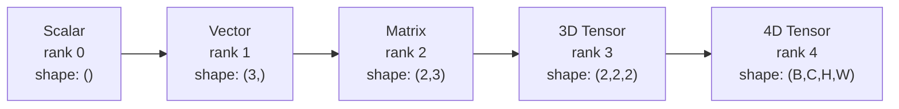
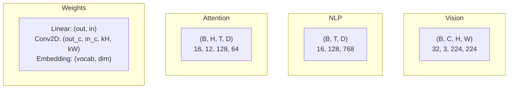
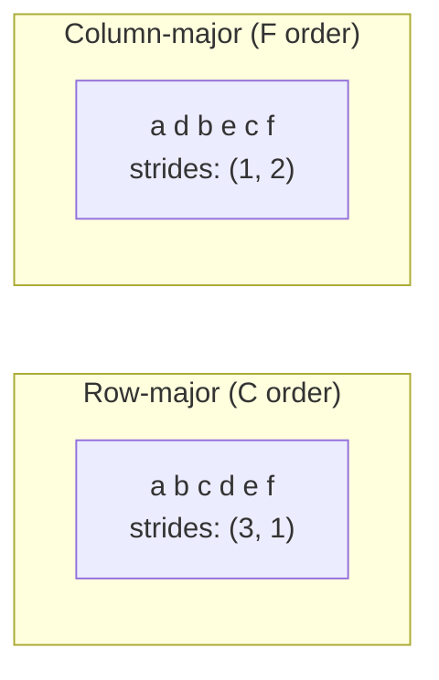
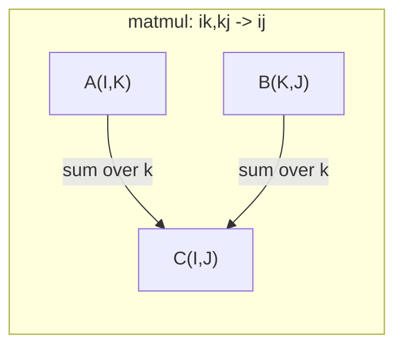

# Tensor Operations

> Tensor adalah bahasa universal antara data dan deep learning. Setiap gambar, setiap kalimat, setiap gradien mengalir melaluinya.

**Type:** Build
**Language:** Python
**Prerequisites:** Phase 1, Lessons 01 (Linear Algebra Intuition), 02 (Vectors, Matrices & Operations)
**Time:** ~90 minutes

## Learning Objectives

- Mengimplementasikan kelas tensor dengan shape, strides, reshape, transpose, dan operasi element-wise dari nol
- Menerapkan aturan broadcasting untuk mengoperasikan tensor dengan bentuk berbeda tanpa menyalin data
- Menulis ekspresi einsum untuk dot product, perkalian matriks, outer product, dan operasi batch
- Menelusuri bentuk tensor yang tepat di setiap langkah multi-head attention

## Masalahnya

Kamu sedang membangun sebuah transformer. Forward pass-nya terlihat rapi. Kamu menjalankannya dan mendapat: `RuntimeError: mat1 and mat2 shapes cannot be multiplied (32x768 and 512x768)`. Kamu menatap shape-shape itu. Kamu mencoba satu transpose. Sekarang isinya `Expected 4D input (got 3D input)`. Kamu menambahkan satu unsqueeze. Sesuatu yang lain rusak.

Galat shape adalah bug paling umum dalam kode deep learning. Secara konsep tidak sulit -- setiap operasi punya kontrak shape -- tapi cepat berlipat ganda. Sebuah transformer punya lusinan reshape, transpose, dan broadcast yang dirangkai bersama. Satu sumbu yang salah, dan galatnya berantai. Lebih buruk lagi, beberapa kesalahan shape sama sekali tidak melempar error. Ia diam-diam menghasilkan sampah dengan melakukan broadcasting di dimensi yang salah atau menjumlahkan di sumbu yang salah.

Matriks menangani hubungan berpasangan antara dua himpunan benda. Data nyata tidak muat dalam dua dimensi. Sebuah batch 32 gambar RGB berukuran 224x224 adalah tensor 4D: `(32, 3, 224, 224)`. Self-attention dengan 12 head juga 4D: `(batch, heads, seq_len, head_dim)`. Kamu membutuhkan struktur data yang menggeneralisasi ke jumlah dimensi berapa pun, dengan operasi yang menyusun dengan bersih di semua dimensi tersebut. Struktur itu adalah tensor. Kuasai operasinya, dan galat shape menjadi mudah di-debug.

## Konsepnya

### Apa itu tensor

Tensor adalah array multi-dimensi dari angka dengan tipe data yang seragam. Jumlah dimensinya adalah **rank** (atau **order**). Setiap dimensi adalah sebuah **axis**. **Shape** adalah tuple yang mencantumkan ukuran di sepanjang setiap sumbu.



Total elemen = hasil kali semua ukuran. Shape `(2, 3, 4)` menyimpan `2 * 3 * 4 = 24` elemen.

### Bentuk tensor dalam deep learning

Tipe data yang berbeda memetakan ke bentuk tensor tertentu secara konvensi.



PyTorch memakai NCHW (channels-first). TensorFlow default ke NHWC (channels-last). Layout yang tidak cocok menyebabkan perlambatan diam-diam atau error.

### Cara kerja tata letak memori

Array 2D di memori adalah sekuens 1D dari byte. **Strides** memberitahumu berapa banyak elemen yang harus dilewati untuk melangkah satu langkah di sepanjang setiap sumbu.



Transpose tidak memindahkan data. Ia menukar stride, membuat tensor **non-contiguous** -- elemen-elemen untuk satu baris tidak lagi bersebelahan di memori.

### Aturan broadcasting

Broadcasting memungkinkan kamu mengoperasikan tensor dengan bentuk berbeda tanpa menyalin data. Selaraskan shape dari kanan. Dua dimensi kompatibel ketika keduanya sama atau salah satunya bernilai 1. Dimensi yang lebih sedikit diberi padding 1 di sebelah kiri.

```
Tensor A:     (8, 1, 6, 1)
Tensor B:        (7, 1, 5)
Padded B:     (1, 7, 1, 5)
Result:       (8, 7, 6, 5)
```

### Einsum: operasi tensor universal

Notasi summation Einstein memberi label setiap sumbu dengan sebuah huruf. Sumbu yang ada di masukan tapi tidak di keluaran akan dijumlahkan. Sumbu yang ada di keduanya dipertahankan.



Pola kunci: `i,i->` (dot product), `i,j->ij` (outer product), `ii->` (trace), `ij->ji` (transpose), `bij,bjk->bik` (batch matmul), `bhtd,bhsd->bhts` (attention scores).

```figure
tensor-broadcast
```

## Bangun Sendiri

Kodenya ada di `code/tensors.py`. Setiap langkah merujuk ke implementasi di sana.

### Langkah 1: Penyimpanan tensor dan strides

Sebuah tensor menyimpan daftar datar angka plus metadata shape. Strides memberi tahu logika indexing cara memetakan indeks multi-dimensi ke posisi datar.

```python
class Tensor:
    def __init__(self, data, shape=None):
        if isinstance(data, (list, tuple)):
            self._data, self._shape = self._flatten_nested(data)
        elif isinstance(data, np.ndarray):
            self._data = data.flatten().tolist()
            self._shape = tuple(data.shape)
        else:
            self._data = [data]
            self._shape = ()

        if shape is not None:
            total = reduce(lambda a, b: a * b, shape, 1)
            if total != len(self._data):
                raise ValueError(
                    f"Cannot reshape {len(self._data)} elements into shape {shape}"
                )
            self._shape = tuple(shape)

        self._strides = self._compute_strides(self._shape)

    @staticmethod
    def _compute_strides(shape):
        if len(shape) == 0:
            return ()
        strides = [1] * len(shape)
        for i in range(len(shape) - 2, -1, -1):
            strides[i] = strides[i + 1] * shape[i + 1]
        return tuple(strides)
```

Untuk shape `(3, 4)`, stride-nya `(4, 1)` -- lewati 4 elemen untuk maju satu baris, lewati 1 elemen untuk maju satu kolom.

### Langkah 2: Reshape, squeeze, unsqueeze

Reshape mengubah shape tanpa mengubah urutan elemen. Total jumlah elemen harus tetap sama. Gunakan `-1` untuk salah satu dimensi agar ukurannya disimpulkan.

```python
t = Tensor(list(range(12)), shape=(2, 6))
r = t.reshape((3, 4))
r = t.reshape((-1, 3))
```

Squeeze menghapus sumbu berukuran 1. Unsqueeze menyisipkan satu. Unsqueeze sangat penting untuk broadcasting -- vektor bias `(D,)` yang ditambahkan ke batch `(B, T, D)` perlu diunsqueeze ke `(1, 1, D)`.

```python
t = Tensor(list(range(6)), shape=(1, 3, 1, 2))
s = t.squeeze()
v = Tensor([1, 2, 3])
u = v.unsqueeze(0)
```

### Langkah 3: Transpose dan permute

Transpose menukar dua sumbu. Permute mengatur ulang semua sumbu. Inilah cara kamu mengonversi antara NCHW dan NHWC.

```python
mat = Tensor(list(range(6)), shape=(2, 3))
tr = mat.transpose(0, 1)

t4d = Tensor(list(range(24)), shape=(1, 2, 3, 4))
perm = t4d.permute((0, 2, 3, 1))
```

Setelah transpose atau permute, tensor menjadi non-contiguous di memori. Di PyTorch, `view` gagal pada tensor non-contiguous -- gunakan `reshape` atau panggil `.contiguous()` terlebih dahulu.

### Langkah 4: Operasi element-wise dan reduksi

Operasi element-wise (tambah, kali, kurang) diterapkan secara independen ke setiap elemen dan mempertahankan shape. Reduksi (sum, mean, max) menciutkan satu atau lebih sumbu.

```python
a = Tensor([[1, 2], [3, 4]])
b = Tensor([[10, 20], [30, 40]])
c = a + b
d = a * 2
s = a.sum(axis=0)
```

Global average pooling di CNN: `(B, C, H, W).mean(axis=[2, 3])` menghasilkan `(B, C)`. Sequence mean pooling di NLP: `(B, T, D).mean(axis=1)` menghasilkan `(B, D)`.

### Langkah 5: Broadcasting dengan NumPy

Fungsi `demo_broadcasting_numpy()` di `tensors.py` menunjukkan pola-pola inti.

```python
activations = np.random.randn(4, 3)
bias = np.array([0.1, 0.2, 0.3])
result = activations + bias

images = np.random.randn(2, 3, 4, 4)
scale = np.array([0.5, 1.0, 1.5]).reshape(1, 3, 1, 1)
result = images * scale

a = np.array([1, 2, 3]).reshape(-1, 1)
b = np.array([10, 20, 30, 40]).reshape(1, -1)
outer = a * b
```

Jarak berpasangan via broadcasting: reshape `(M, 2)` ke `(M, 1, 2)` dan `(N, 2)` ke `(1, N, 2)`, kurangkan, kuadratkan, jumlahkan di sepanjang sumbu terakhir, ambil akar kuadrat. Hasil: `(M, N)`.

### Langkah 6: Operasi einsum

Fungsi `demo_einsum()` dan `demo_einsum_gallery()` membahas setiap pola yang umum.

```python
a = np.array([1.0, 2.0, 3.0])
b = np.array([4.0, 5.0, 6.0])
dot = np.einsum("i,i->", a, b)

A = np.array([[1, 2], [3, 4], [5, 6]], dtype=float)
B = np.array([[7, 8, 9], [10, 11, 12]], dtype=float)
matmul = np.einsum("ik,kj->ij", A, B)

batch_A = np.random.randn(4, 3, 5)
batch_B = np.random.randn(4, 5, 2)
batch_mm = np.einsum("bij,bjk->bik", batch_A, batch_B)
```

Biaya komputasi sebuah kontraksi adalah hasil kali semua ukuran indeks (yang dipertahankan dan yang dijumlahkan). Untuk `bij,bjk->bik` dengan B=32, I=128, J=64, K=128: `32 * 128 * 64 * 128 = 33,554,432` multiply-adds.

### Langkah 7: Mekanisme attention via einsum

Fungsi `demo_attention_einsum()` mengimplementasikan multi-head attention dari ujung ke ujung.

```python
B, H, T, D = 2, 4, 8, 16
E = H * D

X = np.random.randn(B, T, E)
W_q = np.random.randn(E, E) * 0.02

Q = np.einsum("bte,ek->btk", X, W_q)
Q = Q.reshape(B, T, H, D).transpose(0, 2, 1, 3)

scores = np.einsum("bhtd,bhsd->bhts", Q, K) / np.sqrt(D)
weights = softmax(scores, axis=-1)
attn_output = np.einsum("bhts,bhsd->bhtd", weights, V)

concat = attn_output.transpose(0, 2, 1, 3).reshape(B, T, E)
output = np.einsum("bte,ek->btk", concat, W_o)
```

Setiap langkah adalah operasi tensor: proyeksi (matmul via einsum), pemisahan head (reshape + transpose), attention scores (batch matmul via einsum), jumlah berbobot (batch matmul via einsum), penggabungan head (transpose + reshape), proyeksi keluaran (matmul via einsum).

## Gunakan

### Scratch vs NumPy

| Operation | Scratch (Tensor class) | NumPy |
|---|---|---|
| Create | `Tensor([[1,2],[3,4]])` | `np.array([[1,2],[3,4]])` |
| Reshape | `t.reshape((3,4))` | `a.reshape(3,4)` |
| Transpose | `t.transpose(0,1)` | `a.T` atau `a.transpose(0,1)` |
| Squeeze | `t.squeeze(0)` | `np.squeeze(a, 0)` |
| Sum | `t.sum(axis=0)` | `a.sum(axis=0)` |
| Einsum | N/A | `np.einsum("ij,jk->ik", a, b)` |

### Scratch vs PyTorch

```python
import torch

t = torch.tensor([[1, 2, 3], [4, 5, 6]], dtype=torch.float32)
t.shape
t.stride()
t.is_contiguous()

t.reshape(3, 2)
t.unsqueeze(0)
t.transpose(0, 1)
t.transpose(0, 1).contiguous()

torch.einsum("ik,kj->ij", A, B)
```

PyTorch menambahkan autograd, dukungan GPU, dan kernel BLAS yang dioptimalkan. Semantik shape-nya identik. Jika kamu memahami versi scratch-nya, galat shape di PyTorch menjadi terbaca.

### Setiap layer neural network sebagai operasi tensor

| Operation | Tensor Form | Einsum |
|---|---|---|
| Linear layer | `Y = X @ W.T + b` | `"bd,od->bo"` + bias |
| Attention QKV | `Q = X @ W_q` | `"btd,dh->bth"` |
| Attention scores | `Q @ K.T / sqrt(d)` | `"bhtd,bhsd->bhts"` |
| Attention output | `softmax(scores) @ V` | `"bhts,bhsd->bhtd"` |
| Batch norm | `(X - mu) / sigma * gamma` | element-wise + broadcast |
| Softmax | `exp(x) / sum(exp(x))` | element-wise + reduction |

## Rilis

Pelajaran ini menghasilkan dua prompt yang dapat digunakan ulang:

1. **`outputs/prompt-tensor-shapes.md`** -- Prompt sistematis untuk mendebug ketidakcocokan bentuk tensor. Termasuk tabel keputusan untuk setiap operasi umum (matmul, broadcast, cat, Linear, Conv2d, BatchNorm, softmax) dan tabel pencarian perbaikan.

2. **`outputs/prompt-tensor-debugger.md`** -- Prompt debugging langkah-demi-langkah yang kamu tempel ke asisten AI mana pun saat galat shape sedang menghalangimu. Berikan pesan error dan bentuk tensor-mu, dapatkan kembali perbaikan yang tepat.

## Latihan

1. **Mudah -- Reshape round-trip.** Ambil tensor dengan bentuk `(2, 3, 4)`. Reshape ke `(6, 4)`, lalu ke `(24,)`, lalu kembali ke `(2, 3, 4)`. Verifikasi urutan elemen tetap dipertahankan di setiap langkah dengan mencetak data flat.

2. **Sedang -- Implementasikan broadcasting.** Perluas kelas `Tensor` dengan metode `broadcast_to(shape)` yang mengembangkan dimensi berukuran 1 agar cocok dengan bentuk target. Lalu ubah `_elementwise_op` agar otomatis melakukan broadcast sebelum beroperasi. Uji dengan bentuk `(3, 1)` dan `(1, 4)` yang menghasilkan `(3, 4)`.

3. **Sulit -- Bangun einsum dari nol.** Implementasikan fungsi dasar `einsum(subscripts, *tensors)` yang menangani setidaknya: dot product (`i,i->`), perkalian matriks (`ij,jk->ik`), outer product (`i,j->ij`), dan transpose (`ij->ji`). Parsing string subscript, identifikasi indeks yang dikontraksikan, dan loop melalui semua kombinasi indeks. Bandingkan hasil-mu dengan `np.einsum`.

4. **Sulit — Pelacak bentuk attention.** Tulis fungsi yang menerima `batch_size`, `seq_len`, `embed_dim`, dan `num_heads` sebagai masukan dan mencetak bentuk yang tepat di setiap langkah multi-head attention: input, proyeksi Q/K/V, pemisahan head, attention scores, bobot softmax, jumlah berbobot, penggabungan head, proyeksi keluaran. Verifikasi terhadap keluaran `demo_attention_einsum()`.

## Istilah Kunci

| Term | What people say | What it actually means |
|---|---|---|
| Tensor | "A matrix but more dimensions" | A multi-dimensional array with uniform type and defined shape, strides, and operations |
| Rank | "The number of dimensions" | The number of axes. A matrix has rank 2, not rank equal to its matrix rank |
| Shape | "The size of the tensor" | A tuple listing the size along each axis. `(2, 3)` means 2 rows, 3 columns |
| Stride | "How memory is laid out" | The number of elements to skip to advance one position along each axis |
| Broadcasting | "It just works when shapes differ" | A strict set of rules: align from right, dimensions must be equal or one must be 1 |
| Contiguous | "The tensor is normal" | Elements stored sequentially in memory with no gaps or reordering from the logical layout |
| Einsum | "A fancy way to write matmul" | A general notation that expresses any tensor contraction, outer product, trace, or transpose in one line |
| View | "Same as reshape" | A tensor sharing the same memory buffer but with different shape/stride metadata. Fails on non-contiguous data |
| Contraction | "Summing over an index" | The general operation where a shared index between tensors is multiplied and summed, producing a lower-rank result |
| NCHW / NHWC | "PyTorch vs TensorFlow format" | Memory layout conventions for image tensors. NCHW puts channels before spatial dims, NHWC puts them after |

## Bacaan Lanjutan

- [NumPy Broadcasting](https://numpy.org/doc/stable/user/basics.broadcasting.html) -- Aturan kanonis dengan contoh visual
- [PyTorch Tensor Views](https://pytorch.org/docs/stable/tensor_view.html) -- Kapan view bekerja dan kapan menyalin
- [einops](https://github.com/arogozhnikov/einops) -- Pustaka yang membuat reshaping tensor terbaca dan aman
- [The Illustrated Transformer](https://jalammar.github.io/illustrated-transformer/) -- Memvisualisasikan bentuk tensor yang mengalir melalui attention
- [Einstein Summation in NumPy](https://numpy.org/doc/stable/reference/generated/numpy.einsum.html) -- Dokumentasi einsum lengkap dengan contoh
