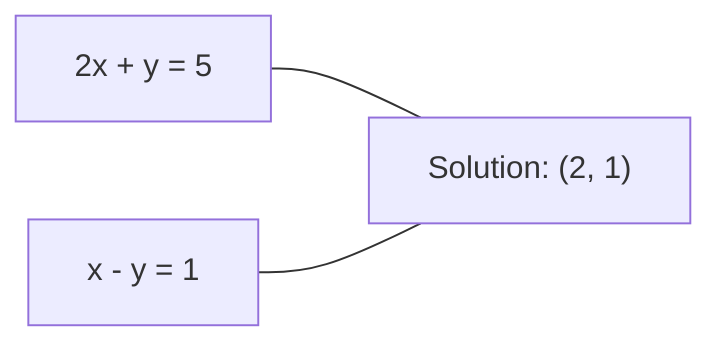
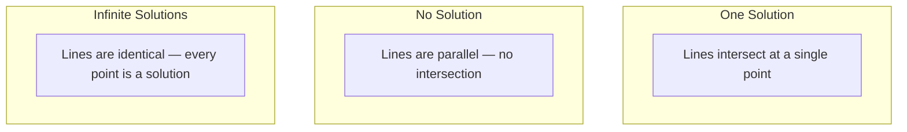

# Linear Systems

> Menyelesaikan Ax = b adalah masalah tertua dalam matematika yang masih menjalankan neural network-mu.

**Type:** Build
**Language:** Python
**Prerequisites:** Phase 1, Lessons 01 (Linear Algebra Intuition), 02 (Vectors & Matrices), 03 (Matrix Transformations)
**Time:** ~120 minutes

## Learning Objectives

- Menyelesaikan Ax = b menggunakan Gaussian elimination dengan partial pivoting dan back substitution
- Memfaktorkan matriks dengan dekomposisi LU, QR, dan Cholesky serta menjelaskan kapan masing-masing tepat
- Menurunkan normal equations untuk least squares dan menghubungkannya dengan linear dan ridge regression
- Mendiagnosis sistem ill-conditioned menggunakan condition number dan menerapkan regularisasi untuk menstabilkannya

## Masalahnya

Setiap kali kamu melatih linear regression, kamu menyelesaikan sebuah sistem linear. Setiap kali kamu menghitung least-squares fit, kamu menyelesaikan sebuah sistem linear. Setiap kali layer neural network menghitung `y = Wx + b`, ia mengevaluasi satu sisi dari sistem linear. Saat kamu menambahkan regularisasi, kamu memodifikasi sistemnya. Saat kamu memakai Gaussian processes, kamu memfaktorkan sebuah matriks. Saat kamu meng-invert matriks kovarians untuk jarak Mahalanobis, kamu menyelesaikan sebuah sistem linear.

Persamaan Ax = b muncul di mana-mana. A adalah matriks koefisien yang diketahui. b adalah vektor output yang diketahui. x adalah vektor variabel tak dikenal yang ingin kamu temukan. Dalam linear regression, A adalah matriks data-mu, b adalah vektor target-mu, dan x adalah vektor bobot. Seluruh modelnya berkurang menjadi: temukan x sehingga Ax sedekat mungkin dengan b.

Pelajaran ini membangun setiap metode utama untuk menyelesaikan persamaan itu dari nol. Kamu akan memahami mengapa beberapa metode cepat dan yang lain stabil, mengapa beberapa hanya bekerja untuk sistem persegi dan yang lain menangani yang overdetermined, dan mengapa condition number dari matriks-mu menentukan apakah jawabanmu berarti sama sekali.

## Konsepnya

### Apa arti Ax = b secara geometrik

Sistem persamaan linear punya interpretasi geometrik. Setiap persamaan mendefinisikan sebuah hiperplane. Solusinya adalah titik (atau himpunan titik) di mana semua hiperplane beririsan.

```
2x + y = 5          Two lines in 2D.
x - y  = 1          They intersect at x=2, y=1.
```



Tiga hal bisa terjadi:



Dalam bentuk matriks, "satu solusi" berarti A dapat di-invert. "Tidak ada solusi" berarti sistemnya tidak konsisten. "Solusi tak hingga" berarti A punya null space. Sebagian besar masalah ML jatuh dalam kategori "tidak ada solusi tepat" karena kamu punya lebih banyak persamaan (titik data) daripada variabel tak dikenal (parameter). Di situlah least squares masuk.

### Gambaran kolom vs gambaran baris

Ada dua cara membaca Ax = b.

**Gambaran baris.** Setiap baris A mendefinisikan satu persamaan. Setiap persamaan adalah sebuah hiperplane. Solusinya adalah di mana semuanya beririsan.

**Gambaran kolom.** Setiap kolom A adalah sebuah vektor. Pertanyaannya menjadi: kombinasi linier kolom-kolom A apa yang menghasilkan b?

```
A = | 2  1 |    b = | 5 |
    | 1 -1 |        | 1 |

Row picture: solve 2x + y = 5 and x - y = 1 simultaneously.

Column picture: find x1, x2 such that:
  x1 * [2, 1] + x2 * [1, -1] = [5, 1]
  2 * [2, 1] + 1 * [1, -1] = [4+1, 2-1] = [5, 1]   check.
```

Gambaran kolom lebih fundamental. Jika b berada di kolom space A, sistemnya punya solusi. Jika tidak, kamu menemukan titik terdekat di kolom space. Titik terdekat itu adalah solusi least-squares.

### Gaussian elimination

Gaussian elimination mengubah Ax = b menjadi sistem segitiga atas Ux = c yang kamu selesaikan dengan back substitution. Ini adalah metode paling langsung.

Algoritmanya:

```
1. For each column k (the pivot column):
   a. Find the largest entry in column k at or below row k (partial pivoting).
   b. Swap that row with row k.
   c. For each row i below k:
      - Compute multiplier m = A[i][k] / A[k][k]
      - Subtract m times row k from row i.
2. Back substitute: solve from the last equation upward.
```

Contoh:

```
Original:
| 2  1  1 | 8 |       R2 = R2 - (2)R1     | 2  1   1 |  8 |
| 4  3  3 |20 |  -->  R3 = R3 - (1)R1 --> | 0  1   1 |  4 |
| 2  3  1 |12 |                            | 0  2   0 |  4 |

                       R3 = R3 - (2)R2     | 2  1   1 |  8 |
                                       --> | 0  1   1 |  4 |
                                           | 0  0  -2 | -4 |

Back substitute:
  -2 * x3 = -4    -->  x3 = 2
  x2 + 2  = 4     -->  x2 = 2
  2*x1 + 2 + 2 = 8 --> x1 = 2
```

Gaussian elimination berbiaya O(n^3) operasi. Untuk sistem 1000x1000, itu sekitar satu miliar operasi floating-point. Cepat, tapi kamu bisa lebih baik jika perlu menyelesaikan banyak sistem dengan A yang sama.

### Partial pivoting: mengapa ini penting

Tanpa pivoting, Gaussian elimination bisa gagal atau menghasilkan sampah. Jika elemen pivot nol, kamu membagi dengan nol. Jika kecil, kamu memperbesar galat pembulatan.

```
Bad pivot:                       With partial pivoting:
| 0.001  1 | 1.001 |            Swap rows first:
| 1      1 | 2     |            | 1      1 | 2     |
                                 | 0.001  1 | 1.001 |
m = 1/0.001 = 1000              m = 0.001/1 = 0.001
R2 = R2 - 1000*R1               R2 = R2 - 0.001*R1
| 0.001  1     | 1.001   |      | 1      1     | 2     |
| 0     -999   | -999.0  |      | 0      0.999 | 0.999 |

x2 = 1.000 (correct)            x2 = 1.000 (correct)
x1 = (1.001 - 1)/0.001          x1 = (2 - 1)/1 = 1.000 (correct)
   = 0.001/0.001 = 1.000        Stable because the multiplier is small.
```

Dalam aritmetika floating-point dengan presisi terbatas, versi tanpa pivot bisa kehilangan digit signifikan. Partial pivoting selalu memilih pivot terbesar yang tersedia untuk meminimalkan amplifikasi galat.

### Dekomposisi LU

Dekomposisi LU memfaktorkan A menjadi matriks segitiga bawah L dan matriks segitiga atas U: A = LU. Matriks L menyimpan pengali dari Gaussian elimination. Matriks U adalah hasil eliminasi.

```
A = L @ U

| 2  1  1 |   | 1  0  0 |   | 2  1   1 |
| 4  3  3 | = | 2  1  0 | @ | 0  1   1 |
| 2  3  1 |   | 1  2  1 |   | 0  0  -2 |
```

Mengapa memfaktorkan alih-alih hanya mengeliminasi? Karena setelah kamu punya L dan U, menyelesaikan Ax = b untuk b baru mana pun hanya berbiaya O(n^2):

```
Ax = b
LUx = b
Let y = Ux:
  Ly = b    (forward substitution, O(n^2))
  Ux = y    (back substitution, O(n^2))
```

Biaya O(n^3) dibayar sekali selama faktorisasi. Setiap penyelesaian berikutnya berbiaya O(n^2). Jika kamu perlu menyelesaikan 1000 sistem dengan A yang sama tapi vektor b berbeda, LU menghemat faktor 1000/3 dalam total kerja.

Dengan partial pivoting, kamu mendapat PA = LU di mana P adalah matriks permutasi yang mencatat pertukaran baris.

### Dekomposisi QR

Dekomposisi QR memfaktorkan A menjadi matriks ortogonal Q dan matriks segitiga atas R: A = QR.

Matriks ortogonal punya sifat Q^T Q = I. Kolom-kolomnya adalah vektor orthonormal. Mengalikan dengan Q mempertahankan panjang dan sudut.

```
A = Q @ R

Q has orthonormal columns: Q^T Q = I
R is upper triangular

To solve Ax = b:
  QRx = b
  Rx = Q^T b    (just multiply by Q^T, no inversion needed)
  Back substitute to get x.
```

QR lebih stabil secara numerik daripada LU untuk menyelesaikan masalah least-squares. Proses Gram-Schmidt membangun Q kolom demi kolom:

```
Given columns a1, a2, ... of A:

q1 = a1 / ||a1||

q2 = a2 - (a2 . q1) * q1        (subtract projection onto q1)
q2 = q2 / ||q2||                (normalize)

q3 = a3 - (a3 . q1) * q1 - (a3 . q2) * q2
q3 = q3 / ||q3||

R[i][j] = qi . aj    for i <= j
```

Setiap langkah menghilangkan komponen di sepanjang semua vektor q sebelumnya, meninggalkan hanya arah ortogonal yang baru.

### Dekomposisi Cholesky

Ketika A simetris (A = A^T) dan positif definit (semua eigenvalue positif), kamu bisa memfaktorkannya sebagai A = L L^T di mana L adalah segitiga bawah. Ini adalah dekomposisi Cholesky.

```
A = L @ L^T

| 4  2 |   | 2  0 |   | 2  1 |
| 2  5 | = | 1  2 | @ | 0  2 |

L[i][i] = sqrt(A[i][i] - sum(L[i][k]^2 for k < i))
L[i][j] = (A[i][j] - sum(L[i][k]*L[j][k] for k < j)) / L[j][j]    for i > j
```

Cholesky dua kali lebih cepat dari LU dan membutuhkan setengah penyimpanan. Ia hanya bekerja untuk matriks simetris positif definit, tapi itu sering muncul:

- Matriks kovarians bersifat simetris semi-definisi positif (positif definit dengan regularisasi).
- Matriks kernel dalam Gaussian processes bersifat simetris positif definit.
- Hessian dari fungsi konveks di minimum bersifat simetris positif definit.
- A^T A selalu simetris semi-definisi positif.

Dalam Gaussian processes, kamu memfaktorkan matriks kernel K dengan Cholesky, lalu menyelesaikan K alpha = y untuk mendapatkan mean prediktif. Faktor Cholesky juga memberimu log-determinan untuk marginal likelihood: log det(K) = 2 * sum(log(diag(L))).

### Least squares: saat Ax = b tidak punya solusi tepat

Jika A berukuran m x n dengan m > n (lebih banyak persamaan daripada variabel tak dikenal), sistemnya overdetermined. Tidak ada solusi tepat. Sebagai gantinya, kamu meminimalkan galat kuadrat:

```
minimize ||Ax - b||^2

This is the sum of squared residuals:
  sum((A[i,:] @ x - b[i])^2 for i in range(m))
```

Minimizer memenuhi normal equations:

```
A^T A x = A^T b
```

Turunannya: kembangkan ||Ax - b||^2 = (Ax - b)^T (Ax - b) = x^T A^T A x - 2 x^T A^T b + b^T b. Ambil gradien terhadap x, setel ke nol: 2 A^T A x - 2 A^T b = 0.

```
Original system (overdetermined, 4 equations, 2 unknowns):
| 1  1 |         | 3 |
| 1  2 | x     = | 5 |       No exact x satisfies all 4 equations.
| 1  3 |         | 6 |
| 1  4 |         | 8 |

Normal equations:
A^T A = | 4  10 |    A^T b = | 22 |
        | 10 30 |            | 63 |

Solve: x = [1.5, 1.7]

This is linear regression. x[0] is the intercept, x[1] is the slope.
```

### Normal equations = linear regression

Kaitannya tepat. Dalam linear regression, matriks data X-mu punya satu baris per sampel dan satu kolom per fitur. Vektor target y-mu punya satu entri per sampel. Vektor bobot w memenuhi:

```
X^T X w = X^T y
w = (X^T X)^(-1) X^T y
```

Ini adalah solusi bentuk tertutup untuk linear regression. Setiap panggilan ke `sklearn.linear_model.LinearRegression.fit()` menghitung ini (atau ekuivalennya via QR atau SVD).

Tambahkan istilah regularisasi lambda * I ke matriks dan kamu mendapat ridge regression:

```
(X^T X + lambda * I) w = X^T y
w = (X^T X + lambda * I)^(-1) X^T y
```

Regularisasi membuat matriks lebih baik kondisinya (lebih mudah di-invert dengan akurat) dan mencegah overfitting dengan mengecilkan bobot ke arah nol. Matriks X^T X + lambda * I selalu simetris positif definit ketika lambda > 0, jadi kamu bisa menggunakan Cholesky untuk menyelesaikannya.

### Pseudoinverse (Moore-Penrose)

Pseudoinverse A+ menggeneralisasi inversi matriks ke matriks non-persegi dan singular. Untuk matriks A apa pun:

```
x = A+ b

where A+ = V Sigma+ U^T    (computed via SVD)
```

Sigma+ dibentuk dengan mengambil kebalikan dari setiap nilai singular non-nol dan mentransposisi hasilnya. Jika A = U Sigma V^T, maka A+ = V Sigma+ U^T.

```
A = U Sigma V^T        (SVD)

Sigma = | 5  0 |       Sigma+ = | 1/5  0  0 |
        | 0  2 |                | 0  1/2  0 |
        | 0  0 |

A+ = V Sigma+ U^T
```

Pseudoinverse memberikan solusi least-squares norm-minimum. Jika sistemnya punya:
- Satu solusi: A+ b memberikannya.
- Tidak ada solusi: A+ b memberikan solusi least-squares.
- Solusi tak hingga: A+ b memberikan yang punya ||x|| terkecil.

`np.linalg.lstsq` dan `np.linalg.pinv` NumPy keduanya menggunakan SVD secara internal.

### Condition number

Condition number mengukur seberapa sensitif solusi terhadap perubahan kecil pada masukan. Untuk matriks A, condition number-nya adalah:

```
kappa(A) = ||A|| * ||A^(-1)|| = sigma_max / sigma_min
```

di mana sigma_max dan sigma_min adalah nilai singular terbesar dan terkecil.

```
Well-conditioned (kappa ~ 1):        Ill-conditioned (kappa ~ 10^15):
Small change in b -->                Small change in b -->
small change in x                    huge change in x

| 2  0 |   kappa = 2/1 = 2          | 1   1          |   kappa ~ 10^15
| 0  1 |   safe to solve            | 1   1+10^(-15) |   solution is garbage
```

Aturan praktis:
- kappa < 100: aman, solusinya akurat.
- kappa ~ 10^k: kamu kehilangan sekitar k digit presisi dari aritmetika floating-point-mu.
- kappa ~ 10^16 (untuk float64): solusinya tidak berarti. Matriksnya efektif singular.

Di ML, ill-conditioning terjadi ketika fitur hampir kolinier. Regularisasi (menambahkan lambda * I) memperbaiki condition number dari sigma_max / sigma_min menjadi (sigma_max + lambda) / (sigma_min + lambda).

### Metode iteratif: conjugate gradient

Untuk sistem sparse yang sangat besar (jutaan variabel tak dikenal), metode langsung seperti LU atau Cholesky terlalu mahal. Metode iteratif mengaproksimasi solusi dengan memperbaiki sebuah tebakan selama banyak iterasi.

Conjugate gradient (CG) menyelesaikan Ax = b ketika A simetris positif definit. Ia menemukan solusi tepat dalam setidaknya n iterasi (dalam aritmetika tepat), tapi biasanya konvergen jauh lebih cepat jika eigenvalue A berkelompok.

```
Algorithm sketch:
  x0 = initial guess (often zero)
  r0 = b - A x0           (residual)
  p0 = r0                 (search direction)

  For k = 0, 1, 2, ...:
    alpha = (rk . rk) / (pk . A pk)
    x_{k+1} = xk + alpha * pk
    r_{k+1} = rk - alpha * A pk
    beta = (r_{k+1} . r_{k+1}) / (rk . rk)
    p_{k+1} = r_{k+1} + beta * pk
    if ||r_{k+1}|| < tolerance: stop
```

CG digunakan dalam:
- Optimasi skala besar (metode Newton-CG)
- Menyelesaikan diskritisasi PDE
- Metode kernel di mana matriks kernel terlalu besar untuk difaktorkan
- Preconditioning untuk solver iteratif lain

Tingkat konvergensi bergantung pada condition number. Sistem yang lebih baik kondisinya konvergen lebih cepat, yang merupakan alasan lain mengapa regularisasi membantu.

### Gambaran lengkap: metode mana kapan

| Method | Requirements | Cost | Use case |
|--------|-------------|------|----------|
| Gaussian elimination | Square, nonsingular A | O(n^3) | One-off solve of a square system |
| LU decomposition | Square, nonsingular A | O(n^3) factor + O(n^2) solve | Multiple solves with the same A |
| QR decomposition | Any A (m >= n) | O(mn^2) | Least squares, numerically stable |
| Cholesky | Symmetric positive definite A | O(n^3/3) | Covariance matrices, Gaussian processes, ridge regression |
| Normal equations | Overdetermined (m > n) | O(mn^2 + n^3) | Linear regression (small n) |
| SVD / pseudoinverse | Any A | O(mn^2) | Rank-deficient systems, minimum-norm solutions |
| Conjugate gradient | Symmetric positive definite, sparse A | O(n * k * nnz) | Large sparse systems, k = iterations |

### Kaitan dengan ML

Setiap metode di pelajaran ini muncul dalam ML produksi:

**Linear regression.** Solusi bentuk tertutup menyelesaikan normal equations X^T X w = X^T y. Ini dilakukan via Cholesky (jika n kecil) atau QR (jika stabilitas numerik penting) atau SVD (jika matriksnya mungkin rank-deficient).

**Ridge regression.** Menambahkan lambda * I ke X^T X. Sistem teregularisasi (X^T X + lambda * I) w = X^T y selalu dapat diselesaikan via Cholesky karena X^T X + lambda * I bersifat simetris positif definit untuk lambda > 0.

**Gaussian processes.** Mean prediktif membutuhkan penyelesaian K alpha = y di mana K adalah matriks kernel. Faktorisasi Cholesky dari K adalah pendekatan standar. Log marginal likelihood menggunakan log det(K) = 2 sum(log(diag(L))).

**Inisialisasi neural network.** Inisialisasi ortogonal menggunakan dekomposisi QR untuk membuat matriks bobot yang kolom-kolomnya orthonormal. Ini mencegah runtuhnya sinyal di jaringan dalam.

**Preconditioning.** Optimizer skala besar menggunakan Cholesky tidak lengkap atau LU tidak lengkap sebagai preconditioner untuk solver conjugate gradient.

**Rekayasa fitur.** Condition number dari X^T X memberitahu apakah fitur-mu kolinier. Jika kappa besar, buang fitur atau tambahkan regularisasi.

```figure
linear-system-conditioning
```

## Bangun Sendiri

### Langkah 1: Gaussian elimination dengan partial pivoting

```python
import numpy as np

def gaussian_elimination(A, b):
    n = len(b)
    Ab = np.hstack([A.astype(float), b.reshape(-1, 1).astype(float)])

    for k in range(n):
        max_row = k + np.argmax(np.abs(Ab[k:, k]))
        Ab[[k, max_row]] = Ab[[max_row, k]]

        if abs(Ab[k, k]) < 1e-12:
            raise ValueError(f"Matrix is singular or nearly singular at pivot {k}")

        for i in range(k + 1, n):
            m = Ab[i, k] / Ab[k, k]
            Ab[i, k:] -= m * Ab[k, k:]

    x = np.zeros(n)
    for i in range(n - 1, -1, -1):
        x[i] = (Ab[i, -1] - Ab[i, i+1:n] @ x[i+1:n]) / Ab[i, i]

    return x
```

### Langkah 2: Dekomposisi LU

```python
def lu_decompose(A):
    n = A.shape[0]
    L = np.eye(n)
    U = A.astype(float).copy()
    P = np.eye(n)

    for k in range(n):
        max_row = k + np.argmax(np.abs(U[k:, k]))
        if max_row != k:
            U[[k, max_row]] = U[[max_row, k]]
            P[[k, max_row]] = P[[max_row, k]]
            if k > 0:
                L[[k, max_row], :k] = L[[max_row, k], :k]

        for i in range(k + 1, n):
            L[i, k] = U[i, k] / U[k, k]
            U[i, k:] -= L[i, k] * U[k, k:]

    return P, L, U

def lu_solve(P, L, U, b):
    n = len(b)
    Pb = P @ b.astype(float)

    y = np.zeros(n)
    for i in range(n):
        y[i] = Pb[i] - L[i, :i] @ y[:i]

    x = np.zeros(n)
    for i in range(n - 1, -1, -1):
        x[i] = (y[i] - U[i, i+1:] @ x[i+1:]) / U[i, i]

    return x
```

### Langkah 3: Dekomposisi Cholesky

```python
def cholesky(A):
    n = A.shape[0]
    L = np.zeros_like(A, dtype=float)

    for i in range(n):
        for j in range(i + 1):
            s = A[i, j] - L[i, :j] @ L[j, :j]
            if i == j:
                if s <= 0:
                    raise ValueError("Matrix is not positive definite")
                L[i, j] = np.sqrt(s)
            else:
                L[i, j] = s / L[j, j]

    return L
```

### Langkah 4: Least squares via normal equations

```python
def least_squares_normal(A, b):
    AtA = A.T @ A
    Atb = A.T @ b
    return gaussian_elimination(AtA, Atb)

def ridge_regression(A, b, lam):
    n = A.shape[1]
    AtA = A.T @ A + lam * np.eye(n)
    Atb = A.T @ b
    L = cholesky(AtA)
    y = np.zeros(n)
    for i in range(n):
        y[i] = (Atb[i] - L[i, :i] @ y[:i]) / L[i, i]
    x = np.zeros(n)
    for i in range(n - 1, -1, -1):
        x[i] = (y[i] - L.T[i, i+1:] @ x[i+1:]) / L.T[i, i]
    return x
```

### Langkah 5: Condition number

```python
def condition_number(A):
    U, S, Vt = np.linalg.svd(A)
    return S[0] / S[-1]
```

## Gunakan

Menyatukan potongan-potongannya untuk linear regression dan ridge regression pada data nyata:

```python
np.random.seed(42)
X_raw = np.random.randn(100, 3)
w_true = np.array([2.0, -1.0, 0.5])
y = X_raw @ w_true + np.random.randn(100) * 0.1

X = np.column_stack([np.ones(100), X_raw])

w_ols = least_squares_normal(X, y)
print(f"OLS weights (ours):    {w_ols}")

w_np = np.linalg.lstsq(X, y, rcond=None)[0]
print(f"OLS weights (numpy):   {w_np}")
print(f"Max difference: {np.max(np.abs(w_ols - w_np)):.2e}")

w_ridge = ridge_regression(X, y, lam=1.0)
print(f"Ridge weights (ours):  {w_ridge}")

from sklearn.linear_model import Ridge
ridge_sk = Ridge(alpha=1.0, fit_intercept=False)
ridge_sk.fit(X, y)
print(f"Ridge weights (sklearn): {ridge_sk.coef_}")
```

## Rilis

Pelajaran ini menghasilkan:
- `code/linear_systems.py` berisi implementasi dari nol untuk Gaussian elimination, dekomposisi LU, dekomposisi Cholesky, least squares, dan ridge regression
- Demonstrasi yang berjalan bahwa normal equations dan LinearRegression dari sklearn menghasilkan bobot yang sama

## Latihan

1. Selesaikan sistem `[[1,2,3],[4,5,6],[7,8,10]] x = [6, 15, 27]` menggunakan Gaussian elimination-mu, solver LU-mu, dan `np.linalg.solve`. Verifikasi bahwa ketiganya memberi jawaban yang sama dalam toleransi floating-point.

2. Hasilkan matriks acak X berukuran 50x5 dan target y = X @ w_true + noise. Selesaikan w menggunakan normal equations, QR (via `np.linalg.qr`), SVD (via `np.linalg.svd`), dan `np.linalg.lstsq`. Bandingkan keempat solusi. Ukur condition number dari X^T X dan jelaskan bagaimana ini memengaruhi metode mana yang kamu percaya.

3. Buat matriks yang hampir singular dengan membuat dua kolom hampir identik (misalnya, kolom 2 = kolom 1 + noise 1e-10). Hitung condition number-nya. Selesaikan Ax = b dengan dan tanpa regularisasi (tambahkan 0.01 * I). Bandingkan solusi dan residu. Jelaskan mengapa regularisasi membantu.

4. Implementasikan algoritma conjugate gradient untuk matriks simetris positif definit acak berukuran 100x100. Hitung berapa iterasi yang dibutuhkan untuk konvergen ke toleransi 1e-8. Bandingkan dengan maksimum teoretis yaitu n iterasi.

5. Ukur waktu solver Cholesky-mu vs solver LU-mu vs `np.linalg.solve` pada matriks simetris positif definit berukuran 10, 50, 200, 500. Plot hasilnya. Verifikasi bahwa Cholesky kira-kira 2x lebih cepat dari LU.

## Istilah Kunci

| Term | What people say | What it actually means |
|------|----------------|----------------------|
| Linear system | "Solve for x" | A set of linear equations Ax = b. Finding x means finding the input that produces output b under transformation A. |
| Gaussian elimination | "Row reduce" | Systematically zero out entries below the diagonal using row operations, producing an upper triangular system solvable by back substitution. O(n^3). |
| Partial pivoting | "Swap rows for stability" | Before eliminating in column k, swap the row with the largest absolute value in that column to the pivot position. Prevents division by small numbers. |
| LU decomposition | "Factor into triangles" | Write A = LU where L is lower triangular (stores multipliers) and U is upper triangular (the eliminated matrix). Amortizes the O(n^3) cost over multiple solves. |
| QR decomposition | "Orthogonal factorization" | Write A = QR where Q has orthonormal columns and R is upper triangular. More stable than LU for least squares. |
| Cholesky decomposition | "Square root of a matrix" | For symmetric positive definite A, write A = LL^T. Half the cost of LU. Used for covariance matrices, kernel matrices, and ridge regression. |
| Least squares | "Best fit when exact is impossible" | Minimize the sum of squared residuals ||Ax - b||^2 when the system is overdetermined (more equations than unknowns). |
| Normal equations | "The calculus shortcut" | A^T A x = A^T b. Setting the gradient of ||Ax - b||^2 to zero. This IS the closed-form solution to linear regression. |
| Pseudoinverse | "Inversion for non-square matrices" | A+ = V Sigma+ U^T via SVD. Gives the minimum-norm least-squares solution for any matrix, square or rectangular, singular or not. |
| Condition number | "How trustworthy is this answer" | kappa = sigma_max / sigma_min. Measures sensitivity to input perturbations. Lose about log10(kappa) digits of precision. |
| Ridge regression | "Regularized least squares" | Solve (X^T X + lambda I) w = X^T y. Adding lambda I improves conditioning and shrinks weights toward zero. Prevents overfitting. |
| Conjugate gradient | "Iterative Ax=b for big matrices" | An iterative solver for symmetric positive definite systems. Converges in at most n steps. Practical for large sparse systems where factorization is too expensive. |
| Overdetermined system | "More data than parameters" | m > n in an m-by-n system. No exact solution exists. Least squares finds the best approximation. This is every regression problem. |
| Back substitution | "Solve from the bottom up" | Given an upper triangular system, solve the last equation first, then substitute backward. O(n^2). |
| Forward substitution | "Solve from the top down" | Given a lower triangular system, solve the first equation first, then substitute forward. O(n^2). Used in the L step of LU solves. |

## Bacaan Lanjutan

- [MIT 18.06: Linear Algebra](https://ocw.mit.edu/courses/18-06-linear-algebra-spring-2010/) (Gilbert Strang) -- kursus definitif tentang sistem linear dan faktorisasi matriks
- [Numerical Linear Algebra](https://people.maths.ox.ac.uk/trefethen/text.html) (Trefethen & Bau) -- referensi standar untuk memahami stabilitas numerik, conditioning, dan mengapa algoritma gagal
- [Matrix Computations](https://www.press.jhu.edu/books/title/10678/matrix-computations) (Golub & Van Loan) -- referensi ensiklopedis untuk setiap algoritma matriks
- [3Blue1Brown: Inverse Matrices](https://www.3blue1brown.com/lessons/inverse-matrices) -- intuisi geometrik tentang apa arti penyelesaian Ax = b secara geometri
