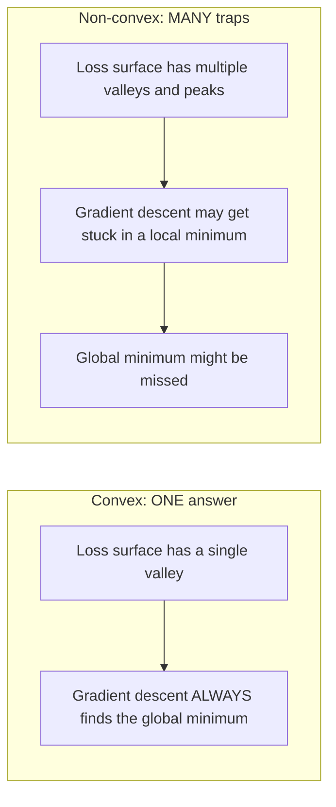
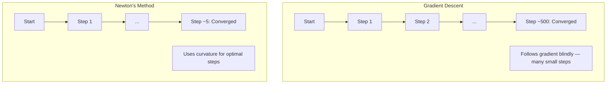
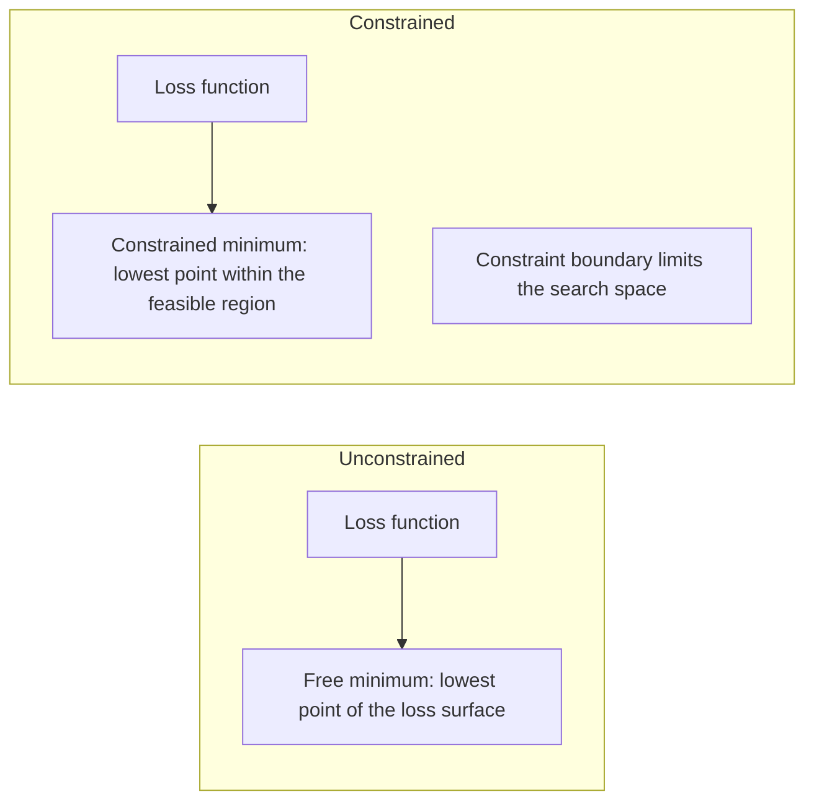
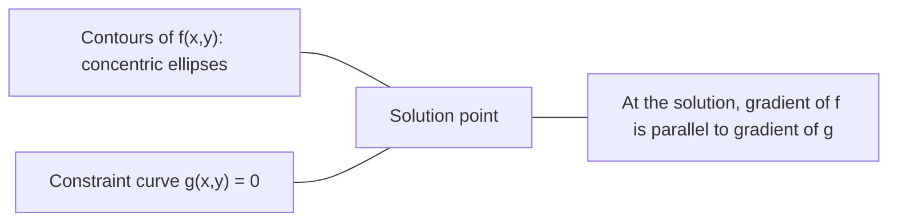

# Convex Optimization

> Masalah konveks punya satu lembah. Neural network punya jutaan. Mengetahui perbedaannya penting.

**Type:** Build
**Language:** Python
**Prerequisites:** Phase 1, Lessons 04 (Calculus for ML), 08 (Optimization)
**Time:** ~90 minutes

## Learning Objectives

- Menguji apakah sebuah fungsi konveks menggunakan definisi, turunan kedua, dan kriteria Hessian
- Mengimplementasikan metode Newton dan membandingkan konvergensi kuadratiknya dengan gradient descent
- Menyelesaikan masalah optimasi terbatas menggunakan Lagrange multiplier dan menafsirkan kondisi KKT
- Menjelaskan mengapa lanskap loss neural network non-konveks tapi SGD tetap menemukan solusi yang baik

## Masalahnya

Lesson 08 mengajarkanmu gradient descent, momentum, dan Adam. Optimizer-optimizer itu berjalan menuruni bukit di permukaan apa pun. Tapi mereka datang tanpa jaminan apa pun. Gradient descent di lanskap non-konveks bisa mendarat di local minimum yang buruk, tersangkut di titik saddle, atau berosilasi selamanya. Kamu menggunakannya juga karena neural network bersifat non-konveks dan tidak ada alternatif.

Tapi banyak masalah dalam machine learning bersifat konveks. Linear regression, logistic regression, SVM, LASSO, ridge regression. Untuk ini, ada sesuatu yang lebih kuat: optimasi dengan jaminan matematis. Sebuah masalah konveks punya tepat satu lembah. Algoritma apa pun yang berjalan menuruni bukit akan mencapai global minimum. Tanpa restart. Tanpa jadwal learning rate. Tanpa doa.

Memahami konveksitas melakukan tiga hal. Pertama, memberitahu kapan masalahmu mudah (konveks) versus sulit (non-konveks). Kedua, memberimu alat yang lebih cepat seperti metode Newton untuk masalah konveks. Ketiga, menjelaskan konsep yang muncul di seluruh ML: regularisasi sebagai batasan, dualitas di SVM, dan mengapa deep learning bekerja meskipun melanggar setiap sifat bagus yang diberikan konveksitas.

## Konsepnya

### Himpunan konveks

Sebuah himpunan S konveks jika untuk dua titik mana pun di S, segmen garis di antara keduanya juga berada sepenuhnya di S.

| Convex sets | Not convex |
|---|---|
| **Rectangle**: any two points inside can be connected by a line segment that stays inside | **Star/crescent shape**: a line between two interior points can pass outside the set |
| **Triangle**: same property holds for all interior points | **Donut/annulus**: the hole means some line segments leave the set |
| The line segment between any two points stays within the set | The line segment between some pairs of points exits the set |

Tes formal: untuk titik x, y mana pun di S dan t mana pun di [0, 1], titik tx + (1-t)y juga berada di S.

Contoh himpunan konveks:
- Sebuah garis, sebuah bidang, seluruh R^n
- Sebuah bola (lingkaran, bola, hiperbola)
- Sebuah halfspace: {x : a^T x <= b}
- Perpotongan dari himpunan konveks berapa pun

Contoh himpunan non-konveks:
- Donat (annulus)
- Gabungan dua lingkaran yang lepas
- Himpunan apa pun dengan "takik" atau "lubang"

### Fungsi konveks

Sebuah fungsi f konveks jika domain-nya adalah himpunan konveks dan untuk dua titik x, y mana pun di domain-nya dan t mana pun di [0, 1]:

```
f(tx + (1-t)y) <= t*f(x) + (1-t)*f(y)
```

Secara geometri: segmen garis di antara dua titik mana pun pada grafik berada di atas atau di atas grafik.

| Property | Convex function | Non-convex function |
|---|---|---|
| **Line segment test** | The line between any two points on the graph lies **above or on** the curve | The line between some points on the graph dips **below** the curve |
| **Shape** | Single bowl/valley curving upward | Multiple peaks and valleys with mixed curvature |
| **Local minima** | Every local minimum is the global minimum | Multiple local minima may exist at different heights |

Fungsi konveks yang umum:
- f(x) = x^2 (parabola)
- f(x) = |x| (nilai absolut)
- f(x) = e^x (eksponensial)
- f(x) = max(0, x) (ReLU, meskipun piecewise linear)
- f(x) = -log(x) untuk x > 0 (log negatif)
- Fungsi linier mana pun f(x) = a^T x + b (baik konveks maupun konkaf)

### Menguji konveksitas

Tiga tes praktis, dari yang paling mudah sampai yang paling ketat.

**Tes 1: Tes turunan kedua (1D).** Jika f''(x) >= 0 untuk semua x, maka f konveks.

- f(x) = x^2: f''(x) = 2 >= 0. Konveks.
- f(x) = x^3: f''(x) = 6x. Negatif untuk x < 0. Tidak konveks.
- f(x) = e^x: f''(x) = e^x > 0. Konveks.

**Tes 2: Tes Hessian (multivariat).** Jika matriks Hessian H(x) semi-definisi positif untuk semua x, maka f konveks. Hessian adalah matriks dari turunan parsial kedua.

**Tes 3: Tes definisi.** Periksa ketidaksamaan f(tx + (1-t)y) <= t*f(x) + (1-t)*f(y) secara langsung. Berguna untuk fungsi yang turunannya sulit dihitung.

### Mengapa konveksitas penting

Teorema sentral dari optimasi konveks:

**Untuk fungsi konveks, setiap local minimum adalah global minimum.**

Ini berarti gradient descent tidak bisa terjebak. Jalur menuruni bukit mana pun membawa ke jawaban yang sama. Algoritmanya dijamin konvergen ke solusi optimal.



Konsekuensinya:
- Tidak perlu random restart
- Tidak perlu jadwal learning rate yang canggih
- Bukti konvergensi mungkin (laju bergantung pada sifat fungsi)
- Solusinya unik (hingga daerah datar)

### Konveks vs non-konveks di ML

| Problem | Convex? | Why |
|---------|---------|-----|
| Linear regression (MSE) | Yes | Loss is quadratic in weights |
| Logistic regression | Yes | Log-loss is convex in weights |
| SVM (hinge loss) | Yes | Maximum of linear functions |
| LASSO (L1 regression) | Yes | Sum of convex functions is convex |
| Ridge regression (L2) | Yes | Quadratic + quadratic = convex |
| Neural network (any loss) | No | Nonlinear activations create non-convex landscape |
| k-means clustering | No | Discrete assignment step |
| Matrix factorization | No | Product of unknowns |

Model linier dengan loss konveks bersifat konveks. Saat kamu menambahkan layer tersembunyi dengan aktivasi nonlinier, konveksitasnya patah.

### Matriks Hessian

Hessian H dari fungsi f: R^n -> R adalah matriks n x n dari turunan parsial kedua.

```
H[i][j] = d^2 f / (dx_i dx_j)
```

Untuk f(x, y) = x^2 + 3xy + y^2:

```
df/dx = 2x + 3y       d^2f/dx^2 = 2      d^2f/dxdy = 3
df/dy = 3x + 2y       d^2f/dydx = 3      d^2f/dy^2 = 2

H = [ 2  3 ]
    [ 3  2 ]
```

Hessian memberitahu tentang kelengkungan:
- Semua eigenvalue positif: fungsi melengkung ke atas di setiap arah (konveks di titik itu)
- Semua eigenvalue negatif: melengkung ke bawah di setiap arah (konkaf, local max)
- Tanda campuran: titik saddle (melengkung ke atas di beberapa arah, ke bawah di yang lain)
- Eigenvalue nol: datar di arah itu (degenerat)

Untuk konveksitas, Hessian harus semi-definisi positif (semua eigenvalue >= 0) di mana-mana, bukan hanya di satu titik.

### Metode Newton

Gradient descent menggunakan informasi orde-pertama (gradiennya). Metode Newton menggunakan informasi orde-kedua (Hessian-nya). Ia memasang sebuah aproksimasi kuadratik di titik saat ini dan melompat langsung ke minimum kuadratik itu.

```
Update rule:
  x_new = x - H^(-1) * gradient

Compare to gradient descent:
  x_new = x - lr * gradient
```

Metode Newton menggantikan learning rate skalar dengan Hessian inverse. Ini secara otomatis menyesuaikan ukuran langkah dan arah berdasarkan kelengkungan lokal.



Keunggulan:
- Konvergensi kuadratik di dekat minimum (galat dikuadratkan di setiap langkah)
- Tidak ada learning rate untuk di-tune
- Invarian skala (bekerja terlepas dari bagaimana kamu memparameterisasi masalah)

Kekurangan:
- Menghitung Hessian berbiaya O(n^2) memori dan O(n^3) untuk meng-invert
- Untuk neural network dengan 1 juta bobot, itu 10^12 entri dan 10^18 operasi
- Tidak praktis untuk deep learning

### Optimasi terbatas

Optimasi tanpa batasan: minimalkan f(x) di semua x.
Optimasi terbatas: minimalkan f(x) dengan batasan.

Masalah nyata punya batasan. Kamu ingin meminimalkan biaya tapi anggaranmu terbatas. Kamu ingin meminimalkan galat tapi kompleksitas model-mu dibatasi.



### Lagrange multiplier

Metode Lagange multiplier mengubah masalah terbatas menjadi tak terbatas.

Masalah: minimalkan f(x) dengan batasan g(x) = 0.

Solusi: perkenalkan variabel baru (Lagrange multiplier lambda) dan selesaikan masalah tanpa batasan:

```
L(x, lambda) = f(x) + lambda * g(x)
```

Di solusi, gradien L adalah nol:

```
dL/dx = df/dx + lambda * dg/dx = 0
dL/dlambda = g(x) = 0
```

Intuisi geometrik: di minimum terbatas, gradien f harus sejajar dengan gradien batasan g. Jika keduanya tidak sejajar, kamu bisa bergerak di sepanjang permukaan batasan dan mengurangi f lebih jauh.



Contoh: minimalkan f(x,y) = x^2 + y^2 dengan batasan x + y = 1.

```
L = x^2 + y^2 + lambda(x + y - 1)

dL/dx = 2x + lambda = 0  =>  x = -lambda/2
dL/dy = 2y + lambda = 0  =>  y = -lambda/2
dL/dlambda = x + y - 1 = 0

From first two: x = y
Substituting: 2x = 1, so x = y = 0.5, lambda = -1
```

Titik terdekat pada garis x + y = 1 dari asal adalah (0.5, 0.5).

### Kondisi KKT

Kondisi Karush-Kuhan-Tucker menggeneralisasi Lagrange multiplier ke batasan ketidaksamaan.

Masalah: minimalkan f(x) dengan batasan g_i(x) <= 0 untuk i = 1, ..., m.

Kondisi KKT (diperlukan untuk optimalitas):

```
1. Stationarity:    df/dx + sum(lambda_i * dg_i/dx) = 0
2. Primal feasibility:  g_i(x) <= 0  for all i
3. Dual feasibility:    lambda_i >= 0  for all i
4. Complementary slackness:  lambda_i * g_i(x) = 0  for all i
```

Complementary slackness adalah wawasan kuncinya: baik batasannya aktif (g_i = 0, solusi duduk di batas) atau multiplier-nya nol (batasannya tidak penting). Sebuah batasan yang tidak memengaruhi solusi punya lambda = 0.

Kondisi KKT bersifat sentral untuk SVM. Support vector adalah titik-titik data di mana batasannya aktif (lambda > 0). Semua titik data lain punya lambda = 0 dan tidak memengaruhi decision boundary.

### Regularisasi sebagai optimasi terbatas

Regularisasi L1 dan L2 bukan trik sewenang-wenang. Ini adalah masalah optimasi terbatas yang menyamar.

**Regularisasi L2 (Ridge):**

```
minimize  Loss(w)  subject to  ||w||^2 <= t

Equivalent unconstrained form:
minimize  Loss(w) + lambda * ||w||^2
```

Batasan ||w||^2 <= t mendefinisikan sebuah bola (lingkaran di 2D, bola di 3D). Solusinya adalah di mana kontur loss pertama kali menyentuh bola ini.

**Regularisasi L1 (LASSO):**

```
minimize  Loss(w)  subject to  ||w||_1 <= t

Equivalent unconstrained form:
minimize  Loss(w) + lambda * ||w||_1
```

Batasan ||w||_1 <= t mendefinisikan sebuah berlian (persegi yang diputar di 2D).

| Property | L2 constraint (circle) | L1 constraint (diamond) |
|---|---|---|
| **Constraint shape** | Circle (sphere in higher dims) | Diamond (rotated square in 2D) |
| **Where loss contour touches** | Smooth boundary — any point on the circle | Corner — aligned with an axis |
| **Solution behavior** | Weights are small but nonzero | Some weights are exactly zero (sparse) |
| **Result** | Weight shrinkage | Feature selection |

Ini menjelaskan mengapa L1 menghasilkan model sparse (pemilihan fitur) sedangkan L2 hanya mengecilkan bobot. Berlian punya sudut yang sejajar dengan sumbu. Kontur loss lebih mungkin menyentuh sebuah sudut, menyetel satu atau lebih bobot menjadi tepat nol.

### Dualitas

Setiap masalah optimasi terbatas (primal) punya masalah pendamping (dual). Untuk masalah konveks, primal dan dual punya nilai optimal yang sama. Ini adalah strong duality.

Fungsi dual Lagrangian:

```
Primal: minimize f(x) subject to g(x) <= 0
Lagrangian: L(x, lambda) = f(x) + lambda * g(x)
Dual function: d(lambda) = min_x L(x, lambda)
Dual problem: maximize d(lambda) subject to lambda >= 0
```

Mengapa dualitas penting:
- Masalah dual terkadang lebih mudah diselesaikan daripada primal
- SVM diselesaikan dalam bentuk dual-nya, di mana masalahnya bergantung pada dot product antar titik data (memungkinkan kernel trick)
- Dual memberikan batas bawah pada optimum primal, berguna untuk memeriksa kualitas solusi

Khusus untuk SVM:

```
Primal: find w, b that maximize the margin 2/||w|| subject to
        y_i(w^T x_i + b) >= 1 for all i

Dual:   maximize sum(alpha_i) - 0.5 * sum_ij(alpha_i * alpha_j * y_i * y_j * x_i^T x_j)
        subject to alpha_i >= 0 and sum(alpha_i * y_i) = 0

The dual only involves dot products x_i^T x_j.
Replace x_i^T x_j with K(x_i, x_j) to get the kernel trick.
```

### Mengapa deep learning bekerja meskipun non-konveks

Fungsi loss neural network sangat non-konveks. Dengan setiap ukuran klasik, mengoptimalkannya seharusnya gagal. Namun stochastic gradient descent menemukan solusi yang baik secara andal. Beberapa faktor menjelaskan ini.

**Sebagian besar local minimum cukup baik.** Di ruang dimensi tinggi, titik kritis acak (di mana gradiennya nol) secara dominan adalah titik saddle, bukan local minimum. Sedikit local minimum yang ada cenderung punya nilai loss yang dekat dengan global minimum. Terjebak di local minimum yang mengerikan sangat tidak mungkin ketika ruang parameter punya jutaan dimensi.

**Titik saddle, bukan local minimum, adalah rintangan yang sebenarnya.** Dalam fungsi dengan n parameter, titik saddle punya campuran arah kelengkungan positif dan negatif. Untuk titik kritis acak di dimensi tinggi, probabilitas semua n eigenvalue positif (local minimum) kira-kira 2^(-n). Hampir semua titik saddle. Kebisingan SGD membantu melepaskan diri dari mereka.

**Overparameterization menghaluskan lanskap.** Jaringan dengan lebih banyak parameter daripada contoh training punya permukaan loss yang lebih halus dan lebih terhubung. Jaringan yang lebih lebar punya lebih sedikit local minimum yang buruk. Ini counterintuitif tapi konsisten secara empiris.

**Struktur lanskap loss:**

| Property | Low-dimensional space | High-dimensional space |
|---|---|---|
| **Landscape** | Many isolated peaks and valleys | Smoothly connected valleys |
| **Minima** | Many isolated local minima | Few bad local minima; most are near-optimal |
| **Navigation** | Hard to find global minimum | Many paths lead to good solutions |
| **Critical points** | Mix of local minimum and saddle points | Overwhelmingly saddle points, not local minima |

**Kebisingan stochastic bertindak sebagai regularisasi implisit.** Mini-batch SGD menambahkan kebisingan yang mencegah penyelesaian di minimum yang tajam. Minimum yang tajam overfit; minimum yang datar generalisasi. Kebiasaannya memiringkan optimasi ke daerah datar dari lanskap loss.

### Metode orde-kedua dalam praktiknya

Metode Newton murni tidak praktis untuk model besar. Beberapa aproksimasi membuat informasi orde-kedua dapat digunakan.

**L-BFGS (Limited-memory BFGS):** Mengaproksimasi Hessian inverse menggunakan m perbedaan gradien terakhir. Membutuhkan memori O(mn) alih-alih O(n^2). Bekerja dengan baik untuk masalah dengan sampai ~10.000 parameter. Digunakan di ML klasik (logistic regression, CRFs) tapi bukan deep learning.

**Natural gradient:** Menggunakan matriks Fisher information (Hessian yang diharapkan dari log-likelihood) alih-alih Hessian standar. Ini memperhitungkan geometri distribusi probabilitas. K-FAC (Kronecker-Factored Approximate Curvature) mengaproksimasi matriks Fisher sebagai produk Kronecker, membuatnya praktis untuk neural network.

**Optimasi Hessian-free:** Menggunakan conjugate gradient untuk menyelesaikan Hx = g tanpa pernah membentuk H. Hanya membutuhkan produk Hessian-vektor, yang bisa dihitung dalam waktu O(n) melalui diferensiasi otomatis.

**Aproksimasi diagonal:** Momentum kedua Adam adalah aproksimasi diagonal dari diagonal Hessian. AdaHessian memperluas ini dengan menggunakan elemen diagonal Hessian yang sebenarnya via estimator Hutchinson.

| Method | Memory | Per-step cost | When to use |
|--------|--------|--------------|-------------|
| Gradient descent | O(n) | O(n) | Baseline, large models |
| Newton's method | O(n^2) | O(n^3) | Small convex problems |
| L-BFGS | O(mn) | O(mn) | Medium convex problems |
| Adam | O(n) | O(n) | Deep learning default |
| K-FAC | O(n) | O(n) per layer | Research, large-batch training |

```figure
convex-vs-nonconvex
```

## Bangun Sendiri

### Langkah 1: Pemeriksa konveksitas

Bangun fungsi yang menguji konveksitas secara empiris dengan melakukan sampling titik dan memeriksa definisinya.

```python
import random
import math

def check_convexity(f, dim, bounds=(-5, 5), samples=1000):
    violations = 0
    for _ in range(samples):
        x = [random.uniform(*bounds) for _ in range(dim)]
        y = [random.uniform(*bounds) for _ in range(dim)]
        t = random.uniform(0, 1)
        mid = [t * xi + (1 - t) * yi for xi, yi in zip(x, y)]
        lhs = f(mid)
        rhs = t * f(x) + (1 - t) * f(y)
        if lhs > rhs + 1e-10:
            violations += 1
    return violations == 0, violations
```

### Langkah 2: Metode Newton untuk 2D

Implementasikan metode Newton menggunakan Hessian eksplisit. Bandingkan kecepatan konvergensi dengan gradient descent.

```python
def newtons_method(f, grad_f, hessian_f, x0, steps=50, tol=1e-12):
    x = list(x0)
    history = [x[:]]
    for _ in range(steps):
        g = grad_f(x)
        H = hessian_f(x)
        det = H[0][0] * H[1][1] - H[0][1] * H[1][0]
        if abs(det) < 1e-15:
            break
        H_inv = [
            [H[1][1] / det, -H[0][1] / det],
            [-H[1][0] / det, H[0][0] / det],
        ]
        dx = [
            H_inv[0][0] * g[0] + H_inv[0][1] * g[1],
            H_inv[1][0] * g[0] + H_inv[1][1] * g[1],
        ]
        x = [x[0] - dx[0], x[1] - dx[1]]
        history.append(x[:])
        if sum(gi ** 2 for gi in g) < tol:
            break
    return history
```

### Langkah 3: Solver Lagrange multiplier

Selesaikan optimasi terbatas menggunakan gradient descent pada Lagrangian.

```python
def lagrange_solve(f_grad, g_val, g_grad, x0, lr=0.01,
                   lr_lambda=0.01, steps=5000):
    x = list(x0)
    lam = 0.0
    history = []
    for _ in range(steps):
        fg = f_grad(x)
        gv = g_val(x)
        gg = g_grad(x)
        x = [
            xi - lr * (fgi + lam * ggi)
            for xi, fgi, ggi in zip(x, fg, gg)
        ]
        lam = lam + lr_lambda * gv
        history.append((x[:], lam, gv))
    return history
```

### Langkah 4: Bandingkan orde-pertama vs orde-kedua

Jalankan gradient descent dan metode Newton pada fungsi kuadratik yang sama. Hitung langkah-langkah sampai konvergensi.

```python
def quadratic(x):
    return 5 * x[0] ** 2 + x[1] ** 2

def quadratic_grad(x):
    return [10 * x[0], 2 * x[1]]

def quadratic_hessian(x):
    return [[10, 0], [0, 2]]
```

Metode Newton akan konvergen dalam 1 langkah (ia tepat untuk kuadratik). Gradient descent akan membutuhkan ratusan langkah karena eigenvalue Hessian berbeda dengan faktor 5, menciptakan lembah yang memanjang.

## Gunakan

Analisis konveksitas berlaku langsung saat memilih model dan solver ML.

Untuk masalah konveks (logistic regression, SVM, LASSO):
- Gunakan solver khusus (liblinear, CVXPY, scipy.optimize.minimize dengan method='L-BFGS-B')
- Harapkan solusi global yang unik
- Metode orde-kedua praktis dan cepat

Untuk masalah non-konveks (neural network):
- Gunakan metode orde-pertama (SGD, Adam)
- Terima bahwa solusinya bergantung pada inisialisasi dan keacakan
- Gunakan overparameterization, kebaisan, dan jadwal learning rate sebagai regularisasi implisit
- Jangan buang waktu mencari global minimum. Local minimum yang baik sudah cukup.

```python
from scipy.optimize import minimize

result = minimize(
    fun=lambda w: sum((y - X @ w) ** 2) + 0.1 * sum(w ** 2),
    x0=np.zeros(d),
    method='L-BFGS-B',
    jac=lambda w: -2 * X.T @ (y - X @ w) + 0.2 * w,
)
```

Untuk SVM, formulasi dual memungkinkanmu menggunakan kernel trick:

```python
from sklearn.svm import SVC

svm = SVC(kernel='rbf', C=1.0)
svm.fit(X_train, y_train)
print(f"Support vectors: {svm.n_support_}")
```

## Latihan

1. **Galeri konveksitas.** Uji fungsi-fungsi ini untuk konveksitas menggunakan pemeriksanya: f(x) = x^4, f(x) = sin(x), f(x,y) = x^2 + y^2, f(x,y) = x*y, f(x) = max(x, 0). Jelaskan mengapa setiap hasil masuk akal.

2. **Balapan Newton vs gradient descent.** Jalankan kedua metode pada f(x,y) = 50*x^2 + y^2 dari titik awal (10, 10). Berapa langkah yang dibutuhkan masing-masing untuk mencapai loss < 1e-10? Apa yang terjadi pada gradient descent ketika condition number (rasio eigenvalue Hessian terbesar ke terkecil) meningkat?

3. **Geometri Lagrange multiplier.** Minimalkan f(x,y) = (x-3)^2 + (y-3)^2 dengan batasan x + 2y = 4. Verifikasi solusinya dengan memeriksa bahwa gradien f sejajar dengan gradien g di solusi.

4. **Batasan regularisasi.** Implementasikan optimasi berbatas L1: minimalkan (x-3)^2 + (y-2)^2 dengan batasan |x| + |y| <= 1. Tunjukkan bahwa solusinya punya satu koordinat yang sama dengan nol (sparsity dari batasan berlian).

5. **Analisis eigenvalue Hessian.** Hitung Hessian dari fungsi Rosenbrock di (1,1) dan di (-1,1). Hitung eigenvalue di kedua titik. Apa yang diberitahukan eigenvalue tentang kelengkungan di minimum versus jauh dari minimum?

## Istilah Kunci

| Term | What it means |
|------|---------------|
| Convex set | A set where the line segment between any two points in the set stays inside the set |
| Convex function | A function where the line between any two points on its graph lies above or on the graph. Equivalently, Hessian is positive semidefinite everywhere |
| Local minimum | A point lower than all nearby points. For convex functions, every local minimum is the global minimum |
| Global minimum | The lowest point of a function over its entire domain |
| Hessian matrix | The matrix of all second partial derivatives. Encodes curvature information |
| Positive semidefinite | A matrix whose eigenvalues are all non-negative. The multidimensional analogue of "second derivative >= 0" |
| Condition number | Ratio of largest to smallest eigenvalue of the Hessian. High condition number means elongated valleys and slow gradient descent |
| Newton's method | Second-order optimizer that uses the inverse Hessian to determine step direction and size. Quadratic convergence near the minimum |
| Lagrange multiplier | A variable introduced to convert a constrained optimization problem into an unconstrained one |
| KKT conditions | Necessary conditions for optimality with inequality constraints. Generalize Lagrange multipliers |
| Complementary slackness | At the solution, either a constraint is active or its multiplier is zero. Never both nonzero |
| Duality | Every constrained problem has a companion dual problem. For convex problems, both have the same optimal value |
| Strong duality | Primal and dual optimal values are equal. Holds for convex problems satisfying Slater's condition |
| L-BFGS | Approximate second-order method that stores the last m gradient differences instead of the full Hessian |
| Saddle point | A point where the gradient is zero but it is a minimum in some directions and a maximum in others |
| Overparameterization | Using more parameters than training examples. Smooths the loss landscape and reduces bad local minima |

## Bacaan Lanjutan

- [Boyd & Vandenberghe: Convex Optimization](https://web.stanford.edu/~boyd/cvxbook/) - teks standar, tersedia gratis online
- [Bottou, Curtis, Nocedal: Optimization Methods for Large-Scale Machine Learning (2018)](https://arxiv.org/abs/1606.04838) - menjembatani teori optimasi konveks dan praktik deep learning
- [Choromanska et al.: The Loss Surfaces of Multilayer Networks (2015)](https://arxiv.org/abs/1412.0233) - mengapa lanskap neural network non-konveks tidak seburuk yang tampak
- [Nocedal & Wright: Numerical Optimization](https://link.springer.com/book/10.1007/978-0-387-40065-5) - referensi komprehensif untuk metode Newton, L-BFGS, dan optimasi terbatas
