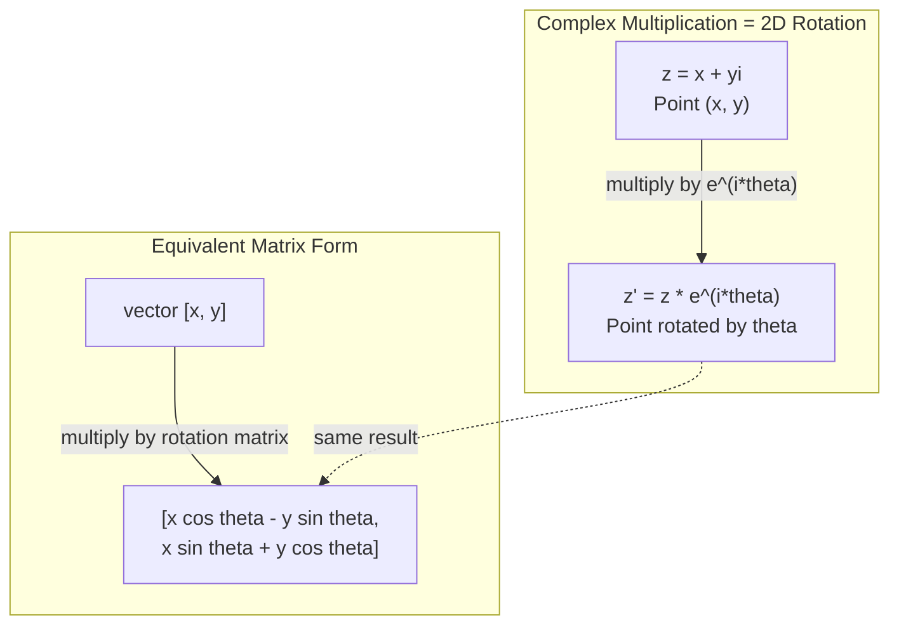
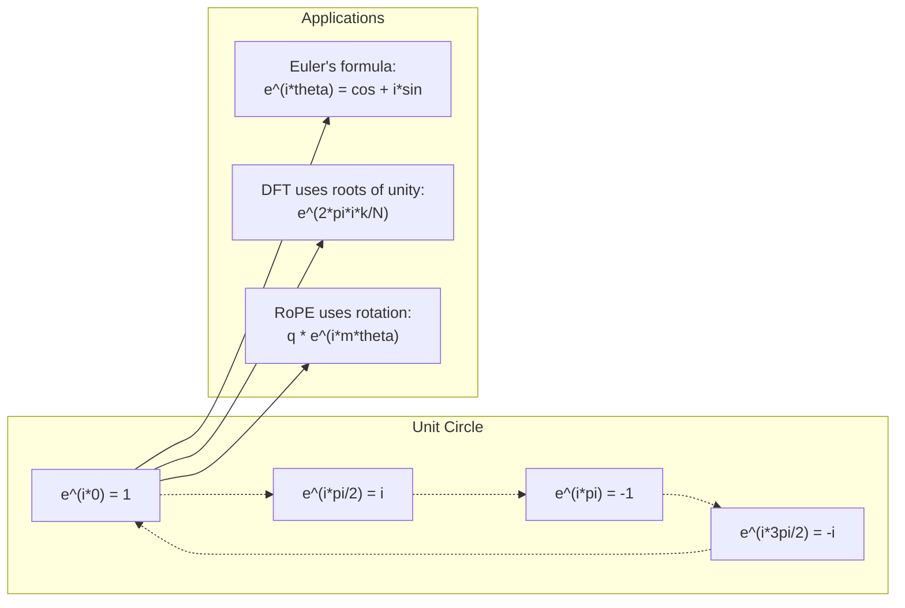

# Bilangan Kompleks untuk AI

> Akar kuadrat dari -1 bukan imajiner. Ia kunci untuk rotasi, frekuensi, dan separuh pemrosesan sinyal.

**Type:** Learn
**Language:** Python
**Prerequisites:** Phase 1, Lessons 01-04 (linear algebra, calculus)
**Time:** ~60 minutes

## Learning Objectives

- Melakukan aritmetika kompleks (tambah, kali, bagi, konjugasi) dalam bentuk persegi dan polar
- Menerapkan Euler's formula untuk mengonversi antara eksponensial kompleks dan fungsi trigonometri
- Mengimplementasikan Discrete Fourier Transform menggunakan akar satuan kompleks
- Menjelaskan bagaimana rotasi kompleks mendasari RoPE dan sinusoidal positional encodings di transformer

## Masalahnya

Kamu membuka paper tentang Fourier transform dan ada `i` di mana-mana. Kamu melihat positional encoding transformer dan melihat `sin` dan `cos` pada frekuensi berbeda — bagian real dan imajiner dari eksponensial kompleks. Kamu membaca tentang komputasi kuantum dan menemukan semuanya diekspresikan dalam ruang vektor kompleks.

Bilangan kompleks terasa abstrak. Sistem bilangan yang dibangun di atas akar kuadrat dari -1 terasa seperti trik matematika. Tapi ini bukan trik. Ini bahasa alami dari rotasi dan osilasi. Setiap kali sesuatu berputar, bergetar, atau berfluktuasi, bilangan kompleks adalah alat yang tepat.

Tanpa memahami bilangan kompleks, kamu tidak bisa memahami Discrete Fourier Transform. Kamu tidak bisa memahami FFT. Kamu tidak bisa memahami bagaimana RoPE (Rotary Position Embedding) bekerja di model bahasa modern. Kamu tidak bisa memahami mengapa sinusoidal positional encodings di paper Transformer asli memakai frekuensi yang mereka gunakan.

Pelajaran ini membangun aritmetika kompleks dari nol, menghubungkannya ke geometri, dan menunjukkan dengan tepat di mana bilangan kompleks muncul dalam machine learning.

## Konsepnya

### Apa itu bilangan kompleks?

Bilangan kompleks punya dua bagian: bagian real dan bagian imajiner.

```
z = a + bi

where:
  a is the real part
  b is the imaginary part
  i is the imaginary unit, defined by i^2 = -1
```

Sesederhana itu. Kamu memperluas garis bilangan menjadi bidang. Bilangan real duduk di satu sumbu. Bilangan imajiner duduk di sumbu lain. Setiap bilangan kompleks adalah titik di bidang ini.

### Aritmetika kompleks

**Penjumlahan.** Jumlahkan bagian real, jumlahkan bagian imajiner.

```
(a + bi) + (c + di) = (a + c) + (b + d)i

Example: (3 + 2i) + (1 + 4i) = 4 + 6i
```

**Perkalian.** Gunakan hukum distributif dan ingat bahwa i^2 = -1.

```
(a + bi)(c + di) = ac + adi + bci + bdi^2
                 = ac + adi + bci - bd
                 = (ac - bd) + (ad + bc)i

Example: (3 + 2i)(1 + 4i) = 3 + 12i + 2i + 8i^2
                            = 3 + 14i - 8
                            = -5 + 14i
```

**Konjugasi.** Balik tanda bagian imajiner.

```
conjugate of (a + bi) = a - bi
```

Hasil kali bilangan kompleks dengan konjugasinya selalu real:

```
(a + bi)(a - bi) = a^2 + b^2
```

**Pembagian.** Kalikan penyebut dan pembilang dengan konjugasi penyebut.

```
(a + bi) / (c + di) = (a + bi)(c - di) / (c^2 + d^2)
```

Ini menghilangkan bagian imajiner dari penyebut, memberimu bilangan kompleks yang bersih.

### Bidang kompleks

Bidang kompleks memetakan setiap bilangan kompleks ke titik 2D. Sumbu horizontal adalah sumbu real, sumbu vertikal adalah sumbu imajiner.

```
z = 3 + 2i  corresponds to the point (3, 2)
z = -1 + 0i corresponds to the point (-1, 0) on the real axis
z = 0 + 4i  corresponds to the point (0, 4) on the imaginary axis
```

Bilangan kompleks secara bersamaan adalah titik dan vektor dari asal. Interpretasi ganda inilah yang membuat bilangan kompleks berguna untuk geometri.

### Bentuk polar

Setiap titik di bidang bisa dideskripsikan dengan jaraknya dari asal dan sudutnya dari sumbu real positif.

```
z = r * (cos(theta) + i*sin(theta))

where:
  r = |z| = sqrt(a^2 + b^2)     (magnitude, or modulus)
  theta = atan2(b, a)             (phase, or argument)
```

Bentuk persegi (a + bi) baik untuk penjumlahan. Bentuk polar (r, theta) baik untuk perkalian.

**Perkalian dalam bentuk polar.** Kalikan magnitudo, jumlahkan sudut.

```
z1 = r1 * e^(i*theta1)
z2 = r2 * e^(i*theta2)

z1 * z2 = (r1 * r2) * e^(i*(theta1 + theta2))
```

Inilah mengapa bilangan kompleks sempurna untuk rotasi. Mengalikan dengan bilangan kompleks bermagnitude 1 adalah rotasi murni.

### Euler's formula

Jembatan antara eksponensial kompleks dan trigonometri:

```
e^(i*theta) = cos(theta) + i*sin(theta)
```

Ini adalah formula terpenting di pelajaran ini. Saat theta = pi:

```
e^(i*pi) = cos(pi) + i*sin(pi) = -1 + 0i = -1

Therefore: e^(i*pi) + 1 = 0
```

Lima konstanta fundamental (e, i, pi, 1, 0) terhubung dalam satu persamaan.

### Mengapa Euler's formula penting untuk ML

Euler's formula mengatakan bahwa `e^(i*theta)` menelusuri lingkaran satuan seiring theta berubah. Pada theta = 0, kamu di (1, 0). Pada theta = pi/2, kamu di (0, 1). Pada theta = pi, kamu di (-1, 0). Pada theta = 3*pi/2, kamu di (0, -1). Rotasi penuh adalah theta = 2*pi.

Ini berarti eksponensial kompleks ADALAH rotasi. Dan rotasi ada di mana-mana dalam pemrosesan sinyal dan ML.

### Koneksi ke rotasi 2D

Mengalikan bilangan kompleks (x + yi) dengan e^(i*theta) memutar titik (x, y) sebesar theta di sekitar asal.

```
Rotation via complex multiplication:
  (x + yi) * (cos(theta) + i*sin(theta))
  = (x*cos(theta) - y*sin(theta)) + (x*sin(theta) + y*cos(theta))i

Rotation via matrix multiplication:
  [cos(theta)  -sin(theta)] [x]   [x*cos(theta) - y*sin(theta)]
  [sin(theta)   cos(theta)] [y] = [x*sin(theta) + y*cos(theta)]
```

Keduanya menghasilkan hasil yang identik. Perkalian kompleks ADALAH rotasi 2D. Matriks rotasi hanyalah perkalian kompleks yang ditulis dalam notasi matriks.



### Phasor dan sinyal berputar

Eksponensial kompleks e^(i*omega*t) adalah titik yang berputar di sekitar lingkaran satuan dengan frekuensi sudut omega. Saat t meningkat, titik menelusuri lingkaran.

Bagian real dari titik berputar ini adalah cos(omega*t). Bagian imajiner adalah sin(omega*t). Sinyal sinusoidal adalah bayangan dari bilangan kompleks yang berputar.

```
e^(i*omega*t) = cos(omega*t) + i*sin(omega*t)

Real part:      cos(omega*t)    -- a cosine wave
Imaginary part: sin(omega*t)    -- a sine wave
```

Ini adalah representasi phasor. Alih-alih melacak gelombang sinus yang bergelombang, kamu melacak panah yang berputar dengan halus. Pergeseran fase menjadi pergeseran sudut. Perubahan magnitudo menjadi perubahan magnitude. Penjumlahan sinyal menjadi penjumlahan vektor.

### Akar satuan

Akar satuan ke-N adalah N titik yang tersebar merata di lingkaran satuan:

```
w_k = e^(2*pi*i*k/N)    for k = 0, 1, 2, ..., N-1
```

Untuk N = 4, akarnya: 1, i, -1, -i (empat titik kompas).
Untuk N = 8, kamu dapat empat titik kompas plus empat diagonal.

Akar satuan adalah fondasi dari Discrete Fourier Transform. DFT mendekomposisikan sinyal menjadi komponen pada N frekuensi yang tersebar merata ini.

### Koneksi ke DFT

Discrete Fourier Transform dari sinyal x[0], x[1], ..., x[N-1] adalah:

```
X[k] = sum_{n=0}^{N-1} x[n] * e^(-2*pi*i*k*n/N)
```

Setiap X[k] mengukur seberapa besar sinyal berkorelasi dengan akar satuan ke-k — sinusoid kompleks pada frekuensi k. DFT memecah sinyal menjadi N phasor berputar dan memberitahumu amplitudo dan fase dari masing-masing.

### Mengapa i bukan imajiner

Kata "imajiner" adalah kecelakaan historis. Descartes memakainya dengan merendahkan. Tapi i tidak lebih imajiner daripada bilangan negatif saat orang pertama kali menolaknya. Bilangan negatif menjawab "dari berapa kamu mengurangi 5 untuk mendapatkan 3?" Satuan imajiner menjawab "kamu menaikkan pangkat berapa untuk mendapatkan -1?"

Lebih berguna: i adalah operator rotasi 90 derajat. Kalikan bilangan real dengan i sekali, kamu memutar 90 derajat ke sumbu imajiner. Kalikan lagi dengan i (i^2), kamu memutar another 90 derajat — sekarang kamu menunjuk ke arah real negatif. Itulah mengapa i^2 = -1. Ini bukan misteri. Ini setengah putaran yang dibangun dari dua seperempat putaran.

Inilah mengapa bilangan kompleks ada di mana-mana dalam rekayasa. Apa pun yang berputar — gelombang elektromagnetik, status kuantum, osilasi sinyal, positional encodings — secara alami dideskripsikan dengan bilangan kompleks.

### Eksponensial kompleks vs fungsi trigonometri

Sebelum Euler's formula, insinyur menulis sinyal sebagai A*cos(omega*t + phi) — amplitudo A, frekuensi omega, fase phi. Ini bekerja tapi membuat aritmetika menyakitkan. Menambahkan dua cosinus dengan fase berbeda membutuhkan identitas trigonometri.

Dengan eksponensial kompleks, sinyal yang sama adalah A*e^(i*(omega*t + phi)). Menambahkan dua sinyal hanyalah menambahkan dua bilangan kompleks. Mengalikan (modulasi) hanyalah mengalikan magnitudo dan menjumlahkan sudut. Pergeseran fase menjadi penjumlahan sudut. Pergeseran frekuensi menjadi perkalian dengan phasor.

Seluruh bidang pemrosesan sinyal beralih ke notasi eksponensial kompleks karena matematikanya lebih bersih. "Sinyal real" selalu hanyalah bagian real dari representasi kompleks. Bagian imajiner dibawa sebagai pembukuan, membuat seluruh aljabar bekerja secara alami.

### Koneksi ke transformer

**Sinusoidal positional encodings** (paper Transformer asli):

```
PE(pos, 2i) = sin(pos / 10000^(2i/d))
PE(pos, 2i+1) = cos(pos / 10000^(2i/d))
```

Pasangan sin dan cos adalah bagian real dan imajiner dari eksponensial kompleks pada frekuensi berbeda. Setiap frekuensi memberikan "resolusi" berbeda untuk meng-encode posisi. Frekuensi rendah berubah perlahan (posisi kasar). Frekuensi tinggi berubah cepat (posisi halus). Bersama-sama mereka memberi setiap posisi sidik jari frekuensi yang unik.

**RoPE (Rotary Position Embedding)** membawanya lebih jauh. Ia secara eksplisit mengalikan vektor query dan key dengan matriks rotasi kompleks. Posisi relatif antara dua token menjadi sudut rotasi. Attention dihitung menggunakan vektor yang dirotasi ini, membuat model sensitif terhadap posisi relatif melalui perkalian kompleks.

| Operation | Algebraic Form | Geometric Meaning |
|-----------|---------------|-------------------|
| Addition | (a+c) + (b+d)i | Vector addition in the plane |
| Multiplication | (ac-bd) + (ad+bc)i | Rotate and scale |
| Conjugate | a - bi | Reflect over real axis |
| Magnitude | sqrt(a^2 + b^2) | Distance from origin |
| Phase | atan2(b, a) | Angle from positive real axis |
| Division | multiply by conjugate | Reverse rotation and rescale |
| Power | r^n * e^(i*n*theta) | Rotate n times, scale by r^n |



```figure
roots-of-unity
```

## Bangun Sendiri

### Langkah 1: Kelas kompleks

Bangun kelas bilangan kompleks yang mendukung aritmetika, magnitudo, fase, dan konversi antara bentuk persegi dan polar.

```python
import math

class Complex:
    def __init__(self, real, imag=0.0):
        self.real = real
        self.imag = imag

    def __add__(self, other):
        return Complex(self.real + other.real, self.imag + other.imag)

    def __mul__(self, other):
        r = self.real * other.real - self.imag * other.imag
        i = self.real * other.imag + self.imag * other.real
        return Complex(r, i)

    def __truediv__(self, other):
        denom = other.real ** 2 + other.imag ** 2
        r = (self.real * other.real + self.imag * other.imag) / denom
        i = (self.imag * other.real - self.real * other.imag) / denom
        return Complex(r, i)

    def magnitude(self):
        return math.sqrt(self.real ** 2 + self.imag ** 2)

    def phase(self):
        return math.atan2(self.imag, self.real)

    def conjugate(self):
        return Complex(self.real, -self.imag)
```

### Langkah 2: Konversi polar dan Euler's formula

```python
def to_polar(z):
    return z.magnitude(), z.phase()

def from_polar(r, theta):
    return Complex(r * math.cos(theta), r * math.sin(theta))

def euler(theta):
    return Complex(math.cos(theta), math.sin(theta))
```

Verifikasi: `euler(theta).magnitude()` harus selalu 1.0. `euler(0)` harus memberi (1, 0). `euler(pi)` harus memberi (-1, 0).

### Langkah 3: Rotasi

Merotasi titik (x, y) sebesar theta hanyalah satu perkalian kompleks:

```python
point = Complex(3, 4)
rotated = point * euler(math.pi / 4)
```

Magnitudo tetap sama. Hanya sudutnya yang berubah.

### Langkah 4: DFT dari aritmetika kompleks

```python
def dft(signal):
    N = len(signal)
    result = []
    for k in range(N):
        total = Complex(0, 0)
        for n in range(N):
            angle = -2 * math.pi * k * n / N
            total = total + Complex(signal[n], 0) * euler(angle)
        result.append(total)
    return result
```

Ini adalah DFT O(N^2). Setiap output X[k] adalah jumlah sampel sinyal yang dikalikan dengan akar satuan.

### Langkah 5: Inverse DFT

Inverse DFT merekonstruksi sinyal asli dari spektrumnya. Satu-satunya perbedaan dari DFT maju: balik tanda di eksponen dan bagi dengan N.

```python
def idft(spectrum):
    N = len(spectrum)
    result = []
    for n in range(N):
        total = Complex(0, 0)
        for k in range(N):
            angle = 2 * math.pi * k * n / N
            total = total + spectrum[k] * euler(angle)
        result.append(Complex(total.real / N, total.imag / N))
    return result
```

Ini memberimu rekonstruksi sempurna. Terapkan DFT, lalu IDFT, dan kamu mendapatkan kembali sinyal asli hingga presisi mesin. Tidak ada informasi yang hilang.

### Langkah 6: Akar satuan

```python
def roots_of_unity(N):
    return [euler(2 * math.pi * k / N) for k in range(N)]
```

Verifikasi dua sifat:
- Setiap akar punya magnitudo tepat 1.
- Jumlah semua N akar adalah nol (mereka saling menghapus karena simetri).

Sifat inilah yang membuat DFT dapat di-invert. Akar satuan membentuk basis ortogonal untuk domain frekuensi.

## Gunakan

Python punya dukungan bilangan kompleks bawaan. Literal `j` mewakili satuan imajiner.

```python
z = 3 + 2j
w = 1 + 4j

print(z + w)
print(z * w)
print(abs(z))

import cmath
print(cmath.phase(z))
print(cmath.exp(1j * cmath.pi))
```

Untuk array, numpy menangani bilangan kompleks secara native:

```python
import numpy as np

z = np.array([1+2j, 3+4j, 5+6j])
print(np.abs(z))
print(np.angle(z))
print(np.conj(z))
print(np.real(z))
print(np.imag(z))

signal = np.sin(2 * np.pi * 5 * np.linspace(0, 1, 128))
spectrum = np.fft.fft(signal)
freqs = np.fft.fftfreq(128, d=1/128)
```

## Rilis

Jalankan `code/complex_numbers.py` untuk menghasilkan `outputs/skill-complex-arithmetic.md`.

## Latihan

1. **Aritmetika kompleks manual.** Hitung (2 + 3i) * (4 - i) dan verifikasi dengan kode. Lalu hitung (5 + 2i) / (1 - 3i). Gambar kedua hasil di bidang kompleks dan periksa bahwa perkalian telah memutar dan menskala bilangan pertama.

2. **Urutan rotasi.** Mulai dari titik (1, 0). Kalikan dengan e^(i*pi/6) dua belas kali. Verifikasi bahwa kamu kembali ke (1, 0) setelah 12 perkalian. Cetak koordinat di setiap langkah dan konfirmasi bahwa mereka menelusuri poligon 12 beraturan.

3. **DFT dari sinyal yang diketahui.** Buat sinyal yang merupakan jumlah dari sin(2*pi*3*t) dan 0.5*sin(2*pi*7*t) yang di-sample di 32 titik. Jalankan DFT-mu. Verifikasi bahwa spektrum magnitudo punya puncak pada frekuensi 3 dan 7, dengan puncak pada 7 setengah tinggi dari puncak pada 3.

4. **Visualisasi akar satuan.** Hitung akar satuan ke-8. Verifikasi bahwa mereka berjumlah nol. Verifikasi bahwa mengalikan setiap akar dengan akar primitif e^(2*pi*i/8) memberikan akar berikutnya.

5. **Ekivalensi matriks rotasi.** Untuk 10 sudut acak dan 10 titik acak, verifikasi bahwa perkalian kompleks memberikan hasil yang sama dengan perkalian matriks-vektor dengan matriks rotasi 2x2. Cetak perbedaan numerik maksimum.

## Istilah Kunci

| Term | What it means |
|------|---------------|
| Complex number | A number a + bi where a is the real part, b is the imaginary part, and i^2 = -1 |
| Imaginary unit | The number i, defined by i^2 = -1. Not imaginary in the philosophical sense -- it is a rotation operator |
| Complex plane | The 2D plane where the x-axis is real and the y-axis is imaginary. Also called the Argand plane |
| Magnitude (modulus) | The distance from the origin: sqrt(a^2 + b^2). Written as \|z\| |
| Phase (argument) | The angle from the positive real axis: atan2(b, a). Written as arg(z) |
| Conjugate | The mirror image across the real axis: conjugate of a + bi is a - bi |
| Polar form | Expressing z as r * e^(i*theta) instead of a + bi. Makes multiplication easy |
| Euler's formula | e^(i*theta) = cos(theta) + i*sin(theta). Connects exponentials to trigonometry |
| Phasor | A rotating complex number e^(i*omega*t) representing a sinusoidal signal |
| Roots of unity | The N complex numbers e^(2*pi*i*k/N) for k = 0 to N-1. N equally spaced points on the unit circle |
| DFT | Discrete Fourier Transform. Decomposes a signal into complex sinusoidal components using roots of unity |
| RoPE | Rotary Position Embedding. Uses complex multiplication to encode relative position in transformer attention |

## Bacaan Lanjutan

- [Visual Introduction to Euler's Formula](https://betterexplained.com/articles/intuitive-understanding-of-eulers-formula/) - builds geometric intuition without heavy notation
- [Su et al.: RoFormer (2021)](https://arxiv.org/abs/2104.09864) - the paper introducing Rotary Position Embedding using complex rotations
- [Vaswani et al.: Attention Is All You Need (2017)](https://arxiv.org/abs/1706.03762) - the original Transformer paper with sinusoidal positional encodings
- [3Blue1Brown: Euler's formula with introductory group theory](https://www.youtube.com/watch?v=mvmuCPvRoWQ) - visual explanation of why e^(i*pi) = -1
- [Needham: Visual Complex Analysis](https://global.oup.com/academic/product/visual-complex-analysis-9780198534464) - the best visual treatment of complex numbers, full of geometric insight
- [Strang: Introduction to Linear Algebra, Ch. 10](https://math.mit.edu/~gs/linearalgebra/) - complex numbers in the context of linear algebra and eigenvalues
