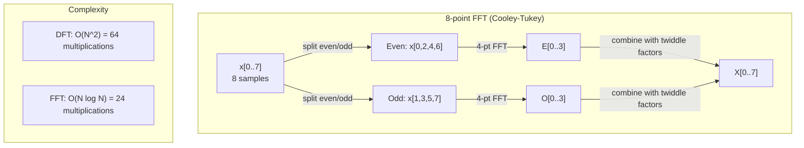
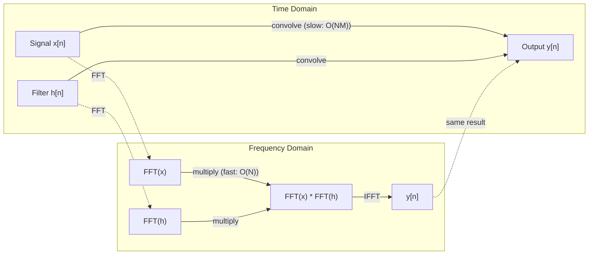

# The Fourier Transform

> Setiap sinyal adalah jumlah gelombang sinus. Fourier transform memberitahumu yang mana.

**Type:** Build
**Language:** Python
**Prerequisites:** Phase 1, Lessons 01-04, 19 (complex numbers)
**Time:** ~90 minutes

## Learning Objectives

- Mengimplementasikan DFT dari nol dan memverifikasinya terhadap FFT Cooley-Tukey O(N log N)
- Menafsirkan koefisien frekuensi: mengekstrak amplitudo, fase, dan power spectrum dari sinyal
- Menerapkan convolution theorem untuk melakukan konvolusi via perkalian FFT
- Menghubungkan dekomposisi frekuensi Fourier dengan positional encoding transformer dan layer konvolusi CNN

## Masalahnya

Rekaman audio adalah urutan pengukuran tekanan seiring waktu. Harga saham adalah urutan nilai seiring hari. Gambar adalah grid intensitas piksel seiring ruang. Semuanya adalah data di domain waktu (atau ruang). Kamu melihat nilai berubah seiring indeks.

Tapi banyak pola tidak terlihat di domain waktu. Apakah sinyal audio ini nada murni atau akor? Apakah harga saham ini punya siklus mingguan? Apakah gambar ini punya tekstur berulang? Pertanyaan-pertanyaan ini tentang konten frekuensi, dan domain waktu menyembunyikannya.

Fourier transform mengonversi data dari domain waktu ke domain frekuensi. Ia mengambil sinyal dan mendekomposisinya menjadi gelombang sinus pada frekuensi berbeda. Setiap gelombang sinus punya amplitudo (seberapa kuat) dan fase (di mana ia mulai). Fourier transform memberitahumu keduanya.

Ini penting untuk ML karena pemikiran domain frekuensi muncul di mana-mana. Convolutional neural networks melakukan konvolusi, yang merupakan perkalian di domain frekuensi. Positional encoding transformer menggunakan dekomposisi frekuensi untuk merepresentasikan posisi. Model audio (pengenalan musik, generasi musik) bekerja pada spectrogram — representasi frekuensi dari suara. Model time series mencari pola periodik. Memahami Fourier transform memberimu kosakata untuk bekerja dengan semua ini.

## Konsepnya

### Definisi DFT

Diberikan N sampel x[0], x[1], ..., x[N-1], Discrete Fourier Transform menghasilkan N koefisien frekuensi X[0], X[1], ..., X[N-1]:

```
X[k] = sum_{n=0}^{N-1} x[n] * e^(-2*pi*i*k*n/N)

for k = 0, 1, ..., N-1
```

Setiap X[k] adalah bilangan kompleks. Magnitudonya |X[k]| memberitahumu amplitudo frekuensi k. Sudut fasenya angle(X[k]) memberitahukan offset fase dari frekuensi itu.

Wawasan kunci: `e^(-2*pi*i*k*n/N)` adalah phasor berputar pada frekuensi k. DFT menghitung korelasi antara sinyal dan masing-masing dari N frekuensi yang tersebar merata. Jika sinyal mengandung energi pada frekuensi k, korelasinya besar. Jika tidak, ia mendekati nol.

### Apa arti setiap koefisien

**X[0]: komponen DC.** Ini adalah jumlah semua sampel — proporsional terhadap mean. Ia merepresentasikan offset konstan (frekuensi nol) dari sinyal.

```
X[0] = sum_{n=0}^{N-1} x[n] * e^0 = sum of all samples
```

**X[k] untuk 1 <= k <= N/2: frekuensi positif.** X[k] merepresentasikan frekuensi k siklus per N sampel. k lebih tinggi berarti frekuensi lebih tinggi (osilasi lebih cepat).

**X[N/2]: frekuensi Nyquist.** Frekuensi tertinggi yang bisa direpresentasikan dengan N sampel. Di atas ini, kamu mendapat aliasing — frekuensi tinggi menyamar sebagai frekuensi rendah.

**X[k] untuk N/2 < k < N: frekuensi negatif.** Untuk sinyal bernilai real, X[N-k] = conj(X[k]). Frekuensi negatif adalah cermin dari frekuensi positif. Inilah mengapa informasi yang berguna ada di N/2 + 1 koefisien pertama.

### Inverse DFT

Inverse DFT merekonstruksi sinyal asli dari koefisien frekuensinya:

```
x[n] = (1/N) * sum_{k=0}^{N-1} X[k] * e^(2*pi*i*k*n/N)

for n = 0, 1, ..., N-1
```

Satu-satunya perbedaan dari DFT maju: tanda di eksponen positif (bukan negatif), dan ada faktor normalisasi 1/N.

Inverse DFT adalah rekonstruksi sempurna. Tidak ada informasi yang hilang. Kamu bisa pergi dari domain waktu ke domain frekuensi dan kembali tanpa galat apa pun. DFT adalah perubahan basis — ia mengekspresikan kembali informasi yang sama dalam sistem koordinat berbeda.

### FFT: membuatnya cepat

DFT sebagaimana didefinisikan di atas adalah O(N^2): untuk setiap N koefisien output, kamu menjumlahkan N sampel input. Untuk N = 1 juta, itu 10^12 operasi.

Fast Fourier Transform (FFT) menghitung hasil yang sama dalam O(N log N). Untuk N = 1 juta, itu sekitar 20 juta operasi alih-alih satu triliun. Inilah yang membuat analisis frekuensi praktis.

Algoritma Cooley-Tukey (FFT paling umum) bekerja dengan divide and conquer:

1. Pecah sinyal menjadi sampel berindeks genap dan berindeks ganjil.
2. Hitung DFT dari setiap separuh secara rekursif.
3. Gabungkan dua DFT separuh ukuran menggunakan "twiddle factors" e^(-2*pi*i*k/N).

```
X[k] = E[k] + e^(-2*pi*i*k/N) * O[k]          for k = 0, ..., N/2 - 1
X[k + N/2] = E[k] - e^(-2*pi*i*k/N) * O[k]    for k = 0, ..., N/2 - 1

where E = DFT of even-indexed samples
      O = DFT of odd-indexed samples
```

Simetri berarti setiap level rekursi melakukan pekerjaan O(N), dan ada log2(N) level. Total: O(N log N).



FFT membutuhkan panjang sinyal menjadi pangkat dari 2. Dalam praktiknya, sinyal di-zero-pad ke pangkat 2 berikutnya.

### Analisis spektral

**Power spectrum** adalah |X[k]|^2 — kuadrat magnitudo setiap koefisien frekuensi. Ia menunjukkan berapa banyak energi di setiap frekuensi.

**Phase spectrum** adalah angle(X[k]) — offset fase setiap frekuensi. Untuk sebagian besar tugas analisis, kamu peduli pada power spectrum dan mengabaikan fase.

```
Power at frequency k:  P[k] = |X[k]|^2 = X[k].real^2 + X[k].imag^2
Phase at frequency k:  phi[k] = atan2(X[k].imag, X[k].real)
```

### Resolusi frekuensi

Resolusi frekuensi DFT bergantung pada jumlah sampel N dan laju sampling fs.

```
Frequency of bin k:      f_k = k * fs / N
Frequency resolution:    delta_f = fs / N
Maximum frequency:       f_max = fs / 2  (Nyquist)
```

Untuk memisahkan dua frekuensi yang berdekatan, kamu butuh lebih banyak sampel. Untuk menangkap frekuensi tinggi, kamu butuh laju sampling lebih tinggi.

### Convolution theorem

Ini adalah salah satu hasil terpenting dalam pemrosesan sinyal dan langsung relevan dengan CNN.

**Konvolusi di domain waktu sama dengan perkalian pointwise di domain frekuensi.**

```
x * h = IFFT(FFT(x) . FFT(h))

where * is convolution and . is element-wise multiplication
```

Mengapa ini penting:

- Konvolusi langsung dari dua sinyal berpanjang N dan M membutuhkan O(N*M) operasi.
- Konvolusi berbasis FFT membutuhkan O(N log N): transform keduanya, kalikan, transform kembali.
- Untuk kernel besar, konvolusi FFT jauh lebih cepat.
- Inilah yang tepat terjadi di layer konvolusi dengan receptive field besar.

Catatan: DFT menghitung konvolusi sirkular (sinyal membungkus). Untuk konvolusi linier (tanpa pembungkusan), zero-pad kedua sinyal ke panjang N + M - 1 sebelum menghitung.



### Windowing

DFT mengasumsikan sinyal periodik — ia memperlakukan N sampel sebagai satu periode dari sinyal yang berulang tak hingga. Jika sinyal tidak diakhiri pada nilai yang sama, ini menciptakan diskontinuitas di batas, yang muncul sebagai konten frekuensi tinggi semu. Ini disebut spectral leakage.

Windowing mengurangi leakage dengan memperkecil sinyal ke nol di kedua ujung sebelum menghitung DFT.

Jendela umum:

| Window | Shape | Main lobe width | Side lobe level | Use case |
|--------|-------|----------------|-----------------|----------|
| Rectangular | Flat (no window) | Narrowest | Highest (-13 dB) | When signal is exactly periodic in N samples |
| Hann | Raised cosine | Moderate | Low (-31 dB) | General purpose spectral analysis |
| Hamming | Modified cosine | Moderate | Lower (-42 dB) | Audio processing, speech analysis |
| Blackman | Triple cosine | Wide | Very low (-58 dB) | When side lobe suppression is critical |

```
Hann window:    w[n] = 0.5 * (1 - cos(2*pi*n / (N-1)))
Hamming window: w[n] = 0.54 - 0.46 * cos(2*pi*n / (N-1))
```

Terapkan jendela dengan mengalikannya pointwise dengan sinyal sebelum DFT: `X = DFT(x * w)`.

### Sifat DFT

| Property | Time Domain | Frequency Domain |
|----------|-------------|-----------------|
| Linearity | a*x + b*y | a*X + b*Y |
| Time shift | x[n - k] | X[f] * e^(-2*pi*i*f*k/N) |
| Frequency shift | x[n] * e^(2*pi*i*f0*n/N) | X[f - f0] |
| Convolution | x * h | X * H (pointwise) |
| Multiplication | x * h (pointwise) | X * H (circular convolution, scaled by 1/N) |
| Parseval's theorem | sum \|x[n]\|^2 | (1/N) * sum \|X[k]\|^2 |
| Conjugate symmetry (real input) | x[n] real | X[k] = conj(X[N-k]) |

Parseval's theorem mengatakan total energi sama di kedua domain. Energi dikonservasi melalui transform.

### Koneksi ke positional encoding

Transformer asli menggunakan sinusoidal positional encodings:

```
PE(pos, 2i)   = sin(pos / 10000^(2i/d_model))
PE(pos, 2i+1) = cos(pos / 10000^(2i/d_model))
```

Setiap pasangan dimensi (2i, 2i+1) berosilasi pada frekuensi berbeda. Frekuensi-frekuensi ini tersebar secara geometris dari tinggi (dimensi 0,1) ke rendah (dimensi terakhir). Ini memberi setiap posisi pola unik di semua pita frekuensi — mirip dengan bagaimana koefisien Fourier mengidentifikasi sinyal secara unik.

Sifat kunci yang disediakan:

- **Keunikan:** Tidak ada dua posisi yang punya encoding sama.
- **Nilai terbatas:** sin dan cos selalu di [-1, 1].
- **Posisi relatif:** Encoding posisi p+k bisa diekspresikan sebagai fungsi linier dari encoding di posisi p. Model bisa belajar untuk attention pada posisi relatif.

### Koneksi ke CNN

Layer konvolusi menerapkan filter yang dipelajari (kernel) ke input dengan menggesernya melintasi sinyal atau gambar. Secara matematis, ini adalah operasi konvolusi.

Dengan convolution theorem, ini setara dengan:
1. FFT pada input
2. FFT pada kernel
3. Kalikan di domain frekuensi
4. IFFT hasilnya

Implementasi CNN standar menggunakan konvolusi langsung (lebih cepat untuk kernel 3x3 kecil). Tapi untuk kernel besar atau konvolusi global, pendekatan berbasis FFT jauh lebih cepat. Beberapa arsitektur (seperti FNet) menggantikan attention sepenuhnya dengan FFT, mencapai akurasi kompetitif dengan O(N log N) alih-alih kompleksitas O(N^2).

### Spectrogram dan Short-Time Fourier Transform

Satu FFT memberitahukan konten frekuensi dari seluruh sinyal, tapi tidak memberitahu kapan frekuensi-frekuensi itu terjadi. Chirp (sinyal yang frekuensinya meningkat seiring waktu) dan akor (semua frekuensi hadir bersamaan) bisa punya spektrum magnitudo yang sama.

Short-Time Fourier Transform (STFT) menyelesaikan ini dengan menghitung FFT pada jendela sinyal yang tumpang tindih. Hasilnya adalah spectrogram: representasi 2D dengan waktu di satu sumbu dan frekuensi di sumbu lain. Intensitas di setiap titik menunjukkan energi pada frekuensi itu pada waktu itu.

```
STFT procedure:
1. Choose a window size (e.g., 1024 samples)
2. Choose a hop size (e.g., 256 samples -- 75% overlap)
3. For each window position:
   a. Extract the windowed segment
   b. Apply a Hann/Hamming window
   c. Compute FFT
   d. Store the magnitude spectrum as one column of the spectrogram
```

Spectrogram adalah representasi input standar untuk model ML audio. Model pengenalan ucapan (Whisper, DeepSpeech) bekerja pada mel-spectrogram — spectrogram dengan frekuensi yang dipetakan ke skala mel, yang lebih cocok dengan persepsi nada manusia.

### Aliasing

Jika sinyal mengandung frekuensi di atas fs/2 (frekuensi Nyquist), sampling pada rate fs akan membuat salinan ter-alias. Sinyal 90 Hz yang di-sample pada 100 Hz terlihat identik dengan sinyal 10 Hz. Tidak ada cara untuk membedakannya dari sampel saja.

```
Example:
  True signal: 90 Hz sine wave
  Sampling rate: 100 Hz
  Apparent frequency: 100 - 90 = 10 Hz

  The samples from the 90 Hz signal at 100 Hz sampling rate
  are identical to the samples from a 10 Hz signal.
  No amount of math can recover the original 90 Hz.
```

Inilah mengapa konverter analog-ke-digital menyertakan filter anti-aliasing yang menghapus frekuensi di atas Nyquist sebelum sampling. Dalam ML, aliasing muncul saat downsampling feature map tanpa filtering low-pass yang tepat — beberapa arsitektur menangani ini dengan layer pooling anti-aliased.

### Zero-padding tidak meningkatkan resolusi

Miskonsepsi umum: zero-padding sinyal sebelum FFT meningkatkan resolusi frekuensi. Tidak. Zero-padding menginterpolasi antara bin frekuensi yang ada, memberimu spektrum yang tampak lebih halus. Tapi ia tidak bisa mengungkap detail frekuensi yang tidak ada di sampel asli.

Resolusi frekuensi sejati hanya bergantung pada waktu observasi T = N / fs. Untuk memisahkan dua frekuensi yang dipisahkan delta_f, kamu butuh setidaknya T = 1 / delta_f detik data. Tidak ada jumlah zero-padding yang mengubah batas fundamental ini.

```figure
fourier-synthesis
```

## Bangun Sendiri

### Langkah 1: DFT dari nol

DFT O(N^2) mengikuti langsung dari definisi.

```python
import math

class Complex:
    ...

def dft(x):
    N = len(x)
    result = []
    for k in range(N):
        total = Complex(0, 0)
        for n in range(N):
            angle = -2 * math.pi * k * n / N
            w = Complex(math.cos(angle), math.sin(angle))
            xn = x[n] if isinstance(x[n], Complex) else Complex(x[n])
            total = total + xn * w
        result.append(total)
    return result
```

### Langkah 2: Inverse DFT

Struktur sama, eksponen positif, bagi dengan N.

```python
def idft(X):
    N = len(X)
    result = []
    for n in range(N):
        total = Complex(0, 0)
        for k in range(N):
            angle = 2 * math.pi * k * n / N
            w = Complex(math.cos(angle), math.sin(angle))
            total = total + X[k] * w
        result.append(Complex(total.real / N, total.imag / N))
    return result
```

### Langkah 3: FFT (Cooley-Tukey)

FFT rekursif membutuhkan panjang pangkat-2. Pecah menjadi genap dan ganjil, rekursif, gabungkan dengan twiddle factors.

```python
def fft(x):
    N = len(x)
    if N <= 1:
        return [x[0] if isinstance(x[0], Complex) else Complex(x[0])]
    if N % 2 != 0:
        return dft(x)

    even = fft([x[i] for i in range(0, N, 2)])
    odd = fft([x[i] for i in range(1, N, 2)])

    result = [Complex(0)] * N
    for k in range(N // 2):
        angle = -2 * math.pi * k / N
        twiddle = Complex(math.cos(angle), math.sin(angle))
        t = twiddle * odd[k]
        result[k] = even[k] + t
        result[k + N // 2] = even[k] - t
    return result
```

### Langkah 4: Helper analisis spektral

```python
def power_spectrum(X):
    return [xk.real ** 2 + xk.imag ** 2 for xk in X]

def convolve_fft(x, h):
    N = len(x) + len(h) - 1
    padded_N = 1
    while padded_N < N:
        padded_N *= 2

    x_padded = x + [0.0] * (padded_N - len(x))
    h_padded = h + [0.0] * (padded_N - len(h))

    X = fft(x_padded)
    H = fft(h_padded)

    Y = [xk * hk for xk, hk in zip(X, H)]

    y = idft(Y)
    return [y[n].real for n in range(N)]
```

## Gunakan

Untuk kerja nyata, gunakan FFT numpy yang didukung oleh library C yang sangat dioptimalkan.

```python
import numpy as np

signal = np.sin(2 * np.pi * 5 * np.arange(256) / 256)
spectrum = np.fft.fft(signal)
freqs = np.fft.fftfreq(256, d=1/256)

power = np.abs(spectrum) ** 2

positive_freqs = freqs[:len(freqs)//2]
positive_power = power[:len(power)//2]
```

Untuk windowing dan analisis spektral lebih lanjut:

```python
from scipy.signal import windows, stft

window = windows.hann(256)
windowed = signal * window
spectrum = np.fft.fft(windowed)
```

Untuk konvolusi:

```python
from scipy.signal import fftconvolve

result = fftconvolve(signal, kernel, mode='full')
```

Untuk spectrogram:

```python
from scipy.signal import stft

frequencies, times, Zxx = stft(signal, fs=sample_rate, nperseg=256)
spectrogram = np.abs(Zxx) ** 2
```

Matriks spectrogram berbentuk (n_frequencies, n_time_frames). Setiap kolom adalah power spectrum pada satu jendela waktu. Inilah yang dikonsumsi model ML audio sebagai input.

## Rilis

Jalankan `code/fourier.py` untuk menghasilkan `outputs/prompt-spectral-analyzer.md`.

## Latihan

1. **Identifikasi nada murni.** Buat sinyal dengan satu gelombang sinus pada frekuensi tak diketahui (di antara 1 dan 50 Hz), di-sample pada 128 Hz selama 1 detik. Gunakan DFT-mu untuk mengidentifikasi frekuensi. Verifikasi jawabannya cocok. Sekarang tambahkan noise Gaussian dengan standar deviasi 0.5 dan ulangi. Bagaimana noise memengaruhi spektrum?

2. **Verifikasi FFT vs DFT.** Hasilkan sinyal acak berpanjang 64. Hitung DFT (O(N^2)) dan FFT. Verifikasi bahwa semua koefisien cocok hingga 1e-10. Ukur waktu kedua fungsi pada sinyal berpanjang 256, 512, 1024, dan 2048. Plot rasio waktu DFT ke waktu FFT.

3. **Pembuktian convolution theorem lewat contoh.** Buat sinyal x = [1, 2, 3, 4, 0, 0, 0, 0] dan filter h = [1, 1, 1, 0, 0, 0, 0, 0]. Hitung konvolusi sirkular mereka secara langsung (loop bersarang). Lalu hitung via FFT (transform, kalikan, inverse transform). Verifikasi hasilnya cocok. Sekarang lakukan konvolusi linier dengan zero-padding yang tepat.

4. **Efek windowing.** Buat sinyal yang merupakan jumlah dua gelombang sinus pada 10 Hz dan 12 Hz (sangat berdekatan). Sample pada 128 Hz selama 1 detik. Hitung power spectrum tanpa jendela, dengan jendela Hann, dan dengan jendela Hamming. Jendela mana yang membuat puncak paling mudah dibedakan? Mengapa?

5. **Analisis positional encoding.** Hasilkan sinusoidal positional encodings untuk d_model = 128 dan max_pos = 512. Untuk setiap pasangan posisi (p1, p2), hitung dot product encoding mereka. Tunjukkan bahwa dot product hanya bergantung pada |p1 - p2|, bukan pada posisi absolut. Apa yang terjadi pada dot product seiring jarak bertambah?

## Istilah Kunci

| Term | What it means |
|------|---------------|
| DFT (Discrete Fourier Transform) | Converts N time-domain samples into N frequency-domain coefficients. Each coefficient is the correlation with a complex sinusoid at that frequency |
| FFT (Fast Fourier Transform) | An O(N log N) algorithm to compute the DFT. The Cooley-Tukey algorithm splits even/odd indices recursively |
| Inverse DFT | Reconstructs the time-domain signal from frequency coefficients. Same formula as DFT with flipped exponent sign and 1/N scaling |
| Frequency bin | Each index k in the DFT output represents frequency k*fs/N Hz. The "bin" is the discrete frequency slot |
| DC component | X[0], the zero-frequency coefficient. Proportional to the signal mean |
| Nyquist frequency | fs/2, the maximum frequency representable at sampling rate fs. Frequencies above this alias |
| Power spectrum | \|X[k]\|^2, the squared magnitude of each frequency coefficient. Shows energy distribution across frequencies |
| Phase spectrum | angle(X[k]), the phase offset of each frequency component. Often ignored in analysis |
| Spectral leakage | Spurious frequency content caused by treating a non-periodic signal as periodic. Reduced by windowing |
| Window function | A tapering function (Hann, Hamming, Blackman) applied before DFT to reduce spectral leakage |
| Twiddle factor | The complex exponential e^(-2*pi*i*k/N) used to combine sub-DFTs in the FFT butterfly computation |
| Convolution theorem | Convolution in time domain equals pointwise multiplication in frequency domain. Fundamental to signal processing and CNNs |
| Circular convolution | Convolution where the signal wraps around. This is what the DFT naturally computes |
| Linear convolution | Standard convolution without wraparound. Achieved by zero-padding before DFT |
| Parseval's theorem | Total energy is preserved through the Fourier transform. sum \|x[n]\|^2 = (1/N) sum \|X[k]\|^2 |
| Aliasing | When frequencies above Nyquist appear as lower frequencies due to insufficient sampling rate |

## Bacaan Lanjutan

- [Cooley & Tukey: An Algorithm for the Machine Calculation of Complex Fourier Series (1965)](https://www.ams.org/journals/mcom/1965-19-090/S0025-5718-1965-0178586-1/) - the original FFT paper that changed computing
- [3Blue1Brown: But what is the Fourier Transform?](https://www.youtube.com/watch?v=spUNpyF58BY) - the best visual introduction to Fourier transforms
- [Lee-Thorp et al.: FNet: Mixing Tokens with Fourier Transforms (2021)](https://arxiv.org/abs/2105.03824) - replaces self-attention with FFT in transformers
- [Smith: The Scientist and Engineer's Guide to Digital Signal Processing](http://www.dspguide.com/) - free online textbook covering FFT, windowing, and spectral analysis in depth
- [Vaswani et al.: Attention Is All You Need (2017)](https://arxiv.org/abs/1706.03762) - sinusoidal positional encodings derived from Fourier frequency decomposition
- [Radford et al.: Whisper (2022)](https://arxiv.org/abs/2212.04356) - speech recognition using mel-spectrograms as input representation
