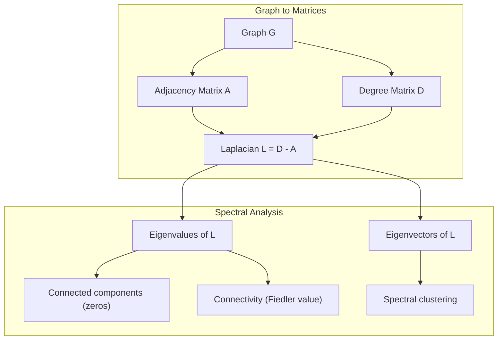
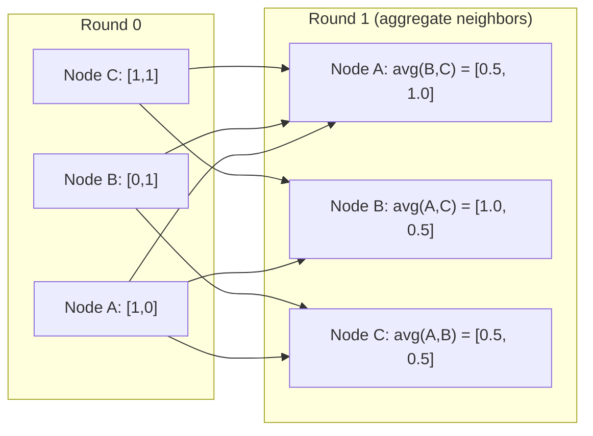

# Graph Theory untuk Machine Learning

> Graph adalah data structure dari hubungan. Jika datamu punya koneksi, kamu butuh graph theory.

**Type:** Build
**Language:** Python
**Prerequisites:** Phase 1, Lessons 01-03 (linear algebra, matrices)
**Time:** ~90 minutes

## Learning Objectives

- Membangun graph class dengan representasi adjacency matrix/list dan mengimplementasikan traversal BFS dan DFS
- Menghitung graph Laplacian dan menggunakan eigenvalue-nya untuk mendeteksi connected components dan meng-cluster node
- Mengimplementasikan satu putaran GNN-style message passing sebagai perkalian matriks adjacency ternormalisasi
- Menerapkan spectral clustering untuk mempartisi graph menggunakan Fiedler vector

## Masalahnya

Social networks, molekul, knowledge bases, citation networks, peta jalan — semuanya adalah graph. ML tradisional memperlakukan data sebagai tabel datar. Setiap baris independen. Setiap fitur adalah kolom. Tapi saat struktur koneksi itu penting, tabel gagal.

Pertimbangkan social network. Kamu ingin memprediksi produk apa yang akan dibeli user. Riwayat belanja mereka penting. Tapi riwayat belanja teman-teman mereka lebih penting. Koneksi membawa sinyal.

Atau pertimbangkan molekul. Kamu ingin memprediksi apakah molekul mengikat ke protein. Atom-atomnya penting, tapi yang benar-benar penting adalah bagaimana atom-atom terikat satu sama lain. Strukturnya adalah data.

Graph Neural Networks (GNN) adalah area dengan pertumbuhan tercepat di deep learning. Mereka menopang penemuan obat, rekomendasi sosial, deteksi penipuan, dan penalaran knowledge graph. Setiap GNN dibangun di atas fondasi yang sama: graph theory dasar.

Kamu butuh empat hal:
1. Cara merepresentasikan graph sebagai matriks (sehingga kamu bisa mengalikannya)
2. Algoritma traversal untuk mengeksplorasi struktur graph
3. Laplacian — matriks terpenting tunggal dalam spectral graph theory
4. Message passing — operasi yang membuat GNN bekerja

## Konsepnya

### Graph: Node dan Edge

Graph G = (V, E) terdiri dari vertices (node) V dan edges E. Setiap edge menghubungkan dua node.

**Directed vs undirected.** Di graph undirected, edge (u, v) berarti u terhubung ke v DAN v terhubung ke u. Di graph directed (digraph), edge (u, v) berarti u menunjuk ke v, tapi tidak pasti sebaliknya.

**Weighted vs unweighted.** Di graph unweighted, edge ada atau tidak ada. Di graph weighted, setiap edge punya bobot numerik — jarak, biaya, kekuatan.

| Graph type | Example |
|-----------|---------|
| Undirected, unweighted | Facebook friendship network |
| Directed, unweighted | Twitter follow network |
| Undirected, weighted | Road map (distances) |
| Directed, weighted | Web page links (PageRank scores) |

### Adjacency Matrix

Adjacency matrix A adalah representasi inti. Untuk graph dengan n node:

```
A[i][j] = 1    if there is an edge from node i to node j
A[i][j] = 0    otherwise
```

Untuk graph undirected, A simetris: A[i][j] = A[j][i]. Untuk graph weighted, A[i][j] = bobot edge (i, j).

**Contoh — sebuah segitiga:**

```
Nodes: 0, 1, 2
Edges: (0,1), (1,2), (0,2)

A = [[0, 1, 1],
     [1, 0, 1],
     [1, 1, 0]]
```

Adjacency matrix adalah input untuk setiap GNN. Operasi matriks pada A sesuai dengan operasi pada graph.

### Degree

Degree sebuah node adalah jumlah edge yang terhubung kepadanya. Untuk graph directed, kamu punya in-degree (edge masuk) dan out-degree (edge keluar).

Degree matrix D diagonal:

```
D[i][i] = degree of node i
D[i][j] = 0    for i != j
```

Untuk contoh segitiga: D = diag(2, 2, 2) karena setiap node terhubung ke dua lainnya.

Degree memberitahumu tentang kepentingan node. Degree tinggi = hub node. Distribusi degree sebuah network mengungkap strukturnya. Social networks mengikuti power laws (sedikit hub, banyak leaf node). Random graphs punya degree berdistribusi Poisson.

### BFS dan DFS

Dua algoritma traversal graph fundamental. Kamu butuh keduanya.

**Breadth-First Search (BFS):** Jelajahi semua neighbor dulu, lalu neighbor dari neighbor. Menggunakan queue (FIFO).

```
BFS from node 0:
  Visit 0
  Queue: [1, 2]        (neighbors of 0)
  Visit 1
  Queue: [2, 3]        (add neighbors of 1)
  Visit 2
  Queue: [3]           (neighbors of 2 already visited)
  Visit 3
  Queue: []            (done)
```

BFS menemukan shortest path di graph unweighted. Jarak dari start ke node mana pun sama dengan level BFS saat node itu ditemukan pertama kali. Inilah mengapa BFS digunakan untuk jarak hop-count di social networks.

**Depth-First Search (DFS):** Pergi sedalam mungkin sebelum backtrack. Menggunakan stack (LIFO) atau rekursi.

```
DFS from node 0:
  Visit 0
  Stack: [1, 2]        (neighbors of 0)
  Visit 2               (pop from stack)
  Stack: [1, 3]         (add neighbors of 2)
  Visit 3               (pop from stack)
  Stack: [1]
  Visit 1               (pop from stack)
  Stack: []             (done)
```

DFS berguna untuk:
- Menemukan connected components (jalankan DFS dari node yang belum dikunjungi)
- Deteksi cycle (back edge di DFS tree)
- Topological sorting (urutan finish DFS terbalik)

| Algorithm | Data structure | Finds | Use case |
|-----------|---------------|-------|----------|
| BFS | Queue | Shortest paths | Social network distance, knowledge graph traversal |
| DFS | Stack | Components, cycles | Connectivity, topological sort |

### Graph Laplacian

L = D - A. Matriks terpenting dalam spectral graph theory.

Untuk segitiga:

```
D = [[2, 0, 0],    A = [[0, 1, 1],    L = [[2, -1, -1],
     [0, 2, 0],         [1, 0, 1],         [-1, 2, -1],
     [0, 0, 2]]         [1, 1, 0]]         [-1, -1,  2]]
```

Laplacian punya sifat luar biasa:

1. **L positif semi-definit.** Semua eigenvalue >= 0.

2. **Jumlah eigenvalue nol sama dengan jumlah connected components.** Graph terhubung punya tepat satu eigenvalue nol. Graph dengan 3 komponen terpisah punya tiga eigenvalue nol.

3. **Eigenvalue terkecil yang bukan nol (Fiedler value) mengukur konektivitas.** Fiedler value besar berarti graph terhubung dengan baik. Fiedler value kecil berarti graph punya titik lemah — sebuah bottleneck.

4. **Eigenvector dari Fiedler value (Fiedler vector) mengungkap pembagian terbaik.** Node dengan nilai positif masuk ke satu grup, node dengan nilai negatif masuk ke grup lain. Ini spectral clustering.



### Sifat Spektral

Eigenvalue dari adjacency matrix dan Laplacian mengungkap sifat struktural tanpa traversal apa pun.

**Spectral clustering** bekerja seperti ini:
1. Hitung Laplacian L
2. Temukan k eigenvector terkecil dari L (lewati yang pertama, yang semuanya satu untuk graph terhubung)
3. Gunakan eigenvector-eigenvector itu sebagai koordinat baru untuk setiap node
4. Jalankan k-means pada koordinat itu

Mengapa ini bekerja? Eigenvector dari L mengkodekan fungsi paling "halus" pada graph. Node yang terhubung dengan baik mendapat nilai eigenvector serupa. Node yang dipisahkan oleh bottleneck mendapat nilai berbeda. Eigenvector secara alami memisahkan cluster.

**Koneksi random walk.** Laplacian ternormalisasi berhubungan dengan random walk pada graph. Distribusi stationary dari random walk proporsional terhadap degree node. Mixing time (seberapa cepat walk konvergen) bergantung pada spectral gap.

### Message Passing

Operasi inti dari Graph Neural Networks. Setiap node mengumpulkan pesan dari neighbor-nya, mengagregasinya, dan meng-update statusnya sendiri.

```
h_v^(k+1) = UPDATE(h_v^(k), AGGREGATE({h_u^(k) : u in neighbors(v)}))
```

Dalam bentuk paling sederhana, AGGREGATE = mean, dan UPDATE = transform linier + aktivasi:

```
h_v^(k+1) = sigma(W * mean({h_u^(k) : u in neighbors(v)}))
```

Ini adalah perkalian matriks dalam penyamaran. Jika H adalah matriks semua fitur node dan A adalah adjacency matrix:

```
H^(k+1) = sigma(A_norm * H^(k) * W)
```

di mana A_norm adalah adjacency matrix ternormalisasi (setiap baris berjumlah 1).

Satu putaran message passing membiarkan setiap node "melihat" neighbor segeranya. Dua putaran membiarkannya melihat neighbor dari neighbor. K putaran memberi setiap node informasi dari lingkungan K-hop-nya.



### Konsep dan Aplikasi ML

| Concept | ML Application |
|---------|---------------|
| Adjacency matrix | GNN input representation |
| Graph Laplacian | Spectral clustering, community detection |
| BFS/DFS | Knowledge graph traversal, path finding |
| Degree distribution | Node importance, feature engineering |
| Message passing | GNN layers (GCN, GAT, GraphSAGE) |
| Eigenvalues of L | Community detection, graph partitioning |
| Spectral clustering | Unsupervised node grouping |
| PageRank | Node importance, web search |

```figure
graph-degree-distribution
```

## Bangun Sendiri

### Langkah 1: Graph class dari nol

```python
class Graph:
    def __init__(self, n_nodes, directed=False):
        self.n = n_nodes
        self.directed = directed
        self.adj = {i: {} for i in range(n_nodes)}

    def add_edge(self, u, v, weight=1.0):
        self.adj[u][v] = weight
        if not self.directed:
            self.adj[v][u] = weight

    def neighbors(self, node):
        return list(self.adj[node].keys())

    def degree(self, node):
        return len(self.adj[node])

    def adjacency_matrix(self):
        import numpy as np
        A = np.zeros((self.n, self.n))
        for u in range(self.n):
            for v, w in self.adj[u].items():
                A[u][v] = w
        return A

    def degree_matrix(self):
        import numpy as np
        D = np.zeros((self.n, self.n))
        for i in range(self.n):
            D[i][i] = self.degree(i)
        return D

    def laplacian(self):
        return self.degree_matrix() - self.adjacency_matrix()
```

Adjacency list (`self.adj`) menyimpan neighbor secara efisien. Konversi adjacency matrix menggunakan numpy karena semua operasi spektral membutuhkannya.

### Langkah 2: BFS dan DFS

```python
from collections import deque

def bfs(graph, start):
    visited = set()
    order = []
    distances = {}
    queue = deque([(start, 0)])
    visited.add(start)
    while queue:
        node, dist = queue.popleft()
        order.append(node)
        distances[node] = dist
        for neighbor in graph.neighbors(node):
            if neighbor not in visited:
                visited.add(neighbor)
                queue.append((neighbor, dist + 1))
    return order, distances


def dfs(graph, start):
    visited = set()
    order = []
    stack = [start]
    while stack:
        node = stack.pop()
        if node in visited:
            continue
        visited.add(node)
        order.append(node)
        for neighbor in reversed(graph.neighbors(node)):
            if neighbor not in visited:
                stack.append(neighbor)
    return order
```

BFS menggunakan deque (double-ended queue) untuk popleft O(1). DFS menggunakan list sebagai stack. Keduanya mengunjungi setiap node tepat sekali — waktu O(V + E).

### Langkah 3: Connected components dan eigenvalue Laplacian

```python
def connected_components(graph):
    visited = set()
    components = []
    for node in range(graph.n):
        if node not in visited:
            order, _ = bfs(graph, node)
            visited.update(order)
            components.append(order)
    return components


def laplacian_eigenvalues(graph):
    import numpy as np
    L = graph.laplacian()
    eigenvalues = np.linalg.eigvalsh(L)
    return eigenvalues
```

`eigvalsh` untuk matriks simetris — Laplacian selalu simetris untuk graph undirected. Ia mengembalikan eigenvalue secara berurutan naik. Hitung yang nol untuk menemukan jumlah connected components.

### Langkah 4: Spectral clustering

```python
def spectral_clustering(graph, k=2):
    import numpy as np
    L = graph.laplacian()
    eigenvalues, eigenvectors = np.linalg.eigh(L)
    features = eigenvectors[:, 1:k+1]

    labels = np.zeros(graph.n, dtype=int)
    for i in range(graph.n):
        if features[i, 0] >= 0:
            labels[i] = 0
        else:
            labels[i] = 1
    return labels
```

Untuk k=2, tanda dari Fiedler vector memecah graph menjadi dua cluster. Untuk k>2, kamu akan menjalankan k-means pada k eigenvector pertama (mengecualikan eigenvector trivial yang semuanya satu).

### Langkah 5: Message passing

```python
def message_passing(graph, features, weight_matrix):
    import numpy as np
    A = graph.adjacency_matrix()
    row_sums = A.sum(axis=1, keepdims=True)
    row_sums[row_sums == 0] = 1
    A_norm = A / row_sums
    aggregated = A_norm @ features
    output = aggregated @ weight_matrix
    return output
```

Ini adalah satu putaran GNN message passing. Fitur baru setiap node adalah rata-rata tertimbang dari fitur neighbor-nya, ditransformasi oleh weight matrix. Tumpuk beberapa putaran untuk menyebarkan informasi lebih jauh.

## Gunakan

Dengan networkx dan numpy, operasi yang sama adalah one-liner:

```python
import networkx as nx
import numpy as np

G = nx.karate_club_graph()

A = nx.adjacency_matrix(G).toarray()
L = nx.laplacian_matrix(G).toarray()

eigenvalues = np.linalg.eigvalsh(L.astype(float))
print(f"Smallest eigenvalues: {eigenvalues[:5]}")
print(f"Connected components: {nx.number_connected_components(G)}")

communities = nx.community.greedy_modularity_communities(G)
print(f"Communities found: {len(communities)}")

pr = nx.pagerank(G)
top_nodes = sorted(pr.items(), key=lambda x: x[1], reverse=True)[:5]
print(f"Top 5 PageRank nodes: {top_nodes}")
```

networkx menangani graph berapa pun ukurannya dengan backend C yang dioptimalkan. Gunakan di produksi. Gunakan implementasi dari-nol-mu untuk memahami apa yang dilakukannya.

### Analisis spektral numpy

```python
import numpy as np

A = np.array([
    [0, 1, 1, 0, 0],
    [1, 0, 1, 0, 0],
    [1, 1, 0, 1, 0],
    [0, 0, 1, 0, 1],
    [0, 0, 0, 1, 0]
])

D = np.diag(A.sum(axis=1))
L = D - A

eigenvalues, eigenvectors = np.linalg.eigh(L)
print(f"Eigenvalues: {np.round(eigenvalues, 4)}")
print(f"Fiedler value: {eigenvalues[1]:.4f}")
print(f"Fiedler vector: {np.round(eigenvectors[:, 1], 4)}")

fiedler = eigenvectors[:, 1]
group_a = np.where(fiedler >= 0)[0]
group_b = np.where(fiedler < 0)[0]
print(f"Cluster A: {group_a}")
print(f"Cluster B: {group_b}")
```

Fiedler vector melakukan pekerjaan berat. Nilai positif di satu cluster, negatif di yang lain. Tidak perlu optimasi iteratif — hanya satu eigendecomposition.

## Rilis

Pelajaran ini menghasilkan:
- `outputs/skill-graph-analysis.md` — skill reference untuk menganalisis data berstruktur graph

## Koneksi

| Concept | Where it shows up |
|---------|------------------|
| Adjacency matrix | GCN, GAT, GraphSAGE input |
| Laplacian | Spectral clustering, ChebNet filters |
| BFS | Knowledge graph traversal, shortest path queries |
| Message passing | Every GNN layer, neural message passing |
| Spectral gap | Graph connectivity, mixing time of random walks |
| Degree distribution | Power-law networks, node feature engineering |
| Connected components | Preprocessing, handling disconnected graphs |
| PageRank | Node importance ranking, attention initialization |

GNN layak disebut khusus. Operasi graph convolution di GCN (Kipf & Welling, 2017) menggunakan adjacency matrix dengan self-loops yang ditambahkan, A_hat = A + I:

```text
H^(l+1) = sigma(D_hat^(-1/2) * A_hat * D_hat^(-1/2) * H^(l) * W^(l))
```

di mana A_hat = A + I (adjacency plus self-loops) dan D_hat adalah degree matrix dari A_hat. Self-loops memastikan setiap node menyertakan fiturnya sendiri selama agregasi. Ini persis message passing dengan normalisasi simetris. D_hat^(-1/2) * A_hat * D_hat^(-1/2) adalah adjacency matrix ternormalisasi. Laplacian muncul karena normalisasi ini berhubungan dengan L_sym = I - D^(-1/2) * A * D^(-1/2). Memahami Laplacian berarti memahami mengapa GCN bekerja.

## Latihan

1. **Implementasikan PageRank dari nol.** Mulai dengan skor uniform. Di setiap langkah: score(v) = (1-d)/n + d * sum(score(u)/out_degree(u)) untuk semua u yang menunjuk ke v. Gunakan d=0.85. Jalankan sampai konvergen (change < 1e-6). Uji pada web graph kecil.

2. **Temukan komunitas menggunakan spectral clustering.** Buat graph dengan dua cluster yang jelas terpisah (misalnya, dua clique yang dihubungkan oleh satu edge). Jalankan spectral clustering dan verifikasi bahwa ia menemukan pembagian yang benar. Apa yang terjadi saat kamu menambahkan lebih banyak edge antar-cluster?

3. **Implementasikan algoritma Dijkstra** untuk shortest path di graph weighted. Bandingkan hasil dengan BFS pada graph yang sama dengan bobot uniform.

4. **Bangun jaringan message passing 2-layer.** Terapkan message passing dua kali dengan weight matrix berbeda. Tunjukkan bahwa setelah 2 putaran, setiap node punya informasi dari lingkungan 2-hop-nya.

5. **Analisis graph dunia nyata.** Gunakan Karate Club graph (34 node, 78 edge). Hitung distribusi degree, eigenvalue Laplacian, dan spectral clustering. Bandingkan hasil spectral clustering dengan split ground truth yang diketahui.

## Istilah Kunci

| Term | What people say | What it actually means |
|------|----------------|----------------------|
| Graph | "Nodes and edges" | A mathematical structure G=(V,E) encoding pairwise relationships |
| Adjacency matrix | "The connection table" | An n x n matrix where A[i][j] = 1 if nodes i and j are connected |
| Degree | "How connected a node is" | The number of edges touching a node |
| Laplacian | "D minus A" | L = D - A, the matrix whose eigenvalues reveal graph structure |
| Fiedler value | "The algebraic connectivity" | The smallest non-zero eigenvalue of L, measuring how well-connected the graph is |
| BFS | "Level-by-level search" | Traversal that visits all neighbors before going deeper, finds shortest paths |
| DFS | "Go deep first" | Traversal that follows one path to its end before backtracking |
| Message passing | "Nodes talk to neighbors" | Each node aggregates information from its neighbors, the core of GNNs |
| Spectral clustering | "Cluster by eigenvectors" | Partition a graph using eigenvectors of its Laplacian |
| Connected component | "A separate piece" | A maximal subgraph where every node can reach every other node |

## Bacaan Lanjutan

- **Kipf & Welling (2017)** -- "Semi-Supervised Classification with Graph Convolutional Networks." The paper that launched modern GNNs. Shows that spectral graph convolutions simplify to message passing.
- **Spielman (2012)** -- "Spectral Graph Theory" lecture notes. The definitive introduction to Laplacians, spectral gaps, and graph partitioning.
- **Hamilton (2020)** -- "Graph Representation Learning." Book covering GNNs from fundamentals to applications.
- **Bronstein et al. (2021)** -- "Geometric Deep Learning: Grids, Groups, Graphs, Geodesics, and Gauges." The unifying framework paper.
- **Veličković et al. (2018)** -- "Graph Attention Networks." Extends message passing with attention mechanisms.
