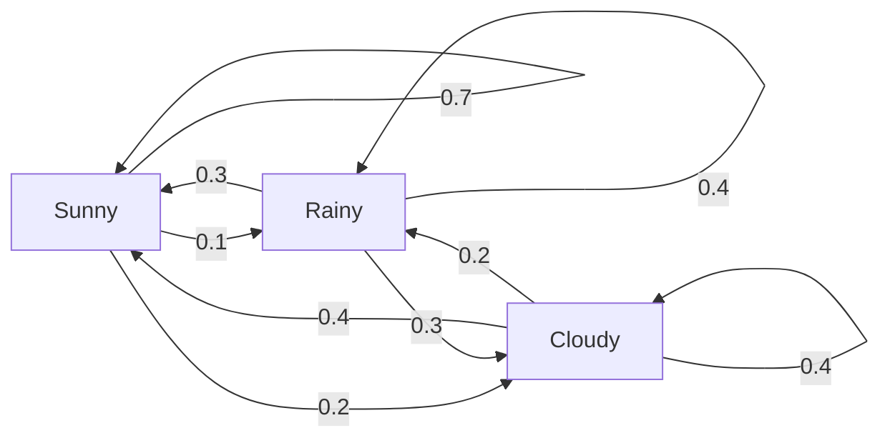
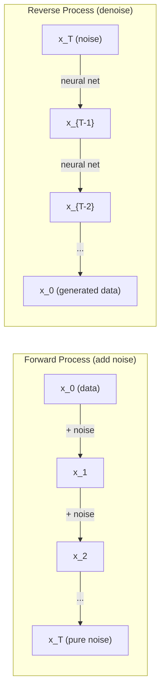

# Stochastic Processes

> Randomness dengan struktur. Matematika di balik random walk, Markov chain, dan diffusion models.

**Type:** Learn
**Language:** Python
**Prerequisites:** Phase 1, Lessons 06-07 (probability, Bayes)
**Time:** ~75 minutes

## Learning Objectives

- Mensimulasikan random walk 1D dan 2D dan memverifikasi penskalaan sqrt(n) dari perpindahan
- Membangun simulator Markov chain dan menghitung distribusi stationary-nya via eigendecomposition
- Mengimplementasikan Metropolis-Hastings MCMC dan Langevin dynamics untuk sampling dari distribusi target
- Menghubungkan proses diffusion maju dengan Brownian motion dan menjelaskan bagaimana proses reverse menghasilkan data

## Masalahnya

Banyak sistem AI melibatkan randomness yang berevolusi seiring waktu. Bukan randomness statis — randomness terstruktur, sekuensial di mana setiap langkah bergantung pada apa yang mendahuluinya.

Language model menghasilkan token satu per satu. Setiap token bergantung pada konteks sebelumnya. Model mengeluarkan distribusi probabilitas, sampling dari situ, lalu lanjut. Itu adalah stochastic process.

Diffusion model menambahkan noise ke gambar langkah demi langkah sampai menjadi statis murni. Lalu mereka membalik prosesnya, men-denoise langkah demi langkah sampai gambar baru muncul. Proses maju adalah Markov chain. Proses reverse adalah Markov chain terpelajari yang berjalan mundur.

Agent reinforcement learning mengambil aksi di environment. Setiap aksi mengarah ke status baru dengan probabilitas tertentu. Agent mengikuti policy acak di dunia acak. Keseluruhannya adalah Markov decision process.

Sampling MCMC — tulang punggung inferensi Bayesian — membangun Markov chain yang distribusi stationary-nya adalah posterior yang ingin kamu sampling.

Semuanya dibangun di atas empat ide fondasional:
1. Random walks — stochastic process paling sederhana
2. Markov chains — randomness terstruktur dengan transition matrix
3. Langevin dynamics — gradient descent dengan noise
4. Metropolis-Hastings — sampling dari distribusi apa pun

## Konsepnya

### Random Walks

Mulai dari posisi 0. Di setiap langkah, lempar koin fair. Kepala: geser kanan (+1). Ekor: geser kiri (-1).

Setelah n langkah, posisimu adalah jumlah dari n nilai acak +/-1. Posisi yang diharapkan adalah 0 (walk tidak bias). Tapi jarak yang diharapkan dari asal tumbuh seperti sqrt(n).

Ini counterintuitive. Walk-nya fair — tidak ada drift ke arah mana pun. Tapi seiring waktu, ia menyimpang semakin jauh dari tempat ia mulai. Standar deviasi setelah n langkah adalah sqrt(n).

```
Step 0:  Position = 0
Step 1:  Position = +1 or -1
Step 2:  Position = +2, 0, or -2
...
Step 100: Expected distance from origin ~ 10 (sqrt(100))
Step 10000: Expected distance from origin ~ 100 (sqrt(10000))
```

**Di 2D**, walk bergerak ke atas, bawah, kiri, atau kanan dengan probabilitas sama. Penskalaan sqrt(n) yang sama berlaku untuk jarak dari asal. Path menelusuri pola mirip-fraktal.

**Mengapa sqrt(n)?** Setiap langkah adalah +1 atau -1 dengan probabilitas sama. Setelah n langkah, posisi S_n = X_1 + X_2 + ... + X_n di mana setiap X_i adalah +/-1. Varians setiap langkah adalah 1, dan langkah-langkahnya independen, jadi Var(S_n) = n. Standar deviasi = sqrt(n). Dengan central limit theorem, S_n / sqrt(n) konvergen ke distribusi normal standar.

Penskalaan sqrt(n) ini muncul di mana-mana dalam ML. Noise SGD berskala 1/sqrt(batch_size). Dimensi embedding berskala sqrt(d). Akar kuadrat adalah tanda tangan dari penjumlahan acak independen.

**Koneksi ke Brownian motion.** Ambil random walk dengan ukuran langkah 1/sqrt(n) dan n langkah per unit waktu. Saat n menuju tak hingga, walk konvergen ke Brownian motion B(t) — proses continuous-time di mana B(t) terdistribusi normal dengan mean 0 dan varians t.

Brownian motion adalah fondasi matematis dari difusi. Ia memodelkan kocokan acak partikel dalam fluida, fluktuasi harga saham, dan — yang krusial — proses noise dalam diffusion models.

**Gambler's ruin.** Random walker yang mulai di posisi k, dengan barrier absorbing di 0 dan N. Apa probabilitas mencapai N sebelum 0? Untuk walk fair: P(reach N) = k/N. Ini sederhana dan elegan. Ini berhubungan dengan teori martingale — walk fair adalah martingale (nilai future yang diharapkan = nilai saat ini).

### Markov Chains

Markov chain adalah sistem yang berpindah antar status menurut probabilitas tetap. Sifat kunci: status berikutnya hanya bergantung pada status saat ini, bukan pada history.

```
P(X_{t+1} = j | X_t = i, X_{t-1} = ...) = P(X_{t+1} = j | X_t = i)
```

Ini adalah sifat Markov. Artinya kamu bisa mendeskripsikan seluruh dinamika dengan transition matrix P:

```
P[i][j] = probability of going from state i to state j
```

Setiap baris P berjumlah 1 (kamu pasti ke suatu tempat).

**Contoh — Cuaca:**

```
States: Sunny (0), Rainy (1), Cloudy (2)

P = [[0.7, 0.1, 0.2],    (if sunny: 70% sunny, 10% rainy, 20% cloudy)
     [0.3, 0.4, 0.3],    (if rainy: 30% sunny, 40% rainy, 30% cloudy)
     [0.4, 0.2, 0.4]]    (if cloudy: 40% sunny, 20% rainy, 40% cloudy)
```

Mulai di status mana pun. Setelah banyak transisi, distribusi status konvergen ke distribusi stationary pi, di mana pi * P = pi. Ini adalah left eigenvector dari P dengan eigenvalue 1.

Untuk chain cuaca, distribusi stationary adalah [0.55, 0.18, 0.27] — dalam jangka panjang, cerah 55% dari waktu terlepas dari status awal.



**Menghitung distribusi stationary.** Ada dua pendekatan:

1. **Power method**: kalikan distribusi awal mana pun dengan P secara berulang. Setelah cukup iterasi, ia konvergen.
2. **Eigenvalue method**: temukan left eigenvector dari P dengan eigenvalue 1. Ini adalah eigenvector dari P^T dengan eigenvalue 1.

Kedua pendekatan membutuhkan chain memenuhi syarat konvergen.

**Syarat konvergen.** Markov chain konvergen ke distribusi stationary yang unik jika chain-nya:
- **Irreducible**: setiap status dapat dicapai dari setiap status lain
- **Aperiodic**: chain tidak berputar dengan periode tetap

Sebagian besar chain yang kamu temui dalam ML memenuhi kedua syarat.

**Status absorbing.** Status bersifat absorbing jika begitu kamu masuk, kamu tidak pernah keluar (P[i][i] = 1). Markov chain absorbing memodelkan proses dengan status terminal — permainan yang berakhir, customer yang churn, urutan token yang mencapai token end-of-text.

**Mixing time.** Berapa langkah sampai chain "mendekati" distribusi stationary? Secara formal, jumlah langkah sampai total variation distance dari stationarity turun di bawah ambang tertentu. Mixing cepat = few steps needed. Spectral gap dari P (1 dikurangi eigenvalue terbesar kedua) mengontrol mixing time. Gap lebih besar = mixing lebih cepat.

### Koneksi ke Language Models

Generasi token dalam language model secara kasar adalah proses Markov. Diberikan konteks saat ini, model mengeluarkan distribusi atas token berikutnya. Temperature mengontrol ketajaman:

```
P(token_i) = exp(logit_i / temperature) / sum(exp(logit_j / temperature))
```

- Temperature = 1.0: distribusi standar
- Temperature < 1.0: lebih tajam (lebih deterministik)
- Temperature > 1.0: lebih datar (lebih acak)
- Temperature -> 0: argmax (greedy)

Top-k sampling memotong ke k token berprobabilitas tertinggi. Top-p (nucleus) sampling memotong ke himpunan token terkecil yang probabilitas kumulatifnya melebihi p. Keduanya memodifikasi probabilitas transisi Markov.

### Brownian Motion

Limit continuous-time dari random walk. Posisi B(t) punya tiga sifat:
1. B(0) = 0
2. B(t) - B(s) terdistribusi normal dengan mean 0 dan varians t - s (untuk t > s)
3. Inkrement pada interval yang tidak tumpang tindih independen

Brownian motion kontinu tapi tidak dapat diturunkan di mana pun — ia bergetar di setiap skala. Path punya dimensi fraktal 2 di bidang.

Dalam simulasi diskrit, kamu mengaproksimasi Brownian motion dengan:

```
B(t + dt) = B(t) + sqrt(dt) * z,    where z ~ N(0, 1)
```

Penskalaan sqrt(dt) penting. Ini berasal dari central limit theorem yang diterapkan pada random walks.

### Langevin Dynamics

Gradient descent menemukan minimum fungsi. Langevin dynamics menemukan distribusi probabilitas proporsional terhadap exp(-U(x)/T), di mana U adalah energy function dan T adalah temperature.

```
x_{t+1} = x_t - dt * gradient(U(x_t)) + sqrt(2 * T * dt) * z_t
```

Dua kekuatan bertindak pada partikel:
1. **Kekuatan gradien** (-dt * gradient(U)): mendorong ke energi rendah (seperti gradient descent)
2. **Kekuatan acak** (sqrt(2*T*dt) * z): mendorong ke arah acak (eksplorasi)

Pada temperature T = 0, ini gradient descent murni. Pada temperature tinggi, ini hampir random walk. Pada temperature yang tepat, partikel mengeksplorasi lanskap energi dan menghabiskan lebih banyak waktu di region berenergi rendah.

**Koneksi ke diffusion models.** Proses maju dari diffusion model adalah:

```
x_t = sqrt(alpha_t) * x_{t-1} + sqrt(1 - alpha_t) * noise
```

Ini adalah Markov chain yang secara bertahap mencampur data dengan noise. Setelah cukup langkah, x_T adalah noise Gaussian murni.

Proses reverse — pergi dari noise kembali ke data — juga Markov chain, tapi probabilitas transisinya dipelajari oleh neural network. Network belajar memprediksi noise yang ditambahkan di setiap langkah, lalu menguranginya.



### MCMC: Markov Chain Monte Carlo

Terkadang kamu perlu sampling dari distribusi p(x) yang bisa kamu evaluasi (hingga konstanta) tapi tidak bisa sampling secara langsung. Posterior Bayesian adalah contoh klasik — kamu tahu likelihood kali prior, tapi konstanta normalisasi tidak dapat ditangani.

**Metropolis-Hastings** membangun Markov chain yang distribusi stationary-nya adalah p(x):

1. Mulai di posisi x mana pun
2. Usulkan posisi baru x' dari distribution proposal Q(x'|x)
3. Hitung acceptance ratio: a = p(x') * Q(x|x') / (p(x) * Q(x'|x))
4. Terima x' dengan probabilitas min(1, a). Jika tidak, tetap di x.
5. Ulangi.

Jika Q simetris (misalnya, Q(x'|x) = Q(x|x') = N(x, sigma^2)), rasionya menyederhanakan menjadi a = p(x') / p(x). Kamu hanya butuh rasio probabilitas — konstanta normalisasi terhapus.

Chain dijamin konvergen ke p(x) di bawah syarat ringan. Tapi konvergen bisa lambat jika proposal terlalu kecil (random walk) atau terlalu besar (penolakan tinggi). Menyetel proposal adalah seni MCMC.

**Mengapa ini bekerja.** Acceptance ratio memastikan detailed balance: probabilitas berada di x dan bergerak ke x' sama dengan probabilitas berada di x' dan bergerak ke x. Detailed balance menyiratkan bahwa p(x) adalah distribusi stationary dari chain. Jadi setelah cukup langkah, sampel datang dari p(x).

**Pertimbangan praktis:**
- **Burn-in**: buang N sampel pertama. Chain butuh waktu untuk mencapai distribusi stationary dari titik awalnya.
- **Thinning**: simpan setiap sampel ke-k untuk mengurangi autokorelasi.
- **Beberapa chain**: jalankan beberapa chain dari titik awal berbeda. Jika mereka konvergen ke distribusi yang sama, kamu punya bukti konvergen.
- **Acceptance rate**: untuk proposal Gaussian di d dimensi, acceptance rate optimal sekitar 23% (Roberts & Rosenthal, 2001). Terlalu tinggi berarti chain hampir tidak bergerak. Terlalu rendah berarti ia menolak semua.

### Stochastic Processes di AI

| Process | AI Application |
|---------|---------------|
| Random walk | Exploration in RL, Node2Vec embeddings |
| Markov chain | Text generation, MCMC sampling |
| Brownian motion | Diffusion models (forward process) |
| Langevin dynamics | Score-based generative models, SGLD |
| Markov decision process | Reinforcement learning |
| Metropolis-Hastings | Bayesian inference, posterior sampling |

```figure
random-walk-diffusion
```

## Bangun Sendiri

### Langkah 1: Simulator random walk

```python
import numpy as np

def random_walk_1d(n_steps, seed=None):
    rng = np.random.RandomState(seed)
    steps = rng.choice([-1, 1], size=n_steps)
    positions = np.concatenate([[0], np.cumsum(steps)])
    return positions


def random_walk_2d(n_steps, seed=None):
    rng = np.random.RandomState(seed)
    directions = rng.choice(4, size=n_steps)
    dx = np.zeros(n_steps)
    dy = np.zeros(n_steps)
    dx[directions == 0] = 1   # right
    dx[directions == 1] = -1  # left
    dy[directions == 2] = 1   # up
    dy[directions == 3] = -1  # down
    x = np.concatenate([[0], np.cumsum(dx)])
    y = np.concatenate([[0], np.cumsum(dy)])
    return x, y
```

Walk 1D menyimpan cumulative sums. Setiap langkah adalah +1 atau -1. Setelah n langkah, posisinya adalah jumlahnya. Varians tumbuh linier dengan n, sehingga standar deviasi tumbuh seperti sqrt(n).

### Langkah 2: Markov chain

```python
class MarkovChain:
    def __init__(self, transition_matrix, state_names=None):
        self.P = np.array(transition_matrix, dtype=float)
        self.n_states = len(self.P)
        self.state_names = state_names or [str(i) for i in range(self.n_states)]

    def step(self, current_state, rng=None):
        if rng is None:
            rng = np.random.RandomState()
        probs = self.P[current_state]
        return rng.choice(self.n_states, p=probs)

    def simulate(self, start_state, n_steps, seed=None):
        rng = np.random.RandomState(seed)
        states = [start_state]
        current = start_state
        for _ in range(n_steps):
            current = self.step(current, rng)
            states.append(current)
        return states

    def stationary_distribution(self):
        eigenvalues, eigenvectors = np.linalg.eig(self.P.T)
        idx = np.argmin(np.abs(eigenvalues - 1.0))
        stationary = np.real(eigenvectors[:, idx])
        stationary = stationary / stationary.sum()
        return np.abs(stationary)
```

Distribusi stationary adalah left eigenvector dari P dengan eigenvalue 1. Kami menemukannya dengan menghitung eigenvector dari P^T (mentranspos mengubah left eigenvectors menjadi right eigenvectors).

### Langkah 3: Langevin dynamics

```python
def langevin_dynamics(grad_U, x0, dt, temperature, n_steps, seed=None):
    rng = np.random.RandomState(seed)
    x = np.array(x0, dtype=float)
    trajectory = [x.copy()]
    for _ in range(n_steps):
        noise = rng.randn(*x.shape)
        x = x - dt * grad_U(x) + np.sqrt(2 * temperature * dt) * noise
        trajectory.append(x.copy())
    return np.array(trajectory)
```

Gradien mendorong x ke energi rendah. Noise mencegah ia tersangkut. Di equilibrium, distribusi sampel proporsional terhadap exp(-U(x)/temperature).

### Langkah 4: Metropolis-Hastings

```python
def metropolis_hastings(target_log_prob, proposal_std, x0, n_samples, seed=None):
    rng = np.random.RandomState(seed)
    x = np.array(x0, dtype=float)
    samples = [x.copy()]
    accepted = 0
    for _ in range(n_samples - 1):
        x_proposed = x + rng.randn(*x.shape) * proposal_std
        log_ratio = target_log_prob(x_proposed) - target_log_prob(x)
        if np.log(rng.rand()) < log_ratio:
            x = x_proposed
            accepted += 1
        samples.append(x.copy())
    acceptance_rate = accepted / (n_samples - 1)
    return np.array(samples), acceptance_rate
```

Algoritma mengusulkan titik baru, memeriksa apakah ia punya probabilitas lebih tinggi (atau menerima dengan probabilitas proporsional terhadap rasio), dan mengulangi. Acceptance rate harus sekitar 23-50% untuk mixing yang baik.

## Gunakan

Dalam praktiknya, kamu menggunakan library yang sudah mapan untuk algoritma-algoritma ini. Tapi memahami mekanismenya penting untuk debugging dan tuning.

```python
import numpy as np

rng = np.random.RandomState(42)
walk = np.cumsum(rng.choice([-1, 1], size=10000))
print(f"Final position: {walk[-1]}")
print(f"Expected distance: {np.sqrt(10000):.1f}")
print(f"Actual distance: {abs(walk[-1])}")
```

### numpy untuk transition matrices

```python
import numpy as np

P = np.array([[0.7, 0.1, 0.2],
              [0.3, 0.4, 0.3],
              [0.4, 0.2, 0.4]])

distribution = np.array([1.0, 0.0, 0.0])
for _ in range(100):
    distribution = distribution @ P

print(f"Stationary distribution: {np.round(distribution, 4)}")
```

Kalikan distribusi awal dengan P secara berulang. Setelah cukup iterasi, ia konvergen ke distribusi stationary terlepas dari tempat kamu mulai. Ini adalah power method untuk menemukan left eigenvector dominan.

### Koneksi ke framework nyata

- **PyTorch diffusion:** `DDPMScheduler` di Hugging Face `diffusers` mengimplementasikan Markov chain maju dan reverse
- **NumPyro / PyMC:** Menggunakan MCMC (NUTS sampler, yang memperbaiki Metropolis-Hastings) untuk inferensi Bayesian
- **Gymnasium (RL):** Fungsi langkah environment mendefinisikan Markov decision process

### Memverifikasi konvergen Markov chain

```python
import numpy as np

P = np.array([[0.9, 0.1], [0.3, 0.7]])

eigenvalues = np.linalg.eigvals(P)
spectral_gap = 1 - sorted(np.abs(eigenvalues))[-2]
print(f"Eigenvalues: {eigenvalues}")
print(f"Spectral gap: {spectral_gap:.4f}")
print(f"Approximate mixing time: {1/spectral_gap:.1f} steps")
```

Spectral gap memberitahumu seberapa cepat chain melupakan status awalnya. Gap 0.2 berarti kira-kira 5 langkah untuk mix. Gap 0.01 berarti kira-kira 100 langkah. Selalu periksa ini sebelum menjalankan simulasi panjang — chain yang lambat membuang-buang komputasi.

## Rilis

Pelajaran ini menghasilkan:
- `outputs/prompt-stochastic-process-advisor.md` — prompt yang membantu mengidentifikasi framework stochastic process mana yang berlaku untuk masalah tertentu

## Koneksi

| Concept | Where it shows up |
|---------|------------------|
| Random walk | Node2Vec graph embeddings, exploration in RL |
| Markov chain | Token generation in LLMs, MCMC sampling |
| Brownian motion | Forward diffusion process in DDPM, SDE-based models |
| Langevin dynamics | Score-based generative models, stochastic gradient Langevin dynamics (SGLD) |
| Stationary distribution | MCMC convergence target, PageRank |
| Metropolis-Hastings | Bayesian posterior sampling, simulated annealing |
| Temperature | LLM sampling, Boltzmann exploration in RL, simulated annealing |
| Mixing time | Convergence speed of MCMC, spectral gap analysis |
| Absorbing state | End-of-sequence token, terminal states in RL |
| Detailed balance | Correctness guarantee for MCMC samplers |

Diffusion models layak disebut khusus. DDPM (Ho et al., 2020) mendefinisikan Markov chain maju:

```
q(x_t | x_{t-1}) = N(x_t; sqrt(1-beta_t) * x_{t-1}, beta_t * I)
```

di mana beta_t adalah noise schedule. Setelah T langkah, x_T secara kasar N(0, I). Proses reverse diparameterisasi oleh neural network yang memprediksi noise:

```
p_theta(x_{t-1} | x_t) = N(x_{t-1}; mu_theta(x_t, t), sigma_t^2 * I)
```

Setiap langkah generasi adalah langkah dalam Markov chain yang dipelajari. Memahami Markov chains berarti memahami bagaimana dan mengapa diffusion models menghasilkan data.

SGLD (Stochastic Gradient Langevin Dynamics) menggabungkan gradient descent mini-batch dengan noise Langevin. Alih-alih menghitung gradien penuh, kamu menggunakan estimat stokastik dan menambahkan noise yang dikalibrasi. Saat learning rate menyusut, SGLD transisi dari optimasi ke sampling — kamu mendapat sampel posterior Bayesian kasar secara gratis. Ini adalah salah satu cara paling sederhana untuk mendapat estimasi ketidakpastian dari neural network.

Wawasan kunci di balik semua koneksi ini: stochastic processes bukan hanya alat teoretis. Mereka adalah mekanisme komputasi di dalam sistem AI modern. Saat kamu menyetel temperature LLM, kamu menyesuaikan Markov chain. Saat kamu melatih diffusion model, kamu belajar membalik proses mirip-Brownian-motion. Saat kamu menjalankan inferensi Bayesian, kamu membangun chain yang konvergen ke posterior.

## Latihan

1. **Simulasikan 1000 random walks dengan 10000 langkah.** Plot distribusi posisi akhir. Verifikasi bahwa ia secara kasar Gaussian dengan mean 0 dan standar deviasi sqrt(10000) = 100.

2. **Bangun text generator menggunakan Markov chain.** Latih pada korpus kecil: untuk setiap kata, hitung transisi ke kata berikutnya. Bangun transition matrix. Hasilkan kalimat baru dengan sampling dari chain.

3. **Implementasikan simulated annealing** menggunakan Metropolis-Hastings. Mulai dengan temperature tinggi (hampir semua diterima) dan secara bertahap turunkan (hanya perbaikan yang diterima). Gunakan untuk menemukan minimum fungsi dengan banyak local minima.

4. **Bandingkan Langevin dynamics pada temperature berbeda.** Sampling dari potensi sumur ganda U(x) = (x^2 - 1)^2. Pada temperature rendah, sampel terkumpul di satu sumur. Pada temperature tinggi, mereka tersebar di kedua sumur. Temukan temperature kritis di mana chain mixing di antara sumur.

5. **Implementasikan proses diffusion maju.** Mulai dengan sinyal 1D (misalnya, gelombang sinus). Tambahkan noise secara progresif selama 100 langkah dengan noise schedule linier. Tunjukkan bagaimana sinyal terdegradasi ke noise murni. Lalu implementasikan denoiser sederhana yang membalik prosesnya (bahkan yang naif yang hanya mengurangi noise yang diperkirakan).

## Istilah Kunci

| Term | What people say | What it actually means |
|------|----------------|----------------------|
| Random walk | "Coin-flip movement" | A process where position changes by random increments at each step |
| Markov property | "Memoryless" | The future depends only on the present state, not on the history |
| Transition matrix | "The probability table" | P[i][j] = probability of moving from state i to state j |
| Stationary distribution | "The long-run average" | The distribution pi where pi*P = pi -- the chain's equilibrium |
| Brownian motion | "Random jiggling" | The continuous-time limit of a random walk, B(t) ~ N(0, t) |
| Langevin dynamics | "Gradient descent with noise" | Update rule that combines deterministic gradient and random perturbation |
| MCMC | "Walking toward the target" | Constructing a Markov chain whose stationary distribution is the one you want |
| Metropolis-Hastings | "Propose and accept/reject" | MCMC algorithm that uses acceptance ratios to ensure convergence |
| Temperature | "The randomness knob" | Parameter controlling the tradeoff between exploration and exploitation |
| Diffusion process | "Noise in, noise out" | Forward: gradually add noise. Reverse: gradually remove it. Generates data. |

## Bacaan Lanjutan

- **Ho, Jain, Abbeel (2020)** -- "Denoising Diffusion Probabilistic Models." The DDPM paper that launched the diffusion model revolution. Clear derivation of the forward and reverse Markov chains.
- **Song & Ermon (2019)** -- "Generative Modeling by Estimating Gradients of the Data Distribution." Score-based approach using Langevin dynamics for sampling.
- **Roberts & Rosenthal (2004)** -- "General state space Markov chains and MCMC algorithms." The theory behind when and why MCMC works.
- **Norris (1997)** -- "Markov Chains." The standard textbook. Covers convergence, stationary distributions, and hitting times.
- **Welling & Teh (2011)** -- "Bayesian Learning via Stochastic Gradient Langevin Dynamics." Combines SGD with Langevin dynamics for scalable Bayesian inference.
