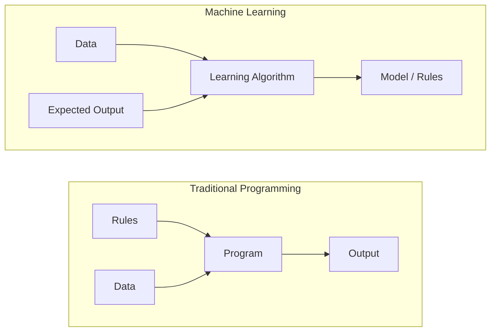
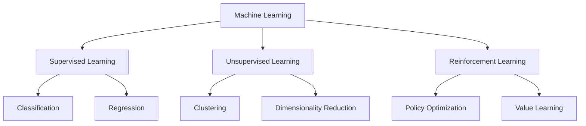
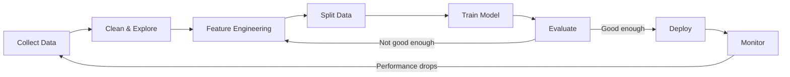
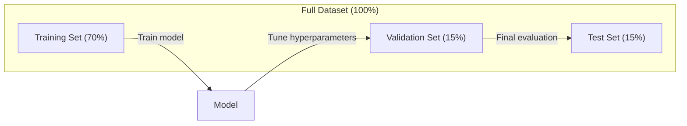
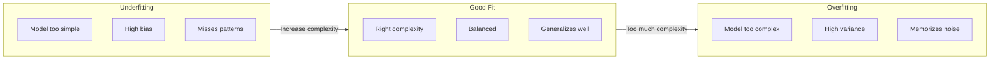
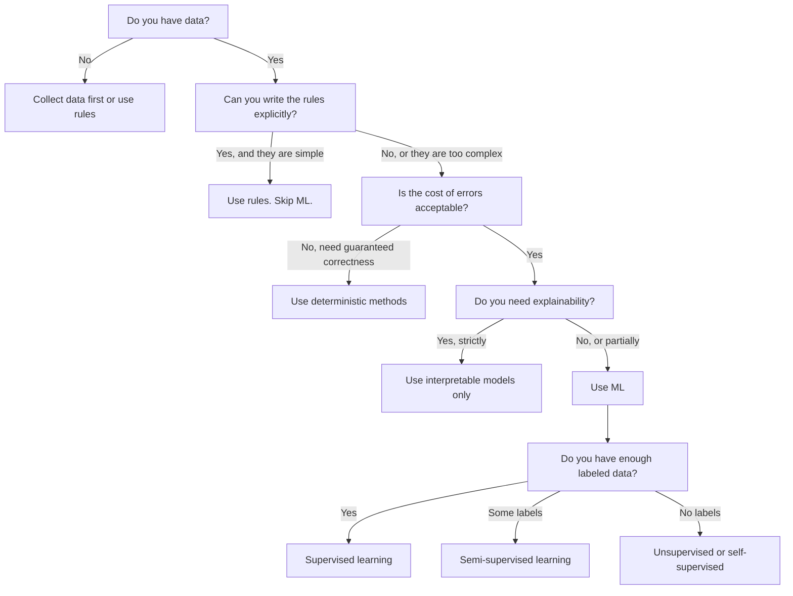

# Apa Itu Machine Learning

> Machine learning adalah mengajarkan komputer menemukan pola dalam data, bukan menulis aturan secara manual.

**Type:** Learn
**Languages:** Python
**Prerequisites:** Phase 1 (Math Foundations)
**Time:** ~45 minutes

## Tujuan Pembelajaran

- Jelaskan perbedaan antara supervised, unsupervised, dan reinforcement learning serta identifikasi tipe mana yang berlaku untuk masalah tertentu
- Implementasikan klasifier nearest centroid dari nol dan evaluasikan terhadap baseline acak
- Bedakan antara tugas klasifikasi dan regression serta pilih loss function yang tepat untuk masing-masing
- Evaluasi apakah masalah bisnis tertentu cocok untuk ML atau lebih baik diselesaikan dengan aturan deterministik

## Masalahnya

Kamu ingin membangun filter spam. Pendekatan tradisional: duduk dan menulis ratusan aturan. "Jika email berisi 'GRATIS UANG', tandai sebagai spam. Jika punya lebih dari 3 tanda seru, tandai sebagai spam." Kamu menghabiskan berminggu-minggu menulis aturan. Lalu para spammer mengubah redaksi pesan mereka. Aturanmu rusak. Kamu menulis lebih banyak lagi aturan. Siklusnya tidak pernah selesai.

Machine learning membalik ini. Alih-alih menulis aturan, kamu memberi komputer ribuan email berlabel ("spam" atau "bukan spam") dan membiarkannya menemukan aturannya sendiri. Komputer menemukan pola yang tidak pernah kamu bayangkan. Ketika spammer mengubah taktiknya, kamu melatih ulang dengan data baru alih-alih menulis ulang kode.

Pergeseran dari "memprogram aturan" menjadi "belajar dari data" inti dari machine learning. Setiap recommendation engine, asisten suara, mobil otonom, dan bahasa model bekerja dengan cara ini.

## Konsepnya

### Belajar dari Data, Bukan Aturan

Pemrograman tradisional dan machine learning menyelesaikan masalah dengan arah yang berlawanan.



Pemrograman tradisional: kamu menulis aturannya. Program menerapkannya pada data untuk menghasilkan output.

Machine learning: kamu menyediakan data dan output yang diharapkan. Algoritmanya menemukan aturannya.

"Model" yang keluar dari training ITULAH aturannya, dikodekan sebagai angka (weight, parameter). Model menggeneralisasi dari contoh yang telah dilihatnya untuk membuat prediksi pada data yang belum pernah dilihatnya.

### Tiga Jenis Machine Learning



**Supervised Learning**: Kamu punya pasangan input-output. Model belajar memetakan input ke output.
- "Ini 10.000 foto berlabel kucing atau anjing. Belajar membedakannya."
- "Ini fitur rumah dan harganya. Belajar memprediksi harganya."

**Unsupervised Learning**: Kamu hanya punya input. Tanpa label. Model menemukan strukturnya sendiri.
- "Ini 10.000 riwayat belanja pelanggan. Temukan pengelompokan alaminya."
- "Ini data poin berdimensi 1.000. Reduksi ke 2 dimensi sambil mempertahankan strukturnya."

**Reinforcement Learning**: Sebuah agen mengambil tindakan di dalam lingkungan dan menerima reward atau penalty. Ia belajar strategi (policy) untuk memaksimalkan total reward.
- "Mainkan game ini. +1 untuk menang, -1 untuk kalah. Temukan sebuah strategi."
- "Kontrol lengan robot ini. +1 untuk mengambil objek, -0,01 untuk setiap detik yang terbuang."

Sebagian besar yang akan kamu bangun dalam praktiknya menggunakan supervised learning. Unsupervised learning umum untuk preprocessing dan eksplorasi. Reinforcement learning menggerakkan game AI, robotics, dan RLHF untuk bahasa model.

### Melampaui Tiga Besar

Tiga kategori di atas bersih, tetapi ML dunia nyata sering mengaburkan batasnya.

**Semi-supervised learning** memakai sedikit data berlabel dan banyak data tanpa label. Kamu mungkin punya 100 gambar medis berlabel dan 100.000 yang tidak berlabel. Tekniknya antara lain:

- **Label propagation:** Bangun graph yang menghubungkan data poin yang mirip. Label menyebar dari node berlabel ke tetangga yang tidak berlabel melalui graph.
- **Pseudo-labeling:** Latih model pada data berlabel, gunakan untuk memprediksi label data tanpa label, lalu latih ulang pada semuanya. Model mem-bootstrap set training-nya sendiri.
- **Consistency regularization:** Model harus memberikan prediksi yang sama untuk sebuah input dan versi input tersebut yang sedikit terdistorsi. Ini bahkan bekerja tanpa label.

**Self-supervised learning** menciptakan supervision dari data itu sendiri. Sama sekali tidak butuh label manusia. Model menciptakan tugas prediksinya sendiri dari struktur data.

- **Masked language modeling (BERT):** Sembunyikan 15% kata dalam kalimat, latih model untuk memprediksi kata yang hilang. "Label" datang dari teks asli.
- **Contrastive learning (SimCLR):** Ambil sebuah gambar, buat dua versi yang diaugmentasi. Latih model untuk mengenali bahwa keduanya berasal dari gambar yang sama sambil membedakannya dari versi augmenasi gambar lain.
- **Next-token prediction (GPT):** Prediksi kata berikutnya diberikan semua kata sebelumnya. Setiap dokumen teks menjadi sebuah contoh training.

Ini bukan kategori terpisah dari tiga besar. Ini adalah strategi yang menggabungkan ide supervised dan unsupervised. Self-supervised learning secara teknis supervised (model memprediksi sesuatu), tetapi label-nya dihasilkan secara otomatis, bukan oleh manusia.

### Klasifikasi vs Regression

Ini dua tugas supervised learning utama.

| Aspect | Classification | Regression |
|--------|---------------|------------|
| Output | Discrete categories | Continuous numbers |
| Example | "Is this email spam?" | "What will the house price be?" |
| Output space | {cat, dog, bird} | Any real number |
| Loss function | Cross-entropy, accuracy | Mean squared error, MAE |
| Decision | Boundaries between classes | A curve that fits the data |

Klasifikasi menjawab "kategori mana?" Regression menjawab "berapa banyak?"

Beberapa masalah bisa dirumuskan dengan cara apa pun. Memprediksi apakah sebuah saham naik atau turun adalah klasifikasi. Memprediksi harga persisnya adalah regression.

### Alur Kerja ML

Setiap proyek machine learning mengikuti pipeline yang sama, terlepas dari algoritmanya.



**Kumpulkan Data**: Kumpulkan data mentah. Data lebih banyak hampir selalu lebih baik, tetapi kualitas lebih penting daripada kuantitas.

**Bersihkan & Jelajahi**: Tangani nilai yang hilang, hapus duplikat, visualisasikan distribusi, temukan anomali. Langkah ini sering menyita 60-80% total waktu proyek.

**Feature Engineering**: Transformasikan data mentah menjadi fitur yang bisa dipakai model. Ubah tanggal menjadi hari dalam minggu. Normalkan kolom numerik. Encode variabel kategorikal. Fitur bagus lebih penting daripada algoritma canggih.

**Bagi Data**: Bagi menjadi set training, validation, dan test. Model training pada data training, kamu mengatur hyperparameter pada data validation, dan kamu melaporkan performa akhir pada data test.

**Latih Model**: Berikan data training ke sebuah algoritma. Algoritma menyesuaikan parameter internal untuk meminimalkan loss function.

**Evaluasi**: Ukur performa pada data validation/test. Jika performa tidak dapat diterima, kembali dan coba fitur, algoritma, atau hyperparameter yang berbeda.

**Deploy**: Masukkan model ke produksi di mana ia membuat prediksi pada data baru.

**Monitor**: Lacak performa dari waktu ke waktu. Distribusi data berubah (data drift), dan model menurun. Ketika performa turun, latih ulang.

### Pembagian Training, Validation, dan Test

Ini konsep terpenting yang salah dipahami pemula. Kamu harus mengevaluasi modelmu pada data yang belum pernah dilihatnya selama training. Kalau tidak, kamu mengukur hafalan, bukan pembelajaran.



| Split | Purpose | When used | Typical size |
|-------|---------|-----------|-------------|
| Training | Model learns from this data | During training | 60-80% |
| Validation | Tune hyperparameters, compare models | After each training run | 10-20% |
| Test | Final unbiased performance estimate | Once, at the very end | 10-20% |

Set test itu sakral. Kamu melihatnya tepat satu kali. Jika kamu terus menyesuaikan model berdasarkan performa test, kamu sebenarnya sedang training pada set test dan angka yang kamu laporkan menjadi tidak bermakna.

Untuk dataset kecil, gunakan k-fold cross-validation: bagi data menjadi k bagian, training pada k-1 bagian, validasi pada bagian tersisa, putar, dan rata-ratakan hasilnya.

### Overfitting vs Underfitting



**Underfitting**: Model terlalu sederhana untuk menangkap pola dalam data. Sebuah garis lurus yang mencoba menyesuaikan hubungan berkelok. Error training tinggi. Error test tinggi.

**Overfitting**: Model terlalu kompleks dan menghafal data training, termasuk noise-nya. Kurva berkelok yang melewati setiap titik training tetapi gagal pada data baru. Error training rendah. Error test tinggi.

**Good fit**: Model menangkap pola nyata tanpa menghafal noise. Error training dan error test keduanya cukup rendah.

Tanda-tanda overfitting:
- Akurasi training jauh lebih tinggi daripada akurasi validation
- Model bekerja baik pada data training tetapi buruk pada data baru
- Menambah data training meningkatkan performa (model sedang menghafal, bukan belajar)

Perbaikan untuk overfitting:
- Dapatkan lebih banyak data training
- Kurangi kompleksitas model (lebih sedikit parameter, arsitektur lebih sederhana)
- Regularization (tambahkan penalti untuk weight yang besar)
- Dropout (secara acak menonaktifkan neuron selama training)
- Early stopping (hentikan training ketika error validation mulai meningkat)

Perbaikan untuk underfitting:
- Gunakan model yang lebih kompleks
- Tambah lebih banyak fitur
- Kurangi regularization
- Training lebih lama

### Tradeoff Bias-Variance

Ini kerangka matematika di balik overfitting dan underfitting.

**Bias**: Error dari asumsi yang salah dalam model. Model linear punya bias tinggi ketika hubungan sebenarnya non-linear. Bias tinggi menyebabkan underfitting.

**Variance**: Error dari sensitivitas terhadap fluktuasi kecil dalam data training. Model dengan variance tinggi memberikan prediksi yang sangat berbeda ketika dilatih pada subset data yang berbeda. Variance tinggi menyebabkan overfitting.

| Model complexity | Bias | Variance | Result |
|-----------------|------|----------|--------|
| Too low (linear model for curved data) | High | Low | Underfitting |
| Just right | Medium | Medium | Good generalization |
| Too high (degree-20 polynomial for 10 points) | Low | High | Overfitting |

Total error = Bias^2 + Variance + Irreducible noise

Kamu tidak bisa mengurangi irreducible noise (itu adalah randomness dalam data itu sendiri). Kamu ingin menemukan titik manis di mana bias^2 + variance diminimalkan.

### Teorema No Free Lunch

Tidak ada algoritma tunggal yang bekerja terbaik untuk setiap masalah. Algoritma yang berperforma baik pada satu kelas masalah akan berperforma buruk pada kelas lain. Inilah mengapa data scientist mencoba beberapa algoritma dan membandingkan hasilnya.

Dalam praktiknya, pilihannya bergantung pada:
- Seberapa banyak data yang kamu punya
- Berapa banyak fitur yang ada
- Apakah hubungannya linear atau non-linear
- Apakah kamu butuh interpretabilitas
- Seberapa banyak komputasi yang mampu kamu bayar

### Kapan JANGAN Memakai Machine Learning

ML kuat tetapi tidak selalu alat yang tepat. Sebelum meraih sebuah model, tanyakan apakah kamu benar-benar membutuhkannya.

**Jangan pakai ML ketika:**

- **Aturannya sederhana dan terdefinisi dengan baik.** Perhitungan pajak, algoritma pengurutan, konversi satuan. Jika kamu bisa menulis logikanya dalam beberapa pernyataan if, model menambah kompleksitas tanpa keuntungan.
- **Kamu tidak punya data atau sangat sedikit data.** ML butuh contoh untuk dipelajari. Dengan 10 titik data, kamu tidak bisa melatih apa pun yang bermakna. Kumpulkan data dulu.
- **Biaya salahnya bersifat katastropik dan kamu butuh kepastian kebenaran.** Perhitungan dosis medis, kontrol reaktor nuklir, verifikasi kriptografis. Model ML bersifat probabilistik. Kadang mereka akan salah. Jika "kadang salah" tidak dapat diterima, gunakan metode deterministik.
- **Sebuah tabel lookup atau heuristik sudah menyelesaikan masalahnya.** Jika ambang sederhana atau tabel sudah menutupi 99% kasus, menambah ML menambah biaya perawatan tanpa perbaikan yang bermakna.
- **Kamu tidak bisa menjelaskan keputusannya dan explainability diwajibkan.** Industri teregulasi (peminjaman, asuransi, keadilan pidana) kadang mewajibkan setiap keputusannya dapat dijelaskan sepenuhnya. Beberapa model ML dapat diinterpretasi (linear regression, decision tree kecil). Kebanyakan tidak.
- **Masalahnya berubah lebih cepat daripada yang bisa kamu latih ulang.** Jika aturannya berubah setiap hari dan training ulang memakan waktu seminggu, modelnya selalu basi.

Gunakan flowchart keputusan ini:



```figure
f3-learning-boundary
```

## Bangun Sendiri

Kode di `code/ml_intro.py` mengimplementasikan klasifier nearest centroid dari nol, algoritma ML paling sederhana yang mungkin ada. Ia mendemonstrasikan ide inti: belajar dari data, lalu prediksi pada data baru.

### Langkah 1: Klasifier Nearest Centroid dari Nol

Klasifier nearest centroid menghitung pusat (mean) dari setiap kelas dalam data training. Untuk memprediksi, ia menugaskan setiap titik baru ke kelas yang paling dekat pusatnya.

```python
class NearestCentroid:
    def fit(self, X, y):
        self.classes = np.unique(y)
        self.centroids = np.array([
            X[y == c].mean(axis=0) for c in self.classes
        ])

    def predict(self, X):
        distances = np.array([
            np.sqrt(((X - c) ** 2).sum(axis=1))
            for c in self.centroids
        ])
        return self.classes[distances.argmin(axis=0)]
```

Itu seluruh algoritmanya. Fit menghitung dua mean. Predict menghitung jarak. Tanpa gradient descent, tanpa iterasi, tanpa hyperparameter.

### Langkah 2: Latih pada Data Sintetis

Kita menghasilkan dataset klasifikasi 2D dengan dua kelas yang sedikit tumpang tindih. Klasifier centroid menggambar batas keputusan linear di antara pusat-pusat kelas.

```python
rng = np.random.RandomState(42)
X_class0 = rng.randn(100, 2) + np.array([1.0, 1.0])
X_class1 = rng.randn(100, 2) + np.array([-1.0, -1.0])
X = np.vstack([X_class0, X_class1])
y = np.array([0] * 100 + [1] * 100)
```

### Langkah 3: Bandingkan dengan Baseline

Setiap model ML harus dibandingkan dengan baseline yang sepele. Di sini, baseline memprediksi kelas acak. Jika model ML-mu tidak mengalahkan tebakan acak, ada yang salah.

```python
baseline_preds = rng.choice([0, 1], size=len(y_test))
baseline_acc = np.mean(baseline_preds == y_test)
```

Klasifier centroid seharusnya mendapat akurasi sekitar 90%+ pada dataset bersih ini. Baseline acak mendapat sekitar 50%.

### Mengapa Ini Penting

Klasifier nearest centroid sangat sederhana. Ia tidak punya hyperparameter, tidak ada iterasi, tidak ada gradient descent. Namun ia menangkap pola ML yang mendasar:

1. **Belajar** sebuah representasi dari data training (para centroid)
2. **Prediksi** pada data baru menggunakan representasi tersebut (jarak terdekat)
3. **Evaluasi** terhadap sebuah baseline (tebakan acak)

Setiap algoritma ML, dari logistic regression hingga transformer, mengikuti pola tiga langkah yang sama. Representasinya menjadi lebih kompleks, tetapi alur kerjanya tetap sama.

### Langkah 4: Apa yang Tidak Bisa Dilakukan Klasifier Centroid

Klasifier nearest centroid mengasumsikan setiap kelas membentuk satu gumpalan. Ia menggambar batas keputusan linear. Ia gagal ketika:

- Kelas punya beberapa cluster (misalnya, digit "1" bisa ditulis dengan beberapa cara berbeda)
- Batas keputusannya non-linear (misalnya, satu kelas membungkus kelas lain)
- Fitur punya skala yang sangat berbeda (jarak didominasi fitur berskala terbesar)

Keterbatasan ini yang memotivasi setiap algoritma lain yang akan kamu pelajari. K-nearest neighbors menangani beberapa cluster. Decision tree menangani batas non-linear. Feature scaling memperbaiki masalah skala. Setiap pelajaran membangun di atas keterbatasan pelajaran sebelumnya.

## Gunakan

sklearn menyediakan `NearestCentroid` dan generator data sintetis:

```python
from sklearn.neighbors import NearestCentroid
from sklearn.datasets import make_classification
from sklearn.model_selection import train_test_split

X, y = make_classification(
    n_samples=500, n_features=2, n_redundant=0,
    n_clusters_per_class=1, random_state=42
)
X_train, X_test, y_train, y_test = train_test_split(X, y, test_size=0.3)

clf = NearestCentroid()
clf.fit(X_train, y_train)
print(f"Accuracy: {clf.score(X_test, y_test):.3f}")
```

## Rilis

Pelajaran ini menghasilkan `outputs/prompt-ml-problem-framer.md` -- sebuah prompt yang mengubah masalah bisnis samar menjadi tugas ML yang konkret. Berikan deskripsi masalah ("kami ingin mengurangi churn" atau "memprediksi permintaan kuartal depan") dan prompt itu mengidentifikasi tipe pembelajaran, mendefinisikan target prediksi, membuat daftar fitur kandidat, memilih metrik keberhasilan, menetapkan baseline, dan menandai jebakan seperti data leakage atau class imbalance. Gunakan di awal setiap proyek ML untuk menghindari membangun hal yang salah.

## Istilah Kunci

| Term | What people say | What it actually means |
|------|----------------|----------------------|
| Model | "The AI" | A mathematical function with learnable parameters that maps inputs to outputs |
| Training | "Teaching the AI" | Running an optimization algorithm to adjust model parameters so predictions match known outputs |
| Feature | "An input column" | A measurable property of the data that the model uses to make predictions |
| Label | "The answer" | The known output for a training example, used to compute the error signal |
| Hyperparameter | "A setting you tweak" | A parameter set before training that controls the learning process (learning rate, number of layers) |
| Loss function | "How wrong the model is" | A function that measures the gap between predicted and actual outputs, which training tries to minimize |
| Overfitting | "It memorized the test" | The model learned training-specific noise instead of general patterns, so it fails on new data |
| Underfitting | "It didn't learn anything" | The model is too simple to capture the real patterns in the data |
| Generalization | "It works on new data" | The model's ability to make accurate predictions on data it was not trained on |
| Cross-validation | "Testing on different chunks" | Repeatedly splitting data into train/test folds and averaging results, giving a more robust performance estimate |
| Regularization | "Keeping weights small" | Adding a penalty term to the loss function that discourages overly complex models |
| Data drift | "The world changed" | The statistical distribution of incoming data shifts over time, degrading model performance |

## Latihan

1. Ambil dataset apa pun (misalnya, Iris, Titanic). Bagi 70/15/15 menjadi train/validation/test. Jelaskan mengapa kamu seharusnya tidak mengatur hyperparameter pada set test.
2. Sebutkan tiga masalah dunia nyata. Untuk masing-masing, identifikasi apakah itu klasifikasi, regression, atau clustering, dan apakah itu supervised atau unsupervised.
3. Sebuah model mendapat akurasi 99% pada data training tetapi 60% pada data test. Diagnosa masalahnya dan sebutkan tiga hal yang akan kamu coba untuk memperbaikinya.

## Bacaan Lanjutan

- [An Introduction to Statistical Learning](https://www.statlearning.com/) - buku teks gratis yang mencakup semua metode ML klasikal dengan contoh praktis
- [Google's Machine Learning Crash Course](https://developers.google.com/machine-learning/crash-course) - pengantar visual ringkas untuk konsep ML
- [Scikit-learn User Guide](https://scikit-learn.org/stable/user_guide.html) - referensi praktis untuk mengimplementasikan ML di Python
