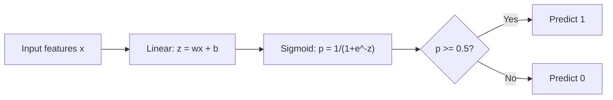
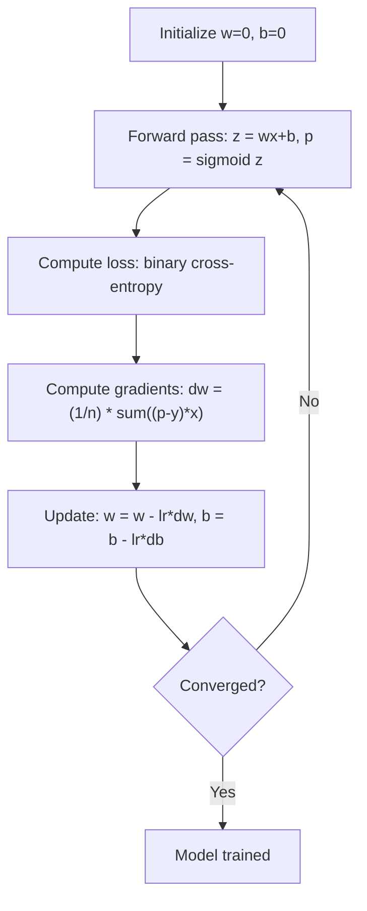

# Logistic Regression

> Logistic regression menekuk garis lurus menjadi kurva-S untuk menjawab pertanyaan ya-atau-tidak dengan probabilitas.

**Type:** Build
**Languages:** Python
**Prerequisites:** Phase 2 Lesson 1-2 (What Is ML, Linear Regression)
**Time:** ~90 minutes

## Tujuan Pembelajaran

- Implementasikan logistic regression dari nol menggunakan fungsi sigmoid dan binary cross-entropy loss
- Hitung dan interpretasikan precision, recall, F1 score, dan confusion matrix untuk klasifikasi biner
- Jelaskan mengapa MSE gagal untuk klasifikasi dan mengapa binary cross-entropy menghasilkan permukaan cost cekung
- Bangun model softmax regression untuk klasifikasi multi-kelas dan evaluasi tradeoff penyetelan threshold

## Masalahnya

Kamu ingin memprediksi apakah sebuah tumor ganas atau jinak diberikan ukurannya. Kamu mencoba linear regression. Ia mengeluarkan angka seperti 0,3 atau 1,7 atau -0,5. Apa arti angka-angka itu? Apakah 1,7 berarti "sangat ganas"? Apakah -0,5 berarti "sangat jinak"? Linear regression mengeluarkan angka tanpa batas. Klasifikasi butuh probabilitas yang dibatasi antara 0 dan 1, dan sebuah keputusan yang jelas: ya atau tidak.

Logistic regression memecahkan ini. Ia mengambil kombinasi linear yang sama (wx + b) dan mengoperkannya melalui fungsi sigmoid, yang memampatkan angka apa pun ke dalam rentang (0, 1). Outputnya adalah sebuah probabilitas. Kamu menetapkan sebuah threshold (biasanya 0,5) dan membuat keputusan.

Ini adalah salah satu algoritma yang paling luas dipakai dalam praktik. Meski namanya begitu, logistic regression adalah algoritma klasifikasi, bukan algoritma regression. Namanya berasal dari fungsi logistik (sigmoid) yang dipakainya.

## Konsepnya

### Mengapa Linear Regression Gagal untuk Klasifikasi

Bayangkan memprediksi lulus/gagal (1/0) berdasarkan jam belajar. Linear regression menyesuaikan sebuah garis melalui data:

```
hours:  1   2   3   4   5   6   7   8   9   10
actual: 0   0   0   0   1   1   1   1   1   1
```

Penyesuaian linear mungkin menghasilkan prediksi seperti -0,2 pada jam 1 dan 1,3 pada jam 10. Nilai-nilai ini bukan probabilitas. Ia turun di bawah 0 dan naik di atas 1. Lebih buruk lagi, satu outlier (seseorang yang belajar 50 jam) akan menarik seluruh garis, mengubah prediksi untuk semua orang.

Klasifikasi butuh fungsi yang:
- Mengeluarkan nilai antara 0 dan 1 (probabilitas)
- Menciptakan transisi tajam (sebuah decision boundary)
- Tidak terdistorsi oleh outlier yang jauh dari batas

### Fungsi Sigmoid

Fungsi sigmoid melakukan persis hal ini:

```
sigmoid(z) = 1 / (1 + e^(-z))
```

Sifat-sifatnya:
- Ketika z besar dan positif, sigmoid(z) mendekati 1
- Ketika z besar dan negatif, sigmoid(z) mendekati 0
- Ketika z = 0, sigmoid(z) = 0,5
- Outputnya selalu antara 0 dan 1
- Fungsinya halus dan dapat diturunkan di mana-mana

Turunannya punya bentuk yang nyaman: sigmoid'(z) = sigmoid(z) * (1 - sigmoid(z)). Ini membuat perhitungan gradient menjadi efisien.

### Logistic Regression = Model Linear + Sigmoid

Model menghitung z = wx + b (sama dengan linear regression), lalu menerapkan sigmoid:



Output p diinterpretasikan sebagai P(y=1 | x), probabilitas bahwa input termasuk kelas 1. Decision boundary berada di tempat wx + b = 0, yang membuat output sigmoid tepat 0,5.

### Binary Cross-Entropy Loss

Kamu tidak bisa memakai MSE untuk logistic regression. MSE dengan sigmoid menciptakan permukaan cost non-cekung dengan banyak local minimum. Sebagai gantinya, gunakan binary cross-entropy (log loss):

```
Loss = -(1/n) * sum(y * log(p) + (1-y) * log(1-p))
```

Mengapa ini bekerja:
- Ketika y=1 dan p mendekati 1: log(1) = 0, jadi loss mendekati 0 (benar, cost rendah)
- Ketika y=1 dan p mendekati 0: log(0) mendekati negatif tak hingga, jadi loss sangat besar (salah, cost tinggi)
- Ketika y=0 dan p mendekati 0: log(1) = 0, jadi loss mendekati 0 (benar, cost rendah)
- Ketika y=0 dan p mendekati 1: log(0) mendekati negatif tak hingga, jadi loss sangat besar (salah, cost tinggi)

Loss function ini bersifat cekung untuk logistic regression, menjamin adanya satu global minimum tunggal.

### Gradient Descent untuk Logistic Regression

Gradient untuk binary cross-entropy dengan sigmoid punya bentuk yang bersih:

```
dL/dw = (1/n) * sum((p - y) * x)
dL/db = (1/n) * sum(p - y)
```

Ini tampak identik dengan gradient linear regression. Perbedaannya adalah p = sigmoid(wx + b) alih-alih p = wx + b. Sigmoid memperkenalkan nonlinearity, tetapi aturan update gradient tetap sama.



### Decision Boundary

Untuk input 2D (dua fitur), decision boundary adalah garis tempat:

```
w1*x1 + w2*x2 + b = 0
```

Titik di satu sisi diklasifikasikan sebagai 1, titik di sisi lain sebagai 0. Logistic regression selalu menghasilkan decision boundary linear. Jika kamu butuh batas berkelok, kamu harus menambahkan fitur polinomial atau memakai model non-linear.

### Klasifikasi Multi-Kelas dengan Softmax

Logistic regression biner menangani dua kelas. Untuk k kelas, gunakan fungsi softmax:

```
softmax(z_i) = e^(z_i) / sum(e^(z_j) for all j)
```

Setiap kelas punya vektor weight-nya sendiri. Model menghitung skor z_i untuk setiap kelas, lalu softmax mengonversi skor menjadi probabilitas yang berjumlah 1. Kelas yang diprediksi adalah yang probabilitasnya tertinggi.

Loss function menjadi categorical cross-entropy:

```
Loss = -(1/n) * sum(sum(y_k * log(p_k)))
```

di mana y_k adalah 1 untuk kelas yang benar dan 0 untuk semua sisanya (one-hot encoding).

### Metrik Evaluasi

Akurasi saja tidak cukup. Untuk dataset dengan 95% negatif dan 5% positif, model yang selalu memprediksi negatif mendapat akurasi 95% tetapi tidak berguna.

**Confusion Matrix**:

| | Predicted Positive | Predicted Negative |
|---|---|---|
| Actually Positive | True Positive (TP) | False Negative (FN) |
| Actually Negative | False Positive (FP) | True Negative (TN) |

**Precision**: Dari semua prediksi positif, berapa yang benar-benar positif?
```
Precision = TP / (TP + FP)
```

**Recall** (Sensitivitas): Dari semua yang benar-benar positif, berapa yang kita tangkap?
```
Recall = TP / (TP + FN)
```

**F1 Score**: Rata-rata harmonik dari precision dan recall. Menyeimbangkan kedua metrik.
```
F1 = 2 * (Precision * Recall) / (Precision + Recall)
```

Kapan memprioritaskan:
- **Precision**: ketika false positives mahal (filter spam, kamu tidak ingin memblokir email yang sah)
- **Recall**: ketika false negatives mahal (skrining kanker, kamu tidak ingin melewatkan tumor)
- **F1**: ketika kamu butuh satu metrik yang seimbang

```figure
logistic-sigmoid
```

## Bangun Sendiri

### Langkah 1: Fungsi sigmoid dan pembangkitan data

```python
import random
import math

def sigmoid(z):
    z = max(-500, min(500, z))
    return 1.0 / (1.0 + math.exp(-z))


random.seed(42)
N = 200
X = []
y = []

for _ in range(N // 2):
    X.append([random.gauss(2, 1), random.gauss(2, 1)])
    y.append(0)

for _ in range(N // 2):
    X.append([random.gauss(5, 1), random.gauss(5, 1)])
    y.append(1)

combined = list(zip(X, y))
random.shuffle(combined)
X, y = zip(*combined)
X = list(X)
y = list(y)

print(f"Generated {N} samples (2 classes, 2 features)")
print(f"Class 0 center: (2, 2), Class 1 center: (5, 5)")
print(f"First 5 samples:")
for i in range(5):
    print(f"  Features: [{X[i][0]:.2f}, {X[i][1]:.2f}], Label: {y[i]}")
```

### Langkah 2: Logistic regression dari nol

```python
class LogisticRegression:
    def __init__(self, n_features, learning_rate=0.01):
        self.weights = [0.0] * n_features
        self.bias = 0.0
        self.lr = learning_rate
        self.loss_history = []

    def predict_proba(self, x):
        z = sum(w * xi for w, xi in zip(self.weights, x)) + self.bias
        return sigmoid(z)

    def predict(self, x, threshold=0.5):
        return 1 if self.predict_proba(x) >= threshold else 0

    def compute_loss(self, X, y):
        n = len(y)
        total = 0.0
        for i in range(n):
            p = self.predict_proba(X[i])
            p = max(1e-15, min(1 - 1e-15, p))
            total += y[i] * math.log(p) + (1 - y[i]) * math.log(1 - p)
        return -total / n

    def fit(self, X, y, epochs=1000, print_every=200):
        n = len(y)
        n_features = len(X[0])
        for epoch in range(epochs):
            dw = [0.0] * n_features
            db = 0.0
            for i in range(n):
                p = self.predict_proba(X[i])
                error = p - y[i]
                for j in range(n_features):
                    dw[j] += error * X[i][j]
                db += error
            for j in range(n_features):
                self.weights[j] -= self.lr * (dw[j] / n)
            self.bias -= self.lr * (db / n)
            loss = self.compute_loss(X, y)
            self.loss_history.append(loss)
            if epoch % print_every == 0:
                print(f"  Epoch {epoch:4d} | Loss: {loss:.4f} | w: [{self.weights[0]:.3f}, {self.weights[1]:.3f}] | b: {self.bias:.3f}")
        return self

    def accuracy(self, X, y):
        correct = sum(1 for i in range(len(y)) if self.predict(X[i]) == y[i])
        return correct / len(y)


split = int(0.8 * N)
X_train, X_test = X[:split], X[split:]
y_train, y_test = y[:split], y[split:]

print("\n=== Training Logistic Regression ===")
model = LogisticRegression(n_features=2, learning_rate=0.1)
model.fit(X_train, y_train, epochs=1000, print_every=200)

print(f"\nTrain accuracy: {model.accuracy(X_train, y_train):.4f}")
print(f"Test accuracy:  {model.accuracy(X_test, y_test):.4f}")
print(f"Weights: [{model.weights[0]:.4f}, {model.weights[1]:.4f}]")
print(f"Bias: {model.bias:.4f}")
```

### Langkah 3: Confusion matrix dan metrik dari nol

```python
class ClassificationMetrics:
    def __init__(self, y_true, y_pred):
        self.tp = sum(1 for t, p in zip(y_true, y_pred) if t == 1 and p == 1)
        self.tn = sum(1 for t, p in zip(y_true, y_pred) if t == 0 and p == 0)
        self.fp = sum(1 for t, p in zip(y_true, y_pred) if t == 0 and p == 1)
        self.fn = sum(1 for t, p in zip(y_true, y_pred) if t == 1 and p == 0)

    def accuracy(self):
        total = self.tp + self.tn + self.fp + self.fn
        return (self.tp + self.tn) / total if total > 0 else 0

    def precision(self):
        denom = self.tp + self.fp
        return self.tp / denom if denom > 0 else 0

    def recall(self):
        denom = self.tp + self.fn
        return self.tp / denom if denom > 0 else 0

    def f1(self):
        p = self.precision()
        r = self.recall()
        return 2 * p * r / (p + r) if (p + r) > 0 else 0

    def print_confusion_matrix(self):
        print(f"\n  Confusion Matrix:")
        print(f"                  Predicted")
        print(f"                  Pos   Neg")
        print(f"  Actual Pos     {self.tp:4d}  {self.fn:4d}")
        print(f"  Actual Neg     {self.fp:4d}  {self.tn:4d}")

    def print_report(self):
        self.print_confusion_matrix()
        print(f"\n  Accuracy:  {self.accuracy():.4f}")
        print(f"  Precision: {self.precision():.4f}")
        print(f"  Recall:    {self.recall():.4f}")
        print(f"  F1 Score:  {self.f1():.4f}")


y_pred_test = [model.predict(x) for x in X_test]
print("\n=== Classification Report (Test Set) ===")
metrics = ClassificationMetrics(y_test, y_pred_test)
metrics.print_report()
```

### Langkah 4: Analisis decision boundary

```python
print("\n=== Decision Boundary ===")
w1, w2 = model.weights
b = model.bias
print(f"Decision boundary: {w1:.4f}*x1 + {w2:.4f}*x2 + {b:.4f} = 0")
if abs(w2) > 1e-10:
    print(f"Solved for x2:     x2 = {-w1/w2:.4f}*x1 + {-b/w2:.4f}")

print("\nSample predictions near the boundary:")
test_points = [
    [3.0, 3.0],
    [3.5, 3.5],
    [4.0, 4.0],
    [2.5, 2.5],
    [5.0, 5.0],
]
for point in test_points:
    prob = model.predict_proba(point)
    pred = model.predict(point)
    print(f"  [{point[0]}, {point[1]}] -> prob={prob:.4f}, class={pred}")
```

### Langkah 5: Multi-kelas dengan softmax

```python
class SoftmaxRegression:
    def __init__(self, n_features, n_classes, learning_rate=0.01):
        self.n_features = n_features
        self.n_classes = n_classes
        self.lr = learning_rate
        self.weights = [[0.0] * n_features for _ in range(n_classes)]
        self.biases = [0.0] * n_classes

    def softmax(self, scores):
        max_score = max(scores)
        exp_scores = [math.exp(s - max_score) for s in scores]
        total = sum(exp_scores)
        return [e / total for e in exp_scores]

    def predict_proba(self, x):
        scores = [
            sum(self.weights[k][j] * x[j] for j in range(self.n_features)) + self.biases[k]
            for k in range(self.n_classes)
        ]
        return self.softmax(scores)

    def predict(self, x):
        probs = self.predict_proba(x)
        return probs.index(max(probs))

    def fit(self, X, y, epochs=1000, print_every=200):
        n = len(y)
        for epoch in range(epochs):
            grad_w = [[0.0] * self.n_features for _ in range(self.n_classes)]
            grad_b = [0.0] * self.n_classes
            total_loss = 0.0
            for i in range(n):
                probs = self.predict_proba(X[i])
                for k in range(self.n_classes):
                    target = 1.0 if y[i] == k else 0.0
                    error = probs[k] - target
                    for j in range(self.n_features):
                        grad_w[k][j] += error * X[i][j]
                    grad_b[k] += error
                true_prob = max(probs[y[i]], 1e-15)
                total_loss -= math.log(true_prob)
            for k in range(self.n_classes):
                for j in range(self.n_features):
                    self.weights[k][j] -= self.lr * (grad_w[k][j] / n)
                self.biases[k] -= self.lr * (grad_b[k] / n)
            if epoch % print_every == 0:
                print(f"  Epoch {epoch:4d} | Loss: {total_loss / n:.4f}")
        return self

    def accuracy(self, X, y):
        correct = sum(1 for i in range(len(y)) if self.predict(X[i]) == y[i])
        return correct / len(y)


random.seed(42)
X_3class = []
y_3class = []

centers = [(1, 1), (5, 1), (3, 5)]
for label, (cx, cy) in enumerate(centers):
    for _ in range(50):
        X_3class.append([random.gauss(cx, 0.8), random.gauss(cy, 0.8)])
        y_3class.append(label)

combined = list(zip(X_3class, y_3class))
random.shuffle(combined)
X_3class, y_3class = zip(*combined)
X_3class = list(X_3class)
y_3class = list(y_3class)

split_3 = int(0.8 * len(X_3class))
X_train_3 = X_3class[:split_3]
y_train_3 = y_3class[:split_3]
X_test_3 = X_3class[split_3:]
y_test_3 = y_3class[split_3:]

print("\n=== Multi-class Softmax Regression (3 classes) ===")
softmax_model = SoftmaxRegression(n_features=2, n_classes=3, learning_rate=0.1)
softmax_model.fit(X_train_3, y_train_3, epochs=1000, print_every=200)
print(f"\nTrain accuracy: {softmax_model.accuracy(X_train_3, y_train_3):.4f}")
print(f"Test accuracy:  {softmax_model.accuracy(X_test_3, y_test_3):.4f}")

print("\nSample predictions:")
for i in range(5):
    probs = softmax_model.predict_proba(X_test_3[i])
    pred = softmax_model.predict(X_test_3[i])
    print(f"  True: {y_test_3[i]}, Predicted: {pred}, Probs: [{', '.join(f'{p:.3f}' for p in probs)}]")
```

### Langkah 6: Penyetelan threshold

```python
print("\n=== Threshold Tuning ===")
print("Default threshold: 0.5. Adjusting the threshold trades precision for recall.\n")

thresholds = [0.3, 0.4, 0.5, 0.6, 0.7]
print(f"{'Threshold':>10} {'Accuracy':>10} {'Precision':>10} {'Recall':>10} {'F1':>10}")
print("-" * 52)

for t in thresholds:
    y_pred_t = [1 if model.predict_proba(x) >= t else 0 for x in X_test]
    m = ClassificationMetrics(y_test, y_pred_t)
    print(f"{t:>10.1f} {m.accuracy():>10.4f} {m.precision():>10.4f} {m.recall():>10.4f} {m.f1():>10.4f}")
```

## Gunakan

Sekarang hal yang sama dengan scikit-learn.

```python
from sklearn.linear_model import LogisticRegression as SklearnLR
from sklearn.metrics import accuracy_score, precision_score, recall_score, f1_score
from sklearn.metrics import confusion_matrix, classification_report
from sklearn.model_selection import train_test_split
from sklearn.preprocessing import StandardScaler
import numpy as np

np.random.seed(42)
X_0 = np.random.randn(100, 2) + [2, 2]
X_1 = np.random.randn(100, 2) + [5, 5]
X_sk = np.vstack([X_0, X_1])
y_sk = np.array([0] * 100 + [1] * 100)

X_tr, X_te, y_tr, y_te = train_test_split(X_sk, y_sk, test_size=0.2, random_state=42)

scaler = StandardScaler()
X_tr_sc = scaler.fit_transform(X_tr)
X_te_sc = scaler.transform(X_te)

lr = SklearnLR()
lr.fit(X_tr_sc, y_tr)
y_pred = lr.predict(X_te_sc)

print("=== Scikit-learn Logistic Regression ===")
print(f"Accuracy:  {accuracy_score(y_te, y_pred):.4f}")
print(f"Precision: {precision_score(y_te, y_pred):.4f}")
print(f"Recall:    {recall_score(y_te, y_pred):.4f}")
print(f"F1:        {f1_score(y_te, y_pred):.4f}")
print(f"\nConfusion Matrix:\n{confusion_matrix(y_te, y_pred)}")
print(f"\nClassification Report:\n{classification_report(y_te, y_pred)}")
```

Implementasi dari-nol-mu menghasilkan decision boundary dan metrik yang sama. Scikit-learn menambahkan opsi solver (liblinear, lbfgs, saga), regularization otomatis, strategi multi-kelas (one-vs-rest, multinomial), dan optimasi stabilitas numerik.

## Rilis

Pelajaran ini menghasilkan:
- `code/logistic_regression.py` - logistic regression dari nol dengan metrik

## Latihan

1. Hasilkan dataset yang TIDAK linearly separable (misalnya, dua lingkaran konsentris). Latih logistic regression dan amati kegagalannya. Lalu tambahkan fitur polinomial (x1^2, x2^2, x1*x2) dan latih ulang. Tunjukkan bahwa akurasinya membaik.
2. Implementasikan confusion matrix multi-kelas untuk model softmax 3-kelas. Hitung precision dan recall per kelas. Kelas mana yang paling sulit diklasifikasikan?
3. Bangun kurva ROC dari nol. Untuk 100 nilai threshold dari 0 hingga 1, hitung true positive rate dan false positive rate. Hitung AUC (area under the curve) menggunakan aturan trapesium.

## Istilah Kunci

| Term | What people say | What it actually means |
|------|----------------|----------------------|
| Logistic regression | "Regression for classification" | A linear model followed by a sigmoid function that outputs class probabilities |
| Sigmoid function | "The S-curve" | The function 1/(1+e^(-z)) that maps any real number to the range (0, 1) |
| Binary cross-entropy | "Log loss" | The loss function -[y*log(p) + (1-y)*log(1-p)] that penalizes confident wrong predictions severely |
| Decision boundary | "The dividing line" | The surface where the model's output probability equals 0.5, separating predicted classes |
| Softmax | "Multi-class sigmoid" | A function that converts a vector of scores into probabilities that sum to 1 |
| Precision | "How many selected are relevant" | TP / (TP + FP), the fraction of positive predictions that are actually positive |
| Recall | "How many relevant are selected" | TP / (TP + FN), the fraction of actual positives that the model correctly identifies |
| F1 score | "Balanced accuracy" | The harmonic mean of precision and recall: 2*P*R / (P+R) |
| Confusion matrix | "The error breakdown" | A table showing TP, TN, FP, FN counts for each class pair |
| Threshold | "The cutoff" | The probability value above which the model predicts class 1 (default 0.5, tunable) |
| One-hot encoding | "Binary columns for categories" | Representing class k as a vector of zeros with a 1 at position k |
| Categorical cross-entropy | "Multi-class log loss" | The extension of binary cross-entropy to k classes using one-hot encoded labels |
