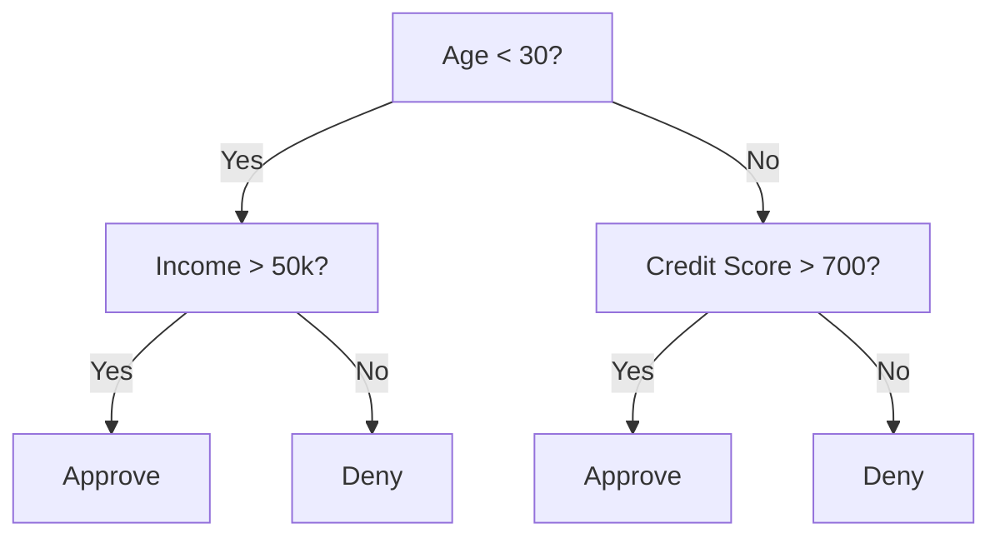
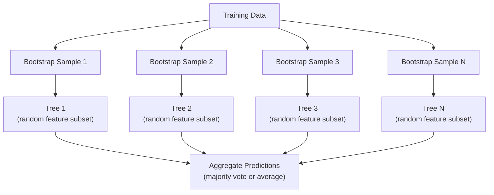

# Decision Tree dan Random Forest

> Decision tree hanyalah sebuah flowchart. Tetapi hutan dari pohon-pohon itu adalah salah satu alat terkuat di ML.

**Type:** Build
**Language:** Python
**Prerequisites:** Phase 1 (Lessons 09 Information Theory, 06 Probability)
**Time:** ~90 minutes

## Tujuan Pembelajaran

- Implementasikan perhitungan Gini impurity, entropy, dan information gain untuk menemukan split decision tree yang optimal
- Bangun klasifier decision tree dari nol dengan kontrol pre-pruning (kedalaman maksimum, sampel minimum)
- Konstruksikan random forest menggunakan bootstrap sampling dan randomisasi fitur, serta jelaskan mengapa ini mengurangi variance
- Bandingkan feature importance MDI dengan permutation importance dan identifikasi kapan MDI bias

## Masalahnya

Kamu punya data tabular. Baris adalah sampel, kolom adalah fitur, dan ada kolom target yang ingin kamu prediksi. Kamu bisa melemparkan neural network ke sana. Tetapi untuk data tabular, model berbasis pohon (decision tree, random forest, gradient boosted tree) secara konsisten mengalahkan deep learning. Kompetisi Kaggle pada data terstruktur didominasi oleh XGBoost dan LightGBM, bukan transformer.

Mengapa? Pohon menangani tipe fitur campuran (numerik dan kategorikal) tanpa preprocessing. Mereka menangani hubungan non-linear tanpa feature engineering. Mereka dapat diinterpretasi: kamu bisa melihat pohonnya dan melihat persis mengapa sebuah prediksi dibuat. Dan random forest, yang merata-ratakan banyak pohon, sangat tahan terhadap overfitting pada dataset berukuran sedang.

Pelajaran ini membangun decision tree dari nol menggunakan pembagian rekursif, lalu membangun random forest di atasnya. Kamu akan mengimplementasikan matematika di balik kriteria split (Gini impurity, entropy, information gain) dan memahami mengapa ensemble dari weak learner menjadi kuat.

## Konsepnya

### Apa yang dilakukan decision tree

Decision tree mempartisi ruang fitur menjadi wilayah persegi dengan mengajukan serangkaian pertanyaan ya/tidak.



Setiap node internal menguji sebuah fitur terhadap sebuah threshold. Setiap node daun membuat prediksi. Untuk mengklasifikasikan sebuah data poin baru, kamu mulai dari akar dan mengikuti cabang-cabangnya hingga mencapai daun.

Pohon dibangun dari atas ke bawah dengan memilih, di setiap node, fitur dan threshold yang terbaik memisahkan data. "Terbaik" didefinisikan oleh sebuah kriteria split.

### Kriteria split: mengukur impurity

Di setiap node, kita punya sekumpulan sampel. Kita ingin membaginya sehingga node anak yang dihasilkan se-"murni" mungkin, yang berarti setiap anak sebagian besar berisi satu kelas.

**Gini impurity** mengukur probabilitas bahwa sampel yang dipilih secara acak akan salah klasifikasi jika dilabeli menurut distribusi kelas di node tersebut.

```
Gini(S) = 1 - sum(p_k^2)

where p_k is the proportion of class k in set S.
```

Untuk node murni (semua satu kelas), Gini = 0. Untuk split biner dengan kelas 50/50, Gini = 0,5. Lebih rendah lebih baik.

```
Example: 6 cats, 4 dogs

Gini = 1 - (0.6^2 + 0.4^2) = 1 - (0.36 + 0.16) = 0.48
```

**Entropy** mengukur kandungan informasi (disorder) dalam sebuah node. Dibahas di Phase 1 Lesson 09.

```
Entropy(S) = -sum(p_k * log2(p_k))
```

Untuk node murni, entropy = 0. Untuk split biner 50/50, entropy = 1,0. Lebih rendah lebih baik.

```
Example: 6 cats, 4 dogs

Entropy = -(0.6 * log2(0.6) + 0.4 * log2(0.4))
        = -(0.6 * -0.737 + 0.4 * -1.322)
        = 0.442 + 0.529
        = 0.971 bits
```

**Information gain** adalah berkurangnya impurity (entropy atau Gini) setelah sebuah split.

```
IG(S, feature, threshold) = Impurity(S) - weighted_avg(Impurity(S_left), Impurity(S_right))

where the weights are the proportions of samples in each child.
```

Algoritma serakah di setiap node: coba setiap fitur dan setiap threshold yang mungkin. Pilih pasangan (fitur, threshold) yang memaksimalkan information gain.

### Bagaimana pembagian bekerja

Untuk dataset dengan n fitur dan m sampel di node saat ini:

1. Untuk setiap fitur j (j = 1 hingga n):
   - Urutkan sampel berdasarkan fitur j
   - Coba setiap titik tengah antara nilai-nilai berbeda yang berurutan sebagai threshold
   - Hitung information gain untuk setiap threshold
2. Pilih fitur dan threshold dengan information gain tertinggi
3. Bagi data menjadi kiri (fitur <= threshold) dan kanan (fitur > threshold)
4. Rekursif pada setiap anak

Pendekatan serakah ini tidak menjamin pohon yang optimal secara global. Menemukan pohon optimal bersifat NP-hard. Tetapi pembagian serakah bekerja baik dalam praktik.

### Kondisi berhenti

Tanpa kondisi berhenti, pohon tumbuh hingga setiap daun murni (satu sampel per daun). Ini menghafal data training dengan sempurna dan menggeneralisasi dengan sangat buruk.

**Pre-pruning** menghentikan pohon sebelum tumbuh sepenuhnya:
- Kedalaman maksimum: berhenti membagi ketika pohon mencapai kedalaman tertentu
- Sampel minimum per daun: berhenti jika sebuah node punya lebih sedikit dari k sampel
- Information gain minimum: berhenti jika split terbaik meningkatkan impurity kurang dari sebuah threshold
- Node daun maksimum: batasi jumlah total daun

**Post-pruning** menumbuhkan pohon penuh, lalu memangkasnya kembali:
- Cost-complexity pruning (dipakai scikit-learn): menambahkan penalti sebanding dengan jumlah daun. Tingkatkan penalti untuk mendapatkan pohon yang lebih kecil
- Reduced error pruning: hapus sebuah subtree jika error validation tidak meningkat

Pre-pruning lebih sederhana dan lebih cepat. Post-pruning sering menghasilkan pohon yang lebih baik karena tidak menghentikan split yang mungkin bisa menghasilkan split bermanfaat lebih lanjut secara prematur.

### Decision tree untuk regression

Untuk regression, prediksi daun adalah mean dari nilai target di daun tersebut. Kriteria split-nya juga berubah:

**Variance reduction** menggantikan information gain:

```
VR(S, feature, threshold) = Var(S) - weighted_avg(Var(S_left), Var(S_right))
```

Pilih split yang mengurangi variance paling banyak. Pohon mempartisi ruang input menjadi wilayah-wilayah, dan memprediksi sebuah konstanta (mean-nya) di setiap wilayah.

### Random forest: kekuatan ensemble

Satu decision tree punya variance tinggi. Perubahan kecil dalam data dapat menghasilkan pohon yang sangat berbeda. Random forest memperbaiki ini dengan merata-ratakan banyak pohon.



Dua sumber randomness membuat pohon-pohon menjadi beragam:

**Bagging (bootstrap aggregating):** Setiap pohon dilatih pada sebuah bootstrap sample, sampel acak dengan pengambilan ulang dari data training. Sekitar 63% sampel asli muncul di setiap bootstrap (sisanya adalah sampel out-of-bag yang bisa dipakai untuk validasi).

**Randomisasi fitur:** Di setiap split, hanya subset acak fitur yang dipertimbangkan. Untuk klasifikasi, defaultnya adalah sqrt(n_fitur). Untuk regression, n_fitur/3. Ini mencegah semua pohon membagi pada fitur dominan yang sama.

Wawasan kunci: merata-ratakan banyak pohon yang terdekorrelasi mengurangi variance tanpa menambah bias. Setiap pohon individual mungkin biasa saja. Ensemble-nya kuat.

### Feature importance

Random forest secara alami menyediakan skor feature importance. Metode paling umum:

**Mean Decrease in Impurity (MDI):** Untuk setiap fitur, jumlahkan total pengurangan impurity di seluruh pohon dan semua node tempat fitur itu digunakan. Fitur yang menghasilkan pengurangan impurity lebih besar pada split awal lebih penting.

```
importance(feature_j) = sum over all nodes where feature_j is used:
    (n_samples_at_node / n_total_samples) * impurity_decrease
```

Ini cepat (dihitung selama training) tetapi bias terhadap fitur ber-kardinalitas tinggi dan fitur dengan banyak titik split yang mungkin.

**Permutation importance** adalah alternatifnya: acak-kan nilai sebuah fitur dan ukur seberapa besar akurasi model turun. Lebih andal tetapi lebih lambat.

### Kapan pohon mengalahkan neural network

Pohon dan hutan mendominasi neural network pada data tabular. Beberapa alasannya:

| Factor | Trees | Neural networks |
|--------|-------|----------------|
| Mixed types (numeric + categorical) | Native support | Need encoding |
| Small datasets (< 10k rows) | Work well | Overfit |
| Feature interactions | Found by splitting | Need architecture design |
| Interpretability | Full transparency | Black box |
| Training time | Minutes | Hours |
| Hyperparameter sensitivity | Low | High |

Neural network menang ketika datanya punya struktur spasial atau sekuensial (gambar, teks, audio). Untuk tabel fitur datar, pohon adalah pilihannya.

```figure
decision-tree-depth
```

## Bangun Sendiri

### Langkah 1: Gini impurity dan entropy

Bangun kedua kriteria split dari nol dan verifikasi bahwa keduanya sepakat split mana yang baik.

```python
import math

def gini_impurity(labels):
    n = len(labels)
    if n == 0:
        return 0.0
    counts = {}
    for label in labels:
        counts[label] = counts.get(label, 0) + 1
    return 1.0 - sum((c / n) ** 2 for c in counts.values())

def entropy(labels):
    n = len(labels)
    if n == 0:
        return 0.0
    counts = {}
    for label in labels:
        counts[label] = counts.get(label, 0) + 1
    return -sum(
        (c / n) * math.log2(c / n) for c in counts.values() if c > 0
    )
```

### Langkah 2: Temukan split terbaik

Coba setiap fitur dan setiap threshold. Kembalikan yang information gain-nya tertinggi.

```python
def information_gain(parent_labels, left_labels, right_labels, criterion="gini"):
    measure = gini_impurity if criterion == "gini" else entropy
    n = len(parent_labels)
    n_left = len(left_labels)
    n_right = len(right_labels)
    if n_left == 0 or n_right == 0:
        return 0.0
    parent_impurity = measure(parent_labels)
    child_impurity = (
        (n_left / n) * measure(left_labels) +
        (n_right / n) * measure(right_labels)
    )
    return parent_impurity - child_impurity
```

### Langkah 3: Bangun kelas DecisionTree

Pembagian rekursif, prediksi, dan pelacakan feature importance. `_build` adalah jantung pohonnya: ia berhenti ketika sebuah node murni atau mencapai batas pre-pruning, selain itu ia mengambil split terbaik dan merekursif ke kedua anak.

```python
import random

class DecisionTree:
    def __init__(self, max_depth=None, min_samples_split=2,
                 min_samples_leaf=1, criterion="gini",
                 max_features=None):
        self.max_depth = max_depth
        self.min_samples_split = min_samples_split
        self.min_samples_leaf = min_samples_leaf
        self.criterion = criterion
        self.max_features = max_features
        self.tree = None
        self.feature_importances_ = None

    def fit(self, X, y):
        self.n_features = len(X[0])
        self.feature_importances_ = [0.0] * self.n_features
        self.n_samples = len(X)
        self.tree = self._build(X, y, depth=0)
        total = sum(self.feature_importances_)
        if total > 0:
            self.feature_importances_ = [
                fi / total for fi in self.feature_importances_
            ]

    def predict(self, X):
        return [self._predict_one(x, self.tree) for x in X]

    def _build(self, X, y, depth):
        if len(set(y)) == 1:
            return {"leaf": True, "value": y[0]}

        if self.max_depth is not None and depth >= self.max_depth:
            return self._make_leaf(y)

        if len(y) < self.min_samples_split:
            return self._make_leaf(y)

        best_feature, best_threshold, best_gain = self._best_split(X, y)

        if best_feature is None or best_gain <= 0:
            return self._make_leaf(y)

        left_X, left_y, right_X, right_y = self._split_data(
            X, y, best_feature, best_threshold
        )

        if len(left_y) < self.min_samples_leaf or len(right_y) < self.min_samples_leaf:
            return self._make_leaf(y)

        weight = len(y) / self.n_samples
        self.feature_importances_[best_feature] += weight * best_gain

        return {
            "leaf": False,
            "feature": best_feature,
            "threshold": best_threshold,
            "left": self._build(left_X, left_y, depth + 1),
            "right": self._build(right_X, right_y, depth + 1),
        }

    def _make_leaf(self, y):
        counts = {}
        for label in y:
            counts[label] = counts.get(label, 0) + 1
        return {"leaf": True, "value": max(counts, key=counts.get)}

    def _best_split(self, X, y):
        best_feature = None
        best_threshold = None
        best_gain = -1.0

        if self.max_features == "sqrt":
            k = max(1, int(math.sqrt(self.n_features)))
            feature_indices = random.sample(range(self.n_features), k)
        elif isinstance(self.max_features, int):
            if self.max_features < 1:
                raise ValueError("max_features must be at least 1 when given as an integer")
            k = min(self.max_features, self.n_features)
            feature_indices = random.sample(range(self.n_features), k)
        else:
            feature_indices = list(range(self.n_features))

        for feature_idx in feature_indices:
            values = sorted(set(X[i][feature_idx] for i in range(len(X))))
            if len(values) <= 1:
                continue

            for i in range(len(values) - 1):
                threshold = (values[i] + values[i + 1]) / 2.0
                left_y = [y[j] for j in range(len(X)) if X[j][feature_idx] <= threshold]
                right_y = [y[j] for j in range(len(X)) if X[j][feature_idx] > threshold]

                if len(left_y) < self.min_samples_leaf or len(right_y) < self.min_samples_leaf:
                    continue

                gain = information_gain(y, left_y, right_y, self.criterion)
                if gain > best_gain:
                    best_gain = gain
                    best_feature = feature_idx
                    best_threshold = threshold

        return best_feature, best_threshold, best_gain

    def _split_data(self, X, y, feature, threshold):
        left_X, left_y, right_X, right_y = [], [], [], []
        for i in range(len(X)):
            if X[i][feature] <= threshold:
                left_X.append(X[i])
                left_y.append(y[i])
            else:
                right_X.append(X[i])
                right_y.append(y[i])
        return left_X, left_y, right_X, right_y

    def _predict_one(self, x, node):
        if node["leaf"]:
            return node["value"]
        if x[node["feature"]] <= node["threshold"]:
            return self._predict_one(x, node["left"])
        return self._predict_one(x, node["right"])
```

### Langkah 4: Bangun kelas RandomForest

Bootstrap sampling, randomisasi fitur, dan voting mayoritas.

```python
class RandomForest:
    def __init__(self, n_trees=100, max_depth=None,
                 min_samples_split=2, max_features="sqrt",
                 criterion="gini"):
        self.n_trees = n_trees
        self.max_depth = max_depth
        self.min_samples_split = min_samples_split
        self.max_features = max_features
        self.criterion = criterion
        self.trees = []

    def fit(self, X, y):
        n = len(X)
        for _ in range(self.n_trees):
            indices = [random.randint(0, n - 1) for _ in range(n)]
            X_boot = [X[i] for i in indices]
            y_boot = [y[i] for i in indices]
            tree = DecisionTree(
                max_depth=self.max_depth,
                min_samples_split=self.min_samples_split,
                max_features=self.max_features,
                criterion=self.criterion,
            )
            tree.fit(X_boot, y_boot)
            self.trees.append(tree)

    def predict(self, X):
        all_preds = [tree.predict(X) for tree in self.trees]
        predictions = []
        for i in range(len(X)):
            votes = {}
            for preds in all_preds:
                v = preds[i]
                votes[v] = votes.get(v, 0) + 1
            predictions.append(max(votes, key=votes.get))
        return predictions
```

Lihat `code/trees.py` untuk implementasi lengkap dengan semua metode pembantu.

## Gunakan

Dengan scikit-learn, melatih random forest hanya tiga baris:

```python
from sklearn.ensemble import RandomForestClassifier
from sklearn.datasets import load_iris
from sklearn.model_selection import train_test_split

X, y = load_iris(return_X_y=True)
X_train, X_test, y_train, y_test = train_test_split(X, y, random_state=42)

rf = RandomForestClassifier(n_estimators=100, random_state=42)
rf.fit(X_train, y_train)
print(f"Accuracy: {rf.score(X_test, y_test):.4f}")
print(f"Feature importances: {rf.feature_importances_}")
```

Dalam praktiknya, gradient boosted tree (XGBoost, LightGBM, CatBoost) sering lebih kuat daripada random forest karena mereka membangun pohon secara sekuensial, dengan setiap pohon memperbaiki error pohon sebelumnya. Tetapi random forest lebih sulit salah konfigurasi dan hampir tidak butuh penyetelan hyperparameter.

## Rilis

Pelajaran ini menghasilkan `outputs/prompt-tree-interpreter.md` -- sebuah prompt yang menginterpretasi split decision tree untuk pemangku kepentingan bisnis. Berikan struktur pohon yang sudah dilatih (kedalaman, fitur, threshold split, akurasi) dan prompt itu menerjemahkan model menjadi aturan bahasa sederhana, memeringkat feature importance, menandai overfitting atau leakage, dan merekomendasikan langkah berikutnya. Gunakan setiap kali kamu perlu menjelaskan model berbasis pohon kepada seseorang yang tidak membaca kode.

## Latihan

1. Latih satu decision tree pada dataset 2D dengan 3 kelas. Telusuri split-splitnya secara manual dan gambar batas keputusan persegi-nya. Bandingkan batas pada max_depth=2 vs max_depth=10.
2. Implementasikan pembagian variance reduction untuk pohon regression. Hasilkan y = sin(x) + noise untuk 200 titik dan sesuaikan pohon regression-mu. Plot prediksi piecewise-constant pohon terhadap kurva sebenarnya.
3. Bangun random forest dengan 1, 5, 10, 50, dan 200 pohon. Plot akurasi training dan akurasi test terhadap jumlah pohon. Amati bahwa akurasi test mendatar tetapi tidak menurun (hutan menahan overfitting).
4. Bandingkan Gini impurity vs entropy sebagai kriteria split pada 5 dataset berbeda. Ukur akurasi dan kedalaman pohon. Dalam kebanyakan kasus, keduanya menghasilkan hasil yang hampir identik. Jelaskan mengapa.
5. Implementasikan permutation importance. Bandingkan dengan importance MDI pada dataset di mana satu fitur adalah noise acak tetapi ber-kardinalitas tinggi. MDI akan memeringkat fitur noise tersebut tinggi. Permutation importance tidak akan.

## Istilah Kunci

| Term | What people say | What it actually means |
|------|----------------|----------------------|
| Decision tree | "A flowchart for predictions" | A model that partitions feature space into rectangular regions by learning a sequence of if/else splits |
| Gini impurity | "How mixed the node is" | Probability of misclassifying a random sample at a node. 0 = pure, 0.5 = maximum impurity for binary |
| Entropy | "The disorder in a node" | Information content at a node. 0 = pure, 1.0 = maximum uncertainty for binary. From information theory |
| Information gain | "How good a split is" | Reduction in impurity after a split. The greedy criterion for choosing splits |
| Pre-pruning | "Stop the tree early" | Stopping tree growth early by setting max depth, min samples, or min gain thresholds |
| Post-pruning | "Trim the tree after" | Growing the full tree, then removing subtrees that do not improve validation performance |
| Bagging | "Train on random subsets" | Bootstrap aggregating. Train each model on a different random sample with replacement |
| Random forest | "A bunch of trees" | Ensemble of decision trees, each trained on a bootstrap sample with random feature subsets at each split |
| Feature importance (MDI) | "Which features matter" | Total impurity decrease contributed by each feature, summed across all trees and nodes |
| Permutation importance | "Shuffle and check" | Accuracy drop when a feature's values are randomly shuffled. More reliable than MDI for noisy features |
| Variance reduction | "The regression version of info gain" | The regression tree analogue of information gain. Picks the split that reduces target variance the most |
| Bootstrap sample | "Random sample with repeats" | A random sample drawn with replacement from the original dataset. Same size, but with duplicates |

## Bacaan Lanjutan

- [Breiman: Random Forests (2001)](https://link.springer.com/article/10.1023/A:1010933404324) - the original random forest paper
- [Grinsztajn et al.: Why do tree-based models still outperform deep learning on tabular data? (2022)](https://arxiv.org/abs/2207.08815) - rigorous comparison of trees vs neural networks on tabular tasks
- [scikit-learn Decision Trees documentation](https://scikit-learn.org/stable/modules/tree.html) - practical guide with visualization tools
- [XGBoost: A Scalable Tree Boosting System (Chen & Guestrin, 2016)](https://arxiv.org/abs/1603.02754) - the gradient boosting paper that dominates Kaggle
