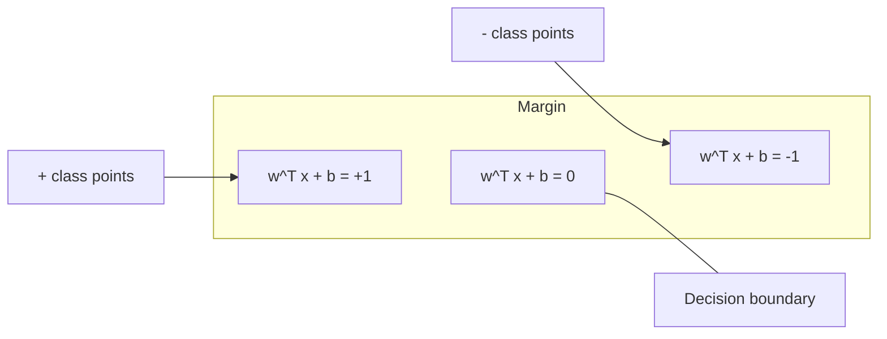
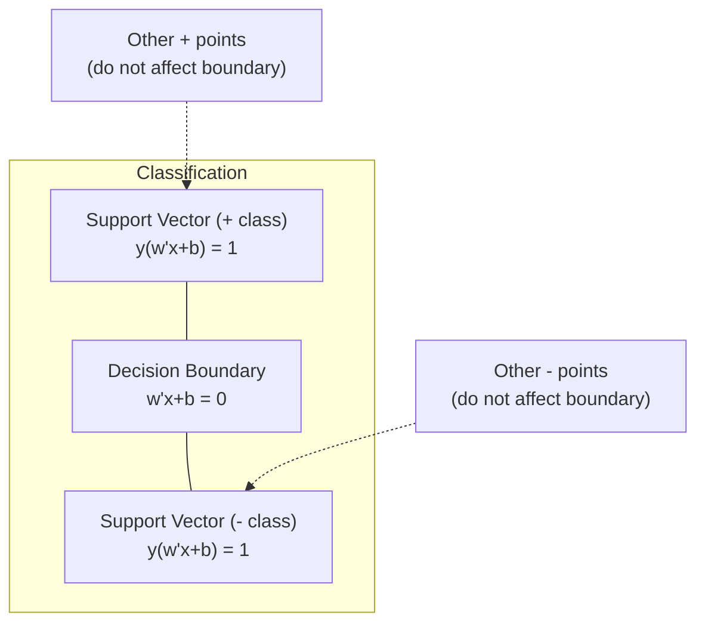
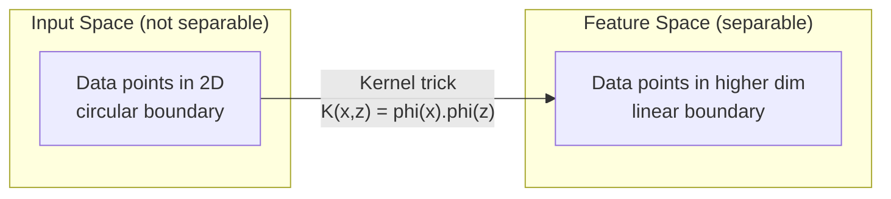

# Support Vector Machines

> Temukan jalan terlebar antara dua kelas. Itulah seluruh idenya.

**Type:** Build
**Language:** Python
**Prerequisites:** Phase 1 (Lessons 08 Optimization, 14 Norms and Distances, 18 Convex Optimization)
**Time:** ~90 minutes

## Tujuan Pembelajaran

- Implementasikan linear SVM dari nol menggunakan hinge loss dan gradient descent pada formulasi primal
- Jelaskan prinsip maximum margin dan identifikasi support vector dari model yang sudah dilatih
- Bandingkan kernel linear, polinomial, dan RBF serta jelaskan bagaimana kernel trick menghindari pemetaan dimensi-tinggi eksplisit
- Evaluasi tradeoff yang dikontrol oleh parameter C antara lebar margin dan error klasifikasi

## Masalahnya

Kamu punya dua kelas data poin dan perlu menggambar sebuah garis (atau hyperplane) yang memisahkan mereka. Ada garis yang tak terhingga yang bisa bekerja. Mana yang harus kamu pilih?

Yang margin-nya paling besar. Margin adalah jarak antara decision boundary dan data poin terdekat di setiap sisi. Margin lebih lebar berarti klasifier lebih percaya diri dan menggeneralisasi lebih baik ke data yang belum terlihat.

Intuisi ini mengarah ke Support Vector Machines, salah satu algoritma yang paling elegan secara matematis di ML. SVM adalah metode klasifikasi yang dominan sebelum deep learning dan tetap menjadi pilihan terbaik untuk dataset kecil, data berdimensi tinggi, dan masalah di mana kamu butuh model yang berprinsip, dipahami baik, dengan jaminan teoretis.

SVM terhubung langsung ke Phase 1: optimasinya bersifat cekung (Lesson 18), margin-nya diukur dengan norm (Lesson 14), dan kernel trick memanfaatkan dot product untuk menangani batas non-linear tanpa pernah menghitung di ruang dimensi-tinggi.

## Konsepnya

### Klasifier maximum margin

Diberikan data yang linearly separable dengan label y_i di {-1, +1} dan vektor fitur x_i, kita menginginkan hyperplane w^T x + b = 0 yang memisahkan kelas-kelas.

Jarak dari sebuah titik x_i ke hyperplane adalah:

```
distance = |w^T x_i + b| / ||w||
```

Untuk titik yang diklasifikasikan dengan benar: y_i * (w^T x_i + b) > 0. Margin adalah dua kali jarak dari hyperplane ke titik terdekat di sisi mana pun.



Masalah optimasinya:

```
maximize    2 / ||w||     (the margin width)
subject to  y_i * (w^T x_i + b) >= 1  for all i
```

Setara dengannya (meminimalkan ||w||^2 lebih mudah dioptimasi):

```
minimize    (1/2) ||w||^2
subject to  y_i * (w^T x_i + b) >= 1  for all i
```

Ini adalah program kuadratik cekung. Ia punya solusi global tunggal. Data poin yang tepat berada di batas-batas margin (tempat y_i * (w^T x_i + b) = 1) adalah support vector. Mereka adalah satu-satunya titik yang menentukan decision boundary. Pindahkan atau hapus titik mana pun yang bukan support vector, dan batasnya tidak berubah.

### Support vector: sekumpulan kecil yang krusial



Sebagian besar titik training tidak relevan. Hanya support vector yang penting. Inilah mengapa SVM hemat memori saat waktu prediksi: kamu hanya perlu menyimpan support vector-nya, bukan seluruh set training.

Jumlah support vector juga memberikan batas atas generalization error. Support vector lebih sedikit relatif terhadap ukuran dataset berarti generalisasi lebih baik.

### Soft margin: menangani noise dengan parameter C

Data nyata jarang sepenuhnya terpisahkan. Beberapa titik mungkin berada di sisi yang salah dari batas, atau di dalam margin. Formulasi soft margin mengizinkan pelanggaran dengan memperkenalkan slack variable.

```
minimize    (1/2) ||w||^2 + C * sum(xi_i)
subject to  y_i * (w^T x_i + b) >= 1 - xi_i
            xi_i >= 0  for all i
```

Slack variable xi_i mengukur seberapa banyak titik i melanggar margin. C mengontrol trade-off-nya:

| C value | Behavior |
|---------|----------|
| Large C | Penalizes violations heavily. Narrow margin, fewer misclassifications. Overfits |
| Small C | Allows more violations. Wide margin, more misclassifications. Underfits |

C adalah kekuatan regularization, dalam kebalikannya. C besar = regularization lebih lemah. C kecil = regularization lebih kuat.

### Hinge loss: loss function SVM

SVM soft margin bisa ditulis ulang sebagai optimasi tanpa batasan:

```
minimize    (1/2) ||w||^2 + C * sum(max(0, 1 - y_i * (w^T x_i + b)))
```

Istilah max(0, 1 - y_i * f(x_i)) adalah hinge loss. Ia bernilai nol ketika titik diklasifikasikan dengan benar dan berada di luar margin. Ia bersifat linear ketika titik berada di dalam margin atau salah klasifikasi.

```
Hinge loss for a single point:

loss
  |
  | \
  |  \
  |   \
  |    \
  |     \_______________
  |
  +-----|-----|-------->  y * f(x)
       0     1

Zero loss when y*f(x) >= 1 (correctly classified, outside margin).
Linear penalty when y*f(x) < 1.
```

Bandingkan dengan logistic loss (logistic regression):

```
Hinge:     max(0, 1 - y*f(x))          Hard cutoff at margin
Logistic:  log(1 + exp(-y*f(x)))        Smooth, never exactly zero
```

Hinge loss menghasilkan solusi sedang (hanya support vector yang punya kontribusi non-nol). Logistic loss memakai semua titik data. Ini membuat SVM lebih hemat memori saat waktu prediksi.

### Melatih linear SVM dengan gradient descent

Kamu bisa melatih linear SVM menggunakan gradient descent pada hinge loss plus L2 regularization, tanpa menyelesaikan QP terkendali:

```
L(w, b) = (lambda/2) * ||w||^2 + (1/n) * sum(max(0, 1 - y_i * (w^T x_i + b)))

Gradient with respect to w:
  If y_i * (w^T x_i + b) >= 1:  dL/dw = lambda * w
  If y_i * (w^T x_i + b) < 1:   dL/dw = lambda * w - y_i * x_i

Gradient with respect to b:
  If y_i * (w^T x_i + b) >= 1:  dL/db = 0
  If y_i * (w^T x_i + b) < 1:   dL/db = -y_i
```

Ini disebut formulasi primal. Ia berjalan dalam O(n * d) per epoch, di mana n adalah jumlah sampel dan d adalah jumlah fitur. Untuk data besar, jarang, berdimensi tinggi (klasifikasi teks), ini cepat.

### Formulasi dual dan kernel trick

Dual Lagrangian dari masalah SVM (dari Phase 1 Lesson 18, kondisi KKT) adalah:

```
maximize    sum(alpha_i) - (1/2) * sum_ij(alpha_i * alpha_j * y_i * y_j * (x_i . x_j))
subject to  0 <= alpha_i <= C
            sum(alpha_i * y_i) = 0
```

Dual hanya melibatkan dot product x_i . x_j antar titik data. Inilah wawasan kuncinya. Ganti setiap dot product dengan sebuah fungsi kernel K(x_i, x_j) dan SVM bisa mempelajari batas non-linear tanpa pernah menghitung transformasinya secara eksplisit.

```
Linear kernel:      K(x, z) = x . z
Polynomial kernel:  K(x, z) = (x . z + c)^d
RBF (Gaussian):     K(x, z) = exp(-gamma * ||x - z||^2)
```

Kernel RBF memetakan data ke ruang dimensi-tak-hingga. Titik yang berdekatan di ruang input punya nilai kernel mendekati 1. Titik yang jauh punya nilai kernel mendekati 0. Ia bisa mempelajari decision boundary mulus apa pun.



Menghitung matriks kernel menghitung dot product di ruang dimensi-tinggi tanpa pernah pergi ke sana. Untuk kernel polinomial derajat d dalam D dimensi, ruang fitur eksplisit punya O(D^d) dimensi. Tetapi K(x, z) dihitung dalam waktu O(D).

### SVM untuk regression (SVR)

Support Vector Regression menyesuaikan sebuah tabung berlebar epsilon di sekeliling data. Titik di dalam tabung punya loss nol. Titik di luar tabung ditonjol secara linear.

```
minimize    (1/2) ||w||^2 + C * sum(xi_i + xi_i*)
subject to  y_i - (w^T x_i + b) <= epsilon + xi_i
            (w^T x_i + b) - y_i <= epsilon + xi_i*
            xi_i, xi_i* >= 0
```

Parameter epsilon mengontrol lebar tabung. Tabung lebih lebar = support vector lebih sedikit = penyesuaian lebih halus. Tabung lebih sempit = support vector lebih banyak = penyesuaian lebih ketat.

### Mengapa SVM kalah dari deep learning (dan kapan mereka tetap menang)

SVM mendominasi ML dari akhir 1990-an hingga awal 2010-an. Deep learning melampaui mereka karena beberapa alasan:

| Factor | SVMs | Deep learning |
|--------|------|---------------|
| Feature engineering | Requires it | Learns features |
| Scalability | O(n^2) to O(n^3) for kernel | O(n) per epoch with SGD |
| Image/text/audio | Needs handcrafted features | Learns from raw data |
| Large datasets (>100k) | Slow | Scales well |
| GPU acceleration | Limited benefit | Massive speedup |

SVM masih menang dalam situasi-situasi ini:
- Dataset kecil (ratusan hingga ribuan sampel)
- Data jarang berdimensi tinggi (teks dengan fitur TF-IDF)
- Ketika kamu butuh jaminan matematis (batas margin)
- Ketika waktu training harus minimal (linear SVM sangat cepat)
- Klasifikasi biner dengan struktur margin yang jelas
- Anomaly detection (one-class SVM)

```figure
svm-margin
```

## Bangun Sendiri

### Langkah 1: Hinge loss dan gradient

Fondasinya. Hitung hinge loss untuk sebuah batch dan gradient-nya.

```python
def hinge_loss(X, y, w, b):
    n = len(X)
    total_loss = 0.0
    for i in range(n):
        margin = y[i] * (dot(w, X[i]) + b)
        total_loss += max(0.0, 1.0 - margin)
    return total_loss / n
```

### Langkah 2: Linear SVM via gradient descent

Latih dengan meminimalkan hinge loss yang terregularisasi. Tidak butuh solver QP.

```python
class LinearSVM:
    def __init__(self, lr=0.001, lambda_param=0.01, n_epochs=1000):
        self.lr = lr
        self.lambda_param = lambda_param
        self.n_epochs = n_epochs
        self.w = None
        self.b = 0.0

    def fit(self, X, y):
        n_features = len(X[0])
        self.w = [0.0] * n_features
        self.b = 0.0

        for epoch in range(self.n_epochs):
            for i in range(len(X)):
                margin = y[i] * (dot(self.w, X[i]) + self.b)
                if margin >= 1:
                    self.w = [wj - self.lr * self.lambda_param * wj
                              for wj in self.w]
                else:
                    self.w = [wj - self.lr * (self.lambda_param * wj - y[i] * X[i][j])
                              for j, wj in enumerate(self.w)]
                    self.b -= self.lr * (-y[i])

    def predict(self, X):
        return [1 if dot(self.w, x) + self.b >= 0 else -1 for x in X]
```

### Langkah 3: Fungsi kernel

Implementasikan kernel linear, polinomial, dan RBF.

```python
def linear_kernel(x, z):
    return dot(x, z)

def polynomial_kernel(x, z, degree=3, c=1.0):
    return (dot(x, z) + c) ** degree

def rbf_kernel(x, z, gamma=0.5):
    diff = [xi - zi for xi, zi in zip(x, z)]
    return math.exp(-gamma * dot(diff, diff))
```

### Langkah 4: Identifikasi margin dan support vector

Setelah training, identifikasi titik mana yang merupakan support vector dan hitung lebar margin-nya.

```python
def find_support_vectors(X, y, w, b, tol=1e-3):
    support_vectors = []
    for i in range(len(X)):
        margin = y[i] * (dot(w, X[i]) + b)
        if abs(margin - 1.0) < tol:
            support_vectors.append(i)
    return support_vectors
```

Lihat `code/svm.py` untuk implementasi lengkap dengan semua demo.

## Gunakan

Dengan scikit-learn:

```python
from sklearn.svm import SVC, LinearSVC, SVR
from sklearn.preprocessing import StandardScaler
from sklearn.pipeline import Pipeline

clf = Pipeline([
    ("scaler", StandardScaler()),
    ("svm", SVC(kernel="rbf", C=1.0, gamma="scale")),
])
clf.fit(X_train, y_train)
print(f"Accuracy: {clf.score(X_test, y_test):.4f}")
print(f"Support vectors: {clf['svm'].n_support_}")
```

Penting: selalu skalakan fitur-mu sebelum melatih SVM. SVM sensitif terhadap magnitudo fitur karena margin bergantung pada ||w||, dan fitur yang tidak diskalakan mendistorsi geometrinya.

Untuk dataset besar, gunakan `LinearSVC` (formulasi primal, O(n) per epoch) alih-alih `SVC` (formulasi dual, O(n^2) hingga O(n^3)):

```python
from sklearn.svm import LinearSVC

clf = Pipeline([
    ("scaler", StandardScaler()),
    ("svm", LinearSVC(C=1.0, max_iter=10000)),
])
```

## Latihan

1. Hasilkan dataset 2D yang linearly separable. Latih LinearSVM-mu dan identifikasi support vector-nya. Verifikasi bahwa support vector adalah titik-titik yang paling dekat dengan decision boundary.

2. Ubah C dari 0,001 hingga 1000 pada dataset berisi noise. Plot decision boundary untuk setiap nilai C. Amati transisi dari margin lebar (underfitting) ke margin sempit (overfitting).

3. Buat sebuah dataset di mana batas kelas bersifat melingkar (bukan linear). Tunjukkan bahwa linear SVM gagal. Hitung matriks kernel RBF dan tunjukkan bahwa kelas-kelas menjadi terpisahkan di ruang fitur yang ditimbulkan kernel.

4. Bandingkan hinge loss vs logistic loss pada dataset yang sama. Latih sebuah linear SVM dan logistic regression. Hitung berapa banyak titik training yang berkontribusi pada decision boundary masing-masing model (support vector vs semua titik).

5. Implementasikan SVR (epsilon-insensitive loss). Sesuaikan dengan y = sin(x) + noise. Plot tabung epsilon di sekeliling prediksi dan sorot support vector-nya (titik di luar tabung).

## Istilah Kunci

| Term | What it actually means |
|------|----------------------|
| Support vectors | The training points closest to the decision boundary. The only points that determine the hyperplane |
| Margin | The distance between the decision boundary and the nearest support vectors. SVMs maximize this |
| Hinge loss | max(0, 1 - y*f(x)). Zero when correctly classified and outside the margin. Linear penalty otherwise |
| C parameter | Trade-off between margin width and classification errors. Large C = narrow margin, small C = wide margin |
| Soft margin | SVM formulation that allows margin violations via slack variables. Handles non-separable data |
| Kernel trick | Computing dot products in a high-dimensional feature space without explicitly mapping to that space |
| Linear kernel | K(x, z) = x . z. Equivalent to standard dot product. For linearly separable data |
| RBF kernel | K(x, z) = exp(-gamma * \|\|x-z\|\|^2). Maps to infinite dimensions. Learns any smooth boundary |
| Polynomial kernel | K(x, z) = (x . z + c)^d. Maps to a feature space of polynomial combinations |
| Dual formulation | Reformulation of the SVM problem that depends only on dot products between data points. Enables kernels |
| SVR | Support Vector Regression. Fits an epsilon-tube around the data. Points inside the tube have zero loss |
| Slack variables | xi_i: measures how much a point violates the margin. Zero for correctly classified points outside margin |
| Maximum margin | The principle of choosing the hyperplane that maximizes the distance to the nearest points of each class |

## Bacaan Lanjutan

- [Vapnik: The Nature of Statistical Learning Theory (1995)](https://link.springer.com/book/10.1007/978-1-4757-3264-1) - the foundational text on SVMs and statistical learning
- [Cortes & Vapnik: Support-vector networks (1995)](https://link.springer.com/article/10.1007/BF00994018) - the original SVM paper
- [Platt: Sequential Minimal Optimization (1998)](https://www.microsoft.com/en-us/research/publication/sequential-minimal-optimization-a-fast-algorithm-for-training-support-vector-machines/) - the SMO algorithm that made SVM training practical
- [scikit-learn SVM documentation](https://scikit-learn.org/stable/modules/svm.html) - practical guide with implementation details
- [LIBSVM: A Library for Support Vector Machines](https://www.csie.ntu.edu.tw/~cjlin/libsvm/) - the C++ library behind most SVM implementations
