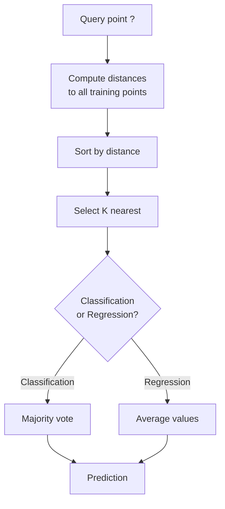
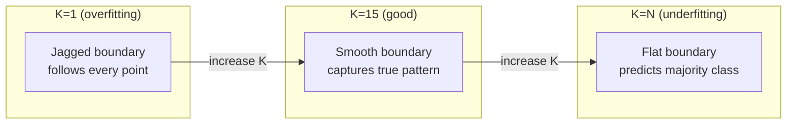
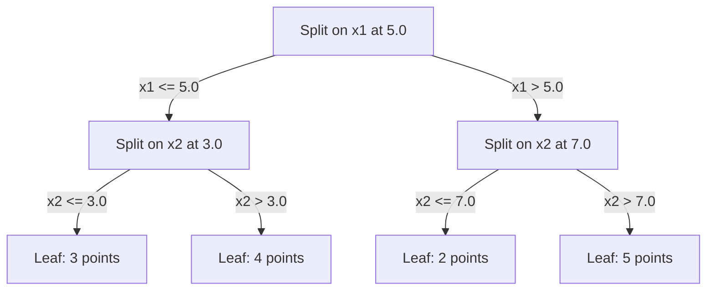

# K-Nearest Neighbors dan Jarak

> Simpan semuanya. Prediksi dengan melihat tetanggamu. Algoritma paling sederhana yang benar-benar bekerja.

**Type:** Build
**Language:** Python
**Prerequisites:** Phase 1 (Lesson 14 Norms and Distances)
**Time:** ~90 minutes

## Tujuan Pembelajaran

- Implementasikan KNN classification dan regression dari nol dengan K yang dapat dikonfigurasi dan voting berbobot jarak
- Bandingkan metrik jarak L1, L2, cosine, dan Minkowski serta pilih yang tepat untuk tipe data tertentu
- Jelaskan curse of dimensionality dan demonstrasikan mengapa KNN menurun di ruang dimensi-tinggi
- Bangun KD-tree untuk pencarian nearest neighbor yang efisien dan analisis kapan ia mengalahkan brute-force

## Masalahnya

Kamu punya sebuah dataset. Sebuah data poin baru tiba. Kamu perlu mengklasifikasikannya atau memprediksi nilainya. Alih-alih mempelajari parameter dari data (seperti linear regression atau SVM), kamu hanya menemukan K titik training terdekat ke titik baru itu dan membiarkan mereka memberikan suara.

Ini adalah K-nearest neighbors. Tidak ada fase training. Tidak ada parameter untuk dipelajari. Tidak ada loss function untuk diminimalkan. Kamu menyimpan seluruh set training dan menghitung jarak saat waktu prediksi.

Kedengarannya terlalu sederhana untuk bekerja. Tetapi KNN ternyata cukup kompetitif untuk banyak masalah, terutama dengan dataset kecil hingga sedang, dan memahaminya secara mendalam mengungkap konsep-konsep mendasar: pilihan metrik jarak (terhubung ke Phase 1 Lesson 14), curse of dimensionality, dan perbedaan antara lazy dan eager learning.

KNN juga muncul di mana-mana dalam AI modern, hanya dengan nama berbeda. Vector database melakukan pencarian KNN atas embedding. Retrieval-augmented generation (RAG) menemukan K chunk dokumen terdekat. Sistem rekomendasi menemukan pengguna atau item yang mirip. Algoritmanya sama. Skalanya dan struktur data yang berbeda.

## Konsepnya

### Bagaimana KNN bekerja

Diberikan dataset titik berlabel dan sebuah titik query baru:

1. Hitung jarak dari query ke setiap titik dalam dataset
2. Urutkan berdasarkan jarak
3. Ambil K titik terdekat
4. Untuk klasifikasi: voting mayoritas di antara K tetangga
5. Untuk regression: rata-rata (atau rata-rata berbobot) dari nilai K tetangga



Itulah seluruh algoritmanya. Tanpa fitting. Tanpa gradient descent. Tanpa epoch.

### Memilih K

K adalah satu-satunya hyperparameter. Ia mengontrol tradeoff bias-variance:

| K | Behavior |
|---|----------|
| K = 1 | Decision boundary follows every point. Zero training error. High variance. Overfits |
| Small K (3-5) | Sensitive to local structure. Can capture complex boundaries |
| Large K | Smoother boundaries. More robust to noise. May underfit |
| K = N | Predicts the majority class for every point. Maximum bias |

Titik awal yang umum adalah K = sqrt(N) untuk dataset berisi N titik. Gunakan K ganjil untuk klasifikasi biner untuk menghindari seri.



### Metrik jarak

Fungsi jarak mendefinisikan apa arti "dekat". Metrik yang berbeda menghasilkan tetangga yang berbeda, prediksi yang berbeda.

**L2 (Euclidean)** adalah default. Jarak garis lurus.

```
d(a, b) = sqrt(sum((a_i - b_i)^2))
```

Sensitif terhadap skala fitur. Selalu standardisasi fitur sebelum memakai L2 dengan KNN.

**L1 (Manhattan)** menjumlahkan selisih absolut. Lebih tahan terhadap outlier daripada L2 karena tidak menkuadratkan selisihnya.

```
d(a, b) = sum(|a_i - b_i|)
```

**Cosine distance** mengukur sudut antara vektor, mengabaikan magnitudo. Penting untuk data teks dan embedding.

```
d(a, b) = 1 - (a . b) / (||a|| * ||b||)
```

**Minkowski** menggeneralisasi L1 dan L2 dengan parameter p.

```
d(a, b) = (sum(|a_i - b_i|^p))^(1/p)

p=1: Manhattan
p=2: Euclidean
p->inf: Chebyshev (max absolute difference)
```

Metrik mana yang dipakai bergantung pada data:

| Data type | Best metric | Why |
|-----------|------------|-----|
| Numeric features, similar scale | L2 (Euclidean) | Default, works for spatial data |
| Numeric features, outliers | L1 (Manhattan) | Robust, does not amplify large differences |
| Text embeddings | Cosine | Magnitude is noise, direction is meaning |
| High-dimensional sparse | Cosine or L1 | L2 suffers from curse of dimensionality |
| Mixed types | Custom distance | Combine metrics per feature type |

### Weighted KNN

KNN standar memberikan bobot yang sama pada semua K tetangga. Tetapi tetangga pada jarak 0,1 seharusnya lebih penting daripada yang pada jarak 5,0.

**Distance-weighted KNN** memberi bobot setiap tetangga secara invers terhadap jarak:

```
weight_i = 1 / (distance_i + epsilon)

For classification: weighted vote
For regression:     weighted average = sum(w_i * y_i) / sum(w_i)
```

Epsilon mencegah pembagian dengan nol ketika titik query persis cocok dengan titik training.

Weighted KNN kurang sensitif terhadap pilihan K karena tetangga yang jauh berkontribusi sangat sedikit apa pun.

### Curse of dimensionality

Performa KNN menurun di dimensi tinggi. Ini bukan kekhawatiran yang samar. Ini adalah fakta matematika.

**Masalah 1: jarak konvergen.** Ketika dimensi bertambah, rasio jarak maksimum terhadap jarak minimum mendekati 1. Semua titik menjadi sama-sama "jauh" dari query.

```
In d dimensions, for random uniform points:

d=2:    max_dist / min_dist = varies widely
d=100:  max_dist / min_dist ~ 1.01
d=1000: max_dist / min_dist ~ 1.001

When all distances are nearly equal, "nearest" is meaningless.
```

**Masalah 2: volume meledak.** Untuk menangkap K tetangga dalam pecahan tetap dari data, kamu perlu memperluas radius pencarianmu untuk menutupi pecahan ruang fitur yang jauh lebih besar. "Lingkungan tetangga" di dimensi tinggi mencakup sebagian besar ruang.

**Masalah 3: sudut mendominasi.** Dalam hypercube satuan berdimensi d, sebagian besar volume terkonsentrasi di dekat sudut-sudut, bukan pusatnya. Sebuah bola yang ditulis di dalam kubus berisi pecahan volume yang menyusut seiring d bertambah.

Konsekuensi praktis: KNN bekerja baik hingga sekitar 20-50 fitur. Di luar itu, kamu butuh reduksi dimensi (PCA, UMAP, t-SNE) sebelum menerapkan KNN, atau kamu perlu memakai struktur pencarian berbasis pohon yang memanfaatkan dimensi bawaan data yang lebih rendah.

### KD-tree: pencarian nearest neighbor yang cepat

Brute-force KNN menghitung jarak dari query ke setiap titik training. Itu O(n * d) per query. Untuk dataset besar, ini terlalu lambat.

KD-tree mempartisi ruang secara rekursif di sepanjang sumbu fitur. Di setiap level, ia membagi di sepanjang satu dimensi pada nilai median.



Untuk menemukan nearest neighbor, telusuri pohon hingga daun yang berisi query, lalu backtracking dan periksa partisi tetangga hanya jika mereka bisa berisi titik yang lebih dekat.

Waktu query rata-rata: O(log n) untuk dimensi rendah. Tetapi KD-tree menurun ke O(n) di dimensi tinggi (d > 20) karena backtracking mengeliminasi cabang yang makin sedikit.

### Ball tree: lebih baik untuk dimensi sedang

Ball tree mempartisi data menjadi hipersfer bersarang alih-alih kotak yang sejajar sumbu. Setiap node mendefinisikan sebuah bola (pusat + jari-jari) yang berisi semua titik di subtree tersebut.

Keunggulan dibanding KD-tree:
- Lebih baik bekerja di dimensi sedang (hingga ~50)
- Menangani struktur yang tidak sejajar sumbu
- Volume pengikat yang lebih ketat berarti lebih banyak cabang yang dipangkas selama pencarian

Baik KD-tree maupun ball tree adalah algoritma eksak. Untuk pencarian berskala benar-benar besar (jutaan titik, ratusan dimensi), metode approximate nearest neighbor (HNSW, IVF, product quantization) dipakai sebagai gantinya. Ini dibahas di Phase 1 Lesson 14.

### Lazy learning vs eager learning

KNN adalah lazy learner: ia tidak mengerjakan apa pun saat training dan mengerjakan semuanya saat prediksi. Sebagian besar algoritma lain (linear regression, SVM, neural network) adalah eager learner: mereka menghitung berat saat training untuk membangun model ringkas, lalu prediksinya cepat.

| Aspect | Lazy (KNN) | Eager (SVM, neural net) |
|--------|------------|------------------------|
| Training time | O(1) just store data | O(n * epochs) |
| Prediction time | O(n * d) per query | O(d) or O(parameters) |
| Memory at prediction | Store entire training set | Store model parameters only |
| Adapts to new data | Add points instantly | Retrain the model |
| Decision boundary | Implicit, computed on the fly | Explicit, fixed after training |

Lazy learning ideal ketika:
- Dataset sering berubah (menambah/menghapus titik tanpa training ulang)
- Kamu butuh prediksi untuk sangat sedikit query
- Kamu menginginkan waktu training nol
- Dataset cukup kecil sehingga pencarian brute-force cepat

### KNN untuk regression

Alih-alih voting mayoritas, KNN untuk regression merata-ratakan nilai target dari K tetangga.

```
prediction = (1/K) * sum(y_i for i in K nearest neighbors)

Or with distance weighting:
prediction = sum(w_i * y_i) / sum(w_i)
where w_i = 1 / distance_i
```

KNN regression menghasilkan prediksi piecewise-constant (atau piecewise-halus dengan pembobotan). Ia tidak bisa mengekstrapolasi di luar rentang data training. Jika target training semuanya antara 0 dan 100, KNN tidak akan pernah memprediksi 200.

```figure
knn-smoothness
```

## Bangun Sendiri

### Langkah 1: Fungsi jarak

Implementasikan jarak L1, L2, cosine, dan Minkowski. Ini terhubung langsung ke Phase 1 Lesson 14.

```python
import math

def l2_distance(a, b):
    return math.sqrt(sum((ai - bi) ** 2 for ai, bi in zip(a, b)))

def l1_distance(a, b):
    return sum(abs(ai - bi) for ai, bi in zip(a, b))

def cosine_distance(a, b):
    dot_val = sum(ai * bi for ai, bi in zip(a, b))
    norm_a = math.sqrt(sum(ai ** 2 for ai in a))
    norm_b = math.sqrt(sum(bi ** 2 for bi in b))
    if norm_a == 0 or norm_b == 0:
        return 1.0
    return 1.0 - dot_val / (norm_a * norm_b)

def minkowski_distance(a, b, p=2):
    if p == float('inf'):
        return max(abs(ai - bi) for ai, bi in zip(a, b))
    return sum(abs(ai - bi) ** p for ai, bi in zip(a, b)) ** (1 / p)
```

### Langkah 2: Klasifier dan regresor KNN

Bangun KNN lengkap dengan K yang dapat dikonfigurasi, metrik jarak, dan pembobotan jarak opsional.

```python
class KNN:
    def __init__(self, k=5, distance_fn=l2_distance, weighted=False,
                 task="classification"):
        self.k = k
        self.distance_fn = distance_fn
        self.weighted = weighted
        self.task = task
        self.X_train = None
        self.y_train = None

    def fit(self, X, y):
        self.X_train = X
        self.y_train = y

    def predict(self, X):
        return [self._predict_one(x) for x in X]
```

### Langkah 3: KD-tree untuk pencarian efisien

Bangun KD-tree dari nol yang membagi secara rekursif pada median setiap dimensi.

```python
class KDTree:
    def __init__(self, X, indices=None, depth=0):
        # Recursively partition the data
        self.axis = depth % len(X[0])
        # Split on median of the current axis
        ...

    def query(self, point, k=1):
        # Traverse to leaf, then backtrack
        ...
```

Lihat `code/knn.py` untuk implementasi lengkap dengan semua metode pembantu dan demo.

### Langkah 4: Feature scaling

KNN membutuhkan feature scaling karena jarak sensitif terhadap magnitudo fitur. Fitur yang ber rentang 0 hingga 1000 akan mendominasi fitur yang ber rentang 0 hingga 1.

```python
def standardize(X):
    n = len(X)
    d = len(X[0])
    means = [sum(X[i][j] for i in range(n)) / n for j in range(d)]
    stds = [
        max(1e-10, (sum((X[i][j] - means[j]) ** 2 for i in range(n)) / n) ** 0.5)
        for j in range(d)
    ]
    return [[((X[i][j] - means[j]) / stds[j]) for j in range(d)] for i in range(n)], means, stds
```

## Gunakan

Dengan scikit-learn:

```python
from sklearn.neighbors import KNeighborsClassifier
from sklearn.preprocessing import StandardScaler
from sklearn.pipeline import Pipeline

clf = Pipeline([
    ("scaler", StandardScaler()),
    ("knn", KNeighborsClassifier(n_neighbors=5, metric="euclidean")),
])
clf.fit(X_train, y_train)
print(f"Accuracy: {clf.score(X_test, y_test):.4f}")
```

Scikit-learn secara otomatis memakai KD-tree atau ball tree ketika dataset cukup besar dan dimensinya cukup rendah. Untuk data berdimensi tinggi, ia kembali ke brute force. Kamu bisa mengontrol ini dengan parameter `algorithm`.

Untuk pencarian nearest neighbor berskala besar (jutaan vektor), gunakan FAISS, Annoy, atau sebuah vector database:

```python
import faiss

index = faiss.IndexFlatL2(dimension)
index.add(embeddings)
distances, indices = index.search(query_vectors, k=5)
```

## Latihan

1. Implementasikan KNN classification pada dataset 2D dengan 3 kelas. Plot decision boundary untuk K=1, K=5, K=15, dan K=N. Amati transisi dari overfitting ke underfitting.
2. Hasilkan 1000 titik acak dalam 2, 5, 10, 50, 100, dan 500 dimensi. Untuk setiap dimensi, hitung rasio jarak pairwise maksimum terhadap jarak pairwise minimum. Plot rasio terhadap dimensi untuk memvisualisasikan curse of dimensionality.
3. Bandingkan jarak L1, L2, dan cosine untuk KNN pada masalah klasifikasi teks (pakai vektor TF-IDF). Metrik mana yang memberikan akurasi terbaik? Mengapa cosine cenderung menang untuk teks?
4. Implementasikan KD-tree dan ukur waktu query vs brute force untuk dataset berisi 1k, 10k, dan 100k titik dalam 2D, 10D, dan 50D. Pada dimensi berapa KD-tree berhenti lebih cepat dari brute force?
5. Bangun regresor weighted KNN untuk y = sin(x) + noise. Bandingkan dengan KNN tanpa bobot untuk K=3, 10, 30. Tunjukkan bahwa pembobotan menghasilkan prediksi lebih halus, terutama untuk K besar.

## Istilah Kunci

| Term | What it actually means |
|------|----------------------|
| K-nearest neighbors | Non-parametric algorithm that predicts by finding the K closest training points to a query |
| Lazy learning | No computation at training time. All work happens at prediction time. KNN is the canonical example |
| Eager learning | Heavy computation at training time to build a compact model. Most ML algorithms are eager |
| Curse of dimensionality | In high dimensions, distances converge and neighborhoods expand to cover most of the space, making KNN ineffective |
| KD-tree | Binary tree that recursively partitions space along feature axes. O(log n) queries in low dimensions |
| Ball tree | Tree of nested hyperspheres. Works better than KD-trees in moderate dimensions (up to ~50) |
| Weighted KNN | Neighbors weighted inversely by distance. Closer neighbors have more influence on the prediction |
| Feature scaling | Normalizing features to comparable ranges. Required for distance-based methods like KNN |
| Majority vote | Classification by counting which class is most common among K neighbors |
| Brute force search | Computing distance to every training point. O(n*d) per query. Exact but slow for large n |
| Approximate nearest neighbor | Algorithms (HNSW, LSH, IVF) that find approximately nearest points much faster than exact search |
| Voronoi diagram | The partition of space where each region contains all points closer to one training point than any other. K=1 KNN produces Voronoi boundaries |

## Bacaan Lanjutan

- [Cover & Hart: Nearest Neighbor Pattern Classification (1967)](https://ieeexplore.ieee.org/document/1053964) - the foundational KNN paper proving it has error rate at most twice the Bayes optimal
- [Friedman, Bentley, Finkel: An Algorithm for Finding Best Matches in Logarithmic Expected Time (1977)](https://dl.acm.org/doi/10.1145/355744.355745) - the original KD-tree paper
- [Beyer et al.: When Is "Nearest Neighbor" Meaningful? (1999)](https://link.springer.com/chapter/10.1007/3-540-49257-7_15) - formal analysis of the curse of dimensionality for nearest neighbor
- [scikit-learn Nearest Neighbors documentation](https://scikit-learn.org/stable/modules/neighbors.html) - practical guide with algorithm selection
- [FAISS: A Library for Efficient Similarity Search](https://github.com/facebookresearch/faiss) - Meta's library for billion-scale approximate nearest neighbor search
