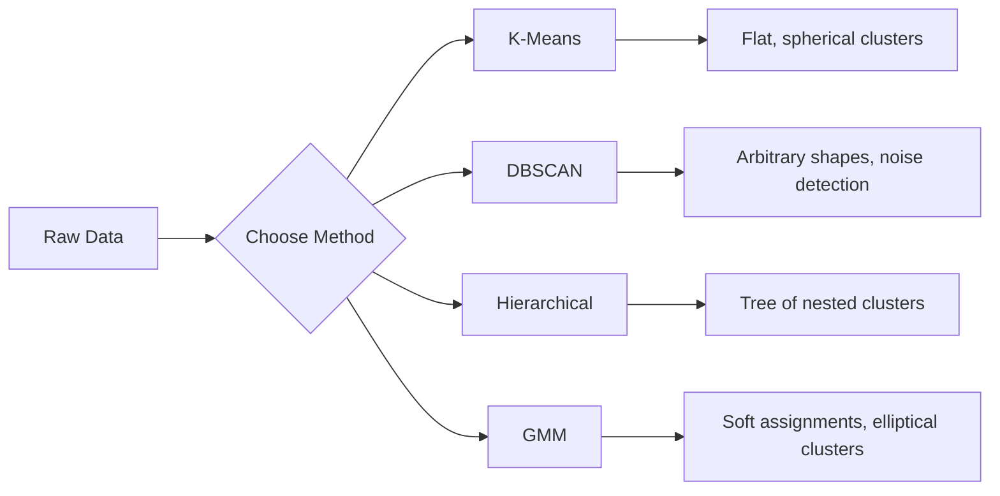

# Unsupervised Learning

> Tanpa label, tanpa guru. Algoritmanya menemukan strukturnya sendiri.

**Type:** Build
**Languages:** Python
**Prerequisites:** Phase 1 (Norms & Distances, Probability & Distributions), Phase 2 Lessons 1-6
**Time:** ~90 minutes

## Tujuan Pembelajaran

- Implementasikan K-Means, DBSCAN, dan Gaussian Mixture Models dari nol dan bandingkan perilaku clustering mereka
- Evaluasi kualitas cluster menggunakan silhouette score dan elbow method untuk memilih K yang optimal
- Jelaskan kapan DBSCAN mengalahkan K-Means dan identifikasi algoritma mana yang menangani cluster non-sferis dan outlier
- Bangun pipeline anomaly detection menggunakan metode clustering untuk menandai poin yang menyimpang dari pola normal

## Masalahnya

Semua pelajaran ML sejauh ini mengasumsikan data berlabel: "ini inputnya, ini output yang benar." Di dunia nyata, label itu mahal. Sebuah rumah sakit punya jutaan rekaman pasien tetapi tidak ada yang secara manual menandai setiap rekaman dengan kategori penyakit. Situs e-commerce punya jutaan sesi pengguna tetapi tidak ada yang melabeli segmen pelanggan secara manual. Tim keamanan punya log jaringan tetapi tidak ada yang menandai setiap anomali.

Unsupervised learning menemukan pola tanpa diberi tahu apa yang harus dicari. Ia mengelompokkan data poin yang mirip, menemukan struktur tersembunyi, dan menampilkan anomali. Jika supervised learning adalah belajar dari buku teks dengan kunci jawaban, unsupervised learning adalah menatap data mentah hingga pola-pola itu menampakkan diri.

Masalahnya: tanpa label, kamu tidak bisa langsung mengukur "benar" atau "salah." Kamu butuh alat berbeda untuk mengevaluasi apakah struktur yang ditemukan algoritmamu bermakna.

## Konsepnya

### Clustering: Mengelompokkan Hal yang Mirip

Clustering menugaskan setiap data poin ke sebuah kelompok (cluster) sehingga titik dalam kelompok yang sama lebih mirip satu sama lain daripada dengan titik di kelompok lain. Pertanyaannya selalu: apa arti "mirip"?



### K-Means: Andalannya

K-Means mempartisi data menjadi tepat K cluster. Setiap cluster punya sebuah centroid (pusat massanya), dan setiap titik termasuk ke centroid terdekat.

Algoritma Lloyd:

1. Pilih K titik acak sebagai centroid awal
2. Tugaskan setiap data poin ke centroid terdekat
3. Hitung ulang setiap centroid sebagai mean dari titik-titik yang ditugaskan padanya
4. Ulangi langkah 2-3 hingga penugasan berhenti berubah

Fungsi objektif (inertia) mengukur total jarak kuadrat dari setiap titik ke centroid yang ditugaskan padanya. K-Means meminimalkan ini, tetapi hanya menemukan local minimum. Inisialisasi yang berbeda bisa memberikan hasil yang berbeda.

### Memilih K

Dua metode standar:

**Elbow method:** Jalankan K-Means untuk K = 1, 2, 3, ..., n. Plot inertia vs K. Cari "siku" tempat menambahkan cluster lebih banyak berhenti mengurangi inertia secara signifikan.

**Silhouette score:** Untuk setiap titik, ukur seberapa mirip ia dengan cluster-nya sendiri (a) dibanding cluster lain terdekat (b). Koefisien siluet adalah (b - a) / max(a, b), ber rentang dari -1 (cluster yang salah) hingga +1 (terkelompok dengan baik). Rata-ratakan di seluruh titik untuk skor global.

### DBSCAN: Clustering Berbasis Density

K-Means mengasumsikan cluster bersifat sferis dan mengharuskan kamu memilih K di awal. DBSCAN tidak membuat asumsi apa pun. Ia menemukan cluster sebagai wilayah padat yang dipisahkan oleh wilayah jarang.

Dua parameter:
- **eps**: radius sebuah neighborhood
- **min_samples**: jumlah minimum titik yang dibutuhkan untuk membentuk wilayah padat

Tiga tipe titik:
- **Core point**: punya setidaknya min_samples titik dalam jarak eps
- **Border point**: dalam jarak eps dari sebuah core point tetapi bukan core point sendiri
- **Noise point**: bukan core maupun border. Ini adalah outlier.

DBSCAN menghubungkan core point yang berada dalam jarak eps satu sama lain ke cluster yang sama. Border point bergabung ke cluster core point terdekat. Noise point tidak termasuk cluster mana pun.

Kekuatan: menemukan cluster berbentuk apa pun, secara otomatis menentukan jumlah cluster, mengidentifikasi outlier. Kelemahan: kesulitan dengan cluster berdensity bervariasi.

### Hierarchical Clustering

Membangun sebuah pohon (dendrogram) dari cluster-cluster bersarang.

Agglomerative (bottom-up):
1. Mulai dengan setiap titik sebagai cluster-nya sendiri
2. Gabungkan dua cluster terdekat
3. Ulangi hingga hanya tersisa satu cluster
4. Potong dendrogram pada level yang diinginkan untuk mendapatkan K cluster

"Kedekatan" antar cluster bisa diukur sebagai:
- **Single linkage**: jarak minimum antara dua titik mana pun di kedua cluster
- **Complete linkage**: jarak maksimum antara dua titik mana pun
- **Average linkage**: jarak rata-rata di semua pasangan
- **Ward's method**: penggabungan yang menyebabkan peningkatan terkecil pada total variance dalam cluster

### Gaussian Mixture Models (GMM)

K-Means memberikan penugasan keras: setiap titik termasuk ke tepat satu cluster. GMM memberikan penugasan lembut: setiap titik punya probabilitas untuk termasuk ke setiap cluster.

Mengasumsikan data dihasilkan dari campuran K distribusi Gaussian, masing-masing dengan mean dan covariance-nya sendiri. Algoritma Expectation-Maximization (EM) berselang-seling antara:

- **E-step**: hitung probabilitas bahwa setiap titik termasuk ke setiap Gaussian
- **M-step**: perbarui mean, covariance, dan mixing weight dari setiap Gaussian untuk memaksimalkan likelihood data

GMM bisa memodelkan cluster elips (tidak hanya sferis seperti K-Means) dan secara alami menangani cluster yang tumpang tindih.

### Kapan Memakai Yang Mana

| Method | Best for | Avoid when |
|--------|----------|------------|
| K-Means | Large datasets, spherical clusters, known K | Irregular shapes, outliers present |
| DBSCAN | Unknown K, arbitrary shapes, outlier detection | Varying densities, very high dimensions |
| Hierarchical | Small datasets, need dendrogram, unknown K | Large datasets (O(n^2) memory) |
| GMM | Overlapping clusters, soft assignments needed | Very large datasets, too many dimensions |

### Anomaly Detection dengan Clustering

Clustering secara alami mendukung anomaly detection:
- **K-Means**: titik yang jauh dari centroid mana pun adalah anomali
- **DBSCAN**: noise point adalah anomali secara definisi
- **GMM**: titik dengan probabilitas rendah di bawah semua Gaussian adalah anomali

```figure
kmeans-step
```

## Bangun Sendiri

### Langkah 1: K-Means dari nol

```python
import math
import random


def euclidean_distance(a, b):
    return math.sqrt(sum((ai - bi) ** 2 for ai, bi in zip(a, b)))


def kmeans(data, k, max_iterations=100, seed=42):
    random.seed(seed)
    n_features = len(data[0])

    centroids = random.sample(data, k)

    for iteration in range(max_iterations):
        clusters = [[] for _ in range(k)]
        assignments = []

        for point in data:
            distances = [euclidean_distance(point, c) for c in centroids]
            nearest = distances.index(min(distances))
            clusters[nearest].append(point)
            assignments.append(nearest)

        new_centroids = []
        for cluster in clusters:
            if len(cluster) == 0:
                new_centroids.append(random.choice(data))
                continue
            centroid = [
                sum(point[j] for point in cluster) / len(cluster)
                for j in range(n_features)
            ]
            new_centroids.append(centroid)

        if all(
            euclidean_distance(old, new) < 1e-6
            for old, new in zip(centroids, new_centroids)
        ):
            print(f"  Converged at iteration {iteration + 1}")
            break

        centroids = new_centroids

    return assignments, centroids
```

### Langkah 2: Elbow method dan silhouette score

```python
def compute_inertia(data, assignments, centroids):
    total = 0.0
    for point, cluster_id in zip(data, assignments):
        total += euclidean_distance(point, centroids[cluster_id]) ** 2
    return total


def silhouette_score(data, assignments):
    n = len(data)
    if n < 2:
        return 0.0

    clusters = {}
    for i, c in enumerate(assignments):
        clusters.setdefault(c, []).append(i)

    if len(clusters) < 2:
        return 0.0

    scores = []
    for i in range(n):
        own_cluster = assignments[i]
        own_members = [j for j in clusters[own_cluster] if j != i]

        if len(own_members) == 0:
            scores.append(0.0)
            continue

        a = sum(euclidean_distance(data[i], data[j]) for j in own_members) / len(own_members)

        b = float("inf")
        for cluster_id, members in clusters.items():
            if cluster_id == own_cluster:
                continue
            avg_dist = sum(euclidean_distance(data[i], data[j]) for j in members) / len(members)
            b = min(b, avg_dist)

        if max(a, b) == 0:
            scores.append(0.0)
        else:
            scores.append((b - a) / max(a, b))

    return sum(scores) / len(scores)


def find_best_k(data, max_k=10):
    print("Elbow method:")
    inertias = []
    for k in range(1, max_k + 1):
        assignments, centroids = kmeans(data, k)
        inertia = compute_inertia(data, assignments, centroids)
        inertias.append(inertia)
        print(f"  K={k}: inertia={inertia:.2f}")

    print("\nSilhouette scores:")
    for k in range(2, max_k + 1):
        assignments, centroids = kmeans(data, k)
        score = silhouette_score(data, assignments)
        print(f"  K={k}: silhouette={score:.4f}")

    return inertias
```

### Langkah 3: DBSCAN dari nol

```python
def dbscan(data, eps, min_samples):
    n = len(data)
    labels = [-1] * n
    cluster_id = 0

    def region_query(point_idx):
        neighbors = []
        for i in range(n):
            if euclidean_distance(data[point_idx], data[i]) <= eps:
                neighbors.append(i)
        return neighbors

    visited = [False] * n

    for i in range(n):
        if visited[i]:
            continue
        visited[i] = True

        neighbors = region_query(i)

        if len(neighbors) < min_samples:
            labels[i] = -1
            continue

        labels[i] = cluster_id
        seed_set = list(neighbors)
        seed_set.remove(i)

        j = 0
        while j < len(seed_set):
            q = seed_set[j]

            if not visited[q]:
                visited[q] = True
                q_neighbors = region_query(q)
                if len(q_neighbors) >= min_samples:
                    for nb in q_neighbors:
                        if nb not in seed_set:
                            seed_set.append(nb)

            if labels[q] == -1:
                labels[q] = cluster_id

            j += 1

        cluster_id += 1

    return labels
```

### Langkah 4: Gaussian Mixture Model (algoritma EM)

```python
def gmm(data, k, max_iterations=100, seed=42):
    random.seed(seed)
    n = len(data)
    d = len(data[0])

    indices = random.sample(range(n), k)
    means = [list(data[i]) for i in indices]
    variances = [1.0] * k
    weights = [1.0 / k] * k

    def gaussian_pdf(x, mean, variance):
        d = len(x)
        coeff = 1.0 / ((2 * math.pi * variance) ** (d / 2))
        exponent = -sum((xi - mi) ** 2 for xi, mi in zip(x, mean)) / (2 * variance)
        return coeff * math.exp(max(exponent, -500))

    for iteration in range(max_iterations):
        responsibilities = []
        for i in range(n):
            probs = []
            for j in range(k):
                probs.append(weights[j] * gaussian_pdf(data[i], means[j], variances[j]))
            total = sum(probs)
            if total == 0:
                total = 1e-300
            responsibilities.append([p / total for p in probs])

        old_means = [list(m) for m in means]

        for j in range(k):
            r_sum = sum(responsibilities[i][j] for i in range(n))
            if r_sum < 1e-10:
                continue

            weights[j] = r_sum / n

            for dim in range(d):
                means[j][dim] = sum(
                    responsibilities[i][j] * data[i][dim] for i in range(n)
                ) / r_sum

            variances[j] = sum(
                responsibilities[i][j]
                * sum((data[i][dim] - means[j][dim]) ** 2 for dim in range(d))
                for i in range(n)
            ) / (r_sum * d)
            variances[j] = max(variances[j], 1e-6)

        shift = sum(
            euclidean_distance(old_means[j], means[j]) for j in range(k)
        )
        if shift < 1e-6:
            print(f"  GMM converged at iteration {iteration + 1}")
            break

    assignments = []
    for i in range(n):
        assignments.append(responsibilities[i].index(max(responsibilities[i])))

    return assignments, means, weights, responsibilities
```

### Langkah 5: Hasilkan data uji dan jalankan semuanya

```python
def make_blobs(centers, n_per_cluster=50, spread=0.5, seed=42):
    random.seed(seed)
    data = []
    true_labels = []
    for label, (cx, cy) in enumerate(centers):
        for _ in range(n_per_cluster):
            x = cx + random.gauss(0, spread)
            y = cy + random.gauss(0, spread)
            data.append([x, y])
            true_labels.append(label)
    return data, true_labels


def make_moons(n_samples=200, noise=0.1, seed=42):
    random.seed(seed)
    data = []
    labels = []
    n_half = n_samples // 2
    for i in range(n_half):
        angle = math.pi * i / n_half
        x = math.cos(angle) + random.gauss(0, noise)
        y = math.sin(angle) + random.gauss(0, noise)
        data.append([x, y])
        labels.append(0)
    for i in range(n_half):
        angle = math.pi * i / n_half
        x = 1 - math.cos(angle) + random.gauss(0, noise)
        y = 1 - math.sin(angle) - 0.5 + random.gauss(0, noise)
        data.append([x, y])
        labels.append(1)
    return data, labels


if __name__ == "__main__":
    centers = [[2, 2], [8, 3], [5, 8]]
    data, true_labels = make_blobs(centers, n_per_cluster=50, spread=0.8)

    print("=== K-Means on 3 blobs ===")
    assignments, centroids = kmeans(data, k=3)
    print(f"  Centroids: {[[round(c, 2) for c in cent] for cent in centroids]}")
    sil = silhouette_score(data, assignments)
    print(f"  Silhouette score: {sil:.4f}")

    print("\n=== Elbow Method ===")
    find_best_k(data, max_k=6)

    print("\n=== DBSCAN on 3 blobs ===")
    db_labels = dbscan(data, eps=1.5, min_samples=5)
    n_clusters = len(set(db_labels) - {-1})
    n_noise = db_labels.count(-1)
    print(f"  Found {n_clusters} clusters, {n_noise} noise points")

    print("\n=== GMM on 3 blobs ===")
    gmm_assignments, gmm_means, gmm_weights, _ = gmm(data, k=3)
    print(f"  Means: {[[round(m, 2) for m in mean] for mean in gmm_means]}")
    print(f"  Weights: {[round(w, 3) for w in gmm_weights]}")
    gmm_sil = silhouette_score(data, gmm_assignments)
    print(f"  Silhouette score: {gmm_sil:.4f}")

    print("\n=== DBSCAN on moons (non-spherical clusters) ===")
    moon_data, moon_labels = make_moons(n_samples=200, noise=0.1)
    moon_db = dbscan(moon_data, eps=0.3, min_samples=5)
    n_moon_clusters = len(set(moon_db) - {-1})
    n_moon_noise = moon_db.count(-1)
    print(f"  Found {n_moon_clusters} clusters, {n_moon_noise} noise points")

    print("\n=== K-Means on moons (will fail to separate) ===")
    moon_km, moon_centroids = kmeans(moon_data, k=2)
    moon_sil = silhouette_score(moon_data, moon_km)
    print(f"  Silhouette score: {moon_sil:.4f}")
    print("  K-Means splits moons poorly because they are not spherical")

    print("\n=== Anomaly detection with DBSCAN ===")
    anomaly_data = list(data)
    anomaly_data.append([20.0, 20.0])
    anomaly_data.append([-5.0, -5.0])
    anomaly_data.append([15.0, 0.0])
    anomaly_labels = dbscan(anomaly_data, eps=1.5, min_samples=5)
    anomalies = [
        anomaly_data[i]
        for i in range(len(anomaly_labels))
        if anomaly_labels[i] == -1
    ]
    print(f"  Detected {len(anomalies)} anomalies")
    for a in anomalies[-3:]:
        print(f"    Point {[round(v, 2) for v in a]}")
```

## Gunakan

Dengan scikit-learn, algoritma yang sama menjadi satu baris:

```python
from sklearn.cluster import KMeans, DBSCAN, AgglomerativeClustering
from sklearn.mixture import GaussianMixture
from sklearn.metrics import silhouette_score as sklearn_silhouette

km = KMeans(n_clusters=3, random_state=42).fit(data)
db = DBSCAN(eps=1.5, min_samples=5).fit(data)
agg = AgglomerativeClustering(n_clusters=3).fit(data)
gmm_model = GaussianMixture(n_components=3, random_state=42).fit(data)
```

Versi from-scratch menunjukkan persis apa yang dihitung pustaka-pustaka ini. K-Means berselang-seling antara penugasan dan perhitungan ulang. DBSCAN menumbuhkan cluster dari benih padat. GMM berselang-seling antara expectation dan maximization. Versi pustaka menambahkan stabilitas numerik, inisialisasi yang lebih cerdas (K-Means++), dan akselerasi GPU, tetapi logika intinya sama.

## Rilis

Pelajaran ini menghasilkan implementasi kerja K-Means, DBSCAN, dan GMM dari nol. Kode clustering bisa digunakan ulang sebagai fondasi untuk metode unsupervised yang lebih canggih.

## Latihan

1. Implementasikan inisialisasi K-Means++: alih-alih memilih centroid acak, pilih yang pertama secara acak dan setiap centroid berikutnya dengan probabilitas sebanding dengan jarak kuadratnya ke centroid yang sudah ada terdekat. Bandingkan kecepatan konvergensi dengan inisialisasi acak.
2. Tambahkan hierarchical agglomerative clustering ke kode. Implementasikan linkage Ward dan hasilkan sebuah dendrogram (sebagai daftar bersarang dari penggabungan). Potong pada level yang berbeda dan bandingkan dengan hasil K-Means.
3. Bangun pipeline anomaly detection sederhana: jalankan DBSCAN dan GMM pada data yang sama, tandai titik yang kedua metode sepakati sebagai outlier (noise di DBSCAN, probabilitas rendah di GMM). Ukur tumpang tindihnya dan diskusikan kapan metode-metode itu berbeda pendapat.

## Istilah Kunci

| Term | What people say | What it actually means |
|------|----------------|----------------------|
| Clustering | "Grouping similar things" | Partitioning data into subsets where within-group similarity exceeds between-group similarity, measured by a specific distance metric |
| Centroid | "The center of a cluster" | The mean of all points assigned to a cluster; used by K-Means as the cluster representative |
| Inertia | "How tight the clusters are" | Sum of squared distances from each point to its assigned centroid; lower is tighter |
| Silhouette score | "How well-separated clusters are" | For each point, (b - a) / max(a, b) where a is mean intra-cluster distance and b is mean nearest-cluster distance |
| Core point | "A point in a dense region" | A point with at least min_samples neighbors within eps distance, in DBSCAN |
| EM algorithm | "Soft K-Means" | Expectation-Maximization: iteratively compute membership probabilities (E-step) and update distribution parameters (M-step) |
| Dendrogram | "A tree of clusters" | A tree diagram showing the order and distance at which clusters were merged in hierarchical clustering |
| Anomaly | "An outlier" | A data point that does not conform to the expected pattern, identified as noise by DBSCAN or low-probability by GMM |

## Bacaan Lanjutan

- [Stanford CS229 - Unsupervised Learning](https://cs229.stanford.edu/notes2022fall/main_notes.pdf) - Andrew Ng's lecture notes on clustering and EM
- [scikit-learn Clustering Guide](https://scikit-learn.org/stable/modules/clustering.html) - practical comparison of all clustering algorithms with visual examples
- [DBSCAN original paper (Ester et al., 1996)](https://www.aaai.org/Papers/KDD/1996/KDD96-037.pdf) - the paper that introduced density-based clustering
