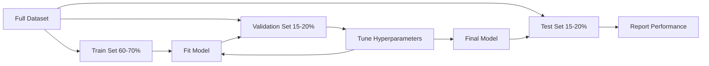

# Model Evaluation

> Sebagus apa pun model itu bergantung pada cara kamu mengukurnya.

**Type:** Build
**Languages:** Python
**Prerequisites:** Phase 1 (Probability & Distributions, Statistics for ML), Phase 2 Lessons 1-8
**Time:** ~90 minutes

## Tujuan Pembelajaran

- Implementasikan K-fold dan stratified K-fold cross-validation dari nol serta jelaskan mengapa stratifikasi penting untuk data imbalanced
- Hitung precision, recall, F1, AUC-ROC, dan metrik regression (MSE, RMSE, MAE, R-squared) dari nol
- Interpretasikan learning curve untuk mendiagnosis apakah model menderita bias tinggi atau variance tinggi
- Identifikasi kesalahan evaluasi umum termasuk data leakage, pemilihan metrik yang salah, dan kontaminasi set test

## Masalahnya

Kamu melatih sebuah model. Ia mendapat akurasi 95% pada datamu. Apakah itu bagus?

Mungkin. Mungkin tidak. Jika 95% datamu termasuk satu kelas, model yang selalu memprediksi kelas itu mendapat akurasi 95% sambil sama sekali tidak berguna. Jika kamu mengevaluasi pada data yang sama tempat kamu melatihnya, angka 95% itu tidak bermakna karena model hanya menghafal jawabannya. Jika dataset-mu punya komponen waktu dan kamu mengacak-acak sebelum membagi, modelmu mungkin menggunakan data masa depan untuk memprediksi masa lalu.

Evaluasi model adalah tempat sebagian besar proyek ML salah jalan. Metrik yang salah membuat model buruk tampak baik. Pembagian yang salah membiarkan model curang. Perbandingan yang salah membuatmu memilih model yang lebih buruk. Mendapatkan evaluasi dengan benar bukan pilihan. Itulah perbedaan antara model yang bekerja di produksi dan model yang gagal saat melihat data nyata.

## Konsepnya

### Train, Validation, Test



Tiga pembagian, tiga tujuan:

- **Training set**: model belajar dari data ini. Ia melihat contoh-contoh ini selama training.
- **Validation set**: dipakai untuk mengatur hyperparameter dan memilih di antara model-model. Model tidak pernah training pada data ini, tetapi keputusan-keputusanmu dipengaruhinya.
- **Test set**: disentuh tepat sekali, di akhir, untuk melaporkan performa akhir. Jika kamu melihat performa test lalu kembali mengubah modelmu, itu tidak lagi merupakan set test. Ia telah menjadi set validation kedua.

Test set adalah jaminan hold-out-mu bahwa performa yang dilaporkan mencerminkan bagaimana model akan bekerja pada data yang benar-benar belum terlihat.

### K-Fold Cross-Validation

Dengan dataset kecil, satu pembagian train/validation membuang data dan memberikan estimasi yang berisik. K-fold cross-validation memakai semua data untuk training dan validasi:

```mermaid
flowchart TB
    subgraph Fold1["Fold 1"]
        direction LR
        V1["Val"] --- T1a["Train"] --- T1b["Train"] --- T1c["Train"] --- T1d["Train"]
    end
    subgraph Fold2["Fold 2"]
        direction LR
        T2a["Train"] --- V2["Val"] --- T2b["Train"] --- T2c["Train"] --- T2d["Train"]
    end
    subgraph Fold3["Fold 3"]
        direction LR
        T3a["Train"] --- T3b["Train"] --- V3["Val"] --- T3c["Train"] --- T3d["Train"]
    end
    subgraph Fold4["Fold 4"]
        direction LR
        T4a["Train"] --- T4b["Train"] --- T4c["Train"] --- V4["Val"] --- T4d["Train"]
    end
    subgraph Fold5["Fold 5"]
        direction LR
        T5a["Train"] --- T5b["Train"] --- T5c["Train"] --- T5d["Train"] --- V5["Val"]
    end
    Fold1 --> R["Average scores"]
    Fold2 --> R
    Fold3 --> R
    Fold4 --> R
    Fold5 --> R
```



1. Bagi data menjadi K fold berukuran sama
2. Untuk setiap fold, training pada K-1 fold dan validasi pada fold tersisa
3. Rata-ratakan K skor validasi

K=5 atau K=10 adalah pilihan standar. Setiap titik data dipakai untuk validasi tepat sekali. Skor rata-rata adalah estimasi yang lebih stabil daripada pembagian tunggal mana pun.

**Stratified K-fold**: mempertahankan distribusi kelas di setiap fold. Jika dataset-mu 70% kelas A dan 30% kelas B, setiap fold akan punya rasio yang kira-kira sama. Ini penting untuk dataset imbalanced di mana pembagian acak bisa menaruh semua sampel minoritas dalam satu fold.

### Metrik Klasifikasi

**Confusion matrix**: fondasinya. Untuk klasifikasi biner:

|  | Predicted Positive | Predicted Negative |
|--|---|---|
| Actually Positive | True Positive (TP) | False Negative (FN) |
| Actually Negative | False Positive (FP) | True Negative (TN) |

Dari matriks ini, semua metrik lain mengikuti:

- **Accuracy** = (TP + TN) / (TP + TN + FP + FN). Fraksi prediksi yang benar. Menyesatkan ketika kelas tidak seimbang.
- **Precision** = TP / (TP + FP). Dari semua yang diprediksi positif, berapa yang benar-benar begitu? Pakai ketika false positives mahal (misalnya, filter spam menandai email nyata sebagai spam).
- **Recall** (sensitivity) = TP / (TP + FN). Dari semua yang benar-benar positif, berapa yang kita tangkap? Pakai ketika false negatives mahal (misalnya, skrining kanker melewatkan tumor).
- **F1 score** = 2 * precision * recall / (precision + recall). Rata-rata harmonik dari precision dan recall. Menyeimbangkan keduanya ketika tidak ada yang jelas mendominasi.
- **AUC-ROC**: Area Under the Receiver Operating Characteristic curve. Memplot true positive rate vs false positive rate pada berbagai threshold klasifikasi. AUC = 0,5 berarti tebakan acak, AUC = 1,0 berarti pemisahan sempurna. Independen-threshold: ia mengukur seberapa baik model memeringkat positif di atas negatif, terlepas dari cutoff yang kamu pilih.

### Metrik Regression

- **MSE** (Mean Squared Error) = mean((y_true - y_pred)^2). Menonjolkan error besar secara kuadrat. Sensitif terhadap outlier.
- **RMSE** (Root Mean Squared Error) = sqrt(MSE). Satuan sama dengan variabel target. Lebih mudah diinterpretasi daripada MSE.
- **MAE** (Mean Absolute Error) = mean(|y_true - y_pred|). Memperlakukan semua error secara linear. Lebih tahan terhadap outlier daripada MSE.
- **R-squared** = 1 - SS_res / SS_tot, di mana SS_res = sum((y_true - y_pred)^2) dan SS_tot = sum((y_true - y_mean)^2). Fraksi variance yang dijelaskan oleh model. R^2 = 1,0 adalah sempurna. R^2 = 0,0 berarti model tidak lebih baik daripada selalu memprediksi mean. R^2 bisa negatif jika model lebih buruk dari mean.

### Learning Curve

Plot skor training dan validasi sebagai fungsi dari ukuran set training:

- **Bias tinggi (underfitting)**: kedua kurva konvergen ke skor rendah. Menambah data tidak akan membantu. Kamu butuh model yang lebih kompleks.
- **Variance tinggi (overfitting)**: skor training tinggi tetapi skor validasi jauh lebih rendah. Jarak di antaranya besar. Menambah data seharusnya membantu.

### Validation Curve

Plot skor training dan validasi sebagai fungsi sebuah hyperparameter:

- Pada kompleksitas rendah: kedua skor rendah (underfitting)
- Pada kompleksitas yang tepat: kedua skor tinggi dan berdekatan
- Pada kompleksitas tinggi: skor training tetap tinggi tetapi skor validasi turun (overfitting)

Nilai hyperparameter optimal adalah tempat skor validasi mencapai puncak.

### Kesalahan Evaluasi yang Umum

**Data leakage**: informasi dari set test merembes ke training. Contoh: menyesuaikan sebuah scaler pada seluruh dataset sebelum membagi, menyertakan data masa depan dalam prediksi deret waktu, memakai fitur yang diturunkan dari target. Selalu bagikan dulu, lalu preprocess.

**Class imbalance**: 99% transaksi sah, 1% penipuan. Model yang selalu memprediksi "sah" mendapat akurasi 99%. Gunakan precision, recall, F1, atau AUC-ROC sebagai gantinya.

**Metrik salah**: mengoptimalkan akurasi ketika kamu seharusnya mengoptimalkan recall (diagnosis medis), atau mengoptimalkan RMSE ketika datamu punya banyak outlier (gunakan MAE).

**Tidak memakai pembagian stratified**: dengan data imbalanced, pembagian acak bisa menaruh sangat sedikit sampel minoritas pada fold validasi, memberikan estimasi yang tidak stabil.

**Menguji terlalu sering**: setiap kali kamu melihat performa test dan menyesuaikan, kamu overfit ke set test. Set test itu sekali pakai.

```figure
precision-recall-threshold
```

## Bangun Sendiri

### Langkah 1: Pembagian train/validation/test

```python
import random
import math


def train_val_test_split(X, y, train_ratio=0.6, val_ratio=0.2, seed=42):
    random.seed(seed)
    n = len(X)
    indices = list(range(n))
    random.shuffle(indices)

    train_end = int(n * train_ratio)
    val_end = int(n * (train_ratio + val_ratio))

    train_idx = indices[:train_end]
    val_idx = indices[train_end:val_end]
    test_idx = indices[val_end:]

    X_train = [X[i] for i in train_idx]
    y_train = [y[i] for i in train_idx]
    X_val = [X[i] for i in val_idx]
    y_val = [y[i] for i in val_idx]
    X_test = [X[i] for i in test_idx]
    y_test = [y[i] for i in test_idx]

    return X_train, y_train, X_val, y_val, X_test, y_test
```

### Langkah 2: K-fold dan stratified K-fold cross-validation

```python
def kfold_split(n, k=5, seed=42):
    random.seed(seed)
    indices = list(range(n))
    random.shuffle(indices)

    fold_size = n // k
    folds = []

    for i in range(k):
        start = i * fold_size
        end = start + fold_size if i < k - 1 else n
        val_idx = indices[start:end]
        train_idx = indices[:start] + indices[end:]
        folds.append((train_idx, val_idx))

    return folds


def stratified_kfold_split(y, k=5, seed=42):
    random.seed(seed)

    class_indices = {}
    for i, label in enumerate(y):
        class_indices.setdefault(label, []).append(i)

    for label in class_indices:
        random.shuffle(class_indices[label])

    folds = [{"train": [], "val": []} for _ in range(k)]

    for label, indices in class_indices.items():
        fold_size = len(indices) // k
        for i in range(k):
            start = i * fold_size
            end = start + fold_size if i < k - 1 else len(indices)
            val_part = indices[start:end]
            train_part = indices[:start] + indices[end:]
            folds[i]["val"].extend(val_part)
            folds[i]["train"].extend(train_part)

    return [(f["train"], f["val"]) for f in folds]


def cross_validate(X, y, model_fn, k=5, metric_fn=None, stratified=False):
    n = len(X)

    if stratified:
        folds = stratified_kfold_split(y, k)
    else:
        folds = kfold_split(n, k)

    scores = []
    for train_idx, val_idx in folds:
        X_train = [X[i] for i in train_idx]
        y_train = [y[i] for i in train_idx]
        X_val = [X[i] for i in val_idx]
        y_val = [y[i] for i in val_idx]

        model = model_fn()
        model.fit(X_train, y_train)
        predictions = [model.predict(x) for x in X_val]

        if metric_fn:
            score = metric_fn(y_val, predictions)
        else:
            score = sum(1 for yt, yp in zip(y_val, predictions) if yt == yp) / len(y_val)
        scores.append(score)

    return scores
```

### Langkah 3: Confusion matrix dan metrik klasifikasi

```python
def confusion_matrix(y_true, y_pred):
    tp = sum(1 for yt, yp in zip(y_true, y_pred) if yt == 1 and yp == 1)
    tn = sum(1 for yt, yp in zip(y_true, y_pred) if yt == 0 and yp == 0)
    fp = sum(1 for yt, yp in zip(y_true, y_pred) if yt == 0 and yp == 1)
    fn = sum(1 for yt, yp in zip(y_true, y_pred) if yt == 1 and yp == 0)
    return tp, tn, fp, fn


def accuracy(y_true, y_pred):
    tp, tn, fp, fn = confusion_matrix(y_true, y_pred)
    total = tp + tn + fp + fn
    return (tp + tn) / total if total > 0 else 0.0


def precision(y_true, y_pred):
    tp, tn, fp, fn = confusion_matrix(y_true, y_pred)
    return tp / (tp + fp) if (tp + fp) > 0 else 0.0


def recall(y_true, y_pred):
    tp, tn, fp, fn = confusion_matrix(y_true, y_pred)
    return tp / (tp + fn) if (tp + fn) > 0 else 0.0


def f1_score(y_true, y_pred):
    p = precision(y_true, y_pred)
    r = recall(y_true, y_pred)
    return 2 * p * r / (p + r) if (p + r) > 0 else 0.0


def roc_curve(y_true, y_scores):
    thresholds = sorted(set(y_scores), reverse=True)
    tpr_list = []
    fpr_list = []

    total_positives = sum(y_true)
    total_negatives = len(y_true) - total_positives

    for threshold in thresholds:
        y_pred = [1 if s >= threshold else 0 for s in y_scores]
        tp = sum(1 for yt, yp in zip(y_true, y_pred) if yt == 1 and yp == 1)
        fp = sum(1 for yt, yp in zip(y_true, y_pred) if yt == 0 and yp == 1)

        tpr = tp / total_positives if total_positives > 0 else 0.0
        fpr = fp / total_negatives if total_negatives > 0 else 0.0

        tpr_list.append(tpr)
        fpr_list.append(fpr)

    return fpr_list, tpr_list, thresholds


def auc_roc(y_true, y_scores):
    fpr_list, tpr_list, _ = roc_curve(y_true, y_scores)

    pairs = sorted(zip(fpr_list, tpr_list))
    fpr_sorted = [p[0] for p in pairs]
    tpr_sorted = [p[1] for p in pairs]

    area = 0.0
    for i in range(1, len(fpr_sorted)):
        width = fpr_sorted[i] - fpr_sorted[i - 1]
        height = (tpr_sorted[i] + tpr_sorted[i - 1]) / 2
        area += width * height

    return area
```

### Langkah 4: Metrik regression

```python
def mse(y_true, y_pred):
    n = len(y_true)
    return sum((yt - yp) ** 2 for yt, yp in zip(y_true, y_pred)) / n


def rmse(y_true, y_pred):
    return math.sqrt(mse(y_true, y_pred))


def mae(y_true, y_pred):
    n = len(y_true)
    return sum(abs(yt - yp) for yt, yp in zip(y_true, y_pred)) / n


def r_squared(y_true, y_pred):
    mean_y = sum(y_true) / len(y_true)
    ss_res = sum((yt - yp) ** 2 for yt, yp in zip(y_true, y_pred))
    ss_tot = sum((yt - mean_y) ** 2 for yt in y_true)
    if ss_tot == 0:
        return 0.0
    return 1.0 - ss_res / ss_tot
```

### Langkah 5: Learning curve

```python
def learning_curve(X, y, model_fn, metric_fn, train_sizes=None, val_ratio=0.2, seed=42):
    random.seed(seed)
    n = len(X)
    indices = list(range(n))
    random.shuffle(indices)

    val_size = int(n * val_ratio)
    val_idx = indices[:val_size]
    pool_idx = indices[val_size:]

    X_val = [X[i] for i in val_idx]
    y_val = [y[i] for i in val_idx]

    if train_sizes is None:
        train_sizes = [int(len(pool_idx) * r) for r in [0.1, 0.2, 0.4, 0.6, 0.8, 1.0]]

    train_scores = []
    val_scores = []

    for size in train_sizes:
        subset = pool_idx[:size]
        X_train = [X[i] for i in subset]
        y_train = [y[i] for i in subset]

        model = model_fn()
        model.fit(X_train, y_train)

        train_pred = [model.predict(x) for x in X_train]
        val_pred = [model.predict(x) for x in X_val]

        train_scores.append(metric_fn(y_train, train_pred))
        val_scores.append(metric_fn(y_val, val_pred))

    return train_sizes, train_scores, val_scores
```

### Langkah 6: Sebuah klasifier sederhana untuk pengujian, plus demo lengkap

```python
class SimpleLogistic:
    def __init__(self, lr=0.1, epochs=100):
        self.lr = lr
        self.epochs = epochs
        self.weights = None
        self.bias = 0.0

    def sigmoid(self, z):
        z = max(-500, min(500, z))
        return 1.0 / (1.0 + math.exp(-z))

    def fit(self, X, y):
        n_features = len(X[0])
        self.weights = [0.0] * n_features
        self.bias = 0.0

        for _ in range(self.epochs):
            for xi, yi in zip(X, y):
                z = sum(w * x for w, x in zip(self.weights, xi)) + self.bias
                pred = self.sigmoid(z)
                error = yi - pred
                for j in range(n_features):
                    self.weights[j] += self.lr * error * xi[j]
                self.bias += self.lr * error

    def predict_proba(self, x):
        z = sum(w * xi for w, xi in zip(self.weights, x)) + self.bias
        return self.sigmoid(z)

    def predict(self, x):
        return 1 if self.predict_proba(x) >= 0.5 else 0


class SimpleLinearRegression:
    def __init__(self, lr=0.001, epochs=200):
        self.lr = lr
        self.epochs = epochs
        self.weights = None
        self.bias = 0.0

    def fit(self, X, y):
        n_features = len(X[0])
        self.weights = [0.0] * n_features
        self.bias = 0.0
        n = len(X)

        for _ in range(self.epochs):
            for xi, yi in zip(X, y):
                pred = sum(w * x for w, x in zip(self.weights, xi)) + self.bias
                error = yi - pred
                for j in range(n_features):
                    self.weights[j] += self.lr * error * xi[j] / n
                self.bias += self.lr * error / n

    def predict(self, x):
        return sum(w * xi for w, xi in zip(self.weights, x)) + self.bias


def standardize(values):
    n = len(values)
    mean = sum(values) / n
    var = sum((v - mean) ** 2 for v in values) / n
    std = math.sqrt(var) if var > 0 else 1.0
    return [(v - mean) / std for v in values], mean, std


def make_classification_data(n=300, seed=42):
    random.seed(seed)
    X = []
    y = []
    for _ in range(n):
        x1 = random.gauss(0, 1)
        x2 = random.gauss(0, 1)
        label = 1 if (x1 + x2 + random.gauss(0, 0.5)) > 0 else 0
        X.append([x1, x2])
        y.append(label)
    return X, y


def make_regression_data(n=200, seed=42):
    random.seed(seed)
    X = []
    y = []
    for _ in range(n):
        x1 = random.uniform(0, 10)
        x2 = random.uniform(0, 5)
        target = 3 * x1 + 2 * x2 + random.gauss(0, 2)
        X.append([x1, x2])
        y.append(target)
    return X, y


def make_imbalanced_data(n=300, minority_ratio=0.05, seed=42):
    random.seed(seed)
    X = []
    y = []
    for _ in range(n):
        if random.random() < minority_ratio:
            x1 = random.gauss(3, 0.5)
            x2 = random.gauss(3, 0.5)
            label = 1
        else:
            x1 = random.gauss(0, 1)
            x2 = random.gauss(0, 1)
            label = 0
        X.append([x1, x2])
        y.append(label)
    return X, y


if __name__ == "__main__":
    X_clf, y_clf = make_classification_data(300)

    print("=== Train/Validation/Test Split ===")
    X_train, y_train, X_val, y_val, X_test, y_test = train_val_test_split(X_clf, y_clf)
    print(f"  Train: {len(X_train)}, Val: {len(X_val)}, Test: {len(X_test)}")
    print(f"  Train class distribution: {sum(y_train)}/{len(y_train)} positive")
    print(f"  Val class distribution: {sum(y_val)}/{len(y_val)} positive")

    model = SimpleLogistic(lr=0.1, epochs=200)
    model.fit(X_train, y_train)

    print("\n=== Classification Metrics ===")
    y_pred = [model.predict(x) for x in X_test]
    tp, tn, fp, fn = confusion_matrix(y_test, y_pred)
    print(f"  Confusion matrix: TP={tp}, TN={tn}, FP={fp}, FN={fn}")
    print(f"  Accuracy:  {accuracy(y_test, y_pred):.4f}")
    print(f"  Precision: {precision(y_test, y_pred):.4f}")
    print(f"  Recall:    {recall(y_test, y_pred):.4f}")
    print(f"  F1 Score:  {f1_score(y_test, y_pred):.4f}")

    y_scores = [model.predict_proba(x) for x in X_test]
    auc = auc_roc(y_test, y_scores)
    print(f"  AUC-ROC:   {auc:.4f}")

    print("\n=== K-Fold Cross-Validation (K=5) ===")
    cv_scores = cross_validate(
        X_clf, y_clf,
        model_fn=lambda: SimpleLogistic(lr=0.1, epochs=200),
        k=5,
        metric_fn=accuracy,
    )
    mean_cv = sum(cv_scores) / len(cv_scores)
    std_cv = math.sqrt(sum((s - mean_cv) ** 2 for s in cv_scores) / len(cv_scores))
    print(f"  Fold scores: {[round(s, 4) for s in cv_scores]}")
    print(f"  Mean: {mean_cv:.4f} (+/- {std_cv:.4f})")

    print("\n=== Stratified K-Fold Cross-Validation (K=5) ===")
    strat_scores = cross_validate(
        X_clf, y_clf,
        model_fn=lambda: SimpleLogistic(lr=0.1, epochs=200),
        k=5,
        metric_fn=accuracy,
        stratified=True,
    )
    strat_mean = sum(strat_scores) / len(strat_scores)
    strat_std = math.sqrt(sum((s - strat_mean) ** 2 for s in strat_scores) / len(strat_scores))
    print(f"  Fold scores: {[round(s, 4) for s in strat_scores]}")
    print(f"  Mean: {strat_mean:.4f} (+/- {strat_std:.4f})")

    print("\n=== Imbalanced Data: Why Accuracy Lies ===")
    X_imb, y_imb = make_imbalanced_data(300, minority_ratio=0.05)
    positives = sum(y_imb)
    print(f"  Class distribution: {positives} positive, {len(y_imb) - positives} negative ({positives/len(y_imb)*100:.1f}% positive)")

    always_negative = [0] * len(y_imb)
    print(f"  Always-negative baseline:")
    print(f"    Accuracy:  {accuracy(y_imb, always_negative):.4f}")
    print(f"    Precision: {precision(y_imb, always_negative):.4f}")
    print(f"    Recall:    {recall(y_imb, always_negative):.4f}")
    print(f"    F1 Score:  {f1_score(y_imb, always_negative):.4f}")

    X_tr_i, y_tr_i, X_v_i, y_v_i, X_te_i, y_te_i = train_val_test_split(X_imb, y_imb)
    model_imb = SimpleLogistic(lr=0.5, epochs=500)
    model_imb.fit(X_tr_i, y_tr_i)
    y_pred_imb = [model_imb.predict(x) for x in X_te_i]
    print(f"\n  Trained model on imbalanced data:")
    print(f"    Accuracy:  {accuracy(y_te_i, y_pred_imb):.4f}")
    print(f"    Precision: {precision(y_te_i, y_pred_imb):.4f}")
    print(f"    Recall:    {recall(y_te_i, y_pred_imb):.4f}")
    print(f"    F1 Score:  {f1_score(y_te_i, y_pred_imb):.4f}")

    print("\n=== Regression Metrics ===")
    X_reg, y_reg = make_regression_data(200)

    col0 = [x[0] for x in X_reg]
    col1 = [x[1] for x in X_reg]
    col0_s, m0, s0 = standardize(col0)
    col1_s, m1, s1 = standardize(col1)
    X_reg_scaled = [[col0_s[i], col1_s[i]] for i in range(len(X_reg))]

    X_tr_r, y_tr_r, X_v_r, y_v_r, X_te_r, y_te_r = train_val_test_split(X_reg_scaled, y_reg)
    reg_model = SimpleLinearRegression(lr=0.01, epochs=500)
    reg_model.fit(X_tr_r, y_tr_r)
    y_pred_r = [reg_model.predict(x) for x in X_te_r]

    print(f"  MSE:       {mse(y_te_r, y_pred_r):.4f}")
    print(f"  RMSE:      {rmse(y_te_r, y_pred_r):.4f}")
    print(f"  MAE:       {mae(y_te_r, y_pred_r):.4f}")
    print(f"  R-squared: {r_squared(y_te_r, y_pred_r):.4f}")

    mean_baseline = [sum(y_tr_r) / len(y_tr_r)] * len(y_te_r)
    print(f"\n  Mean baseline:")
    print(f"    MSE:       {mse(y_te_r, mean_baseline):.4f}")
    print(f"    R-squared: {r_squared(y_te_r, mean_baseline):.4f}")

    print("\n=== Learning Curve ===")
    sizes, train_sc, val_sc = learning_curve(
        X_clf, y_clf,
        model_fn=lambda: SimpleLogistic(lr=0.1, epochs=200),
        metric_fn=accuracy,
    )
    print(f"  {'Size':>6} {'Train':>8} {'Val':>8}")
    for s, tr, va in zip(sizes, train_sc, val_sc):
        print(f"  {s:>6} {tr:>8.4f} {va:>8.4f}")

    print("\n=== Statistical Model Comparison ===")
    model_a_scores = cross_validate(
        X_clf, y_clf,
        model_fn=lambda: SimpleLogistic(lr=0.1, epochs=100),
        k=5, metric_fn=accuracy,
    )
    model_b_scores = cross_validate(
        X_clf, y_clf,
        model_fn=lambda: SimpleLogistic(lr=0.1, epochs=500),
        k=5, metric_fn=accuracy,
    )
    diffs = [a - b for a, b in zip(model_a_scores, model_b_scores)]
    mean_diff = sum(diffs) / len(diffs)
    std_diff = math.sqrt(sum((d - mean_diff) ** 2 for d in diffs) / len(diffs))
    t_stat = mean_diff / (std_diff / math.sqrt(len(diffs))) if std_diff > 0 else 0.0
    print(f"  Model A (100 epochs) mean: {sum(model_a_scores)/len(model_a_scores):.4f}")
    print(f"  Model B (500 epochs) mean: {sum(model_b_scores)/len(model_b_scores):.4f}")
    print(f"  Mean difference: {mean_diff:.4f}")
    print(f"  Paired t-statistic: {t_stat:.4f}")
    print(f"  (|t| > 2.78 for significance at p<0.05 with df=4)")
```

## Gunakan

Dengan scikit-learn, evaluasi sudah tertanam dalam alur kerja:

```python
from sklearn.model_selection import cross_val_score, StratifiedKFold, learning_curve
from sklearn.metrics import (
    accuracy_score, precision_score, recall_score, f1_score,
    roc_auc_score, confusion_matrix, mean_squared_error, r2_score,
)
from sklearn.linear_model import LogisticRegression

model = LogisticRegression()
scores = cross_val_score(model, X, y, cv=StratifiedKFold(5), scoring="f1")
```

Versi from-scratch menunjukkan persis apa yang dilakukan cross-validation (tanpa sihir, hanya for-loop dan pelacakan indeks), bagaimana setiap metrik dihitung (hanya menghitung TP/FP/TN/FN), dan mengapa stratifikasi penting (mempertahankan rasio kelas di setiap fold). Versi pustaka menambahkan parallelism, lebih banyak opsi scoring, dan integrasi dengan pipeline.

## Rilis

Pelajaran ini menghasilkan:
- `outputs/skill-evaluation.md` - sebuah skill yang mencakup strategi evaluasi untuk model klasifikasi dan regression

## Latihan

1. Implementasikan kurva precision-recall: plot precision vs recall pada threshold yang berbeda. Hitung average precision (area di bawah kurva PR). Bandingkan kurva PR dengan kurva ROC pada dataset imbalanced dan jelaskan kapan masing-masing lebih informatif.
2. Bangun loop cross-validation bersarang: loop luar mengevaluasi performa model, loop dalam mengatur hyperparameter. Pakai untuk membandingkan dua model secara adil tanpa merembeskan data validasi ke evaluasi.
3. Implementasikan uji permutasi untuk perbandingan model: acak-akan label-nya, latih ulang, dan ukur performa. Ulangi 100 kali untuk membangun distribusi null. Hitung p-value untuk performa model yang diamati terhadap distribusi ini.

## Istilah Kunci

| Term | What people say | What it actually means |
|------|----------------|----------------------|
| Overfitting | "Memorizing the training data" | The model captures noise in the training data, performing well on training but poorly on unseen data |
| Cross-validation | "Testing on different subsets" | Systematically rotating which portion of data is used for validation, averaging results across all rotations |
| Precision | "How many predicted positives are correct" | TP / (TP + FP): the fraction of positive predictions that are actually positive |
| Recall | "How many actual positives we found" | TP / (TP + FN): the fraction of actual positives that were correctly identified |
| AUC-ROC | "How well the model separates classes" | The area under the curve of true positive rate vs false positive rate across all thresholds, from 0.5 (random) to 1.0 (perfect) |
| R-squared | "How much variance is explained" | 1 - (sum of squared residuals / total sum of squares): the fraction of target variance captured by the model |
| Data leakage | "The model cheated" | Using information during training that would not be available at prediction time, leading to optimistic evaluation |
| Learning curve | "How performance changes with more data" | A plot of training and validation scores vs training set size, revealing underfitting or overfitting |
| Stratified split | "Keeping class ratios balanced" | Splitting data so each subset has the same proportion of each class as the full dataset |

## Bacaan Lanjutan

- [scikit-learn Model Selection Guide](https://scikit-learn.org/stable/model_selection.html) - comprehensive reference on cross-validation, metrics, and hyperparameter tuning
- [Beyond Accuracy: Precision and Recall (Google ML Crash Course)](https://developers.google.com/machine-learning/crash-course/classification/precision-and-recall) - clear explanation with interactive examples
- [A Survey of Cross-Validation Procedures (Arlot & Celisse, 2010)](https://projecteuclid.org/journals/statistics-surveys/volume-4/issue-none/A-survey-of-cross-validation-procedures-for-model-selection/10.1214/09-SS054.full) - rigorous treatment of when and why different CV strategies work
