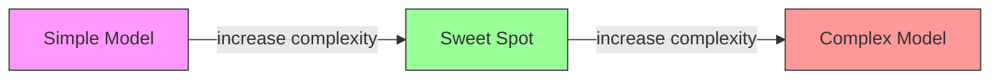
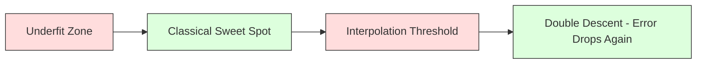
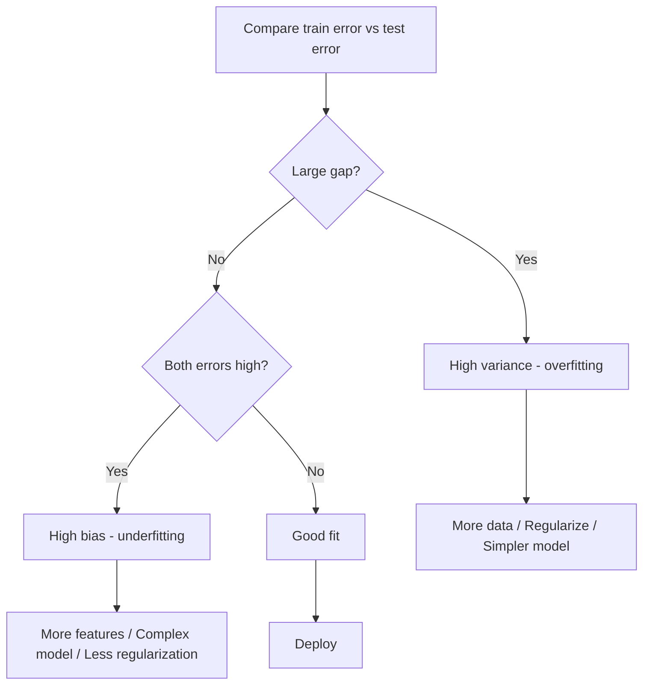
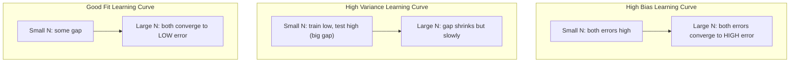
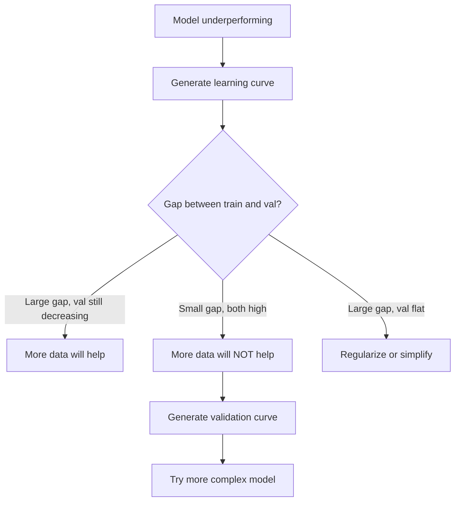

# Bias-Variance Tradeoff

> Setiap error model datang dari salah satu dari tiga sumber: bias, variance, atau noise. Kamu hanya bisa mengontrol dua yang pertama.

**Type:** Learn
**Language:** Python
**Prerequisites:** Phase 2, Lessons 01-09 (ML basics, regression, classification, evaluation)
**Time:** ~75 minutes

## Tujuan Pembelajaran

- Turunkan dekomposisi bias-variance dari expected prediction error dan jelaskan peran irreducible noise
- Diagnosa apakah model menderita bias tinggi atau variance tinggi menggunakan pola error training dan test
- Jelaskan bagaimana teknik regularization (L1, L2, dropout, early stopping) menukar bias dengan variance
- Implementasikan eksperimen yang memvisualisasikan tradeoff bias-variance di seluruh model dengan kompleksitas meningkat

## Masalahnya

Kamu melatih sebuah model. Ia punya beberapa error pada data test. Dari mana error itu berasal?

Jika modelmu terlalu sederhana (linear regression pada dataset berkelok), ia akan secara konsisten melewatkan pola sebenarnya. Itulah bias. Jika modelmu terlalu kompleks (polinomial derajat-20 pada 15 titik data), ia akan menyesuaikan data training dengan sempurna tetapi memberikan prediksi yang sangat berbeda pada data baru. Itulah variance.

Kamu tidak bisa meminimalkan keduanya pada saat yang sama untuk kapasitas model tetap. Dorong bias turun dan variance naik. Dorong variance turun dan bias naik. Memahami tradeoff ini adalah keterampilan diagnostik paling berguna dalam machine learning. Ia memberitahumu apakah membuat modelmu lebih kompleks atau kurang kompleks, apakah mendapatkan lebih banyak data atau meng-engineering fitur yang lebih baik, apakah mengregularisasi lebih banyak atau lebih sedikit.

## Konsepnya

### Bias: Error Sistematis

Bias mengukur seberapa jauh prediksi rata-rata modelmu dari nilai sebenarnya. Jika kamu melatih model yang sama pada banyak set training berbeda yang ditarik dari distribusi yang sama dan merata-ratakan prediksinya, bias adalah jarak antara rata-rata itu dan kebenarannya.

Bias tinggi berarti model terlalu kaku untuk menangkap pola yang sebenarnya. Sebuah garis lurus yang disesuaikan dengan sebuah parabola akan selalu melewatkan kurvanya, seberapa pun banyak data yang kamu berikan. Ini adalah underfitting.

```
High bias (underfitting):
  Model always predicts roughly the same wrong thing.
  Training error: HIGH
  Test error: HIGH
  Gap between them: SMALL
```

### Variance: Sensitivitas terhadap Data Training

Variance mengukur seberapa banyak prediksimu berubah ketika kamu melatih pada subset data yang berbeda. Jika perubahan kecil pada set training menyebabkan perubahan besar pada model, variance-nya tinggi.

Variance tinggi berarti model sedang menyesuaikan noise dalam data training, bukan sinyal yang mendasarinya. Polinomial derajat-20 akan menembus setiap titik training tetapi berayun liar di antara mereka. Ini adalah overfitting.

```
High variance (overfitting):
  Model fits training data perfectly but fails on new data.
  Training error: LOW
  Test error: HIGH
  Gap between them: LARGE
```

### Dekomposisinya

Untuk titik x mana pun, expected prediction error di bawah squared loss terdekomposisi persis:

```
Expected Error = Bias^2 + Variance + Irreducible Noise

where:
  Bias^2   = (E[f_hat(x)] - f(x))^2
  Variance = E[(f_hat(x) - E[f_hat(x)])^2]
  Noise    = E[(y - f(x))^2]             (sigma^2)
```

- `f(x)` adalah fungsi sebenarnya
- `f_hat(x)` adalah prediksi modelmu
- `E[...]` adalah expectation di atas set training yang berbeda
- `y` adalah label yang diamati (fungsi sebenarnya plus noise)

Istilah noise bersifat irreducible. Tidak ada model yang bisa lebih baik dari sigma^2 pada data berisik. Tugasmu adalah menemukan keseimbangan yang tepat antara bias^2 dan variance.

### Kompleksitas Model vs Error



Kurva U yang klasikal:

| Complexity | Bias | Variance | Total Error |
|-----------|------|----------|-------------|
| Too low | HIGH | LOW | HIGH (underfitting) |
| Just right | MODERATE | MODERATE | LOWEST |
| Too high | LOW | HIGH | HIGH (overfitting) |

### Regularization sebagai Kontrol Bias-Variance

Regularization secara sengaja menambah bias untuk mengurangi variance. Ia membatasi model sehingga ia tidak bisa mengejar noise.

- **L2 (Ridge):** Mengecilkan semua weight menuju nol. Mempertahankan semua fitur tetapi mengurangi pengaruhnya.
- **L1 (Lasso):** Mendorong sebagian weight tepat ke nol. Melakukan feature selection.
- **Dropout:** Menonaktifkan neuron secara acak selama training. Memaksa representasi yang redundan.
- **Early stopping:** Menghentikan training sebelum model menyesuaikan data training sepenuhnya.

Kekuatan regularisasi (lambda, dropout rate, jumlah epoch) secara langsung mengontrol di mana kamu berdiri di kurva bias-variance. Regularisasi lebih banyak berarti bias lebih banyak, variance lebih sedikit.

### Double Descent: Perspektif Modern

Teori klasikal mengatakan: setelah titik manis, kompleksitas lebih banyak selalu merugikan. Tetapi riset sejak 2019 telah menunjukkan sesuatu yang tak terduga. Jika kamu terus meningkatkan kapasitas model jauh melampaui interpolation threshold (tempat model punya cukup parameter untuk menyesuaikan data training dengan sempurna), test error bisa menurun lagi.



Fenomena "double descent" ini menjelaskan mengapa neural network yang masif overparameterized (dengan jauh lebih banyak parameter daripada contoh training) tetap menggeneralisasi dengan baik. Tradeoff bias-variance klasikal tidak salah, tetapi tidak lengkap untuk rezim modern.

Pengamatan kunci tentang double descent:
- Ia terjadi pada model linear, decision tree, dan neural network
- Data lebih banyak justru bisa merugikan di region interpolasi (sample-wise double descent)
- Epoch training lebih banyak bisa menyebabkannya juga (epoch-wise double descent)
- Regularization menghaluskan puncaknya tetapi tidak mengeliminasikannya

Mengapa ini terjadi? Di interpolation threshold, model baru saja punya kapasitas yang cukup untuk menyesuaikan semua titik training. Ia dipaksa ke solusi yang sangat spesifik yang menembus setiap titik, dan gangguan kecil dalam data menyebabkan perubahan besar pada penyesuaiannya. Di sinilah variance memuncak. Melampaui threshold, model punya banyak solusi yang mungkin yang menyesuaikan data dengan sempurna. Algoritma pembelajaran (misalnya, gradient descent dengan regularisasi implisit) cenderung memilih yang paling sederhana di antara mereka. Bias implisit terhadap solusi sederhana inilah mengapa model overparameterized menggeneralisasi.

| Regime | Parameters vs Samples | Behavior |
|--------|----------------------|----------|
| Underparameterized | p << n | Classical tradeoff applies |
| Interpolation threshold | p ~ n | Variance peaks, test error spikes |
| Overparameterized | p >> n | Implicit regularization kicks in, test error drops |

Untuk tujuan praktis: jika kamu memakai neural network atau ensemble pohon besar, jangan berhenti di interpolation threshold. Entah tetap jauh di bawahnya (dengan regularisasi eksplisit) atau pergi jauh melampauiinya. Tempat terburuk untuk berada adalah persis di threshold.

### Mendiagnosis Modelmu



| Symptom | Diagnosis | Fix |
|---------|-----------|-----|
| High train error, high test error | Bias | More features, complex model, less regularization |
| Low train error, high test error | Variance | More data, regularization, simpler model, dropout |
| Low train error, low test error | Good fit | Ship it |
| Train error decreasing, test error increasing | Overfitting in progress | Early stopping |

### Strategi Praktis

**Ketika bias adalah masalahnya:**
- Tambahkan fitur polinomial atau interaksi
- Pakai model yang lebih lentur (ensemble pohon alih-alih linear)
- Kurangi kekuatan regularisasi
- Training lebih lama (jika belum konvergen)

**Ketika variance adalah masalahnya:**
- Dapatkan lebih banyak data training
- Pakai bagging (random forest)
- Tingkatkan regularisasi (lambda lebih tinggi, dropout lebih banyak)
- Feature selection (hapus fitur yang berisik)
- Pakai cross-validation untuk mendeteksinya lebih awal

### Ensemble Method dan Reduksi Variance

Ensemble method adalah alat praktis paling ampuh untuk melawan variance.

**Bagging (Bootstrap Aggregating)** melatih beberapa model pada bootstrap sample data training yang berbeda, lalu merata-ratakan prediksi mereka. Setiap model individual punya variance tinggi, tetapi rata-ratanya punya variance jauh lebih rendah. Random forest adalah bagging yang diterapkan pada decision tree.

Mengapa ini bekerja secara matematis: jika kamu merata-ratakan N prediksi independen, masing-masing dengan variance sigma^2, variance dari rata-ratanya adalah sigma^2 / N. Model-model itu tidak benar-benar independen (mereka semua melihat data serupa), jadi reduksinya kurang dari 1/N, tetapi tetap substansial.

**Boosting** mengurangi bias dengan membangun model secara sekuensial, di mana setiap model baru berfokus pada error ensemble sejauh ini. Gradient boosting dan AdaBoost adalah contoh utamanya. Boosting bisa overfit jika kamu menambahkan terlalu banyak model, jadi kamu butuh early stopping atau regularisasi.

| Method | Primary Effect | Bias Change | Variance Change |
|--------|---------------|-------------|-----------------|
| Bagging | Reduces variance | No change | Decreases |
| Boosting | Reduces bias | Decreases | Can increase |
| Stacking | Reduces both | Depends on meta-learner | Depends on base models |
| Dropout | Implicit bagging | Slight increase | Decreases |

**Aturan praktis:** jika model dasarmu punya variance tinggi (pohon dalam, polinomial derajat tinggi), pakai bagging. Jika model dasarmu punya bias tinggi (stump dangkal, model linear sederhana), pakai boosting.

### Learning Curve

Learning curve memplot error training dan validasi sebagai fungsi dari ukuran set training. Ini adalah alat diagnostik praktis paling yang kamu punya. Berbeda dengan satu perbandingan train/test, learning curve menunjukkan trajektori modelmu dan memberitahumu apakah lebih banyak data akan membantu.



Cara membacanya:

| Scenario | Training Error | Validation Error | Gap | What It Means | What to Do |
|----------|---------------|-----------------|-----|---------------|------------|
| High bias | High | High | Small | Model cannot capture the pattern | More features, complex model, less regularization |
| High variance | Low | High | Large | Model memorizes training data | More data, regularization, simpler model |
| Good fit | Moderate | Moderate | Small | Model generalizes well | Ship it |
| High variance, improving | Low | Decreasing with more data | Shrinking | Variance problem that data can fix | Collect more data |
| High bias, flat | High | High and flat | Small and flat | More data will NOT help | Change model architecture |

Wawasan kritisnya: jika kedua kurva sudah mendatar dan jaraknya kecil tetapi kedua error-nya tinggi, lebih banyak data tidak berguna. Kamu butuh model yang lebih baik. Jika jaraknya besar dan masih menyusut, lebih banyak data akan membantu.

### Cara Menghasilkan Learning Curve

Ada dua pendekatan:

**Pendekatan 1: Ubah ukuran set training, model tetap.** Pertahankan model dan hyperparameter tetap konstan. Latih pada subset data training yang semakin besar. Ukur error training dan error validasi pada setiap ukuran. Ini adalah learning curve standar.

**Pendekatan 2: Ubah kompleksitas model, data tetap.** Pertahankan data tetap konstan. Sapu sebuah parameter kompleksitas (derajat polinomial, kedalaman pohon, jumlah layer). Ukur error training dan error validasi pada setiap kompleksitas. Ini adalah validation curve dan menunjukkan tradeoff bias-variance secara langsung.

Kedua pendekatan saling melengkapi. Yang pertama memberitahumu apakah lebih banyak data akan membantu. Yang kedua memberitahumu apakah model berbeda akan membantu. Jalankan keduanya sebelum membuat keputusan tentang langkah berikutnya.



```figure
bias-variance
```

## Bangun Sendiri

Kode di `code/bias_variance.py` menjalankan eksperimen dekomposisi bias-variance lengkap. Berikut pendekatannya, langkah demi langkah.

### Langkah 1: Hasilkan Data Sintetis dari Fungsi yang Diketahui

Kita memakai `f(x) = sin(1.5x) + 0.5x` dengan noise Gaussian. Mengetahui fungsi sebenarnya memungkinkan kita menghitung bias dan variance yang tepat.

```python
def true_function(x):
    return np.sin(1.5 * x) + 0.5 * x

def generate_data(n_samples=30, noise_std=0.5, x_range=(-3, 3), seed=None):
    rng = np.random.RandomState(seed)
    x = rng.uniform(x_range[0], x_range[1], n_samples)
    y = true_function(x) + rng.normal(0, noise_std, n_samples)
    return x, y
```

### Langkah 2: Bootstrap Sampling dan Penyesuaian Polinomial

Untuk setiap derajat polinomial, kita menarik banyak set training bootstrap, menyesuaikan polinomialnya, dan mencatat prediksi pada grid test yang tetap. Ini memberi kita distribusi prediksi di setiap titik test.

```python
def fit_polynomial(x_train, y_train, degree, lam=0.0):
    X = np.column_stack([x_train ** d for d in range(degree + 1)])
    if lam > 0:
        penalty = lam * np.eye(X.shape[1])
        penalty[0, 0] = 0
        w = np.linalg.solve(X.T @ X + penalty, X.T @ y_train)
    else:
        w = np.linalg.lstsq(X, y_train, rcond=None)[0]
    return w
```

Kita menyesuaikan pada 200 bootstrap sample yang berbeda. Setiap bootstrap sample ditarik dari distribusi mendasar yang sama tetapi berisi titik-titik yang berbeda.

### Langkah 3: Menghitung Bias^2, Dekomposisi Variance

Dengan 200 set prediksi di setiap titik test, kita bisa menghitung dekomposisinya langsung dari definisi:

```python
mean_pred = predictions.mean(axis=0)
bias_sq = np.mean((mean_pred - y_true) ** 2)
variance = np.mean(predictions.var(axis=0))
total_error = np.mean(np.mean((predictions - y_true) ** 2, axis=1))
```

- `mean_pred` adalah E[f_hat(x)] yang diestimasi dari bootstrap sample
- `bias_sq` adalah jarak kuadrat antara prediksi rata-rata dan kebenaran
- `variance` adalah sebaran rata-rata prediksi di seluruh bootstrap sample
- `total_error` harusnya kira-kira sama dengan bias^2 + variance + noise

### Langkah 4: Learning Curve

Learning curve menyapu ukuran set training sambil menjaga kompleksitas model tetap. Ia menunjukkan apakah model-mu dibatasi data atau dibatasi kapasitas.

```python
def demo_learning_curves():
    sizes = [10, 15, 20, 30, 50, 75, 100, 150, 200, 300]
    degree = 5

    for n in sizes:
        train_errors = []
        test_errors = []
        for seed in range(50):
            x_train, y_train = generate_data(n_samples=n, seed=seed * 100)
            w = fit_polynomial(x_train, y_train, degree)
            train_pred = predict_polynomial(x_train, w)
            train_mse = np.mean((train_pred - y_train) ** 2)
            test_pred = predict_polynomial(x_test, w)
            test_mse = np.mean((test_pred - y_test) ** 2)
            train_errors.append(train_mse)
            test_errors.append(test_mse)
        # Average over runs gives the learning curve point
```

Untuk model ber-variance tinggi (derajat 5 dengan data kecil), kamu melihat:
- Error training mulai rendah dan meningkat ketika lebih banyak data membuat hafalan lebih sulit
- Error test mulai tinggi dan menurun ketika model mendapatkan lebih banyak sinyal
- Jarak menyusut dengan lebih banyak data

Untuk model ber-bias tinggi (derajat 1), kedua error cepat konvergen ke nilai tinggi yang sama dan lebih banyak data tidak membantu.

### Langkah 5: Sapuan Regularization

Kode juga menyertakan `demo_regularization_sweep()`, yang memfiksasi sebuah polinomial derajat tinggi (derajat 15) dan menyapu kekuatan regularisasi Ridge dari 0,001 hingga 100. Ini menunjukkan tradeoff bias-variance dari sudut berbeda: alih-alih mengubah kompleksitas model, kita mengubah kekuatan batasannya.

```python
def demo_regularization_sweep():
    alphas = [0.001, 0.005, 0.01, 0.05, 0.1, 0.5, 1.0, 5.0, 10.0, 50.0, 100.0]
    for alpha in alphas:
        results = bias_variance_decomposition([15], lam=alpha)
        r = results[15]
        print(f"alpha={alpha:.3f}  bias={r['bias_sq']:.4f}  var={r['variance']:.4f}")
```

Pada alpha rendah, polinomial derajat-15 hampir tidak terbatasi. Variance mendominasi karena model mengejar noise di setiap bootstrap sample. Pada alpha tinggi, penaltinya begitu kuat sehingga model secara efektif menjadi fungsi yang nyaris konstanta. Bias mendominasi. Alpha optimal berada di antara ekstrem-ekstrem ini.

Ini adalah kurva U yang sama dari pengubahan derajat polinomial, tetapi dikontrol oleh sebuah kenop kontinu alih-alih diskret. Dalam praktiknya, regularisasi adalah cara yang disukai untuk mengontrol tradeoff karena ia memungkinkan kontrol halus tanpa mengubah set fitur.

## Gunakan

sklearn menyediakan `learning_curve` dan `validation_curve` untuk mengotomatiskan diagnostik-diagnostik ini tanpa menulis loop bootstrap.

### Validation Curve: Sapu Kompleksitas Model

```python
from sklearn.model_selection import validation_curve
from sklearn.pipeline import make_pipeline
from sklearn.preprocessing import PolynomialFeatures
from sklearn.linear_model import Ridge

degrees = list(range(1, 16))
train_scores_all = []
val_scores_all = []

for d in degrees:
    pipe = make_pipeline(PolynomialFeatures(d), Ridge(alpha=0.01))
    train_scores, val_scores = validation_curve(
        pipe, X, y, param_name="polynomialfeatures__degree",
        param_range=[d], cv=5, scoring="neg_mean_squared_error"
    )
    train_scores_all.append(-train_scores.mean())
    val_scores_all.append(-val_scores.mean())
```

Ini memberimu kurva tradeoff bias-variance secara langsung. Di mana skor validasi terburuk relatif terhadap skor train, variance mendominasi. Di mana keduanya buruk, bias mendominasi.

### Learning Curve: Sapu Ukuran Set Training

```python
from sklearn.model_selection import learning_curve

pipe = make_pipeline(PolynomialFeatures(5), Ridge(alpha=0.01))
train_sizes, train_scores, val_scores = learning_curve(
    pipe, X, y, train_sizes=np.linspace(0.1, 1.0, 10),
    cv=5, scoring="neg_mean_squared_error"
)
train_mse = -train_scores.mean(axis=1)
val_mse = -val_scores.mean(axis=1)
```

Plot `train_mse` dan `val_mse` terhadap `train_sizes`. Bentuknya memberitahumu segalanya tentang modelmu.

### Cross-Validation dengan Sapuan Regularization

```python
from sklearn.model_selection import cross_val_score

alphas = [0.001, 0.01, 0.1, 1.0, 10.0, 100.0]
for alpha in alphas:
    pipe = make_pipeline(PolynomialFeatures(10), Ridge(alpha=alpha))
    scores = cross_val_score(pipe, X, y, cv=5, scoring="neg_mean_squared_error")
    print(f"alpha={alpha:>7.3f}  MSE={-scores.mean():.4f} +/- {scores.std():.4f}")
```

Ini menyapu kekuatan regularisasi untuk kompleksitas model yang tetap. Kamu akan melihat tradeoff bias-variance yang sama: alpha rendah berarti variance tinggi, alpha tinggi berarti bias tinggi.

### Menggabungkan Semuanya: Alur Diagnostik Lengkap

Dalam praktiknya, kamu menjalankan diagnostik-diagnostik ini secara berurutan:

1. Latih modelmu. Hitung error train dan test.
2. Jika keduanya tinggi: kamu punya masalah bias. Lompat ke langkah 4.
3. Jika train rendah tetapi test tinggi: kamu punya masalah variance. Hasilkan learning curve untuk melihat apakah lebih banyak data akan membantu. Jika tidak, regularisasi.
4. Hasilkan validation curve yang menyapu parameter kompleksitas utamamu. Temukan titik manisnya.
5. Di titik manis, hasilkan learning curve. Jika jaraknya masih besar, kamu butuh lebih banyak data atau regularisasi.
6. Coba Ridge/Lasso dengan nilai alpha berbeda menggunakan `cross_val_score`. Pilih alpha tempat error cross-validated paling rendah.

Ini membutuhkan 10-15 menit komputasi untuk sebagian besar dataset tabular dan menghemat berjam-jam menebak-nebak.

## Rilis

Pelajaran ini menghasilkan: `outputs/prompt-model-diagnostics.md`

## Latihan

1. Jalankan dekomposisinya dengan `noise_std=0` (tanpa noise). Apa yang terjadi pada istilah error irreducible? Apakah kompleksitas optimal berubah?
2. Tingkatkan ukuran set training dari 30 hingga 300. Bagaimana ini memengaruhi komponen variance? Apakah derajat polinomial optimal bergeser?
3. Tambahkan regularisasi L2 (Ridge regression) ke eksperimen. Untuk polinomial derajat tinggi yang tetap (derajat 15), sapu lambda dari 0 hingga 100. Plot bias^2 dan variance sebagai fungsi dari lambda.
4. Ubah fungsi sebenarnya dari polinomial menjadi `sin(x)`. Bagaimana dekomposisi bias-variancenya berubah? Apakah masih ada derajat optimal yang jelas?
5. Implementasikan sebuah wrapper bootstrap aggregating (bagging) sederhana: latih 10 model pada bootstrap sample dan rata-ratakan prediksinya. Tunjukkan bahwa ini mengurangi variance tanpa menambah banyak bias.

## Istilah Kunci

| Term | What people say | What it actually means |
|------|----------------|----------------------|
| Bias | "The model is too simple" | Systematic error from wrong assumptions. The gap between the average model prediction and truth. |
| Variance | "The model is overfitting" | Error from sensitivity to training data. How much predictions change across different training sets. |
| Irreducible error | "Noise in the data" | Error from randomness in the true data-generating process. No model can eliminate it. |
| Underfitting | "Not learning enough" | Model has high bias. It misses the real pattern even on training data. |
| Overfitting | "Memorizing the data" | Model has high variance. It fits noise in training data that does not generalize. |
| Regularization | "Constraining the model" | Adding a penalty to reduce model complexity, trading bias for lower variance. |
| Double descent | "More parameters can help" | Test error decreases again when model capacity far exceeds the interpolation threshold. |
| Model complexity | "How flexible the model is" | The capacity of a model to fit arbitrary patterns. Controlled by architecture, features, or regularization. |

## Bacaan Lanjutan

- [Hastie, Tibshirani, Friedman: Elements of Statistical Learning, Ch. 7](https://hastie.su.domains/ElemStatLearn/) -- the definitive treatment of bias-variance decomposition
- [Belkin et al., Reconciling modern machine learning practice and the bias-variance trade-off (2019)](https://arxiv.org/abs/1812.11118) -- the double descent paper
- [Nakkiran et al., Deep Double Descent (2019)](https://arxiv.org/abs/1912.02292) -- epoch-wise and sample-wise double descent
- [Scott Fortmann-Roe: Understanding the Bias-Variance Tradeoff](http://scott.fortmann-roe.com/docs/BiasVariance.html) -- clear visual explanation
