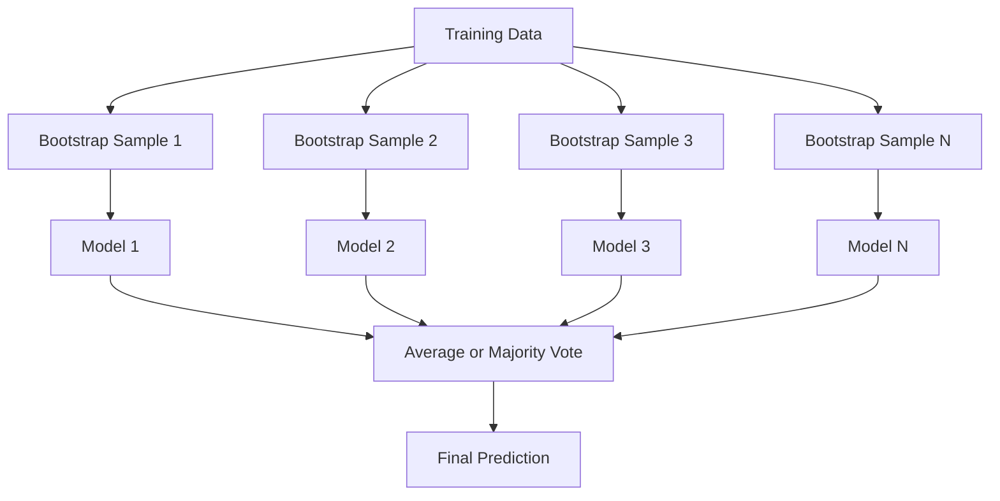
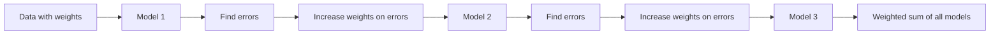
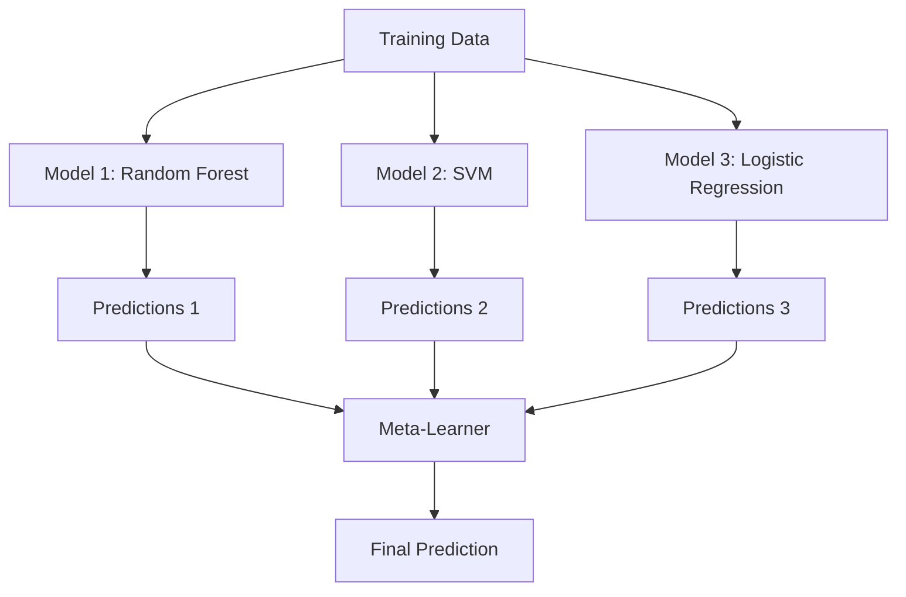

# Ensemble Method

> Sekelompok weak learner, yang digabungkan dengan benar, menjadi strong learner. Ini bukan metafora. Ini sebuah teorema.

**Type:** Build
**Language:** Python
**Prerequisites:** Phase 2, Lesson 10 (Bias-Variance Tradeoff)
**Time:** ~120 minutes

## Tujuan Pembelajaran

- Implementasikan AdaBoost dan gradient boosting dari nol serta jelaskan bagaimana boosting mengurangi bias secara sekuensial
- Bangun sebuah ensemble bagging dan demonstrasikan bagaimana merata-ratakan model yang terdekorrelasi mengurangi variance tanpa menambah bias
- Bandingkan bagging, boosting, dan stacking dari segi komponen error mana yang dituju masing-masing metode
- Evaluasi keberagaman ensemble dan jelaskan mengapa akurasi voting mayoritas membaik dengan lebih banyak weak learner independen

## Masalahnya

Satu decision tree cepat dilatih dan mudah diinterpretasi, tetapi ia overfit. Satu model linear underfit pada batas yang kompleks. Kamu bisa menghabiskan berhari-hari meng-engineering arsitektur model yang sempurna. Atau kamu bisa menggabungkan sejumlah model yang tidak sempurna dan mendapatkan sesuatu yang lebih baik daripada masing-masing secara individual.

Ensemble method melakukan persis ini. Mereka adalah teknik paling andal untuk memenangkan kompetisi Kaggle pada data tabular, mereka menggerakkan sebagian besar sistem produksi ML, dan mereka mengilustrasikan tradeoff bias-variance dalam aksi. Bagging mengurangi variance. Boosting mengurangi bias. Stacking mempelajari model mana yang dipercaya pada input mana.

## Konsepnya

### Mengapa Ensemble Bekerja

Misalkan kamu punya N klasifier independen, masing-masing dengan akurasi p > 0,5. Voting mayoritas punya akurasi:

```
P(majority correct) = sum over k > N/2 of C(N,k) * p^k * (1-p)^(N-k)
```

Untuk 21 klasifier yang masing-masing berakurasi 60%, akurasi voting mayoritas sekitar 74%. Dengan 101 klasifier, ia naik ke 84%. Error-error itu saling menghapus ketika model-model membuat kesalahan yang berbeda.

Syarat kuncinya adalah **keberagaman**. Jika semua model membuat error yang sama, menggabungkannya tidak membantu apa pun. Ensemble bekerja karena mereka menghasilkan model yang beragam melalui:

- Set training yang berbeda (bagging)
- Set fitur yang berbeda (random forest)
- Koreksi error sekuensial (boosting)
- Keluarga model yang berbeda (stacking)

### Bagging (Bootstrap Aggregating)

Bagging menciptakan keberagaman dengan melatih setiap model pada bootstrap sample data training yang berbeda.



Sebuah bootstrap sample ditarik dengan pengambilan ulang dari data asli, berukuran sama dengan aslinya. Sekitar 63,2% sampel unik muncul di setiap bootstrap. Sisa 36,8% (sampel out-of-bag) menyediakan set validasi gratis.

Bagging mengurangi variance tanpa menambah banyak bias. Setiap pohon individual overfit pada bootstrap sample-nya, tetapi overfitting-nya berbeda untuk setiap pohon, jadi merata-ratakan menghapus noise-nya.

**Random forest** adalah bagging dengan twist ekstra: di setiap split, hanya subset acak fitur yang dipertimbangkan. Ini memaksa keberagaman yang lebih besar lagi di antara pohon-pohon. Jumlah fitur kandidat tipikal adalah `sqrt(n_fitur)` untuk klasifikasi dan `n_fitur / 3` untuk regression.

### Boosting (Koreksi Error Sekuensial)

Boosting melatih model secara sekuensial. Setiap model baru berfokus pada contoh-contoh yang salah ditangani model-model sebelumnya.



Boosting mengurangi bias. Setiap model baru memperbaiki error sistematis dari ensemble sejauh ini. Prediksi akhir adalah jumlah berbobot dari semua model, di mana model-model yang lebih baik mendapat bobot lebih tinggi.

Tradeoff-nya: boosting bisa overfit jika kamu menjalankan terlalu banyak putaran, karena ia terus menyesuaikan contoh-contoh yang lebih sulit, beberapa di antaranya mungkin adalah noise.

### AdaBoost

AdaBoost (Adaptive Boosting) adalah algoritma boosting praktis pertama. Ia bekerja dengan learner dasar mana pun, biasanya decision stump (pohon kedalaman-1).

Algoritmanya:

```
1. Initialize sample weights: w_i = 1/N for all i

2. For t = 1 to T:
   a. Train weak learner h_t on weighted data
   b. Compute weighted error:
      err_t = sum(w_i * I(h_t(x_i) != y_i)) / sum(w_i)
   c. Compute model weight:
      alpha_t = 0.5 * ln((1 - err_t) / err_t)
   d. Update sample weights:
      w_i = w_i * exp(-alpha_t * y_i * h_t(x_i))
   e. Normalize weights to sum to 1

3. Final prediction: H(x) = sign(sum(alpha_t * h_t(x)))
```

Model dengan error lebih rendah mendapat alpha lebih tinggi. Sampel yang salah klasifikasi mendapat bobot lebih tinggi sehingga model berikutnya berfokus pada mereka.

### Gradient Boosting

Gradient boosting menggeneralisasi boosting ke loss function apa pun. Alih-alih memberi bobot ulang sampel, ia menyesuaikan setiap model baru pada residu (negative gradient dari loss) dari ensemble saat ini.

```
1. Initialize: F_0(x) = argmin_c sum(L(y_i, c))

2. For t = 1 to T:
   a. Compute pseudo-residuals:
      r_i = -dL(y_i, F_{t-1}(x_i)) / dF_{t-1}(x_i)
   b. Fit a tree h_t to the residuals r_i
   c. Find optimal step size:
      gamma_t = argmin_gamma sum(L(y_i, F_{t-1}(x_i) + gamma * h_t(x_i)))
   d. Update:
      F_t(x) = F_{t-1}(x) + learning_rate * gamma_t * h_t(x)

3. Final prediction: F_T(x)
```

Untuk squared error loss, pseudo-residual hanyalah residu aktual: `r_i = y_i - F_{t-1}(x_i)`. Setiap pohon secara harfiah menyesuaikan error dari ensemble sebelumnya.

Learning rate (shrinkage) mengontrol seberapa besar kontribusi setiap pohon. Learning rate lebih kecil membutuhkan lebih banyak pohon tetapi menggeneralisasi lebih baik. Nilai tipikal: 0,01 hingga 0,3.

### XGBoost: Mengapa Ia Mendominasi Data Tabular

XGBoost (eXtreme Gradient Boosting) adalah gradient boosting dengan optimasi rekayasa yang membuatnya cepat, akurat, dan tahan terhadap overfitting:

- **Objektif terregularisasi:** penalti L1 dan L2 pada bobot daun mencegah pohon individual menjadi terlalu percaya diri
- **Aproksimasi orde-kedua:** memakai turunan pertama dan kedua dari loss, memberikan keputusan split yang lebih baik
- **Split sadar-sparsitas:** menangani nilai yang hilang secara native dengan mempelajari arah terbaik untuk data yang hilang di setiap split
- **Column subsampling:** seperti random forest, menyampel fitur di setiap split demi keberagaman
- **Weighted quantile sketch:** menemukan titik split untuk fitur kontinu secara efisien pada data terdistribusi
- **Struktur blok sadar-cache:** tata letak memori yang dioptimasi untuk garis cache CPU

Untuk data tabular, XGBoost (dan penerusnya LightGBM) secara konsisten mengungguli neural network. Ini tidak akan berubah dalam waktu dekat. Jika datamu muat dalam sebuah tabel dengan baris dan kolom, mulailah dengan gradient boosting.

### Stacking (Meta-Learning)

Stacking memakai prediksi dari beberapa model dasar sebagai fitur untuk sebuah meta-learner.



Meta-learner mempelajari model dasar mana yang dipercaya untuk input mana. Jika random forest lebih baik di wilayah tertentu dan SVM di wilayah lain, meta-learner akan belajar untuk mengarahkannya sesuai.

Untuk menghindari data leakage, prediksi model dasar harus dihasilkan melalui cross-validation pada set training. Kamu tidak pernah melatih model dasar dan menghasilkan meta-fitur pada data yang sama.

### Voting

Ensemble paling sederhana. Hanya menggabungkan prediksi secara langsung.

- **Hard voting:** voting mayoritas pada label kelas.
- **Soft voting:** rata-ratakan probabilitas yang diprediksi, pilih kelas dengan probabilitas rata-rata tertinggi. Biasanya lebih baik karena ia memakai informasi keyakinan.

```figure
f3-ensemble-average
```

## Bangun Sendiri

### Langkah 1: Decision Stump (Learner Dasar)

Kode di `code/ensembles.py` mengimplementasikan semuanya dari nol. Kita mulai dengan sebuah decision stump: sebuah pohon dengan satu split.

```python
class DecisionStump:
    def __init__(self):
        self.feature_idx = None
        self.threshold = None
        self.polarity = 1
        self.alpha = None

    def fit(self, X, y, weights):
        n_samples, n_features = X.shape
        best_error = float("inf")

        for f in range(n_features):
            thresholds = np.unique(X[:, f])
            for thresh in thresholds:
                for polarity in [1, -1]:
                    pred = np.ones(n_samples)
                    pred[polarity * X[:, f] < polarity * thresh] = -1
                    error = np.sum(weights[pred != y])
                    if error < best_error:
                        best_error = error
                        self.feature_idx = f
                        self.threshold = thresh
                        self.polarity = polarity

    def predict(self, X):
        n = X.shape[0]
        pred = np.ones(n)
        idx = self.polarity * X[:, self.feature_idx] < self.polarity * self.threshold
        pred[idx] = -1
        return pred
```

### Langkah 2: AdaBoost dari Nol

```python
class AdaBoostScratch:
    def __init__(self, n_estimators=50):
        self.n_estimators = n_estimators
        self.stumps = []
        self.alphas = []

    def fit(self, X, y):
        n = X.shape[0]
        weights = np.full(n, 1 / n)

        for _ in range(self.n_estimators):
            stump = DecisionStump()
            stump.fit(X, y, weights)
            pred = stump.predict(X)

            err = np.sum(weights[pred != y])
            err = np.clip(err, 1e-10, 1 - 1e-10)

            alpha = 0.5 * np.log((1 - err) / err)
            weights *= np.exp(-alpha * y * pred)
            weights /= weights.sum()

            stump.alpha = alpha
            self.stumps.append(stump)
            self.alphas.append(alpha)

    def predict(self, X):
        total = sum(a * s.predict(X) for a, s in zip(self.alphas, self.stumps))
        return np.sign(total)
```

### Langkah 3: Gradient Boosting dari Nol

```python
class GradientBoostingScratch:
    def __init__(self, n_estimators=100, learning_rate=0.1, max_depth=3):
        self.n_estimators = n_estimators
        self.lr = learning_rate
        self.max_depth = max_depth
        self.trees = []
        self.initial_pred = None

    def fit(self, X, y):
        self.initial_pred = np.mean(y)
        current_pred = np.full(len(y), self.initial_pred)

        for _ in range(self.n_estimators):
            residuals = y - current_pred
            tree = SimpleRegressionTree(max_depth=self.max_depth)
            tree.fit(X, residuals)
            update = tree.predict(X)
            current_pred += self.lr * update
            self.trees.append(tree)

    def predict(self, X):
        pred = np.full(X.shape[0], self.initial_pred)
        for tree in self.trees:
            pred += self.lr * tree.predict(X)
        return pred
```

### Langkah 4: Bandingkan dengan sklearn

Kode memverifikasi bahwa implementasi from-scratch kita menghasilkan akurasi yang mirip dengan `AdaBoostClassifier` dan `GradientBoostingClassifier` dari sklearn, dan membandingkan semua metode berdampingan.

## Gunakan

### Kapan Memakai Metode Mana

| Method | Reduces | Best for | Watch out for |
|--------|---------|----------|---------------|
| Bagging / Random Forest | Variance | Noisy data, many features | Does not help with bias |
| AdaBoost | Bias | Clean data, simple base learners | Sensitive to outliers and noise |
| Gradient Boosting | Bias | Tabular data, competitions | Slow to train, easy to overfit without tuning |
| XGBoost / LightGBM | Both | Production tabular ML | Many hyperparameters |
| Stacking | Both | Getting last 1-2% accuracy | Complex, risk of overfitting meta-learner |
| Voting | Variance | Quick combination of diverse models | Only helps if models are diverse |

### Stack Produksi untuk Data Tabular

Untuk sebagian besar masalah prediksi tabular, inilah urutan untuk dicoba:

1. **LightGBM atau XGBoost** dengan parameter default
2. Setel n_estimators, learning_rate, max_depth, min_child_weight
3. Jika kamu butuh 0,5% terakhir, bangun sebuah ensemble stacking dengan 3-5 model yang beragam
4. Gunakan cross-validation di seluruh proses

Neural network pada data tabular hampir selalu lebih buruk dari gradient boosting, meski ada upaya riset berkelanjutan. TabNet, NODE, dan arsitektur serupa kadang menyamai tetapi jarang mengalahkan XGBoost yang sudah disetel baik.

## Rilis

Pelajaran ini menghasilkan `outputs/prompt-ensemble-selector.md` -- sebuah prompt yang membantumu memilih metode ensemble yang tepat untuk dataset tertentu. Deskripsikan datamu (ukuran, tipe fitur, tingkat noise, keseimbangan kelas) dan masalah yang kamu pecahkan. Prompt itu menuntun melalui checklist keputusan, merekomendasikan sebuah metode, menyarankan hyperparameter awal, dan memperingatkan tentang kesalahan-kesalahan umum untuk metode tersebut. Juga menghasilkan `outputs/skill-ensemble-builder.md` dengan panduan pemilihan lengkap.

## Latihan

1. Modifikasi implementasi AdaBoost untuk melacak akurasi training setelah setiap putaran. Plot akurasi vs jumlah estimator. Kapan ia konvergen?
2. Implementasikan random forest dari nol dengan menambahkan subsampling fitur acak ke pohon regression. Latih 100 pohon dengan `max_features=sqrt(n_fitur)` dan rata-ratakan prediksinya. Bandingkan reduksi variance dengan satu pohon.
3. Pada implementasi gradient boosting, tambahkan early stopping: lacak loss validasi setelah setiap putaran dan berhenti ketika tidak membaik selama 10 putaran berturut-turut. Berapa banyak pohon yang sebenarnya dibutuhkan?
4. Bangun sebuah ensemble stacking dengan tiga model dasar (logistic regression, decision tree, k-nearest neighbors) dan sebuah meta-learner logistic regression. Gunakan cross-validation 5-fold untuk menghasilkan meta-fitur. Bandingkan dengan masing-masing model dasar secara sendiri.
5. Jalankan XGBoost pada dataset yang sama dengan parameter default. Bandingkan akurasinya dengan gradient boosting from-scratch-mu. Ukur waktu keduanya. Seberapa besar selisih kecepatannya?

## Istilah Kunci

| Term | What people say | What it actually means |
|------|----------------|----------------------|
| Bagging | "Train on random subsets" | Bootstrap aggregating: train models on bootstrap samples, average predictions to reduce variance |
| Boosting | "Focus on hard examples" | Train models sequentially, each correcting errors of the ensemble so far, to reduce bias |
| AdaBoost | "Reweight the data" | Boosting via sample weight updates; misclassified points get higher weight for the next learner |
| Gradient boosting | "Fit the residuals" | Boosting via fitting each new model to the negative gradient of the loss function |
| XGBoost | "The Kaggle weapon" | Gradient boosting with regularization, second-order optimization, and systems-level speed tricks |
| Stacking | "Models on top of models" | Use predictions of base models as input features for a meta-learner |
| Random forest | "Many randomized trees" | Bagging with decision trees, adding random feature subsampling at each split for diversity |
| Ensemble diversity | "Make different mistakes" | Models must be uncorrelated in their errors for the ensemble to improve over individuals |
| Out-of-bag error | "Free validation" | Samples not in a bootstrap draw (~36.8%) serve as a validation set without needing a holdout |

## Bacaan Lanjutan

- [Schapire & Freund: Boosting: Foundations and Algorithms](https://mitpress.mit.edu/9780262526036/) -- the book by AdaBoost's creators
- [Friedman: Greedy Function Approximation: A Gradient Boosting Machine (2001)](https://doi.org/10.1214/aos/1013203451) -- the original gradient boosting paper
- [Chen & Guestrin: XGBoost (2016)](https://arxiv.org/abs/1603.02754) -- the XGBoost paper
- [Wolpert: Stacked Generalization (1992)](https://www.sciencedirect.com/science/article/abs/pii/S0893608005800231) -- the original stacking paper
- [scikit-learn Ensemble Methods](https://scikit-learn.org/stable/modules/ensemble.html) -- practical reference
