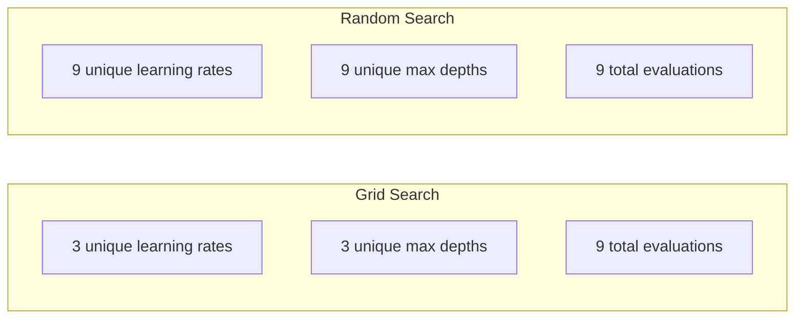
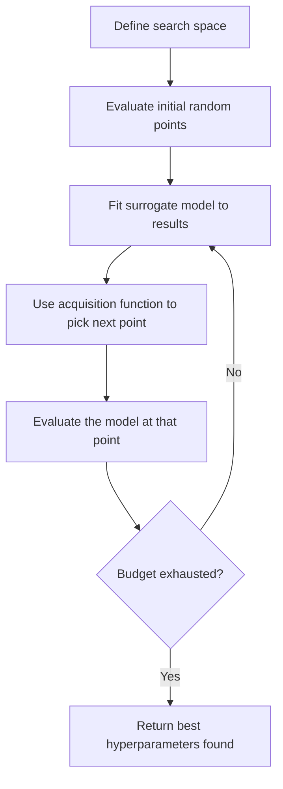
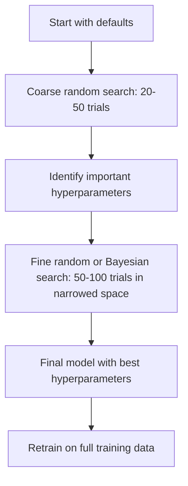
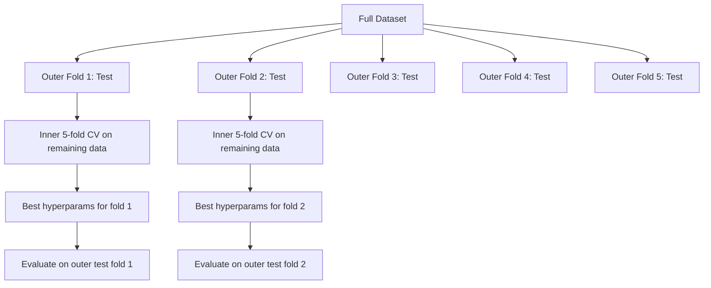

# Hyperparameter Tuning

> Hyperparameter adalah kenop yang kamu putar sebelum training dimulai. Memutarnya dengan baik adalah perbedaan antara model yang biasa saja dan yang hebat.

**Type:** Build
**Language:** Python
**Prerequisites:** Phase 2, Lesson 11 (Ensemble Methods)
**Time:** ~90 minutes

## Tujuan Pembelajaran

- Implementasikan grid search, random search, dan optimasi Bayesian dari nol serta bandingkan efisiensi sampel mereka
- Jelaskan mengapa random search mengalahkan grid search ketika sebagian besar hyperparameter punya efek dimensi rendah
- Bangun loop optimasi Bayesian menggunakan model surrogate dan acquisition function untuk memandu pencarian
- Rancang strategi penyetelan hyperparameter yang menghindari overfitting pada set validasi melalui cross-validation yang tepat

## Masalahnya

Model gradient boosting-mu punya learning rate, jumlah pohon, max depth, jumlah sampel per daun, rasio subsample, dan rasio sampel kolom. Itu enam hyperparameter. Jika masing-masing punya 5 nilai yang masuk akal, grid-nya punya 5^6 = 15.625 kombinasi. Melatih masing-masing memakan waktu 10 detik. Itu 43 jam komputasi untuk mencobanya semua.

Grid search adalah pendekatan yang jelas dan yang terburuk saat skala besar. Random search melakukan lebih baik dengan komputasi lebih sedikit. Optimasi Bayesian melakukan lebih baik lagi dengan belajar dari evaluasi masa lalu. Mengetahui strategi mana yang dipakai, dan hyperparameter mana yang benar-benar penting, menghemat hari-hari waktu GPU yang terbuang.

## Konsepnya

### Parameter vs Hyperparameter

Parameter dipelajari selama training (weight, bias, threshold split). Hyperparameter diatur sebelum training dimulai dan mengontrol bagaimana pembelajaran terjadi.

| Hyperparameter | What it controls | Typical range |
|---------------|-----------------|---------------|
| Learning rate | Step size per update | 0.001 to 1.0 |
| Number of trees/epochs | How long to train | 10 to 10,000 |
| Max depth | Model complexity | 1 to 30 |
| Regularization (lambda) | Overfitting prevention | 0.0001 to 100 |
| Batch size | Gradient estimation noise | 16 to 512 |
| Dropout rate | Fraction of neurons dropped | 0.0 to 0.5 |

### Grid Search

Grid search mengevaluasi setiap kombinasi nilai yang dispesifikasikan. Ia menyeluruh dan mudah dipahami, tetapi berskala eksponensial terhadap jumlah hyperparameter.

```
Grid for 2 hyperparameters:

  learning_rate: [0.01, 0.1, 1.0]
  max_depth:     [3, 5, 7]

  Evaluations: 3 x 3 = 9 combinations

  (0.01, 3)  (0.01, 5)  (0.01, 7)
  (0.1,  3)  (0.1,  5)  (0.1,  7)
  (1.0,  3)  (1.0,  5)  (1.0,  7)
```

Grid search punya kecacatan mendasar: jika satu hyperparameter penting dan yang lain tidak, sebagian besar evaluasi terbuang. Kamu hanya mendapat 3 nilai unik dari parameter penting dari 9 evaluasi.

### Random Search

Random search menyampel hyperparameter dari distribusi alih-alih sebuah grid. Dengan anggaran yang sama dari 9 evaluasi, kamu mendapat 9 nilai unik dari setiap hyperparameter.



Mengapa random mengalahkan grid (Bergstra & Bengio, 2012):

- Sebagian besar hyperparameter punya dimensi efektif yang rendah. Hanya 1-2 dari 6 hyperparameter yang biasanya penting untuk masalah tertentu.
- Grid search membuang evaluasi pada dimensi yang tidak penting.
- Random search menutupi dimensi-dimensi penting lebih padat dengan anggaran yang sama.
- Pada 60 percobaan acak, kamu punya peluang 95% menemukan sebuah titik dalam 5% dari optimum (jika ada di ruang pencarian).

### Optimasi Bayesian

Random search mengabaikan hasil. Ia tidak belajar bahwa learning rate tinggi menyebabkan divergensi atau bahwa kedalaman 3 secara konsisten mengungguli kedalaman 10. Optimasi Bayesian memakai evaluasi masa lalu untuk memutuskan di mana mencari berikutnya.



Dua komponen kunci:

**Surrogate model:** Sebuah model yang murah dievaluasi (biasanya Gaussian process) yang mengaproksimasi objektif yang mahal. Ia memberikan prediksi dan estimasi ketidakpastian di titik mana pun dalam ruang pencarian.

**Acquisition function:** Memutuskan di mana mengevaluasi berikutnya dengan menyeimbangkan exploitation (mencari di dekat titik baik yang diketahui) dan eksplorasi (mencari di mana ketidakpastiannya tinggi). Pilihan yang umum:

- **Expected Improvement (EI):** Seberapa banyak peningkatan atas yang terbaik saat ini yang kita harapkan di titik ini?
- **Upper Confidence Bound (UCB):** Prediksi plus kelipatan ketidakpastian. UCB lebih tinggi berarti menjanjikan atau belum dieksplorasi.
- **Probability of Improvement (PI):** Berapa probabilitas titik ini mengalahkan yang terbaik saat ini?

Optimasi Bayesian biasanya menemukan hyperparameter yang lebih baik daripada random search dengan evaluasi 2-5x lebih sedikit. Overhead menyesuaikan model surrogate bisa diabaikan dibanding melatih model yang sebenarnya.

### Early Stopping

Tidak setiap run training harus selesai. Jika sebuah konfigurasi jelas buruk setelah 10 epoch, hentikan dan lanjutkan. Ini adalah early stopping dalam konteks pencarian hyperparameter.

Strategi:
- **Berbasis kesabaran:** Berhenti jika loss validasi tidak membaik selama N epoch berturut-turut
- **Median pruning:** Berhenti jika hasil antara dari percobaan lebih buruk daripada median dari percobaan yang selesai pada langkah yang sama
- **Hyperband:** Alokasikan anggaran kecil ke banyak konfigurasi, lalu tingkatkan anggaran secara bertahap untuk yang terbaik

Hyperband khususnya efektif. Ia memulai 81 konfigurasi dengan masing-masing 1 epoch, mempertahankan sepertiga teratas, memberi mereka 3 epoch, mempertahankan sepertiga teratas, dan seterusnya. Ini menemukan konfigurasi yang baik 10-50x lebih cepat daripada mengevaluasi semua konfigurasi dengan anggaran penuh.

### Learning Rate Scheduler

Learning rate hampir selalu hyperparameter terpenting. Alih-alih menjaganya tetap tetap, scheduler menyesuaikannya selama training.

| Scheduler | Formula | When to use |
|-----------|---------|-------------|
| Step decay | Multiply by 0.1 every N epochs | Classic CNN training |
| Cosine annealing | lr * 0.5 * (1 + cos(pi * t / T)) | Modern default |
| Warmup + decay | Linear increase then cosine decay | Transformers |
| One-cycle | Increase then decrease over one cycle | Fast convergence |
| Reduce on plateau | Reduce by factor when metric stalls | Safe default |

### Importance Hyperparameter

Tidak semua hyperparameter sama pentingnya. Riset tentang random forest (Probst et al., 2019) dan gradient boosting menunjukkan pola yang konsisten:

**Penting tinggi:**
- Learning rate (selalu setel ini lebih dulu)
- Jumlah estimator / epoch (gunakan early stopping alih-alih menyetel)
- Kekuatan regularisasi

**Penting sedang:**
- Max depth / jumlah layer
- Sampel minimum per daun / weight decay
- Rasio subsample

**Penting rendah:**
- Max features (untuk random forest)
- Pilihan fungsi aktivasi tertentu
- Batch size (dalam rentang yang wajar)

Setel yang penting terlebih dahulu, biarkan sisanya pada default.

### Strategi Praktis



Alur kerja konkretnya:

1. **Mulai dengan default pustaka.** Ini dipilih oleh praktisi berpengalaman dan sering sudah 80% menuju ke sana.
2. **Random search kasar.** Rentang luas, 20-50 percobaan. Gunakan early stopping untuk membunuh run yang buruk dengan cepat.
3. **Analisis hasil.** Hyperparameter mana yang berkorelasi dengan performa? Persempit ruang pencarian.
4. **Pencarian halus.** Optimasi Bayesian atau random search terfokus di ruang yang sudah dipersempit. 50-100 percobaan.
5. **Latih ulang pada seluruh data training** dengan hyperparameter terbaik yang ditemukan.

### Integrasi Cross-Validation

Menyetel hyperparameter pada satu pembagian validasi berisiko. Hyperparameter terbaik mungkin overfit pada fold validasi tertentu. Nested cross-validation memecahkan ini dengan menggunakan dua loop:

- **Loop luar (evaluasi):** membagi data menjadi train+val dan test. Melaporkan performa tanpa bias.
- **Loop dalam (penyetelan):** membagi train+val menjadi train dan val. Menemukan hyperparameter terbaik.



Setiap fold luar menemukan hyperparameter terbaiknya sendiri secara independen. Skor luar adalah estimasi tanpa bias dari performa generalisasi.

Dengan sklearn:

```python
from sklearn.model_selection import cross_val_score, GridSearchCV
from sklearn.ensemble import GradientBoostingRegressor

inner_cv = GridSearchCV(
    GradientBoostingRegressor(),
    param_grid={
        "learning_rate": [0.01, 0.05, 0.1],
        "max_depth": [2, 3, 5],
        "n_estimators": [50, 100, 200],
    },
    cv=5,
    scoring="neg_mean_squared_error",
)

outer_scores = cross_val_score(
    inner_cv, X, y, cv=5, scoring="neg_mean_squared_error"
)

print(f"Nested CV MSE: {-outer_scores.mean():.4f} +/- {outer_scores.std():.4f}")
```

Ini mahal (5 fold luar x 5 fold dalam x 27 titik grid = 675 penyesuaian model), tetapi memberimu estimasi performa yang bisa dipercaya. Pakai ketika melaporkan hasil akhir di makalah atau ketika taruhannya tinggi.

### Tips Praktis

**Mulai dengan learning rate.** Ini selalu hyperparameter terpenting untuk metode berbasis gradien. Learning rate yang buruk membuat semua yang lain tidak relevan. Fiksasi hyperparameter lain pada default dan sapu learning rate lebih dulu.

**Pakai distribusi log-uniform untuk learning rate dan regularisasi.** Selisih antara 0,001 dan 0,01 sama pentingnya dengan selisih antara 0,1 dan 1,0. Mencari secara linear membuang anggaran di ujung yang besar.

**Pakai early stopping alih-alih menyetel n_estimators.** Untuk boosting dan neural network, atur n_estimators atau epoch tinggi dan biarkan early stopping memutuskan kapan berhenti. Ini menghapus satu hyperparameter dari pencarian.

**Alokasi anggaran.** Habiskan 60% anggaran penyetelanmu pada 2 hyperparameter terpenting. Habiskan sisa 40% untuk semuanya. 2 teratas menyumbang sebagian besar variasi performa.

**Skala itu penting.** Jangan pernah mencari batch size pada skala log (16, 32, 64 sudah baik). Selalu cari learning rate pada skala log. Cocokkan distribusi pencarian dengan bagaimana hyperparameter memengaruhi model.

| Model Type | Top Hyperparameters | Recommended Search | Budget |
|-----------|--------------------|--------------------|--------|
| Random Forest | n_estimators, max_depth, min_samples_leaf | Random search, 50 trials | Low (fast training) |
| Gradient Boosting | learning_rate, n_estimators, max_depth | Bayesian, 100 trials + early stopping | Medium |
| Neural Network | learning_rate, weight_decay, batch_size | Bayesian or random, 100+ trials | High (slow training) |
| SVM | C, gamma (RBF kernel) | Grid on log scale, 25-50 trials | Low (2 params) |
| Lasso/Ridge | alpha | 1D search on log scale, 20 trials | Very low |
| XGBoost | learning_rate, max_depth, subsample, colsample | Bayesian, 100-200 trials + early stopping | Medium |

**Jika ragu:** random search dengan 2x jumlah hyperparameter sebagai percobaan (misalnya, 6 hyperparameter = minimal 12+ percobaan). Kamu akan terkejut betapa seringnya random search dengan 50 percobaan mengalahkan grid search yang dirancang hati-hati.

```figure
k-fold-cv
```

## Bangun Sendiri

### Langkah 1: Grid Search dari Nol

Kode di `code/tuning.py` mengimplementasikan grid search, random search, dan sebuah optimizer Bayesian sederhana dari nol.

```python
def grid_search(model_fn, param_grid, X_train, y_train, X_val, y_val):
    keys = list(param_grid.keys())
    values = list(param_grid.values())
    best_score = -float("inf")
    best_params = None
    n_evals = 0

    for combo in itertools.product(*values):
        params = dict(zip(keys, combo))
        model = model_fn(**params)
        model.fit(X_train, y_train)
        score = evaluate(model, X_val, y_val)
        n_evals += 1

        if score > best_score:
            best_score = score
            best_params = params

    return best_params, best_score, n_evals
```

### Langkah 2: Random Search dari Nol

```python
def random_search(model_fn, param_distributions, X_train, y_train,
                  X_val, y_val, n_iter=50, seed=42):
    rng = np.random.RandomState(seed)
    best_score = -float("inf")
    best_params = None

    for _ in range(n_iter):
        params = {k: sample(v, rng) for k, v in param_distributions.items()}
        model = model_fn(**params)
        model.fit(X_train, y_train)
        score = evaluate(model, X_val, y_val)

        if score > best_score:
            best_score = score
            best_params = params

    return best_params, best_score, n_iter
```

### Langkah 3: Optimasi Bayesian (Disederhanakan)

Inti idenya: sesuaikan sebuah Gaussian process pada pasangan (hyperparameter, skor) yang diamati, lalu gunakan sebuah acquisition function untuk memutuskan di mana melihat berikutnya.

```python
class SimpleBayesianOptimizer:
    def __init__(self, search_space, n_initial=5):
        self.search_space = search_space
        self.n_initial = n_initial
        self.X_observed = []
        self.y_observed = []

    def _kernel(self, x1, x2, length_scale=1.0):
        dists = np.sum((x1[:, None, :] - x2[None, :, :]) ** 2, axis=2)
        return np.exp(-0.5 * dists / length_scale ** 2)

    def _fit_gp(self, X_new):
        X_obs = np.array(self.X_observed)
        y_obs = np.array(self.y_observed)
        y_mean = y_obs.mean()
        y_centered = y_obs - y_mean

        K = self._kernel(X_obs, X_obs) + 1e-4 * np.eye(len(X_obs))
        K_star = self._kernel(X_new, X_obs)

        L = np.linalg.cholesky(K)
        alpha = np.linalg.solve(L.T, np.linalg.solve(L, y_centered))
        mu = K_star @ alpha + y_mean

        v = np.linalg.solve(L, K_star.T)
        var = 1.0 - np.sum(v ** 2, axis=0)
        var = np.maximum(var, 1e-6)

        return mu, var

    def _expected_improvement(self, mu, var, best_y):
        sigma = np.sqrt(var)
        z = (mu - best_y) / (sigma + 1e-10)
        ei = sigma * (z * norm_cdf(z) + norm_pdf(z))
        return ei

    def suggest(self):
        if len(self.X_observed) < self.n_initial:
            return sample_random(self.search_space)

        candidates = [sample_random(self.search_space) for _ in range(500)]
        X_cand = np.array([to_vector(c) for c in candidates])
        mu, var = self._fit_gp(X_cand)
        ei = self._expected_improvement(mu, var, max(self.y_observed))
        return candidates[np.argmax(ei)]

    def observe(self, params, score):
        self.X_observed.append(to_vector(params))
        self.y_observed.append(score)
```

Surrogate GP memberikan dua hal di setiap titik kandidat: skor prediksi (mu) dan ketidakpastian (var). Expected Improvement menyeimbangkan ini: ia menguntungkan titik-titik di mana model memprediksi skor tinggi ATAU di mana ketidakpastiannya tinggi. Di awal, sebagian besar titik punya ketidakpastian tinggi sehingga optimizer mengeksplorasi. Nanti, ia berfokus pada wilayah yang paling menjanjikan.

### Langkah 4: Bandingkan Semua Metode

Jalankan ketiga metode pada objektif sintetis yang sama dan bandingkan. Perbandingan ini memakai wrapper yang disederhanakan yang memanggil setiap optimizer dengan fungsi objektif langsung (tanpa training model), jadi API-nya berbeda dari implementasi berbasis model di atas:

```python
def synthetic_objective(params):
    lr = params["learning_rate"]
    depth = params["max_depth"]
    return -(np.log10(lr) + 2) ** 2 - (depth - 4) ** 2 + 10

param_grid = {
    "learning_rate": [0.001, 0.01, 0.1, 1.0],
    "max_depth": [2, 3, 4, 5, 6, 7, 8],
}

grid_best = None
grid_score = -float("inf")
grid_history = []
for combo in itertools.product(*param_grid.values()):
    params = dict(zip(param_grid.keys(), combo))
    score = synthetic_objective(params)
    grid_history.append((params, score))
    if score > grid_score:
        grid_score = score
        grid_best = params

param_dist = {
    "learning_rate": ("log_float", 0.001, 1.0),
    "max_depth": ("int", 2, 8),
}

rand_best = None
rand_score = -float("inf")
rand_history = []
rng = np.random.RandomState(42)
for _ in range(28):
    params = {k: sample(v, rng) for k, v in param_dist.items()}
    score = synthetic_objective(params)
    rand_history.append((params, score))
    if score > rand_score:
        rand_score = score
        rand_best = params

optimizer = SimpleBayesianOptimizer(param_dist, n_initial=5)
bayes_history = []
for _ in range(28):
    params = optimizer.suggest()
    score = synthetic_objective(params)
    optimizer.observe(params, score)
    bayes_history.append((params, score))
bayes_score = max(s for _, s in bayes_history)

print(f"{'Method':<20} {'Best Score':>12} {'Evaluations':>12}")
print("-" * 50)
print(f"{'Grid Search':<20} {grid_score:>12.4f} {len(grid_history):>12}")
print(f"{'Random Search':<20} {rand_score:>12.4f} {len(rand_history):>12}")
print(f"{'Bayesian Opt':<20} {bayes_score:>12.4f} {len(bayes_history):>12}")
```

Dengan anggaran yang sama, optimasi Bayesian biasanya menemukan skor terbaik paling cepat karena ia tidak membuang evaluasi di wilayah yang jelas buruk. Random search menutupi lebih banyak wilayah daripada grid search. Grid search hanya menang ketika kamu punya sangat sedikit hyperparameter dan mampu bersikap menyeluruh.

## Gunakan

### Optuna dalam Praktik

Optuna adalah pustaka yang direkomendasikan untuk penyetelan hyperparameter yang serius. Ia mendukung pruning, pencarian terdistribusi, dan visualisasi out of the box.

```python
import optuna

def objective(trial):
    lr = trial.suggest_float("learning_rate", 1e-4, 1e-1, log=True)
    n_est = trial.suggest_int("n_estimators", 50, 500)
    max_depth = trial.suggest_int("max_depth", 2, 10)

    model = GradientBoostingRegressor(
        learning_rate=lr,
        n_estimators=n_est,
        max_depth=max_depth,
    )
    model.fit(X_train, y_train)
    return mean_squared_error(y_val, model.predict(X_val))

study = optuna.create_study(direction="minimize")
study.optimize(objective, n_trials=100)

print(f"Best params: {study.best_params}")
print(f"Best MSE: {study.best_value:.4f}")
```

Fitur kunci Optuna:
- `suggest_float(..., log=True)` untuk parameter yang paling baik dicari pada skala log (learning rate, regularisasi)
- `suggest_int` untuk parameter bilangan bulat
- `suggest_categorical` untuk pilihan diskret
- MedianPruner bawaan untuk early stopping percobaan yang buruk
- `study.trials_dataframe()` untuk analisis

### Optuna dengan Pruning

Pruning menghentikan percobaan yang tidak menjanjikan lebih awal, menghemat komputasi yang masif. Inilah polanya:

```python
import optuna
from sklearn.model_selection import cross_val_score

def objective(trial):
    params = {
        "learning_rate": trial.suggest_float("lr", 1e-4, 0.5, log=True),
        "max_depth": trial.suggest_int("max_depth", 2, 10),
        "n_estimators": trial.suggest_int("n_estimators", 50, 500),
        "subsample": trial.suggest_float("subsample", 0.5, 1.0),
    }

    model = GradientBoostingRegressor(**params)
    scores = cross_val_score(model, X_train, y_train, cv=3,
                             scoring="neg_mean_squared_error")
    mean_score = -scores.mean()

    trial.report(mean_score, step=0)
    if trial.should_prune():
        raise optuna.TrialPruned()

    return mean_score

pruner = optuna.pruners.MedianPruner(n_startup_trials=10, n_warmup_steps=5)
study = optuna.create_study(direction="minimize", pruner=pruner)
study.optimize(objective, n_trials=200)
```

`MedianPruner` menghentikan sebuah percobaan jika nilai antaranya lebih buruk daripada median dari semua percobaan yang selesai pada langkah yang sama. Pruning membutuhkan pemanggilan `trial.report()` untuk melaporkan metrik antara dan `trial.should_prune()` untuk memeriksa apakah percobaan harus dihentikan. `n_startup_trials=10` memastikan setidaknya 10 percobaan selesai sepenuhnya sebelum pruning mulai berlaku. Ini biasanya menghemat 40-60% total komputasi.

### Tuner Bawaan sklearn

Untuk eksperimen cepat, sklearn menyediakan `GridSearchCV`, `RandomizedSearchCV`, dan `HalvingRandomSearchCV`:

```python
from sklearn.model_selection import RandomizedSearchCV
from scipy.stats import loguniform, randint

param_dist = {
    "learning_rate": loguniform(1e-4, 0.5),
    "max_depth": randint(2, 10),
    "n_estimators": randint(50, 500),
}

search = RandomizedSearchCV(
    GradientBoostingRegressor(),
    param_dist,
    n_iter=100,
    cv=5,
    scoring="neg_mean_squared_error",
    random_state=42,
    n_jobs=-1,
)
search.fit(X_train, y_train)
print(f"Best params: {search.best_params_}")
print(f"Best CV MSE: {-search.best_score_:.4f}")
```

Gunakan `loguniform` dari scipy untuk learning rate dan regularisasi. Gunakan `randint` untuk hyperparameter bilangan bulat. Flag `n_jobs=-1` mem-paralelkan di seluruh core CPU.

### Kesalahan Umum dalam Penyetelan Hyperparameter

**Data leakage melalui preprocessing.** Jika kamu menyesuaikan sebuah scaler pada seluruh dataset sebelum cross-validation, informasi dari fold validasi merembes ke training. Selalu letakkan preprocessing di dalam sebuah `Pipeline` sehingga ia hanya di-fit pada fold training.

**Overfitting ke set validasi.** Menjalankan ribuan percobaan secara efektif melatih pada set validasi. Gunakan nested cross-validation untuk estimasi performa akhir, atau sisihkan sebuah set test terpisah yang tidak pernah kamu sentuh selama penyetelan.

**Mencari rentang yang terlalu sempit.** Jika nilai terbaikmu berada di batas ruang pencariannya, kamu belum mencari cukup luas. Nilai optimal mungkin berada di luar rentangmu. Selalu periksa apakah parameter terbaik berada di tepi.

**Mengabaikan efek interaksi.** Learning rate dan jumlah estimator berinteraksi kuat dalam boosting. Learning rate rendah membutuhkan lebih banyak estimator. Menyetelnya secara independen memberikan hasil lebih buruk daripada menyetelnya bersama.

**Tidak memakai early stopping untuk model iteratif.** Untuk gradient boosting dan neural network, atur n_estimators atau epoch ke nilai tinggi dan gunakan early stopping. Ini secara ketat lebih baik daripada menyetel jumlah iterasi sebagai hyperparameter.

## Latihan

1. Jalankan grid search dan random search dengan total anggaran yang sama (misalnya, 50 evaluasi). Bandingkan skor terbaik yang ditemukan. Jalankan eksperimennya 10 kali dengan seed berbeda. Seberapa sering random search menang?
2. Implementasikan Hyperband dari nol. Mulai dengan 81 konfigurasi, masing-masing dilatih selama 1 epoch. Pertahankan 1/3 teratas di setiap putaran dan tigakan anggarannya. Bandingkan total komputasi (jumlah seluruh epoch di semua konfigurasi) dengan menjalankan 81 konfigurasi dengan anggaran penuh.
3. Tambahkan sebuah learning rate scheduler (cosine annealing) ke implementasi gradient boosting dari Lesson 11. Apakah ini membantu dibanding learning rate yang tetap?
4. Gunakan Optuna untuk menyetel RandomForestClassifier pada dataset nyata (misalnya, dataset breast cancer sklearn). Gunakan `optuna.visualization.plot_param_importances(study)` untuk melihat hyperparameter mana yang paling penting. Apakah ini cocok dengan peringkat importance dari pelajaran ini?
5. Implementasikan sebuah acquisition function sederhana (Expected Improvement) dan demonstrasikan eksplorasi vs exploitation. Plot mean dan ketidakpastian model surrogate, dan tunjukkan di mana EI memilih untuk mengevaluasi berikutnya.

## Istilah Kunci

| Term | What people say | What it actually means |
|------|----------------|----------------------|
| Hyperparameter | "A setting you choose" | A value set before training that controls the learning process, not learned from data |
| Grid search | "Try every combination" | Exhaustive search over a specified parameter grid. Exponential cost. |
| Random search | "Just sample randomly" | Sample hyperparameters from distributions. Covers important dimensions better than grid search. |
| Bayesian optimization | "Smart search" | Uses a surrogate model of the objective to decide where to evaluate next, balancing exploration and exploitation |
| Surrogate model | "A cheap approximation" | A model (usually Gaussian process) that approximates the expensive objective function from observed evaluations |
| Acquisition function | "Where to look next" | Scores candidate points by balancing expected improvement with uncertainty. EI and UCB are common choices. |
| Early stopping | "Stop wasting time" | Terminate training early when validation performance stops improving |
| Hyperband | "Tournament bracket for configs" | Adaptive resource allocation: start many configs with small budgets, keep the best and increase their budgets |
| Learning rate scheduler | "Change lr during training" | A function that adjusts the learning rate over the course of training for better convergence |

## Bacaan Lanjutan

- [Bergstra & Bengio: Random Search for Hyper-Parameter Optimization (2012)](https://jmlr.org/papers/v13/bergstra12a.html) -- the paper that showed random beats grid
- [Snoek et al., Practical Bayesian Optimization of Machine Learning Algorithms (2012)](https://arxiv.org/abs/1206.2944) -- Bayesian optimization for ML
- [Li et al., Hyperband: A Novel Bandit-Based Approach (2018)](https://jmlr.org/papers/v18/16-558.html) -- the Hyperband paper
- [Optuna: A Next-generation Hyperparameter Optimization Framework](https://arxiv.org/abs/1907.10902) -- the Optuna paper
- [Probst et al., Tunability: Importance of Hyperparameters (2019)](https://jmlr.org/papers/v20/18-444.html) -- which hyperparameters matter
