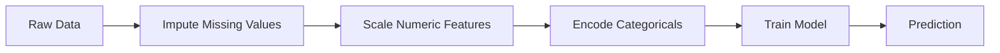
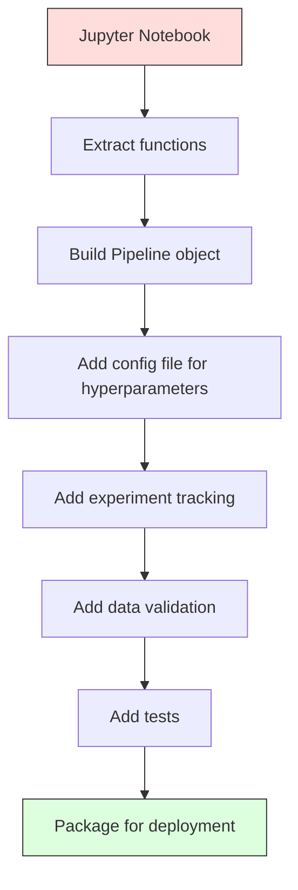

# ML Pipelines

> Sebuah model bukanlah sebuah produk. Pipeline adalah produknya. Pipeline adalah segala sesuatu dari data mentah hingga prediksi yang di-deploy, dan setiap langkah harus dapat direproduksi.

**Type:** Build
**Language:** Python
**Prerequisites:** Phase 2, Lesson 12 (Hyperparameter Tuning)
**Time:** ~120 minutes

## Tujuan Pembelajaran

- Bangun sebuah pipeline ML dari nol yang menghubungkan imputation, scaling, encoding, dan training model menjadi satu objek yang dapat direproduksi
- Identifikasi skenario data leakage dan jelaskan bagaimana pipeline mencegahnya dengan hanya meng-fit transformer pada data training
- Konstruksikan sebuah ColumnTransformer yang menerapkan preprocessing berbeda pada fitur numerik dan kategorikal
- Implementasikan serialisasi pipeline dan tunjukkan bahwa pipeline yang sama yang sudah di-fit menghasilkan hasil identik di training dan produksi

## Masalahnya

Kamu punya sebuah notebook yang memuat data, mengisi nilai hilang dengan median, menskalakan fitur, melatih model, dan mencetak akurasi. Ini bekerja. Kamu rilis.

Sebulan kemudian, seseorang melatih ulang model dan mendapat hasil berbeda. Median dihitung pada seluruh dataset termasuk data test (data leakage). Parameter scaling tidak disimpan, jadi inference menggunakan statistik yang berbeda. Kode feature engineering disalin-tempel antara training dan serving, dan salinannya berbeda. Sebuah kolom kategorikal mendapat nilai baru di produksi yang belum pernah dilihat encoder.

Ini bukan skenario hipotetis. Ini adalah alasan paling umum sistem ML gagal di produksi. Pipeline memecahkan semuanya dengan mengemas setiap langkah transformasi menjadi satu objek yang terurut dan dapat direproduksi.

## Konsepnya

### Apa Itu Pipeline

Pipeline adalah urutan transformasi data yang terurut, diikuti sebuah model. Setiap langkah mengambil output langkah sebelumnya sebagai input. Seluruh pipeline di-fit sekali pada data training. Saat inference, pipeline yang sudah di-fit yang sama mentransformasi data baru dan menghasilkan prediksi.



Pipeline menjamin:
- Transformasi hanya di-fit pada data training (tanpa leakage)
- Transformasi yang sama diterapkan saat inference
- Seluruh objek dapat diserialisasi dan di-deploy sebagai satu artefak
- Cross-validation menerapkan pipeline per fold, mencegah leakage halus

### Data Leakage: Pembunuh Diam-Diam

Data leakage terjadi ketika informasi dari set test atau data masa depan mencemari training. Pipeline mencegah bentuk-bentuk yang paling umum.

**Bocor (salah):**
```python
X = df.drop("target", axis=1)
y = df["target"]

scaler = StandardScaler()
X_scaled = scaler.fit_transform(X)

X_train, X_test = X_scaled[:800], X_scaled[800:]
y_train, y_test = y[:800], y[800:]
```

Scaler melihat data test. Mean dan standar deviasi menyertakan sampel test. Ini melebih-lebihkan estimasi akurasi.

**Benar:**
```python
X_train, X_test = X[:800], X[800:]

scaler = StandardScaler()
X_train_scaled = scaler.fit_transform(X_train)
X_test_scaled = scaler.transform(X_test)
```

Dengan sebuah pipeline, kamu tidak perlu memikirkan ini. Pipeline menanganinya secara otomatis.

### Pipeline sklearn

`Pipeline` dari sklearn menghubungkan transformer dan estimator. Ia mengekspos `.fit()`, `.predict()`, dan `.score()` yang menerapkan semua langkah secara berurutan.

```python
from sklearn.pipeline import Pipeline
from sklearn.preprocessing import StandardScaler
from sklearn.linear_model import LogisticRegression

pipe = Pipeline([
    ("scaler", StandardScaler()),
    ("model", LogisticRegression()),
])

pipe.fit(X_train, y_train)
predictions = pipe.predict(X_test)
```

Ketika kamu memanggil `pipe.fit(X_train, y_train)`:
1. Scaler memanggil `fit_transform` pada X_train
2. Model memanggil `fit` pada X_train yang sudah diskalakan

Ketika kamu memanggil `pipe.predict(X_test)`:
1. Scaler memanggil `transform` (bukan fit_transform) pada X_test
2. Model memanggil `predict` pada X_test yang sudah diskalakan

Scaler tidak pernah melihat data test selama fitting. Ini adalah inti seluruhnya.

### ColumnTransformer: Pipeline Berbeda untuk Kolom Berbeda

Dataset nyata punya kolom numerik dan kategorikal yang membutuhkan preprocessing berbeda. `ColumnTransformer` menangani ini.

```python
from sklearn.compose import ColumnTransformer
from sklearn.preprocessing import StandardScaler, OneHotEncoder
from sklearn.impute import SimpleImputer

numeric_pipe = Pipeline([
    ("impute", SimpleImputer(strategy="median")),
    ("scale", StandardScaler()),
])

categorical_pipe = Pipeline([
    ("impute", SimpleImputer(strategy="most_frequent")),
    ("encode", OneHotEncoder(handle_unknown="ignore")),
])

preprocessor = ColumnTransformer([
    ("num", numeric_pipe, ["age", "income", "score"]),
    ("cat", categorical_pipe, ["city", "gender", "plan"]),
])

full_pipeline = Pipeline([
    ("preprocess", preprocessor),
    ("model", GradientBoostingClassifier()),
])
```

`handle_unknown="ignore"` di OneHotEncoder sangat kritis untuk produksi. Ketika sebuah kategori baru muncul (sebuah kota yang belum pernah dilihat model), ia menghasilkan vektor nol alih-alih crash.

### Experiment Tracking

Sebuah pipeline membuat training dapat direproduksi, tetapi kamu juga perlu melacak apa yang terjadi di seluruh eksperimen: hyperparameter mana yang digunakan, versi dataset apa, apa metrik-metriknya, kode apa yang berjalan.

**MLflow** adalah solusi open-source yang paling umum:

```python
import mlflow

with mlflow.start_run():
    mlflow.log_param("max_depth", 5)
    mlflow.log_param("n_estimators", 100)
    mlflow.log_param("learning_rate", 0.1)

    pipe.fit(X_train, y_train)
    accuracy = pipe.score(X_test, y_test)

    mlflow.log_metric("accuracy", accuracy)
    mlflow.sklearn.log_model(pipe, "model")
```

Setiap run direkam dengan parameter, metrik, artefak, dan model lengkap. Kamu dapat membandingkan run, mereproduksi eksperimen apa pun, dan men-deploy versi model mana pun.

**Weights & Biases (wandb)** menyediakan fungsionalitas yang sama dengan dashboard yang di-host:

```python
import wandb

wandb.init(project="my-pipeline")
wandb.config.update({"max_depth": 5, "n_estimators": 100})

pipe.fit(X_train, y_train)
accuracy = pipe.score(X_test, y_test)

wandb.log({"accuracy": accuracy})
```

### Model Versioning

Setelah experiment tracking, kamu perlu mengelola versi model. Model mana yang ada di produksi? Mana yang staging? Mana yang milik minggu lalu?

Model Registry dari MLflow menyediakan:
- **Version tracking:** Setiap model yang disimpan mendapat sebuah nomor versi
- **Stage transitions:** "Staging", "Production", "Archived"
- **Approval workflow:** Model harus secara eksplisit di-promote ke production
- **Rollback:** Kembali ke versi sebelumnya secara instan

### Data Versioning dengan DVC

Kode di-version dengan git. Data juga harus di-version, tetapi git tidak dapat menangani file besar. DVC (Data Version Control) memecahkan ini.

```
dvc init
dvc add data/training.csv
git add data/training.csv.dvc data/.gitignore
git commit -m "Track training data"
dvc push
```

DVC menyimpan data yang sebenarnya di remote storage (S3, GCS, Azure) dan menyimpan file `.dvc` kecil di git yang merekam hash. Ketika kamu melakukan checkout sebuah git commit, `dvc checkout` memulihkan data yang persis digunakan.

Ini berarti setiap git commit men-pin baik kode maupun data. Reproduktivitas penuh.

### Reproducible Experiments

Sebuah eksperimen yang dapat direproduksi membutuhkan empat hal:

1. **Fixed random seeds:** Atur seed untuk numpy, random, dan framework (torch, sklearn)
2. **Pinned dependencies:** requirements.txt atau poetry.lock dengan versi yang persis
3. **Versioned data:** DVC atau sejenisnya
4. **Config files:** Semua hyperparameter di sebuah config, bukan di-hardcode

```python
import numpy as np
import random

def set_seed(seed=42):
    random.seed(seed)
    np.random.seed(seed)
    try:
        import torch
        torch.manual_seed(seed)
        torch.cuda.manual_seed_all(seed)
        torch.backends.cudnn.deterministic = True
    except ImportError:
        pass
```

### Dari Notebook ke Production Pipeline



Progresi tipikalnya:

1. **Notebook exploration:** Eksperimen cepat, visualisasi, ide fitur
2. **Extract functions:** Pindahkan preprocessing, feature engineering, dan evaluasi ke modul-modul
3. **Build Pipeline:** Hubungkan transformasi menjadi sebuah Pipeline sklearn atau kelas kustom
4. **Config management:** Pindahkan semua hyperparameter ke sebuah config YAML/JSON
5. **Experiment tracking:** Tambahkan logging MLflow atau wandb
6. **Data validation:** Periksa skema, distribusi, dan pola nilai hilang sebelum training
7. **Tests:** Unit test untuk transformer, integration test untuk pipeline lengkap
8. **Deployment:** Serialisasi pipeline, bungkus di sebuah API (FastAPI, Flask), containerize

### Kesalahan Pipeline yang Umum

| Kesalahan | Mengapa ini buruk | Perbaikan |
|---------|-------------|-----|
| Meng-fit pada data penuh sebelum splitting | Data leakage | Gunakan Pipeline dengan cross_val_score |
| Feature engineering di luar pipeline | Transformasi berbeda di train vs serve | Letakkan semua transformasi di Pipeline |
| Tidak menangani kategori tak dikenal | Crash produksi pada nilai baru | OneHotEncoder(handle_unknown="ignore") |
| Kolom hardcoded | Rusak ketika skema berubah | Gunakan daftar nama kolom dari config |
| Tidak ada data validation | Prediksi diam-diam salah pada data buruk | Tambahkan pemeriksaan skema sebelum prediksi |
| Training/serving skew | Model melihat fitur berbeda di produksi | Satu objek Pipeline untuk keduanya |

```figure
f3-pipeline-flow
```

## Bangun Sendiri

Kode di `code/pipeline.py` membangun sebuah pipeline ML lengkap dari nol:

### Langkah 1: Transformer Kustom

```python
class CustomTransformer:
    def __init__(self):
        self.means = None
        self.stds = None

    def fit(self, X):
        self.means = np.mean(X, axis=0)
        self.stds = np.std(X, axis=0)
        self.stds[self.stds == 0] = 1.0
        return self

    def transform(self, X):
        return (X - self.means) / self.stds

    def fit_transform(self, X):
        return self.fit(X).transform(X)
```

### Langkah 2: Pipeline dari Nol

```python
class PipelineFromScratch:
    def __init__(self, steps):
        self.steps = steps

    def fit(self, X, y=None):
        X_current = X.copy()
        for name, step in self.steps[:-1]:
            X_current = step.fit_transform(X_current)
        name, model = self.steps[-1]
        model.fit(X_current, y)
        return self

    def predict(self, X):
        X_current = X.copy()
        for name, step in self.steps[:-1]:
            X_current = step.transform(X_current)
        name, model = self.steps[-1]
        return model.predict(X_current)
```

### Langkah 3: Cross-Validation dengan Pipeline

Kode mendemonstrasikan bagaimana cross-validation dengan pipeline mencegah data leakage: scaler di-fit secara terpisah pada data training setiap fold.

### Langkah 4: Full Production Pipeline dengan sklearn

Sebuah pipeline lengkap dengan `ColumnTransformer`, beberapa jalur preprocessing, dan sebuah model, dilatih dengan cross-validation dan experiment logging yang tepat.

## Rilis

Pelajaran ini menghasilkan:
- `outputs/prompt-ml-pipeline.md` -- sebuah skill untuk membangun dan mendebug pipeline ML
- `code/pipeline.py` -- sebuah pipeline lengkap dari nol hingga sklearn

## Latihan

1. Bangun sebuah pipeline yang menangani sebuah dataset dengan 3 kolom numerik dan 2 kolom kategorikal. Gunakan `ColumnTransformer` untuk menerapkan median imputation + scaling ke numerik dan most-frequent imputation + one-hot encoding ke kategorikal. Latih dengan 5-fold cross-validation.

2. Sengaja memperkenalkan data leakage: fit scaler pada seluruh dataset sebelum splitting. Bandingkan cross-validation score (bocor) dengan cross-validation score pipeline (bersih). Seberapa besar selisihnya?

3. Serialisasi pipeline-mu dengan `joblib.dump`. Muat di sebuah skrip terpisah dan jalankan prediksi. Verifikasi prediksinya identik.

4. Tambahkan sebuah transformer kustom ke pipeline yang membuat fitur polinomial (derajat 2) untuk dua kolom numerik paling penting. Di mana seharusnya ia berada dalam pipeline?

5. Siapkan MLflow tracking untuk pipeline-mu. Jalankan 5 eksperimen dengan hyperparameter berbeda. Gunakan MLflow UI (`mlflow ui`) untuk membandingkan run dan memilih model terbaik.

## Istilah Kunci

| Istilah | Apa yang orang katakan | Apa artinya yang sebenarnya |
|------|----------------|----------------------|
| Pipeline | "Rantai transformasi + model" | Sebuah urutan transformer yang sudah di-fit dan sebuah model, diterapkan sebagai satu unit untuk mencegah leakage |
| Data leakage | "Info test bocor ke training" | Menggunakan informasi dari luar set training untuk membangun model, melebih-lebihkan estimasi performa |
| ColumnTransformer | "Preprocessing berbeda per kolom" | Menerapkan pipeline berbeda ke subset kolom berbeda, menggabungkan hasil |
| Experiment tracking | "Mencatat run-mu" | Merekam parameter, metrik, artefak, dan versi kode untuk setiap training run |
| MLflow | "Melacak dan men-deploy model" | Platform open-source untuk experiment tracking, model registry, dan deployment |
| DVC | "Git untuk data" | Sistem version control untuk file data besar, menyimpan hash di git dan data di remote storage |
| Model registry | "Katalog versi model" | Sebuah sistem yang melacak versi model dengan label stage (staging, production, archived) |
| Training/serving skew | "Ini bekerja di notebook" | Perbedaan antara bagaimana data diproses selama training versus inference, menyebabkan kesalahan diam-diam |
| Reproducibility | "Kode sama, hasil sama" | Kemampuan untuk mendapatkan hasil identik dari kode, data, dan konfigurasi yang sama |

## Bacaan Lanjutan

- [dokumen Pipeline scikit-learn](https://scikit-learn.org/stable/modules/compose.html) -- referensi pipeline resmi
- [dokumentasi MLflow](https://mlflow.org/docs/latest/index.html) -- experiment tracking dan model registry
- [dokumentasi DVC](https://dvc.org/doc) -- data versioning
- [Sculley et al., Hidden Technical Debt in Machine Learning Systems (2015)](https://papers.nips.cc/paper/2015/hash/86df7dcfd896fcaf2674f757a2463eba-Abstract.html) -- makalah seminal tentang kompleksitas sistem ML
- [Google ML Best Practices: Rules of ML](https://developers.google.com/machine-learning/guides/rules-of-ml) -- saran praktis ML produksi
