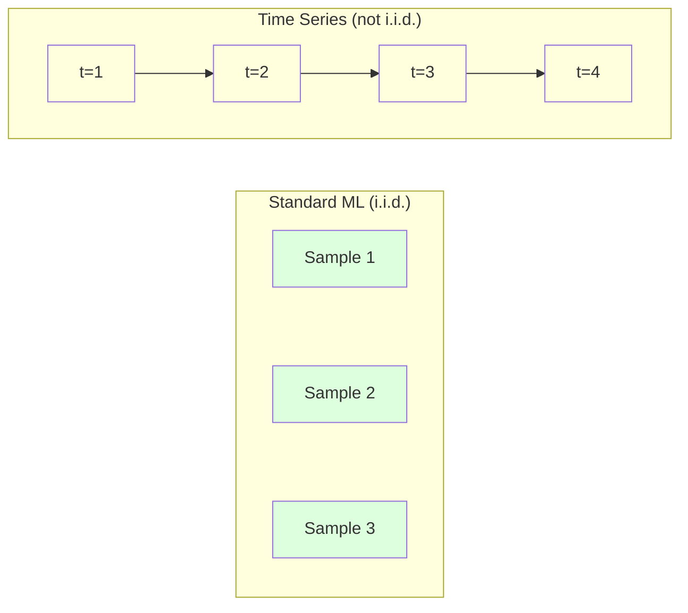
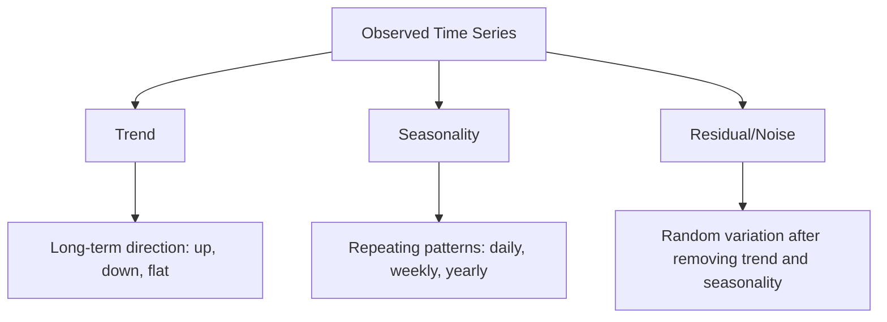
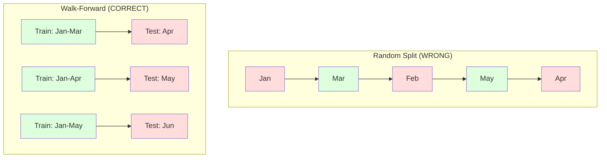

# Time Series Fundamentals

> Kinerja masa lalu memang memprediksi hasil masa depan -- jika kamu memeriksa stationarity terlebih dahulu.

**Type:** Build
**Language:** Python
**Prerequisites:** Phase 2, Lessons 01-09
**Time:** ~90 minutes

## Tujuan Pembelajaran

- Dekomposisikan sebuah time series menjadi komponen trend, seasonality, dan residual serta uji stationarity
- Implementasikan lag features dan statistik rolling untuk mengubah sebuah time series menjadi masalah supervised learning
- Bangun sebuah kerangka kerja walk-forward validation yang mencegah data masa depan bocor (leak) ke training
- Jelaskan mengapa pembagian train/test acak tidak valid untuk time series dan tunjukkan kesenjangan performa versus pembagian temporal yang tepat

## Masalahnya

Kamu punya data yang diurutkan berdasarkan waktu. Penjualan harian, suhu per jam, penggunaan CPU per menit, harga saham mingguan. Kamu ingin memprediksi nilai berikutnya, minggu berikutnya, kuartal berikutnya.

Kamu meraih toolkit ML standarmu: pembagian train/test acak, cross-validation, matriks fitur masuk, prediksi keluar. Setiap langkahnya salah.

Time series menghancurkan asumsi yang diandalkan ML standar. Sampel tidak independen -- suhu hari ini bergantung pada suhu kemarin. Pembagian acak membocorkan (leak) informasi masa depan ke masa lalu. Fitur yang terlihat bagus dalam backtest gagal di produksi karena bergantung pada pola yang berubah seiring waktu.

Sebuah model yang mencapai akurasi 95% dengan cross-validation acak mungkin mendapat 55% dengan evaluasi berbasis waktu yang tepat. Selisihnya bukan sekadar teknis. Ini adalah selisih antara sebuah model yang bekerja di atas kertas dan yang bekerja di produksi.

Pelajaran ini mencakup dasar-dasarnya: apa yang membuat data waktu berbeda, bagaimana mengevaluasi model secara jujur, dan bagaimana mengubah sebuah time series menjadi fitur yang dapat dikonsumsi oleh model ML standar.

## Konsepnya

### Apa yang Membuat Time Series Berbeda

ML standar mengasumsikan i.i.d. -- independent and identically distributed. Setiap sampel ditarik dari distribusi yang sama, secara independen dari sampel lain. Time series melanggar keduanya:

- **Tidak independen.** Harga saham hari ini bergantung pada kemarin. Penjualan minggu ini berkorelasi dengan minggu lalu.
- **Tidak identically distributed.** Distribusi bergeser seiring waktu. Penjualan di Desember berbeda tampilannya dari penjualan di Maret.

Pelanggaran-pelanggaran ini bukan hal kecil. Mereka mengubah bagaimana kamu membangun fitur, bagaimana kamu mengevaluasi model, dan algoritma mana yang bekerja.



Dalam ML standar, sampel dapat dipertukarkan (interchangeable). Mengacaknya tidak mengubah apa pun. Dalam time series, urutan adalah segalanya. Mengacaknya menghancurkan sinyalnya.

### Komponen sebuah Time Series

Setiap time series adalah sebuah kombinasi dari:



- **Trend**: Arah jangka panjang. Pendapatan tumbuh 10% per tahun. Suhu global yang naik.
- **Seasonality**: Pola berulang pada interval tetap. Penjualan ritel melonjak di Desember. Penggunaan pendingin udara mencapai puncak di Juli.
- **Residual**: Apa pun yang tersisa setelah menghapus trend dan seasonality. Jika residual terlihat seperti white noise, dekomposisi telah menangkap sinyalnya.

### Stationarity

Sebuah time series bersifat stationary jika properti statistiknya (mean, variance, autocorrelation) tidak berubah seiring waktu. Kebanyakan metode peramalan mengasumsikan stationarity.

**Mengapa ini penting:** Sebuah series non-stationary punya mean yang tergeser (drift). Sebuah model yang dilatih pada data Januari telah mempelajari mean yang berbeda dari yang akan ditunjukkan Februari. Model akan salah secara sistematis.

**Cara memeriksa:** Hitung rolling mean dan rolling standar deviasi di atas window-window. Jika mereka tergeser, series-nya non-stationary.

**Cara memperbaiki:** Differencing. Alih-alih memodelkan nilai mentah, modelkan perubahan antara nilai-nilai berurutan:

```
diff[t] = value[t] - value[t-1]
```

Jika satu putaran differencing tidak membuat series menjadi stationary, terapkan lagi (differencing orde kedua). Kebanyakan series dunia nyata membutuhkan setidaknya dua putaran.

**Contoh:**

Series asli: [100, 102, 106, 112, 120]
Selisih pertama:  [2, 4, 6, 8] (masih cenderung naik)
Selisih kedua:  [2, 2, 2] (konstan -- stationary)

Series asli punya sebuah trend kuadratik. Differencing pertama mengubahnya menjadi sebuah trend linear. Differencing kedua membuatnya datar. Dalam praktik, kamu jarang membutuhkan lebih dari dua putaran.

**Uji formal:** Uji Augmented Dickey-Fuller (ADF) adalah uji statistik standar untuk stationarity. Hipotesis nolnya adalah "series-nya non-stationary." Sebuah p-value di bawah 0,05 berarti kamu dapat menolak hipotesis nol dan menyimpulkan stationarity. Kita tidak mengimplementasikan ADF dari nol (ini membutuhkan tabel distribusi asimptotik), tetapi pendekatan statistik rolling di kode kita memberikan sebuah pemeriksaan visual yang praktis.

### Autocorrelation

Autocorrelation mengukur seberapa banyak sebuah nilai pada waktu t berkorelasi dengan nilai pada waktu t-k (k langkah di masa lalu). Autocorrelation function (ACF) memplot korelasi ini untuk setiap lag k.

**ACF memberi tahu kamu:**
- Seberapa jauh ke belakang series ini mengingat. Jika ACF turun ke nol setelah lag 5, nilai yang lebih dari 5 langkah yang lalu tidak relevan.
- Apakah seasonality ada. Jika ACF melonjak di lag 12 (data bulanan), ada seasonality tahunan.
- Berapa banyak lag features yang dibuat. Gunakan lag hingga ACF menjadi dapat diabaikan.

**PACF (Partial Autocorrelation Function)** menghapus korelasi tidak langsung. Jika hari ini berkorelasi dengan 3 hari yang lalu hanya karena keduanya berkorelasi dengan kemarin, PACF di lag 3 akan nol sementara ACF di lag 3 tidak akan.

### Lag Features: Mengubah Time Series menjadi Supervised Learning

Model ML standar membutuhkan sebuah matriks fitur X dan sebuah target y. Time series memberimu satu kolom nilai. Jembatannya adalah lag features.

Ambil series [10, 12, 14, 13, 15] dan buat fitur lag-1 dan lag-2:

| lag_2 | lag_1 | target |
|-------|-------|--------|
| 10    | 12    | 14     |
| 12    | 14    | 13     |
| 14    | 13    | 15     |

Kini kamu punya sebuah masalah regresi standar. Model ML mana pun (linear regression, random forest, gradient boosting) dapat memprediksi target dari lag-lag ini.

Fitur tambahan yang dapat kamu rancang:
- **Statistik rolling:** mean, std, min, max dari k nilai terakhir
- **Fitur kalender:** hari dalam minggu, bulan, is_holiday, is_weekend
- **Nilai yang di-difference:** perubahan dari langkah sebelumnya
- **Statistik expanding:** mean kumulatif, jumlah kumulatif
- **Fitur rasio:** nilai saat ini / rolling mean (seberapa jauh dari rata-rata baru-baru ini)
- **Fitur interaksi:** lag_1 * hari_dalam_minggu (efek hari kerja pada momentum)

**Berapa banyak lag?** Gunakan autocorrelation function. Jika ACF signifikan hingga lag 10, gunakan setidaknya 10 lag. Jika ada seasonality mingguan, sertakan lag 7 (dan mungkin 14). Lebih banyak lag memberi model lebih banyak riwayat tetapi juga lebih banyak fitur untuk di-fit, meningkatkan risiko overfitting.

**Jebakan alignment target.** Saat membuat lag features, target haruslah nilai pada waktu t, dan semua fitur harus menggunakan nilai pada waktu t-1 atau sebelumnya. Jika kamu secara tidak sengaja menyertakan nilai pada waktu t sebagai sebuah fitur, kamu mendapat sebuah prediktor yang sempurna -- dan sebuah model yang sama sekali tidak berguna. Ini adalah bug paling umum dalam feature engineering time series.

### Walk-Forward Validation

Ini adalah konsep terpenting dalam pelajaran ini. Standard k-fold cross-validation secara acak menempatkan sampel ke train dan test. Untuk time series, ini membocorkan informasi masa depan.



Walk-forward validation:
1. Latih pada data hingga waktu t
2. Prediksi pada waktu t+1 (atau t+1 hingga t+k untuk multi-step)
3. Geser window ke depan
4. Ulangi

Setiap fold test hanya berisi data yang datang setelah semua data training. Tanpa kebocoran masa depan. Ini memberimu sebuah estimasi yang jujur tentang bagaimana model akan berperforma ketika di-deploy.

**Expanding window** menggunakan semua data historis untuk training (window tumbuh). **Sliding window** menggunakan sebuah training window berukuran tetap (window bergeser). Gunakan expanding ketika kamu percaya data lama masih relevan. Gunakan sliding ketika dunia berubah dan data lama merugikan.

### Intuisi ARIMA

ARIMA adalah model time series klasik. Ia punya tiga komponen:

- **AR (Autoregressive):** Prediksi dari nilai masa lalu. AR(p) menggunakan p nilai terakhir.
- **I (Integrated):** Differencing untuk mencapai stationarity. I(d) menerapkan d putaran differencing.
- **MA (Moving Average):** Prediksi dari kesalahan peramalan masa lalu. MA(q) menggunakan q kesalahan terakhir.

ARIMA(p, d, q) menggabungkan ketiganya. Kamu memilih p, d, q berdasarkan analisis ACF/PACF atau pencarian otomatis (auto-ARIMA).

Kita tidak akan mengimplementasikan ARIMA dari nol -- ini membutuhkan optimasi numerik yang di luar cakupan pelajaran ini. Insight kuncinya adalah memahami apa yang dilakukan setiap komponen sehingga kamu dapat menafsirkan hasil ARIMA dan mengetahui kapan menggunakannya.

### Kapan Menggunakan Apa

| Pendekatan | Terbaik untuk | Menangani Seasonality | Menangani Fitur Eksternal |
|----------|---------|-------------------|------------------------|
| Lag features + ML | Tabular dengan banyak fitur eksternal | Dengan fitur kalender | Ya |
| ARIMA | Single univariate series, jangka pendek | Varian SARIMA | Tidak (ARIMAX terbatas) |
| Exponential smoothing | Trend sederhana + seasonality | Ya (Holt-Winters) | Tidak |
| Prophet | Peramalan bisnis, hari libur | Ya (istilah Fourier) | Terbatas |
| Neural networks (LSTM, Transformer) | Sekuens panjang, banyak series | Dipelajari | Ya |

Untuk kebanyakan masalah praktis, lag features + gradient boosting adalah titik awal terkuat. Ia menangani fitur eksternal secara alami, tidak membutuhkan stationarity, dan mudah didebug.

### Horizon dan Strategi Peramalan

Peramalan single-step memprediksi satu langkah waktu ke depan. Multi-step memprediksi beberapa langkah. Ada tiga strategi:

**Recursive (iteratif):** Prediksi satu langkah ke depan, gunakan prediksi sebagai input untuk langkah berikutnya. Sederhana tetapi kesalahan menumpuk -- setiap prediksi menggunakan prediksi sebelumnya, sehingga kesalahan menjadi berlipat ganda.

**Direct:** Latih sebuah model terpisah untuk setiap horizon. Model-1 memprediksi t+1, Model-5 memprediksi t+5. Tanpa akumulasi kesalahan, tetapi setiap model memiliki lebih sedikit sampel training dan tidak berbagi informasi.

**Multi-output:** Latih satu model yang mengeluarkan semua horizon secara bersamaan. Berbagi informasi di seluruh horizon tetapi membutuhkan model yang mendukung banyak output (atau sebuah fungsi loss kustom).

Untuk kebanyakan masalah praktis, mulailah dengan recursive untuk horizon pendek (1-5 langkah) dan direct untuk horizon yang lebih panjang.

### Kesalahan Umum dalam Time Series

| Kesalahan | Mengapa ini terjadi | Cara memperbaiki |
|---------|---------------|-----------|
| Pembagian train/test acak | Kebiasaan dari ML standar | Gunakan walk-forward atau pembagian temporal |
| Menggunakan fitur masa depan | Fitur pada waktu t secara tidak sengaja disertakan | Audit setiap fitur untuk alignment temporal |
| Overfitting pada seasonality | Model menghafal pola kalender | Tahan satu siklus musiman penuh di set test |
| Mengabaikan perubahan skala | Pendapatan berlipat ganda tetapi pola tetap | Modelkan persentase perubahan alih-alih absolut |
| Terlalu banyak lag features | "Lebih banyak riwayat lebih baik" | Gunakan ACF untuk menentukan lag yang relevan |
| Tidak differencing | "Model akan mengurusnya sendiri" | Model pohon menangani trend; model linear membutuhkan stationarity |

```figure
f3-series-decompose
```

## Bangun Sendiri

Kode di `code/time_series.py` mengimplementasikan blok bangun inti dari nol.

### Pembuat Lag Feature

```python
def make_lag_features(series, n_lags):
    n = len(series)
    X = np.full((n, n_lags), np.nan)
    for lag in range(1, n_lags + 1):
        X[lag:, lag - 1] = series[:-lag]
    valid = ~np.isnan(X).any(axis=1)
    return X[valid], series[valid]
```

Ini mengubah sebuah series 1D menjadi sebuah matriks fitur di mana setiap baris memiliki `n_lags` nilai terakhir sebagai fitur, dan nilai saat ini sebagai target.

### Walk-Forward Cross-Validation

```python
def walk_forward_split(n_samples, n_splits=5, min_train=50):
    assert min_train < n_samples, "min_train must be less than n_samples"
    step = max(1, (n_samples - min_train) // n_splits)
    for i in range(n_splits):
        train_end = min_train + i * step
        test_end = min(train_end + step, n_samples)
        if train_end >= n_samples:
            break
        yield slice(0, train_end), slice(train_end, test_end)
```

Setiap pembagian memastikan data training datang secara ketat sebelum data test. Training window melebar (expanding) dengan setiap fold.

### Model Autoregressive Sederhana

Sebuah model AR murni hanyalah regresi linear pada lag features:

```python
class SimpleAR:
    def __init__(self, n_lags=5):
        self.n_lags = n_lags
        self.weights = None
        self.bias = None

    def fit(self, series):
        X, y = make_lag_features(series, self.n_lags)
        # Solve via normal equations
        X_b = np.column_stack([np.ones(len(X)), X])
        theta = np.linalg.lstsq(X_b, y, rcond=None)[0]
        self.bias = theta[0]
        self.weights = theta[1:]
        return self
```

Ini secara konseptual identik dengan regresi linear dari Lesson 02, tetapi diterapkan pada versi time-lagged dari variabel yang sama.

### Pemeriksaan Stationarity

Kode menghitung statistik rolling untuk menilai stationarity secara visual dan numeris:

```python
def check_stationarity(series, window=50):
    rolling_mean = np.array([
        series[max(0, i - window):i].mean()
        for i in range(1, len(series) + 1)
    ])
    rolling_std = np.array([
        series[max(0, i - window):i].std()
        for i in range(1, len(series) + 1)
    ])
    return rolling_mean, rolling_std
```

Jika rolling mean tergeser atau rolling std berubah, series-nya non-stationary. Terapkan differencing dan periksa lagi.

Kode juga memeriksa stationarity dengan membandingkan bagian pertama dan bagian kedua dari series. Jika mean berbeda lebih dari setengah standar deviasi atau rasio variance melebihi 2x, series ditandai sebagai non-stationary.

### Autocorrelation

```python
def autocorrelation(series, max_lag=20):
    n = len(series)
    mean = series.mean()
    var = series.var()
    acf = np.zeros(max_lag + 1)
    for k in range(max_lag + 1):
        cov = np.mean((series[:n-k] - mean) * (series[k:] - mean))
        acf[k] = cov / var if var > 0 else 0
    return acf
```

## Gunakan

Dengan sklearn, kamu menggunakan lag features secara langsung dengan regressor mana pun:

```python
from sklearn.linear_model import Ridge
from sklearn.ensemble import GradientBoostingRegressor

X, y = make_lag_features(series, n_lags=10)

for train_idx, test_idx in walk_forward_split(len(X)):
    model = Ridge(alpha=1.0)
    model.fit(X[train_idx], y[train_idx])
    predictions = model.predict(X[test_idx])
```

Untuk ARIMA, gunakan statsmodels:

```python
from statsmodels.tsa.arima.model import ARIMA

model = ARIMA(train_series, order=(5, 1, 2))
fitted = model.fit()
forecast = fitted.forecast(steps=30)
```

Kode di `time_series.py` mendemonstrasikan kedua pendekatan dan membandingkannya menggunakan walk-forward validation.

### TimeSeriesSplit sklearn

sklearn menyediakan `TimeSeriesSplit` yang mengimplementasikan walk-forward validation:

```python
from sklearn.model_selection import TimeSeriesSplit

tscv = TimeSeriesSplit(n_splits=5)
for train_index, test_index in tscv.split(X):
    X_train, X_test = X[train_index], X[test_index]
    y_train, y_test = y[train_index], y[test_index]
    model.fit(X_train, y_train)
    score = model.score(X_test, y_test)
```

Ini ekuivalent dengan `walk_forward_split` dari-nol kita tetapi terintegrasi ke dalam kerangka kerja cross-validation sklearn. Kamu dapat menggunakannya dengan `cross_val_score`:

```python
from sklearn.model_selection import cross_val_score

scores = cross_val_score(model, X, y, cv=TimeSeriesSplit(n_splits=5))
print(f"Mean score: {scores.mean():.4f} +/- {scores.std():.4f}")
```

### Metrik Evaluasi

Peramalan time series menggunakan metrik regresi, tetapi dengan konteks yang sadar-waktu (time-aware):

- **MAE (Mean Absolute Error):** Rata-rata dari |y_true - y_pred|. Mudah ditafsirkan dalam satuan asli. "Secara rata-rata, prediksi meleset 3,2 derajat."
- **RMSE (Root Mean Squared Error):** Akar dari mean squared error. Memberi penalti lebih besar pada kesalahan besar dibanding MAE. Gunakan ketika kesalahan besar lebih buruk daripada banyak kesalahan kecil.
- **MAPE (Mean Absolute Percentage Error):** Rata-rata dari |error / true_value| * 100. Independen skala, berguna untuk membandingkan di seluruh series berbeda. Tetapi tidak terdefinisi ketika nilai yang sebenarnya nol.
- **Perbandingan baseline naive:** Selalu bandingkan dengan baseline sederhana. Baseline seasonal naive memprediksi nilai dari satu periode yang lalu (kemarin, minggu lalu). Jika model-mu tidak dapat mengalahkan naive, ada yang salah.

### Fitur Rolling

Kode mendemonstrasikan penambahan statistik rolling (mean, std, min, max di window 7 dan 14 hari) ke lag features. Ini memberi model informasi tentang trend dan volatilitas baru-baru ini yang tidak ditangkap oleh lag features sendirian.

Misalnya, jika rolling mean sedang naik, ini menyarankan sebuah trend ke atas. Jika rolling std sedang meningkat, ini menyarankan volatilitas yang tumbuh. Inilah jenis-jenis pola yang dapat dipelajari model berbasis pohon tetapi tidak dapat dipelajari model linear.

## Rilis

Pelajaran ini menghasilkan:
- `outputs/prompt-time-series-advisor.md` -- sebuah prompt untuk membingkai masalah time series
- `code/time_series.py` -- lag features, walk-forward validation, model AR, pemeriksaan stationarity

### Baseline yang Harus Kamu Kalahkan

Sebelum membangun model apa pun, tetapkan baseline:

1. **Nilai terakhir (persistence).** Prediksi bahwa besok akan sama dengan hari ini. Untuk banyak series, ini secara mengejutkan sulit dikalahkan.
2. **Seasonal naive.** Prediksi bahwa hari ini akan sama dengan hari yang sama minggu lalu (atau tahun lalu). Jika model-mu tidak dapat mengalahkan ini, ia belum mempelajari pola yang berguna apa pun di luar seasonality.
3. **Moving average.** Prediksi rata-rata dari k nilai terakhir. Menghaluskan noise tetapi tidak dapat menangkap perubahan mendadak.

Jika model ML canggihmu kalah dari baseline seasonal naive, kamu punya sebuah bug. Paling umum: kebocoran masa depan di fitur, metode evaluasi yang salah, atau series-nya benar-benar acak dan tidak dapat diprediksi.

### Tips Praktis

1. **Mulailah dengan plotting.** Sebelum pemodelan apa pun, plot series mentahnya. Cari trend, seasonality, outlier, structural breaks (perubahan mendadak dalam perilaku). Sebuah pemeriksaan visual 30 detik sering kali memberi tahu kamu lebih banyak daripada satu jam analisis otomatis.

2. **Difference dulu, modelkan kemudian.** Jika series punya trend yang jelas, difference-nya sebelum membuat lag features. Model berbasis pohon dapat menangani trend, tetapi model linear tidak, dan differencing tidak pernah merugikan.

3. **Tahan setidaknya satu siklus musiman penuh.** Jika kamu punya seasonality mingguan, set test-mu membutuhkan setidaknya satu minggu penuh. Jika bulanan, setidaknya satu bulan penuh. Jika tidak, kamu tidak dapat mengevaluasi apakah model telah menangkap pola musiman.

4. **Monitor di produksi.** Model time series memburuk seiring waktu seiring dunia berubah. Lacak kesalahan prediksi secara rolling. Ketika kesalahan mulai meningkat, latih ulang model pada data baru-baru ini.

5. **Waspada terhadap perubahan regime (regime changes).** Sebuah model yang dilatih pada data pra-pandemi tidak akan memprediksi perilaku pasca-pandemi. Sertakan indikator perubahan regime yang diketahui sebagai fitur, atau gunakan sebuah sliding window yang melupakan data lama.

6. **Log-transform series yang skewed.** Pendapatan, harga, dan hitungan sering kali right-skewed. Mengambil log menstabilkan variance dan membuat pola multipikatif menjadi aditif, yang dapat ditangani model linear. Peramal dalam log space, lalu eksponensialkan untuk kembali ke satuan asli.

## Latihan

1. **Eksperimen stationarity.** Hasilkan sebuah series dengan trend linear. Periksa stationarity dengan statistik rolling. Terapkan differencing pertama. Periksa lagi. Berapa putaran differencing yang dibutuhkan untuk sebuah trend kuadratik?

2. **Seleksi lag.** Hitung ACF pada sebuah series musiman (periode=7). Lag mana yang punya autocorrelation tertinggi? Buat lag features hanya menggunakan lag-lag tersebut (bukan lag berurutan). Apakah akurasinya membaik dibanding menggunakan lag 1 hingga 7?

3. **Walk-forward vs pembagian acak.** Latih sebuah regresi Ridge pada lag features. Evaluasi dengan pembagian acak 80/20 dan dengan walk-forward validation. Seberapa besar pembagian acak melebih-lebihkan performa?

4. **Feature engineering.** Tambahkan rolling mean (window=7), rolling std (window=7), dan fitur hari-dalam-minggu ke lag features. Bandingkan akurasi dengan dan tanpa ekstra-ekstra ini menggunakan walk-forward validation.

5. **Peramalan multi-step.** Ubah model AR untuk memprediksi 5 langkah ke depan alih-alih 1. Bandingkan dua strategi: (a) prediksi satu langkah, gunakan prediksi sebagai input untuk langkah berikutnya (recursive), dan (b) latih model terpisah untuk setiap horizon (direct). Mana yang lebih akurat?

## Istilah Kunci

| Istilah | Apa yang orang katakan | Apa artinya yang sebenarnya |
|------|----------------|----------------------|
| Stationarity | "Statistiknya tidak berubah seiring waktu" | Sebuah series yang mean, variance, dan struktur autocorrelation-nya konstan seiring waktu |
| Differencing | "Kurangkan nilai berurutan" | Menghitung y[t] - y[t-1] untuk menghapus trend dan mencapai stationarity |
| Autocorrelation (ACF) | "Bagaimana sebuah series berkorelasi dengan dirinya sendiri" | Korelasi antara sebuah time series dan salinan lagged-nya sendiri, sebagai fungsi dari lag |
| Partial autocorrelation (PACF) | "Korelasi langsung saja" | Autocorrelation di lag k setelah menghapus efek semua lag yang lebih pendek |
| Lag features | "Nilai masa lalu sebagai input" | Menggunakan y[t-1], y[t-2], ..., y[t-k] sebagai fitur untuk memprediksi y[t] |
| Walk-forward validation | "Cross-validation yang menghormati waktu" | Evaluasi di mana data training selalu mendahului data test secara kronologis |
| ARIMA | "Model time series klasik" | AutoRegressive Integrated Moving Average: menggabungkan nilai masa lalu (AR), differencing (I), dan kesalahan masa lalu (MA) |
| Seasonality | "Pola kalender berulang" | Siklus reguler dan dapat diprediksi dalam sebuah time series yang terikat pada periode kalender (harian, mingguan, tahunan) |
| Trend | "Arah jangka panjang" | Sebuah penurunan atau peningkatan tingkat series yang persisten seiring waktu |
| Expanding window | "Gunakan semua riwayat" | Walk-forward validation di mana set training tumbuh dengan setiap fold |
| Sliding window | "Riwayat berukuran tetap" | Walk-forward validation di mana set training adalah sebuah window berpanjang tetap yang bergeser ke depan |

## Bacaan Lanjutan

- [Hyndman and Athanasopoulos, Forecasting: Principles and Practice (3rd ed.)](https://otexts.com/fpp3/) -- buku teks terbaik gratis tentang peramalan time series
- [Time Series Split scikit-learn](https://scikit-learn.org/stable/modules/generated/sklearn.model_selection.TimeSeriesSplit.html) -- splitter walk-forward sklearn
- [dokumen ARIMA statsmodels](https://www.statsmodels.org/stable/generated/statsmodels.tsa.arima.model.ARIMA.html) -- implementasi ARIMA dengan diagnostik
- [Makridakis et al., The M5 Competition (2022)](https://www.sciencedirect.com/science/article/pii/S0169207021001874) -- kompetisi peramalan skala besar yang menunjukkan metode ML vs metode statistik
