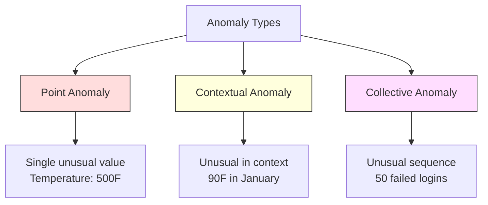
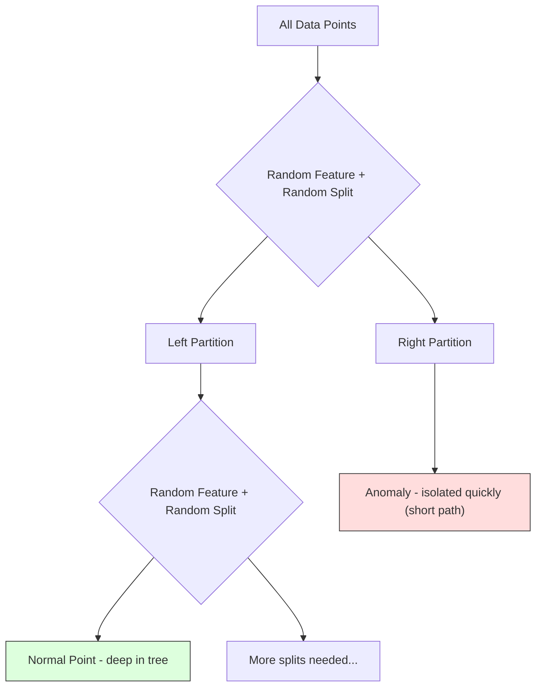
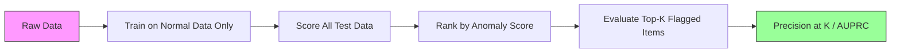

# Anomaly Detection

> Normal itu mudah didefinisikan. Abnormal adalah apa pun yang tidak cocok.

**Type:** Build
**Language:** Python
**Prerequisites:** Phase 2, Lessons 01-09
**Time:** ~75 minutes

## Tujuan Pembelajaran

- Implementasikan metode deteksi anomali Z-score, IQR, dan Isolation Forest dari nol
- Bedakan antara anomali point, contextual, dan collective serta pilih metode deteksi yang tepat untuk masing-masing
- Jelaskan mengapa deteksi anomali diframing sebagai memodelkan data normal daripada mengklasifikasi anomali
- Bandingkan deteksi anomali unsupervised dengan klasifikasi supervised dan evaluasi tradeoff antara cakupan anomali novel dan precision

## Masalahnya

Sebuah kartu kredit digunakan di New York pada jam 2 sore, lalu di Tokyo pada jam 2:05 sore. Sebuah sensor pabrik membaca 150 derajat ketika rentang normal adalah 80-120. Sebuah server mengirim 50.000 request per detik ketika rata-rata harian adalah 200.

Ini adalah anomali. Menemukannya itu penting. Fraud merugikan miliaran. Kegagalan peralatan menimbulkan biaya downtime. Intrusi jaringan merugikan data.

Tantangannya: kamu jarang punya contoh berlabel dari anomali. Fraud menyumbang 0,1% transaksi. Kegagalan peralatan terjadi beberapa kali per tahun. Kamu tidak dapat melatih sebuah classifier standar karena hampir tidak ada apa pun di kelas "anomaly" untuk dipelajari. Bahkan jika kamu punya beberapa label, anomali yang pernah kamu lihat bukan satu-sunya tipe yang akan kamu temui. Skema fraud besok berbeda dari hari ini.

Deteksi anomali membalik masalahnya. Alih-alih mempelajari apa yang abnormal, pelajari apa yang normal. Apa pun yang menyimpang dari normal itu mencurigakan. Ini bekerja tanpa label, beradaptasi dengan tipe anomali baru, dan berskala ke dataset masif.

## Konsepnya

### Tipe-Tipe Anomali

Tidak semua anomali sama:

- **Point anomalies.** Sebuah titik data tunggal yang tidak biasa terlepas dari konteksnya. Sebuah pembacaan suhu 500 derajat. Sebuah transaksi $50.000 dari sebuah akun yang biasanya menghabiskan $50.
- **Contextual anomalies.** Sebuah titik data yang tidak biasa diberikan konteksnya. Suhu 90 derajat normal di musim panas, anomali di musim dingin. Nilai yang sama, konteks berbeda.
- **Collective anomalies.** Sebuah urutan titik data yang tidak biasa sebagai sebuah kelompok, meskipun setiap titik individual mungkin normal. Lima kegagalan login normal. Lima puluh berturut-turut adalah sebuah serangan brute-force.

Kebanyakan metode mendeteksi point anomalies. Contextual anomalies membutuhkan fitur waktu atau lokasi. Collective anomalies membutuhkan metode yang sadar-sekuens (sequence-aware).



### Framing Unsupervised

Dalam klasifikasi standar, kamu punya label untuk kedua kelas. Dalam deteksi anomali, kamu biasanya punya satu dari tiga situasi:

1. **Fully unsupervised.** Tanpa label sama sekali. Kamu meng-fit detektor pada semua data dan berharap anomali cukup langka untuk tidak merusak model "normal".
2. **Semi-supervised.** Kamu punya sebuah dataset bersih dari data normal saja. Kamu meng-fit pada set bersih ini dan memberi skor ke semua yang lain. Ini adalah setup terkuat ketika memungkinkan.
3. **Weakly supervised.** Kamu punya beberapa anomali berlabel. Gunakan mereka untuk evaluasi, bukan training. Latih secara unsupervised, lalu ukur precision/recall pada subset berlabel.

Insight kuncinya: deteksi anomali pada dasarnya berbeda dari klasifikasi. Kamu memodelkan distribusi data normal, bukan batas keputusan antara dua kelas.

### Supervised vs Unsupervised: Tradeoff-nya

Jika kamu memang punya anomali berlabel, haruskah kamu menggunakannya untuk training (klasifikasi supervised) atau untuk evaluasi saja (deteksi unsupervised)?

**Supervised (perlakukan sebagai klasifikasi):**
- Menangkap tipe anomali persis yang pernah kamu lihat sebelumnya
- Precision lebih tinggi pada tipe anomali yang diketahui
- Melewatkan tipe anomali novel sepenuhnya
- Membutuhkan retraining ketika tipe anomali baru muncul
- Membutuhkan cukup contoh anomali (sering kali terlalu sedikit)

**Unsupervised (modelkan normal, tandai penyimpangan):**
- Menangkap setiap penyimpangan dari normal, termasuk tipe novel
- Tidak membutuhkan anomali berlabel
- Tingkat false positive lebih tinggi (tidak semua yang tidak biasa itu buruk)
- Lebih tahan terhadap distribution shift

Dalam praktik, sistem terbaik menggabungkan keduanya: deteksi unsupervised untuk cakupan luas, model supervised untuk tipe anomali prioritas tinggi yang diketahui, dan tinjauan manusia untuk kasus yang ambigu.

### Metode Z-Score

Pendekatan paling sederhana. Hitung mean dan standar deviasi setiap fitur. Tandai setiap titik yang lebih dari k standar deviasi dari mean.

```text
z_score = (x - mean) / std
anomaly if |z_score| > threshold
```

Threshold default adalah 3,0 (99,7% data normal berada dalam 3 standar deviasi untuk sebuah distribusi Gaussian).

**Kekuatan:** Sederhana. Cepat. Dapat ditafsirkan ("nilai ini 4,5 standar deviasi dari normal").

**Kelemahan:** Mengasumsikan data terdistribusi normal. Sensitif terhadap outlier dalam data training (outlier menggeser mean dan melebih-lebihkan std, membuatnya lebih sulit dideteksi). Gagal pada distribusi multimodal.

**Ketika bekerja dengan baik:** Monitoring fitur tunggal di mana data kira-kira berbentuk lonceng. Waktu respons server, toleransi manufaktur, pembacaan sensor dengan baseline stabil.

**Ketika gagal:** Data multi-klaster (dua lokasi kantor dengan baseline suhu berbeda), data skewed (jumlah transaksi di mana $1000 langka tetapi bukan anomali), data dengan outlier di set training.

### Metode IQR

Lebih robust daripada Z-score. Menggunakan interquartile range alih-alih mean dan standar deviasi.

```
Q1 = 25th percentile
Q3 = 75th percentile
IQR = Q3 - Q1
lower_bound = Q1 - factor * IQR
upper_bound = Q3 + factor * IQR
anomaly if x < lower_bound or x > upper_bound
```

Factor default adalah 1,5.

**Kekuatan:** Robust terhadap outlier (percentile tidak dipengaruhi oleh nilai ekstrem). Bekerja pada distribusi skewed. Tanpa asumsi normalitas.

**Kelemahan:** Hanya univariate (diterapkan per fitur secara independen). Tidak dapat mendeteksi anomali yang hanya tidak biasa ketika fitur dipertimbangkan bersama (sebuah titik mungkin normal di setiap fitur individual tetapi anomali di ruang gabungannya).

**Catatan praktis:** Factor 1,5 di IQR sesuai dengan whisker dalam sebuah box plot. Titik di luar whisker adalah outlier potensial. Menggunakan 3,0 alih-alih 1,5 membuat detektor lebih konservatif (lebih sedikit flag, lebih sedikit false positive). Factor yang tepat bergantung pada toleransimu terhadap false alarm.

### Isolation Forest

Insight kuncinya: anomali itu sedikit dan berbeda. Dalam sebuah pembagian acak dari data, anomali lebih mudah diisolasi -- mereka membutuhkan lebih sedikit pembagian acak untuk dipisahkan dari yang lain.



**Cara kerjanya:**
1. Bangun banyak pohon acak (sebuah isolation forest)
2. Di setiap node, pilih sebuah fitur acak dan sebuah nilai split acak antara min dan max fitur tersebut
3. Terus membelah hingga setiap titik terisolasi (di daunnya sendiri)
4. Anomali punya panjang path rata-rata yang lebih pendek di seluruh pohon

**Mengapa ini bekerja:** Titik normal hidup di region yang padat. Banyak pembagian acak dibutuhkan untuk mengisolasi satu dari tetangganya. Anomali hidup di region yang jarang. Satu atau dua pembagian acak cukup untuk mengisolasi mereka.

Skor anomali berdasarkan panjang path rata-rata di seluruh pohon, dinormalisasi oleh panjang path yang diharapkan dari sebuah binary search tree acak:

```
score(x) = 2^(-average_path_length(x) / c(n))
```

Di mana `c(n)` adalah panjang path yang diharapkan untuk n sampel. Skor mendekati 1 berarti anomali. Skor mendekati 0,5 berarti normal. Skor mendekati 0 berarti sangat normal (jauh di dalam klaster padat).

**Kekuatan:** Tanpa asumsi distribusi. Bekerja di dimensi tinggi. Berskala dengan baik (sublinear dalam ukuran sampel karena setiap pohon menggunakan sebuah subsample). Menangani tipe campuran fitur.

**Kelemahan:** Kesulitan dengan anomali di region padat (efek masking). Pembagian acak kurang efektif ketika banyak fitur tidak relevan.

**Hyperparameter kunci:**
- `n_estimators`: Jumlah pohon. 100 biasanya cukup. Lebih banyak pohon memberi skor lebih tetapi komputasi lebih lambat.
- `max_samples`: Jumlah sampel per pohon. 256 adalah default di makalah aslinya. Nilai yang lebih kecil membuat pohon individual kurang akurat tetapi meningkatkan keragaman. Subsampling inilah yang membuat Isolation Forest cepat -- setiap pohon melihat sebagian kecil dari data.
- `contamination`: Pecahan anomali yang diharapkan. Hanya digunakan untuk menetapkan threshold. Tidak memengaruhi skor itu sendiri.

### Local Outlier Factor (LOF)

LOF membandingkan kepadatan lokal di sekitar sebuah titik dengan kepadatan di sekitar tetangganya. Sebuah titik di region jarang yang dikelilingi region padat adalah anomali.

**Cara kerjanya:**
1. Untuk setiap titik, temukan k nearest neighbors-nya
2. Hitung local reachability density (seberapa padat lingkungannya)
3. Bandingkan kepadatan setiap titik dengan kepadatan tetangganya
4. Jika sebuah titik punya kepadatan jauh lebih rendah daripada tetangganya, itu adalah sebuah outlier

**Skor LOF:**
- LOF mendekati 1,0 berarti kepadatan serupa dengan tetangga (normal)
- LOF lebih besar dari 1,0 berarti kepadatan lebih rendah daripada tetangga (berpotensi anomali)
- LOF jauh lebih besar dari 1,0 (misalnya, 2,0+) berarti kepadatan jauh lebih rendah (kemungkinan anomali)

Bagian "lokal"-nya sangat kritis. Pertimbangkan sebuah dataset dengan dua klaster: sebuah klaster padat berisi 1000 titik dan sebuah klaster jarang berisi 50 titik. Sebuah titik di tepi klaster jarang tidak secara global tidak biasa -- ia punya 50 tetangga. Tetapi ia secara lokal tidak biasa jika tetangga terdekatnya lebih padat daripada dirinya. LOF menangkap nuansa ini yang dilewatkan metode global.

**Kekuatan:** Mendeteksi anomali lokal (titik yang tidak biasa di lingkungannya, bahkan jika mereka tidak secara global tidak biasa). Bekerja pada klaster dengan kepadatan berbeda.

**Kelemahan:** Lambat pada dataset besar (O(n^2) untuk implementasi naive). Sensitif terhadap pilihan k. Tidak bekerja dengan baik di dimensi yang sangat tinggi (curse of dimensionality memengaruhi perhitungan jarak).

### Perbandingan

| Metode | Asumsi | Kecepatan | Menangani Dimensi Tinggi | Mendeteksi Anomali Lokal |
|--------|------------|-------|-------------------|------------------------|
| Z-score | Distribusi normal | Sangat cepat | Ya (per fitur) | Tidak |
| IQR | Tidak ada (per fitur) | Sangat cepat | Ya (per fitur) | Tidak |
| Isolation Forest | Tidak ada | Cepat | Ya | Sebagian |
| LOF | Jarak itu bermakna | Lambat | Buruk | Ya |

### Tantangan Evaluasi

Mengevaluasi detektor anomali lebih sulit daripada mengevaluasi classifier:

- **Ketidakseimbangan kelas ekstrem.** Dengan 0,1% anomali, memprediksi "normal" untuk segalanya memberikan akurasi 99,9%. Akurasi tidak berguna.
- **AUROC menyesatkan.** Dengan ketidakseimbangan berat, AUROC dapat terlihat bagus bahkan ketika model melewatkan sebagian besar anomali pada threshold praktis.
- **Metrik yang lebih baik:** Precision@k (dari k item berperingkat teratas yang ditandai, berapa yang benar-benar anomali), AUPRC (area di bawah kurva precision-recall), dan recall pada tingkat false positive tetap.



### Pipeline Deteksi Anomali

Dalam praktik, deteksi anomali mengikuti alur kerja ini:

1. **Kumpulkan data baseline.** Idealnya, sebuah periode di mana kamu tahu tidak ada (atau sangat sedikit) anomali.
2. **Feature engineering.** Fitur mentah plus fitur turunan (statistik rolling, fitur waktu, rasio).
3. **Latih detektornya.** Fit pada data baseline. Model mempelajari seperti apa "normal".
4. **Beri skor ke data baru.** Setiap observasi baru mendapat sebuah skor anomali.
5. **Seleksi threshold.** Pilih batas skor. Ini adalah sebuah keputusan bisnis: threshold lebih tinggi berarti lebih sedikit false alarm tetapi lebih banyak anomali yang terlewat.
6. **Alert dan investigasi.** Titik yang ditandai dikirim ke tinjauan manusia atau respons otomatis.
7. **Pengumpulan umpan balik (feedback).** Rekam apakah item yang ditandai adalah anomali yang sebenarnya atau false alarm. Gunakan data ini untuk mengevaluasi detektor dan menyetel threshold seiring waktu.

Pipeline tidak pernah "selesai." Distribusi data bergeser, tipe anomali baru muncul, dan threshold membutuhkan penyesuaian. Perlakukan deteksi anomali sebagai sebuah sistem yang hidup, bukan sebuah model sekali-jadi.

```figure
f3-anomaly-fence
```

## Bangun Sendiri

Kode di `code/anomaly_detection.py` mengimplementasikan Z-score, IQR, dan Isolation Forest dari nol.

### Detektor Z-Score

```python
def zscore_detect(X, threshold=3.0):
    mean = X.mean(axis=0)
    std = X.std(axis=0)
    std[std == 0] = 1.0
    z = np.abs((X - mean) / std)
    return z.max(axis=1) > threshold
```

Sederhana dan tervektorisasi. Menandai sebuah titik jika melebihi threshold.

### Detektor IQR

```python
def iqr_detect(X, factor=1.5):
    q1 = np.percentile(X, 25, axis=0)
    q3 = np.percentile(X, 75, axis=0)
    iqr = q3 - q1
    iqr[iqr == 0] = 1.0
    lower = q1 - factor * iqr
    upper = q3 + factor * iqr
    outside = (X < lower) | (X > upper)
    return outside.any(axis=1)
```

### Isolation Forest dari Nol

Implementasi dari-nol-nya membangun isolation trees yang secara acak membagi ruang fitur:

```python
class IsolationTree:
    def __init__(self, max_depth):
        self.max_depth = max_depth

    def fit(self, X, depth=0):
        n, p = X.shape
        if depth >= self.max_depth or n <= 1:
            self.is_leaf = True
            self.size = n
            return self
        self.is_leaf = False
        self.feature = np.random.randint(p)
        x_min = X[:, self.feature].min()
        x_max = X[:, self.feature].max()
        if x_min == x_max:
            self.is_leaf = True
            self.size = n
            return self
        self.threshold = np.random.uniform(x_min, x_max)
        left_mask = X[:, self.feature] < self.threshold
        self.left = IsolationTree(self.max_depth).fit(X[left_mask], depth + 1)
        self.right = IsolationTree(self.max_depth).fit(X[~left_mask], depth + 1)
        return self
```

Panjang path untuk mengisolasi sebuah titik menentukan skor anomalinya. Path yang lebih pendek berarti lebih anomali.

Kelas `IsolationForest` membungkus banyak pohon:

```python
class IsolationForest:
    def __init__(self, n_estimators=100, max_samples=256, seed=42):
        self.n_estimators = n_estimators
        self.max_samples = max_samples

    def fit(self, X):
        sample_size = min(self.max_samples, X.shape[0])
        max_depth = int(np.ceil(np.log2(sample_size)))
        for _ in range(self.n_estimators):
            idx = rng.choice(X.shape[0], size=sample_size, replace=False)
            tree = IsolationTree(max_depth=max_depth)
            tree.fit(X[idx])
            self.trees.append(tree)

    def anomaly_score(self, X):
        avg_path = average path length across all trees
        scores = 2.0 ** (-avg_path / c(max_samples))
        return scores
```

Faktor normalisasi `c(n)` adalah panjang path yang diharapkan dari sebuah pencarian yang gagal dalam sebuah binary search tree dengan n elemen. Ini sama dengan `2 * H(n-1) - 2*(n-1)/n` di mana `H` adalah bilangan harmonik. Normalisasi ini memastikan skor dapat dibandingkan di seluruh dataset dengan ukuran berbeda.

### Skenario Demo

Kode menghasilkan beberapa skenario pengujian:

1. **Single cluster dengan outlier.** Sebuah klaster Gaussian 2D dengan anomali yang disuntikkan jauh dari pusat. Semua metode seharusnya bekerja di sini.
2. **Data multimodal.** Tiga klaster dengan ukuran dan kepadatan berbeda. Titik di antara klaster adalah anomali. Z-score kesulitan karena rentang per fiturnya lebar.
3. **Data berdimensi tinggi.** 50 fitur, tetapi anomali berbeda hanya di 5 di antaranya. Menguji apakah metode dapat menemukan anomali di subset fitur.

Setiap demo membandingkan semua metode menggunakan precision, recall, F1, dan Precision@k.

## Gunakan

Dengan sklearn (menggunakan implementasi pustaka, bukan dari nol):

```python
from sklearn.ensemble import IsolationForest
from sklearn.neighbors import LocalOutlierFactor

iso = IsolationForest(n_estimators=100, contamination=0.05, random_state=42)
iso.fit(X_train)
predictions = iso.predict(X_test)

lof = LocalOutlierFactor(n_neighbors=20, contamination=0.05, novelty=True)
lof.fit(X_train)
predictions = lof.predict(X_test)
```

Perhatikan `contamination` menetapkan pecahan anomali yang diharapkan. Menyetelnya dengan benar itu penting -- terlalu rendah melewatkan anomali, terlalu tinggi menciptakan false alarm.

Kode di `anomaly_detection.py` membandingkan implementasi dari-nol dengan sklearn pada data yang sama.

### Parameter Contamination sklearn

Parameter `contamination` di sklearn menentukan threshold untuk mengubah skor anomali kontinu menjadi prediksi biner. Ia tidak mengubah skor dasarnya.

```python
iso_5 = IsolationForest(contamination=0.05)
iso_10 = IsolationForest(contamination=0.10)
```

Keduanya menghasilkan skor anomali yang sama. Tetapi `iso_5` menandai 5% teratas sementara `iso_10` menandai 10% teratas. Jika kamu tidak mengetahui laju anomali yang sebenarnya (kamu biasanya tidak tahu), setel contamination ke "auto" dan bekerja dengan skor mentah secara langsung. Tetapkan threshold-mu sendiri berdasarkan tradeoff biaya antara false positive dan false negative.

### One-Class SVM

Sebuah detektor anomali unsupervised lain yang layak diketahui. One-Class SVM meng-fit sebuah batas di sekitar data normal di ruang fitur berdimensi tinggi (menggunakan kernel trick).

```python
from sklearn.svm import OneClassSVM

oc_svm = OneClassSVM(kernel="rbf", gamma="auto", nu=0.05)
oc_svm.fit(X_train)
predictions = oc_svm.predict(X_test)
```

Parameter `nu` memperkirakan pecahan anomali. One-Class SVM bekerja dengan baik pada dataset kecil hingga menengah tetapi tidak berskala ke data yang sangat besar (matriks kernel tumbuh kuadratik).

### Pendekatan Autoencoder (Pratinjau)

Autoencoder adalah neural networks yang mempelajari cara mengompresi dan merekonstruksi data. Latih pada data normal. Saat waktu pengujian (test time), anomali punya kesalahan rekonstruksi yang tinggi karena jaringan hanya mempelajari cara merekonstruksi pola normal.

Ini dicakup di Phase 3 (Deep Learning), tetapi prinsipnya sama: modelkan apa yang normal, tandai apa yang menyimpang.

### Ensemble Deteksi Anomali

Sama seperti metode ensemble memperbaiki klasifikasi (Lesson 11), menggabungkan beberapa detektor anomali memperbaiki deteksi. Pendekatan paling sederhana:

1. Jalankan beberapa detektor (Z-score, IQR, Isolation Forest, LOF)
2. Normalisasi skor setiap detektor ke [0, 1]
3. Rata-ratakan skor yang dinormalisasi
4. Tandai titik di atas threshold pada skor rata-rata

Ini mengurangi false positive karena metode berbeda punya mode kegagalan berbeda. Sebuah titik yang ditandai oleh keempat metode hampir pasti anomali. Sebuah titik yang ditandai hanya oleh satu mungkin adalah keanehan (quirk) metode itu.

Ensemble yang lebih canggih menimbang setiap detektor berdasarkan keandalan yang diperkirakan (diukur pada sebuah set validasi dengan anomali yang diketahui, jika tersedia).

### Pertimbangan Produksi

1. **Threshold drift.** Seiring distribusi data bergeser, sebuah threshold tetap menjadi usang. Monitor distribusi skor anomali dan sesuaikan secara berkala.
2. **Alert fatigue.** Terlalu banyak false alarm dan operator berhenti memperhatikan. Mulailah dengan threshold yang tinggi (alert lebih sedikit, lebih andal) dan turunkannya seiring kepercayaan terbentuk.
3. **Pendekatan ensemble.** Di produksi, gabungkan beberapa detektor. Tandai sebuah titik hanya jika beberapa metode setuju itu anomali. Ini mengurangi false positive secara signifikan.
4. **Feature engineering.** Fitur mentah jarang cukup. Tambahkan statistik rolling, rasio, time-since-last-event, dan fitur spesifik domain. Sebuah set fitur yang baik lebih penting daripada pilihan detektornya.
5. **Feedback loop.** Ketika operator menyelidiki item yang ditandai dan mengonfirmasi atau menyangkalnya, berikan umpan balik ini kembali ke sistem. Akumulasikan data berlabel seiring waktu untuk mengevaluasi dan meningkatkan detektor.

## Rilis

Pelajaran ini menghasilkan:
- `outputs/skill-anomaly-detector.md` -- sebuah skill keputusan untuk memilih detektor yang tepat
- `code/anomaly_detection.py` -- Z-score, IQR, dan Isolation Forest dari nol, dengan perbandingan sklearn

### Memilih Sebuah Threshold

Skor anomali itu kontinu. Kamu membutuhkan sebuah threshold untuk membuat keputusan biner. Ini adalah sebuah keputusan bisnis, bukan teknis.

Pertimbangkan dua skenario:
- **Deteksi fraud.** Melewatkan fraud itu mahal (chargebacks, kepercayaan pelanggan). False alarm menghabiskan waktu analis manusia 5 menit untuk menyelidiki. Setel threshold rendah untuk menangkap lebih banyak fraud, terima lebih banyak false alarm.
- **Pemeliharaan peralatan.** Sebuah false alarm berarti sebuah shutdown yang tidak perlu dengan biaya $50.000. Sebuah kegagalan yang terlewat berarti sebuah perbaikan $500.000. Setel threshold untuk menyeimbangkan biaya-biaya ini.

Dalam kedua kasus, threshold optimal bergantung pada rasio biaya antara false positive dan false negative. Plot precision dan recall di berbagai threshold, overlay fungsi biaya, dan pilih titik dengan biaya minimum.

### Berskala ke Produksi

Untuk deteksi anomali real-time di produksi:

1. **Training batch, scoring online.** Latih model secara berkala (harian, mingguan) pada data normal baru-baru ini. Beri skor setiap observasi baru ketika datang.
2. **Komputasi fitur harus cocok.** Jika kamu melatih dengan statistik rolling 30 hari, kamu membutuhkan 30 hari riwayat untuk menghitung fitur untuk sebuah observasi baru. Buffer riwayat yang dibutuhkan.
3. **Monitoring distribusi skor.** Lacak distribusi skor anomali seiring waktu. Jika skor median tergeser ke atas, data berubah atau model sudah usang.
4. **Explainability (dapat dijelaskan).** Ketika kamu menandai sebuah anomali, katakan mengapa. Z-score: "Fitur X 4,2 standar deviasi di atas normal." Isolation Forest: "Titik ini terisolasi dalam 3,1 split secara rata-rata (titik normal membutuhkan 8,5)."

## Latihan

1. **Penyetelan threshold.** Jalankan detektor Z-score dengan threshold dari 1,0 hingga 5,0 dengan langkah 0,5. Plot precision dan recall di setiap threshold. Di mana titik sweet spot untuk datamu?

2. **Anomali multivariat.** Hasilkan data 2D di mana setiap fitur individual terlihat normal, tetapi kombinasinya anomali (misalnya, titik yang jauh dari diagonal klaster utama). Tunjukkan bahwa Z-score per fitur melewatkan ini tetapi Isolation Forest menangkapnya.

3. **LOF dari nol.** Implementasikan Local Outlier Factor menggunakan k-nearest neighbors. Bandingkan dengan LocalOutlierFactor sklearn pada data yang sama. Gunakan k=10 dan k=50 -- bagaimana pilihan k memengaruhi hasil?

4. **Deteksi anomali streaming.** Ubah detektor Z-score untuk bekerja dalam sebuah setting streaming: perbarui mean dan variance berjalan ketika titik baru datang (algoritma online Welford). Bandingkan dengan Z-score batch pada data yang sama.

5. **Evaluasi dunia nyata.** Ambil sebuah dataset dengan anomali yang diketahui (fraud kartu kredit dari Kaggle, misalnya). Evaluasi keempat metode menggunakan precision@100, precision@500, dan AUPRC. Metode mana yang bekerja paling baik? Mengapa?

## Istilah Kunci

| Istilah | Apa yang orang katakan | Apa artinya yang sebenarnya |
|------|----------------|----------------------|
| Anomali | "Outlier, titik yang tidak biasa" | Sebuah titik data yang menyimpang secara signifikan dari pola yang diharapkan dari data normal |
| Point anomaly | "Sebuah nilai yang aneh" | Sebuah observasi individual yang tidak biasa terlepas dari konteksnya |
| Contextual anomaly | "Nilai normal, konteks salah" | Sebuah observasi yang tidak biasa diberikan konteksnya (waktu, lokasi, dll.) tetapi mungkin normal dalam konteks lain |
| Isolation Forest | "Pembagian acak untuk menemukan outlier" | Sebuah ensemble dari pohon acak yang mengisolasi anomali dengan lebih sedikit pembagian daripada titik normal |
| Local Outlier Factor | "Bandingkan kepadatan dengan tetangga" | Sebuah metode yang menandai titik yang kepadatan lokalnya jauh lebih rendah daripada kepadatan tetangga mereka |
| Z-score | "Standar deviasi dari mean" | (x - mean) / std, mengukur seberapa jauh sebuah titik dari pusat dalam satuan standar deviasi |
| IQR | "Interquartile range" | Q3 - Q1, mengukur sebaran 50% tengah dari data, digunakan untuk deteksi outlier yang robust |
| Contamination | "Pecahan anomali yang diharapkan" | Sebuah hyperparameter yang memberi tahu detektor proporsi data apa yang harus ia tandai sebagai anomali |
| Precision@k | "Dari k flag teratas, berapa yang nyata" | Precision yang dihitung hanya pada k titik paling mencurigakan, berguna untuk deteksi anomali yang tidak seimbang |
| AUPRC | "Area di bawah kurva precision-recall" | Sebuah merik yang merangkum performa precision-recall di seluruh threshold, lebih baik daripada AUROC untuk data yang tidak seimbang |

## Bacaan Lanjutan

- [Liu et al., Isolation Forest (2008)](https://cs.nju.edu.cn/zhouzh/zhouzh.files/publication/icdm08b.pdf) -- makalah asli Isolation Forest
- [Breunig et al., LOF: Identifying Density-Based Local Outliers (2000)](https://dl.acm.org/doi/10.1145/342009.335388) -- makalah asli LOF
- [dokumen Outlier Detection scikit-learn](https://scikit-learn.org/stable/modules/outlier_detection.html) -- ikhtisar semua detektor anomali sklearn
- [Chandola et al., Anomaly Detection: A Survey (2009)](https://dl.acm.org/doi/10.1145/1541880.1541882) -- survei komprehensif tentang metode deteksi anomali
- [Goldstein and Uchida, A Comparative Evaluation of Unsupervised Anomaly Detection Algorithms (2016)](https://journals.plos.org/plosone/article?id=10.1371/journal.pone.0152173) -- perbandingan empiris 10 metode pada dataset nyata
