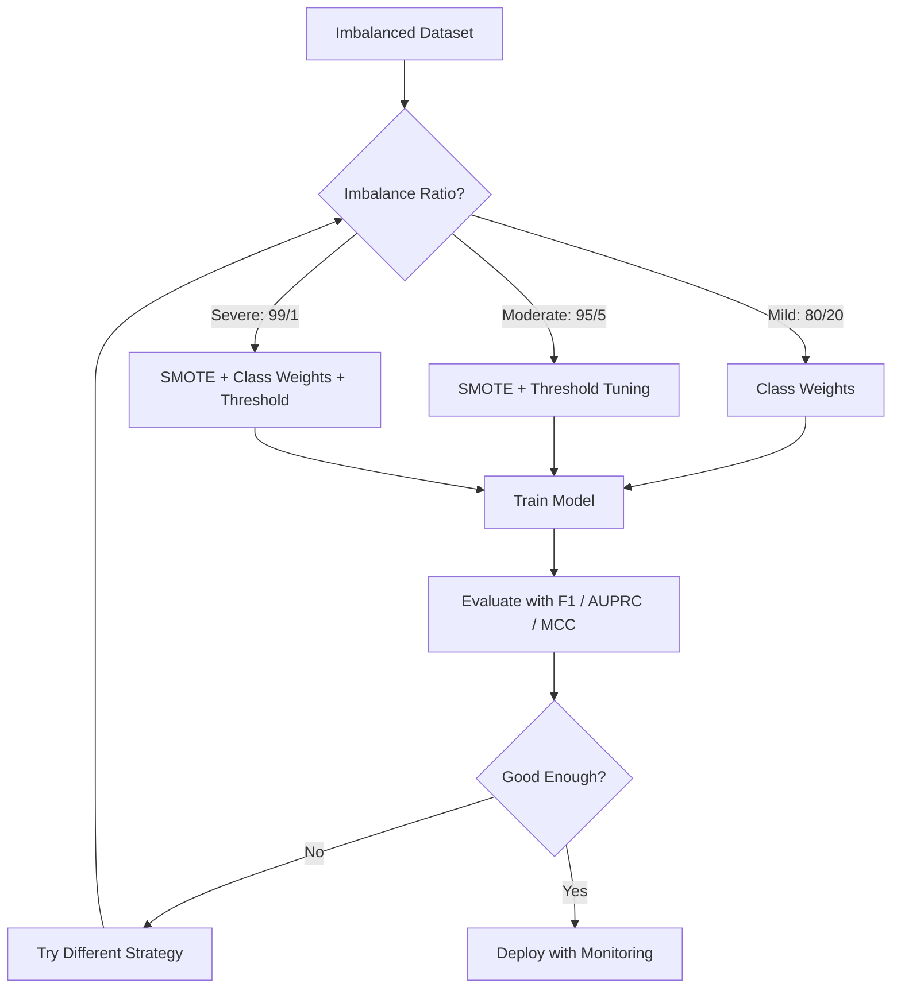
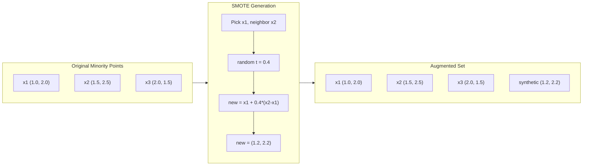
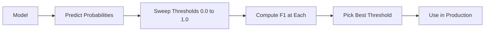
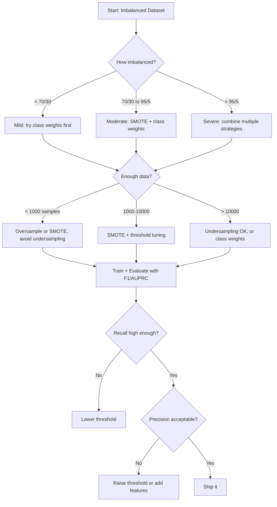

# Handling Imbalanced Data

> Ketika 99% datamu adalah "normal," akurasi adalah sebuah kebohongan.

**Type:** Build
**Language:** Python
**Prerequisites:** Phase 2, Lessons 01-09 (especially evaluation metrics)
**Time:** ~90 minutes

## Tujuan Pembelajaran

- Implementasikan SMOTE dari nol dan jelaskan bagaimana oversampling sintetik berbeda dari duplikasi acak
- Evaluasi classifier yang tidak seimbang menggunakan F1, AUPRC, dan Matthews Correlation Coefficient alih-alih akurasi
- Bandingkan strategi class weighting, threshold tuning, dan resampling serta pilih pendekatan yang tepat untuk rasio imbalance yang diberikan
- Bangun sebuah pipeline data imbalanced lengkap yang menggabungkan SMOTE, class weights, dan optimasi threshold

## Masalahnya

Kamu membangun sebuah model deteksi fraud. Ia mencapai akurasi 99,9%. Kamu merayakannya. Lalu kamu menyadari model itu memprediksi "not fraud" untuk setiap transaksi tunggal.

Ini bukan sebuah bug. Ini adalah hal yang rasional untuk dilakukan ketika hanya 0,1% transaksi yang penipuan (fraudulent). Model mempelajari bahwa selalu menebak kelas mayoritas meminimalkan keseluruhan kesalahan. Ini secara teknis benar dan sama sekali tidak berguna.

Ini terjadi di mana pun klasifikasi nyata itu penting. Diagnosis penyakit: laju positif 1%. Intrusi jaringan: 0,01% serangan. Cacat manufaktur: 0,5% cacat. Filter spam: 20% spam. Prediksi churn: 5% churner. Semakin berkonsekuensi kelas minoritas, semakin langka cenderungnya.

Akurasi gagal karena memperlakukan semua prediksi yang benar secara sama. Melabeli dengan benar sebuah transaksi yang sah dan menangkap dengan benar fraud sama-sama dihitung sebagai satu poin akurasi. Tetapi menangkap fraud adalah seluruh alasan model ini ada. Kita membutuhkan metrik, teknik, dan strategi training yang memaksa model memperhatikan kelas yang langka tetapi penting.

## Konsepnya

### Mengapa Akurasi Gagal

Pertimbangkan sebuah dataset dengan 1000 sampel: 990 negatif, 10 positif. Sebuah model yang selalu memprediksi negatif:

|  | Predicted Positive | Predicted Negative |
|--|---|---|
| Actually Positive | 0 (TP) | 10 (FN) |
| Actually Negative | 0 (FP) | 990 (TN) |

Akurasi = (0 + 990) / 1000 = 99,0%

Model menangkap nol fraud. Nol penyakit. Nol cacat. Tetapi akurasi mengatakan 99%. Inilah mengapa akurasi berbahaya untuk masalah yang tidak seimbang.

### Metrik yang Lebih Baik

**Precision** = TP / (TP + FP). Dari semua yang ditandai positif, berapa yang benar-benar positif? Precision tinggi berarti sedikit false alarm.

**Recall** = TP / (TP + FN). Dari semua yang benar-benar positif, berapa yang kita tangkap? Recall tinggi berarti sedikit positif yang terlewat.

**F1 Score** = 2 * precision * recall / (precision + recall). Rata-rata harmonik. Memberi penalti lebih besar pada ketidakseimbangan ekstrem antara precision dan recall daripada rata-rata aritmetika.

**F-beta Score** = (1 + beta^2) * precision * recall / (beta^2 * precision + recall). Ketika beta > 1, recall lebih penting. Ketika beta < 1, precision lebih penting. F2 umum dalam deteksi fraud (melewatkan fraud lebih buruk daripada sebuah false alarm).

**AUPRC** (Area Under Precision-Recall Curve). Seperti AUC-ROC tetapi lebih informatif untuk data yang tidak seimbang. Sebuah classifier acak punya AUPRC sama dengan laju kelas positif (bukan 0,5 seperti ROC). Ini membuat peningkatan lebih mudah terlihat.

**Matthews Correlation Coefficient** = (TP * TN - FP * FN) / sqrt((TP+FP)(TP+FN)(TN+FP)(TN+FN)). Rentang dari -1 hingga +1. Hanya memberikan skor tinggi ketika model berperforma baik di kedua kelas. Seimbang bahkan ketika kelas sangat berbeda ukurannya.

Untuk model "selalu prediksi negatif" di atas: precision = 0/0 (tidak terdefinisi, sering disetel ke 0), recall = 0/10 = 0, F1 = 0, MCC = 0. Metrik-metrik ini mengidentifikasi dengan benar bahwa model itu tak berguna.

### Pipeline Data Imbalanced



### SMOTE: Synthetic Minority Oversampling Technique

Oversampling acak menduplikasi sampel minoritas yang ada. Ini bekerja tetapi berisiko overfitting karena model melihat titik yang identik berulang kali.

SMOTE membuat sampel minoritas sintetik baru yang masuk akal tetapi bukan salinan. Algoritmanya:

1. Untuk setiap sampel minoritas x, temukan k nearest neighbors-nya di antara sampel minoritas lainnya
2. Pilih sebuah tetangga secara acak
3. Buat sebuah sampel baru pada garis ruas antara x dan tetangga tersebut

Formulanya: `new_sample = x + random(0, 1) * (neighbor - x)`

Ini menginterpolasi antara titik minoritas yang nyata, membuat sampel di region ruang fitur yang sama tanpa sekadar menyalin data yang ada.



### Strategi Sampling Dibandingkan

**Random Oversampling**: menduplikasi sampel minoritas untuk menyamakan jumlah mayoritas.
- Pro: sederhana, tanpa kehilangan informasi
- Con: duplikasi persis menyebabkan overfitting, meningkatkan waktu training

**Random Undersampling**: menghapus sampel mayoritas untuk menyamakan jumlah minoritas.
- Pro: training cepat, sederhana
- Con: membuang data mayoritas yang berpotensi berguna, variance lebih tinggi

**SMOTE**: membuat sampel minoritas sintetik melalui interpolasi.
- Pro: menghasilkan titik data baru, mengurangi overfitting dibanding oversampling acak
- Con: dapat membuat sampel noisy dekat batas keputusan, tidak memperhitungkan distribusi kelas mayoritas

| Strategi | Data Diubah | Risiko | Kapan Digunakan |
|----------|-------------|------|-------------|
| Oversample | Minoritas diduplikasi | Overfitting | Dataset kecil, imbalance sedang |
| Undersample | Mayoritas dihapus | Kehilangan informasi | Dataset besar, menginginkan training cepat |
| SMOTE | Minoritas sintetik ditambahkan | Noise di batas | Imbalance sedang, cukup sampel minoritas untuk k-NN |

### Class Weights

Alih-alih mengubah data, ubah bagaimana model memperlakukan kesalahan. Berikan bobot lebih tinggi pada misclassifikasi kelas minoritas.

Untuk sebuah masalah biner dengan 950 sampel negatif dan 50 positif:
- Weight untuk kelas negatif = n_samples / (2 * n_negative) = 1000 / (2 * 950) = 0,526
- Weight untuk kelas positif = n_samples / (2 * n_positive) = 1000 / (2 * 50) = 10,0

Kelas positif mendapat bobot 19x. Mismengklasifikasi satu sampel positif berharga sama dengan mismengklasifikasi 19 sampel negatif. Model dipaksa untuk memperhatikan kelas minoritas.

Dalam regresi logistik, ini memodifikasi fungsi loss:

```
weighted_loss = -sum(w_i * [y_i * log(p_i) + (1-y_i) * log(1-p_i)])
```

di mana w_i bergantung pada kelas sampel i.

Class weights secara matematis ekuivalen dengan oversampling dalam harapan (expectation), tetapi tanpa membuat titik data baru. Ini membuatnya lebih cepat dan menghindari risiko overfitting dari sampel yang diduplikasi.

### Threshold Tuning

Kebanyakan classifier mengeluarkan sebuah probabilitas. Threshold default adalah 0,5: jika P(positif) >= 0,5, prediksi positif. Tetapi 0,5 itu sewenang-wenang (arbitrary). Ketika kelas tidak seimbang, threshold optimal biasanya jauh lebih rendah.

Prosesnya:
1. Latih sebuah model
2. Dapatkan probabilitas prediksi pada set validasi
3. Sapu (sweep) threshold dari 0,0 hingga 1,0
4. Hitung F1 (atau metrik pilihanmu) di setiap threshold
5. Pilih threshold yang memaksimalkan metrik-mu



Sebuah model mungkin mengeluarkan P(fraud) = 0,15 untuk sebuah transaksi penipuan. Di threshold 0,5, ini diklasifikasikan sebagai tidak fraud. Di threshold 0,10, ia ditangkap dengan benar. Kalibrasi probabilitas kurang penting selama peringkat (ranking) -- selama fraud mendapat probabilitas lebih tinggi daripada non-fraud, ada sebuah threshold yang memisahkan mereka.

### Cost-Sensitive Learning

Generalisasi dari class weights. Alih-alih biaya yang seragam, tetapkan biaya misclassifikasi spesifik:

| | Predict Positive | Predict Negative |
|--|---|---|
| Actually Positive | 0 (benar) | C_FN = 100 |
| Actually Negative | C_FP = 1 | 0 (benar) |

Melewatkan sebuah transaksi penipuan (FN) berharga 100x lebih mahal daripada sebuah false alarm (FP). Model mengoptimalkan untuk total biaya, bukan total jumlah kesalahan.

Ini adalah pendekatan paling berprinsip (principled) ketika kamu dapat mengestimasi biaya dunia nyata. Sebuah diagnosis kanker yang terlewat memiliki biaya yang sangat berbeda dari sebuah false alarm yang mengarah ke biopsi tambahan. Membuat biaya-biaya ini eksplisit memaksa tradeoff yang tepat.

### Flowchart Keputusan



```figure
class-imbalance
```

## Bangun Sendiri

### Langkah 1: Hasilkan sebuah dataset imbalanced

```python
import numpy as np


def make_imbalanced_data(n_majority=950, n_minority=50, seed=42):
    rng = np.random.RandomState(seed)

    X_maj = rng.randn(n_majority, 2) * 1.0 + np.array([0.0, 0.0])
    X_min = rng.randn(n_minority, 2) * 0.8 + np.array([2.5, 2.5])

    X = np.vstack([X_maj, X_min])
    y = np.concatenate([np.zeros(n_majority), np.ones(n_minority)])

    shuffle_idx = rng.permutation(len(y))
    return X[shuffle_idx], y[shuffle_idx]
```

### Langkah 2: SMOTE dari nol

```python
def euclidean_distance(a, b):
    return np.sqrt(np.sum((a - b) ** 2))


def find_k_neighbors(X, idx, k):
    distances = []
    for i in range(len(X)):
        if i == idx:
            continue
        d = euclidean_distance(X[idx], X[i])
        distances.append((i, d))
    distances.sort(key=lambda x: x[1])
    return [d[0] for d in distances[:k]]


def smote(X_minority, k=5, n_synthetic=100, seed=42):
    rng = np.random.RandomState(seed)
    n_samples = len(X_minority)
    k = min(k, n_samples - 1)
    synthetic = []

    for _ in range(n_synthetic):
        idx = rng.randint(0, n_samples)
        neighbors = find_k_neighbors(X_minority, idx, k)
        neighbor_idx = neighbors[rng.randint(0, len(neighbors))]
        t = rng.random()
        new_point = X_minority[idx] + t * (X_minority[neighbor_idx] - X_minority[idx])
        synthetic.append(new_point)

    return np.array(synthetic)
```

### Langkah 3: Oversampling dan undersampling acak

```python
def random_oversample(X, y, seed=42):
    rng = np.random.RandomState(seed)
    classes, counts = np.unique(y, return_counts=True)
    max_count = counts.max()

    X_resampled = list(X)
    y_resampled = list(y)

    for cls, count in zip(classes, counts):
        if count < max_count:
            cls_indices = np.where(y == cls)[0]
            n_needed = max_count - count
            chosen = rng.choice(cls_indices, size=n_needed, replace=True)
            X_resampled.extend(X[chosen])
            y_resampled.extend(y[chosen])

    X_out = np.array(X_resampled)
    y_out = np.array(y_resampled)
    shuffle = rng.permutation(len(y_out))
    return X_out[shuffle], y_out[shuffle]


def random_undersample(X, y, seed=42):
    rng = np.random.RandomState(seed)
    classes, counts = np.unique(y, return_counts=True)
    min_count = counts.min()

    X_resampled = []
    y_resampled = []

    for cls in classes:
        cls_indices = np.where(y == cls)[0]
        chosen = rng.choice(cls_indices, size=min_count, replace=False)
        X_resampled.extend(X[chosen])
        y_resampled.extend(y[chosen])

    X_out = np.array(X_resampled)
    y_out = np.array(y_resampled)
    shuffle = rng.permutation(len(y_out))
    return X_out[shuffle], y_out[shuffle]
```

### Langkah 4: Regresi logistik dengan class weights

```python
def sigmoid(z):
    return 1.0 / (1.0 + np.exp(-np.clip(z, -500, 500)))


def logistic_regression_weighted(X, y, weights, lr=0.01, epochs=200):
    n_samples, n_features = X.shape
    w = np.zeros(n_features)
    b = 0.0

    for _ in range(epochs):
        z = X @ w + b
        pred = sigmoid(z)
        error = pred - y
        weighted_error = error * weights

        gradient_w = (X.T @ weighted_error) / n_samples
        gradient_b = np.mean(weighted_error)

        w -= lr * gradient_w
        b -= lr * gradient_b

    return w, b


def compute_class_weights(y):
    classes, counts = np.unique(y, return_counts=True)
    n_samples = len(y)
    n_classes = len(classes)
    weight_map = {}
    for cls, count in zip(classes, counts):
        weight_map[cls] = n_samples / (n_classes * count)
    return np.array([weight_map[yi] for yi in y])
```

### Langkah 5: Threshold tuning

```python
def find_optimal_threshold(y_true, y_probs, metric="f1"):
    best_threshold = 0.5
    best_score = -1.0

    for threshold in np.arange(0.05, 0.96, 0.01):
        y_pred = (y_probs >= threshold).astype(int)
        tp = np.sum((y_pred == 1) & (y_true == 1))
        fp = np.sum((y_pred == 1) & (y_true == 0))
        fn = np.sum((y_pred == 0) & (y_true == 1))

        if metric == "f1":
            precision = tp / (tp + fp) if (tp + fp) > 0 else 0.0
            recall = tp / (tp + fn) if (tp + fn) > 0 else 0.0
            score = 2 * precision * recall / (precision + recall) if (precision + recall) > 0 else 0.0
        elif metric == "recall":
            score = tp / (tp + fn) if (tp + fn) > 0 else 0.0
        elif metric == "precision":
            score = tp / (tp + fp) if (tp + fp) > 0 else 0.0

        if score > best_score:
            best_score = score
            best_threshold = threshold

    return best_threshold, best_score
```

### Langkah 6: Fungsi evaluasi

```python
def confusion_matrix_values(y_true, y_pred):
    tp = np.sum((y_pred == 1) & (y_true == 1))
    tn = np.sum((y_pred == 0) & (y_true == 0))
    fp = np.sum((y_pred == 1) & (y_true == 0))
    fn = np.sum((y_pred == 0) & (y_true == 1))
    return tp, tn, fp, fn


def compute_metrics(y_true, y_pred):
    tp, tn, fp, fn = confusion_matrix_values(y_true, y_pred)
    accuracy = (tp + tn) / (tp + tn + fp + fn)
    precision = tp / (tp + fp) if (tp + fp) > 0 else 0.0
    recall = tp / (tp + fn) if (tp + fn) > 0 else 0.0
    f1 = 2 * precision * recall / (precision + recall) if (precision + recall) > 0 else 0.0

    denom = np.sqrt(float((tp + fp) * (tp + fn) * (tn + fp) * (tn + fn)))
    mcc = (tp * tn - fp * fn) / denom if denom > 0 else 0.0

    return {
        "accuracy": accuracy,
        "precision": precision,
        "recall": recall,
        "f1": f1,
        "mcc": mcc,
    }
```

### Langkah 7: Bandingkan semua pendekatan

```python
X, y = make_imbalanced_data(950, 50, seed=42)
split = int(0.8 * len(y))
X_train, X_test = X[:split], X[split:]
y_train, y_test = y[:split], y[split:]

# Baseline: no treatment
w_base, b_base = logistic_regression_weighted(
    X_train, y_train, np.ones(len(y_train)), lr=0.1, epochs=300
)
probs_base = sigmoid(X_test @ w_base + b_base)
preds_base = (probs_base >= 0.5).astype(int)

# Oversampled
X_over, y_over = random_oversample(X_train, y_train)
w_over, b_over = logistic_regression_weighted(
    X_over, y_over, np.ones(len(y_over)), lr=0.1, epochs=300
)
preds_over = (sigmoid(X_test @ w_over + b_over) >= 0.5).astype(int)

# SMOTE
minority_mask = y_train == 1
X_minority = X_train[minority_mask]
synthetic = smote(X_minority, k=5, n_synthetic=len(y_train) - 2 * int(minority_mask.sum()))
X_smote = np.vstack([X_train, synthetic])
y_smote = np.concatenate([y_train, np.ones(len(synthetic))])
w_sm, b_sm = logistic_regression_weighted(
    X_smote, y_smote, np.ones(len(y_smote)), lr=0.1, epochs=300
)
preds_smote = (sigmoid(X_test @ w_sm + b_sm) >= 0.5).astype(int)

# Class weights
sample_weights = compute_class_weights(y_train)
w_cw, b_cw = logistic_regression_weighted(
    X_train, y_train, sample_weights, lr=0.1, epochs=300
)
probs_cw = sigmoid(X_test @ w_cw + b_cw)
preds_cw = (probs_cw >= 0.5).astype(int)

# Threshold tuning (tune on held-out validation set, not test set)
probs_val = sigmoid(X_val @ w_cw + b_cw)
best_thresh, best_f1 = find_optimal_threshold(y_val, probs_val, metric="f1")
preds_thresh = (probs_cw >= best_thresh).astype(int)
```

Berkas kode menjalankan semua ini dalam satu skrip dan mencetak hasilnya.

## Gunakan

Dengan scikit-learn dan imbalanced-learn, teknik-teknik ini adalah one-liner:

```python
from sklearn.linear_model import LogisticRegression
from sklearn.metrics import classification_report, f1_score
from sklearn.model_selection import train_test_split
from imblearn.over_sampling import SMOTE
from imblearn.under_sampling import RandomUnderSampler
from imblearn.pipeline import Pipeline

X_train, X_test, y_train, y_test = train_test_split(X, y, stratify=y)

model_weighted = LogisticRegression(class_weight="balanced")
model_weighted.fit(X_train, y_train)
print(classification_report(y_test, model_weighted.predict(X_test)))

smote = SMOTE(random_state=42)
X_resampled, y_resampled = smote.fit_resample(X_train, y_train)
model_smote = LogisticRegression()
model_smote.fit(X_resampled, y_resampled)
print(classification_report(y_test, model_smote.predict(X_test)))

pipeline = Pipeline([
    ("smote", SMOTE()),
    ("model", LogisticRegression(class_weight="balanced")),
])
pipeline.fit(X_train, y_train)
print(classification_report(y_test, pipeline.predict(X_test)))
```

Implementasi dari-nol menunjukkan dengan persis apa yang dilakukan setiap teknik. SMOTE hanyalah interpolasi k-NN pada kelas minoritas. Class weights mengalikan loss. Threshold tuning adalah sebuah for-loop di atas cutoff. Tanpa sihir.

## Rilis

Pelajaran ini menghasilkan:
- `outputs/skill-imbalanced-data.md` -- sebuah checklist keputusan untuk menangani masalah klasifikasi imbalanced

## Latihan

1. **Borderline-SMOTE**: modifikasi implementasi SMOTE untuk hanya membuat sampel sintetik untuk titik minoritas yang dekat dengan batas keputusan (titik yang k-nearest neighbors-nya menyertakan sampel kelas mayoritas). Bandingkan hasilnya dengan SMOTE standar pada sebuah dataset di mana kelas-kelasnya tumpang tindih.

2. **Optimasi cost matrix**: implementasikan cost-sensitive learning di mana cost matrix adalah sebuah parameter. Buat sebuah fungsi yang mengambil sebuah cost matrix dan mengembalikan prediksi optimal yang meminimalkan biaya yang diharapkan (expected cost). Uji dengan rasio biaya berbeda (1:10, 1:100, 1:1000) dan plot bagaimana tradeoff precision-recall berubah.

3. **Kalibrasi threshold**: implementasikan Platt scaling (fit sebuah regresi logistik pada keluaran mentah model untuk menghasilkan probabilitas yang dikalibrasi). Bandingkan kurva precision-recall sebelum dan sesudah kalibrasi. Tunjukkan bahwa kalibrasi tidak mengubah peringkat (AUC tetap sama) tetapi membuat probabilitas lebih bermakna.

4. **Ensemble dengan balanced bagging**: latih beberapa model, masing-masing pada sebuah sampel bootstrap yang seimbang (semua minoritas + subset acak mayoritas). Rata-ratkan prediksi mereka. Bandingkan pendekatan ini dengan sebuah model tunggal dengan SMOTE. Ukur baik performa maupun variance di seluruh run.

5. **Eksperimen rasio imbalance**: ambil sebuah dataset seimbang dan tingkatkan rasio imbalance secara progresif (50/50, 70/30, 90/10, 95/5, 99/1). Untuk setiap rasio, latih dengan dan tanpa SMOTE. Plot F1 vs rasio imbalance untuk kedua pendekatan. Pada rasio berapa SMOTE mulai membuat perbedaan yang berarti?

## Istilah Kunci

| Istilah | Apa yang orang katakan | Apa artinya yang sebenarnya |
|------|----------------|----------------------|
| Class imbalance | "Satu kelas punya sampel jauh lebih banyak" | Distribusi kelas dalam dataset sangat miring (skewed), menyebabkan model memihak kelas mayoritas |
| SMOTE | "Oversampling sintetik" | Membuat sampel minoritas baru dengan menginterpolasi antara sampel minoritas yang ada dan k nearest minority neighbors mereka |
| Class weights | "Membuat kesalahan pada kelas langka lebih mahal" | Mengalikan fungsi loss dengan bobot spesifik-kelas sehingga model memberi penalti lebih berat pada misclassifikasi minoritas |
| Threshold tuning | "Menggeser batas keputusan" | Mengubah cutoff probabilitas untuk klasifikasi dari default 0,5 ke sebuah nilai yang mengoptimalkan metrik yang diinginkan |
| Precision-recall tradeoff | "Kamu tidak bisa punya keduanya" | Menurunkan threshold menangkap lebih banyak positif (recall lebih tinggi) tetapi juga menandai lebih banyak false positive (precision lebih rendah), dan sebaliknya |
| AUPRC | "Area di bawah kurva PR" | Merangkum kurva precision-recall menjadi satu bilangan; lebih informatif daripada AUC-ROC ketika kelas sangat tidak seimbang |
| Matthews Correlation Coefficient | "Metrik yang seimbang" | Sebuah korelasi antara label yang diprediksi dan sebenarnya yang menghasilkan skor tinggi hanya ketika model berperforma baik di kedua kelas |
| Cost-sensitive learning | "Kesalahan berbeda berharga berbeda" | Menginkorporasikan biaya misclassifikasi dunia nyata ke dalam tujuan training sehingga model mengoptimalkan untuk total biaya, bukan jumlah kesalahan |
| Random oversampling | "Duplikatkan minoritas" | Mengulang sampel kelas minoritas untuk menyeimbangkan jumlah kelas; sederhana tetapi berisiko overfitting pada titik yang diduplikasi |

## Bacaan Lanjutan

- [SMOTE: Synthetic Minority Over-sampling Technique (Chawla et al., 2002)](https://arxiv.org/abs/1106.1813) -- makalah SMOTE asli, masih karya yang paling dikutip tentang imbalanced learning
- [Learning from Imbalanced Data (He & Garcia, 2009)](https://ieeexplore.ieee.org/document/5128907) -- survei komprehensif yang mencakup pendekatan sampling, cost-sensitive, dan algorithmic
- [dokumentasi imbalanced-learn](https://imbalanced-learn.org/stable/) -- pustaka Python dengan varian SMOTE, strategi undersampling, dan integrasi pipeline
- [The Precision-Recall Plot Is More Informative than the ROC Plot (Saito & Rehmsmeier, 2015)](https://journals.plos.org/plosone/article?id=10.1371/journal.pone.0118432) -- kapan dan mengapa lebih memilih kurva PR daripada kurva ROC untuk masalah yang tidak seimbang
