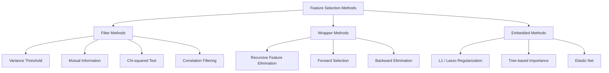
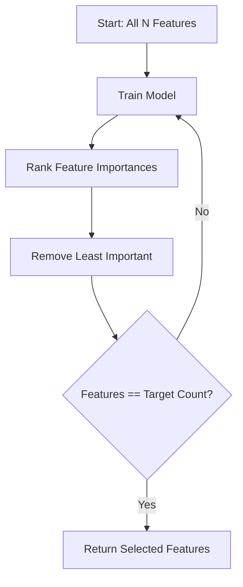
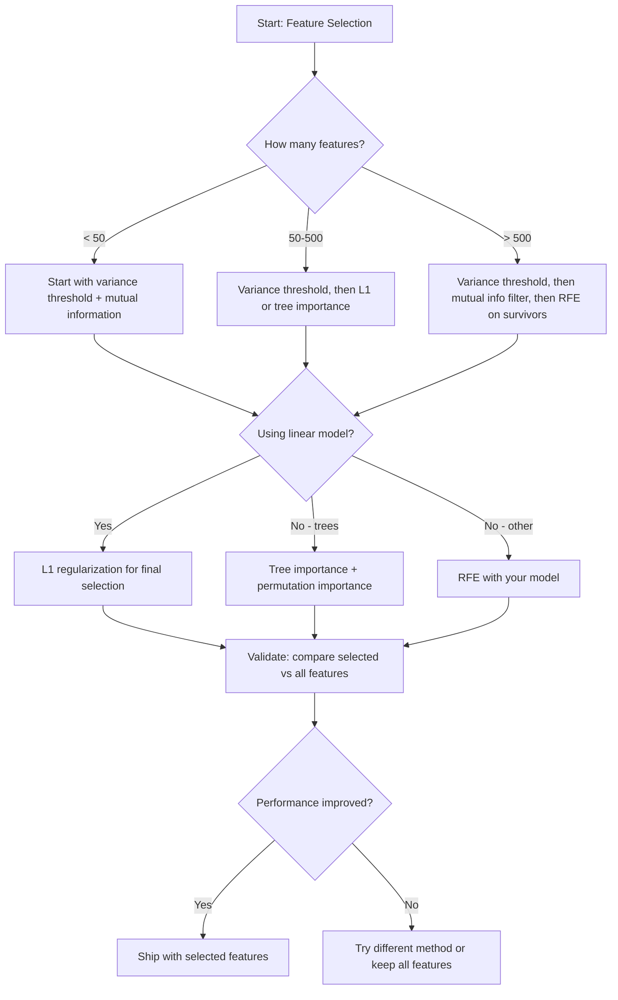

# Feature Selection

> Lebih banyak fitur bukan berarti lebih baik. Fitur yang tepat itu lebih baik.

**Type:** Build
**Language:** Python
**Prerequisites:** Phase 2, Lessons 01-09, 08 (feature engineering)
**Time:** ~75 minutes

## Tujuan Pembelajaran

- Implementasikan metode filter (variance threshold, mutual information, chi-squared) dan metode wrapper (RFE, forward selection) dari nol
- Jelaskan mengapa mutual information menangkap hubungan fitur-target nonlinear yang dilewatkan oleh korelasi
- Bandingkan L1 regularization (seleksi embedded) dengan RFE (seleksi wrapper) dan evaluasi tradeoff komputasional mereka
- Bangun sebuah pipeline seleksi fitur yang menggabungkan beberapa metode dan tunjukkan generalisasi yang membaik pada data held-out

## Masalahnya

Kamu punya 500 fitur. Model-mu melatih dengan lambat, overfit secara konstan, dan tidak ada yang dapat menjelaskan apa yang dipelajarinya. Kamu menambahkan lebih banyak fitur berharap performa membaik. Malah memburuk.

Ini adalah curse of dimensionality yang sedang bekerja. Seiring jumlah fitur tumbuh, volume ruang fitur meledak. Titik-titik data menjadi jarang. Jarak antar titik konvergen. Model membutuhkan data yang secara eksponensial lebih banyak untuk menemukan pola yang nyata. Fitur noise menenggelamkan fitur sinyal. Overfitting menjadi default.

Feature selection adalah antidotnya. Kupas noise-nya. Hapus redundansinya. Simpan fitur-fitur yang membawa informasi aktual tentang targetnya. Hasilnya: training lebih cepat, generalisasi lebih baik, dan model yang benar-benar dapat kamu jelaskan.

Tujuannya bukan menggunakan semua informasi yang tersedia. Tujuannya adalah menggunakan informasi yang tepat.

## Konsepnya

### Tiga Kategori Feature Selection

Setiap metode feature selection jatuh ke dalam salah satu dari tiga kategori:



**Metode filter** memberi skor setiap fitur secara independen menggunakan sebuah ukuran statistik. Tidak menggunakan model. Cepat, tetapi melewatkan interaksi fitur.

**Metode wrapper** melatih sebuah model untuk mengevaluasi subset fitur. Menggunakan performa model sebagai skornya. Hasil lebih baik, tetapi mahal karena melatih ulang model berkali-kali.

**Metode embedded** memilih fitur sebagai bagian dari training model. L1 regularization menggerakkan weight ke nol. Decision trees membelah pada fitur-fitur paling berguna. Seleksi terjadi selama fitting, bukan sebagai langkah terpisah.

### Variance Threshold

Filter paling sederhana. Jika sebuah fitur hampir tidak bervariasi di seluruh sampel, ia membawa hampir tidak ada informasi.

Pertimbangkan sebuah fitur yang bernilai 0,0 untuk 999 dari 1000 sampel. Variancenya mendekati nol. Tidak ada model yang dapat menggunakannya untuk membedakan antara kelas-kelas. Hapus.

```
variance(x) = mean((x - mean(x))^2)
```

Tetapkan sebuah threshold (misalnya 0,01). Buang setiap fitur dengan variance di bawahnya. Ini menghapus fitur konstan atau nyaris-konstan tanpa melihat variabel target sama sekali.

Kapan menggunakannya: sebagai sebuah langkah preprocessing sebelum metode lain. Menangkap fitur-fitur yang jelas tidak berguna dengan biaya nyaris-nol.

Keterbatasan: sebuah fitur dapat memiliki variance tinggi tetapi tetap murni noise. Variance threshold itu necessary tetapi tidak sufficient.

### Mutual Information

Mutual information mengukur seberapa banyak mengetahui nilai fitur X mengurangi ketidakpastian tentang target Y.

```
I(X; Y) = sum_x sum_y p(x, y) * log(p(x, y) / (p(x) * p(y)))
```

Jika X dan Y independen, p(x, y) = p(x) * p(y), jadi istilah log-nya nol dan I(X; Y) = 0. Semakin banyak X memberi tahu kamu tentang Y, semakin tinggi mutual information-nya.

Keuntungan kunci dibanding korelasi: mutual information menangkap hubungan nonlinear. Sebuah fitur mungkin punya korelasi nol dengan target tetapi mutual information tinggi karena hubungannya kuadratik atau periodik.

Untuk fitur kontinu, discretize menjadi bins terlebih dahulu (estimasi berbasis histogram). Jumlah bin memengaruhi estimasi -- terlalu sedikit bin kehilangan informasi, terlalu banyak bin menambahkan noise. Pilihan umum: sqrt(n) bin atau aturan Sturges (1 + log2(n)).


### Recursive Feature Elimination (RFE)

RFE adalah sebuah metode wrapper. Ia menggunakan feature importance dari model itu sendiri untuk memangkas secara iteratif:

1. Latih model dengan semua fitur
2. Peringkat fitur berdasarkan importance (koefisien untuk model linear, impurity reduction untuk pohon)
3. Hapus fitur yang paling tidak penting
4. Ulangi hingga jumlah fitur yang diinginkan tersisa



RFE mempertimbangkan interaksi fitur karena model melihat semua fitur yang tersisa bersama-sama. Menghapus satu fitur mengubah importance fitur lainnya. Ini membuatnya lebih menyeluruh daripada metode filter.

Biayanya: kamu melatih model N - target kali. Dengan 500 fitur dan target 10, itu 490 run training. Untuk model yang mahal, ini lambat. Kamu dapat mempercepatnya dengan menghapus banyak fitur per langkah (misalnya, hapus 10% terbawah setiap putaran).

### L1 (Lasso) Regularization

L1 regularization menambahkan nilai absolut weight ke fungsi loss:

```
loss = prediction_error + alpha * sum(|w_i|)
```

Parameter alpha mengontrol seberapa agresif fitur-fitur dipangkas. Alpha lebih tinggi berarti lebih banyak weight menjadi tepat nol.

Mengapa tepat nol? Penalti L1 menciptakan sebuah region batas berbentuk belah ketupat di ruang weight. Solusi optimal cenderung mendarat di sebuah sudut dari belah ketupat ini, di mana satu atau lebih weight adalah nol. L2 regularization (ridge) menciptakan sebuah batas melingkar di mana weight menyusut tetapi jarang mencapai nol.

Ini adalah feature selection embedded: model mempelajari selama training fitur mana yang harus diabaikan. Fitur dengan weight nol efektif dihapus.

Keuntungan: satu run training, menangani fitur yang berkorelasi (memilih satu dan men-zero-kan yang lain), dibangun ke dalam sebagian besar implementasi model linear.

Keterbatasan: hanya bekerja untuk model linear. Tidak dapat menangkap importance fitur nonlinear.

### Tree-Based Feature Importance

Decision trees dan ensemble mereka (random forests, gradient boosting) secara alami memeringkat fitur. Setiap pembagian mengurangi impurity (Gini atau entropy untuk klasifikasi, variance untuk regresi). Fitur-fitur yang menghasilkan pengurangan impurity yang lebih besar lebih penting.

Untuk sebuah random forest dengan T pohon:

```
importance(feature_j) = (1/T) * sum over all trees of
    sum over all nodes splitting on feature_j of
        (n_samples * impurity_decrease)
```

Ini memberikan sebuah skor importance ternormalisasi untuk setiap fitur. Menangani hubungan nonlinear dan interaksi fitur secara otomatis.

Kewaspadaan: tree-based importance bias terhadap fitur dengan banyak nilai unik (high cardinality). Sebuah kolom ID acak akan tampak penting karena membelah setiap sampel dengan sempurna. Gunakan permutation importance sebagai sanity check.

### Permutation Importance

Sebuah metode model-agnostic:

1. Latih model dan rekam performa baseline pada data validasi
2. Untuk setiap fitur: acak (shuffle) nilainya secara acak, ukur penurunan performa
3. Semakin besar penurunannya, semakin penting fiturnya

Jika mengacak sebuah fitur tidak merugikan performa, model tidak bergantung padanya. Jika performa runtuh, fitur itu kritis.

Permutation importance menghindari bias cardinality dari tree-based importance. Tetapi lambat: satu evaluasi penuh per fitur, diulang berkali-kali untuk stabilitas.

### Tabel Perbandingan

| Metode | Tipe | Kecepatan | Nonlinear | Interaksi Fitur |
|--------|------|-------|-----------|---------------------|
| Variance threshold | Filter | Sangat cepat | Tidak | Tidak |
| Mutual information | Filter | Cepat | Ya | Tidak |
| Correlation filter | Filter | Cepat | Tidak | Tidak |
| RFE | Wrapper | Lambat | Tergantung model | Ya |
| L1 / Lasso | Embedded | Cepat | Tidak (linear) | Tidak |
| Tree importance | Embedded | Sedang | Ya | Ya |
| Permutation importance | Model-agnostic | Lambat | Ya | Ya |

### Flowchart Keputusan



```figure
f3-feature-prune
```

## Bangun Sendiri

### Langkah 1: Hasilkan data sintetis dengan struktur fitur yang diketahui

```python
import numpy as np


def make_feature_selection_data(n_samples=500, seed=42):
    rng = np.random.RandomState(seed)

    x1 = rng.randn(n_samples)
    x2 = rng.randn(n_samples)
    x3 = rng.randn(n_samples)
    x4 = x1 + 0.1 * rng.randn(n_samples)
    x5 = x2 + 0.1 * rng.randn(n_samples)

    informative = np.column_stack([x1, x2, x3, x4, x5])

    correlated = np.column_stack([
        x1 * 0.9 + 0.1 * rng.randn(n_samples),
        x2 * 0.8 + 0.2 * rng.randn(n_samples),
        x3 * 0.7 + 0.3 * rng.randn(n_samples),
        x1 * 0.5 + x2 * 0.5 + 0.1 * rng.randn(n_samples),
        x2 * 0.6 + x3 * 0.4 + 0.1 * rng.randn(n_samples),
    ])

    noise = rng.randn(n_samples, 10) * 0.5

    X = np.hstack([informative, correlated, noise])
    y = (2 * x1 - 1.5 * x2 + x3 + 0.5 * rng.randn(n_samples) > 0).astype(int)

    feature_names = (
        [f"info_{i}" for i in range(5)]
        + [f"corr_{i}" for i in range(5)]
        + [f"noise_{i}" for i in range(10)]
    )

    return X, y, feature_names
```

Kita tahu ground truth-nya: fitur 0-4 informatif (ditambah 3 dan 4 adalah salinan yang berkorelasi dari 0 dan 1), fitur 5-9 berkorelasi dengan fitur informatif, fitur 10-19 murni noise. Sebuah metode seleksi yang baik seharusnya memeringkat 0-4 tertinggi dan 10-19 terendah.

### Langkah 2: Variance threshold

```python
def variance_threshold(X, threshold=0.01):
    variances = np.var(X, axis=0)
    mask = variances > threshold
    return mask, variances
```

### Langkah 3: Mutual information (diskret)

```python
def discretize(x, n_bins=10):
    min_val, max_val = x.min(), x.max()
    if max_val == min_val:
        return np.zeros_like(x, dtype=int)
    bin_edges = np.linspace(min_val, max_val, n_bins + 1)
    binned = np.digitize(x, bin_edges[1:-1])
    return binned


def mutual_information(X, y, n_bins=10):
    n_samples, n_features = X.shape
    mi_scores = np.zeros(n_features)

    y_vals, y_counts = np.unique(y, return_counts=True)
    p_y = y_counts / n_samples

    for f in range(n_features):
        x_binned = discretize(X[:, f], n_bins)
        x_vals, x_counts = np.unique(x_binned, return_counts=True)
        p_x = dict(zip(x_vals, x_counts / n_samples))

        mi = 0.0
        for xv in x_vals:
            for yi, yv in enumerate(y_vals):
                joint_mask = (x_binned == xv) & (y == yv)
                p_xy = np.sum(joint_mask) / n_samples
                if p_xy > 0:
                    mi += p_xy * np.log(p_xy / (p_x[xv] * p_y[yi]))
        mi_scores[f] = mi

    return mi_scores
```

### Langkah 4: Recursive Feature Elimination

```python
def simple_logistic_importance(X, y, lr=0.1, epochs=100):
    n_samples, n_features = X.shape
    w = np.zeros(n_features)
    b = 0.0

    for _ in range(epochs):
        z = X @ w + b
        pred = 1.0 / (1.0 + np.exp(-np.clip(z, -500, 500)))
        error = pred - y
        w -= lr * (X.T @ error) / n_samples
        b -= lr * np.mean(error)

    return w, b


def rfe(X, y, n_features_to_select=5, lr=0.1, epochs=100):
    n_total = X.shape[1]
    remaining = list(range(n_total))
    rankings = np.ones(n_total, dtype=int)
    rank = n_total

    while len(remaining) > n_features_to_select:
        X_subset = X[:, remaining]
        w, _ = simple_logistic_importance(X_subset, y, lr, epochs)
        importances = np.abs(w)

        least_idx = np.argmin(importances)
        original_idx = remaining[least_idx]
        rankings[original_idx] = rank
        rank -= 1
        remaining.pop(least_idx)

    for idx in remaining:
        rankings[idx] = 1

    selected_mask = rankings == 1
    return selected_mask, rankings
```

### Langkah 5: Seleksi fitur L1

```python
def soft_threshold(w, alpha):
    return np.sign(w) * np.maximum(np.abs(w) - alpha, 0)


def l1_feature_selection(X, y, alpha=0.1, lr=0.01, epochs=500):
    n_samples, n_features = X.shape
    w = np.zeros(n_features)
    b = 0.0

    for _ in range(epochs):
        z = X @ w + b
        pred = 1.0 / (1.0 + np.exp(-np.clip(z, -500, 500)))
        error = pred - y

        gradient_w = (X.T @ error) / n_samples
        gradient_b = np.mean(error)

        w -= lr * gradient_w
        w = soft_threshold(w, lr * alpha)
        b -= lr * gradient_b

    selected_mask = np.abs(w) > 1e-6
    return selected_mask, w
```

### Langkah 6: Tree-based importance (decision tree sederhana)

```python
def gini_impurity(y):
    if len(y) == 0:
        return 0.0
    classes, counts = np.unique(y, return_counts=True)
    probs = counts / len(y)
    return 1.0 - np.sum(probs ** 2)


def best_split(X, y, feature_idx):
    values = np.unique(X[:, feature_idx])
    if len(values) <= 1:
        return None, -1.0

    best_threshold = None
    best_gain = -1.0
    parent_gini = gini_impurity(y)
    n = len(y)

    for i in range(len(values) - 1):
        threshold = (values[i] + values[i + 1]) / 2.0
        left_mask = X[:, feature_idx] <= threshold
        right_mask = ~left_mask

        n_left = np.sum(left_mask)
        n_right = np.sum(right_mask)

        if n_left == 0 or n_right == 0:
            continue

        gain = parent_gini - (n_left / n) * gini_impurity(y[left_mask]) - (n_right / n) * gini_impurity(y[right_mask])

        if gain > best_gain:
            best_gain = gain
            best_threshold = threshold

    return best_threshold, best_gain


def tree_importance(X, y, n_trees=50, max_depth=5, seed=42):
    rng = np.random.RandomState(seed)
    n_samples, n_features = X.shape
    importances = np.zeros(n_features)

    for _ in range(n_trees):
        sample_idx = rng.choice(n_samples, size=n_samples, replace=True)
        feature_subset = rng.choice(n_features, size=max(1, int(np.sqrt(n_features))), replace=False)

        X_boot = X[sample_idx]
        y_boot = y[sample_idx]

        tree_imp = _build_tree_importance(X_boot, y_boot, feature_subset, max_depth)
        importances += tree_imp

    total = importances.sum()
    if total > 0:
        importances /= total

    return importances


def _build_tree_importance(X, y, feature_subset, max_depth, depth=0):
    n_features = X.shape[1]
    importances = np.zeros(n_features)

    if depth >= max_depth or len(np.unique(y)) <= 1 or len(y) < 4:
        return importances

    best_feature = None
    best_threshold = None
    best_gain = -1.0

    for f in feature_subset:
        threshold, gain = best_split(X, y, f)
        if gain > best_gain:
            best_gain = gain
            best_feature = f
            best_threshold = threshold

    if best_feature is None or best_gain <= 0:
        return importances

    importances[best_feature] += best_gain * len(y)

    left_mask = X[:, best_feature] <= best_threshold
    right_mask = ~left_mask

    importances += _build_tree_importance(X[left_mask], y[left_mask], feature_subset, max_depth, depth + 1)
    importances += _build_tree_importance(X[right_mask], y[right_mask], feature_subset, max_depth, depth + 1)

    return importances
```

### Langkah 7: Jalankan semua metode dan bandingkan

Berkas kode menjalankan kelima metode pada dataset sintetis yang sama dan mencetak sebuah tabel perbandingan yang menunjukkan fitur mana yang dipilih setiap metode.

## Gunakan

Dengan scikit-learn, seleksi fitur dibangun ke dalam pipeline:

```python
from sklearn.feature_selection import (
    VarianceThreshold,
    mutual_info_classif,
    RFE,
    SelectFromModel,
)
from sklearn.linear_model import Lasso, LogisticRegression
from sklearn.ensemble import RandomForestClassifier

vt = VarianceThreshold(threshold=0.01)
X_filtered = vt.fit_transform(X)

mi_scores = mutual_info_classif(X, y)
top_k = np.argsort(mi_scores)[-10:]

rfe_selector = RFE(LogisticRegression(), n_features_to_select=10)
rfe_selector.fit(X, y)
X_rfe = rfe_selector.transform(X)

lasso_selector = SelectFromModel(Lasso(alpha=0.01))
lasso_selector.fit(X, y)
X_lasso = lasso_selector.transform(X)

rf = RandomForestClassifier(n_estimators=100)
rf.fit(X, y)
importances = rf.feature_importances_
```

Implementasi dari-nol menunjukkan dengan persis apa yang terjadi di dalam setiap metode. Variance threshold hanyalah menghitung `var(X, axis=0)` dan menerapkan sebuah mask. Mutual information adalah menghitung frekuensi gabungan (joint) dan marginal dalam sebuah tabel kontingensi. RFE adalah sebuah loop yang melatih, memeringkat, dan memangkas. L1 adalah gradient descent dengan sebuah langkah soft-thresholding. Tree importance mengakumulasikan pengurangan impurity di seluruh pembagian. Tanpa sihir -- hanya statistik dan loop.

Versi sklearn menambahkan robustness (misalnya, mutual_info_classif menggunakan k-NN density estimation alih-alih binning), kecepatan (implementasi C), dan integrasi pipeline.

## Rilis

Pelajaran ini menghasilkan:
- `outputs/skill-feature-selector.md` -- sebuah decision tree referensi cepat untuk memilih metode seleksi fitur yang tepat

## Latihan

1. **Forward selection**: implementasikan kebalikan dari RFE. Mulai dengan nol fitur. Di setiap langkah, tambahkan fitur yang paling memperbaiki performa model. Berhenti ketika menambahkan fitur tidak lagi membantu. Bandingkan fitur terpilih dengan hasil RFE. Mana yang lebih cepat? Mana yang memberikan hasil lebih baik?

2. **Stability selection**: jalankan seleksi fitur L1 50 kali, masing-masing pada subsample acak 80% dari data, dengan alpha yang sedikit berbeda. Hitung seberapa sering setiap fitur dipilih. Fitur yang dipilih di > 80% run adalah "stabil." Bandingkan fitur stabil dengan seleksi L1 single-run. Mana yang lebih andal?

3. **Deteksi multicollinearity**: hitung matriks korelasi untuk semua fitur. Implementasikan sebuah fungsi yang, diberikan sebuah threshold korelasi (misalnya 0,9), menghapus satu fitur dari setiap pasangan yang berkorelasi tinggi (mempertahankan yang punya mutual information lebih tinggi dengan target). Uji pada dataset sintetis dan verifikasi bahwa ia menghapus fitur-fitur redundant yang berkorelasi.

4. **Pipeline seleksi fitur**: hubungkan variance threshold, filter mutual information, dan RFE menjadi satu pipeline. Pertama hapus fitur dengan variance nyaris-nol, lalu simpan 50% teratas berdasarkan mutual information, lalu jalankan RFE pada para penyintas (survivors). Bandingkan pipeline ini dengan menjalankan RFE sendirian pada semua fitur. Apakah pipeline-nya lebih cepat? Apakah akurasinya sama?

5. **Permutation importance dari nol**: implementasikan permutation importance. Untuk setiap fitur, acak nilainya 10 kali, ukur penurunan rata-rata skor F1. Bandingkan peringkatnya dengan tree-based importance. Temukan kasus di mana keduanya tidak setuju dan jelaskan mengapa (petunjuk: fitur yang berkorelasi).

## Istilah Kunci

| Istilah | Apa yang orang katakan | Apa artinya yang sebenarnya |
|------|----------------|----------------------|
| Metode filter | "Beri skor fitur secara independen" | Sebuah pendekatan seleksi fitur yang memeringkat fitur menggunakan sebuah ukuran statistik tanpa melatih sebuah model, mengevaluasi setiap fitur secara terisolasi |
| Metode wrapper | "Gunakan model untuk memilih fitur" | Sebuah pendekatan seleksi fitur yang mengevaluasi subset fitur dengan melatih sebuah model dan menggunakan performanya sebagai kriteria seleksi |
| Metode embedded | "Model memilih fitur selama training" | Seleksi fitur yang terjadi sebagai bagian dari fitting model, seperti L1 regularization yang menggerakkan weight ke nol |
| Mutual information | "Seberapa banyak satu variabel memberi tahu kamu tentang yang lain" | Sebuah ukuran pengurangan ketidakpastian tentang Y diberikan pengetahuan tentang X, menangkap baik dependensi linear maupun nonlinear |
| Recursive Feature Elimination | "Latih, peringkat, pangkas, ulangi" | Sebuah metode wrapper iteratif yang melatih sebuah model, menghapus fitur yang paling tidak penting, dan mengulangi hingga jumlah target tercapai |
| L1 / Lasso regularization | "Penalti yang membunuh fitur" | Menambahkan jumlah nilai absolut weight ke fungsi loss, yang menggerakkan weight fitur yang tidak penting tepat ke nol |
| Variance threshold | "Hapus fitur konstan" | Membuang fitur yang variance-nya di seluruh sampel jatuh di bawah sebuah threshold yang dispesifikasikan, menyaring fitur-fitur yang tidak membawa informasi |
| Feature importance | "Fitur mana yang paling penting" | Sebuah skor yang menunjukkan seberapa banyak setiap fitur berkontribusi pada prediksi model, dihitung dari gain pembagian (pohon) atau magnitudo koefisien (linear) |
| Permutation importance | "Acak dan ukur kerusakannya" | Mengevaluasi importance fitur dengan mengacak secara acak nilai setiap fitur dan mengukur penurunan performa model yang dihasilkan |
| Curse of dimensionality | "Terlalu banyak fitur, data tidak cukup" | Fenomena di mana menambahkan fitur meningkatkan volume ruang fitur secara eksponensial, membuat data jarang dan jarak tidak bermakna |

## Bacaan Lanjutan

- [An Introduction to Variable and Feature Selection (Guyon & Elisseeff, 2003)](https://jmlr.org/papers/v3/guyon03a.html) -- survei fondasional tentang metode seleksi fitur, masih banyak dirujuk
- [Panduan Feature Selection scikit-learn](https://scikit-learn.org/stable/modules/feature_selection.html) -- referensi praktis untuk metode filter, wrapper, dan embedded dengan contoh kode
- [Stability Selection (Meinshausen & Buhlmann, 2010)](https://arxiv.org/abs/0809.2932) -- menggabungkan subsampling dengan seleksi fitur untuk hasil yang robust dan dapat direproduksi
- [Beware Default Random Forest Importances (Strobl et al., 2007)](https://bmcbioinformatics.biomedcentral.com/articles/10.1186/1471-2105-8-25) -- mendemonstrasikan bias cardinality dalam tree-based importance dan mengusulkan conditional importance sebagai alternatif
