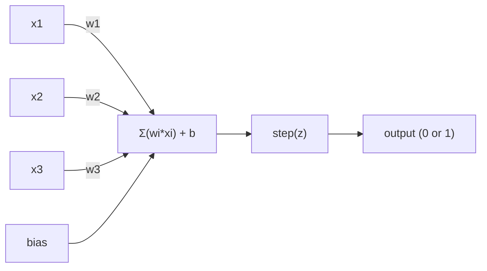
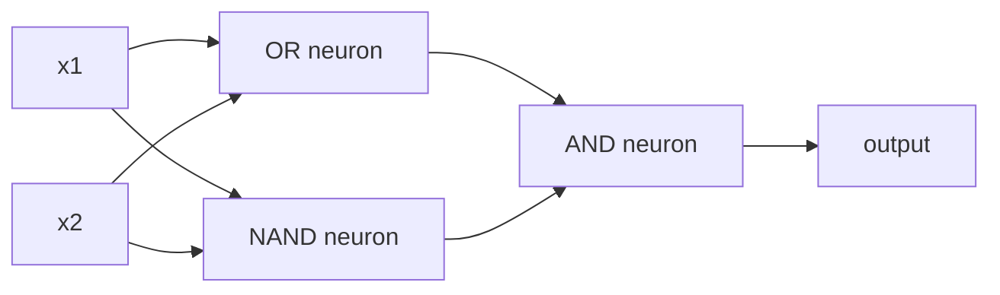

# Perseptron

> Perseptron adalah atom dari neural network. Belah ia dan kamu akan menemukan bobot, bias, dan sebuah keputusan.

**Type:** Build
**Languages:** Python
**Prerequisites:** Phase 1 (Linear Algebra Intuition)
**Time:** ~60 minutes

## Tujuan Pembelajaran

- Mengimplementasikan perseptron dari nol di Python, termasuk aturan update bobot dan fungsi aktivasi step
- Menjelaskan mengapa satu perseptron hanya bisa menyelesaikan masalah yang linearly separable dan mendemonstrasikan kasus kegagalan XOR
- Membangun multi-layer perceptron dengan mengomposisikan gerbang OR, NAND, dan AND untuk menyelesaikan XOR
- Melatih network dua lapis dengan aktivasi sigmoid dan backpropagation agar mempelajari XOR secara otomatis

## Masalahnya

Kamu sudah mengenal vektor dan dot product. Kamu tahu bahwa matriks mengubah input menjadi output. Tapi bagaimana mesin *belajar* transformasi mana yang harus dipakai?

Perseptron menjawab ini. Ia adalah mesin belajar paling sederhana yang mungkin: ambil beberapa input, kalikan dengan bobot, tambahkan bias, lalu buat keputusan biner. Kemudian sesuaikan. Hanya itu. Setiap neural network yang pernah dibangun adalah lapisan-lapisan dari ide ini yang ditumpuk bersama.

Memahami perseptron berarti memahami apa arti "belajar" sebenarnya di dalam kode: menyesuaikan angka-angka sampai output cocok dengan kenyataan.

## Konsepnya

### Satu Neuron, Satu Keputusan

Sebuah perseptron menerima n input, mengalikan masing-masing dengan sebuah bobot, menjumlahkannya, menambahkan bias, dan meneruskan hasilnya melalui fungsi aktivasi.



Fungsi step itu brutal: jika jumlah berbobot plus bias >= 0, output-nya 1. Jika tidak, output-nya 0.

```
step(z) = 1  if z >= 0
           0  if z < 0
```

Ini adalah pengklasifikasi linear. Bobot dan bias mendefinisikan sebuah garis (atau hyperplane dalam dimensi yang lebih tinggi) yang membelah ruang input menjadi dua wilayah.

### Batas Keputusan

Untuk dua input, perseptron menggambar sebuah garis melalui ruang 2D:

```
  x2
  ┤
  │  Class 1        /
  │    (0)          /
  │                /
  │               / w1·x1 + w2·x2 + b = 0
  │              /
  │             /     Class 2
  │            /        (1)
  ┼───────────/──────────── x1
```

Semua yang berada di satu sisi garis menghasilkan output 0. Semua yang berada di sisi lain menghasilkan output 1. Training menggeser garis ini sampai ia memisahkan kelas-kelas dengan benar.

### Aturan Belajar

Aturan belajar perseptron itu sederhana:

```
For each training example (x, y_true):
    y_pred = predict(x)
    error = y_true - y_pred

    For each weight:
        w_i = w_i + learning_rate * error * x_i
    bias = bias + learning_rate * error
```

Jika prediksinya benar, error = 0, tidak ada yang berubah. Jika ia memprediksi 0 padahal seharusnya 1, bobot bertambah. Jika ia memprediksi 1 padahal seharusnya 0, bobot berkurang. Learning rate mengendalikan seberapa besar setiap penyesuaian.

### Masalah XOR

Di sinilah ia gagal. Perhatikan gerbang-gerbang logika ini:

```
AND gate:           OR gate:            XOR gate:
x1  x2  out         x1  x2  out         x1  x2  out
0   0   0           0   0   0           0   0   0
0   1   0           0   1   1           0   1   1
1   0   0           1   0   1           1   0   1
1   1   1           1   1   1           1   1   0
```

AND dan OR itu linearly separable: kamu bisa menggambar satu garis untuk memisahkan 0 dari 1. XOR tidak. Tidak ada satu garis pun yang bisa memisahkan [0,1] dan [1,0] dari [0,0] dan [1,1].

```
AND (separable):        XOR (not separable):

  x2                      x2
  1 ┤  0     1            1 ┤  1     0
    │     /                 │
  0 ┤  0 / 0              0 ┤  0     1
    ┼──/──────── x1         ┼──────────── x1
       line works!          no single line works!
```

Ini adalah batas fundamental. Satu perseptron hanya bisa menyelesaikan masalah yang linearly separable. Minsky dan Papert membuktikannya pada tahun 1969 dan itu nyaris membunuh riset neural network selama satu dekade.

Perbaikannya: tumpuk perseptron menjadi lapisan-lapisan. Multi-layer perceptron bisa menyelesaikan XOR dengan menggabungkan dua keputusan linear menjadi satu keputusan nonlinear.

```figure
perceptron-boundary
```

## Bangun Sendiri

### Langkah 1: Kelas Perceptron

```python
class Perceptron:
    def __init__(self, n_inputs, learning_rate=0.1):
        self.weights = [0.0] * n_inputs
        self.bias = 0.0
        self.lr = learning_rate

    def predict(self, inputs):
        total = sum(w * x for w, x in zip(self.weights, inputs))
        total += self.bias
        return 1 if total >= 0 else 0

    def train(self, training_data, epochs=100):
        for epoch in range(epochs):
            errors = 0
            for inputs, target in training_data:
                prediction = self.predict(inputs)
                error = target - prediction
                if error != 0:
                    errors += 1
                    for i in range(len(self.weights)):
                        self.weights[i] += self.lr * error * inputs[i]
                    self.bias += self.lr * error
            if errors == 0:
                print(f"Converged at epoch {epoch + 1}")
                return
        print(f"Did not converge after {epochs} epochs")
```

### Langkah 2: Latih pada gerbang logika

```python
and_data = [
    ([0, 0], 0),
    ([0, 1], 0),
    ([1, 0], 0),
    ([1, 1], 1),
]

or_data = [
    ([0, 0], 0),
    ([0, 1], 1),
    ([1, 0], 1),
    ([1, 1], 1),
]

not_data = [
    ([0], 1),
    ([1], 0),
]

print("=== AND Gate ===")
p_and = Perceptron(2)
p_and.train(and_data)
for inputs, _ in and_data:
    print(f"  {inputs} -> {p_and.predict(inputs)}")

print("\n=== OR Gate ===")
p_or = Perceptron(2)
p_or.train(or_data)
for inputs, _ in or_data:
    print(f"  {inputs} -> {p_or.predict(inputs)}")

print("\n=== NOT Gate ===")
p_not = Perceptron(1)
p_not.train(not_data)
for inputs, _ in not_data:
    print(f"  {inputs} -> {p_not.predict(inputs)}")
```

### Langkah 3: Saksikan XOR gagal

```python
xor_data = [
    ([0, 0], 0),
    ([0, 1], 1),
    ([1, 0], 1),
    ([1, 1], 0),
]

print("\n=== XOR Gate (single perceptron) ===")
p_xor = Perceptron(2)
p_xor.train(xor_data, epochs=1000)
for inputs, expected in xor_data:
    result = p_xor.predict(inputs)
    status = "OK" if result == expected else "WRONG"
    print(f"  {inputs} -> {result} (expected {expected}) {status}")
```

Ia tidak akan pernah konvergen. Ini adalah bukti keras bahwa satu perseptron tidak bisa mempelajari XOR.

### Langkah 4: Selesaikan XOR dengan dua lapis

Triknya: XOR = (x1 OR x2) AND NOT (x1 AND x2). Gabungkan tiga perseptron:



```python
def xor_network(x1, x2):
    or_neuron = Perceptron(2)
    or_neuron.weights = [1.0, 1.0]
    or_neuron.bias = -0.5

    nand_neuron = Perceptron(2)
    nand_neuron.weights = [-1.0, -1.0]
    nand_neuron.bias = 1.5

    and_neuron = Perceptron(2)
    and_neuron.weights = [1.0, 1.0]
    and_neuron.bias = -1.5

    hidden1 = or_neuron.predict([x1, x2])
    hidden2 = nand_neuron.predict([x1, x2])
    output = and_neuron.predict([hidden1, hidden2])
    return output


print("\n=== XOR Gate (multi-layer network) ===")
for inputs, expected in xor_data:
    result = xor_network(inputs[0], inputs[1])
    print(f"  {inputs} -> {result} (expected {expected})")
```

Keempat kasus benar semua. Menumpuk perseptron menjadi lapisan-lapisan menciptakan batas keputusan yang tidak bisa dihasilkan oleh satu perseptron pun.

### Langkah 5: Latih Network Dua Lapis

Langkah 4 mengatur bobot secara manual. Itu berhasil untuk XOR, tetapi tidak untuk masalah nyata di mana kamu tidak tahu bobot yang tepat sejak awal. Perbaikannya: ganti fungsi step dengan sigmoid dan pelajari bobot secara otomatis melalui backpropagation.

```python
class TwoLayerNetwork:
    def __init__(self, learning_rate=0.5):
        import random
        random.seed(0)
        self.w_hidden = [[random.uniform(-1, 1), random.uniform(-1, 1)] for _ in range(2)]
        self.b_hidden = [random.uniform(-1, 1), random.uniform(-1, 1)]
        self.w_output = [random.uniform(-1, 1), random.uniform(-1, 1)]
        self.b_output = random.uniform(-1, 1)
        self.lr = learning_rate

    def sigmoid(self, x):
        import math
        x = max(-500, min(500, x))
        return 1.0 / (1.0 + math.exp(-x))

    def forward(self, inputs):
        self.inputs = inputs
        self.hidden_outputs = []
        for i in range(2):
            z = sum(w * x for w, x in zip(self.w_hidden[i], inputs)) + self.b_hidden[i]
            self.hidden_outputs.append(self.sigmoid(z))
        z_out = sum(w * h for w, h in zip(self.w_output, self.hidden_outputs)) + self.b_output
        self.output = self.sigmoid(z_out)
        return self.output

    def train(self, training_data, epochs=10000):
        for epoch in range(epochs):
            total_error = 0
            for inputs, target in training_data:
                output = self.forward(inputs)
                error = target - output
                total_error += error ** 2

                d_output = error * output * (1 - output)

                saved_w_output = self.w_output[:]
                hidden_deltas = []
                for i in range(2):
                    h = self.hidden_outputs[i]
                    hd = d_output * saved_w_output[i] * h * (1 - h)
                    hidden_deltas.append(hd)

                for i in range(2):
                    self.w_output[i] += self.lr * d_output * self.hidden_outputs[i]
                self.b_output += self.lr * d_output

                for i in range(2):
                    for j in range(len(inputs)):
                        self.w_hidden[i][j] += self.lr * hidden_deltas[i] * inputs[j]
                    self.b_hidden[i] += self.lr * hidden_deltas[i]
```

```python
net = TwoLayerNetwork(learning_rate=2.0)
net.train(xor_data, epochs=10000)
for inputs, expected in xor_data:
    result = net.forward(inputs)
    predicted = 1 if result >= 0.5 else 0
    print(f"  {inputs} -> {result:.4f} (rounded: {predicted}, expected {expected})")
```

Dua perbedaan kunci dari Langkah 4. Pertama, sigmoid menggantikan fungsi step -- ia mulus, sehingga gradien selalu ada. Kedua, metode `train` mempropagasikan error mundur dari output ke hidden layer, menyesuaikan setiap bobot secara proporsional terhadap kontribusinya pada error. Itulah backpropagation dalam 20 baris.

Ini adalah jembatan ke Pelajaran 03. Matematika di balik `d_output` dan `hidden_deltas` adalah aturan rantai yang diterapkan pada graf network. Kita akan menurunkannya dengan benar di sana.

## Gunakan

Semua yang baru saja kamu bangun dari nol ada dalam satu import:

```python
from sklearn.linear_model import Perceptron as SkPerceptron
import numpy as np

X = np.array([[0,0],[0,1],[1,0],[1,1]])
y = np.array([0, 0, 0, 1])

clf = SkPerceptron(max_iter=100, tol=1e-3)
clf.fit(X, y)
print([clf.predict([x])[0] for x in X])
```

Lima baris. Kelas `Perceptron` 30-baris milikmu melakukan hal yang sama. Versi sklearn menambahkan cek konvergensi, banyak fungsi loss, dan dukungan input sparse -- tetapi loop intinya identik: jumlah berbobot, fungsi step, update bobot saat ada error.

Kesenjangan sebenarnya muncul pada skala. Yang berubah dalam network produksi:

- Fungsi step menjadi sigmoid, ReLU, atau aktivasi mulus lainnya
- Bobot dipelajari otomatis lewat backpropagation (Pelajaran 03)
- Lapisan menjadi lebih dalam: 3, 10, 100+ lapis
- Prinsip yang sama tetap berlaku: setiap lapis menciptakan fitur baru dari output lapis sebelumnya

Satu perseptron hanya bisa menggambar garis lurus. Tumpuk mereka, dan kamu bisa menggambar bentuk apa pun.

## Rilis

Pelajaran ini menghasilkan:

- `outputs/skill-perceptron.md` - sebuah skill yang membahas kapan arsitektur satu lapis vs multi-lapis dibutuhkan

## Latihan

1. Latih perseptron pada gerbang NAND (gerbang universal - setiap rangkaian logika bisa dibangun dari NAND). Verifikasi bahwa bobot dan bias-nya membentuk batas keputusan yang valid.
2. Ubah kelas Perceptron agar melacak batas keputusan (w1*x1 + w2*x2 + b = 0) pada setiap epoch. Cetak bagaimana garis bergeser selama training pada gerbang AND.
3. Bangun perseptron 3-input yang menghasilkan output 1 hanya ketika setidaknya 2 dari 3 input bernilai 1 (fungsi majority vote). Apakah ini linearly separable? Mengapa?

## Istilah Kunci

| Term | What people say | What it actually means |
|------|----------------|----------------------|
| Perceptron | "A fake neuron" | A linear classifier: dot product of inputs and weights, plus bias, through a step function |
| Weight | "How important an input is" | A multiplier that scales each input's contribution to the decision |
| Bias | "The threshold" | A constant that shifts the decision boundary, letting the perceptron fire even with zero inputs |
| Activation function | "The thing that squishes values" | A function applied after the weighted sum - step function for perceptrons, sigmoid/ReLU for modern networks |
| Linearly separable | "You can draw a line between them" | A dataset where a single hyperplane can perfectly separate the classes |
| XOR problem | "The thing perceptrons can't do" | Proof that single-layer networks cannot learn non-linearly-separable functions |
| Decision boundary | "Where the classifier switches" | The hyperplane w*x + b = 0 that divides input space into two classes |
| Multi-layer perceptron | "A real neural network" | Perceptrons stacked in layers, where each layer's output feeds the next layer's input |

## Bacaan Lanjutan

- Frank Rosenblatt, "The Perceptron: A Probabilistic Model for Information Storage and Organization in the Brain" (1958) -- makalah orisinal yang memulai semuanya
- Minsky & Papert, "Perceptrons" (1969) -- buku yang membuktikan XOR tak bisa diselesaikan network satu lapis dan menghentikan riset perseptron selama satu dekade
- Michael Nielsen, "Neural Networks and Deep Learning", Chapter 1 (http://neuralnetworksanddeeplearning.com/) -- gratis online, penjelasan visual terbaik tentang bagaimana perseptron tersusun menjadi network
