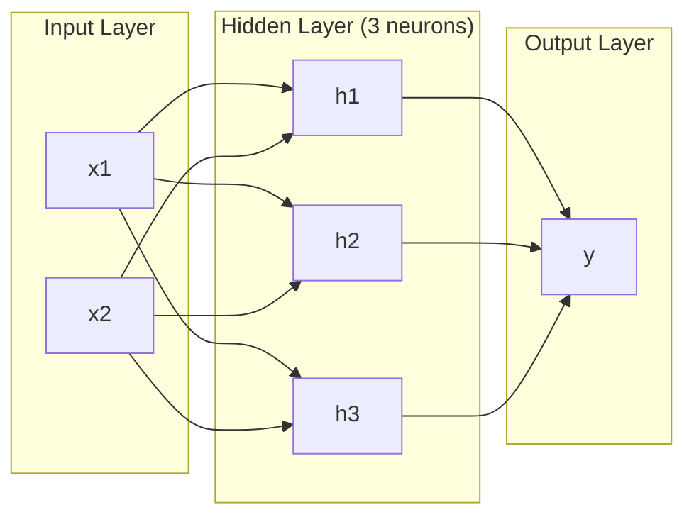
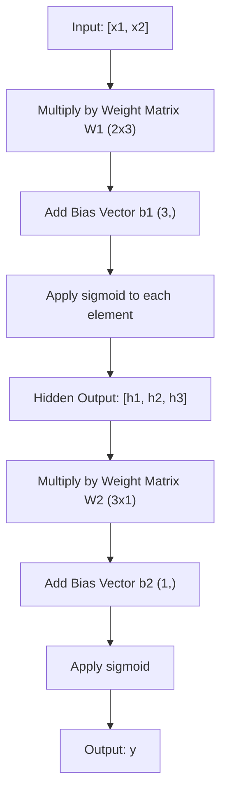
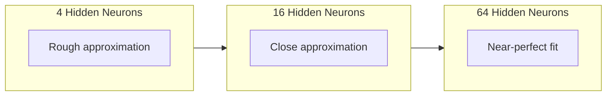

# Network Multi-Lapis dan Forward Pass

> Satu neuron menggambar sebuah garis. Tumpuk mereka, dan kamu bisa menggambar apa pun.

**Type:** Build
**Languages:** Python
**Prerequisites:** Phase 01 (Math Foundations), Lesson 03.01 (The Perceptron)
**Time:** ~90 minutes

## Tujuan Pembelajaran

- Membangun multi-layer network dari nol dengan kelas Layer dan Network yang melakukan forward pass lengkap
- Menelusuri dimensi matriks melalui setiap lapis network dan mengidentifikasi ketidakcocokan bentuk
- Menjelaskan bagaimana menumpuk aktivasi nonlinear memungkinkan network mempelajari batas keputusan yang melengkung
- Menyelesaikan masalah XOR memakai arsitektur 2-2-1 dengan bobot sigmoid yang disetel manual

## Masalahnya

Satu neuron adalah penggambar garis. Hanya itu. Satu garis lurus melalui datamu. Setiap masalah nyata dalam AI -- pengenalan gambar, pemahaman bahasa, bermain Go -- membutuhkan kurva. Menumpuk neuron menjadi lapisan-lapisan adalah cara mendapatkan kurva.

Pada tahun 1969, Minsky dan Papert membuktikan batas ini fatal: network satu lapis tidak bisa mempelajari XOR. Bukan "kesulitan belajar" -- secara matematis tidak bisa. Tabel kebenaran XOR menaruh [0,1] dan [1,0] di satu sisi, [0,0] dan [1,1] di sisi lain. Tidak ada satu garis pun yang memisahkan mereka.

Ini membunuh pendanaan neural network selama lebih dari satu dekade. Perbaikannya jelas jika dilihat ke belakang: berhenti memakai satu lapis. Tumpuk neuron menjadi lapisan-lapisan. Biarkan lapis pertama mengukir ruang input menjadi fitur-fitur baru, dan biarkan lapis kedua mengombinasikan fitur-fitur itu menjadi keputusan yang tak bisa dibuat satu garis pun.

Tumpukan itu adalah multi-layer network. Ia adalah fondasi setiap model deep learning di produksi saat ini. Forward pass -- data mengalir dari input melalui hidden layer ke output -- adalah hal pertama yang harus kamu bangun sebelum yang lain bisa bekerja.

## Konsepnya

### Lapis: Input, Hidden, Output

Multi-layer network punya tiga jenis lapis:

**Lapis input** -- sebenarnya bukan lapis. Ia menampung data mentahmu. Dua fitur berarti dua node input. Tidak ada komputasi yang terjadi di sini.

**Hidden layer** -- tempat kerja terjadi. Setiap neuron mengambil setiap output dari lapis sebelumnya, menerapkan bobot dan bias, lalu meneruskan hasilnya melalui fungsi aktivasi. Disebut "hidden" karena kamu tidak pernah melihat nilai-nilai ini langsung dalam data training.

**Lapis output** -- jawaban akhir. Untuk klasifikasi biner, satu neuron dengan sigmoid. Untuk multi-kelas, satu neuron per kelas.



Ini adalah network 2-3-1. Dua input, tiga neuron hidden, satu output. Setiap koneksi membawa sebuah bobot. Setiap neuron (kecuali input) membawa sebuah bias.

Setiap lapis menghasilkan vektor angka yang disebut hidden state. Untuk teks, hidden state menaikkan dimensionalitas -- mengenkode sebuah kata sebagai 768 angka untuk menangkap makna semantik. Untuk gambar, mereka menurunkan dimensionalitas -- memampatkan jutaan piksel menjadi representasi yang bisa dikelola. Hidden state adalah tempat pembelajaran hidup.

### Neuron dan Aktivasi

Setiap neuron melakukan tiga hal:

1. Mengalikan setiap input dengan bobot yang sesuai
2. Menjumlahkan semua produk dan menambahkan bias
3. Meneruskan jumlah itu melalui fungsi aktivasi

Untuk sekarang, aktivasinya adalah sigmoid:

```
sigmoid(z) = 1 / (1 + e^(-z))
```

Sigmoid memampatkan angka apa pun ke rentang (0, 1). Input positif besar mendorong ke arah 1. Input negatif besar mendorong ke arah 0. Nol dipetakan ke 0,5. Kurva mulus inilah yang membuat belajar menjadi mungkin -- tidak seperti step keras milik perseptron, sigmoid punya gradien di mana-mana.

### Forward Pass: Cara Data Mengalir

Forward pass mendorong data input melalui network, lapis demi lapis, sampai mencapai output. Tidak ada pembelajaran yang terjadi selama forward pass. Ia murni komputasi: kali, tambah, aktivasi, ulangi.



Pada setiap lapis, tiga operasi terjadi berurutan:

```
z = W * input + b       (linear transformation)
a = sigmoid(z)           (activation)
```

Output satu lapis menjadi input lapis berikutnya. Itulah seluruh forward pass.

### Dimensi Matriks

Melacak dimensi adalah skill debugging tunggal terpenting dalam deep learning. Berikut network 2-3-1:

| Step | Operation | Dimensions | Result Shape |
|------|-----------|------------|-------------|
| Input | x | -- | (2,) |
| Hidden linear | W1 * x + b1 | W1: (3, 2), b1: (3,) | (3,) |
| Hidden activation | sigmoid(z1) | -- | (3,) |
| Output linear | W2 * h + b2 | W2: (1, 3), b2: (1,) | (1,) |
| Output activation | sigmoid(z2) | -- | (1,) |

Aturannya: matriks bobot W pada lapis k berbentuk (neuron_di_lapis_k, neuron_di_lapis_k_minus_1). Baris cocok dengan lapis saat ini. Kolom cocok dengan lapis sebelumnya. Jika bentuknya tidak sejajar, kamu punya bug.

### Teorema Aproksimasi Universal

Pada tahun 1989, George Cybenko membuktikan sesuatu yang luar biasa: neural network dengan satu hidden layer dan cukup banyak neuron bisa mengaproksimasi fungsi kontinu apa pun dengan akurasi yang diinginkan.

Ini tidak berarti satu hidden layer selalu terbaik. Artinya arsitekturnya secara teoretis mampu. Dalam praktik, network yang lebih dalam (lebih banyak lapis, lebih sedikit neuron per lapis) mempelajari fungsi yang sama dengan total parameter jauh lebih sedikit daripada network dangkal-lebar. Itulah mengapa deep learning bekerja.

Intuisinya: setiap neuron di hidden layer mempelajari satu "benjolan" atau fitur. Cukup banyak benjolan yang ditempatkan di lokasi tepat bisa mengaproksimasi kurva mulus apa pun. Makin banyak neuron, makin banyak benjolan, makin baik aproksimasinya.



### Komposabilitas

Neural network itu composable. Kamu bisa menumpuknya, merantainya, menjalankannya paralel. Model Whisper memakai network encoder untuk memproses audio dan network decoder terpisah untuk menghasilkan teks. LLM modern hanya decoder. BERT hanya encoder. T5 adalah encoder-decoder. Pilihan arsitektur menentukan apa yang bisa dilakukan model.

```figure
mlp-forward
```

## Bangun Sendiri

Python murni. Tanpa numpy. Setiap operasi matriks ditulis dari nol.

### Langkah 1: Aktivasi Sigmoid

```python
import math

def sigmoid(x):
    x = max(-500.0, min(500.0, x))
    return 1.0 / (1.0 + math.exp(-x))
```

Penjepit ke [-500, 500] mencegah overflow. `math.exp(500)` besar tetapi terbatas. `math.exp(1000)` adalah takhingga.

### Langkah 2: Kelas Layer

Operasi terpenting dalam seluruh deep learning adalah perkalian matriks. Setiap lapis, setiap attention head, setiap forward pass -- semuanya matmul sampai ke bawah. Linear layer menerima vektor input, mengalikannya dengan matriks bobot, dan menambahkan vektor bias: y = Wx + b. Satu persamaan itu adalah 90% komputasi dalam neural network.

Sebuah lapis menampung matriks bobot dan vektor bias. Metode forward-nya menerima vektor input dan mengembalikan output yang sudah diaktivasi.

```python
class Layer:
    def __init__(self, n_inputs, n_neurons, weights=None, biases=None):
        if weights is not None:
            self.weights = weights
        else:
            import random
            self.weights = [
                [random.uniform(-1, 1) for _ in range(n_inputs)]
                for _ in range(n_neurons)
            ]
        if biases is not None:
            self.biases = biases
        else:
            self.biases = [0.0] * n_neurons

    def forward(self, inputs):
        self.last_input = inputs
        self.last_output = []
        for neuron_idx in range(len(self.weights)):
            z = sum(
                w * x for w, x in zip(self.weights[neuron_idx], inputs)
            )
            z += self.biases[neuron_idx]
            self.last_output.append(sigmoid(z))
        return self.last_output
```

Matriks bobot berbentuk (n_neurons, n_inputs). Setiap baris adalah bobot satu neuron di seluruh input. Metode forward meloop neuron, menghitung jumlah berbobot plus bias, menerapkan sigmoid, dan mengumpulkan hasilnya.

### Langkah 3: Kelas Network

Sebuah network adalah daftar lapis. Forward pass merangkainya: output lapis k menjadi masukan lapis k+1.

```python
class Network:
    def __init__(self, layers):
        self.layers = layers

    def forward(self, inputs):
        current = inputs
        for layer in self.layers:
            current = layer.forward(current)
        return current
```

Itulah seluruh forward pass. Empat baris logika. Data masuk, mengalir melalui setiap lapis, keluar di sisi lain.

### Langkah 4: XOR dengan Bobot yang Disetel Manual

Di Pelajaran 01, kita menyelesaikan XOR dengan mengombinasikan perseptron OR, NAND, dan AND. Sekarang lakukan hal yang sama dengan kelas Layer dan Network milik kita. Arsitektur 2-2-1: dua input, dua neuron hidden, satu output.

```python
hidden = Layer(
    n_inputs=2,
    n_neurons=2,
    weights=[[20.0, 20.0], [-20.0, -20.0]],
    biases=[-10.0, 30.0],
)

output = Layer(
    n_inputs=2,
    n_neurons=1,
    weights=[[20.0, 20.0]],
    biases=[-30.0],
)

xor_net = Network([hidden, output])

xor_data = [
    ([0, 0], 0),
    ([0, 1], 1),
    ([1, 0], 1),
    ([1, 1], 0),
]

for inputs, expected in xor_data:
    result = xor_net.forward(inputs)
    predicted = 1 if result[0] >= 0.5 else 0
    print(f"  {inputs} -> {result[0]:.6f} (rounded: {predicted}, expected: {expected})")
```

Bobot besar (20, -20) membuat sigmoid bertindak seperti fungsi step. Neuron hidden pertama mengaproksimasi OR. Yang kedua mengaproksimasi NAND. Neuron output mengombinasikannya menjadi AND, yaitu XOR.

### Langkah 5: Klasifikasi Lingkaran

Masalah yang lebih sulit: klasifikasikan titik 2D sebagai di dalam atau di luar lingkaran berjari-jari 0,5 yang berpusat di origin. Ini membutuhkan batas keputusan melengkung -- mustahil bagi satu perseptron.

```python
import random
import math

random.seed(42)

data = []
for _ in range(200):
    x = random.uniform(-1, 1)
    y = random.uniform(-1, 1)
    label = 1 if (x * x + y * y) < 0.25 else 0
    data.append(([x, y], label))

circle_net = Network([
    Layer(n_inputs=2, n_neurons=8),
    Layer(n_inputs=8, n_neurons=1),
])
```

Dengan bobot acak, network tidak akan mengklasifikasi dengan baik. Tetapi forward pass tetap berjalan. Itulah poinnya -- forward pass hanyalah komputasi. Mempelajari bobot yang tepat adalah backpropagation, yang datang di Pelajaran 03.

```python
correct = 0
for inputs, expected in data:
    result = circle_net.forward(inputs)
    predicted = 1 if result[0] >= 0.5 else 0
    if predicted == expected:
        correct += 1

print(f"Accuracy with random weights: {correct}/{len(data)} ({100*correct/len(data):.1f}%)")
```

Bobot acak menghasilkan akurasi buruk -- sering lebih buruk daripada menebak kelas mayoritas. Setelah training (Pelajaran 03), arsitektur yang sama dengan 8 neuron hidden akan menggambar batas melengkung yang memisahkan dalam dari luar.

## Gunakan

PyTorch melakukan semua di atas dalam empat baris:

```python
import torch
import torch.nn as nn

model = nn.Sequential(
    nn.Linear(2, 8),
    nn.Sigmoid(),
    nn.Linear(8, 1),
    nn.Sigmoid(),
)

x = torch.tensor([[0.0, 0.0], [0.0, 1.0], [1.0, 0.0], [1.0, 1.0]])
output = model(x)
print(output)
```

`nn.Linear(2, 8)` adalah kelas Layer milikmu: matriks bobot berbentuk (8, 2), vektor bias berbentuk (8,). `nn.Sigmoid()` adalah fungsi sigmoid-mu yang diterapkan element-wise. `nn.Sequential` adalah kelas Network milikmu: merangkai lapis berurutan.

Perbedaannya adalah kecepatan dan skala. PyTorch berjalan di GPU, menangani batch jutaan sampel, dan otomatis menghitung gradien untuk backpropagation. Tetapi logika forward pass identik dengan yang baru saja kamu bangun dari nol.

## Rilis

Pelajaran ini menghasilkan prompt yang bisa dipakai ulang untuk merancang arsitektur network:

- `outputs/prompt-network-architect.md`

Pakai saat kamu perlu memutuskan berapa lapis, berapa neuron per lapis, dan fungsi aktivasi mana yang dipakai untuk masalah tertentu.

## Latihan

1. Bangun network 2-4-2-1 (dua hidden layer) dan jalankan forward pass pada data XOR dengan bobot acak. Cetak output hidden layer antara untuk melihat bagaimana representasi bertransformasi di setiap lapis.

2. Ubah ukuran hidden layer dalam pengklasifikasi lingkaran dari 8 menjadi 2, lalu menjadi 32. Jalankan forward pass dengan bobot acak setiap kali. Apakah jumlah neuron hidden mengubah rentang atau distribusi output? Mengapa?

3. Implementasikan metode `count_parameters` pada kelas Network yang mengembalikan total bobot dan bias yang bisa dilatih. Uji pada network 784-256-128-10 (arsitektur MNIST klasik). Berapa parameter yang ia miliki?

4. Bangun forward pass untuk network 3-4-4-2. Beri ia nilai warna RGB (dinormalisasi ke 0-1) dan amati dua output-nya. Ini adalah arsitektur untuk pengklasifikasi warna sederhana dengan dua kelas.

5. Ganti sigmoid dengan fungsi "leaky step": kembalikan 0.01 * z jika z < 0, kalau tidak 1.0. Jalankan forward pass pada XOR dengan bobot setel-manual yang sama dari Langkah 4. Apakah masih bekerja? Mengapa sigmoid mulus lebih disukai daripada cutoff keras?

## Istilah Kunci

| Term | What people say | What it actually means |
|------|----------------|----------------------|
| Forward pass | "Running the model" | Pushing input through every layer -- multiply by weights, add bias, activate -- to produce an output |
| Hidden layer | "The middle part" | Any layer between input and output whose values are not directly observed in the data |
| Multi-layer network | "A deep neural network" | Layers of neurons stacked sequentially, where each layer's output feeds the next layer's input |
| Activation function | "The nonlinearity" | A function applied after the linear transformation that introduces curves into the decision boundary |
| Sigmoid | "The S-curve" | sigma(z) = 1/(1+e^(-z)), squashes any real number to (0,1), smooth and differentiable everywhere |
| Weight matrix | "The parameters" | A matrix W of shape (current_layer_neurons, previous_layer_neurons) containing learnable connection strengths |
| Bias vector | "The offset" | A vector added after the matrix multiply that lets neurons activate even when all inputs are zero |
| Universal approximation | "Neural nets can learn anything" | A single hidden layer with enough neurons can approximate any continuous function -- but "enough" can mean billions |
| Linear transformation | "The matrix multiply step" | z = W * x + b, the computation before activation, which maps inputs to a new space |
| Decision boundary | "Where the classifier switches" | The surface in input space where the network output crosses the classification threshold |

## Bacaan Lanjutan

- Michael Nielsen, "Neural Networks and Deep Learning", Chapter 1-2 (http://neuralnetworksanddeeplearning.com/) -- penjelasan gratis paling jernih tentang forward pass dan struktur network, dengan visualisasi interaktif
- Cybenko, "Approximation by Superpositions of a Sigmoidal Function" (1989) -- makalah teorema aproksimasi universal yang orisinal, ternyata cukup mudah dibaca
- 3Blue1Brown, "But what is a neural network?" (https://www.youtube.com/watch?v=aircAruvnKk) -- penjelasan visual 20 menit tentang lapis, bobot, dan forward pass yang membangun model mental yang tepat
- Goodfellow, Bengio, Courville, "Deep Learning", Chapter 6 (https://www.deeplearningbook.org/) -- referensi standar untuk multi-layer network, gratis online
