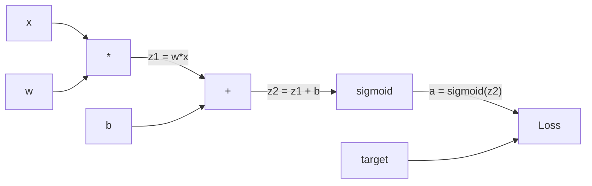
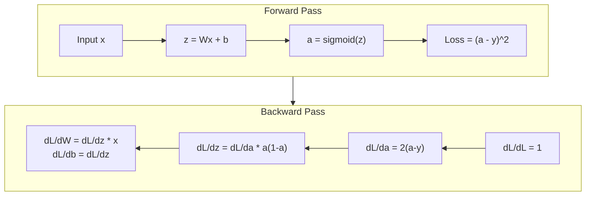
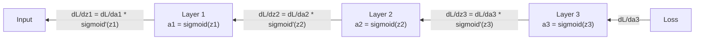

# Backpropagation dari Nol

> Backpropagation adalah algoritma yang membuat belajar menjadi mungkin. Tanpanya, neural network hanyalah generator angka acak yang mahal.

**Type:** Build
**Languages:** Python
**Prerequisites:** Lesson 03.02 (Multi-Layer Networks)
**Time:** ~120 minutes

## Tujuan Pembelajaran

- Mengimplementasikan mesin autograd berbasis Value yang membangun computational graph dan menghitung gradien lewat topological sort
- Menurunkan backward pass untuk penjumlahan, perkalian, dan sigmoid memakai aturan rantai
- Melatih multi-layer network pada klasifikasi XOR dan lingkaran hanya memakai mesin backpropagation buatanmu sendiri
- Mengidentifikasi masalah vanishing gradient dalam network sigmoid yang dalam dan menjelaskan mengapa gradien menyusut secara eksponensial

## Masalahnya

Network-mu punya satu hidden layer dengan 768 input dan 3072 output. Itu 2.359.296 bobot. Ia membuat prediksi yang salah. Bobot mana yang menyebabkan error? Menguji setiap bobot satu per satu berarti 2,3 juta forward pass. Backpropagation menghitung seluruh 2,3 juta gradien dalam satu backward pass. Itu bukan optimasi. Itulah pembeda antara bisa dilatih dan mustahil.

Pendekatan naif: ambil satu bobot, geser sedikit, jalankan forward pass lagi, ukur apakah loss naik atau turun. Itu memberimu gradien untuk bobot tersebut. Sekarang lakukan untuk setiap bobot dalam network. Kalikan dengan ribuan langkah training dan jutaan titik data. Kamu butuh waktu geologis untuk melatih sesuatu yang berguna.

Backpropagation menyelesaikan ini. Satu forward pass, satu backward pass, semua gradien terhitung. Triknya adalah aturan rantai dari kalkulus, diterapkan sistematis pada computational graph. Inilah algoritma yang membuat deep learning praktis. Tanpanya, kita masih terjebak pada masalah mainan.

## Konsepnya

### Aturan Rantai, Diterapkan pada Network

Kamu sudah melihat aturan rantai di Fase 01, Pelajaran 05. Tinjauan cepat: jika y = f(g(x)), maka dy/dx = f'(g(x)) * g'(x). Kamu mengalikan turunan di sepanjang rantai.

Dalam neural network, "rantai" adalah urutan operasi dari input ke loss. Setiap lapis menerapkan bobot, menambahkan bias, melewatkan aktivasi. Fungsi loss membandingkan output akhir dengan target. Backpropagation menelusuri rantai ini secara mundur, menghitung bagaimana setiap operasi berkontribusi pada error.

### Computational Graph

Setiap forward pass membangun sebuah graf. Setiap node adalah operasi (kali, tambah, sigmoid). Setiap edge membawa nilai ke depan dan gradien ke belakang.



Forward pass: nilai mengalir kiri ke kanan. x dan w menghasilkan z1 = w*x. Tambahkan b menjadi z2. Sigmoid menghasilkan aktivasi a. Bandingkan a dengan target y memakai fungsi loss.

Backward pass: gradien mengalir kanan ke kiri. Mulai dari dL/da (bagaimana loss berubah terhadap aktivasi). Kalikan dengan da/dz2 (turunan sigmoid). Itu menghasilkan dL/dz2. Pecah menjadi dL/db (yang sama dengan dL/dz2, karena z2 = z1 + b) dan dL/dz1. Lalu dL/dw = dL/dz1 * x dan dL/dx = dL/dz1 * w.

Setiap node dalam graf punya satu tugas selama backward pass: ambil gradien yang datang dari atas, kalikan dengan turunan lokalnya, dan teruskan ke bawah.

### Forward vs Backward



Forward pass menyimpan setiap nilai antara: z, a, input ke setiap lapis. Backward pass membutuhkan nilai-nilai tersimpan ini untuk menghitung gradien. Inilah tradeoff memori-komputasi di jantung backprop. Kamu menukar memori (menyimpan aktivasi) dengan kecepatan (satu pass alih-alih jutaan).

### Aliran Gradien Melalui Network

Untuk network 3 lapis, gradien dirantai melalui setiap lapis:



Pada setiap lapis, gradien dikalikan dengan turunan sigmoid. Turunan sigmoid adalah a * (1 - a), yang maksimal 0,25 (saat a = 0,5). Tiga lapis ke dalam, gradien sudah dikalikan maksimal 0,25^3 = 0,0156. Sepuluh lapis ke dalam: 0,25^10 = 0,000001.

### Vanishing Gradient

Inilah masalah vanishing gradient. Sigmoid memampatkan output-nya antara 0 dan 1. Turunannya selalu kurang dari 0,25. Tumpuk cukup banyak lapis sigmoid dan gradien menyusut hingga habis. Lapis-lapis awal nyaris tidak belajar karena mereka menerima gradien yang mendekati nol.

```
sigmoid(z):     Output range [0, 1]
sigmoid'(z):    Max value 0.25 (at z = 0)

After 5 layers:   gradient * 0.25^5 = 0.001x original
After 10 layers:  gradient * 0.25^10 = 0.000001x original
```

Inilah mengapa network sigmoid yang dalam nyaris mustahil dilatih. Perbaikannya -- ReLU dan variannya -- adalah topik Pelajaran 04. Untuk sekarang, pahami bahwa backprop bekerja sempurna. Masalahnya adalah apa yang ia lewati.

### Menurunkan Gradien untuk Network 2 Lapis

Matematika konkret untuk network dengan input x, hidden layer dengan sigmoid, output layer dengan sigmoid, dan loss MSE.

Forward pass:
```
z1 = W1 * x + b1
a1 = sigmoid(z1)
z2 = W2 * a1 + b2
a2 = sigmoid(z2)
L = (a2 - y)^2
```

Backward pass (menerapkan aturan rantai langkah demi langkah):
```
dL/da2 = 2(a2 - y)
da2/dz2 = a2 * (1 - a2)
dL/dz2 = dL/da2 * da2/dz2 = 2(a2 - y) * a2 * (1 - a2)

dL/dW2 = dL/dz2 * a1
dL/db2 = dL/dz2

dL/da1 = dL/dz2 * W2
da1/dz1 = a1 * (1 - a1)
dL/dz1 = dL/da1 * da1/dz1

dL/dW1 = dL/dz1 * x
dL/db1 = dL/dz1
```

Setiap gradien adalah produk turunan lokal yang ditelusuri mundur dari loss. Hanya itulah backpropagation.

```figure
backprop-vanishing
```

## Bangun Sendiri

### Langkah 1: Node Value

Setiap angka dalam komputasi kita menjadi sebuah Value. Ia menyimpan datanya, gradiennya, dan cara ia dibuat (sehingga tahu cara menghitung gradien secara mundur).

```python
class Value:
    def __init__(self, data, children=(), op=''):
        self.data = data
        self.grad = 0.0
        self._backward = lambda: None
        self._children = set(children)
        self._op = op

    def __repr__(self):
        return f"Value(data={self.data:.4f}, grad={self.grad:.4f})"
```

Belum ada gradien (0.0). Belum ada fungsi backward (no-op). `_children` mencatat Value mana yang menghasilkan Value ini, sehingga kita bisa mengurutkan graf secara topologis nanti.

### Langkah 2: Operasi dengan Fungsi Backward

Setiap operasi menciptakan Value baru dan mendefinisikan bagaimana gradien mengalir mundur melaluinya.

```python
def __add__(self, other):
    other = other if isinstance(other, Value) else Value(other)
    out = Value(self.data + other.data, (self, other), '+')

    def _backward():
        self.grad += out.grad
        other.grad += out.grad

    out._backward = _backward
    return out

def __mul__(self, other):
    other = other if isinstance(other, Value) else Value(other)
    out = Value(self.data * other.data, (self, other), '*')

    def _backward():
        self.grad += other.data * out.grad
        other.grad += self.data * out.grad

    out._backward = _backward
    return out
```

Untuk penjumlahan: d(a+b)/da = 1, d(a+b)/db = 1. Jadi kedua input mendapat gradien output secara langsung.

Untuk perkalian: d(a*b)/da = b, d(a*b)/db = a. Setiap input mendapat nilai pasangannya dikali gradien output.

`+=` itu krusial. Sebuah Value bisa dipakai dalam banyak operasi. Gradiennya adalah jumlah gradien dari semua jalur.

### Langkah 3: Sigmoid dan Loss

```python
import math

def sigmoid(self):
    x = self.data
    x = max(-500, min(500, x))
    s = 1.0 / (1.0 + math.exp(-x))
    out = Value(s, (self,), 'sigmoid')

    def _backward():
        self.grad += (s * (1 - s)) * out.grad

    out._backward = _backward
    return out
```

Turunan sigmoid: sigmoid(x) * (1 - sigmoid(x)). Kita sudah menghitung sigmoid(x) = s selama forward pass. Pakai ulang. Tanpa kerja tambahan.

```python
def mse_loss(predicted, target):
    diff = predicted + Value(-target)
    return diff * diff
```

MSE untuk satu output: (predicted - target)^2. Kita menyatakan pengurangan sebagai penjumlahan dengan Value yang dinegasi.

### Langkah 4: Backward Pass

Topological sort memastikan kita memproses node dalam urutan yang benar -- gradien sebuah node terakumulasi penuh sebelum kita mempropagasikannya.

```python
def backward(self):
    topo = []
    visited = set()

    def build_topo(v):
        if v not in visited:
            visited.add(v)
            for child in v._children:
                build_topo(child)
            topo.append(v)

    build_topo(self)
    self.grad = 1.0
    for v in reversed(topo):
        v._backward()
```

Mulai dari loss (gradien = 1.0, karena dL/dL = 1). Berjalan mundur melalui graf yang terurut. `_backward` setiap node mendorong gradien ke anak-anaknya.

### Langkah 5: Layer dan Network

```python
import random

class Neuron:
    def __init__(self, n_inputs):
        scale = (2.0 / n_inputs) ** 0.5
        self.weights = [Value(random.uniform(-scale, scale)) for _ in range(n_inputs)]
        self.bias = Value(0.0)

    def __call__(self, x):
        act = sum((wi * xi for wi, xi in zip(self.weights, x)), self.bias)
        return act.sigmoid()

    def parameters(self):
        return self.weights + [self.bias]


class Layer:
    def __init__(self, n_inputs, n_outputs):
        self.neurons = [Neuron(n_inputs) for _ in range(n_outputs)]

    def __call__(self, x):
        out = [n(x) for n in self.neurons]
        return out[0] if len(out) == 1 else out

    def parameters(self):
        params = []
        for n in self.neurons:
            params.extend(n.parameters())
        return params


class Network:
    def __init__(self, sizes):
        self.layers = []
        for i in range(len(sizes) - 1):
            self.layers.append(Layer(sizes[i], sizes[i + 1]))

    def __call__(self, x):
        for layer in self.layers:
            x = layer(x)
            if not isinstance(x, list):
                x = [x]
        return x[0] if len(x) == 1 else x

    def parameters(self):
        params = []
        for layer in self.layers:
            params.extend(layer.parameters())
        return params

    def zero_grad(self):
        for p in self.parameters():
            p.grad = 0.0
```

Sebuah Neuron menerima input, menghitung jumlah berbobot + bias, dan menerapkan sigmoid. Inisialisasi bobot diskalakan dengan sqrt(2/n_inputs) untuk mencegah saturasi sigmoid dalam network yang lebih dalam. Layer adalah daftar Neuron. Network adalah daftar Layer. Metode `parameters()` mengumpulkan semua Value yang bisa dipelajari sehingga kita bisa mengupdate-nya.

### Langkah 6: Latih pada XOR

```python
random.seed(42)
net = Network([2, 4, 1])

xor_data = [
    ([0.0, 0.0], 0.0),
    ([0.0, 1.0], 1.0),
    ([1.0, 0.0], 1.0),
    ([1.0, 1.0], 0.0),
]

learning_rate = 1.0

for epoch in range(1000):
    total_loss = Value(0.0)
    for inputs, target in xor_data:
        x = [Value(i) for i in inputs]
        pred = net(x)
        loss = mse_loss(pred, target)
        total_loss = total_loss + loss

    net.zero_grad()
    total_loss.backward()

    for p in net.parameters():
        p.data -= learning_rate * p.grad

    if epoch % 100 == 0:
        print(f"Epoch {epoch:4d} | Loss: {total_loss.data:.6f}")

print("\nXOR Results:")
for inputs, target in xor_data:
    x = [Value(i) for i in inputs]
    pred = net(x)
    print(f"  {inputs} -> {pred.data:.4f} (expected {target})")
```

Saksikan loss menurun. Dari prediksi acak menjadi output XOR yang benar, digerakkan sepenuhnya oleh backpropagation yang menghitung gradien dan mendorong bobot ke arah yang tepat.

### Langkah 7: Klasifikasi Lingkaran

Di Pelajaran 02, kamu mengatur bobot klasifikasi lingkaran secara manual. Sekarang biarkan network mempelajarinya.

```python
random.seed(7)

def generate_circle_data(n=100):
    data = []
    for _ in range(n):
        x1 = random.uniform(-1.5, 1.5)
        x2 = random.uniform(-1.5, 1.5)
        label = 1.0 if x1 * x1 + x2 * x2 < 1.0 else 0.0
        data.append(([x1, x2], label))
    return data

circle_data = generate_circle_data(80)

circle_net = Network([2, 8, 1])
learning_rate = 0.5

for epoch in range(2000):
    random.shuffle(circle_data)
    total_loss_val = 0.0
    for inputs, target in circle_data:
        x = [Value(i) for i in inputs]
        pred = circle_net(x)
        loss = mse_loss(pred, target)
        circle_net.zero_grad()
        loss.backward()
        for p in circle_net.parameters():
            p.data -= learning_rate * p.grad
        total_loss_val += loss.data

    if epoch % 200 == 0:
        correct = 0
        for inputs, target in circle_data:
            x = [Value(i) for i in inputs]
            pred = circle_net(x)
            predicted_class = 1.0 if pred.data > 0.5 else 0.0
            if predicted_class == target:
                correct += 1
        accuracy = correct / len(circle_data) * 100
        print(f"Epoch {epoch:4d} | Loss: {total_loss_val:.4f} | Accuracy: {accuracy:.1f}%")
```

Kita memakai SGD online di sini -- update bobot setelah setiap sampel alih-alih mengakumulasi batch penuh. Ini memecah simetri lebih cepat dan menghindari saturasi sigmoid pada lanskap loss penuh. Mengacak data setiap epoch mencegah network menghafal urutan.

Tanpa pengaturan manual. Network menemukan batas keputusan melingkar sendiri. Itulah kekuatan backpropagation: kamu mendefinisikan arsitektur, fungsi loss, dan data. Algoritma yang mencari tahu bobotnya.

## Gunakan

PyTorch melakukan semua di atas dalam beberapa baris. Ide intinya identik -- autograd membangun computational graph selama forward pass dan menelusurinya mundur untuk menghitung gradien.

```python
import torch
import torch.nn as nn

model = nn.Sequential(
    nn.Linear(2, 4),
    nn.Sigmoid(),
    nn.Linear(4, 1),
    nn.Sigmoid(),
)
optimizer = torch.optim.SGD(model.parameters(), lr=1.0)
criterion = nn.MSELoss()

X = torch.tensor([[0,0],[0,1],[1,0],[1,1]], dtype=torch.float32)
y = torch.tensor([[0],[1],[1],[0]], dtype=torch.float32)

for epoch in range(1000):
    pred = model(X)
    loss = criterion(pred, y)
    optimizer.zero_grad()
    loss.backward()
    optimizer.step()

print("PyTorch XOR Results:")
with torch.no_grad():
    for i in range(4):
        pred = model(X[i])
        print(f"  {X[i].tolist()} -> {pred.item():.4f} (expected {y[i].item()})")
```

`loss.backward()` adalah `total_loss.backward()` milikmu. `optimizer.step()` adalah `p.data -= lr * p.grad` manual milikmu. `optimizer.zero_grad()` adalah `net.zero_grad()` milikmu. Algoritma yang sama, implementasi kelas industri. PyTorch menangani akselerasi GPU, mixed precision, gradient checkpointing, dan ratusan jenis lapis. Tetapi backward pass-nya adalah aturan rantai yang sama diterapkan pada computational graph yang sama.

Training menjalankan forward pass, lalu backward pass, lalu mengupdate bobot. Inference hanya menjalankan forward pass. Tanpa gradien, tanpa update. Pembedaan ini penting karena inference-lah yang terjadi di produksi. Saat kamu memanggil API seperti Claude atau GPT, kamu menjalankan inference -- prompt-mu mengalir maju melalui network, dan token keluar di ujung lain. Tidak ada bobot yang berubah. Memahami backprop penting karena ia membentuk setiap bobot dalam network itu.

## Rilis

Pelajaran ini menghasilkan:

- `outputs/prompt-gradient-debugger.md` -- prompt yang bisa dipakai ulang untuk mendiagnosis masalah gradien (vanishing, exploding, NaN) dalam neural network apa pun

## Latihan

1. Tambahkan metode `__sub__` pada kelas Value (a - b = a + (-1 * b)). Lalu implementasikan metode `__neg__`. Verifikasi bahwa gradiennya benar dengan membandingkan perhitungan manual untuk ekspresi sederhana seperti (a - b)^2.
2. Tambahkan metode `relu` pada Value (output max(0, x), turunannya 1 jika x > 0, kalau tidak 0). Ganti sigmoid dengan relu di hidden layer dan latih lagi pada XOR. Bandingkan kecepatan konvergensi. Kamu seharusnya melihat training lebih cepat -- ini pratinjau Pelajaran 04.
3. Implementasikan metode `__pow__` pada Value untuk pangkat integer. Pakai untuk mengganti `mse_loss` dengan ekspresi `(predicted - target) ** 2` yang semestinya. Verifikasi gradiennya cocok dengan implementasi aslinya.
4. Tambahkan gradient clipping ke loop training: setelah memanggil `backward()`, batasi semua gradien ke [-1, 1]. Latih network yang lebih dalam (4+ lapis dengan sigmoid) dan bandingkan kurva loss dengan dan tanpa clipping. Ini pertahanan pertamamu melawan exploding gradient.
5. Bangun visualisasi: setelah training pada XOR, cetak gradien setiap parameter dalam network. Identifikasi lapis mana yang gradiennya terkecil. Ini mendemonstrasikan masalah vanishing gradient yang kamu baca di bagian Konsep.

## Istilah Kunci

| Term | What people say | What it actually means |
|------|----------------|----------------------|
| Backpropagation | "The network learns" | An algorithm that computes dL/dw for every weight by applying the chain rule backward through the computational graph |
| Computational graph | "The network structure" | A directed acyclic graph where nodes are operations and edges carry values (forward) and gradients (backward) |
| Chain rule | "Multiply the derivatives" | If y = f(g(x)), then dy/dx = f'(g(x)) * g'(x) -- the mathematical foundation of backpropagation |
| Gradient | "The direction of steepest ascent" | The partial derivative of the loss with respect to a parameter -- tells you how to change that parameter to reduce the loss |
| Vanishing gradient | "Deep networks don't learn" | Gradients shrink exponentially as they propagate through layers with saturating activations like sigmoid |
| Forward pass | "Running the network" | Computing the output from inputs by sequentially applying each layer's operations and storing intermediate values |
| Backward pass | "Computing gradients" | Traversing the computational graph in reverse, accumulating gradients at each node using the chain rule |
| Learning rate | "How fast it learns" | A scalar that controls the step size when updating weights: w_new = w_old - lr * gradient |
| Topological sort | "The right order" | An ordering of graph nodes where each node appears after all nodes it depends on -- ensures gradients are fully accumulated before propagation |
| Autograd | "Automatic differentiation" | A system that builds computational graphs during forward computation and automatically computes gradients -- what PyTorch's engine does |

## Bacaan Lanjutan

- Rumelhart, Hinton & Williams, "Learning representations by back-propagating errors" (1986) -- makalah yang membuat backpropagation menjadi arus utama dan membuka training multi-layer network
- 3Blue1Brown, "Neural Networks" series (https://www.youtube.com/playlist?list=PLZHQObOWTQDNU6R1_67000Dx_ZCJB-3pi) -- penjelasan visual terbaik tentang backpropagation dan aliran gradien melalui network
