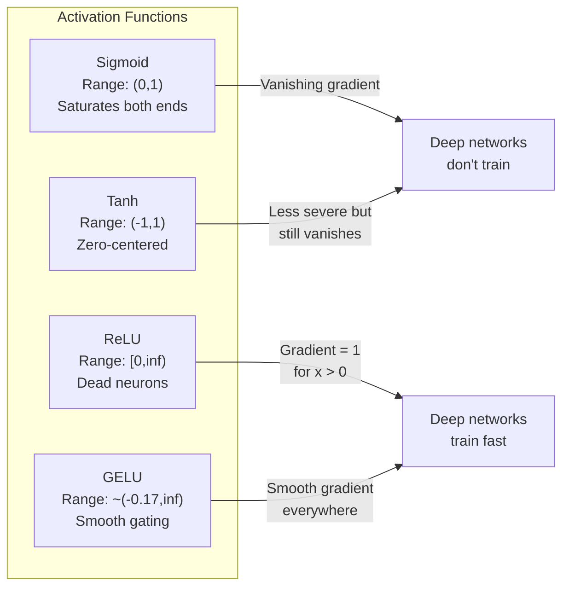
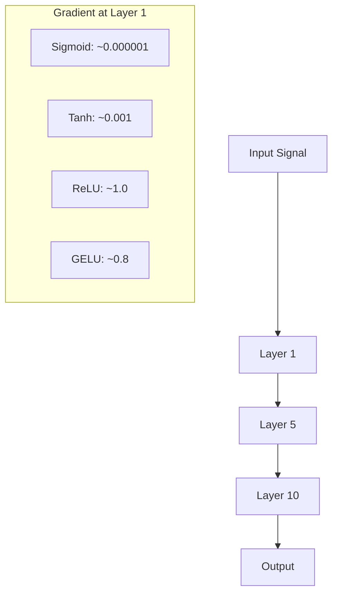
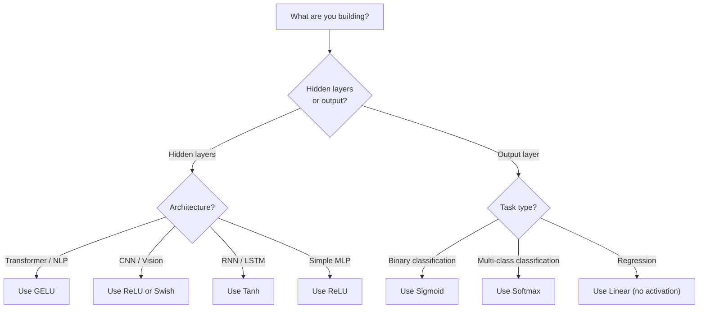

# Fungsi Aktivasi

> Tanpa nonlinearitas, network 100-lapismu hanyalah perkalian matriks yang mewah. Aktivasi adalah gerbang yang membuat neural network bisa berpikir dalam kurva.

**Type:** Build
**Languages:** Python
**Prerequisites:** Lesson 03.03 (Backpropagation)
**Time:** ~75 minutes

## Tujuan Pembelajaran

- Mengimplementasikan sigmoid, tanh, ReLU, Leaky ReLU, GELU, Swish, dan softmax beserta turunannya dari nol
- Mendiagnosis masalah vanishing gradient dengan mengukur magnitudo aktivasi melalui 10+ lapis dengan aktivasi berbeda
- Mendeteksi neuron mati dalam network ReLU dan menjelaskan mengapa GELU menghindari mode kegagalan ini
- Memilih fungsi aktivasi yang tepat untuk arsitektur tertentu (transformer, CNN, RNN, output layer)

## Masalahnya

Tumpuk dua transformasi linear: y = W2(W1x + b1) + b2. Uraikan: y = W2W1x + W2b1 + b2. Itu hanyalah y = Ax + c -- satu transformasi linear. Sebanyak apa pun lapis linear yang kamu tumpuk, hasilnya runtuh menjadi satu perkalian matriks. Network 100-lapismu punya kekuatan representasi yang sama dengan satu lapis.

Ini bukan keingintahuan teoretis. Artinya network linear yang dalam secara harfiah tidak bisa mempelajari XOR, tidak bisa mengklasifikasi dataset spiral, tidak bisa mengenali wajah. Tanpa fungsi aktivasi, kedalaman adalah ilusi.

Fungsi aktivasi memecah linearitas. Mereka membengkokkan output setiap lapis melalui fungsi nonlinear, memberi network kemampuan menekuk batas keputusan, mengaproksimasi fungsi sembarang, dan benar-benar belajar. Tetapi pilih aktivasi yang salah dan gradienmu lenyap menjadi nol (sigmoid dalam network dalam), meledak hingga takhingga (aktivasi tak terbatas tanpa inisialisasi hati-hati), atau neuronmu mati permanen (ReLU dengan bias negatif besar). Pilihan fungsi aktivasi langsung menentukan apakah network-mu belajar atau tidak.

## Konsepnya

### Mengapa Nonlinearitas Perlu

Perkalian matriks itu composable. Mengalikan vektor dengan matriks A lalu matriks B identik dengan mengalikan dengan AB. Artinya menumpuk sepuluh lapis linear secara matematis setara dengan satu lapis linear dengan satu matriks besar. Semua parameter itu, semua kedalaman itu -- terbuang. Kamu butuh sesuatu untuk memutus rantai. Itulah yang dilakukan fungsi aktivasi.

Berikut buktinya. Linear layer menghitung f(x) = Wx + b. Tumpuk dua:

```
Layer 1: h = W1 * x + b1
Layer 2: y = W2 * h + b2
```

Substitusikan:

```
y = W2 * (W1 * x + b1) + b2
y = (W2 * W1) * x + (W2 * b1 + b2)
y = A * x + c
```

Satu lapis. Sisipkan aktivasi nonlinear g() di antara lapis:

```
h = g(W1 * x + b1)
y = W2 * h + b2
```

Kini substitusinya gagal. W2 * g(W1 * x + b1) + b2 tidak bisa direduksi menjadi satu transformasi linear. Network bisa merepresentasikan fungsi nonlinear. Setiap lapis tambahan dengan aktivasi menambah kapasitas representasi.

### Sigmoid

Fungsi aktivasi orisinal untuk neural network.

```
sigmoid(x) = 1 / (1 + e^(-x))
```

Rentang output: (0, 1). Mulus, terdiferensiasi, memetakan bilangan real apa pun ke nilai mirip probabilitas.

Turunannya:

```
sigmoid'(x) = sigmoid(x) * (1 - sigmoid(x))
```

Nilai maksimum turunan ini adalah 0,25, terjadi pada x = 0. Dalam backpropagation, gradien dikalikan melalui lapisan-lapisan. Sepuluh lapis sigmoid berarti gradien dikalikan maksimal 0,25 sebanyak sepuluh kali:

```
0.25^10 = 0.000000953674
```

Kurang dari sepersejuta sinyal aslinya. Inilah masalah vanishing gradient. Gradien di lapis-lapis awal menjadi begitu kecil sehingga bobot nyaris tidak terupdate. Network tampak belajar -- loss menurun di lapis-lapis akhir -- tetapi lapis pertama membeku. Network sigmoid yang dalam tidak bisa dilatih.

Masalah tambahan: output sigmoid selalu positif (0 sampai 1), yang berarti gradien pada bobot selalu bertanda sama. Ini menyebabkan zig-zag selama gradient descent.

### Tanh

Versi sigmoid yang terpusat di nol.

```
tanh(x) = (e^x - e^(-x)) / (e^x + e^(-x))
```

Rentang output: (-1, 1). Zero-centered, yang menghilangkan masalah zig-zag.

Turunannya:

```
tanh'(x) = 1 - tanh(x)^2
```

Turunan maksimum adalah 1,0 pada x = 0 -- empat kali lebih baik daripada sigmoid. Tetapi masalah vanishing gradient tetap ada. Untuk input positif atau negatif besar, turunannya mendekati nol. Sepuluh lapis tetap menghancurkan gradien, hanya tidak seagresif itu.

### ReLU: Terobosan

Rectified Linear Unit. Dipopulerkan untuk deep learning oleh Nair dan Hinton pada 2010 (fungsinya sendiri berasal dari karya Fukushima tahun 1969), ia mengubah segalanya.

```
relu(x) = max(0, x)
```

Rentang output: [0, takhingga). Turunannya sederhana:

```
relu'(x) = 1  if x > 0
            0  if x <= 0
```

Tidak ada vanishing gradient untuk input positif. Gradiennya tepat 1, diteruskan langsung. Inilah mengapa network dalam menjadi bisa dilatih -- ReLU menjaga magnitudo gradien antar lapis.

Tetapi ada mode kegagalan: masalah neuron mati. Jika input berbobot sebuah neuron selalu negatif (karena bias negatif besar atau inisialisasi bobot yang sial), output-nya selalu nol, gradiennya selalu nol, dan ia tidak pernah terupdate. Ia mati permanen. Dalam praktik, 10-40% neuron dalam network ReLU bisa mati selama training.

### Leaky ReLU

Perbaikan paling sederhana untuk neuron mati.

```
leaky_relu(x) = x        if x > 0
                alpha * x if x <= 0
```

Di mana alpha adalah konstanta kecil, biasanya 0,01. Sisi negatif punya kemiringan kecil alih-alih nol, sehingga neuron mati masih mendapat sinyal gradien dan bisa pulih.

### GELU: Default Modern

Gaussian Error Linear Unit. Diperkenalkan oleh Hendrycks dan Gimpel pada 2016. Aktivasi default di BERT, GPT, dan kebanyakan transformer modern.

```
gelu(x) = x * Phi(x)
```

Di mana Phi(x) adalah fungsi distribusi kumulatif dari distribusi normal standar. Aproksimasi yang dipakai dalam praktik:

```
gelu(x) ~= 0.5 * x * (1 + tanh(sqrt(2/pi) * (x + 0.044715 * x^3)))
```

GELU mulus di mana-mana, mengizinkan nilai negatif kecil (tidak seperti ReLU yang memotong keras ke nol), dan punya interpretasi probabilistik: ia membobot setiap input berdasarkan seberapa mungkin ia positif di bawah distribusi Gaussian. Gating mulus ini mengungguli ReLU dalam arsitektur transformer karena memberikan aliran gradien lebih baik dan sepenuhnya menghindari masalah neuron mati.

### Swish / SiLU

Aktivasi self-gated yang ditemukan oleh Ramachandran et al. pada 2017 melalui pencarian otomatis.

```
swish(x) = x * sigmoid(x)
```

Swish secara formal adalah x * sigmoid(x). Google menemukannya melalui pencarian otomatis atas ruang fungsi aktivasi -- neural network yang merancang bagian-bagian neural network.

Seperti GELU, ia mulus, non-monotonik, dan mengizinkan nilai negatif kecil. Perbedaannya halus: Swish memakai sigmoid untuk gating sementara GELU memakai CDF Gaussian. Dalam praktik, performanya nyaris identik. Swish dipakai di EfficientNet dan beberapa model vision. GELU mendominasi model bahasa.

### Softmax: Aktivasi Output

Tidak dipakai di hidden layer. Softmax mengubah vektor skor mentah (logit) menjadi distribusi probabilitas.

```
softmax(x_i) = e^(x_i) / sum(e^(x_j) for all j)
```

Setiap output antara 0 dan 1. Semua output berjumlah 1. Ini menjadikannya aktivasi final standar untuk klasifikasi multi-kelas. Logit terbesar mendapat probabilitas tertinggi, tetapi tidak seperti argmax, softmax terdiferensiasi dan menjaga informasi tentang kepercayaan relatif.

### Perbandingan Bentuk



### Perbandingan Aliran Gradien



### Aktivasi Mana Kapan



```figure
softmax-temperature
```

## Bangun Sendiri

### Langkah 1: Implementasikan Semua Fungsi Aktivasi beserta Turunannya

Setiap fungsi menerima satu float dan mengembalikan float. Setiap fungsi turunan menerima input yang sama dan mengembalikan gradien.

```python
import math

def sigmoid(x):
    x = max(-500, min(500, x))
    return 1.0 / (1.0 + math.exp(-x))

def sigmoid_derivative(x):
    s = sigmoid(x)
    return s * (1 - s)

def tanh_act(x):
    return math.tanh(x)

def tanh_derivative(x):
    t = math.tanh(x)
    return 1 - t * t

def relu(x):
    return max(0.0, x)

def relu_derivative(x):
    return 1.0 if x > 0 else 0.0

def leaky_relu(x, alpha=0.01):
    return x if x > 0 else alpha * x

def leaky_relu_derivative(x, alpha=0.01):
    return 1.0 if x > 0 else alpha

def gelu(x):
    return 0.5 * x * (1 + math.tanh(math.sqrt(2 / math.pi) * (x + 0.044715 * x ** 3)))

def gelu_derivative(x):
    phi = 0.5 * (1 + math.erf(x / math.sqrt(2)))
    pdf = math.exp(-0.5 * x * x) / math.sqrt(2 * math.pi)
    return phi + x * pdf

def swish(x):
    return x * sigmoid(x)

def swish_derivative(x):
    s = sigmoid(x)
    return s + x * s * (1 - s)

def softmax(xs):
    max_x = max(xs)
    exps = [math.exp(x - max_x) for x in xs]
    total = sum(exps)
    return [e / total for e in exps]
```

### Langkah 2: Visualisasikan Di Mana Gradien Mati

Hitung gradien pada 100 titik berjarak sama dari -5 sampai 5. Cetak histogram teks yang menunjukkan di mana gradien setiap aktivasi mendekati nol.

```python
def gradient_scan(name, derivative_fn, start=-5, end=5, n=100):
    step = (end - start) / n
    near_zero = 0
    healthy = 0
    for i in range(n):
        x = start + i * step
        g = derivative_fn(x)
        if abs(g) < 0.01:
            near_zero += 1
        else:
            healthy += 1
    pct_dead = near_zero / n * 100
    print(f"{name:15s}: {healthy:3d} healthy, {near_zero:3d} near-zero ({pct_dead:.0f}% dead zone)")

gradient_scan("Sigmoid", sigmoid_derivative)
gradient_scan("Tanh", tanh_derivative)
gradient_scan("ReLU", relu_derivative)
gradient_scan("Leaky ReLU", leaky_relu_derivative)
gradient_scan("GELU", gelu_derivative)
gradient_scan("Swish", swish_derivative)
```

### Langkah 3: Eksperimen Vanishing Gradient

Forward-pass sebuah sinyal melalui N lapis memakai sigmoid vs ReLU. Ukur bagaimana magnitudo aktivasi berubah.

```python
import random

def vanishing_gradient_experiment(activation_fn, name, n_layers=10, n_inputs=5):
    random.seed(42)
    values = [random.gauss(0, 1) for _ in range(n_inputs)]

    print(f"\n{name} through {n_layers} layers:")
    for layer in range(n_layers):
        weights = [random.gauss(0, 1) for _ in range(n_inputs)]
        z = sum(w * v for w, v in zip(weights, values))
        activated = activation_fn(z)
        magnitude = abs(activated)
        bar = "#" * int(magnitude * 20)
        print(f"  Layer {layer+1:2d}: magnitude = {magnitude:.6f} {bar}")
        values = [activated] * n_inputs

vanishing_gradient_experiment(sigmoid, "Sigmoid")
vanishing_gradient_experiment(relu, "ReLU")
vanishing_gradient_experiment(gelu, "GELU")
```

### Langkah 4: Detektor Neuron Mati

Buat network ReLU, lewatkan input acak melaluinya, hitung berapa neuron yang tidak pernah menyala.

```python
def dead_neuron_detector(n_inputs=5, hidden_size=20, n_samples=1000):
    random.seed(0)
    weights = [[random.gauss(0, 1) for _ in range(n_inputs)] for _ in range(hidden_size)]
    biases = [random.gauss(0, 1) for _ in range(hidden_size)]

    fire_counts = [0] * hidden_size

    for _ in range(n_samples):
        inputs = [random.gauss(0, 1) for _ in range(n_inputs)]
        for neuron_idx in range(hidden_size):
            z = sum(w * x for w, x in zip(weights[neuron_idx], inputs)) + biases[neuron_idx]
            if relu(z) > 0:
                fire_counts[neuron_idx] += 1

    dead = sum(1 for c in fire_counts if c == 0)
    rarely_fire = sum(1 for c in fire_counts if 0 < c < n_samples * 0.05)
    healthy = hidden_size - dead - rarely_fire

    print(f"\nDead Neuron Report ({hidden_size} neurons, {n_samples} samples):")
    print(f"  Dead (never fired):     {dead}")
    print(f"  Barely alive (<5%):     {rarely_fire}")
    print(f"  Healthy:                {healthy}")
    print(f"  Dead neuron rate:       {dead/hidden_size*100:.1f}%")

    for i, c in enumerate(fire_counts):
        status = "DEAD" if c == 0 else "WEAK" if c < n_samples * 0.05 else "OK"
        bar = "#" * (c * 40 // n_samples)
        print(f"  Neuron {i:2d}: {c:4d}/{n_samples} fires [{status:4s}] {bar}")

dead_neuron_detector()
```

### Langkah 5: Perbandingan Training -- Sigmoid vs ReLU vs GELU

Latih network dua lapis yang sama pada dataset lingkaran (titik di dalam lingkaran = kelas 1, di luar = kelas 0) dengan tiga aktivasi berbeda. Bandingkan kecepatan konvergensi.

```python
def make_circle_data(n=200, seed=42):
    random.seed(seed)
    data = []
    for _ in range(n):
        x = random.uniform(-2, 2)
        y = random.uniform(-2, 2)
        label = 1.0 if x * x + y * y < 1.5 else 0.0
        data.append(([x, y], label))
    return data


class ActivationNetwork:
    def __init__(self, activation_fn, activation_deriv, hidden_size=8, lr=0.1):
        random.seed(0)
        self.act = activation_fn
        self.act_d = activation_deriv
        self.lr = lr
        self.hidden_size = hidden_size

        self.w1 = [[random.gauss(0, 0.5) for _ in range(2)] for _ in range(hidden_size)]
        self.b1 = [0.0] * hidden_size
        self.w2 = [random.gauss(0, 0.5) for _ in range(hidden_size)]
        self.b2 = 0.0

    def forward(self, x):
        self.x = x
        self.z1 = []
        self.h = []
        for i in range(self.hidden_size):
            z = self.w1[i][0] * x[0] + self.w1[i][1] * x[1] + self.b1[i]
            self.z1.append(z)
            self.h.append(self.act(z))

        self.z2 = sum(self.w2[i] * self.h[i] for i in range(self.hidden_size)) + self.b2
        self.out = sigmoid(self.z2)
        return self.out

    def backward(self, target):
        error = self.out - target
        d_out = error * self.out * (1 - self.out)

        for i in range(self.hidden_size):
            d_h = d_out * self.w2[i] * self.act_d(self.z1[i])
            self.w2[i] -= self.lr * d_out * self.h[i]
            for j in range(2):
                self.w1[i][j] -= self.lr * d_h * self.x[j]
            self.b1[i] -= self.lr * d_h
        self.b2 -= self.lr * d_out

    def train(self, data, epochs=200):
        losses = []
        for epoch in range(epochs):
            total_loss = 0
            correct = 0
            for x, y in data:
                pred = self.forward(x)
                self.backward(y)
                total_loss += (pred - y) ** 2
                if (pred >= 0.5) == (y >= 0.5):
                    correct += 1
            avg_loss = total_loss / len(data)
            accuracy = correct / len(data) * 100
            losses.append(avg_loss)
            if epoch % 50 == 0 or epoch == epochs - 1:
                print(f"    Epoch {epoch:3d}: loss={avg_loss:.4f}, accuracy={accuracy:.1f}%")
        return losses


data = make_circle_data()

configs = [
    ("Sigmoid", sigmoid, sigmoid_derivative),
    ("ReLU", relu, relu_derivative),
    ("GELU", gelu, gelu_derivative),
]

results = {}
for name, act_fn, act_d_fn in configs:
    print(f"\n=== Training with {name} ===")
    net = ActivationNetwork(act_fn, act_d_fn, hidden_size=8, lr=0.1)
    losses = net.train(data, epochs=200)
    results[name] = losses

print("\n=== Final Loss Comparison ===")
for name, losses in results.items():
    print(f"  {name:10s}: start={losses[0]:.4f} -> end={losses[-1]:.4f} (improvement: {(1 - losses[-1]/losses[0])*100:.1f}%)")
```

## Gunakan

PyTorch menyediakan semuanya dalam bentuk fungsional maupun modul:

```python
import torch
import torch.nn as nn
import torch.nn.functional as F

x = torch.randn(4, 10)

relu_out = F.relu(x)
gelu_out = F.gelu(x)
sigmoid_out = torch.sigmoid(x)
swish_out = F.silu(x)

logits = torch.randn(4, 5)
probs = F.softmax(logits, dim=1)

model = nn.Sequential(
    nn.Linear(10, 64),
    nn.GELU(),
    nn.Linear(64, 32),
    nn.GELU(),
    nn.Linear(32, 5),
)
```

Hidden layer dalam transformer: GELU. Hidden layer dalam CNN: ReLU. Output layer untuk klasifikasi: softmax. Output layer untuk regresi: tidak ada (linear). Output layer untuk probabilitas: sigmoid. Hanya itu. Mulai dari default ini. Ubah hanya saat kamu punya bukti.

RNN dan LSTM memakai tanh untuk hidden state dan sigmoid untuk gate, tetapi jika kamu membangun dari nol hari ini, kamu mungkin tidak memakai RNN. Jika neuron sekarat di network ReLU-mu, beralihlah ke GELU. Jangan meraih Leaky ReLU kecuali kamu punya alasan spesifik -- GELU menyelesaikan masalah neuron mati dan memberikan aliran gradien lebih baik.

## Rilis

Pelajaran ini menghasilkan:

- `outputs/prompt-activation-selector.md` -- prompt yang bisa dipakai ulang yang membantumu memilih fungsi aktivasi yang tepat untuk arsitektur apa pun

## Latihan

1. Implementasikan Parametric ReLU (PReLU) di mana kemiringan negatif alpha adalah parameter yang bisa dipelajari. Latih pada dataset lingkaran dan bandingkan dengan Leaky ReLU tetap.
2. Jalankan eksperimen vanishing gradient dengan 50 lapis alih-alih 10. Plot magnitudo pada setiap lapis untuk sigmoid, tanh, ReLU, dan GELU. Pada lapis ke berapa sinyal setiap aktivasi efektif mencapai nol?
3. Implementasikan ELU (Exponential Linear Unit): elu(x) = x jika x > 0, alpha * (e^x - 1) jika x <= 0. Bandingkan angka neuron matinya dengan ReLU pada network yang sama.
4. Bangun "monitor kesehatan gradien" yang berjalan selama training: pada setiap epoch, hitung magnitudo gradien rata-rata pada setiap lapis. Cetak peringatan saat gradien lapis mana pun turun di bawah 0,001 atau melebihi 100.
5. Ubah perbandingan training agar memakai dataset XOR dari Pelajaran 01 alih-alih lingkaran. Aktivasi mana yang konvergen tercepat pada XOR? Mengapa ini berbeda dari hasil lingkaran?

## Istilah Kunci

| Term | What people say | What it actually means |
|------|----------------|----------------------|
| Activation function | "The nonlinear part" | A function applied to each neuron's output that breaks linearity, enabling the network to learn nonlinear mappings |
| Vanishing gradient | "Gradients disappear in deep networks" | Gradients shrink exponentially through layers when the activation's derivative is less than 1, making early layers untrainable |
| Exploding gradient | "Gradients blow up" | Gradients grow exponentially through layers when the effective multiplier exceeds 1, causing unstable training |
| Dead neuron | "A neuron that stopped learning" | A ReLU neuron whose input is permanently negative, producing zero output and zero gradient |
| Sigmoid | "Squishes values to 0-1" | The logistic function 1/(1+e^-x), historically important but causes vanishing gradients in deep networks |
| ReLU | "Clips negatives to zero" | max(0, x) -- the activation that made deep learning practical by preserving gradient magnitude |
| GELU | "The transformer activation" | Gaussian Error Linear Unit, a smooth activation that weights inputs by their probability of being positive |
| Swish/SiLU | "Self-gated ReLU" | x * sigmoid(x), discovered through automated search, used in EfficientNet |
| Softmax | "Turns scores into probabilities" | Normalizes a vector of logits into a probability distribution where all values are in (0,1) and sum to 1 |
| Leaky ReLU | "ReLU that doesn't die" | max(alpha*x, x) where alpha is small (0.01), preventing dead neurons by allowing small negative gradients |
| Saturation | "The flat part of sigmoid" | Regions where an activation's derivative approaches zero, blocking gradient flow |
| Logit | "The raw score before softmax" | The unnormalized output of the final layer before applying softmax or sigmoid |

## Bacaan Lanjutan

- Nair & Hinton, "Rectified Linear Units Improve Restricted Boltzmann Machines" (2010) -- makalah yang memperkenalkan ReLU dan memungkinkan training network dalam
- Hendrycks & Gimpel, "Gaussian Error Linear Units (GELUs)" (2016) -- memperkenalkan fungsi aktivasi yang menjadi default untuk transformer
- Ramachandran et al., "Searching for Activation Functions" (2017) -- memakai pencarian otomatis untuk menemukan Swish, menunjukkan bahwa desain aktivasi bisa diotomatisasi
- Glorot & Bengio, "Understanding the difficulty of training deep feedforward neural networks" (2010) -- makalah yang mendiagnosis vanishing/exploding gradient dan mengusulkan inisialisasi Xavier
- Goodfellow, Bengio, Courville, "Deep Learning" Chapter 6.3 (https://www.deeplearningbook.org/) -- pembahasan rigor tentang hidden unit dan fungsi aktivasi
