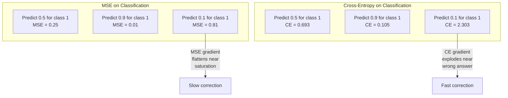
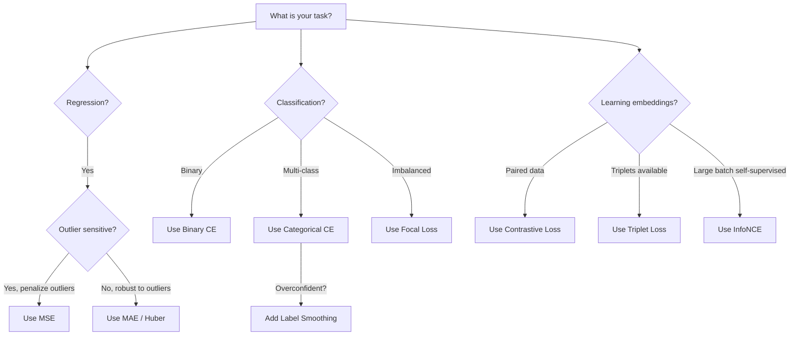
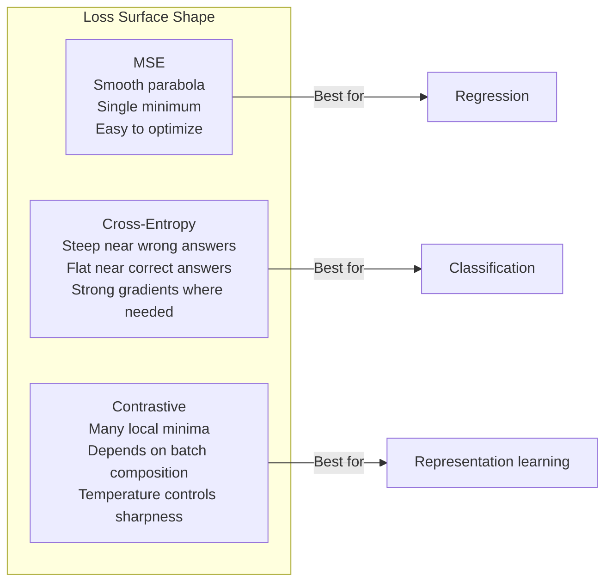

# Fungsi Loss

> Network-mu membuat prediksi. Ground truth berkata lain. Seberapa salah ia? Angka itu adalah loss. Pilih fungsi loss yang salah dan modelmu mengoptimalkan hal yang salah total.

**Type:** Build
**Languages:** Python
**Prerequisites:** Lesson 03.04 (Activation Functions)
**Time:** ~75 minutes

## Tujuan Pembelajaran

- Mengimplementasikan MSE, binary cross-entropy, categorical cross-entropy, dan contrastive loss (InfoNCE) dari nol beserta gradiennya
- Menjelaskan mengapa MSE gagal untuk klasifikasi dengan mendemonstrasikan mode kegagalan "memprediksi 0,5 untuk semuanya"
- Menerapkan label smoothing pada cross-entropy dan menjelaskan bagaimana ia mencegah prediksi yang terlalu percaya diri
- Memilih fungsi loss yang tepat untuk tugas regresi, klasifikasi biner, klasifikasi multi-kelas, dan pembelajaran embedding

## Masalahnya

Model yang meminimalkan MSE pada masalah klasifikasi akan dengan percaya diri memprediksi 0,5 untuk semuanya. Ia meminimalkan loss. Ia juga tidak berguna.

Fungsi loss adalah satu-satunya hal yang benar-benar dioptimasi modelmu. Bukan akurasi. Bukan skor F1. Bukan metrik apa pun yang kamu laporkan ke manajermu. Optimizer mengambil gradien fungsi loss dan menyesuaikan bobot agar angka itu mengecil. Jika fungsi loss tidak menangkap apa yang kamu pedulikan, model akan menemukan cara termurah secara matematis untuk memenuhinya, dan cara itu nyaris tidak pernah yang kamu mau.

Berikut contoh konkret. Kamu punya tugas klasifikasi biner. Dua kelas, terbagi 50/50. Kamu memakai MSE sebagai loss. Model memprediksi 0,5 untuk setiap input. Rata-rata MSE adalah 0,25, yaitu minimum yang mungkin tanpa benar-benar belajar apa pun. Model punya nol kemampuan diskriminatif tetapi secara teknis telah meminimalkan fungsi loss-mu. Beralih ke cross-entropy dan model yang sama dipaksa mendorong prediksi ke arah 0 atau 1, karena -log(0,5) = 0,693 adalah loss yang buruk, sementara -log(0,99) = 0,01 menghargai prediksi benar yang percaya diri. Pilihan fungsi loss adalah pembeda antara model yang belajar dan model yang mengakali metrik.

Lebih parah lagi. Dalam self-supervised learning, kamu bahkan tidak punya label. Contrastive loss mendefinisikan sinyal belajar sepenuhnya: apa yang dihitung mirip, apa yang dihitung berbeda, dan seberapa keras model harus memisahkannya. Salah memakai contrastive loss dan embedding-mu runtuh ke satu titik -- setiap input dipetakan ke vektor yang sama. Secara teknis loss nol. Sama sekali tak berharga.

## Konsepnya

### Mean Squared Error (MSE)

Default untuk regresi. Hitung kuadrat selisih antara prediksi dan target, rata-ratakan atas semua sampel.

```
MSE = (1/n) * sum((y_pred - y_true)^2)
```

Mengapa kuadrat penting: ia menghukum error besar secara kuadratik. Error 2 biayanya 4x lipat error 1. Error 10 biayanya 100x lipat. Ini membuat MSE sensitif terhadap outlier -- satu prediksi yang salah besar mendominasi loss.

Angka nyata: jika modelmu memprediksi harga rumah dan meleset $10.000 pada kebanyakan rumah tetapi meleset $200.000 pada satu mansion, MSE akan agresif mencoba memperbaiki mansion itu, berpotensi merusak performa pada 99 rumah lainnya.

Gradien MSE terhadap sebuah prediksi adalah:

```
dMSE/dy_pred = (2/n) * (y_pred - y_true)
```

Linear terhadap error. Error lebih besar mendapat gradien lebih besar. Ini fitur untuk regresi (error besar butuh koreksi besar) dan bug untuk klasifikasi (kamu ingin menghukum jawaban salah yang percaya diri secara eksponensial, bukan linear).

### Loss Cross-Entropy

Fungsi loss untuk klasifikasi. Berakar pada teori informasi -- ia mengukur divergensi antara distribusi probabilitas prediksi dan distribusi sebenarnya.

**Binary Cross-Entropy (BCE):**

```
BCE = -(y * log(p) + (1 - y) * log(1 - p))
```

Di mana y adalah label benar (0 atau 1) dan p adalah probabilitas prediksi.

Mengapa -log(p) bekerja: saat label benar adalah 1 dan kamu memprediksi p = 0,99, loss-nya -log(0,99) = 0,01. Saat kamu memprediksi p = 0,01, loss-nya -log(0,01) = 4,6. Perbedaan 460x lipat itulah mengapa cross-entropy bekerja. Ia menghukum brutal prediksi salah yang percaya diri sementara nyaris tidak menghukum prediksi benar yang percaya diri.

Gradien menceritakan hal yang sama:

```
dBCE/dp = -(y/p) + (1-y)/(1-p)
```

Saat y = 1 dan p mendekati nol, gradiennya -1/p yang mendekati takhingga negatif. Model mendapat sinyal raksasa untuk memperbaiki kesalahannya. Saat p mendekati 1, gradiennya kecil. Sudah benar, tidak ada yang perlu diperbaiki.

**Categorical Cross-Entropy:**

Untuk klasifikasi multi-kelas dengan target one-hot encoded.

```
CCE = -sum(y_i * log(p_i))
```

Hanya kelas yang benar berkontribusi pada loss (karena semua y_i lain nol). Jika ada 10 kelas dan kelas yang benar mendapat probabilitas 0,1 (tebakan acak), loss-nya -log(0,1) = 2,3. Jika kelas yang benar mendapat probabilitas 0,9, loss-nya -log(0,9) = 0,105. Model belajar memusatkan massa probabilitas pada jawaban yang tepat.

### Mengapa MSE Gagal untuk Klasifikasi



Gradien MSE mendatar saat prediksi mendekati 0 atau 1 (karena saturasi sigmoid). Gradien cross-entropy mengimbanginya -- -log membatalkan wilayah datar sigmoid, memberikan gradien kuat tepat di mana paling dibutuhkan.

### Label Smoothing

Label one-hot standar berkata "ini 100% kelas 3 dan 0% yang lain." Itu klaim yang kuat. Label smoothing melunakkannya:

```
smooth_label = (1 - alpha) * one_hot + alpha / num_classes
```

Dengan alpha = 0,1 dan 10 kelas: alih-alih [0, 0, 1, 0, ...], target menjadi [0,01, 0,01, 0,91, 0,01, ...]. Model menargetkan 0,91 alih-alih 1,0.

Mengapa ini bekerja: model yang mencoba mengeluarkan tepat 1,0 melalui softmax perlu mendorong logit hingga takhingga. Ini menyebabkan overconfidence, merusak generalisasi, dan membuat model rapuh terhadap pergeseran distribusi. Label smoothing membatasi target pada 0,9 (dengan alpha=0,1), menjaga logit dalam rentang wajar. GPT dan kebanyakan model modern memakai label smoothing atau padanannya.

### Contrastive Loss

Tanpa label. Tanpa kelas. Hanya pasangan input dan pertanyaan: apakah ini mirip atau berbeda?

**Contrastive loss gaya SimCLR (NT-Xent / InfoNCE):**

Ambil satu gambar. Buat dua tampilan augmentasinya (crop, rotasi, color jitter). Ini adalah "pasangan positif" -- embedding-nya harus mirip. Setiap gambar lain dalam batch membentuk "pasangan negatif" -- embedding-nya harus berbeda.

```
L = -log(exp(sim(z_i, z_j) / tau) / sum(exp(sim(z_i, z_k) / tau)))
```

Di mana sim() adalah cosine similarity, z_i dan z_j adalah pasangan positif, penjumlahan atas semua negatif, dan tau (temperature) mengendalikan seberapa tajam distribusinya. Temperature lebih rendah = negatif lebih keras = pemisahan lebih agresif.

Angka nyata: batch size 256 berarti 255 negatif per pasangan positif. Temperature tau = 0,07 (default SimCLR). Loss tampak seperti softmax atas similarity -- ia ingin similarity pasangan positif menjadi tertinggi di antara seluruh 256 opsi.

**Triplet Loss:**

Memakai tiga input: anchor, positif (kelas sama), negatif (kelas berbeda).

```
L = max(0, d(anchor, positive) - d(anchor, negative) + margin)
```

Margin (biasanya 0,2-1,0) menegakkan jarak minimum antara jarak positif dan negatif. Jika negatif sudah cukup jauh, loss nol -- tanpa gradien, tanpa update. Ini membuat training efisien tetapi membutuhkan triplet mining yang hati-hati (memilih negatif keras yang dekat dengan anchor).

### Focal Loss

Untuk dataset tak seimbang. Cross-entropy standar memperlakukan semua contoh yang diklasifikasi benar secara setara. Focal loss menurunkan bobot contoh mudah:

```
FL = -alpha * (1 - p_t)^gamma * log(p_t)
```

Di mana p_t adalah probabilitas prediksi dari kelas yang benar dan gamma mengendalikan fokus. Dengan gamma = 0, ini adalah cross-entropy standar. Dengan gamma = 2 (default):

- Contoh mudah (p_t = 0,9): bobot = (0,1)^2 = 0,01. Efektif diabaikan.
- Contoh sulit (p_t = 0,1): bobot = (0,9)^2 = 0,81. Sinyal gradien penuh.

Focal loss diperkenalkan oleh Lin et al. untuk deteksi objek, di mana 99% wilayah kandidat adalah latar (negatif mudah). Tanpa focal loss, model tenggelam dalam contoh latar mudah dan tidak pernah belajar mendeteksi objek. Dengan itu, model memfokuskan kapasitasnya pada kasus sulit dan ambigu yang penting.

### Pohon Keputusan Fungsi Loss



### Lanskap Loss



```figure
cross-entropy-loss
```

## Bangun Sendiri

### Langkah 1: MSE dan Gradiennya

```python
def mse(predictions, targets):
    n = len(predictions)
    total = 0.0
    for p, t in zip(predictions, targets):
        total += (p - t) ** 2
    return total / n

def mse_gradient(predictions, targets):
    n = len(predictions)
    grads = []
    for p, t in zip(predictions, targets):
        grads.append(2.0 * (p - t) / n)
    return grads
```

### Langkah 2: Binary Cross-Entropy

Masalah log(0) itu nyata. Jika model memprediksi tepat 0 untuk contoh positif, log(0) = takhingga negatif. Clipping mencegah ini.

```python
import math

def binary_cross_entropy(predictions, targets, eps=1e-15):
    n = len(predictions)
    total = 0.0
    for p, t in zip(predictions, targets):
        p_clipped = max(eps, min(1 - eps, p))
        total += -(t * math.log(p_clipped) + (1 - t) * math.log(1 - p_clipped))
    return total / n

def bce_gradient(predictions, targets, eps=1e-15):
    grads = []
    for p, t in zip(predictions, targets):
        p_clipped = max(eps, min(1 - eps, p))
        grads.append(-(t / p_clipped) + (1 - t) / (1 - p_clipped))
    return grads
```

### Langkah 3: Categorical Cross-Entropy dengan Softmax

Softmax mengubah logit mentah menjadi probabilitas. Lalu kita hitung cross-entropy terhadap target one-hot.

```python
def softmax(logits):
    max_val = max(logits)
    exps = [math.exp(x - max_val) for x in logits]
    total = sum(exps)
    return [e / total for e in exps]

def categorical_cross_entropy(logits, target_index, eps=1e-15):
    probs = softmax(logits)
    p = max(eps, probs[target_index])
    return -math.log(p)

def cce_gradient(logits, target_index):
    probs = softmax(logits)
    grads = list(probs)
    grads[target_index] -= 1.0
    return grads
```

Gradien softmax + cross-entropy tersederhanakan dengan indah: hanyalah (probabilitas prediksi - 1) untuk kelas yang benar, dan (probabilitas prediksi) untuk semua kelas lain. Penyederhanaan elegan ini bukan kebetulan -- itulah mengapa softmax dan cross-entropy dipasangkan.

### Langkah 4: Label Smoothing

```python
def label_smoothed_cce(logits, target_index, num_classes, alpha=0.1, eps=1e-15):
    probs = softmax(logits)
    loss = 0.0
    for i in range(num_classes):
        if i == target_index:
            smooth_target = 1.0 - alpha + alpha / num_classes
        else:
            smooth_target = alpha / num_classes
        p = max(eps, probs[i])
        loss += -smooth_target * math.log(p)
    return loss
```

### Langkah 5: Contrastive Loss (InfoNCE Sederhana)

```python
def cosine_similarity(a, b):
    dot = sum(x * y for x, y in zip(a, b))
    norm_a = math.sqrt(sum(x * x for x in a))
    norm_b = math.sqrt(sum(x * x for x in b))
    if norm_a < 1e-10 or norm_b < 1e-10:
        return 0.0
    return dot / (norm_a * norm_b)

def contrastive_loss(anchor, positive, negatives, temperature=0.07):
    sim_pos = cosine_similarity(anchor, positive) / temperature
    sim_negs = [cosine_similarity(anchor, neg) / temperature for neg in negatives]

    max_sim = max(sim_pos, max(sim_negs)) if sim_negs else sim_pos
    exp_pos = math.exp(sim_pos - max_sim)
    exp_negs = [math.exp(s - max_sim) for s in sim_negs]
    total_exp = exp_pos + sum(exp_negs)

    return -math.log(max(1e-15, exp_pos / total_exp))
```

### Langkah 6: MSE vs Cross-Entropy pada Klasifikasi

Latih network yang sama dari pelajaran 04 (dataset lingkaran) dengan kedua fungsi loss. Saksikan cross-entropy konvergen lebih cepat.

```python
import random

def sigmoid(x):
    x = max(-500, min(500, x))
    return 1.0 / (1.0 + math.exp(-x))

def make_circle_data(n=200, seed=42):
    random.seed(seed)
    data = []
    for _ in range(n):
        x = random.uniform(-2, 2)
        y = random.uniform(-2, 2)
        label = 1.0 if x * x + y * y < 1.5 else 0.0
        data.append(([x, y], label))
    return data


class LossComparisonNetwork:
    def __init__(self, loss_type="bce", hidden_size=8, lr=0.1):
        random.seed(0)
        self.loss_type = loss_type
        self.lr = lr
        self.hidden_size = hidden_size

        self.w1 = [[random.gauss(0, 0.5) for _ in range(2)] for _ in range(hidden_size)]
        self.b1 = [0.0] * hidden_size
        self.w2 = [random.gauss(0, 0.5) for _ in range(hidden_size)]
        self.b2 = 0.0

    def forward(self, x):
        self.x = x
        self.z1 = []
        self.h = []
        for i in range(self.hidden_size):
            z = self.w1[i][0] * x[0] + self.w1[i][1] * x[1] + self.b1[i]
            self.z1.append(z)
            self.h.append(max(0.0, z))

        self.z2 = sum(self.w2[i] * self.h[i] for i in range(self.hidden_size)) + self.b2
        self.out = sigmoid(self.z2)
        return self.out

    def backward(self, target):
        if self.loss_type == "mse":
            d_loss = 2.0 * (self.out - target)
        else:
            eps = 1e-15
            p = max(eps, min(1 - eps, self.out))
            d_loss = -(target / p) + (1 - target) / (1 - p)

        d_sigmoid = self.out * (1 - self.out)
        d_out = d_loss * d_sigmoid

        for i in range(self.hidden_size):
            d_relu = 1.0 if self.z1[i] > 0 else 0.0
            d_h = d_out * self.w2[i] * d_relu
            self.w2[i] -= self.lr * d_out * self.h[i]
            for j in range(2):
                self.w1[i][j] -= self.lr * d_h * self.x[j]
            self.b1[i] -= self.lr * d_h
        self.b2 -= self.lr * d_out

    def compute_loss(self, pred, target):
        if self.loss_type == "mse":
            return (pred - target) ** 2
        else:
            eps = 1e-15
            p = max(eps, min(1 - eps, pred))
            return -(target * math.log(p) + (1 - target) * math.log(1 - p))

    def train(self, data, epochs=200):
        losses = []
        for epoch in range(epochs):
            total_loss = 0.0
            correct = 0
            for x, y in data:
                pred = self.forward(x)
                self.backward(y)
                total_loss += self.compute_loss(pred, y)
                if (pred >= 0.5) == (y >= 0.5):
                    correct += 1
            avg_loss = total_loss / len(data)
            accuracy = correct / len(data) * 100
            losses.append((avg_loss, accuracy))
            if epoch % 50 == 0 or epoch == epochs - 1:
                print(f"    Epoch {epoch:3d}: loss={avg_loss:.4f}, accuracy={accuracy:.1f}%")
        return losses
```

## Gunakan

PyTorch menyediakan semua fungsi loss standar dengan stabilitas numerik bawaan:

```python
import torch
import torch.nn as nn
import torch.nn.functional as F

predictions = torch.tensor([0.9, 0.1, 0.7], requires_grad=True)
targets = torch.tensor([1.0, 0.0, 1.0])

mse_loss = F.mse_loss(predictions, targets)
bce_loss = F.binary_cross_entropy(predictions, targets)

logits = torch.randn(4, 10)
labels = torch.tensor([3, 7, 1, 9])
ce_loss = F.cross_entropy(logits, labels)
ce_smooth = F.cross_entropy(logits, labels, label_smoothing=0.1)
```

Pakai `F.cross_entropy` (bukan `F.nll_loss` plus softmax manual). Ia menggabungkan log-softmax dan negative log-likelihood dalam satu operasi yang stabil numerik. Menerapkan softmax terpisah lalu mengambil log kurang stabil -- kamu kehilangan presisi dalam pengurangan eksponensial besar.

Untuk contrastive learning, kebanyakan tim memakai implementasi kustom atau pustaka seperti `lightly` atau `pytorch-metric-learning`. Loop intinya selalu sama: hitung similarity berpasangan, buat softmax atas positif dan negatif, backpropagate.

## Rilis

Pelajaran ini menghasilkan:

- `outputs/prompt-loss-function-selector.md` -- prompt yang bisa dipakai ulang untuk memilih fungsi loss yang tepat
- `outputs/prompt-loss-debugger.md` -- prompt diagnostik untuk saat kurva loss-mu tampak salah

## Latihan

1. Implementasikan Huber loss (smooth L1 loss), yaitu MSE untuk error kecil dan MAE untuk error besar. Latih network regresi yang memprediksi y = sin(x) dengan MSE vs Huber saat 5% target training ditambah noise acak (outlier). Bandingkan error uji akhir.
2. Tambahkan focal loss ke loop training klasifikasi biner. Buat dataset tak seimbang (90% kelas 0, 10% kelas 1). Bandingkan BCE standar vs focal loss (gamma=2) pada recall kelas minoritas setelah 200 epoch.
3. Implementasikan triplet loss dengan semi-hard negative mining. Hasilkan data embedding 2D untuk 5 kelas. Untuk setiap anchor, temukan negatif tersulit yang masih lebih jauh daripada positif (semi-hard). Bandingkan konvergensi dengan pemilihan triplet acak.
4. Jalankan perbandingan MSE vs cross-entropy tetapi lacak magnitudo gradien pada setiap lapis selama training. Plot norma gradien rata-rata per epoch. Verifikasi bahwa cross-entropy menghasilkan gradien lebih besar di epoch awal saat model paling tidak pasti.
5. Implementasikan KL divergence loss dan verifikasi bahwa meminimalkan KL(true || predicted) memberikan gradien yang sama dengan cross-entropy saat distribusi benar adalah one-hot. Lalu coba soft target (seperti knowledge distillation) di mana distribusi "benar" berasal dari output softmax model teacher.

## Istilah Kunci

| Term | What people say | What it actually means |
|------|----------------|----------------------|
| Loss function | "How wrong the model is" | A differentiable function mapping predictions and targets to a scalar that the optimizer minimizes |
| MSE | "Average squared error" | Mean of squared differences between predictions and targets; penalizes large errors quadratically |
| Cross-entropy | "The classification loss" | Measures divergence between predicted probability distribution and true distribution using -log(p) |
| Binary cross-entropy | "BCE" | Cross-entropy for two classes: -(y*log(p) + (1-y)*log(1-p)) |
| Label smoothing | "Softening the targets" | Replacing hard 0/1 targets with soft values (e.g., 0.1/0.9) to prevent overconfidence and improve generalization |
| Contrastive loss | "Pull together, push apart" | A loss that learns representations by making similar pairs close and dissimilar pairs far in embedding space |
| InfoNCE | "The CLIP/SimCLR loss" | Normalized temperature-scaled cross-entropy over similarity scores; treats contrastive learning as classification |
| Focal loss | "The imbalanced data fix" | Cross-entropy weighted by (1-p_t)^gamma to down-weight easy examples and focus on hard ones |
| Triplet loss | "Anchor-positive-negative" | Pushes anchor closer to positive than negative by at least a margin in embedding space |
| Temperature | "Sharpness knob" | A scalar divisor on logits/similarities that controls how peaked the resulting distribution is; lower = sharper |

## Bacaan Lanjutan

- Lin et al., "Focal Loss for Dense Object Detection" (2017) -- memperkenalkan focal loss untuk menangani ketidakseimbangan kelas ekstrem dalam deteksi objek (RetinaNet)
- Chen et al., "A Simple Framework for Contrastive Learning of Visual Representations" (SimCLR, 2020) -- mendefinisikan pipeline contrastive learning modern dengan loss NT-Xent
- Szegedy et al., "Rethinking the Inception Architecture" (2016) -- memperkenalkan label smoothing sebagai teknik regularisasi, kini standar di kebanyakan model besar
- Hinton et al., "Distilling the Knowledge in a Neural Network" (2015) -- knowledge distillation memakai soft target dan KL divergence, fondasional untuk kompresi model
