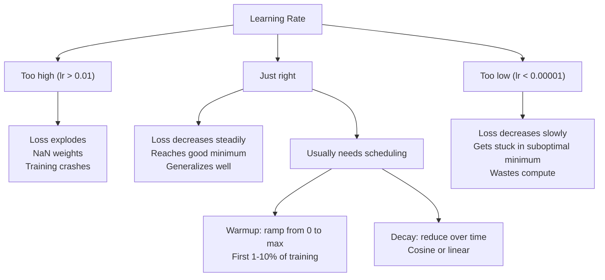
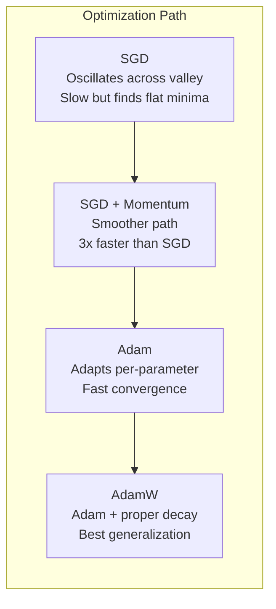
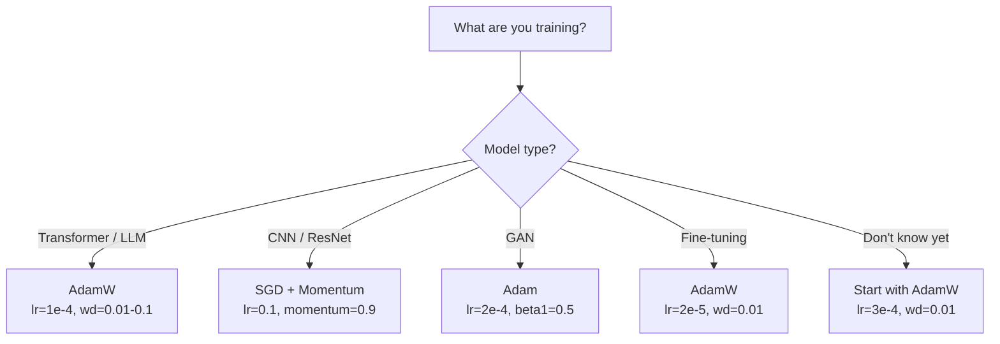

# Optimizer

> Gradient descent memberitahumu arah mana harus bergerak. Ia tidak berkata apa-apa tentang seberapa jauh atau seberapa cepat. SGD adalah kompas. Adam adalah GPS dengan data lalu lintas.

**Type:** Build
**Languages:** Python
**Prerequisites:** Lesson 03.05 (Loss Functions)
**Time:** ~75 minutes

## Tujuan Pembelajaran

- Mengimplementasikan optimizer SGD, SGD dengan momentum, Adam, dan AdamW dari nol di Python
- Menjelaskan bagaimana bias correction Adam mengkompensasi estimasi momen yang diinisialisasi nol pada langkah-langkah awal training
- Mendemonstrasikan mengapa AdamW menghasilkan generalisasi lebih baik daripada Adam dengan regularisasi L2 pada tugas yang sama
- Memilih optimizer dan hiperparameter default yang tepat untuk transformer, CNN, GAN, dan fine-tuning

## Masalahnya

Kamu sudah menghitung gradien. Kamu tahu bobot #4.721 harus turun 0,003 untuk mengurangi loss. Tetapi 0,003 dalam satuan apa? Diskalakan dengan apa? Dan apakah kamu harus bergerak sama jauh pada langkah 1 dan langkah 1.000?

Gradient descent vanila menerapkan learning rate yang sama ke setiap parameter pada setiap langkah: w = w - lr * gradient. Ini menciptakan tiga masalah yang membuat training neural network menyakitkan dalam praktik.

Pertama, osilasi. Lanskap loss jarang berbentuk mangkuk mulus. Ia lebih seperti lembah panjang dan sempit. Gradien menunjuk menyeberangi lembah (arah curam), bukan menyusurinya (arah landai). Gradient descent memantul bolak-balik menyeberangi dimensi sempit sementara hanya maju sedikit di arah yang berguna. Kamu pernah melihat ini: loss turun cepat lalu plateau, bukan karena model konvergen tetapi karena ia berosilasi.

Kedua, satu learning rate untuk semua parameter itu salah. Sebagian bobot butuh update besar (mereka masih tahap awal, underfitting). Yang lain butuh update kecil (mereka sudah dekat nilai optimal). Learning rate yang cocok untuk yang pertama menghancurkan yang kedua, dan sebaliknya.

Ketiga, saddle point. Dalam dimensi tinggi, lanskap loss punya wilayah datar luas di mana gradien mendekati nol. SGD vanila merangkak melaluinya secepat gradien, yaitu efektif nol. Model tampak macet. Ia tidak macet -- ia berada di wilayah datar dengan turunan berguna di sisi lain. Tetapi SGD tidak punya mekanisme untuk menerobos.

Adam menyelesaikan ketiganya. Ia menjaga dua rata-rata berjalan per parameter -- rerata gradien (momentum, menangani osilasi) dan rerata gradien kuadrat (adaptive rate, menangani skala berbeda). Dikombinasikan dengan bias correction untuk beberapa langkah pertama, ia memberimu satu optimizer yang bekerja pada 80% masalah dengan hiperparameter default. Pelajaran ini membangunnya dari nol sehingga kamu paham tepat kapan dan mengapa ia gagal pada 20% sisanya.

## Konsepnya

### Stochastic Gradient Descent (SGD)

Optimizer paling sederhana. Hitung gradien pada mini-batch dan melangkah ke arah berlawanan.

```
w = w - lr * gradient
```

"Stokastik" berarti kamu memakai subset acak (mini-batch) data untuk mengestimasi gradien, bukan seluruh dataset. Noise ini sebenarnya berguna -- ia membantu lepas dari minima lokal yang tajam. Tetapi noise juga menyebabkan osilasi.

Learning rate adalah satu-satunya kenop. Terlalu tinggi: loss divergen. Terlalu rendah: training berlangsung selamanya. Nilai optimal bergantung pada arsitektur, data, batch size, dan tahap training saat ini. Untuk SGD vanila pada network modern, nilai tipikal berkisar 0,01 sampai 0,1. Tetapi bahkan dalam satu run training, learning rate ideal berubah.

### Momentum

Analogi bola menggelinding menuruni bukit terlalu sering dipakai tetapi akurat. Alih-alih melangkah hanya dengan gradien, kamu menjaga velocity yang mengakumulasi gradien masa lalu.

```
m_t = beta * m_{t-1} + gradient
w = w - lr * m_t
```

Beta (biasanya 0,9) mengendalikan seberapa banyak sejarah yang disimpan. Dengan beta = 0,9, momentum kira-kira rerata 10 gradien terakhir (1 / (1 - 0,9) = 10).

Mengapa ini memperbaiki osilasi: gradien yang menunjuk ke arah sama terakumulasi. Gradien yang berbalik arah saling meniadakan. Di lembah sempit itu, komponen "menyeberang" berbalik tanda setiap langkah dan teredam. Komponen "menyusuri" tetap konsisten dan teramplifikasi. Hasilnya akselerasi mulus ke arah yang berguna.

Angka nyata: SGD saja pada lanskap loss yang berkondisi buruk mungkin butuh 10.000 langkah. SGD dengan momentum (beta=0,9) biasanya butuh 3.000-5.000 langkah pada masalah yang sama. Percepatannya tidak marjinal.

### RMSProp

Metode adaptive learning rate per-parameter pertama yang benar-benar bekerja. Diusulkan Hinton dalam kuliah Coursera (tidak pernah dipublikasikan formal).

```
s_t = beta * s_{t-1} + (1 - beta) * gradient^2
w = w - lr * gradient / (sqrt(s_t) + epsilon)
```

s_t melacak rata-rata berjalan dari gradien kuadrat. Parameter dengan gradien besar yang konsisten dibagi angka besar (learning rate efektif lebih kecil). Parameter dengan gradien kecil dibagi angka kecil (learning rate efektif lebih besar).

Ini menyelesaikan masalah "satu learning rate untuk semua parameter". Bobot yang sudah mendapat update besar mungkin dekat targetnya -- perlambat. Bobot yang mendapat update kecil mungkin kurang dilatih -- percepat.

Epsilon (biasanya 1e-8) mencegah pembagian nol saat parameter belum pernah diupdate.

### Adam: Momentum + RMSProp

Adam menggabungkan kedua ide. Ia menjaga dua exponential moving average per parameter:

```
m_t = beta1 * m_{t-1} + (1 - beta1) * gradient        (first moment: mean)
v_t = beta2 * v_{t-1} + (1 - beta2) * gradient^2       (second moment: variance)
```

**Bias correction** adalah detail kunci yang kebanyakan penjelasan lewatkan. Pada langkah 1, m_1 = (1 - beta1) * gradient. Dengan beta1 = 0,9, itu 0,1 * gradient -- sepuluh kali terlalu kecil. Rata-rata bergerak belum pemanasan. Bias correction mengkompensasi:

```
m_hat = m_t / (1 - beta1^t)
v_hat = v_t / (1 - beta2^t)
```

Pada langkah 1 dengan beta1 = 0,9: m_hat = m_1 / (1 - 0,9) = m_1 / 0,1 = gradien sebenarnya. Pada langkah 100: (1 - 0,9^100) kira-kira 1,0, sehingga koreksi lenyap. Bias correction penting untuk ~10 langkah pertama dan tidak relevan setelah ~50.

Update-nya:

```
w = w - lr * m_hat / (sqrt(v_hat) + epsilon)
```

Default Adam: lr = 0,001, beta1 = 0,9, beta2 = 0,999, epsilon = 1e-8. Default ini bekerja untuk 80% masalah. Saat tidak, ubah lr dulu. Lalu beta2. Nyaris tidak pernah ubah beta1 atau epsilon.

### AdamW: Weight Decay yang Benar

Regularisasi L2 menambahkan lambda * w^2 ke loss. Dalam SGD vanila, ini setara dengan weight decay (mengurangi lambda * w dari bobot setiap langkah). Dalam Adam, kesetaraan ini rusak.

Wawasan Loshchilov & Hutter: saat kamu menambahkan L2 ke loss lalu Adam memproses gradien, adaptive learning rate ikut menskalakan suku regularisasi. Parameter dengan varians gradien besar mendapat regularisasi lebih sedikit. Parameter dengan varians kecil mendapat lebih banyak. Ini bukan yang kamu mau -- kamu ingin regularisasi seragam terlepas dari statistik gradien.

AdamW memperbaikinya dengan menerapkan weight decay langsung ke bobot, setelah update Adam:

```
w = w - lr * m_hat / (sqrt(v_hat) + epsilon) - lr * lambda * w
```

Suku weight decay (lr * lambda * w) tidak diskalakan oleh faktor adaptif Adam. Setiap parameter mendapat penyusutan proporsional yang sama.

Ini tampak seperti detail kecil. Bukan. AdamW konvergen ke solusi lebih baik daripada Adam + regularisasi L2 pada hampir setiap tugas. Ia adalah optimizer default di PyTorch untuk training transformer, diffusion model, dan kebanyakan arsitektur modern. BERT, GPT, LLaMA, Stable Diffusion -- semuanya dilatih dengan AdamW.

### Learning Rate: Hiperparameter Terpenting



Jika kamu menyetel satu hiperparameter, setel learning rate. Perubahan 10x pada learning rate lebih penting daripada keputusan arsitektural apa pun yang akan kamu buat. Default umum:

- SGD: lr = 0,01 sampai 0,1
- Adam/AdamW: lr = 1e-4 sampai 3e-4
- Fine-tuning model pretrained: lr = 1e-5 sampai 5e-5
- Warmup learning rate: ramp linear selama 1-10% langkah pertama

### Perbandingan Optimizer



### Kapan Setiap Optimizer Menang



```figure
optimizer-trajectory
```

## Bangun Sendiri

### Langkah 1: SGD Vanila

```python
class SGD:
    def __init__(self, lr=0.01):
        self.lr = lr

    def step(self, params, grads):
        for i in range(len(params)):
            params[i] -= self.lr * grads[i]
```

### Langkah 2: SGD dengan Momentum

```python
class SGDMomentum:
    def __init__(self, lr=0.01, beta=0.9):
        self.lr = lr
        self.beta = beta
        self.velocities = None

    def step(self, params, grads):
        if self.velocities is None:
            self.velocities = [0.0] * len(params)
        for i in range(len(params)):
            self.velocities[i] = self.beta * self.velocities[i] + grads[i]
            params[i] -= self.lr * self.velocities[i]
```

### Langkah 3: Adam

```python
import math

class Adam:
    def __init__(self, lr=0.001, beta1=0.9, beta2=0.999, epsilon=1e-8):
        self.lr = lr
        self.beta1 = beta1
        self.beta2 = beta2
        self.epsilon = epsilon
        self.m = None
        self.v = None
        self.t = 0

    def step(self, params, grads):
        if self.m is None:
            self.m = [0.0] * len(params)
            self.v = [0.0] * len(params)

        self.t += 1

        for i in range(len(params)):
            self.m[i] = self.beta1 * self.m[i] + (1 - self.beta1) * grads[i]
            self.v[i] = self.beta2 * self.v[i] + (1 - self.beta2) * grads[i] ** 2

            m_hat = self.m[i] / (1 - self.beta1 ** self.t)
            v_hat = self.v[i] / (1 - self.beta2 ** self.t)

            params[i] -= self.lr * m_hat / (math.sqrt(v_hat) + self.epsilon)
```

### Langkah 4: AdamW

```python
class AdamW:
    def __init__(self, lr=0.001, beta1=0.9, beta2=0.999, epsilon=1e-8, weight_decay=0.01):
        self.lr = lr
        self.beta1 = beta1
        self.beta2 = beta2
        self.epsilon = epsilon
        self.weight_decay = weight_decay
        self.m = None
        self.v = None
        self.t = 0

    def step(self, params, grads):
        if self.m is None:
            self.m = [0.0] * len(params)
            self.v = [0.0] * len(params)

        self.t += 1

        for i in range(len(params)):
            self.m[i] = self.beta1 * self.m[i] + (1 - self.beta1) * grads[i]
            self.v[i] = self.beta2 * self.v[i] + (1 - self.beta2) * grads[i] ** 2

            m_hat = self.m[i] / (1 - self.beta1 ** self.t)
            v_hat = self.v[i] / (1 - self.beta2 ** self.t)

            params[i] -= self.lr * m_hat / (math.sqrt(v_hat) + self.epsilon)
            params[i] -= self.lr * self.weight_decay * params[i]
```

### Langkah 5: Perbandingan Training

Latih network dua lapis yang sama pada dataset lingkaran dari pelajaran 05 dengan keempat optimizer. Bandingkan konvergensi.

```python
import random

def sigmoid(x):
    x = max(-500, min(500, x))
    return 1.0 / (1.0 + math.exp(-x))

def make_circle_data(n=200, seed=42):
    random.seed(seed)
    data = []
    for _ in range(n):
        x = random.uniform(-2, 2)
        y = random.uniform(-2, 2)
        label = 1.0 if x * x + y * y < 1.5 else 0.0
        data.append(([x, y], label))
    return data


class OptimizerTestNetwork:
    def __init__(self, optimizer, hidden_size=8):
        random.seed(0)
        self.hidden_size = hidden_size
        self.optimizer = optimizer

        self.w1 = [[random.gauss(0, 0.5) for _ in range(2)] for _ in range(hidden_size)]
        self.b1 = [0.0] * hidden_size
        self.w2 = [random.gauss(0, 0.5) for _ in range(hidden_size)]
        self.b2 = 0.0

    def get_params(self):
        params = []
        for row in self.w1:
            params.extend(row)
        params.extend(self.b1)
        params.extend(self.w2)
        params.append(self.b2)
        return params

    def set_params(self, params):
        idx = 0
        for i in range(self.hidden_size):
            for j in range(2):
                self.w1[i][j] = params[idx]
                idx += 1
        for i in range(self.hidden_size):
            self.b1[i] = params[idx]
            idx += 1
        for i in range(self.hidden_size):
            self.w2[i] = params[idx]
            idx += 1
        self.b2 = params[idx]

    def forward(self, x):
        self.x = x
        self.z1 = []
        self.h = []
        for i in range(self.hidden_size):
            z = self.w1[i][0] * x[0] + self.w1[i][1] * x[1] + self.b1[i]
            self.z1.append(z)
            self.h.append(max(0.0, z))

        self.z2 = sum(self.w2[i] * self.h[i] for i in range(self.hidden_size)) + self.b2
        self.out = sigmoid(self.z2)
        return self.out

    def compute_grads(self, target):
        eps = 1e-15
        p = max(eps, min(1 - eps, self.out))
        d_loss = -(target / p) + (1 - target) / (1 - p)
        d_sigmoid = self.out * (1 - self.out)
        d_out = d_loss * d_sigmoid

        grads = [0.0] * (self.hidden_size * 2 + self.hidden_size + self.hidden_size + 1)
        idx = 0
        for i in range(self.hidden_size):
            d_relu = 1.0 if self.z1[i] > 0 else 0.0
            d_h = d_out * self.w2[i] * d_relu
            grads[idx] = d_h * self.x[0]
            grads[idx + 1] = d_h * self.x[1]
            idx += 2

        for i in range(self.hidden_size):
            d_relu = 1.0 if self.z1[i] > 0 else 0.0
            grads[idx] = d_out * self.w2[i] * d_relu
            idx += 1

        for i in range(self.hidden_size):
            grads[idx] = d_out * self.h[i]
            idx += 1

        grads[idx] = d_out
        return grads

    def train(self, data, epochs=300):
        losses = []
        for epoch in range(epochs):
            total_loss = 0.0
            correct = 0
            for x, y in data:
                pred = self.forward(x)
                grads = self.compute_grads(y)
                params = self.get_params()
                self.optimizer.step(params, grads)
                self.set_params(params)

                eps = 1e-15
                p = max(eps, min(1 - eps, pred))
                total_loss += -(y * math.log(p) + (1 - y) * math.log(1 - p))
                if (pred >= 0.5) == (y >= 0.5):
                    correct += 1
            avg_loss = total_loss / len(data)
            accuracy = correct / len(data) * 100
            losses.append((avg_loss, accuracy))
            if epoch % 75 == 0 or epoch == epochs - 1:
                print(f"    Epoch {epoch:3d}: loss={avg_loss:.4f}, accuracy={accuracy:.1f}%")
        return losses
```

## Gunakan

Optimizer PyTorch menangani parameter group, gradient clipping, dan scheduling learning rate:

```python
import torch
import torch.optim as optim

model = torch.nn.Sequential(
    torch.nn.Linear(784, 256),
    torch.nn.ReLU(),
    torch.nn.Linear(256, 10),
)

optimizer = optim.AdamW(model.parameters(), lr=3e-4, weight_decay=0.01)

scheduler = optim.lr_scheduler.CosineAnnealingLR(optimizer, T_max=100)

for epoch in range(100):
    optimizer.zero_grad()
    output = model(torch.randn(32, 784))
    loss = torch.nn.functional.cross_entropy(output, torch.randint(0, 10, (32,)))
    loss.backward()
    torch.nn.utils.clip_grad_norm_(model.parameters(), max_norm=1.0)
    optimizer.step()
    scheduler.step()
```

Polanya selalu: zero_grad, forward, loss, backward, (clip), step, (schedule). Hafalkan urutan ini. Salah urutan (misalnya memanggil scheduler.step() sebelum optimizer.step()) adalah sumber umum bug halus.

Untuk CNN, banyak praktisi masih memilih SGD + momentum (lr=0,1, momentum=0,9, weight_decay=1e-4) dengan schedule step atau cosine. SGD menemukan minima yang lebih datar, yang sering menggeneralisasi lebih baik. Untuk transformer dan LLM, AdamW dengan warmup + cosine decay adalah default universal. Jangan melawan konsensus tanpa alasan yang terukur.

## Rilis

Pelajaran ini menghasilkan:

- `outputs/prompt-optimizer-selector.md` -- prompt keputusan untuk memilih optimizer dan learning rate yang tepat untuk arsitektur apa pun

## Latihan

1. Implementasikan momentum Nesterov, di mana kamu menghitung gradien pada posisi "lookahead" (w - lr * beta * v) alih-alih posisi saat ini. Bandingkan konvergensi dengan momentum standar pada dataset lingkaran.
2. Implementasikan schedule warmup learning rate: ramp linear dari 0 ke max_lr selama 10% langkah training pertama, lalu cosine decay ke 0. Latih dengan Adam + warmup vs Adam tanpa warmup. Ukur berapa epoch yang dibutuhkan untuk mencapai akurasi 90% pada dataset lingkaran.
3. Lacak learning rate efektif untuk setiap parameter selama training Adam. Rate efektif adalah lr * m_hat / (sqrt(v_hat) + eps). Plot distribusi rate efektif setelah 10, 50, dan 200 langkah. Apakah semua parameter diupdate dengan kecepatan sama?
4. Implementasikan gradient clipping (clip menurut norma global). Set norma gradien maksimum ke 1,0. Latih dengan dan tanpa clipping memakai learning rate tinggi (lr=0,01 untuk Adam). Hitung berapa run yang divergen (loss menjadi NaN) dengan dan tanpa clipping selama 10 seed acak.
5. Bandingkan Adam vs AdamW pada network dengan bobot besar. Inisialisasi semua bobot ke nilai acak dalam [-5, 5] (jauh lebih besar dari normal). Latih 200 epoch dengan weight_decay=0,1. Plot norma L2 bobot selama training untuk kedua optimizer. AdamW seharusnya menunjukkan penyusutan bobot lebih cepat.

## Istilah Kunci

| Term | What people say | What it actually means |
|------|----------------|----------------------|
| Learning rate | "Step size" | The scalar multiplier on the gradient update; the single most impactful hyperparameter in training |
| SGD | "Basic gradient descent" | Stochastic gradient descent: update weights by subtracting lr * gradient, computed on a mini-batch |
| Momentum | "Rolling ball analogy" | Exponential moving average of past gradients; dampens oscillation and accelerates consistent directions |
| RMSProp | "Adaptive learning rate" | Divides each parameter's gradient by the running RMS of its recent gradients; equalizes learning rates |
| Adam | "The default optimizer" | Combines momentum (first moment) and RMSProp (second moment) with bias correction for the initial steps |
| AdamW | "Adam done right" | Adam with decoupled weight decay; applies regularization directly to weights rather than through the gradient |
| Bias correction | "Warmup for running averages" | Dividing by (1 - beta^t) to compensate for the zero-initialization of Adam's moment estimates |
| Weight decay | "Shrink the weights" | Subtracting a fraction of the weight value at each step; a regularizer that penalizes large weights |
| Learning rate schedule | "Changing lr over time" | A function that adjusts the learning rate during training; warmup + cosine decay is the modern default |
| Gradient clipping | "Capping the gradient norm" | Scaling down the gradient vector when its norm exceeds a threshold; prevents exploding gradient updates |

## Bacaan Lanjutan

- Kingma & Ba, "Adam: A Method for Stochastic Optimization" (2014) -- makalah Adam orisinal dengan analisis konvergensi dan derivasi bias correction
- Loshchilov & Hutter, "Decoupled Weight Decay Regularization" (2017) -- membuktikan regularisasi L2 dan weight decay tidak setara dalam Adam, dan mengusulkan AdamW
- Smith, "Cyclical Learning Rates for Training Neural Networks" (2017) -- memperkenalkan uji rentang LR dan schedule siklikal yang menghilangkan kebutuhan menyetel learning rate tetap
- Ruder, "An Overview of Gradient Descent Optimization Algorithms" (2016) -- survei tunggal terbaik atas semua varian optimizer, dengan perbandingan dan intuisi yang jernih
