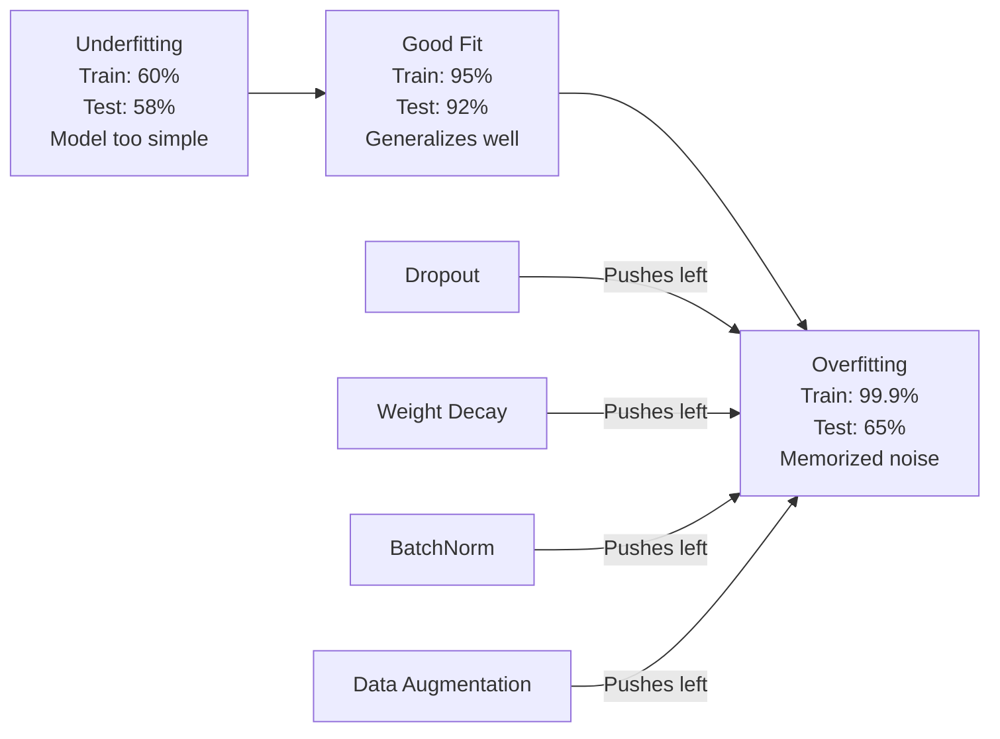
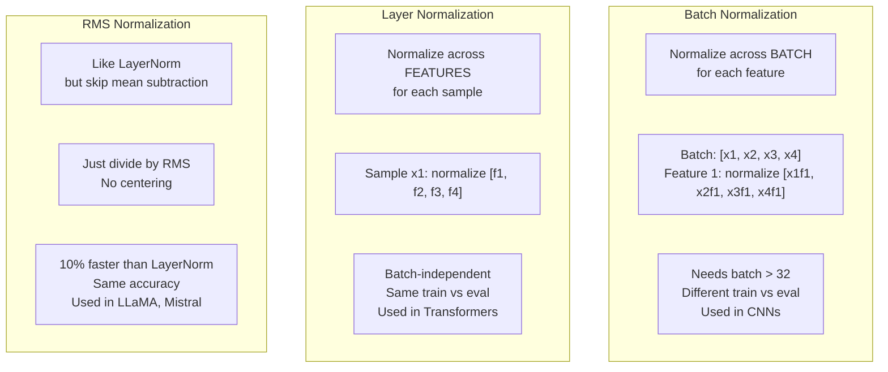
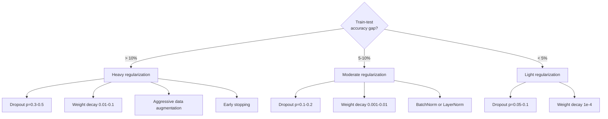

# Regularisasi

> Modelmu mencapai 99% pada data training dan 60% pada data uji. Ia menghafal alih-alih belajar. Regularisasi adalah pajak yang kamu kenakan pada kompleksitas untuk memaksa generalisasi.

**Type:** Build
**Languages:** Python
**Prerequisites:** Lesson 03.06 (Optimizers)
**Time:** ~75 minutes

## Tujuan Pembelajaran

- Mengimplementasikan dropout dengan inverted scaling, L2 weight decay, batch normalization, layer normalization, dan RMSNorm dari nol
- Mengukur kesenjangan akurasi train-test dan mendiagnosis overfitting memakai eksperimen regularisasi
- Menjelaskan mengapa transformer memakai LayerNorm bukan BatchNorm dan mengapa LLM modern memilih RMSNorm
- Menerapkan kombinasi teknik regularisasi yang tepat berdasarkan tingkat keparahan overfitting

## Masalahnya

Neural network dengan parameter cukup bisa menghafal dataset apa pun. Ini bukan hipotesis -- Zhang et al. (2017) membuktikannya dengan melatih network standar pada ImageNet dengan label acak. Network mencapai training loss mendekati nol pada penugasan label yang sepenuhnya acak. Mereka menghafal sejuta pasangan input-output acak tanpa pola untuk dipelajari. Training loss sempurna. Akurasi uji nol.

Inilah masalah overfitting, dan ia memburuk seiring model membesar. GPT-3 punya 175 miliar parameter. Set training punya sekitar 500 miliar token. Dengan parameter sebanyak itu, model punya kapasitas cukup untuk menghafal potongan signifikan data training kata per kata. Tanpa regularisasi, ia hanya akan memuntahkan contoh training alih-alih mempelajari pola yang menggeneralisasi.

Kesenjangan antara performa training dan performa uji adalah overfitting gap. Setiap teknik dalam pelajaran ini menyerang kesenjangan itu dari sudut berbeda. Dropout memaksa network tidak bergantung pada satu neuron pun. Weight decay mencegah satu bobot pun tumbuh terlalu besar. Batch normalization menghaluskan lanskap loss sehingga optimizer menemukan minima yang lebih datar dan menggeneralisasi. Layer normalization melakukan hal yang sama tetapi bekerja di mana batch normalization gagal (batch kecil, sekuens panjang variabel). RMSNorm melakukannya 10% lebih cepat dengan membuang perhitungan mean. Setiap teknik sederhana. Bersama-sama, merekalah pembeda antara model yang menghafal dan yang menggeneralisasi.

## Konsepnya

### Spektrum Overfitting

Setiap model berada di suatu tempat pada spektrum dari underfitting (terlalu sederhana untuk menangkap pola) hingga overfitting (begitu kompleks sampai menangkap noise). Titik manis ada di antaranya, dan regularisasi mendorong model ke arahnya dari sisi overfit.



### Dropout

Teknik regularisasi paling sederhana dengan interpretasi paling elegan. Selama training, nol-kan output setiap neuron secara acak dengan probabilitas p.

```
output = activation(z) * mask    where mask[i] ~ Bernoulli(1 - p)
```

Dengan p = 0,5, separuh neuron dinolkan pada setiap forward pass. Network harus mempelajari representasi redundan karena tidak bisa memprediksi neuron mana yang tersedia. Ini mencegah co-adaptation -- neuron belajar bergantung pada keberadaan neuron spesifik lainnya.

Interpretasi ensemble: network dengan N neuron dan dropout menciptakan 2^N subnetwork yang mungkin (setiap kombinasi neuron mana yang menyala atau mati). Training dengan dropout kira-kira melatih seluruh 2^N subnetwork serentak, masing-masing pada mini-batch berbeda. Saat uji, kamu memakai semua neuron (tanpa dropout) dan menskalakan output dengan (1 - p) agar cocok dengan nilai harapan selama training. Ini setara dengan merata-ratakan prediksi 2^N subnetwork -- ensemble raksasa dari satu model.

Dalam praktik, penskalaan diterapkan selama training alih-alih saat uji (inverted dropout):

```
During training:  output = activation(z) * mask / (1 - p)
During testing:   output = activation(z)   (no change needed)
```

Ini lebih bersih karena kode uji tidak perlu tahu apa-apa tentang dropout.

Rate default: p = 0,1 untuk transformer, p = 0,5 untuk MLP, p = 0,2-0,3 untuk CNN. Dropout lebih tinggi = regularisasi lebih kuat = risiko underfitting lebih besar.

### Weight Decay (Regularisasi L2)

Tambahkan magnitudo kuadrat seluruh bobot ke loss:

```
total_loss = task_loss + (lambda / 2) * sum(w_i^2)
```

Gradien suku regularisasi adalah lambda * w. Artinya pada setiap langkah, setiap bobot disusutkan menuju nol sebesar fraksi yang proporsional dengan magnitudonya. Bobot besar dihukum lebih banyak. Model didorong menuju solusi di mana tidak ada satu bobot pun yang mendominasi.

Mengapa ini membantu generalisasi: model overfit cenderung punya bobot besar yang mengamplifikasi noise dalam data training. Weight decay menjaga bobot tetap kecil, yang membatasi kapasitas efektif model dan memaksanya mengandalkan fitur robust yang menggeneralisasi daripada keanehan hafalan.

Hiperparameter lambda mengendalikan kekuatan. Nilai tipikal:

- 0,01 untuk AdamW pada transformer
- 1e-4 untuk SGD pada CNN
- 0,1 untuk model yang sangat overfit

Seperti dibahas di pelajaran 06: weight decay dan regularisasi L2 setara dalam SGD tetapi tidak dalam Adam. Selalu pakai AdamW (decoupled weight decay) saat training dengan Adam.

### Batch Normalization

Normalisasikan output setiap lapis menyeberangi mini-batch sebelum meneruskannya ke lapis berikutnya.

Untuk mini-batch aktivasi pada suatu lapis:

```
mu = (1/B) * sum(x_i)           (batch mean)
sigma^2 = (1/B) * sum((x_i - mu)^2)   (batch variance)
x_hat = (x_i - mu) / sqrt(sigma^2 + eps)   (normalize)
y = gamma * x_hat + beta        (scale and shift)
```

Gamma dan beta adalah parameter yang bisa dipelajari yang memungkinkan network membatalkan normalisasi jika itu optimal. Tanpanya, kamu memaksa output setiap lapis menjadi zero-mean unit-variance, yang mungkin bukan yang network mau.

**Perbedaan training vs inference:** Selama training, mu dan sigma berasal dari mini-batch saat ini. Selama inference, kamu memakai rata-rata berjalan yang diakumulasi selama training (exponential moving average dengan momentum = 0,1, artinya 90% lama + 10% baru).

Mengapa BatchNorm bekerja masih diperdebatkan. Makalah orisinal mengklaim ia mengurangi "internal covariate shift" (distribusi input lapis berubah saat lapis sebelumnya terupdate). Santurkar et al. (2018) menunjukkan penjelasan ini salah. Alasan sebenarnya: BatchNorm membuat lanskap loss lebih mulus. Gradien lebih prediktif, konstanta Lipschitz lebih kecil, dan optimizer bisa mengambil langkah lebih besar dengan aman. Inilah mengapa BatchNorm memungkinkanmu memakai learning rate lebih tinggi dan konvergen lebih cepat.

BatchNorm punya batas fundamental: ia bergantung pada statistik batch. Dengan batch size 1, mean dan varians tak bermakna. Dengan batch kecil (< 32), statistiknya berisik dan merusak performa. Ini penting untuk tugas seperti deteksi objek (di mana memori membatasi batch size) dan pemodelan bahasa (di mana panjang sekuens bervariasi).

### Layer Normalization

Normalisasikan menyeberangi fitur alih-alih menyeberangi batch. Untuk satu sampel:

```
mu = (1/D) * sum(x_j)           (feature mean)
sigma^2 = (1/D) * sum((x_j - mu)^2)   (feature variance)
x_hat = (x_j - mu) / sqrt(sigma^2 + eps)
y = gamma * x_hat + beta
```

D adalah dimensi fitur. Setiap sampel dinormalisasi independen -- tanpa ketergantungan pada batch size. Inilah mengapa transformer memakai LayerNorm bukan BatchNorm. Sekuens punya panjang variabel, batch size sering kecil (atau 1 selama generasi), dan komputasinya identik antara training dan inference.

LayerNorm dalam transformer diterapkan setelah setiap blok self-attention dan setiap blok feed-forward (Post-LN), atau sebelum mereka (Pre-LN, yang lebih stabil untuk training).

### RMSNorm

LayerNorm tanpa pengurangan mean. Diusulkan oleh Zhang & Sennrich (2019).

```
rms = sqrt((1/D) * sum(x_j^2))
y = gamma * x / rms
```

Hanya itu. Tanpa perhitungan mean, tanpa parameter beta. Observasinya: pemusatan ulang (pengurangan mean) dalam LayerNorm berkontribusi sangat kecil pada performa model, tetapi butuh komputasi. Membuangnya memberikan akurasi sama dengan overhead sekitar 10% lebih sedikit.

LLaMA, LLaMA 2, LLaMA 3, Mistral, dan kebanyakan LLM modern memakai RMSNorm bukan LayerNorm. Pada skala miliaran parameter dan triliunan token, penghematan 10% itu signifikan.

### Perbandingan Normalisasi



### Augmentasi Data sebagai Regularisasi

Bukan modifikasi model tetapi modifikasi data. Transformasikan input training sambil menjaga label:

- Gambar: random crop, flip, rotasi, color jitter, cutout
- Teks: penggantian sinonim, back-translation, penghapusan acak
- Audio: time stretch, pitch shift, penambahan noise

Efeknya identik dengan regularisasi: ia memperbesar ukuran efektif set training, menyulitkan model menghafal contoh spesifik. Model yang hanya melihat setiap gambar sekali dalam bentuk aslinya bisa menghafalnya. Model yang melihat 50 versi augmentasi setiap gambar dipaksa mempelajari struktur invarian.

### Early Stopping

Regularizer paling sederhana: hentikan training saat validation loss mulai naik. Model belum overfit pada titik itu. Dalam praktik, kamu melacak validation loss setiap epoch, menyimpan model terbaik, dan melanjutkan training selama jendela "patience" (biasanya 5-20 epoch). Jika validation loss tidak membaik dalam jendela patience, kamu berhenti dan memuat model tersimpan terbaik.

### Kapan Memakai Apa



```figure
l2-regularization
```

## Bangun Sendiri

### Langkah 1: Dropout (Mode Train dan Eval)

```python
import random
import math


class Dropout:
    def __init__(self, p=0.5):
        self.p = p
        self.training = True
        self.mask = None

    def forward(self, x):
        if not self.training:
            return list(x)
        self.mask = []
        output = []
        for val in x:
            if random.random() < self.p:
                self.mask.append(0)
                output.append(0.0)
            else:
                self.mask.append(1)
                output.append(val / (1 - self.p))
        return output

    def backward(self, grad_output):
        grads = []
        for g, m in zip(grad_output, self.mask):
            if m == 0:
                grads.append(0.0)
            else:
                grads.append(g / (1 - self.p))
        return grads
```

### Langkah 2: L2 Weight Decay

```python
def l2_regularization(weights, lambda_reg):
    penalty = 0.0
    for w in weights:
        penalty += w * w
    return lambda_reg * 0.5 * penalty

def l2_gradient(weights, lambda_reg):
    return [lambda_reg * w for w in weights]
```

### Langkah 3: Batch Normalization

```python
class BatchNorm:
    def __init__(self, num_features, momentum=0.1, eps=1e-5):
        self.gamma = [1.0] * num_features
        self.beta = [0.0] * num_features
        self.eps = eps
        self.momentum = momentum
        self.running_mean = [0.0] * num_features
        self.running_var = [1.0] * num_features
        self.training = True
        self.num_features = num_features

    def forward(self, batch):
        batch_size = len(batch)
        if self.training:
            mean = [0.0] * self.num_features
            for sample in batch:
                for j in range(self.num_features):
                    mean[j] += sample[j]
            mean = [m / batch_size for m in mean]

            var = [0.0] * self.num_features
            for sample in batch:
                for j in range(self.num_features):
                    var[j] += (sample[j] - mean[j]) ** 2
            var = [v / batch_size for v in var]

            for j in range(self.num_features):
                self.running_mean[j] = (1 - self.momentum) * self.running_mean[j] + self.momentum * mean[j]
                self.running_var[j] = (1 - self.momentum) * self.running_var[j] + self.momentum * var[j]
        else:
            mean = list(self.running_mean)
            var = list(self.running_var)

        self.x_hat = []
        output = []
        for sample in batch:
            normalized = []
            out_sample = []
            for j in range(self.num_features):
                x_h = (sample[j] - mean[j]) / math.sqrt(var[j] + self.eps)
                normalized.append(x_h)
                out_sample.append(self.gamma[j] * x_h + self.beta[j])
            self.x_hat.append(normalized)
            output.append(out_sample)
        return output
```

### Langkah 4: Layer Normalization

```python
class LayerNorm:
    def __init__(self, num_features, eps=1e-5):
        self.gamma = [1.0] * num_features
        self.beta = [0.0] * num_features
        self.eps = eps
        self.num_features = num_features

    def forward(self, x):
        mean = sum(x) / len(x)
        var = sum((xi - mean) ** 2 for xi in x) / len(x)

        self.x_hat = []
        output = []
        for j in range(self.num_features):
            x_h = (x[j] - mean) / math.sqrt(var + self.eps)
            self.x_hat.append(x_h)
            output.append(self.gamma[j] * x_h + self.beta[j])
        return output
```

### Langkah 5: RMSNorm

```python
class RMSNorm:
    def __init__(self, num_features, eps=1e-6):
        self.gamma = [1.0] * num_features
        self.eps = eps
        self.num_features = num_features

    def forward(self, x):
        rms = math.sqrt(sum(xi * xi for xi in x) / len(x) + self.eps)
        output = []
        for j in range(self.num_features):
            output.append(self.gamma[j] * x[j] / rms)
        return output
```

### Langkah 6: Training Dengan dan Tanpa Regularisasi

```python
def sigmoid(x):
    x = max(-500, min(500, x))
    return 1.0 / (1.0 + math.exp(-x))


def make_circle_data(n=200, seed=42):
    random.seed(seed)
    data = []
    for _ in range(n):
        x = random.uniform(-2, 2)
        y = random.uniform(-2, 2)
        label = 1.0 if x * x + y * y < 1.5 else 0.0
        data.append(([x, y], label))
    return data


class RegularizedNetwork:
    def __init__(self, hidden_size=16, lr=0.05, dropout_p=0.0, weight_decay=0.0):
        random.seed(0)
        self.hidden_size = hidden_size
        self.lr = lr
        self.dropout_p = dropout_p
        self.weight_decay = weight_decay
        self.dropout = Dropout(p=dropout_p) if dropout_p > 0 else None

        self.w1 = [[random.gauss(0, 0.5) for _ in range(2)] for _ in range(hidden_size)]
        self.b1 = [0.0] * hidden_size
        self.w2 = [random.gauss(0, 0.5) for _ in range(hidden_size)]
        self.b2 = 0.0

    def forward(self, x, training=True):
        self.x = x
        self.z1 = []
        self.h = []
        for i in range(self.hidden_size):
            z = self.w1[i][0] * x[0] + self.w1[i][1] * x[1] + self.b1[i]
            self.z1.append(z)
            self.h.append(max(0.0, z))

        if self.dropout and training:
            self.dropout.training = True
            self.h = self.dropout.forward(self.h)
        elif self.dropout:
            self.dropout.training = False
            self.h = self.dropout.forward(self.h)

        self.z2 = sum(self.w2[i] * self.h[i] for i in range(self.hidden_size)) + self.b2
        self.out = sigmoid(self.z2)
        return self.out

    def backward(self, target):
        eps = 1e-15
        p = max(eps, min(1 - eps, self.out))
        d_loss = -(target / p) + (1 - target) / (1 - p)
        d_sigmoid = self.out * (1 - self.out)
        d_out = d_loss * d_sigmoid

        for i in range(self.hidden_size):
            d_relu = 1.0 if self.z1[i] > 0 else 0.0
            d_h = d_out * self.w2[i] * d_relu
            self.w2[i] -= self.lr * (d_out * self.h[i] + self.weight_decay * self.w2[i])
            for j in range(2):
                self.w1[i][j] -= self.lr * (d_h * self.x[j] + self.weight_decay * self.w1[i][j])
            self.b1[i] -= self.lr * d_h
        self.b2 -= self.lr * d_out

    def evaluate(self, data):
        correct = 0
        total_loss = 0.0
        for x, y in data:
            pred = self.forward(x, training=False)
            eps = 1e-15
            p = max(eps, min(1 - eps, pred))
            total_loss += -(y * math.log(p) + (1 - y) * math.log(1 - p))
            if (pred >= 0.5) == (y >= 0.5):
                correct += 1
        return total_loss / len(data), correct / len(data) * 100

    def train_model(self, train_data, test_data, epochs=300):
        history = []
        for epoch in range(epochs):
            total_loss = 0.0
            correct = 0
            for x, y in train_data:
                pred = self.forward(x, training=True)
                self.backward(y)
                eps = 1e-15
                p = max(eps, min(1 - eps, pred))
                total_loss += -(y * math.log(p) + (1 - y) * math.log(1 - p))
                if (pred >= 0.5) == (y >= 0.5):
                    correct += 1
            train_loss = total_loss / len(train_data)
            train_acc = correct / len(train_data) * 100
            test_loss, test_acc = self.evaluate(test_data)
            history.append((train_loss, train_acc, test_loss, test_acc))
            if epoch % 75 == 0 or epoch == epochs - 1:
                gap = train_acc - test_acc
                print(f"    Epoch {epoch:3d}: train_acc={train_acc:.1f}%, test_acc={test_acc:.1f}%, gap={gap:.1f}%")
        return history
```

## Gunakan

PyTorch menyediakan semua normalisasi dan regularisasi sebagai modul:

```python
import torch
import torch.nn as nn

model = nn.Sequential(
    nn.Linear(784, 256),
    nn.BatchNorm1d(256),
    nn.ReLU(),
    nn.Dropout(0.3),
    nn.Linear(256, 128),
    nn.BatchNorm1d(128),
    nn.ReLU(),
    nn.Dropout(0.3),
    nn.Linear(128, 10),
)

model.train()
out_train = model(torch.randn(32, 784))

model.eval()
out_test = model(torch.randn(1, 784))
```

Toggle `model.train()` / `model.eval()` itu krusial. Ia menyalakan/mematikan dropout dan memberi tahu BatchNorm agar memakai statistik batch vs statistik berjalan. Lupa `model.eval()` sebelum inference adalah salah satu bug paling umum dalam deep learning. Akurasi ujimu akan berfluktuasi acak karena dropout masih aktif dan BatchNorm memakai statistik mini-batch.

Untuk transformer, polanya berbeda:

```python
class TransformerBlock(nn.Module):
    def __init__(self, d_model=512, nhead=8, dropout=0.1):
        super().__init__()
        self.attention = nn.MultiheadAttention(d_model, nhead, dropout=dropout)
        self.norm1 = nn.LayerNorm(d_model)
        self.ff = nn.Sequential(
            nn.Linear(d_model, d_model * 4),
            nn.GELU(),
            nn.Linear(d_model * 4, d_model),
            nn.Dropout(dropout),
        )
        self.norm2 = nn.LayerNorm(d_model)
        self.dropout = nn.Dropout(dropout)

    def forward(self, x):
        attended, _ = self.attention(x, x, x)
        x = self.norm1(x + self.dropout(attended))
        x = self.norm2(x + self.ff(x))
        return x
```

LayerNorm, bukan BatchNorm. Dropout p=0,1, bukan p=0,5. Inilah default transformer.

## Rilis

Pelajaran ini menghasilkan:

- `outputs/prompt-regularization-advisor.md` -- prompt yang mendiagnosis overfitting dan merekomendasikan strategi regularisasi yang tepat

## Latihan

1. Implementasikan spatial dropout untuk data 2D: alih-alih menggugurkan neuron individual, gugurkan seluruh kanal fitur. Simulasikan dengan memperlakukan grup fitur berurutan sebagai kanal dan menggugurkan grup utuh. Bandingkan kesenjangan train-test dengan dropout standar pada dataset lingkaran dengan hidden_size=32.
2. Implementasikan label smoothing dari pelajaran 05 dikombinasikan dengan dropout dari pelajaran ini. Latih dengan empat konfigurasi: tanpa keduanya, hanya dropout, hanya label smoothing, keduanya. Ukur kesenjangan akurasi train-test akhir masing-masing. Kombinasi mana yang memberi kesenjangan terkecil?
3. Tambahkan lapis BatchNorm antara hidden layer dan aktivasi dalam network dataset lingkaranmu. Latih dengan dan tanpa BatchNorm pada learning rate 0,01, 0,05, dan 0,1. BatchNorm seharusnya memungkinkan training stabil pada learning rate lebih tinggi di mana network vanila divergen.
4. Implementasikan early stopping: lacak test loss setiap epoch, simpan bobot terbaik, dan berhenti jika test loss tidak membaik selama 20 epoch. Jalankan network terregularisasi selama 1000 epoch. Laporkan epoch mana yang punya akurasi uji terbaik dan berapa epoch komputasi yang kamu hemat.
5. Bandingkan LayerNorm vs RMSNorm pada network 4 lapis (bukan hanya 2). Inisialisasi keduanya dengan bobot yang sama. Latih 200 epoch dan bandingkan akurasi akhir, kecepatan training (waktu per epoch), dan magnitudo gradien pada lapis pertama. Verifikasi bahwa RMSNorm lebih cepat dengan akurasi sama.

## Istilah Kunci

| Term | What people say | What it actually means |
|------|----------------|----------------------|
| Overfitting | "Model memorized the data" | When a model's training performance significantly exceeds its test performance, indicating it learned noise rather than signal |
| Regularization | "Preventing overfitting" | Any technique that constrains model complexity to improve generalization: dropout, weight decay, normalization, augmentation |
| Dropout | "Random neuron deletion" | Zeroing random neurons during training with probability p, forcing redundant representations; equivalent to training an ensemble |
| Weight decay | "L2 penalty" | Shrinking all weights toward zero by subtracting lambda * w at each step; penalizes complexity through weight magnitude |
| Batch normalization | "Normalize per batch" | Normalizing layer outputs across the batch dimension using batch statistics during training and running averages during inference |
| Layer normalization | "Normalize per sample" | Normalizing across features within each sample; batch-independent, used in transformers where batch size varies |
| RMSNorm | "LayerNorm without the mean" | Root mean square normalization; drops the mean subtraction from LayerNorm for 10% speedup with equal accuracy |
| Early stopping | "Stop before overfit" | Halting training when validation loss stops improving; the simplest regularizer, often used alongside others |
| Data augmentation | "More data from less" | Transforming training inputs (flip, crop, noise) to increase effective dataset size and force invariance learning |
| Generalization gap | "Train-test split" | The difference between training and test performance; regularization aims to minimize this gap |

## Bacaan Lanjutan

- Srivastava et al., "Dropout: A Simple Way to Prevent Neural Networks from Overfitting" (2014) -- makalah dropout orisinal dengan interpretasi ensemble dan eksperimen ekstensif
- Ioffe & Szegedy, "Batch Normalization: Accelerating Deep Network Training by Reducing Internal Covariate Shift" (2015) -- memperkenalkan BatchNorm dan prosedur training-nya, salah satu makalah deep learning paling disitasi
- Zhang & Sennrich, "Root Mean Square Layer Normalization" (2019) -- menunjukkan RMSNorm menyamai akurasi LayerNorm dengan komputasi lebih sedikit; diadopsi LLaMA dan Mistral
- Zhang et al., "Understanding Deep Learning Requires Rethinking Generalization" (2017) -- makalah penting yang menunjukkan neural network bisa menghafal label acak, menantang pandangan tradisional tentang generalisasi
