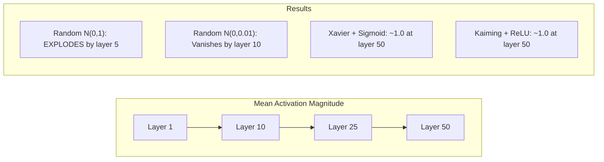
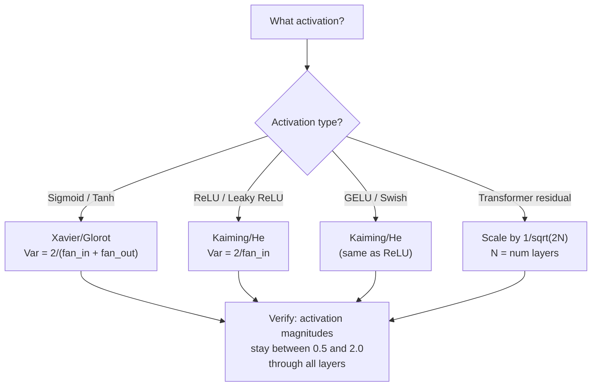

# Inisialisasi Bobot dan Stabilitas Training

> Salah inisialisasi dan training tidak pernah mulai. Benar inisialisasi dan 50 lapis berlatih semulus 3 lapis.

**Type:** Build
**Languages:** Python
**Prerequisites:** Lesson 03.04 (Activation Functions), Lesson 03.07 (Regularization)
**Time:** ~90 minutes

## Tujuan Pembelajaran

- Mengimplementasikan strategi inisialisasi nol, acak, Xavier/Glorot, dan Kaiming/He serta mengukur efeknya pada magnitudo aktivasi melalui 50 lapis
- Menurunkan mengapa init Xavier memakai Var(w) = 2/(fan_in + fan_out) dan Kaiming memakai Var(w) = 2/fan_in
- Mendemonstrasikan masalah simetri dengan inisialisasi nol dan menjelaskan mengapa skala acak saja tidak cukup
- Memasangkan strategi inisialisasi yang tepat dengan fungsi aktivasi: Xavier untuk sigmoid/tanh, Kaiming untuk ReLU/GELU

## Masalahnya

Inisialisasi semua bobot ke nol. Tidak ada yang belajar. Setiap neuron menghitung fungsi yang sama, menerima gradien yang sama, dan terupdate identik. Setelah 10.000 epoch, hidden layer 512-neuron milikmu masih 512 salinan neuron yang sama. Kamu membayar 512 parameter dan mendapat 1.

Inisialisasi mereka terlalu besar. Aktivasi meledak melalui network. Pada lapis 10, nilai mencapai 1e15. Pada lapis 20, mereka overflow menjadi takhingga. Gradien mengikuti lintasan yang sama secara terbalik.

Inisialisasi mereka acak dari distribusi normal standar. Bekerja untuk 3 lapis. Pada 50 lapis, sinyal runtuh ke nol atau meledak hingga takhingga tergantung apakah skala acak sedikit terlalu kecil atau sedikit terlalu besar. Batas antara "bekerja" dan "rusak" tipis sekali.

Inisialisasi bobot adalah keputusan paling diremehkan dalam deep learning. Arsitektur dapat makalah. Optimizer dapat posting blog. Inisialisasi dapat catatan kaki. Tetapi salah langkah dan tidak ada hal lain yang penting -- network-mu mati sebelum training dimulai.

## Konsepnya

### Masalah Simetri

Setiap neuron dalam lapis punya struktur sama: kalikan input dengan bobot, tambah bias, terapkan aktivasi. Jika semua bobot mulai dari nilai sama (nol adalah kasus ekstrem), setiap neuron menghitung output yang sama. Selama backpropagation, setiap neuron menerima gradien yang sama. Selama langkah update, setiap neuron berubah dengan jumlah yang sama.

Kamu macet. Network punya ratusan parameter, tetapi semuanya bergerak serentak. Ini disebut simetri, dan inisialisasi acak adalah cara brute-force untuk memecahnya. Setiap neuron mulai pada titik berbeda dalam ruang bobot, sehingga masing-masing mempelajari fitur berbeda.

Tetapi "acak" saja tidak cukup. *Skala* keacakan menentukan apakah network berlatih.

### Propagasi Varians Melalui Lapis

Pertimbangkan satu lapis dengan fan_in input:

```
z = w1*x1 + w2*x2 + ... + w_n*x_n
```

Jika setiap bobot wi diambil dari distribusi dengan varians Var(w) dan setiap input xi punya varians Var(x), varians output adalah:

```
Var(z) = fan_in * Var(w) * Var(x)
```

Jika Var(w) = 1 dan fan_in = 512, varians output adalah 512x varians input. Setelah 10 lapis: 512^10 = 1,2e27. Sinyalmu meledak.

Jika Var(w) = 0,001, varians output menyusut sebesar 0,001 * 512 = 0,512 per lapis. Setelah 10 lapis: 0,512^10 = 0,00013. Sinyalmu lenyap.

Tujuannya: pilih Var(w) sehingga Var(z) = Var(x). Magnitudo sinyal tetap konstan antar lapis.

### Inisialisasi Xavier/Glorot

Glorot dan Bengio (2010) menurunkan solusi untuk aktivasi sigmoid dan tanh. Agar varians tetap konstan baik pada forward maupun backward pass:

```
Var(w) = 2 / (fan_in + fan_out)
```

Dalam praktik, bobot diambil dari:

```
w ~ Uniform(-limit, limit)  where limit = sqrt(6 / (fan_in + fan_out))
```

atau:

```
w ~ Normal(0, sqrt(2 / (fan_in + fan_out)))
```

Ini bekerja karena sigmoid dan tanh kira-kira linear di dekat nol, tempat aktivasi yang diinisialisasi benar hidup. Varians tetap stabil melalui puluhan lapis.

### Inisialisasi Kaiming/He

ReLU membunuh separuh output (semua yang negatif menjadi nol). Fan_in efektif berkurang separuh karena rata-rata separuh input dinolkan. Init Xavier tidak memperhitungkan ini -- ia meremehkan varians yang dibutuhkan.

He et al. (2015) menyesuaikan rumusnya:

```
Var(w) = 2 / fan_in
```

Bobot diambil dari:

```
w ~ Normal(0, sqrt(2 / fan_in))
```

Faktor 2 mengkompensasi ReLU yang menolkan separuh aktivasi. Tanpanya, sinyal menyusut ~0,5x per lapis. Dengan 50 lapis: 0,5^50 = 8,8e-16. Init Kaiming mencegah ini.

### Inisialisasi Transformer

GPT-2 memperkenalkan pola berbeda. Residual connection menambahkan output setiap sub-lapis ke input-nya:

```
x = x + sublayer(x)
```

Setiap penjumlahan menaikkan varians. Dengan N lapis residual, varians tumbuh proporsional terhadap N. GPT-2 menskalakan bobot lapis residual dengan 1/sqrt(2N), di mana N adalah jumlah lapis. Ini menjaga magnitudo sinyal akumulasi tetap stabil.

Llama 3 (405B parameter, 126 lapis) memakai skema mirip. Tanpa penskalaan ini, aliran residual akan tumbuh tak terbatas melalui 126 lapis blok attention dan feedforward.

```mermaid
flowchart TD
    subgraph "Zero Init"
        Z1["Layer 1<br/>All weights = 0"] --> Z2["Layer 2<br/>All neurons identical"]
        Z2 --> Z3["Layer 3<br/>Still identical"]
        Z3 --> ZR["Result: 1 effective neuron<br/>regardless of width"]
    end

    subgraph "Xavier Init"
        X1["Layer 1<br/>Var = 2/(fan_in+fan_out)"] --> X2["Layer 2<br/>Signal stable"]
        X2 --> X3["Layer 50<br/>Signal stable"]
        X3 --> XR["Result: Trains with<br/>sigmoid/tanh"]
    end

    subgraph "Kaiming Init"
        K1["Layer 1<br/>Var = 2/fan_in"] --> K2["Layer 2<br/>Signal stable"]
        K2 --> K3["Layer 50<br/>Signal stable"]
        K3 --> KR["Result: Trains with<br/>ReLU/GELU"]
    end
```



### Magnitudo Aktivasi Melalui 50 Lapis



### Memilih Init yang Tepat



```figure
weight-init-variance
```

## Bangun Sendiri

### Langkah 1: Strategi Inisialisasi

Empat cara menginisialisasi matriks bobot. Masing-masing mengembalikan daftar berisi daftar (matriks 2D) dengan fan_in kolom dan fan_out baris.

```python
import math
import random


def zero_init(fan_in, fan_out):
    return [[0.0 for _ in range(fan_in)] for _ in range(fan_out)]


def random_init(fan_in, fan_out, scale=1.0):
    return [[random.gauss(0, scale) for _ in range(fan_in)] for _ in range(fan_out)]


def xavier_init(fan_in, fan_out):
    std = math.sqrt(2.0 / (fan_in + fan_out))
    return [[random.gauss(0, std) for _ in range(fan_in)] for _ in range(fan_out)]


def kaiming_init(fan_in, fan_out):
    std = math.sqrt(2.0 / fan_in)
    return [[random.gauss(0, std) for _ in range(fan_in)] for _ in range(fan_out)]
```

### Langkah 2: Fungsi Aktivasi

Kita butuh sigmoid, tanh, dan ReLU untuk menguji setiap strategi init dengan aktivasi yang dituju.

```python
def sigmoid(x):
    x = max(-500, min(500, x))
    return 1.0 / (1.0 + math.exp(-x))


def tanh_act(x):
    return math.tanh(x)


def relu(x):
    return max(0.0, x)
```

### Langkah 3: Forward Pass Melalui 50 Lapis

Lewatkan data acak melalui network yang dalam dan ukur magnitudo aktivasi rerata pada setiap lapis.

```python
def forward_deep(init_fn, activation_fn, n_layers=50, width=64, n_samples=100):
    random.seed(42)
    layer_magnitudes = []

    inputs = [[random.gauss(0, 1) for _ in range(width)] for _ in range(n_samples)]

    for layer_idx in range(n_layers):
        weights = init_fn(width, width)
        biases = [0.0] * width

        new_inputs = []
        for sample in inputs:
            output = []
            for neuron_idx in range(width):
                z = sum(weights[neuron_idx][j] * sample[j] for j in range(width)) + biases[neuron_idx]
                output.append(activation_fn(z))
            new_inputs.append(output)
        inputs = new_inputs

        magnitudes = []
        for sample in inputs:
            magnitudes.append(sum(abs(v) for v in sample) / width)
        mean_mag = sum(magnitudes) / len(magnitudes)
        layer_magnitudes.append(mean_mag)

    return layer_magnitudes
```

### Langkah 4: Eksperimen

Jalankan semua kombinasi: zero init, random N(0,1), random N(0,0,01), Xavier dengan sigmoid, Xavier dengan tanh, Kaiming dengan ReLU. Cetak magnitudo pada lapis kunci.

```python
def run_experiment():
    configs = [
        ("Zero init + Sigmoid", lambda fi, fo: zero_init(fi, fo), sigmoid),
        ("Random N(0,1) + ReLU", lambda fi, fo: random_init(fi, fo, 1.0), relu),
        ("Random N(0,0.01) + ReLU", lambda fi, fo: random_init(fi, fo, 0.01), relu),
        ("Xavier + Sigmoid", xavier_init, sigmoid),
        ("Xavier + Tanh", xavier_init, tanh_act),
        ("Kaiming + ReLU", kaiming_init, relu),
    ]

    print(f"{'Strategy':<30} {'L1':>10} {'L5':>10} {'L10':>10} {'L25':>10} {'L50':>10}")
    print("-" * 80)

    for name, init_fn, act_fn in configs:
        mags = forward_deep(init_fn, act_fn)
        row = f"{name:<30}"
        for idx in [0, 4, 9, 24, 49]:
            val = mags[idx]
            if val > 1e6:
                row += f" {'EXPLODED':>10}"
            elif val < 1e-6:
                row += f" {'VANISHED':>10}"
            else:
                row += f" {val:>10.4f}"
        print(row)
```

### Langkah 5: Demonstrasi Simetri

Tunjukkan bahwa zero init menghasilkan neuron identik.

```python
def symmetry_demo():
    random.seed(42)
    weights = zero_init(2, 4)
    biases = [0.0] * 4

    inputs = [0.5, -0.3]
    outputs = []
    for neuron_idx in range(4):
        z = sum(weights[neuron_idx][j] * inputs[j] for j in range(2)) + biases[neuron_idx]
        outputs.append(sigmoid(z))

    print("\nSymmetry Demo (4 neurons, zero init):")
    for i, out in enumerate(outputs):
        print(f"  Neuron {i}: output = {out:.6f}")
    all_same = all(abs(outputs[i] - outputs[0]) < 1e-10 for i in range(len(outputs)))
    print(f"  All identical: {all_same}")
    print(f"  Effective parameters: 1 (not {len(weights) * len(weights[0])})")
```

### Langkah 6: Laporan Magnitudo Lapis demi Lapis

Cetak bar chart visual dari magnitudo aktivasi melalui 50 lapis.

```python
def magnitude_report(name, magnitudes):
    print(f"\n{name}:")
    for i, mag in enumerate(magnitudes):
        if i % 5 == 0 or i == len(magnitudes) - 1:
            if mag > 1e6:
                bar = "X" * 50 + " EXPLODED"
            elif mag < 1e-6:
                bar = "." + " VANISHED"
            else:
                bar_len = min(50, max(1, int(mag * 10)))
                bar = "#" * bar_len
            print(f"  Layer {i+1:3d}: {bar} ({mag:.6f})")
```

## Gunakan

PyTorch menyediakan ini sebagai fungsi bawaan:

```python
import torch
import torch.nn as nn

layer = nn.Linear(512, 256)

nn.init.xavier_uniform_(layer.weight)
nn.init.xavier_normal_(layer.weight)

nn.init.kaiming_uniform_(layer.weight, nonlinearity='relu')
nn.init.kaiming_normal_(layer.weight, nonlinearity='relu')

nn.init.zeros_(layer.bias)
```

Saat kamu memanggil `nn.Linear(512, 256)`, PyTorch default ke inisialisasi Kaiming uniform. Itulah mengapa kebanyakan network sederhana "langsung bekerja" -- PyTorch sudah membuat pilihan yang tepat. Tetapi saat kamu membangun arsitektur kustom atau lebih dalam dari 20 lapis, kamu perlu memahami apa yang terjadi dan berpotensi mengoverride default.

Untuk transformer, model HuggingFace biasanya menangani inisialisasi dalam metode `_init_weights` mereka. Implementasi GPT-2 menskalakan proyeksi residual dengan 1/sqrt(N). Jika kamu membangun transformer dari nol, kamu perlu menambahkannya sendiri.

## Rilis

Pelajaran ini menghasilkan:

- `outputs/prompt-init-strategy.md` -- prompt yang mendiagnosis masalah inisialisasi bobot dan merekomendasikan strategi yang tepat

## Latihan

1. Tambahkan inisialisasi LeCun (Var = 1/fan_in, dirancang untuk aktivasi SELU). Jalankan eksperimen 50 lapis dengan init LeCun + tanh dan bandingkan dengan Xavier + tanh.
2. Implementasikan penskalaan residual GPT-2: kalikan output setiap lapis dengan 1/sqrt(2*N) sebelum menambahkannya ke aliran residual. Jalankan 50 lapis dengan dan tanpa penskalaan, ukur seberapa cepat magnitudo residual tumbuh.
3. Buat fungsi "cek kesehatan init" yang menerima dimensi lapis network dan jenis aktivasi, lalu merekomendasikan inisialisasi yang benar dan memperingatkan jika init saat ini akan bermasalah.
4. Jalankan eksperimen dengan fan_in = 16 vs fan_in = 1024. Xavier dan Kaiming beradaptasi dengan fan_in, tetapi random init tidak. Tunjukkan bagaimana kesenjangan antara "bekerja" dan "rusak" melebar dengan lapis lebih besar.
5. Implementasikan inisialisasi orthogonal (hasilkan matriks acak, hitung SVD-nya, pakai matriks orthogonal U). Bandingkan dengan Kaiming untuk network ReLU pada 50 lapis.

## Istilah Kunci

| Term | What people say | What it actually means |
|------|----------------|----------------------|
| Weight initialization | "Set starting weights randomly" | The strategy for choosing initial weight values that determines whether a network can train at all |
| Symmetry breaking | "Make neurons different" | Using random initialization to ensure neurons learn distinct features instead of computing identical functions |
| Fan-in | "Number of inputs to a neuron" | The number of incoming connections, which determines how input variance accumulates in the weighted sum |
| Fan-out | "Number of outputs from a neuron" | The number of outgoing connections, relevant for maintaining gradient variance during backpropagation |
| Xavier/Glorot init | "The sigmoid initialization" | Var(w) = 2/(fan_in + fan_out), designed to preserve variance through sigmoid and tanh activations |
| Kaiming/He init | "The ReLU initialization" | Var(w) = 2/fan_in, accounts for ReLU zeroing half the activations |
| Variance propagation | "How signals grow or shrink through layers" | The mathematical analysis of how activation variance changes layer by layer based on weight scale |
| Residual scaling | "GPT-2's init trick" | Scaling residual connection weights by 1/sqrt(2N) to prevent variance growth through N transformer layers |
| Dead network | "Nothing trains" | A network where poor initialization causes all gradients to be zero or all activations to saturate |
| Exploding activations | "Values go to infinity" | When weight variance is too high, causing activation magnitudes to grow exponentially through layers |

## Bacaan Lanjutan

- Glorot & Bengio, "Understanding the difficulty of training deep feedforward neural networks" (2010) -- makalah inisialisasi Xavier orisinal dengan analisis varians
- He et al., "Delving Deep into Rectifiers" (2015) -- memperkenalkan inisialisasi Kaiming untuk network ReLU
- Radford et al., "Language Models are Unsupervised Multitask Learners" (2019) -- makalah GPT-2 dengan inisialisasi penskalaan residual
- Mishkin & Matas, "All You Need is a Good Init" (2016) -- inisialisasi unit-variance sekuensial per lapis, alternatif empiris untuk rumus analitis
