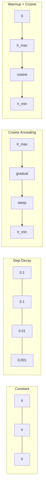
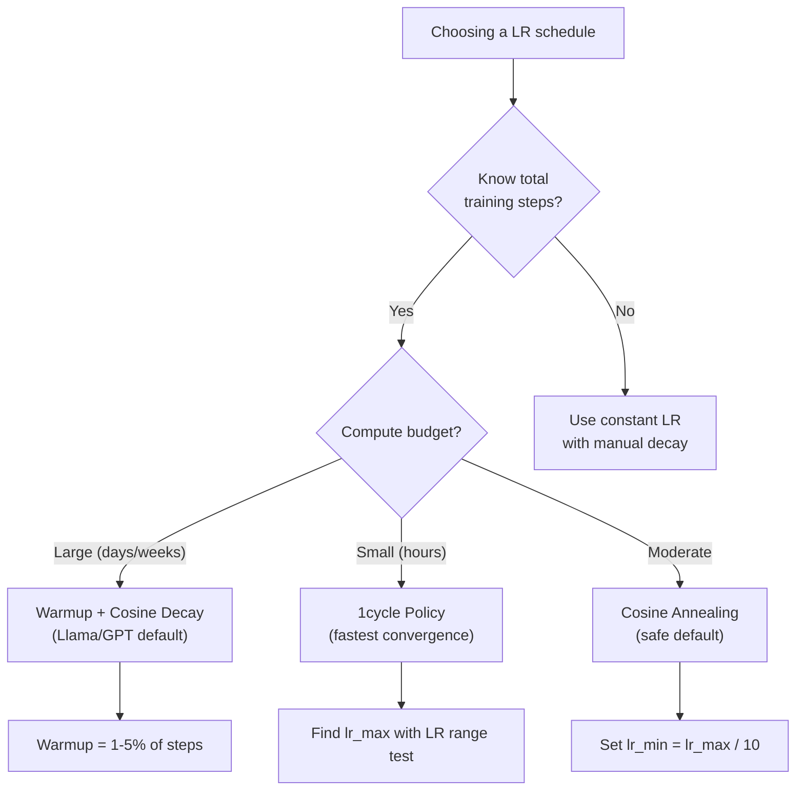
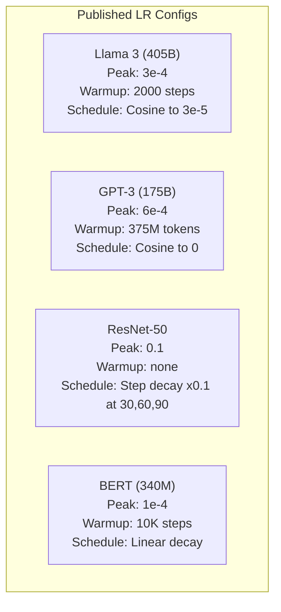

# Schedule Learning Rate dan Warmup

> Learning rate adalah hiperparameter tunggal terpenting. Bukan arsitektur. Bukan ukuran dataset. Bukan fungsi aktivasi. Learning rate. Jika kamu tidak menyetel apa pun, setel ini.

**Type:** Build
**Languages:** Python
**Prerequisites:** Lesson 03.06 (Optimizers), Lesson 03.08 (Weight Initialization)
**Time:** ~90 minutes

## Tujuan Pembelajaran

- Mengimplementasikan schedule learning rate constant, step decay, cosine annealing, warmup + cosine, dan 1cycle dari nol
- Mendemonstrasikan tiga mode kegagalan pemilihan learning rate: divergensi (terlalu tinggi), macet (terlalu rendah), dan osilasi (tanpa decay)
- Menjelaskan mengapa warmup perlu untuk optimizer berbasis Adam dan bagaimana ia menstabilkan training awal
- Membandingkan kecepatan konvergensi kelima schedule pada tugas yang sama dan memilih yang tepat untuk budget training tertentu

## Masalahnya

Set learning rate ke 0,1. Training divergen -- loss melonjak hingga takhingga dalam 3 langkah. Set ke 0,0001. Training merangkak -- setelah 100 epoch, model nyaris tidak bergerak dari acak. Set ke 0,01. Training bekerja 50 epoch, lalu loss berosilasi di sekitar minimum yang tak pernah tercapai karena langkah terlalu besar.

Learning rate optimal bukanlah konstanta. Ia berubah selama training. Di awal, kamu ingin langkah besar agar cepat menjangkau. Di akhir training, kamu ingin langkah kecil agar settle ke minimum yang tajam. Perbedaan antara model akurasi 90% dan 95% sering kali hanyalah schedule.

Setiap model besar yang dipublikasikan tiga tahun terakhir memakai schedule learning rate. Llama 3 memakai peak lr=3e-4 dengan 2000 langkah warmup dan cosine decay ke 3e-5. GPT-3 memakai lr=6e-4 dengan warmup selama 375 juta token. Ini bukan pilihan arbitrer. Mereka adalah hasil sweep hiperparameter ekstensif yang menelan biaya jutaan dolar.

Kamu perlu memahami schedule karena default tidak akan bekerja untuk masalahmu. Saat fine-tuning model pretrained, schedule yang tepat berbeda daripada training dari nol. Saat kamu menaikkan batch size, periode warmup perlu berubah. Saat training rusak pada langkah 10.000, kamu perlu tahu apakah itu masalah schedule atau hal lain.

## Konsepnya

### Learning Rate Konstan

Pendekatan paling sederhana. Pilih satu angka, pakai untuk setiap langkah.

```
lr(t) = lr_0
```

Jarang optimal. Ia terlalu tinggi untuk akhir training (osilasi di sekitar minimum) atau terlalu rendah untuk awal (komputasi terbuang pada langkah kecil). Baik-baik saja untuk model kecil dan debugging. Pilihan buruk untuk apa pun yang berlatih lebih dari sejam.

### Step Decay

Pendekatan jadul dari era ResNet. Potong learning rate dengan faktor (biasanya 10x) pada epoch tetap.

```
lr(t) = lr_0 * gamma^(floor(epoch / step_size))
```

Di mana gamma = 0,1 dan step_size = 30 berarti: lr turun 10x setiap 30 epoch. ResNet-50 memakai ini -- lr=0,1, turun 10x pada epoch 30, 60, dan 90.

Masalahnya: titik decay optimal bergantung pada dataset dan arsitektur. Pindah ke masalah berbeda dan kamu perlu menyetel ulang kapan menurunkan. Transisinya abrupt -- loss bisa melonjak saat rate tiba-tiba berubah.

### Cosine Annealing

Decay mulus dari learning rate maksimum ke minimum, mengikuti kurva kosinus:

```
lr(t) = lr_min + 0.5 * (lr_max - lr_min) * (1 + cos(pi * t / T))
```

Di mana t adalah langkah saat ini dan T adalah jumlah total langkah.

Pada t=0, suku kosinus adalah 1, sehingga lr = lr_max. Pada t=T, suku kosinus adalah -1, sehingga lr = lr_min. Decay landai di awal, mempercepat di tengah, dan melandai lagi di dekat akhir.

Ini adalah default untuk kebanyakan run training modern. Tidak ada hiperparameter untuk disetel selain lr_max dan lr_min. Bentuk kosinus cocok dengan observasi empiris bahwa kebanyakan belajar terjadi di tengah training -- kamu ingin ukuran langkah yang wajar selama periode kritis itu.

### Warmup: Mengapa Kamu Mulai dari Kecil

Adam dan optimizer adaptif lain menjaga estimasi berjalan dari rerata dan varians gradien. Pada langkah 0, estimasi ini diinisialisasi nol. Beberapa update gradien pertama didasarkan pada statistik sampah. Jika learning rate-mu besar selama periode ini, model mengambil langkah besar yang arahnya buruk.

Warmup memperbaikinya. Mulai dengan learning rate kecil (sering lr_max / warmup_steps atau bahkan nol) dan naikkan linear ke lr_max selama N langkah pertama. Saat mencapai learning rate penuh, statistik Adam sudah stabil.

```
lr(t) = lr_max * (t / warmup_steps)     for t < warmup_steps
```

Warmup tipikal: 1-5% dari total langkah training. Llama 3 berlatih ~1,8 triliun token dan warmup selama 2000 langkah. GPT-3 warmup selama 375 juta token.

### Warmup Linear + Cosine Decay

Default modern. Naik linear, lalu turun dengan kosinus:

```
if t < warmup_steps:
    lr(t) = lr_max * (t / warmup_steps)
else:
    progress = (t - warmup_steps) / (total_steps - warmup_steps)
    lr(t) = lr_min + 0.5 * (lr_max - lr_min) * (1 + cos(pi * progress))
```

Inilah yang dipakai Llama, GPT, PaLM, dan kebanyakan transformer modern. Warmup mencegah ketidakstabilan awal. Cosine decay menenangkan model ke minimum yang bagus.

### Kebijakan 1cycle

Penemuan Leslie Smith (2018): naikkan learning rate dari nilai rendah ke nilai tinggi pada separuh pertama training, lalu turunkan kembali pada separuh kedua. Kontraintuitif -- mengapa kamu *menaikkan* learning rate di tengah jalan?

Teorinya: learning rate tinggi bertindak sebagai regularisasi dengan menambahkan noise ke lintasan optimasi. Model menjelajahi lebih banyak lanskap loss selama fase ramp-up, menemukan basin yang lebih baik. Fase ramp-down lalu memoles dalam basin terbaik yang ditemukan.

```
Phase 1 (0 to T/2):    lr ramps from lr_max/25 to lr_max
Phase 2 (T/2 to T):    lr ramps from lr_max to lr_max/10000
```

1cycle sering berlatih lebih cepat daripada cosine annealing untuk budget komputasi tetap. Tradeoff-nya: kamu harus tahu jumlah total langkah di muka.

### Bentuk Schedule



### Diagram Alir Keputusan



### Angka Nyata dari Model Publikasi



```figure
lr-schedule
```

## Bangun Sendiri

### Langkah 1: Fungsi Schedule

Setiap fungsi menerima langkah saat ini dan mengembalikan learning rate pada langkah itu.

```python
import math


def constant_schedule(step, lr=0.01, **kwargs):
    return lr


def step_decay_schedule(step, lr=0.1, step_size=100, gamma=0.1, **kwargs):
    return lr * (gamma ** (step // step_size))


def cosine_schedule(step, lr=0.01, total_steps=1000, lr_min=1e-5, **kwargs):
    if step >= total_steps:
        return lr_min
    return lr_min + 0.5 * (lr - lr_min) * (1 + math.cos(math.pi * step / total_steps))


def warmup_cosine_schedule(step, lr=0.01, total_steps=1000, warmup_steps=100, lr_min=1e-5, **kwargs):
    if total_steps <= warmup_steps:
        return lr * (step / max(warmup_steps, 1))
    if step < warmup_steps:
        return lr * step / warmup_steps
    progress = (step - warmup_steps) / (total_steps - warmup_steps)
    return lr_min + 0.5 * (lr - lr_min) * (1 + math.cos(math.pi * progress))


def one_cycle_schedule(step, lr=0.01, total_steps=1000, **kwargs):
    mid = max(total_steps // 2, 1)
    if step < mid:
        return (lr / 25) + (lr - lr / 25) * step / mid
    else:
        progress = (step - mid) / max(total_steps - mid, 1)
        return lr * (1 - progress) + (lr / 10000) * progress
```

### Langkah 2: Visualisasikan Semua Schedule

Cetak plot berbasis teks yang menunjukkan bagaimana setiap schedule berkembang selama training.

```python
def visualize_schedule(name, schedule_fn, total_steps=500, **kwargs):
    steps = list(range(0, total_steps, total_steps // 20))
    if total_steps - 1 not in steps:
        steps.append(total_steps - 1)

    lrs = [schedule_fn(s, total_steps=total_steps, **kwargs) for s in steps]
    max_lr = max(lrs) if max(lrs) > 0 else 1.0

    print(f"\n{name}:")
    for s, lr_val in zip(steps, lrs):
        bar_len = int(lr_val / max_lr * 40)
        bar = "#" * bar_len
        print(f"  Step {s:4d}: lr={lr_val:.6f} {bar}")
```

### Langkah 3: Network Training

Network dua lapis sederhana pada dataset lingkaran, sama seperti pelajaran sebelumnya, tetapi kini kita memvariasikan schedule.

```python
import random


def sigmoid(x):
    x = max(-500, min(500, x))
    return 1.0 / (1.0 + math.exp(-x))


def relu(x):
    return max(0.0, x)


def relu_deriv(x):
    return 1.0 if x > 0 else 0.0


def make_circle_data(n=200, seed=42):
    random.seed(seed)
    data = []
    for _ in range(n):
        x = random.uniform(-2, 2)
        y = random.uniform(-2, 2)
        label = 1.0 if x * x + y * y < 1.5 else 0.0
        data.append(([x, y], label))
    return data


def train_with_schedule(schedule_fn, schedule_name, data, epochs=300, base_lr=0.05, **kwargs):
    random.seed(0)
    hidden_size = 8
    total_steps = epochs * len(data)

    std = math.sqrt(2.0 / 2)
    w1 = [[random.gauss(0, std) for _ in range(2)] for _ in range(hidden_size)]
    b1 = [0.0] * hidden_size
    w2 = [random.gauss(0, std) for _ in range(hidden_size)]
    b2 = 0.0

    step = 0
    epoch_losses = []

    for epoch in range(epochs):
        total_loss = 0
        correct = 0

        for x, target in data:
            lr = schedule_fn(step, lr=base_lr, total_steps=total_steps, **kwargs)

            z1 = []
            h = []
            for i in range(hidden_size):
                z = w1[i][0] * x[0] + w1[i][1] * x[1] + b1[i]
                z1.append(z)
                h.append(relu(z))

            z2 = sum(w2[i] * h[i] for i in range(hidden_size)) + b2
            out = sigmoid(z2)

            error = out - target
            d_out = error * out * (1 - out)

            for i in range(hidden_size):
                d_h = d_out * w2[i] * relu_deriv(z1[i])
                w2[i] -= lr * d_out * h[i]
                for j in range(2):
                    w1[i][j] -= lr * d_h * x[j]
                b1[i] -= lr * d_h
            b2 -= lr * d_out

            total_loss += (out - target) ** 2
            if (out >= 0.5) == (target >= 0.5):
                correct += 1
            step += 1

        avg_loss = total_loss / len(data)
        accuracy = correct / len(data) * 100
        epoch_losses.append(avg_loss)

    return epoch_losses
```

### Langkah 4: Bandingkan Semua Schedule

Latih network yang sama dengan setiap schedule dan bandingkan loss akhir serta perilaku konvergensi.

```python
def compare_schedules(data):
    configs = [
        ("Constant", constant_schedule, {}),
        ("Step Decay", step_decay_schedule, {"step_size": 15000, "gamma": 0.1}),
        ("Cosine", cosine_schedule, {"lr_min": 1e-5}),
        ("Warmup+Cosine", warmup_cosine_schedule, {"warmup_steps": 3000, "lr_min": 1e-5}),
        ("1cycle", one_cycle_schedule, {}),
    ]

    print(f"\n{'Schedule':<20} {'Start Loss':>12} {'Mid Loss':>12} {'End Loss':>12} {'Best Loss':>12}")
    print("-" * 70)

    for name, schedule_fn, extra_kwargs in configs:
        losses = train_with_schedule(schedule_fn, name, data, epochs=300, base_lr=0.05, **extra_kwargs)
        mid_idx = len(losses) // 2
        best = min(losses)
        print(f"{name:<20} {losses[0]:>12.6f} {losses[mid_idx]:>12.6f} {losses[-1]:>12.6f} {best:>12.6f}")
```

### Langkah 5: LR Terlalu Tinggi vs Terlalu Rendah

Demonstrasikan tiga mode kegagalan: terlalu tinggi (divergensi), terlalu rendah (merangkak), dan pas.

```python
def lr_sensitivity(data):
    learning_rates = [1.0, 0.1, 0.01, 0.001, 0.0001]

    print("\nLR Sensitivity (constant schedule, 100 epochs):")
    print(f"  {'LR':>10} {'Start Loss':>12} {'End Loss':>12} {'Status':>15}")
    print("  " + "-" * 52)

    for lr in learning_rates:
        losses = train_with_schedule(constant_schedule, f"lr={lr}", data, epochs=100, base_lr=lr)
        start = losses[0]
        end = losses[-1]

        if end > start or math.isnan(end) or end > 1.0:
            status = "DIVERGED"
        elif end > start * 0.9:
            status = "BARELY MOVED"
        elif end < 0.15:
            status = "CONVERGED"
        else:
            status = "LEARNING"

        end_str = f"{end:.6f}" if not math.isnan(end) else "NaN"
        print(f"  {lr:>10.4f} {start:>12.6f} {end_str:>12} {status:>15}")
```

## Gunakan

PyTorch menyediakan scheduler di `torch.optim.lr_scheduler`:

```python
import torch
import torch.optim as optim
from torch.optim.lr_scheduler import CosineAnnealingLR, OneCycleLR, StepLR

model = nn.Sequential(nn.Linear(10, 64), nn.ReLU(), nn.Linear(64, 1))
optimizer = optim.Adam(model.parameters(), lr=3e-4)

scheduler = CosineAnnealingLR(optimizer, T_max=1000, eta_min=1e-5)

for step in range(1000):
    loss = train_step(model, optimizer)
    scheduler.step()
```

Untuk warmup + cosine, pakai lambda scheduler atau `get_cosine_schedule_with_warmup` dari HuggingFace:

```python
from transformers import get_cosine_schedule_with_warmup

scheduler = get_cosine_schedule_with_warmup(
    optimizer,
    num_warmup_steps=2000,
    num_training_steps=100000,
)
```

Fungsi HuggingFace inilah yang dipakai kebanyakan skrip fine-tuning Llama dan GPT. Saat ragu, pakai warmup + cosine dengan warmup = 3-5% dari total langkah. Ia bekerja untuk nyaris semuanya.

## Rilis

Pelajaran ini menghasilkan:

- `outputs/prompt-lr-schedule-advisor.md` -- prompt yang merekomendasikan schedule learning rate dan hiperparameter yang tepat untuk setup training-mu

## Latihan

1. Implementasikan exponential decay: lr(t) = lr_0 * gamma^t di mana gamma = 0,999. Bandingkan dengan cosine annealing pada dataset lingkaran.
2. Implementasikan uji rentang learning rate (Leslie Smith): latih beberapa ratus langkah sambil menaikkan LR secara eksponensial dari 1e-7 ke 1. Plot loss vs LR. LR maksimum optimal tepat sebelum loss mulai naik.
3. Latih dengan warmup + cosine tetapi variasikan panjang warmup: 0%, 1%, 5%, 10%, 20% dari total langkah. Temukan titik manis di mana training paling stabil.
4. Implementasikan cosine annealing dengan warm restart (SGDR): reset learning rate ke lr_max setiap T langkah dan decay lagi. Bandingkan dengan kosinus standar pada run training yang lebih panjang.
5. Bangun "dokter bedah schedule" yang memantau training loss dan otomatis beralih dari warmup ke cosine saat loss stabil, serta menurunkan lr jika loss plateau terlalu lama.

## Istilah Kunci

| Term | What people say | What it actually means |
|------|----------------|----------------------|
| Learning rate | "How fast the model learns" | The scalar that multiplies the gradient to determine the parameter update size |
| Schedule | "Change the LR over time" | A function that maps training step to learning rate, designed to optimize convergence |
| Warmup | "Start with a small LR" | Linearly ramping the LR from near-zero to the target value over the first N steps to stabilize optimizer statistics |
| Cosine annealing | "Smooth LR decay" | Decreasing the LR following a cosine curve from lr_max to lr_min over training |
| Step decay | "Drop LR at milestones" | Multiplying the LR by a factor (usually 0.1) at fixed epoch intervals |
| 1cycle policy | "Up then down" | Leslie Smith's method of ramping LR up then down in a single cycle for faster convergence |
| LR range test | "Find the best learning rate" | Training briefly while increasing LR to find the value where loss starts diverging |
| Cosine with warm restarts | "Reset and repeat" | Periodically resetting the LR to lr_max and decaying again (SGDR) |
| Eta min | "The floor for the LR" | The minimum learning rate that the schedule decays to |
| Peak learning rate | "The maximum LR" | The highest LR reached during training, typically after warmup |

## Bacaan Lanjutan

- Loshchilov & Hutter, "SGDR: Stochastic Gradient Descent with Warm Restarts" (2017) -- memperkenalkan cosine annealing dan warm restart
- Smith, "Super-Convergence: Very Fast Training of Neural Networks Using Large Learning Rates" (2018) -- makalah kebijakan 1cycle
- Touvron et al., "Llama 2: Open Foundation and Fine-Tuned Chat Models" (2023) -- mendokumentasikan schedule warmup + cosine yang dipakai pada skala besar
- Goyal et al., "Accurate, Large Minibatch SGD: Training ImageNet in 1 Hour" (2017) -- aturan penskalaan linear dan warmup untuk training batch besar
