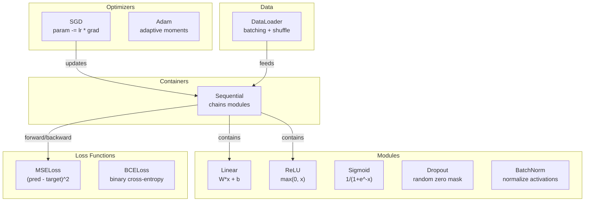
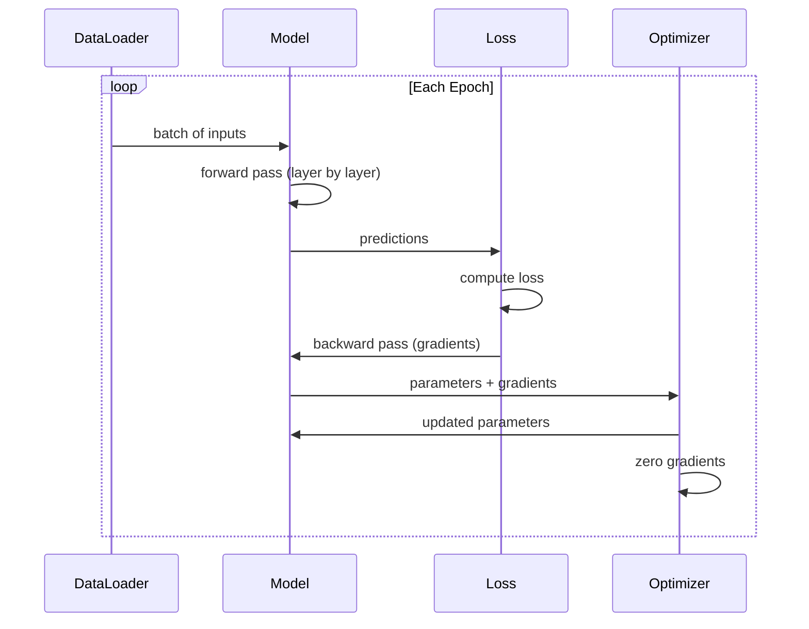
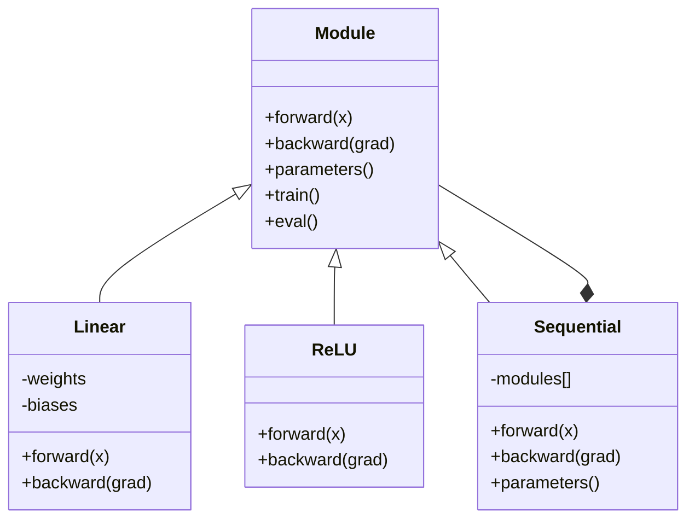

# Bangun Mini Framework Sendiri

> Kamu sudah membangun neuron, lapis, network, backprop, aktivasi, fungsi loss, optimizer, regularisasi, inisialisasi, dan schedule LR. Semua sebagai potongan terpisah. Kini rangkai mereka menjadi sebuah framework. Bukan PyTorch. Bukan TensorFlow. Milikmu.

**Type:** Build
**Languages:** Python
**Prerequisites:** All of Phase 03 (Lessons 01-09)
**Time:** ~120 minutes

## Tujuan Pembelajaran

- Membangun framework deep learning lengkap (~500 baris) dengan Module, Linear, ReLU, Sigmoid, Dropout, BatchNorm, Sequential, fungsi loss, optimizer, dan DataLoader
- Menjelaskan abstraksi Module (forward, backward, parameters) dan mengapa toggle mode train/eval perlu
- Merangkai semua komponen menjadi loop training yang bekerja yang melatih network 4 lapis pada klasifikasi lingkaran
- Memetakan setiap komponen framework-mu ke padanan PyTorch-nya (nn.Module, nn.Sequential, optim.Adam, DataLoader)

## Masalahnya

Kamu punya sepuluh pelajaran building block yang tersebar di file terpisah. Kelas `Value` di sini, loop training di sana, inisialisasi bobot di file lain, schedule learning rate di file lain lagi. Untuk melatih network, kamu copy-paste dari lima pelajaran berbeda dan merangkainya manual.

Itulah yang dipecahkan framework. PyTorch memberimu `nn.Module`, `nn.Sequential`, `optim.Adam`, `DataLoader`, dan pola loop training yang mengikat mereka bersama. TensorFlow memberimu `keras.Layer`, `keras.Sequential`, `keras.optimizers.Adam`. Ini bukan sihir. Ini pola organisasional yang memungkinkan mendefinisikan, melatih, dan mengevaluasi network tanpa menciptakan ulang plumbing setiap kali.

Kamu akan membangun hal yang sama dalam ~500 baris Python. Tanpa numpy. Tanpa dependensi eksternal. Framework yang bisa mendefinisikan feedforward network apa pun, melatihnya dengan SGD atau Adam, membatch data, menerapkan dropout dan batch normalization, memakai aktivasi apa pun, dan menjadwalkan learning rate.

Saat selesai, kamu akan paham tepat apa yang terjadi saat kamu menulis `model = nn.Sequential(...)` di PyTorch. Kamu akan paham mengapa `model.train()` dan `model.eval()` ada. Kamu akan paham mengapa `optimizer.zero_grad()` adalah panggilan terpisah. Kamu akan paham semuanya, karena kamu membangun semuanya.

## Konsepnya

### Abstraksi Module

Setiap lapis di PyTorch mewarisi dari `nn.Module`. Sebuah Module punya tiga tanggung jawab:

1. **forward()** -- menghitung output dari input
2. **parameters()** -- mengembalikan semua bobot yang bisa dilatih
3. **backward()** -- menghitung gradien (ditangani autograd di PyTorch, eksplisit di milik kita)

Linear layer adalah Module. Aktivasi ReLU adalah Module. Lapis dropout adalah Module. Lapis batch normalization adalah Module. Semuanya punya interface yang sama.

### Kontainer Sequential

`nn.Sequential` merangkai Module. Forward pass: masukkan data melalui Module 1, lalu Module 2, lalu Module 3. Backward pass: balik rantai. Kontainer itu sendiri adalah Module -- ia punya forward(), parameters(), dan backward(). Ini pola composite: sekuens Module adalah Module itu sendiri.

### Mode Training vs Evaluasi

Dropout menolkan neuron secara acak selama training tetapi meneruskan semuanya selama evaluasi. Batch normalization memakai statistik batch selama training tetapi rata-rata berjalan selama evaluasi. Metode `train()` dan `eval()` mengganti perilaku ini. Setiap Module punya flag `training`.

### Optimizer

Optimizer mengupdate parameter memakai gradiennya. SGD: `param -= lr * grad`. Adam: menjaga estimasi momentum dan varians, lalu mengupdate. Optimizer tidak tahu tentang arsitektur network -- ia hanya melihat daftar datar parameter dan gradiennya.

### DataLoader

Batching penting karena dua alasan. Pertama, kamu tidak bisa memuat seluruh dataset dalam memori untuk masalah besar. Kedua, gradient descent mini-batch menyediakan noise yang membantu lepas dari minima lokal. DataLoader membagi data menjadi batch dan opsional mengacak antar epoch.

### Arsitektur Framework



### Loop Training



### Hierarki Module



```figure
gradient-clipping
```

## Bangun Sendiri

### Langkah 1: Kelas Dasar Module

Interface abstrak yang diimplementasikan setiap lapis.

```python
class Module:
    def __init__(self):
        self.training = True

    def forward(self, x):
        raise NotImplementedError

    def backward(self, grad):
        raise NotImplementedError

    def parameters(self):
        return []

    def train(self):
        self.training = True

    def eval(self):
        self.training = False
```

### Langkah 2: Linear Layer

Building block fundamental. Menyimpan bobot dan bias, menghitung Wx + b secara forward, dan gradien bobot/input secara backward.

```python
import math
import random


class Linear(Module):
    def __init__(self, fan_in, fan_out):
        super().__init__()
        std = math.sqrt(2.0 / fan_in)
        self.weights = [[random.gauss(0, std) for _ in range(fan_in)] for _ in range(fan_out)]
        self.biases = [0.0] * fan_out
        self.weight_grads = [[0.0] * fan_in for _ in range(fan_out)]
        self.bias_grads = [0.0] * fan_out
        self.fan_in = fan_in
        self.fan_out = fan_out
        self.input = None

    def forward(self, x):
        self.input = x
        output = []
        for i in range(self.fan_out):
            val = self.biases[i]
            for j in range(self.fan_in):
                val += self.weights[i][j] * x[j]
            output.append(val)
        return output

    def backward(self, grad):
        input_grad = [0.0] * self.fan_in
        for i in range(self.fan_out):
            self.bias_grads[i] += grad[i]
            for j in range(self.fan_in):
                self.weight_grads[i][j] += grad[i] * self.input[j]
                input_grad[j] += grad[i] * self.weights[i][j]
        return input_grad

    def parameters(self):
        params = []
        for i in range(self.fan_out):
            for j in range(self.fan_in):
                params.append((self.weights, i, j, self.weight_grads))
            params.append((self.biases, i, None, self.bias_grads))
        return params
```

### Langkah 3: Modul Aktivasi

ReLU, Sigmoid, dan Tanh sebagai Module. Masing-masing menyimpan apa yang dibutuhkan untuk backward pass.

```python
class ReLU(Module):
    def __init__(self):
        super().__init__()
        self.mask = None

    def forward(self, x):
        self.mask = [1.0 if v > 0 else 0.0 for v in x]
        return [max(0.0, v) for v in x]

    def backward(self, grad):
        return [g * m for g, m in zip(grad, self.mask)]


class Sigmoid(Module):
    def __init__(self):
        super().__init__()
        self.output = None

    def forward(self, x):
        self.output = []
        for v in x:
            v = max(-500, min(500, v))
            self.output.append(1.0 / (1.0 + math.exp(-v)))
        return self.output

    def backward(self, grad):
        return [g * o * (1 - o) for g, o in zip(grad, self.output)]


class Tanh(Module):
    def __init__(self):
        super().__init__()
        self.output = None

    def forward(self, x):
        self.output = [math.tanh(v) for v in x]
        return self.output

    def backward(self, grad):
        return [g * (1 - o * o) for g, o in zip(grad, self.output)]
```

### Langkah 4: Modul Dropout

Menolkan elemen secara acak selama training. Menskalakan elemen tersisa dengan 1/(1-p) sehingga nilai harapan tetap sama. Tidak melakukan apa-apa selama eval.

```python
class Dropout(Module):
    def __init__(self, p=0.5):
        super().__init__()
        self.p = p
        self.mask = None

    def forward(self, x):
        if not self.training:
            return x
        self.mask = [0.0 if random.random() < self.p else 1.0 / (1 - self.p) for _ in x]
        return [v * m for v, m in zip(x, self.mask)]

    def backward(self, grad):
        if self.mask is None:
            return grad
        return [g * m for g, m in zip(grad, self.mask)]
```

### Langkah 5: Modul BatchNorm

Menormalisasi aktivasi ke rerata nol dan varians satuan per fitur menyeberangi batch. Menjaga statistik berjalan untuk mode eval.

```python
class BatchNorm(Module):
    def __init__(self, size, momentum=0.1, eps=1e-5):
        super().__init__()
        self.size = size
        self.gamma = [1.0] * size
        self.beta = [0.0] * size
        self.gamma_grads = [0.0] * size
        self.beta_grads = [0.0] * size
        self.running_mean = [0.0] * size
        self.running_var = [1.0] * size
        self.momentum = momentum
        self.eps = eps
        self.x_norm = None
        self.std_inv = None
        self.batch_input = None

    def forward_batch(self, batch):
        batch_size = len(batch)
        output_batch = []

        if self.training:
            mean = [0.0] * self.size
            for sample in batch:
                for j in range(self.size):
                    mean[j] += sample[j]
            mean = [m / batch_size for m in mean]

            var = [0.0] * self.size
            for sample in batch:
                for j in range(self.size):
                    var[j] += (sample[j] - mean[j]) ** 2
            var = [v / batch_size for v in var]

            self.std_inv = [1.0 / math.sqrt(v + self.eps) for v in var]

            self.x_norm = []
            self.batch_input = batch
            for sample in batch:
                normed = [(sample[j] - mean[j]) * self.std_inv[j] for j in range(self.size)]
                self.x_norm.append(normed)
                output = [self.gamma[j] * normed[j] + self.beta[j] for j in range(self.size)]
                output_batch.append(output)

            for j in range(self.size):
                self.running_mean[j] = (1 - self.momentum) * self.running_mean[j] + self.momentum * mean[j]
                self.running_var[j] = (1 - self.momentum) * self.running_var[j] + self.momentum * var[j]
        else:
            std_inv = [1.0 / math.sqrt(v + self.eps) for v in self.running_var]
            for sample in batch:
                normed = [(sample[j] - self.running_mean[j]) * std_inv[j] for j in range(self.size)]
                output = [self.gamma[j] * normed[j] + self.beta[j] for j in range(self.size)]
                output_batch.append(output)

        return output_batch

    def forward(self, x):
        result = self.forward_batch([x])
        return result[0]

    def backward(self, grad):
        if self.x_norm is None:
            return grad
        for j in range(self.size):
            self.gamma_grads[j] += self.x_norm[0][j] * grad[j]
            self.beta_grads[j] += grad[j]
        return [grad[j] * self.gamma[j] * self.std_inv[j] for j in range(self.size)]

    def parameters(self):
        params = []
        for j in range(self.size):
            params.append((self.gamma, j, None, self.gamma_grads))
            params.append((self.beta, j, None, self.beta_grads))
        return params
```

### Langkah 6: Kontainer Sequential

Merangkai modul. Forward kiri-ke-kanan, backward kanan-ke-kiri.

```python
class Sequential(Module):
    def __init__(self, *modules):
        super().__init__()
        self.modules = list(modules)

    def forward(self, x):
        for module in self.modules:
            x = module.forward(x)
        return x

    def backward(self, grad):
        for module in reversed(self.modules):
            grad = module.backward(grad)
        return grad

    def parameters(self):
        params = []
        for module in self.modules:
            params.extend(module.parameters())
        return params

    def train(self):
        self.training = True
        for module in self.modules:
            module.train()

    def eval(self):
        self.training = False
        for module in self.modules:
            module.eval()
```

### Langkah 7: Fungsi Loss

MSE dan Binary Cross-Entropy. Masing-masing mengembalikan nilai loss dan menyediakan backward() yang mengembalikan gradien.

```python
class MSELoss:
    def __call__(self, predicted, target):
        self.predicted = predicted
        self.target = target
        n = len(predicted)
        self.loss = sum((p - t) ** 2 for p, t in zip(predicted, target)) / n
        return self.loss

    def backward(self):
        n = len(self.predicted)
        return [2 * (p - t) / n for p, t in zip(self.predicted, self.target)]


class BCELoss:
    def __call__(self, predicted, target):
        self.predicted = predicted
        self.target = target
        eps = 1e-7
        n = len(predicted)
        self.loss = 0
        for p, t in zip(predicted, target):
            p = max(eps, min(1 - eps, p))
            self.loss += -(t * math.log(p) + (1 - t) * math.log(1 - p))
        self.loss /= n
        return self.loss

    def backward(self):
        eps = 1e-7
        n = len(self.predicted)
        grads = []
        for p, t in zip(self.predicted, self.target):
            p = max(eps, min(1 - eps, p))
            grads.append((-t / p + (1 - t) / (1 - p)) / n)
        return grads
```

### Langkah 8: Optimizer SGD dan Adam

Keduanya menerima daftar parameter dan mengupdate bobot memakai gradien.

```python
class SGD:
    def __init__(self, parameters, lr=0.01):
        self.params = parameters
        self.lr = lr

    def step(self):
        for container, i, j, grad_container in self.params:
            if j is not None:
                container[i][j] -= self.lr * grad_container[i][j]
            else:
                container[i] -= self.lr * grad_container[i]

    def zero_grad(self):
        for container, i, j, grad_container in self.params:
            if j is not None:
                grad_container[i][j] = 0.0
            else:
                grad_container[i] = 0.0


class Adam:
    def __init__(self, parameters, lr=0.001, beta1=0.9, beta2=0.999, eps=1e-8):
        self.params = parameters
        self.lr = lr
        self.beta1 = beta1
        self.beta2 = beta2
        self.eps = eps
        self.t = 0
        self.m = [0.0] * len(parameters)
        self.v = [0.0] * len(parameters)

    def step(self):
        self.t += 1
        for idx, (container, i, j, grad_container) in enumerate(self.params):
            if j is not None:
                g = grad_container[i][j]
            else:
                g = grad_container[i]

            self.m[idx] = self.beta1 * self.m[idx] + (1 - self.beta1) * g
            self.v[idx] = self.beta2 * self.v[idx] + (1 - self.beta2) * g * g

            m_hat = self.m[idx] / (1 - self.beta1 ** self.t)
            v_hat = self.v[idx] / (1 - self.beta2 ** self.t)

            update = self.lr * m_hat / (math.sqrt(v_hat) + self.eps)

            if j is not None:
                container[i][j] -= update
            else:
                container[i] -= update

    def zero_grad(self):
        for container, i, j, grad_container in self.params:
            if j is not None:
                grad_container[i][j] = 0.0
            else:
                grad_container[i] = 0.0
```

### Langkah 9: DataLoader

Membagi data menjadi batch, opsional mengacak setiap epoch.

```python
class DataLoader:
    def __init__(self, data, batch_size=32, shuffle=True):
        self.data = data
        self.batch_size = batch_size
        self.shuffle = shuffle

    def __iter__(self):
        indices = list(range(len(self.data)))
        if self.shuffle:
            random.shuffle(indices)
        for start in range(0, len(indices), self.batch_size):
            batch_indices = indices[start:start + self.batch_size]
            batch = [self.data[i] for i in batch_indices]
            inputs = [item[0] for item in batch]
            targets = [item[1] for item in batch]
            yield inputs, targets

    def __len__(self):
        return (len(self.data) + self.batch_size - 1) // self.batch_size
```

### Langkah 10: Latih Network 4 Lapis pada Klasifikasi Lingkaran

Rangkai semuanya. Definisikan model, pilih loss, pilih optimizer, jalankan loop training.

```python
def make_circle_data(n=500, seed=42):
    random.seed(seed)
    data = []
    for _ in range(n):
        x = random.uniform(-2, 2)
        y = random.uniform(-2, 2)
        label = 1.0 if x * x + y * y < 1.5 else 0.0
        data.append(([x, y], [label]))
    return data


def train():
    random.seed(42)

    model = Sequential(
        Linear(2, 16),
        ReLU(),
        Linear(16, 16),
        ReLU(),
        Linear(16, 8),
        ReLU(),
        Linear(8, 1),
        Sigmoid(),
    )

    criterion = BCELoss()
    optimizer = Adam(model.parameters(), lr=0.01)

    data = make_circle_data(500)
    split = int(len(data) * 0.8)
    train_data = data[:split]
    test_data = data[split:]

    loader = DataLoader(train_data, batch_size=16, shuffle=True)

    model.train()

    for epoch in range(100):
        total_loss = 0
        total_correct = 0
        total_samples = 0

        for batch_inputs, batch_targets in loader:
            batch_loss = 0
            for x, t in zip(batch_inputs, batch_targets):
                pred = model.forward(x)
                loss = criterion(pred, t)
                batch_loss += loss

                optimizer.zero_grad()
                grad = criterion.backward()
                model.backward(grad)
                optimizer.step()

                predicted_class = 1.0 if pred[0] >= 0.5 else 0.0
                if predicted_class == t[0]:
                    total_correct += 1
                total_samples += 1

            total_loss += batch_loss

        avg_loss = total_loss / total_samples
        accuracy = total_correct / total_samples * 100

        if epoch % 10 == 0 or epoch == 99:
            print(f"Epoch {epoch:3d} | Loss: {avg_loss:.6f} | Train Accuracy: {accuracy:.1f}%")

    model.eval()
    correct = 0
    for x, t in test_data:
        pred = model.forward(x)
        predicted_class = 1.0 if pred[0] >= 0.5 else 0.0
        if predicted_class == t[0]:
            correct += 1
    test_accuracy = correct / len(test_data) * 100
    print(f"\nTest Accuracy: {test_accuracy:.1f}% ({correct}/{len(test_data)})")

    return model, test_accuracy
```

## Gunakan

Berikut padanan PyTorch dari yang baru saja kamu bangun:

```python
import torch
import torch.nn as nn
from torch.utils.data import DataLoader, TensorDataset

model = nn.Sequential(
    nn.Linear(2, 16),
    nn.ReLU(),
    nn.Linear(16, 16),
    nn.ReLU(),
    nn.Linear(16, 8),
    nn.ReLU(),
    nn.Linear(8, 1),
    nn.Sigmoid(),
)

criterion = nn.BCELoss()
optimizer = torch.optim.Adam(model.parameters(), lr=0.01)

for epoch in range(100):
    model.train()
    for inputs, targets in dataloader:
        optimizer.zero_grad()
        predictions = model(inputs)
        loss = criterion(predictions, targets)
        loss.backward()
        optimizer.step()

    model.eval()
    with torch.no_grad():
        test_predictions = model(test_inputs)
```

Strukturnya identik. `Sequential`, `Linear`, `ReLU`, `Sigmoid`, `BCELoss`, `Adam`, `zero_grad`, `backward`, `step`, `train`, `eval`. Setiap konsep terpetakan satu-satu. Perbedaannya adalah PyTorch menangani autograd otomatis (tidak perlu mengimplementasikan backward() di setiap modul), berjalan di GPU, dan sudah dioptimasi bertahun-tahun. Tetapi tulangnya sama.

Kini saat kamu melihat kode PyTorch, kamu tahu tepat apa yang terjadi pada setiap baris. Pemahaman itu adalah seluruh poinnya.

## Rilis

Pelajaran ini menghasilkan:

- `outputs/prompt-framework-architect.md` -- prompt untuk merancang arsitektur neural network memakai abstraksi framework

## Latihan

1. Tambahkan kelas `SoftmaxCrossEntropyLoss` untuk klasifikasi multi-kelas. Softmax-kan prediksi, hitung cross-entropy loss, dan tangani backward pass gabungan. Uji pada dataset spiral 3 kelas.
2. Implementasikan scheduling learning rate di optimizer: tambahkan metode `set_lr()` dan rangkai schedule kosinus dari Pelajaran 09. Latih pengklasifikasi lingkaran dengan warmup + cosine dan bandingkan dengan LR konstan.
3. Tambahkan metode `save()` dan `load()` pada Sequential yang menyerialisasi semua bobot ke file JSON dan memuatnya kembali. Verifikasi bahwa model yang dimuat menghasilkan prediksi yang sama dengan yang asli.
4. Implementasikan weight decay (regularisasi L2) dalam optimizer Adam. Tambahkan parameter `weight_decay` yang menyusutkan bobot menuju nol setiap langkah. Bandingkan training dengan decay=0 vs decay=0,01.
5. Ganti loop training per-sampel dengan akumulasi gradien mini-batch yang semestinya: akumulasi gradien di seluruh sampel dalam batch, lalu bagi dengan batch size dan ambil satu langkah optimizer. Ukur apakah ini mengubah kecepatan konvergensi.

## Istilah Kunci

| Term | What people say | What it actually means |
|------|----------------|----------------------|
| Module | "A layer" | The base abstraction in a framework -- anything with forward(), backward(), and parameters() |
| Sequential | "Stack layers in order" | A container that chains modules, applying them in sequence for forward and reverse for backward |
| Forward pass | "Run the network" | Computing the output by passing input through each module in order |
| Backward pass | "Compute gradients" | Propagating the loss gradient through each module in reverse to compute parameter gradients |
| Parameters | "The trainable weights" | All values in the network that the optimizer can update -- weights and biases |
| Optimizer | "The thing that updates weights" | An algorithm that uses gradients to update parameters, implementing SGD, Adam, or other rules |
| DataLoader | "The thing that feeds data" | An iterator that splits a dataset into batches, optionally shuffling between epochs |
| Training mode | "model.train()" | A flag that enables stochastic behavior like dropout and batch normalization with batch stats |
| Evaluation mode | "model.eval()" | A flag that disables dropout and uses running statistics for batch normalization |
| Zero grad | "Clear the gradients" | Resetting all parameter gradients to zero before computing the next batch's gradients |

## Bacaan Lanjutan

- Paszke et al., "PyTorch: An Imperative Style, High-Performance Deep Learning Library" (2019) -- makalah yang menjelaskan keputusan desain PyTorch
- Chollet, "Deep Learning with Python, Second Edition" (2021) -- Bab 3 membahas internal Keras dengan abstraksi modul/lapis yang sama
- Johnson, "Tiny-DNN" (https://github.com/tiny-dnn/tiny-dnn) -- framework deep learning C++ header-only untuk memahami internal framework
