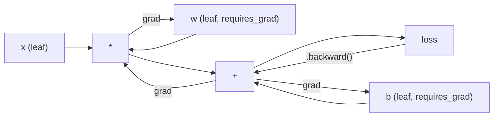
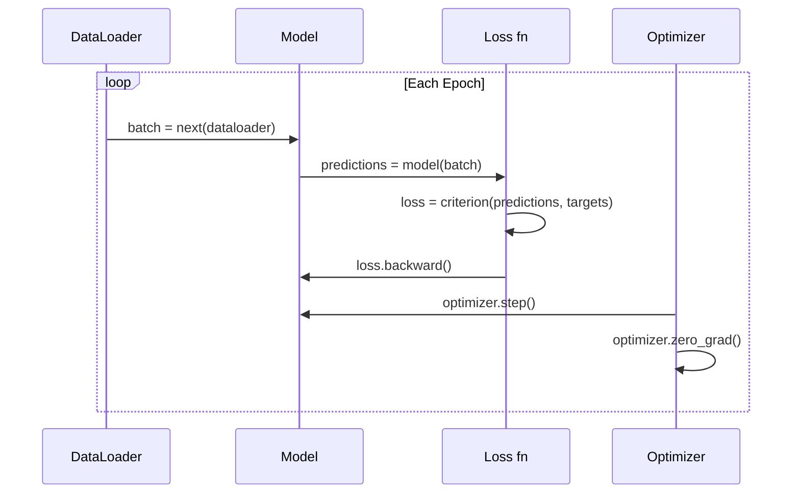

# Pengantar PyTorch

> Kamu membangun mesin dari piston dan kruk as. Kini pelajari yang benar-benar dikendarai semua orang.

**Type:** Build
**Languages:** Python
**Prerequisites:** Lesson 03.10 (Build Your Own Mini Framework)
**Time:** ~75 minutes

## Tujuan Pembelajaran

- Membangun dan melatih neural network memakai nn.Module, nn.Sequential, dan autograd PyTorch
- Memakai tensor PyTorch, akselerasi GPU, dan loop training standar (zero_grad, forward, loss, backward, step)
- Mengonversi komponen mini framework buatanmu ke padanan PyTorch-nya
- Membuat profil dan membandingkan kecepatan training antara framework Python murnimu dan PyTorch pada tugas yang sama

## Masalahnya

Kamu punya mini framework yang bekerja. Linear layer, ReLU, dropout, batch norm, Adam, DataLoader, loop training. Ia melatih network 4 lapis pada masalah klasifikasi lingkaran dalam Python murni.

Ia juga 500x lebih lambat daripada PyTorch pada masalah yang sama.

Mini framework-mu memproses satu sampel sekali waktu dengan loop Python bersarang. PyTorch meneruskan operasi yang sama ke kernel C++/CUDA yang teroptimasi yang berjalan di GPU. Pada satu NVIDIA A100, PyTorch melatih ResNet-50 (25,6M parameter) pada ImageNet (1,28M gambar) dalam sekitar 6 jam. Framework-mu butuh kira-kira 3.000 jam untuk tugas yang sama -- kalau tidak kehabisan memori lebih dulu.

Kecepatan bukan satu-satunya kesenjangan. Framework-mu tidak punya dukungan GPU. Tidak ada diferensiasi otomatis -- kamu menulis backward() manual untuk setiap modul. Tidak ada serialisasi. Tidak ada distributed training. Tidak ada mixed precision. Tidak ada cara men-debug aliran gradien tanpa print statement.

PyTorch mengisi setiap kesenjangan ini. Dan ia melakukannya sambil menjaga model mental yang persis sama yang sudah kamu bangun: Module, forward(), parameters(), backward(), optimizer.step(). Konsepnya berpindah satu-satu. Sintaksnya nyaris identik. Perbedaannya adalah PyTorch membungkus satu dekade rekayasa sistem di balik interface yang sama yang kamu rancang dari nol.

## Konsepnya

### Mengapa PyTorch Menang

Pada 2015, TensorFlow mengharuskanmu mendefinisikan static computation graph sebelum menjalankan apa pun. Kamu membangun graf, mengompilasinya, lalu memberi data melaluinya. Debugging berarti menatap visualisasi graf. Mengubah arsitektur berarti membangun ulang graf dari nol.

PyTorch meluncur pada 2017 dengan filosofi berbeda: eager execution. Kamu menulis Python. Ia langsung berjalan. `y = model(x)` benar-benar menghitung y sekarang, bukan "tambahkan node ke graf yang akan menghitung y nanti." Artinya tool debugging Python standar bekerja. print() bekerja. pdb bekerja. if/else dalam forward pass-mu bekerja.

Pada 2020, pasar sudah bersuara. Pangsa PyTorch dalam makalah riset ML naik dari 7% (2017) menjadi lebih dari 75% (2022). Meta, Google DeepMind, OpenAI, Anthropic, dan Hugging Face semuanya memakai PyTorch sebagai framework utama. TensorFlow 2.x mengadopsi eager execution sebagai respons -- pengakuan diam-diam bahwa desain PyTorch benar.

Pelajaran: pengalaman developer berlipat ganda. Framework yang 10% lebih lambat tetapi 50% lebih cepat di-debug menang setiap kali.

### Tensor

Tensor adalah array multi-dimensi dengan tiga properti krusial: shape, dtype, dan device.

```python
import torch

x = torch.zeros(3, 4)           # shape: (3, 4), dtype: float32, device: cpu
x = torch.randn(2, 3, 224, 224) # batch of 2 RGB images, 224x224
x = torch.tensor([1, 2, 3])     # from a Python list
```

**Shape** adalah dimensionalitas. Skalar berbentuk (), vektor (n,), matriks (m, n), batch gambar (batch, channels, height, width).

**Dtype** mengendalikan presisi dan memori.

| dtype | Bits | Range | Use case |
|-------|------|-------|----------|
| float32 | 32 | ~7 decimal digits | Default training |
| float16 | 16 | ~3.3 decimal digits | Mixed precision |
| bfloat16 | 16 | Same range as float32, less precision | LLM training |
| int8 | 8 | -128 to 127 | Quantized inference |

**Device** menentukan di mana komputasi terjadi.

```python
device = torch.device("cuda" if torch.cuda.is_available() else "cpu")
x = torch.randn(3, 4, device=device)
x = x.to("cuda")
x = x.cpu()
```

Setiap operasi mengharuskan semua tensor pada device yang sama. Ini error PyTorch #1 yang dialami pemula: `RuntimeError: Expected all tensors to be on the same device`. Perbaiki dengan memindahkan semuanya ke device yang sama sebelum komputasi.

**Reshaping** bersifat constant-time -- ia mengubah metadata, bukan data.

```python
x = torch.randn(2, 3, 4)
x.view(2, 12)      # reshape to (2, 12) -- must be contiguous
x.reshape(6, 4)    # reshape to (6, 4) -- works always
x.permute(2, 0, 1) # reorder dimensions
x.unsqueeze(0)     # add dimension: (1, 2, 3, 4)
x.squeeze()        # remove size-1 dimensions
```

### Autograd

Mini framework-mu mengharuskanmu mengimplementasikan backward() untuk setiap modul. PyTorch tidak. Ia merekam setiap operasi pada tensor ke directed acyclic graph (computational graph) lalu menelusuri graf itu secara terbalik untuk menghitung gradien otomatis.



Perbedaan kunci dari framework-mu: PyTorch memakai autodiff berbasis tape. Setiap operasi ditambahkan ke "tape" selama forward pass. Memanggil `.backward()` memutar ulang tape secara terbalik.

```python
x = torch.randn(3, requires_grad=True)
y = x ** 2 + 3 * x
z = y.sum()
z.backward()
print(x.grad)  # dz/dx = 2x + 3
```

Tiga aturan autograd:

1. Hanya tensor leaf dengan `requires_grad=True` yang mengakumulasi gradien
2. Gradien terakumulasi secara default -- panggil `optimizer.zero_grad()` sebelum setiap backward pass
3. `torch.no_grad()` mematikan pelacakan gradien (pakai selama evaluasi)

### nn.Module

`nn.Module` adalah kelas dasar untuk setiap komponen neural network di PyTorch. Kamu sudah membangun abstraksi ini di Pelajaran 10. Versi PyTorch menambahkan registrasi parameter otomatis, penemuan modul rekursif, manajemen device, dan serialisasi state dict.

```python
import torch.nn as nn

class MLP(nn.Module):
    def __init__(self, input_dim, hidden_dim, output_dim):
        super().__init__()
        self.layer1 = nn.Linear(input_dim, hidden_dim)
        self.relu = nn.ReLU()
        self.layer2 = nn.Linear(hidden_dim, output_dim)

    def forward(self, x):
        x = self.layer1(x)
        x = self.relu(x)
        x = self.layer2(x)
        return x
```

Saat kamu menetapkan `nn.Module` atau `nn.Parameter` sebagai atribut di `__init__`, PyTorch otomatis mendaftarkannya. `model.parameters()` mengumpulkan rekursif setiap parameter terdaftar. Inilah mengapa kamu tidak pernah harus mengumpulkan bobot manual seperti di mini framework.

Building block kunci:

| Module | What it does | Parameters |
|--------|-------------|------------|
| nn.Linear(in, out) | Wx + b | in*out + out |
| nn.Conv2d(in_ch, out_ch, k) | 2D convolution | in_ch*out_ch*k*k + out_ch |
| nn.BatchNorm1d(features) | Normalize activations | 2 * features |
| nn.Dropout(p) | Random zeroing | 0 |
| nn.ReLU() | max(0, x) | 0 |
| nn.GELU() | Gaussian error linear | 0 |
| nn.Embedding(vocab, dim) | Lookup table | vocab * dim |
| nn.LayerNorm(dim) | Per-sample normalization | 2 * dim |

### Fungsi Loss dan Optimizer

PyTorch menyediakan versi siap-produksi dari semua yang kamu bangun.

**Fungsi loss** (dari `torch.nn`):

| Loss | Task | Input |
|------|------|-------|
| nn.MSELoss() | Regression | Any shape |
| nn.CrossEntropyLoss() | Multi-class classification | Logits (not softmax) |
| nn.BCEWithLogitsLoss() | Binary classification | Logits (not sigmoid) |
| nn.L1Loss() | Regression (robust) | Any shape |
| nn.CTCLoss() | Sequence alignment | Log probabilities |

Catatan: `CrossEntropyLoss` menggabungkan `LogSoftmax` + `NLLLoss` secara internal. Berikan logit mentah, bukan output softmax. Ini kesalahan umum yang menghasilkan gradien salah secara diam-diam.

**Optimizer** (dari `torch.optim`):

| Optimizer | When to use | Typical LR |
|-----------|-------------|-----------|
| SGD(params, lr, momentum) | CNNs, well-tuned pipelines | 0.01--0.1 |
| Adam(params, lr) | Default starting point | 1e-3 |
| AdamW(params, lr, weight_decay) | Transformers, fine-tuning | 1e-4--1e-3 |
| LBFGS(params) | Small-scale, second-order | 1.0 |

### Loop Training

Setiap loop training PyTorch mengikuti pola 5 langkah yang sama. Kamu sudah tahu ini dari Pelajaran 10.



Pola kanonis:

```python
for epoch in range(num_epochs):
    model.train()
    for inputs, targets in train_loader:
        inputs, targets = inputs.to(device), targets.to(device)
        optimizer.zero_grad()
        outputs = model(inputs)
        loss = criterion(outputs, targets)
        loss.backward()
        optimizer.step()
```

Lima baris di dalam loop batch. Lima baris yang melatih GPT-4, Stable Diffusion, dan LLaMA. Arsitektur berubah. Data berubah. Lima baris ini tidak.

### Dataset dan DataLoader

`Dataset` PyTorch adalah kelas abstrak dengan dua metode: `__len__` dan `__getitem__`. `DataLoader` membungkusnya dengan batching, shuffling, dan pemuatan data multi-proses.

```python
from torch.utils.data import Dataset, DataLoader

class MNISTDataset(Dataset):
    def __init__(self, images, labels):
        self.images = images
        self.labels = labels

    def __len__(self):
        return len(self.labels)

    def __getitem__(self, idx):
        return self.images[idx], self.labels[idx]

loader = DataLoader(dataset, batch_size=64, shuffle=True, num_workers=4)
```

`num_workers=4` memunculkan 4 proses untuk memuat data paralel sementara GPU melatih batch saat ini. Pada workload yang bound ke disk (gambar besar, audio), ini saja bisa menggandakan kecepatan training.

### Training GPU

Memindahkan model ke GPU:

```python
device = torch.device("cuda" if torch.cuda.is_available() else "cpu")
model = model.to(device)
```

Ini memindahkan rekursif setiap parameter dan buffer ke GPU. Lalu pindahkan setiap batch selama training:

```python
inputs, targets = inputs.to(device), targets.to(device)
```

**Mixed precision** membelah dua pemakaian memori dan menggandakan throughput pada GPU modern (A100, H100, RTX 4090) dengan menjalankan forward/backward dalam float16 sambil menjaga bobot master dalam float32:

```python
from torch.amp import autocast, GradScaler

scaler = GradScaler()
for inputs, targets in loader:
    with autocast(device_type="cuda"):
        outputs = model(inputs)
        loss = criterion(outputs, targets)
    scaler.scale(loss).backward()
    scaler.step(optimizer)
    scaler.update()
    optimizer.zero_grad()
```

### Perbandingan: Mini Framework vs PyTorch vs JAX

| Feature | Mini Framework (L10) | PyTorch | JAX |
|---------|---------------------|---------|-----|
| Autodiff | Manual backward() | Tape-based autograd | Functional transforms |
| Execution | Eager (Python loops) | Eager (C++ kernels) | Traced + JIT compiled |
| GPU support | No | Yes (CUDA, ROCm, MPS) | Yes (CUDA, TPU) |
| Speed (MNIST MLP) | ~300s/epoch | ~0.5s/epoch | ~0.3s/epoch |
| Module system | Custom Module class | nn.Module | Stateless functions (Flax/Equinox) |
| Debugging | print() | print(), pdb, breakpoint() | Harder (JIT tracing breaks print) |
| Ecosystem | None | Hugging Face, Lightning, timm | Flax, Optax, Orbax |
| Learning curve | You built it | Moderate | Steep (functional paradigm) |
| Production use | Toy problems | Meta, OpenAI, Anthropic, HF | Google DeepMind, Midjourney |

```figure
dropout-mask
```

## Bangun Sendiri

MLP 3 lapis yang dilatih pada MNIST hanya memakai primitif PyTorch. Tanpa wrapper tingkat tinggi. Tanpa `torchvision.datasets`. Kita mengunduh dan memparsing data mentah sendiri.

### Langkah 1: Muat MNIST dari File Mentah

MNIST dikirim sebagai 4 file gzip: gambar training (60.000 x 28 x 28), label training, gambar uji (10.000 x 28 x 28), label uji. Kita mengunduhnya dan memparsing format biner.

```python
import torch
import torch.nn as nn
import struct
import gzip
import urllib.request
import os

def download_mnist(path="./mnist_data"):
    base_url = "https://storage.googleapis.com/cvdf-datasets/mnist/"
    files = [
        "train-images-idx3-ubyte.gz",
        "train-labels-idx1-ubyte.gz",
        "t10k-images-idx3-ubyte.gz",
        "t10k-labels-idx1-ubyte.gz",
    ]
    os.makedirs(path, exist_ok=True)
    for f in files:
        filepath = os.path.join(path, f)
        if not os.path.exists(filepath):
            urllib.request.urlretrieve(base_url + f, filepath)

def load_images(filepath):
    with gzip.open(filepath, "rb") as f:
        magic, num, rows, cols = struct.unpack(">IIII", f.read(16))
        data = f.read()
        images = torch.frombuffer(bytearray(data), dtype=torch.uint8)
        images = images.reshape(num, rows * cols).float() / 255.0
    return images

def load_labels(filepath):
    with gzip.open(filepath, "rb") as f:
        magic, num = struct.unpack(">II", f.read(8))
        data = f.read()
        labels = torch.frombuffer(bytearray(data), dtype=torch.uint8).long()
    return labels
```

### Langkah 2: Definisikan Model

MLP 3 lapis: 784 -> 256 -> 128 -> 10. Aktivasi ReLU. Dropout untuk regularisasi. Tanpa batch norm agar sederhana.

```python
class MNISTModel(nn.Module):
    def __init__(self):
        super().__init__()
        self.net = nn.Sequential(
            nn.Linear(784, 256),
            nn.ReLU(),
            nn.Dropout(0.2),
            nn.Linear(256, 128),
            nn.ReLU(),
            nn.Dropout(0.2),
            nn.Linear(128, 10),
        )

    def forward(self, x):
        return self.net(x)
```

Output layer menghasilkan 10 logit mentah (satu per digit). Tanpa softmax -- `CrossEntropyLoss` menanganinya secara internal.

Jumlah parameter: 784*256 + 256 + 256*128 + 128 + 128*10 + 10 = 235.146. Kecil menurut standar modern. GPT-2 small punya 124M. Ini berlatih dalam hitungan detik.

### Langkah 3: Loop Training

Pola kanonis forward-loss-backward-step.

```python
def train_one_epoch(model, loader, criterion, optimizer, device):
    model.train()
    total_loss = 0
    correct = 0
    total = 0
    for images, labels in loader:
        images, labels = images.to(device), labels.to(device)
        optimizer.zero_grad()
        outputs = model(images)
        loss = criterion(outputs, labels)
        loss.backward()
        optimizer.step()
        total_loss += loss.item() * images.size(0)
        _, predicted = outputs.max(1)
        correct += predicted.eq(labels).sum().item()
        total += labels.size(0)
    return total_loss / total, correct / total


def evaluate(model, loader, criterion, device):
    model.eval()
    total_loss = 0
    correct = 0
    total = 0
    with torch.no_grad():
        for images, labels in loader:
            images, labels = images.to(device), labels.to(device)
            outputs = model(images)
            loss = criterion(outputs, labels)
            total_loss += loss.item() * images.size(0)
            _, predicted = outputs.max(1)
            correct += predicted.eq(labels).sum().item()
            total += labels.size(0)
    return total_loss / total, correct / total
```

Perhatikan `torch.no_grad()` selama evaluasi. Ini mematikan autograd, mengurangi pemakaian memori dan mempercepat inference. Tanpanya, PyTorch membangun computational graph yang tidak pernah kamu pakai.

### Langkah 4: Rangkai Semuanya

```python
def main():
    device = torch.device("cuda" if torch.cuda.is_available() else "cpu")

    download_mnist()
    train_images = load_images("./mnist_data/train-images-idx3-ubyte.gz")
    train_labels = load_labels("./mnist_data/train-labels-idx1-ubyte.gz")
    test_images = load_images("./mnist_data/t10k-images-idx3-ubyte.gz")
    test_labels = load_labels("./mnist_data/t10k-labels-idx1-ubyte.gz")

    train_dataset = torch.utils.data.TensorDataset(train_images, train_labels)
    test_dataset = torch.utils.data.TensorDataset(test_images, test_labels)
    train_loader = torch.utils.data.DataLoader(
        train_dataset, batch_size=64, shuffle=True
    )
    test_loader = torch.utils.data.DataLoader(
        test_dataset, batch_size=256, shuffle=False
    )

    model = MNISTModel().to(device)
    criterion = nn.CrossEntropyLoss()
    optimizer = torch.optim.Adam(model.parameters(), lr=1e-3)

    num_params = sum(p.numel() for p in model.parameters())
    print(f"Device: {device}")
    print(f"Parameters: {num_params:,}")
    print(f"Train samples: {len(train_dataset):,}")
    print(f"Test samples: {len(test_dataset):,}")
    print()

    for epoch in range(10):
        train_loss, train_acc = train_one_epoch(
            model, train_loader, criterion, optimizer, device
        )
        test_loss, test_acc = evaluate(
            model, test_loader, criterion, device
        )
        print(
            f"Epoch {epoch+1:2d} | "
            f"Train Loss: {train_loss:.4f} | Train Acc: {train_acc:.4f} | "
            f"Test Loss: {test_loss:.4f} | Test Acc: {test_acc:.4f}"
        )

    torch.save(model.state_dict(), "mnist_mlp.pt")
    print(f"\nModel saved to mnist_mlp.pt")
    print(f"Final test accuracy: {test_acc:.4f}")
```

Output harapan setelah 10 epoch: ~97,8% akurasi uji. Waktu training di CPU: ~30 detik. Di GPU: ~5 detik. Pada mini framework-mu dengan arsitektur yang sama: ~45 menit.

## Gunakan

### Perbandingan Cepat: Mini Framework vs PyTorch

| Mini Framework (Lesson 10) | PyTorch |
|---------------------------|---------|
| `model = Sequential(Linear(784, 256), ReLU(), ...)` | `model = nn.Sequential(nn.Linear(784, 256), nn.ReLU(), ...)` |
| `pred = model.forward(x)` | `pred = model(x)` |
| `optimizer.zero_grad()` | `optimizer.zero_grad()` |
| `grad = criterion.backward()` then `model.backward(grad)` | `loss.backward()` |
| `optimizer.step()` | `optimizer.step()` |
| No GPU | `model.to("cuda")` |
| Manual backward for every module | Autograd handles everything |

Interface-nya nyaris identik. Perbedaannya adalah semua yang ada di baliknya.

### Menyimpan dan Memuat Model

```python
torch.save(model.state_dict(), "model.pt")

model = MNISTModel()
model.load_state_dict(torch.load("model.pt", weights_only=True))
model.eval()
```

Selalu simpan `state_dict()` (kamus parameter), bukan objek model. Menyimpan objek model memakai pickle, yang rusak saat kamu merefaktor kode. State dict portabel.

### Scheduling Learning Rate

```python
scheduler = torch.optim.lr_scheduler.CosineAnnealingLR(
    optimizer, T_max=10
)
for epoch in range(10):
    train_one_epoch(model, train_loader, criterion, optimizer, device)
    scheduler.step()
```

PyTorch menyediakan 15+ scheduler: StepLR, ExponentialLR, CosineAnnealingLR, OneCycleLR, ReduceLROnPlateau. Semuanya dicolok ke interface optimizer yang sama.

## Rilis

Pelajaran ini menghasilkan dua artefak:

- `outputs/prompt-pytorch-debugger.md` -- prompt untuk mendiagnosis kegagalan training PyTorch yang umum
- `outputs/skill-pytorch-patterns.md` -- referensi skill untuk pola training PyTorch

## Latihan

1. **Tambahkan batch normalization.** Sisipkan `nn.BatchNorm1d` setelah setiap linear layer (sebelum aktivasi). Bandingkan akurasi uji dan kecepatan training vs versi hanya-dropout. Batch norm seharusnya mencapai 98%+ dalam epoch lebih sedikit.
2. **Implementasikan pencari learning rate.** Latih satu epoch dengan learning rate yang naik eksponensial (dari 1e-7 ke 1,0). Plot loss vs LR. LR optimal tepat sebelum loss mulai menanjak. Pakai ini untuk memilih LR yang lebih baik untuk model MNIST.
3. **Port ke GPU dengan mixed precision.** Tambahkan `torch.amp.autocast` dan `GradScaler` ke loop training. Ukur throughput (sampel/detik) dengan dan tanpa mixed precision di GPU. Pada A100, harapkan speedup ~2x.
4. **Bangun Dataset kustom.** Unduh Fashion-MNIST (format sama dengan MNIST tetapi berisi item pakaian). Implementasikan kelas `FashionMNISTDataset(Dataset)` dengan `__getitem__` dan `__len__`. Latih MLP yang sama dan bandingkan akurasi. Fashion-MNIST lebih sulit -- harapkan ~88% vs ~98%.
5. **Ganti Adam dengan SGD + momentum.** Latih dengan `SGD(params, lr=0,01, momentum=0,9)`. Bandingkan kurva konvergensi. Lalu tambahkan scheduler `CosineAnnealingLR` dan lihat apakah SGD mengejar Adam pada epoch 10.

## Istilah Kunci

| Term | What people say | What it actually means |
|------|----------------|----------------------|
| Tensor | "A multi-dimensional array" | A typed, device-aware array with automatic differentiation support baked into every operation |
| Autograd | "Automatic backprop" | A tape-based system that records operations during forward pass, then replays them in reverse to compute exact gradients |
| nn.Module | "A layer" | The base class for any differentiable computation block -- registers parameters, supports nesting, handles train/eval modes |
| state_dict | "The model weights" | An OrderedDict mapping parameter names to tensors -- the portable, serializable representation of a trained model |
| .backward() | "Compute gradients" | Traverse the computational graph in reverse, computing and accumulating gradients for every leaf tensor with requires_grad=True |
| .to(device) | "Move to GPU" | Recursively transfer all parameters and buffers to the specified device (CPU, CUDA, MPS) |
| DataLoader | "The data pipeline" | An iterator that batches, shuffles, and optionally parallelizes data loading from a Dataset |
| Mixed precision | "Use float16" | Train with float16 forward/backward for speed while keeping float32 master weights for numerical stability |
| Eager execution | "Run it now" | Operations execute immediately when called, not deferred to a later compilation step -- the core design choice that differentiates PyTorch from TF 1.x |
| zero_grad | "Reset gradients" | Set all parameter gradients to zero before the next backward pass, since PyTorch accumulates gradients by default |

## Bacaan Lanjutan

- Paszke et al., "PyTorch: An Imperative Style, High-Performance Deep Learning Library" (2019) -- makalah orisinal yang menjelaskan tradeoff desain PyTorch
- PyTorch Tutorials: "Learning PyTorch with Examples" (https://pytorch.org/tutorials/beginner/pytorch_with_examples.html) -- jalur resmi dari tensor ke nn.Module
- PyTorch Performance Tuning Guide (https://pytorch.org/tutorials/recipes/recipes/tuning_guide.html) -- mixed precision, worker DataLoader, pinned memory, dan optimasi produksi lainnya
- Horace He, "Making Deep Learning Go Brrrr" (https://horace.io/brrr_intro.html) -- mengapa training GPU cepat, dengan strategi optimasi spesifik PyTorch
